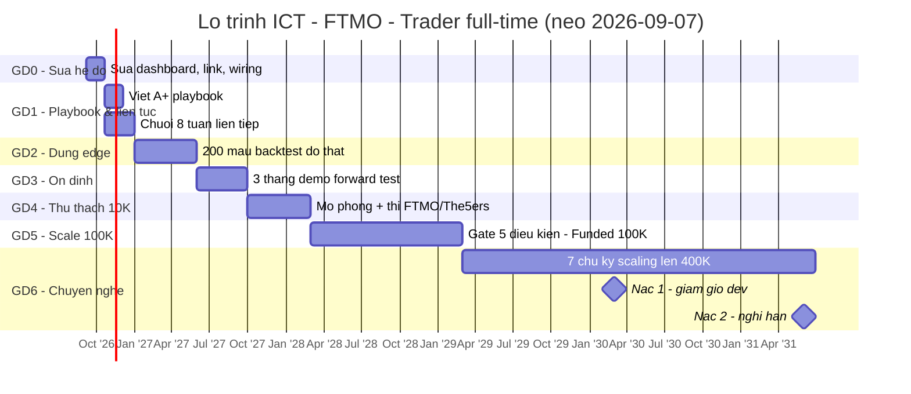

# 🗺️ Lộ Trình Giao Dịch — từ hôm nay đến trader full-time

> Bức tranh tổng thể và là **nguồn sự thật duy nhất**. Mỗi **giai đoạn (phase)** là một chương phát triển; mục tiêu gắn vào giai đoạn qua field `phase:`. Chi tiết thi hành nằm ở [[03 - Lộ trình chi tiết - Từ số 0 đến Funded 100K]]. Phương pháp luyện tập nằm ở [[04 - Phương pháp luyện tập, vòng lặp AI & giữ động lực]].
>
> **Neo thời gian: 2026-09-07.** Ngân sách giả định **25h/tuần**, trong đó tối đa **3–4h/ngày luyện tập sâu** (giới hạn sinh học, không phải giới hạn ý chí).

> [!warning] Nguyên tắc chuyển giai đoạn
> **Không nhảy cóc.** Mỗi gate là điều kiện cứng, đo bằng số liệu thật — không chuyển giai đoạn chỉ vì hết thời gian dự kiến. Trượt gate → ở lại thêm 4 tuần rồi kiểm tra lại.

## Các giai đoạn tổng quan

| Giai đoạn | Chủ đề | Mốc | Gate thoát |
|---|---|---|---|
| **GĐ0 – Sửa hệ đo** | Dữ liệu đáng tin trước đã | 2026-09 → 2026-10 | Dashboard render đúng; 0 lệnh trùng; 0 link hỏng; mọi goal khớp phase |
| **GĐ1 – Playbook & liên tục** | Viết luật + phá kỷ lục chuỗi | 2026-10 → 2026-12 | A+ playbook xong; 3 xung đột định nghĩa đã phân xử; **8 tuần liên tiếp ≥5 ngày có log** |
| **GĐ2 – Dựng edge** | 200 mẫu **đo thật** | 2027-01 → 2027-05 | 200 mẫu NAS100+EURUSD có `r_net`; expectancy ≥ +0.3R trên 100 mẫu gần nhất |
| **GĐ3 – Ổn định** | Forward test demo | 2027-06 → 2027-09 | 3 tháng liên tiếp ≥+1%, max DD <4%, `risk_percent ≤ 0.5` ở **100%** lệnh |
| **GĐ4 – Thử thách** | Mô phỏng + thi gói 10K | 2027-10 → 2028-02 | Funded FTMO 10K + The5ers 10K |
| **GĐ5 – Scale 100K** | Gate 5 điều kiện → 100K | 2028-03 → 2029-02 | Funded 100K + payout đầu tiên |
| **GĐ6 – Chuyển nghề** | Scale $400K → full-time | 2029-03 → 2031 | 7 chu kỳ scaling; đạt Nấc 1 rồi Nấc 2 |

> [!important] Chỉ nửa đầu phản ứng với việc làm nhiều hơn
> GĐ0–GĐ2 rút ngắn được bằng giờ công. **GĐ1 (8 tuần chuỗi), GĐ3 (3 tháng demo), GĐ5 (payout + 3 tháng lãi), GĐ6 (7 × 4 tháng) bị khoá bởi lịch, không bởi nỗ lực.** Tăng từ 25h lên 60h/tuần chỉ mua được ~2–3 tháng trên tổng ~52 tháng — xem phân tích ở [[04 - Phương pháp luyện tập, vòng lặp AI & giữ động lực]].

## Bộ sản phẩm đã chốt

**Chỉ NAS100 + EURUSD** cho toàn lộ trình. Hệ quả: trong 22 note backtest hiện có, chỉ **14 nằm trong phạm vi** (GBPUSD 4 + XAUUSD 4 bị loại) — và vì cột R đang ghi kế hoạch chứ không phải kết quả, số mẫu **đã đo thật ≈ 0**.

---

## GĐ0 — Sửa hệ đo · 2026-09 → 2026-10
**Mục tiêu:** Không đặt gate mới lên số liệu hỏng.

- Dashboard đọc đúng đường dẫn; bỏ bịa ±1R cho lệnh thiếu `r_multiple`.
- Gỡ trùng lệnh live/backtest; chốt một bản live journal duy nhất.
- Sửa link hỏng toàn vault; sửa dây `phase:` cho goal note.

```dataview
TABLE horizon AS "Kỳ hạn", status AS "Trạng thái", progress + "%" AS "Tiến độ", due_date AS "Hạn"
FROM "09 - Goal Tracking/Goals"
WHERE type = "goal" AND contains(phase, "Phase 0")
SORT priority DESC
```

## GĐ1 — Playbook & khôi phục tính liên tục · 2026-10 → 2026-12
**Mục tiêu:** Viết luật xuống thành văn bản nhị phân, và phá kỷ lục chuỗi 6 ngày.

- **Viết `03 - Playbooks/3.2 - Setups/2022 Model A+ Setup.md`** — hiện file setup là **0 byte**, `ICT 2022 Entry Checklist.md` chỉ có 67 từ. Bottleneck #1.
- **Phân xử 3 xung đột định nghĩa**: MSS vs CHoCH vs CISD · IFVG hai nghĩa · SIBI nhận hai lần. Thu hoạch 12 định nghĩa `CONFIRMED` từ `AI Trading Research Lab/definitions/ict_definitions.json`.
- Tạo 3 note còn thiếu: PD Arrays (MOC), Silver Bullet, `30-Sell-side-Liquidity` (bị link 38 lần từ MMBM/MMSM/Mayne nhưng không tồn tại).
- Chấm 36 bảng `## 13. Mức độ thành thạo` (hiện trống 100% cột điểm).
- **Chỉ số chính: chuỗi tuần, không phải khối lượng.** Định nghĩa "ngày tối thiểu" = 1 replay + 1 dòng log (20 phút) để ngày tệ nhất vẫn không phá chuỗi.

```dataview
TABLE horizon AS "Kỳ hạn", status AS "Trạng thái", progress + "%" AS "Tiến độ", due_date AS "Hạn"
FROM "09 - Goal Tracking/Goals"
WHERE type = "goal" AND contains(phase, "Phase 1")
SORT priority DESC
```

## GĐ2 — Dựng edge · 2027-01 → 2027-05
**Mục tiêu:** Biến "mình nghĩ nó chạy được" thành edge đo được, trên mẫu đủ lớn để tin.

- 200 mẫu theo **quy trình 7 bước**: random start · hard right edge · quyết định ở tốc độ thật · pre-registration (thesis + invalidation + target) · **ghi cả setup bị bỏ qua** · đo exit thật · giữ out-of-sample.
- Một mẫu chỉ được tính khi có `exit_price` đo thật + `spread_cost` + `r_net`.
- Debate vòng 2 mỗi 25 setup — chất vấn cấp batch (survivorship) **trước** per-setup.

```dataview
TABLE horizon AS "Kỳ hạn", status AS "Trạng thái", progress + "%" AS "Tiến độ", due_date AS "Hạn"
FROM "09 - Goal Tracking/Goals"
WHERE type = "goal" AND contains(phase, "Phase 2")
SORT priority DESC
```

## GĐ3 — Ổn định · 2027-06 → 2027-09
**Mục tiêu:** Thực thi edge đã kiểm chứng một cách máy móc, dưới thời gian thực.

- Demo 100K, 3 tháng liên tiếp mỗi tháng ≥ +1%, max DD < 4%.
- **`risk_percent ≤ 0.5` ở 100% lệnh** — gate cơ học. 7/28 lệnh live cũ ghi 5% (gấp 10 lần rule); dưới luật FTMO mức đó kết thúc challenge sau ~2 lệnh thua.
- Điểm tuân thủ quan trọng hơn lợi nhuận.

```dataview
TABLE horizon AS "Kỳ hạn", status AS "Trạng thái", progress + "%" AS "Tiến độ", due_date AS "Hạn"
FROM "09 - Goal Tracking/Goals"
WHERE type = "goal" AND contains(phase, "Phase 3")
SORT priority DESC
```

## GĐ4 — Thử thách quỹ cấp vốn (gói 10K) · 2027-10 → 2028-02
**Mục tiêu:** Chứng minh edge sống được dưới luật quỹ, với học phí tâm lý rẻ.

- Mô phỏng 2 vòng theo đúng luật quỹ trước khi chi tiền thật.
- Pass FTMO 10K (P1 +10% → P2 +5%) và The5ers 10K.
- Gói 10K ≈ €89/lần thay vì €540 — trượt một lần nằm trong kế hoạch, không phải thảm hoạ.

```dataview
TABLE horizon AS "Kỳ hạn", status AS "Trạng thái", progress + "%" AS "Tiến độ", due_date AS "Hạn"
FROM "09 - Goal Tracking/Goals"
WHERE type = "goal" AND contains(phase, "Phase 4")
SORT priority DESC
```

## GĐ5 — Scale lên 100K · 2028-03 → 2029-02
**Mục tiêu:** Nhân edge đã sống sót qua luật quỹ lên vốn 100K. Chỉ mở khoá khi đủ **5 điều kiện gate** (funded cả 2 quỹ 10K · ≥2 payout · 3 tháng lãi liên tiếp · mistake rate thấp ổn định · phí trả bằng lợi nhuận trading).

```dataview
TABLE horizon AS "Kỳ hạn", status AS "Trạng thái", progress + "%" AS "Tiến độ", due_date AS "Hạn"
FROM "09 - Goal Tracking/Goals"
WHERE type = "goal" AND contains(phase, "Phase 5")
SORT priority DESC
```

## GĐ6 — Scale $400K & chuyển nghề · 2029-03 → 2031
**Mục tiêu:** Đưa vốn funded lên mức đủ nuôi sống, rồi rời nghề dev theo tiêu chí khách quan — không theo cảm giác sẵn sàng.

**Toán $10K/tháng:** 100K funded ở split 80% cần **12.5%/tháng** để ròng $10K — không bền vững. Ở mức thực tế 3%/tháng, cần **~$400K vốn funded**.

| Vốn funded | Gộp 3%/tháng | Ròng sau split 90% |
|---|---|---|
| $100K | $3,000 | $2,700 |
| $200K | $6,000 | $5,400 |
| **$400K** | $12,000 | **$10,800** |

FTMO Scaling Plan: +25% vốn/chu kỳ, **tối thiểu 4 tháng/chu kỳ**, cần ≥10% lãi ròng + ≥2 payout trong chu kỳ. Từ 100K lên ~400K = **7 chu kỳ ≈ 28 tháng liên tục có lãi sau khi đã funded**. Đoạn này không rút ngắn được bằng nỗ lực.

**Hai nấc rời nghề dev — tiêu chí khách quan:**

- **Nấc 1 — giảm giờ dev:** ≥12 tháng liên tục payout dương trên ≥2 tài khoản funded · thu nhập trading ≥50% lương dev trong 6 tháng gần nhất · quỹ dự phòng ≥12 tháng chi phí sống **bằng tiền mặt** (không tính vốn funded).
- **Nấc 2 — nghỉ hẳn:** ≥24 tháng liên tục payout dương · thu nhập trading ≥150% lương dev trong 12 tháng gần nhất · vốn funded ≥$300K · không vi phạm luật quỹ trong 24 tháng.

> [!danger] Rủi ro nền phải ghi rõ
> **Vốn funded không phải tài sản của bạn.** Quỹ có thể đổi luật hoặc đóng cửa bất cứ lúc nào. Nấc 2 vì thế yêu cầu **≥2 quỹ độc lập** — không bao giờ để toàn bộ thu nhập phụ thuộc một prop firm.

```dataview
TABLE horizon AS "Kỳ hạn", status AS "Trạng thái", progress + "%" AS "Tiến độ", due_date AS "Hạn"
FROM "09 - Goal Tracking/Goals"
WHERE type = "goal" AND contains(phase, "Phase 6")
SORT priority DESC
```

## Dòng thời gian (trực quan)



## Liên kết
- Dashboard: [[00 - Goal Dashboard]]
- Chỉ số: [[02 - Skill Metrics]]
- Lộ trình chi tiết từng giai đoạn: [[03 - Lộ trình chi tiết - Từ số 0 đến Funded 100K]]
- Phương pháp luyện tập & vòng lặp AI: [[04 - Phương pháp luyện tập, vòng lặp AI & giữ động lực]]
