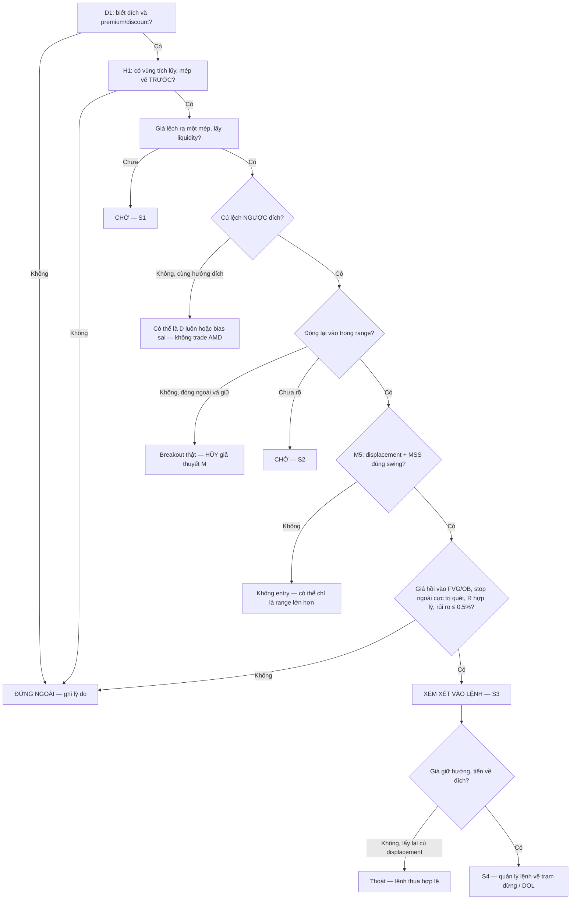

# AMD — Accumulation, Manipulation, Distribution (Power of 3) · v2

> [!summary] Tóm tắt 1 câu
> **AMD (Power of 3) là cách ICT kể lại một chuyển động giá theo ba đoạn — giá chờ trong một vùng (Accumulation), giá lệch ra một phía rồi thua (Manipulation), giá đi thật về phía bên kia (Distribution). Nó là một khung để SẮP XẾP bằng chứng theo đúng thứ tự, không phải một cỗ máy dự đoán giá.**

> [!important] Nguyên tắc cốt lõi của bản v2
> 1. **Cú phá đầu tiên là một CÂU HỎI, không phải câu trả lời.** Nó chỉ thành “Manipulation” khi giá quay về VÀ đi mạnh về phía kia.
> 2. **Chỉ cú lệch NGƯỢC hướng đích (DOL) mới hợp vai Manipulation.** Cú phá cùng hướng đích có thể chính là Distribution.
> 3. **Trong real-time chỉ có ỨNG VIÊN.** “Ứng viên A → ứng viên M → ứng viên D”. Nhãn A/M/D đầy đủ chỉ dán được khi nhìn lại.
> 4. **Chart không cho biết ai làm gì và vì sao.** Mọi câu “Smart Money cố tình…” là diễn giải, không phải quan sát.

> [!abstract] Cách đọc note này — 5 nhãn dùng xuyên suốt
> | Nhãn trong note | Tương ứng protocol | Nghĩa |
> |---|---|---|
> | **[QUAN SÁT]** | Observable market behavior | Thấy trực tiếp trên chart, ai nhìn cũng thấy giống nhau |
> | **[CƠ CHẾ]** | Market mechanics | Giải thích bằng cách lệnh được khớp (market, limit, stop, đấu giá) |
> | **[ICT]** | ICT framework | Tên gọi và cách ICT dùng hiện tượng đó |
> | **[DIỄN GIẢI]** | Interpretation | Hợp lý nhưng không thể xác nhận chỉ từ giá (OHLC) |
> | **[BACKTEST REQUIRED]** | Backtest required | Phải kiểm chứng trên dữ liệu của chính bạn trước khi coi là lợi thế |
>
> Mỗi khái niệm khó đi theo đúng 6 bước: **ELI5 → Ví dụ đời thường → Giá thực sự làm gì → ICT đọc là gì → Vì sao có thể xảy ra → Phản ví dụ.**
> Hình `AMD-v2-*` là **sơ đồ dựng (synthetic)** — giá trong hình là ví dụ, không phải dữ liệu thị trường. Note này **hạn chế số học**: không công thức, không thống kê.

![[AMD-v2-06-Nam-Loai-Thong-Tin.svg|960]]
*Hình AMD-v2-06 — Cùng một sự kiện “giá vượt 100 rồi quay về”, năm câu nói thuộc năm loại sự thật khác nhau. Lỗi phổ biến nhất là đọc câu DIỄN GIẢI như thể nó là QUAN SÁT.*

### Bản đồ trả lời: WHAT → WHY → HOW → MECHANISM → IDENTIFICATION → VALIDATION → APPLICATION → WHEN NOT

| Câu hỏi | Trả lời ở đâu |
|---|---|
| **WHAT** — AMD là gì? | §1, §2, §3 |
| **WHY** — vì sao có hình dạng này? | §4, §5, §9 |
| **HOW** — từng pha hình thành ra sao? | §6, §7, §8 |
| **MECHANISM** — khớp lệnh nói gì? | §5, §7.2, §11 |
| **IDENTIFICATION** — nhận ra khi đang diễn ra? | §19 (quan trọng nhất), §22 |
| **VALIDATION** — khi nào đủ bằng chứng, khi nào hủy? | §7.4, §8.4, §20 |
| **APPLICATION** — dùng trong D1 → H1 → M5? | §18, §23 |
| **WHEN NOT** — khi nào bỏ qua? | §6.5, §17, §20, §27 |

> [!info] v1 → v2: thay đổi gì (theo quy ước versioning)
> | OLD (v1, 2026-10-08) | NEW (v2) | Lý do | Backtest? |
> |---|---|---|---|
> | “Mọi cú phá đầu tiên mặc định là Judas” | Cú phá đầu tiên là **sự kiện**. Chỉ cú phá **ngược đích** mới là ứng viên M; cú phá **cùng hướng đích** có thể là D | Luật cũ quá rộng, mâu thuẫn với chính “Model C” của v1 và Case D (§23) | Có |
> | Range Á vượt một ngưỡng % ADR → bỏ | Diễn đạt định tính: “hộp đã nuốt phần lớn biên độ ngày → bỏ”; ngưỡng số giữ ở dạng HEURISTIC chờ kiểm chứng | Yêu cầu hạn chế số học; ngưỡng chưa được kiểm chứng | Có |
> | Cơ chế “TWAP/VWAP gom thật, không phải ẩn dụ”, “dealer hedging tạo hình V” | Hạ xuống **[DIỄN GIẢI]** | Không thể suy ra từ OHLC; là câu chuyện hợp lý, không phải quan sát | Không kiểm được bằng chart |
> | Flashcard “Asia = A, London = M, NY = D” | “Hình mẫu hay được kể”, không phải lịch hẹn; một ngày có thể 0, 1, 2 chu kỳ | Tránh biến quan sát thường gặp thành quy luật | Có |
> | Phần định nghĩa thuật toán & thống kê (§44–§50 v1) | Bỏ khỏi note này | Yêu cầu: không công thức, không thống kê. Bản v1 còn nguyên trong file backup | — |
> | `common_mistakes` trỏ tới note không tồn tại | Trỏ tới các note thật trong `06 - Mistake Database` | Sửa link hỏng | — |

---

## 1. Executive Summary

- **AMD là gì.** [ICT] Power of 3 (PO3) là mô hình ICT dùng để kể chuyện bên trong một cây nến (ngày, tuần, phiên): giá **chờ** quanh giá mở cửa (Accumulation), **lệch** về một phía để tạo cực trị “sai” (Manipulation), rồi **chạy** về phía thật và đóng gần cực trị bên kia (Distribution). Với nến ngày tăng: Open → Low trước → High sau → Close gần High.
- **Ba pha liên hệ thế nào.** Pha trước không *bắt buộc* pha sau xảy ra. Nó chỉ tạo **điều kiện**: Accumulation tạo ra mốc (mép) nơi lệnh chờ tụ lại; Manipulation dùng hết lệnh chờ ở một phía và có thể để lại người bị kẹt; Distribution là khi phía kia thắng thế và giá phải đi xa để tìm người khớp (§9).
- **Điều quan sát được** [QUAN SÁT]: đi ngang → phá mép → quay vào → đi mạnh ngược lại. **Điều không quan sát được** [DIỄN GIẢI]: ai làm, có cố tình hay không.
- **Cơ chế thật sự có cơ sở** [CƠ CHẾ]: lệnh stop thức dậy thành lệnh thị trường khi giá chạm; lệnh hay tụ quanh mốc rõ. Nhưng nghiên cứu lệnh FX cho thấy lệnh stop thường làm xu hướng **mạnh thêm**, nên “quét stop” tự nó **không** phải lý do để đoán đảo chiều (§7.2).
- **Giá trị thực dụng lớn nhất**: một bộ lọc chống đuổi cú phá đầu tiên + một trình tự bằng chứng (sweep → reclaim → MSS → displacement → FVG) + một chỗ đặt stop rõ ràng (ngoài cực trị cú lệch).
- **Giới hạn lớn nhất**: hindsight. AMD trông hiển nhiên khi nhìn lại; trong real-time luôn có ít nhất ba tương lai (Hình AMD-v2-03). Lợi thế giao dịch của AMD là **[BACKTEST REQUIRED]** — định nghĩa của nó không chứng minh nó có lợi thế.
- **Khi nào bỏ AMD**: không có vùng tích lũy rõ, hộp quá rộng, ngày tin lớn, không xác định được đích, cú phá đầu tiên cùng hướng đích, quét cả hai phía, ngoài killzone, đã chạm giới hạn lỗ (§27).

---

## 2. AMD giải thích cho trẻ 5 tuổi — Chuyện khu chợ

### 2.1 Câu chuyện

Hãy tưởng tượng một khu chợ bán một món đồ. Cả buổi sáng, giá món đồ cứ dao động giữa **90 và 100**. Lúc thì có người mua ở 95, lúc thì có người bán ở 96. Giá lên xuống, lên xuống, nhưng không đi xa khỏi cái “hộp” 90–100.

Rồi đột nhiên:

1. Giá vọt lên **103**.
2. Nhiều người reo: “Lên rồi! Lên nữa!” và vội mua.
3. Nhưng ở 103, **không còn ai muốn mua thêm** — mà người muốn bán thì có. Giá không đứng được.
4. Giá tụt lại **dưới 100**. Ai mua ở 101–103 bây giờ đang lỗ.
5. Họ vội bán để thoát. Thêm người bán, ít người mua → giá rơi mạnh xuống **85**.

![[AMD-v2-01-ELI5-Khu-Cho.svg|960]]
*Hình AMD-v2-01 — Chuyện khu chợ vẽ thành chart. Năm số tròn tương ứng năm bước của câu chuyện.*

### 2.2 Ghép câu chuyện với ba chữ A, M, D

| Đoạn chuyện | Tên ICT | Nói như với trẻ 5 tuổi |
|---|---|---|
| Giá qua lại 90–100 | **Accumulation** (Tích lũy) | “Mọi người còn đang trả giá. Chưa ai thắng.” |
| Vọt lên 103 rồi tụt về dưới 100 | **Manipulation** (Thao túng) | “Một cú chạy làm nhiều người tin nhầm.” |
| Rơi mạnh xuống 85 | **Distribution** (Phân phối) | “Giá đi thật về một phía.” |

### 2.3 Trả lời từng câu hỏi bằng câu chuyện

- **Vì sao giá đi ngang 90–100?** Vì người muốn mua và người muốn bán gần như bằng nhau. Mỗi khi giá lên gần 100, có người bán; mỗi khi giá xuống gần 90, có người mua. Như hai bạn kéo co ngang sức: sợi dây rung qua lại nhưng không bên nào kéo được xa.
- **Chuyện gì xảy ra với người mua khi giá vượt 100?** Có hai nhóm. Nhóm 1: người đã *bán* ở 98–99 và đặt “chốt chặn lỗ” ở 101 — khi giá lên 101, lệnh này bắt họ phải *mua lại*. Nhóm 2: người thích “mua khi phá đỉnh” đặt lệnh mua chờ ở 101. Cả hai nhóm cùng mua một lúc → giá nhảy lên 103. Đến khi giá quay về dưới 100, những người vừa mua ở 101–103 đang lỗ (Hình AMD-v2-02).
- **Liquidity hình thành ở đâu?** Ở **ngay bên ngoài mép hộp**: trên 100 (lệnh mua đang chờ) và dưới 90 (lệnh bán đang chờ). Liquidity, nói kiểu trẻ con, là “chỗ có nhiều người đang đứng chờ để mua hoặc bán khi giá chạm tới”.
- **Vì sao cú lên 103 không nhất thiết là breakout thật?** Vì cú lên đó có thể chỉ là *những người đang chờ* đồng loạt bấm mua. Khi họ mua xong, nếu **không có người mua mới** đến, giá không còn ai đẩy. Một breakout thật cần người mua mới tiếp tục đến *sau* cú phá.

![[AMD-v2-02-ELI5-Ai-Bi-Ket.svg|960]]
*Hình AMD-v2-02 — Ba khoảnh khắc: lệnh chờ đang ngủ → lệnh chờ thức dậy đẩy giá lên 103 → người mua đuổi bị kẹt, chốt lỗ của họ thành lệnh bán.*

> [!warning] Câu chuyện là để HIỂU, không phải để TIN
> Đây là ví dụ minh họa cách đọc mô hình, **không phải bằng chứng** rằng thị trường luôn có một nhóm người cố tình đẩy giá lên 103 để bẫy người khác. Cùng hình dạng đó có thể xảy ra mà không ai “âm mưu” gì: chỉ cần người mua đến hết, người bán vẫn còn.

### 2.4 Ba tương lai — bài học quan trọng nhất cho người mới

Ở khoảnh khắc giá vừa chạm 103, bạn **chưa biết** câu chuyện sẽ kết thúc thế nào:

- **A.** Giá giữ được trên 100 và đi tiếp → đó là **breakout thật**, không phải Manipulation.
- **B.** Giá quay về dưới 100 và rơi mạnh → lúc này mới có lý do gọi cú vọt là **Manipulation**.
- **C.** Giá quay về rồi lại đi ngang trong hộp → **chưa là gì cả**.

![[AMD-v2-03-Ba-Tuong-Lai-Sau-Cu-Vot.svg|960]]
*Hình AMD-v2-03 — Cùng một cú vọt, ba tương lai. Không đặt tên “Manipulation” khi giá chưa quay về và chưa có lực đi về phía kia.*

### 2.5 Từ chuyện chợ sang ngôn ngữ ICT

Bây giờ mới dùng thuật ngữ (mỗi từ được giải thích ngay khi dùng):

- **Range / vùng tích lũy**: cái hộp 90–100.
- **Buy-side Liquidity (BSL)**: kho lệnh *mua* đang chờ phía trên đỉnh hộp (chốt lỗ của người bán + lệnh mua khi phá).
- **Sell-side Liquidity (SSL)**: kho lệnh *bán* đang chờ phía dưới đáy hộp.
- **Liquidity Sweep (quét thanh khoản)**: giá chạm vào kho lệnh, kích hoạt chúng, rồi quay lại.
- **Reclaim**: giá đóng nến quay lại vào trong hộp.
- **Displacement**: giá đi mạnh, nến to, ít râu, theo một hướng.
- **MSS (Market Structure Shift)**: giá phá một đỉnh/đáy quan trọng theo hướng ngược lại, cho thấy “ai đang thắng” có thể đã đổi.
- **FVG (Fair Value Gap)**: khoảng trống giá để lại khi giá đi quá nhanh (giữa râu nến 1 và nến 3).
- **DOL (Draw on Liquidity)**: “đích” — kho lệnh mà giá có khả năng đi tới tiếp theo.

Câu chuyện khu chợ, kể lại bằng ICT: *Accumulation trong range 90–100 → Manipulation quét BSL trên 100 → reclaim về dưới 100 → displacement xuống + MSS → Distribution về SSL dưới 90 và xa hơn.*

---

## 3. Mental model cốt lõi của Power of 3

### 3.1 Power of 3 = câu chuyện bên trong MỘT cây nến

**ELI5:** Một cây nến ngày giống như một “bức ảnh chụp tóm tắt” cả ngày: giá mở cửa ở đâu, lên cao nhất bao nhiêu, xuống thấp nhất bao nhiêu, đóng cửa ở đâu. Power of 3 hỏi: *bên trong bức ảnh đó, giá đã đi đường nào?*

**[ICT]** ICT nhìn nến qua bốn mốc Open – High – Low – Close và cho rằng một ngày “điển hình” đi như sau:

- **Ngày tăng:** mở cửa → đi ngang quanh Open (A) → chạy **xuống dưới** Open tạo Low của ngày (M) → đảo lên, chạy xa, đóng gần High (D).
- **Ngày giảm:** mở cửa → đi ngang quanh Open (A) → chạy **lên trên** Open tạo High của ngày (M) → đảo xuống, đóng gần Low (D).

Mốc Open mà ICT dùng cho PO3 ngày là **Midnight Open — 00:00 giờ New York** (12:00 trưa giờ VN khi Mỹ dùng giờ mùa đông EST, 11:00 khi Mỹ dùng giờ mùa hè EDT).

![[AMD-v2-04-PO3-La-Mot-Cay-Nen.svg|960]]
*Hình AMD-v2-04 — Bên trái: nến bạn thấy. Bên phải: đường đi bên trong nó nếu ngày đó đúng kịch bản PO3. Râu dài phía ngược thân nến là “dấu vân tay” mà PO3 mô tả.*

**[QUAN SÁT]** Rất nhiều nến ngày có một râu ở phía ngược thân nến — đó là hình dạng PO3 mô tả. **[BACKTEST REQUIRED]** Có bao nhiêu ngày như vậy trên thị trường bạn trade, và có đoán trước được ngày nào sẽ như vậy không — chỉ dữ liệu của bạn trả lời được.

> [!note] PO3 là FRACTAL theo cách ICT kể
> Cùng câu chuyện được áp cho nến tuần (đầu tuần lệch, giữa/cuối tuần chạy), nến ngày, và từng phiên. Điều này hữu ích để đặt câu hỏi “cú lệch hôm nay là pha gì của TUẦN?” — nhưng cũng nguy hiểm vì bạn có thể tìm thấy “một AMD nào đó” ở mọi khung nếu đủ muốn. Xem §18 và §24.

### 3.2 Ba pha — mỗi pha một câu hỏi

![[AMD-v2-05-Ba-Pha-Tong-Quat.svg|960]]
*Hình AMD-v2-05 — Chuẩn bị → Lệch hướng → Mở rộng. Hàng trên là điều quan sát được, hàng giữa là giải thích có thể, hàng dưới là câu hỏi bạn phải tự trả lời.*

#### 3.2.1 Accumulation — Chuẩn bị (Preparation)

- **Thị trường ở trạng thái nào?** Cân bằng tạm thời: người mua và người bán gần ngang sức, giá dao động trong biên hẹp.
- **Vì sao giá di chuyển trong một vùng?** Không có thông tin mới đủ mạnh để một bên áp đảo; ít người tham gia (ví dụ phiên Á); người làm giá (market maker) đặt lệnh hai phía và kiếm chênh lệch.
- **Điều gì làm một vùng giá trở nên quan trọng?** Số lần được chạm mà không phá. Mỗi lần chạm, mép càng “rõ” → càng nhiều người dùng nó làm mốc.
- **Người tham gia có thể đang làm gì?** [DIỄN GIẢI] Scalper mua đáy bán đỉnh; người chờ tin; người làm giá cung cấp thanh khoản; có thể có lệnh lớn đang được thực hiện từ từ. Chart không cho biết ai.
- **Liquidity hình thành ra sao?** Lệnh chốt lỗ và lệnh “khi phá” tụ ngay ngoài hai mép (§6.2).
- **Vì sao swing high/low trong range quan trọng?** Chúng là những mốc ai cũng thấy → lệnh chờ tụ quanh đó.
- **Vì sao accumulation tạo vùng dễ quan sát?** Vì biên hẹp + chạm nhiều lần = hình học rõ ràng.

> [!question] Nếu không có Accumulation, M và D có xuất hiện được không?
> **Có thể** — giá vẫn có thể lệch một chút rồi chạy mạnh. Nhưng không có vùng tích lũy thì **không có mốc để đo cú lệch**, nên câu chuyện PO3 mất điểm tựa. ICT xử lý chuyện này bằng cách dùng chính **giá mở cửa** (Midnight Open) làm mốc: ngày tăng thì “lệch xuống dưới Open rồi lên” — kể cả khi không có hộp đẹp. Hệ quả thực hành: **khi không có hộp rõ, hãy dùng Open làm mốc, và hạ độ tin của toàn bộ câu chuyện xuống một bậc.**

#### 3.2.2 Manipulation — Lệch hướng (Deviation)

- **Vì sao giá vượt khỏi range?** Có thể có người chủ động đẩy (lệnh thị trường lớn), có thể là tin, có thể chỉ là dao động chạm tới mép rồi kích hoạt lệnh chờ.
- **Vì sao giá hay tìm tới chỗ có liquidity?** [CƠ CHẾ] Lệnh lớn cần đối tác để khớp; chỗ có nhiều lệnh chờ là chỗ khớp được nhiều. Đồng thời, khi chạm tới, lệnh stop thức dậy làm giá trượt thêm.
- **Vì sao giá đôi khi quay về range?** Khi lệnh chờ đã khớp hết mà **không có người mới** tiếp tục cùng hướng, lực đẩy cạn; nếu phía kia còn dày, giá bị đẩy ngược lại.
- **Khi nào một cú sweep chỉ là một phần của breakout thật?** Khi giá **đóng ngoài và giữ được** (theo quy tắc chấp nhận của bạn: đóng bên ngoài và giữ 2–3 nến), có người mới tiếp tục đẩy, và hướng phá **trùng hướng đích** khung lớn.

> [!question] Điều gì khiến Manipulation có ý nghĩa trong PO3, thay vì chỉ là một failed breakout?
> Bốn thứ cùng lúc: (1) **hướng** — lệch NGƯỢC đích khung lớn; (2) **vị trí** — lệch vào vùng có ý nghĩa (POI, discount/premium, đỉnh/đáy hôm qua); (3) **thời điểm** — quanh giờ mở phiên/killzone; (4) **kết cục** — được nối tiếp bằng Distribution. Thiếu (4) thì nó chỉ là failed breakout. Vì (4) nằm ở tương lai, **Manipulation là một VAI DIỄN được gán sau** — trong real-time bạn chỉ có “ứng viên M”.

#### 3.2.3 Distribution — Mở rộng (Expansion)

- **Vì sao giá bắt đầu đi rõ một hướng?** Một phía đã hết lệnh (đã được khớp ở cú lệch), phía còn lại thắng thế; người bị kẹt ở cú lệch phải thoát, thêm lực cho hướng mới.
- **Distribution có nghĩa gì trong ICT?** Đoạn giá được “giao” về đích — không phải “xả hàng ở đỉnh” như Wyckoff (§8.1).
- **Displacement thể hiện điều gì?** Mất cân bằng: một bên chấp nhận khớp ở giá xấu dần để được vào/ra ngay.
- **MSS có vai trò gì?** Bằng chứng cấu trúc đầu tiên rằng hướng đã đổi (phải phá đúng swing — §13).
- **FVG xuất hiện thế nào?** Khi giá đi nhanh tới mức nến 1 và nến 3 không chạm nhau — để lại khoảng trống có thể được dùng làm chỗ vào lệnh khi giá hồi.
- **DOL đóng vai trò gì?** Trả lời “đi về đâu”: kho lệnh chưa bị lấy ở phía kia (thường là liquidity bên ngoài: đỉnh/đáy hôm qua, đỉnh/đáy tuần).

> [!question] Làm sao biết giá đã thật sự chuyển từ M sang D, chứ không chỉ đang dao động trong range?
> Không có một dấu hiệu đơn lẻ. Cần một **cụm**: reclaim → displacement ngược lại → MSS phá đúng swing đã khởi động cú lệch → giá **giữ** hướng mới (hồi nông, FVG được tôn trọng) → giá tiến về đích. Mỗi mắt xích thiếu = hạ một bậc độ tin. Xem thang bằng chứng Hình AMD-v2-13.

---

## 4. Vì sao AMD tồn tại

### 4.1 AMD trả lời ba bài toán thực tế của người giao dịch

1. **Bài toán “đuổi cú phá đầu tiên”**: người mới hay mua ngay khi giá phá đỉnh, bán ngay khi giá phá đáy — và hay bị quét. AMD cho một lý do có cấu trúc để *chờ*.
2. **Bài toán “stop ở đâu”**: nếu cú lệch là Manipulation thật, cực trị của nó là chỗ mà “câu chuyện sai” nếu giá vượt qua. Stop đặt ngoài đó có ý nghĩa, không tùy tiện.
3. **Bài toán “tổ chức thời gian”**: biết mình đang ở pha nào (hay đang chờ pha nào) giúp không vào lệnh giữa lúc thị trường còn cân bằng.

### 4.2 AMD là loại mô hình gì?

| Cách hiểu | Nội dung | Đánh giá |
|---|---|---|
| Market model | Mô tả cách thị trường *vận hành* | [DIỄN GIẢI] Quá mạnh. AMD không giải thích vì sao thị trường chọn hướng |
| Price-delivery model | ICT coi giá được “giao” theo thuật toán (IPDA) qua 3 pha | [ICT] Đây là cách ICT trình bày; không kiểm chứng được từ chart |
| Khung diễn giải price action | Gọi tên một chuỗi hình dạng: cân bằng → lệch thất bại → mở rộng | [QUAN SÁT] Đúng nhất về mặt kiểm chứng: hình dạng đo được |
| Khung thực thi | Chờ cú lệch thua → vào theo hướng ngược → stop ngoài cực trị cú lệch | Hữu dụng nhất trong thực tế; lợi thế là [BACKTEST REQUIRED] |

**Kết luận v2:** Hãy dùng AMD như **khung diễn giải + khung thực thi**. Đừng dùng nó như một lý thuyết về “thị trường thực sự là gì”. Xem [[60-IPDA-Tai-sao-gia-di-chuyen-Tu-Price-Discovery-den-Price-Delivery]] cho phần IPDA.

### 4.3 AMD có luôn theo thứ tự A → M → D không?

Theo **định nghĩa**, có — vì A, M, D là nhãn theo thứ tự. Nhưng thị trường tạo ra nhiều biến thể mà bạn phải gọi đúng tên thay vì ép vào A → M → D:

- **A → D** (không có M): trend day — mở cửa là chạy (Hình AMD-v2-27).
- **A → M → A → M → D**: lệch hai lần (“double Judas”) trước khi chạy.
- **A → M → (không có D)**: failed manipulation — chỉ là range lớn hơn.
- **D tiếp diễn từ hôm qua** (không có A hôm nay): ngày giá mở cửa đã ở giữa chân sóng.
- **Hai chu kỳ trong ngày**: chu kỳ London giao đích, chu kỳ New York ngược chiều (Case F).

---

## 5. Cơ chế thị trường vs Diễn giải ICT

### 5.1 Ba loại lệnh — nền móng của mọi thứ

**ELI5:** Ở chợ có ba kiểu người mua:
- **Người vội** — “mua ngay, giá nào cũng được” (lệnh thị trường / market).
- **Người kiên nhẫn** — “tôi chỉ mua ở 95, tôi xếp hàng chờ” (lệnh giới hạn / limit).
- **Người hẹn giờ** — “nếu giá chạm 101 thì mua ngay cho tôi” (lệnh dừng / stop).

![[AMD-v2-07-Ba-Loai-Lenh.svg|960]]
*Hình AMD-v2-07 — Ba loại lệnh và cách chúng nằm quanh một vùng đi ngang. Stop “ngủ” ngoài mép; limit “xếp hàng” sát mép.*

**[CƠ CHẾ]** Mỗi giao dịch cần hai phía. Lệnh thị trường **lấy** thanh khoản (ăn vào hàng chờ); lệnh limit **cung cấp** thanh khoản (đứng trong hàng chờ); lệnh stop nằm im, khi giá chạm thì **thức dậy thành lệnh thị trường** — tức là nó trở thành người lấy thanh khoản. Khi nhiều stop thức dậy cùng lúc mà hàng chờ phía bên kia mỏng, giá trượt xa.

### 5.2 Điều nghiên cứu nói (và không nói)

**[CƠ CHẾ — có nghiên cứu]** Carol Osler (Ngân hàng Dự trữ Liên bang New York) phân tích lệnh điều kiện thật của một ngân hàng FX và thấy:
- Lệnh stop-loss và take-profit **tụ quanh số tròn** — những mức thường được dùng làm hỗ trợ/kháng cự.
- **Lệnh stop mua tụ ngay trên** số tròn, **stop bán tụ ngay dưới** số tròn.
- Lệnh **take-profit** có xu hướng làm giá **dừng/đảo** quanh số tròn; lệnh **stop-loss** có xu hướng làm xu hướng **mạnh thêm**, đôi khi kích hoạt thành từng đợt (“price cascades”).
- Tác giả tự ghi chú: phân tích thống kê không chứng minh được quan hệ nhân quả, và dữ liệu một ngân hàng không chắc đại diện cho cả thị trường.

**Hệ quả cho AMD** — đây là điểm v1 bỏ sót:
- Việc lệnh tụ ở ngoài mép là **có cơ sở**.
- Nhưng việc “quét stop → đảo chiều” **không** được nghiên cứu này ủng hộ một cách tự động. Kích hoạt stop thường đẩy giá đi *tiếp*. Đảo chiều chỉ xảy ra nếu sau đó **phía kia đủ dày** và **người mới không đến** (Hình AMD-v2-11).

### 5.3 Tách bạch năm loại câu — áp cho chính AMD

| Câu nói | Loại |
|---|---|
| “Giá đi ngang 6 giờ trong biên hẹp rồi thủng đáy.” | [QUAN SÁT] |
| “Dưới đáy có thể có nhiều lệnh stop bán.” | [CƠ CHẾ] — hợp lý, không biết số lượng |
| “Đây là Accumulation và Judas Swing.” | [ICT] |
| “Smart Money gom hàng trong range rồi đạp giá xuống để lấy thanh khoản.” | [DIỄN GIẢI] — không thể xác nhận từ chart |
| “Kiểu thủng đáy rồi quay vào này thường dẫn tới ngày tăng.” | [BACKTEST REQUIRED] |

> [!danger] Luật ngôn ngữ của vault
> Không dùng “Smart Money” như **lời giải thích thay thế** cho cơ chế. Nếu một câu chỉ đúng khi có “Smart Money cố tình…”, hãy viết lại nó thành câu về **lệnh và khớp lệnh**, hoặc gắn nhãn [DIỄN GIẢI].

---

## 6. Accumulation — Deep Dive

### 6.1 Định nghĩa

| Bước | Nội dung |
|---|---|
| **ELI5** | “Mọi người đứng quanh quầy hàng mặc cả. Giá cứ nhích lên nhích xuống, chưa ai chịu thua.” |
| **Ví dụ đời thường** | Giá rau buổi sáng: 18 – 20 – 19 – 20 – 18. Chưa có xe hàng mới, chưa có khách sỉ — giá đứng yên trong một khoảng. |
| **Giá làm gì** [QUAN SÁT] | Biên dao động hẹp lại, mép trên/dưới được chạm nhiều lần, nến nhỏ, râu hai đầu. |
| **ICT đọc là** [ICT] | Accumulation: pha đầu của PO3, thường quanh giá mở cửa; nơi “lệnh được xây dựng” trước cú lệch. |
| **Vì sao có thể xảy ra** | [CƠ CHẾ] Không có thông tin mới đủ lớn; người tham gia ít; người làm giá đặt lệnh hai phía. [DIỄN GIẢI] Có thể có lệnh lớn được thực hiện từ từ — không kiểm chứng được. |
| **Phản ví dụ** | Cờ tăng giữa xu hướng mạnh: trông đi ngang, nhưng chỉ là “thở”, không phải hai phía cân bằng. |

**Phân biệt bốn từ hay bị dùng lẫn:**

| Từ | Nghĩa | Có phải Accumulation không? |
|---|---|---|
| **Sideways market** (đi ngang chung chung) | Mô tả hình dạng: giá không đi đâu | Chưa — chỉ là hình dạng |
| **Consolidation** (củng cố) | Giá co biên sau một chuyển động | Chưa — có thể là nghỉ giữa xu hướng |
| **Trading range** | Đi ngang có hai mép rõ, chạm nhiều lần | Ứng viên |
| **Accumulation (PO3)** | Trading range ở **vị trí và thời điểm** PO3 quan tâm, có mép vẽ được TRƯỚC cú lệch | Chỉ là **ứng viên** cho chữ A, cho tới khi M và D xuất hiện |

> [!important] Mọi Accumulation đều trông như consolidation — nhưng phần lớn consolidation không phải Accumulation
> Nhãn “Accumulation” là nhãn **có điều kiện**: nó chỉ đúng nếu sau đó có cú lệch thua và cú chạy ngược lại. Trong real-time, gọi đúng là “ứng viên A” (S1 — §19).

### 6.2 Accumulation hình thành như thế nào

```text
GIÁ TỚI MỘT VÙNG → HAI PHÍA GIẰNG CO → BIÊN HẸP LẠI
→ MÉP ĐƯỢC CHẠM NHIỀU LẦN → MÉP TRỞ THÀNH MỐC CHUNG
→ LỆNH CHỜ TỤ NGOÀI MÉP (BSL phía trên, SSL phía dưới)
```

- **Vì sao giá phản ứng nhiều lần quanh một vùng?** Vì người đã thấy giá quay đầu ở đó lần trước sẽ đặt lệnh limit ở đó lần sau — một vòng tự củng cố, cho tới khi có một bên đủ lớn để phá.
- **Swing high/low trong range**: mỗi đỉnh/đáy nhỏ là một mốc cho một nhóm trader nhỏ — **internal liquidity** (thanh khoản nội bộ).
- **Equal highs / equal lows** (đỉnh/đáy bằng nhau): mốc “đẹp” nhất, ai cũng thấy → thường được coi là kho BSL/SSL lớn nhất của range.
- **External liquidity** (thanh khoản bên ngoài): ở ngoài range lớn hơn — đỉnh/đáy hôm qua (PDH/PDL), đỉnh/đáy tuần. Đây thường là đích của Distribution, không phải mục tiêu của Manipulation.

![[AMD-v2-08-Range-Va-Liquidity.svg|960]]
*Hình AMD-v2-08 — Range tích lũy, equal highs/lows, liquidity nội bộ và liquidity bên ngoài (PDH/PDL).*

> [!note] Ba trạng thái của liquidity — đừng gộp
> **Tồn tại** (lệnh đang tụ) ≠ **bị lấy** (giá chạm và kích hoạt) ≠ **là đích** (giá đang hướng tới). Câu “range được tạo ra để thị trường lấy liquidity” là [DIỄN GIẢI]. Lệnh tụ ở mép vì con người thích dùng mép làm mốc — không cần ai thiết kế.

### 6.3 Các loại Accumulation (theo vị trí)

![[AMD-v2-10-Cac-Loai-Accumulation.svg|960]]
*Hình AMD-v2-10 — Cùng hình dạng, sáu vị trí, sáu câu hỏi khác nhau.*

| Vị trí | Ý nghĩa có thể | Câu hỏi phải đặt |
|---|---|---|
| **Sau một đợt giảm dài** | Nền đáy — hoặc nghỉ trước khi giảm tiếp | Đã tới đích (DOL) khung lớn chưa? Có POI không? |
| **Sau một đợt tăng dài** | Vùng tạo đỉnh — hoặc tích lũy lại | Đích phía trên đã được giao chưa? |
| **Trong một phiên** (range phiên Á) | Mốc cho phiên sau | Hộp có quá rộng so với ngày không? |
| **Trước một phiên quan trọng** | Giá chờ London/New York mở | Cú chạy đầu tiên khi mở cửa đi về phía nào so với đích? |
| **Bên trong dealing range lớn** | Range nhỏ ở discount/premium của range lớn | Range nhỏ nằm ở nửa nào của range lớn? |
| **Trong xu hướng tiếp diễn** (re-accumulation) | Nghỉ rồi đi tiếp | Có cú quét đáy nhỏ trước khi đi tiếp không? |

### 6.4 Nhận diện Accumulation — quy trình vẽ hộp

1. **Chọn khung để vẽ** — với AMD ngày trong framework của bạn: vẽ trên **H1** (hoặc M15), quanh khoảng từ phiên Á đến trước London.
2. **Range high / range low**: dùng các đỉnh/đáy được chạm **nhiều lần nhất**, không dùng một râu lẻ loi.
3. **Đánh dấu internal highs/lows** bên trong hộp — đó là những thứ dễ bị quét trước.
4. **Đánh dấu external liquidity**: PDH/PDL, đỉnh/đáy phiên trước, đỉnh/đáy tuần.
5. **Đánh dấu equal highs/lows** — kho lệnh “đẹp” nhất của hộp.
6. **Đánh dấu Midnight Open** — mốc tham chiếu của PO3 ngày.
7. **Quan sát trạng thái hộp**: đang co hẹp (range compression) hay đang giãn ra (range expansion — mép bị đẩy rộng dần)?
8. **Khóa mép**: ghi lại mép **trước khi** cú lệch xảy ra. Không được vẽ lại sau.

![[AMD-v2-22-Ba-Loai-Range.svg|960]]
*Hình AMD-v2-22 — Accumulation range nằm trong trading range, nằm trong dealing range. Vẽ nhầm cấp range là nguồn gốc của “sweep tưởng tượng”.*

### 6.5 Khi nào KHÔNG gọi là Accumulation

![[AMD-v2-09-Khong-Phai-Accumulation.svg|960]]
*Hình AMD-v2-09 — Một ứng viên tốt và năm thứ trông giống nhưng không nên gọi là Accumulation.*

- **Giá chỉ đang nghỉ sau một đợt tăng** (cờ/pullback): hộp nghiêng, không có hai phía cân bằng.
- **Giá đang hồi về** trong xu hướng: không có hộp, chỉ có một nhịp ngược.
- **Volatility thấp, trôi chậm**: không có mép được chạm lặp lại → không biết lệnh chờ nằm đâu.
- **Mép lộn xộn**: mỗi người vẽ một kiểu → “sweep” cũng tùy người.
- **Hộp đã nuốt phần lớn biên độ ngày**: không còn chỗ cho M và D. *(v1 có một ngưỡng số cho điều này; v2 giữ ở dạng định tính — ngưỡng cụ thể là HEURISTIC cần tự kiểm chứng trên thị trường bạn trade.)*
- **Đi ngang ngay trước tin lớn**: thị trường chỉ đang chờ; tin có thể quét cả hai phía trong vài phút.

**Vì sao không nên gán nhãn sớm?** Vì một khi đã gọi “Accumulation”, não bạn bắt đầu *chờ* Manipulation và sẽ thấy nó trong cú dao động tiếp theo — kể cả khi đó chỉ là nhiễu. Gọi sớm = tự gài bẫy xác nhận.

---

## 7. Manipulation — Deep Dive

### 7.1 Định nghĩa

| Bước | Nội dung |
|---|---|
| **ELI5** | “Giá chạy nhầm cửa. Nhiều người chạy theo. Đến nơi thì cửa đóng, ai cũng phải quay lại.” |
| **Ví dụ đời thường** | Có người hô “quầy bên trái giảm giá!”, đám đông ùa sang — hóa ra không có hàng; mọi người quay về, chen lấn sang quầy bên phải. |
| **Giá làm gì** [QUAN SÁT] | Rời vùng tích lũy về một phía, chạm vào đỉnh/đáy có ý nghĩa, không giữ được, đóng nến quay vào. |
| **ICT đọc là** [ICT] | Manipulation — pha thứ hai của PO3; ở đầu phiên thường gọi là **Judas Swing**: cú chạy sai hướng tạo cực trị của ngày/phiên. |
| **Vì sao có thể xảy ra** | [CƠ CHẾ] Lệnh chờ ngoài mép bị kích hoạt và khớp hết; nếu phía kia dày và người mới không đến, lực đẩy cạn. [DIỄN GIẢI] ICT kể rằng thuật toán/Smart Money chủ động lấy thanh khoản — không kiểm chứng được. |
| **Phản ví dụ** | Cú phá đóng nến bên ngoài và giữ được (breakout thật); cú phá đi CÙNG hướng đích khung lớn (có thể là D luôn). |

**Vì sao ICT dùng chữ “Manipulation”?** Vì trong câu chuyện của ICT, cú lệch được coi là có chủ đích: đẩy giá về phía “sai” để lấy lệnh của đám đông trước khi đi về phía “đúng”. **Note này chỉ dùng chữ đó như một cái tên** cho một hình dạng — không phải kết luận pháp lý hay kết luận về ý định của ai.

![[AMD-v2-12-Sau-Thuat-Ngu-De-Nham.svg|960]]
*Hình AMD-v2-12 — Sáu thuật ngữ hay bị dùng lẫn. Cột “Biết khi nào?” quyết định thuật ngữ nào dùng được để vào lệnh.*

| Thuật ngữ | Là gì | Biết khi nào | Quan hệ |
|---|---|---|---|
| **Liquidity Sweep** | Râu xuyên qua mức có lệnh chờ, thân đóng lại bên trong | Khi nến đóng | Sự kiện quan sát được |
| **Stop Run** | Giá chạy qua cụm stop, kích hoạt chúng | Khi giá vượt mức | Không nói gì về kết cục; sweep là stop run quay về nhanh |
| **Failed Breakout** | Đóng nến bên ngoài nhưng không đi tiếp, quay vào | Sau vài nến | Sự kiện quan sát được |
| **False Breakout** | Cùng hình dạng với failed breakout | Chỉ khi nhìn lại | Tên đặt sau khi biết kết quả |
| **Judas Swing** [ICT] | Cú chạy sai hướng đầu phiên, đo so với Midnight Open | Gọi đủ tên khi có cú chạy ngược lại | Sweep + yếu tố thời gian |
| **Manipulation** [ICT · PO3] | Cú lệch khỏi Accumulation, lấy liquidity, rồi thua | Khi A → M → D đã hiện ra | Sweep/failed breakout + nằm trong chuỗi PO3 |

> [!important] Mọi sweep KHÔNG phải Manipulation
> Sweep là **sự kiện**. Manipulation là **vai diễn** trong một câu chuyện ba hồi. Một cú sweep chỉ được “thăng chức” thành Manipulation khi (a) nó ngược hướng đích, (b) nó nằm ở vị trí có ý nghĩa, và (c) Distribution theo sau.

### 7.2 Vì sao giá vượt khỏi range — cơ chế, bằng một ví dụ

Giá đang dao động 90–100. Phía trên 100 có nhiều lệnh **buy stop** (chốt lỗ của người đang bán + lệnh mua khi phá đỉnh). Giá nhích lên **101**:

1. **Lệnh nào được kích hoạt?** Các buy stop trên 100 thức dậy → thành **lệnh mua thị trường**.
2. **Ai tham gia?** Người phải mua (chốt lỗ), người muốn mua (breakout), và có thể người thấy giá chạy nên mua đuổi.
3. **Vì sao giá có thể tăng tiếp?** Lệnh mua thị trường ăn hết lệnh bán đang xếp hàng gần nhất → giá phải lên cao hơn để tìm người bán tiếp. Nếu người mua mới tiếp tục đến, đó là breakout thật.
4. **Vì sao giá có thể đảo chiều?** Nếu phía trên có **người bán lớn** đứng chờ (hoặc người chốt lời), họ hấp thụ hết lệnh mua. Khi lệnh stop đã khớp xong mà **không có người mua mới**, không còn ai đẩy — giá rơi lại.
5. **Vì sao KHÔNG được mặc định kích hoạt buy stop sẽ khiến giá đảo chiều?** Vì (theo nghiên cứu lệnh FX ở §5.2) lệnh stop có xu hướng làm xu hướng **mạnh thêm**. Đảo chiều cần thêm điều kiện mà chart OHLC không hiển thị (độ dày phía bên kia, người mới có đến hay không). Bạn chỉ biết điều đó **sau** — qua việc giá có quay về hay không.

![[AMD-v2-11-Khi-Gia-Cham-Mep-Tren.svg|960]]
*Hình AMD-v2-11 — Giá chạm mép trên: stop thức dậy, giá nhảy một bậc, rồi tới ngã rẽ 4a (đi tiếp) hoặc 4b (quay về).*

### 7.3 Các loại Manipulation

| Loại | Mô tả | Ghi chú |
|---|---|---|
| **Quét BSL** | Lệch lên quét đỉnh | Ứng viên cho **bearish** AMD |
| **Quét SSL** | Lệch xuống quét đáy | Ứng viên cho **bullish** AMD |
| **Quét trên/dưới accumulation range** | Lệch qua mép hộp | Dạng phổ biến nhất |
| **Quét internal liquidity** | Chỉ quét đỉnh/đáy nhỏ bên trong hộp | Yếu hơn; dễ là nhiễu |
| **Quét external liquidity** | Quét PDH/PDL, đỉnh/đáy phiên trước | Mạnh hơn về mặt câu chuyện — vẫn cần xác nhận |
| **Một phía (one-sided)** | Chỉ lệch một phía rồi chạy | Hình mẫu “sạch” |
| **Lệch rồi chạy ngay** | M ngắn, D bắt đầu ngay | Dễ lỡ tàu; không đuổi |
| **Lệch rồi đi ngang tiếp** | M xong lại tích lũy (A2) rồi mới D | Kiên nhẫn; mép mới = mép của A2 |

### 7.4 Bằng chứng xác nhận Manipulation

![[AMD-v2-13-Thang-Bang-Chung-Manipulation.svg|960]]
*Hình AMD-v2-13 — Thang bằng chứng. Bậc 1–3 chỉ tạo ra ứng viên; từ bậc 4–5 mới có bằng chứng hướng đã đổi; bậc 6 là Distribution đang phát triển.*

| | Nội dung |
|---|---|
| **Chỉ là “có thể là Manipulation”** | Giá xuyên mép (bậc 2); râu dài; nến đóng lại bên trong (bậc 3) |
| **Là bằng chứng cho Manipulation** | Không đi tiếp được — đỉnh/đáy sau yếu hơn cú quét (bậc 4); displacement ngược lại + MSS phá đúng swing khởi động cú lệch (bậc 5); giá giữ hướng mới, FVG được tôn trọng (bậc 6) |
| **Phủ định giả thuyết Manipulation** | Đóng nến ngoài mép và **giữ được** (quy tắc chấp nhận của bạn: đóng ngoài và giữ 2–3 nến = hủy) · giá vượt lại cực trị cú quét sau MSS · quay vào nhưng chỉ đi ngang, không có lực về phía kia · phía bên kia (liquidity đối diện) bị lấy trước |

> [!tip] Liquidity đối diện (opposing liquidity)
> Nếu bạn chờ bullish AMD mà phía **trên** còn một pool rất gần chưa bị lấy, Distribution có thể chỉ chạy tới đó rồi dừng. Nếu phía **dưới** còn một pool rõ ràng **sâu hơn** cú quét vừa rồi, cú quét hiện tại có thể chưa phải cú cuối — giá có thể quét tiếp. Xem [[13-Mistake-Trading-Into-Unswept-Liquidity]].

### 7.5 Khi Manipulation không thành

![[AMD-v2-14-Manipulation-That-Bai.svg|960]]
*Hình AMD-v2-14 — Sáu kịch bản: quét rồi đi tiếp (hai chiều), đóng ngoài và giữ, quay vào không lực, MSS không follow-through, quét cả hai phía.*

- **Sweep high rồi tiếp tục tăng / sweep low rồi tiếp tục giảm** → cú quét là bước đầu của breakout.
- **Vượt range và đóng cửa bên ngoài, giữ được** → breakout được chấp nhận.
- **Vượt range nhưng nhanh chóng reclaim** → mới là ứng viên — chưa đủ.
- **Sweep nhưng không có displacement** → liquidity bị lấy, nhưng không ai đẩy về phía kia.
- **Có MSS nhưng không có expansion** → MSS bẫy; stop ngoài cực trị cú quét bảo vệ bạn.

**Vì sao không cố biến mọi sweep thành setup AMD?** Vì sweep xảy ra rất nhiều lần mỗi ngày ở mọi khung. Nếu mỗi sweep là một setup, bạn sẽ giao dịch nhiễu. Bộ lọc của AMD (bối cảnh → vùng tích lũy → hướng ngược đích → reclaim → MSS → displacement) tồn tại chính là để **loại bớt** sweep.

### 7.6 Vì sao một ngày TĂNG có thể bắt đầu bằng một cú GIẢM?

![[AMD-v2-20-Vi-Sao-Bullish-Bat-Dau-Bang-Giam.svg|960]]
*Hình AMD-v2-20 — Cách giải thích dựa trên khớp lệnh: muốn mua nhiều mà không đẩy giá lên, cần nhiều người bán cùng lúc — và dưới đáy range có nhiều lệnh bán đang ngủ.*

- **[CƠ CHẾ]** Mỗi lệnh mua cần một lệnh bán. Khối lượng mua lớn khớp dễ nhất ở nơi có nhiều lệnh bán cùng lúc — dưới đáy range (chốt lỗ của người mua + lệnh bán khi thủng đáy).
- **[DIỄN GIẢI]** Vì vậy câu chuyện ICT: “giá xuống lấy lệnh bán trước, rồi mới đi lên”. Câu chuyện hợp lý — nhưng chart không cho biết có người mua lớn nào ở đáy hay không.
- **[PHẢN VÍ DỤ]** Rất nhiều cú thủng đáy chỉ là người bán thật đang thắng: lệnh bán thức dậy, không ai đỡ, giá giảm tiếp.
- **Đối xứng:** một ngày GIẢM có thể bắt đầu bằng một cú TĂNG — lấy lệnh mua phía trên (người mua đuổi + chốt lỗ của người bán) trước khi đi xuống.

---

## 8. Distribution — Deep Dive

### 8.1 Định nghĩa

| Bước | Nội dung |
|---|---|
| **ELI5** | “Sau khi chạy nhầm cửa, cả đám quay lại và chạy thật nhanh sang cửa bên kia.” |
| **Ví dụ đời thường** | Tin “quầy bên phải mới về hàng” — ai cũng muốn tới trước; không ai đứng lại mặc cả; mọi người chấp nhận chen lấn. |
| **Giá làm gì** [QUAN SÁT] | Nến to liên tiếp, ít râu, phá cấu trúc, để lại khoảng trống (FVG), hồi nông, tiến về một kho lệnh xa. |
| **ICT đọc là** [ICT] | Distribution — pha thứ ba của PO3: giá được “giao” về đích (DOL). |
| **Vì sao có thể xảy ra** | [CƠ CHẾ] Một phía đã hết lệnh; phía kia thắng; người bị kẹt ở cú lệch phải thoát, thêm lực; giá phải đi xa để tìm người khớp. |
| **Phản ví dụ** | Một nến to rồi bị lấy lại toàn bộ (impulse tạm thời); nhịp hồi trong xu hướng ngược. |

**Phân biệt Distribution với…**

| | Distribution (PO3) | Khác ở đâu |
|---|---|---|
| **Consolidation** | Giá CHẠY | Consolidation là giá NGHỈ |
| **Markup/markdown (Wyckoff)** | Gần nghĩa nhất | Wyckoff gọi đoạn chạy là markup/markdown, còn chữ “Distribution” của Wyckoff là vùng tạo ĐỈNH |
| **Distribution (Wyckoff)** | Đoạn chạy về đích | Wyckoff Distribution = vùng đi ngang ở đỉnh nơi hàng được bán ra, TRƯỚC khi giảm |

**Distribution trong ICT có nhất thiết là “tổ chức đang phân phối hàng” không?** **Không cần.** Chữ “distribution” trong ICT có thể hiểu là “giá được phân phối/giao về đích”. Câu chuyện “tổ chức xả hàng cho đám đông đuổi theo” là [DIỄN GIẢI] — cùng hình dạng có thể đến từ nhiều nguồn: người bị kẹt thoát lệnh, người theo đà, tin tức, người làm giá rút lệnh.

![[AMD-v2-16-ICT-vs-Wyckoff.svg|960]]
*Hình AMD-v2-16 — Wyckoff Spring/UTAD có hình dạng rất giống pha M của ICT. Nhưng chữ “Distribution” mang hai nghĩa khác nhau.*

### 8.2 Price expansion — giá mở rộng trông như thế nào

- **Directional expansion**: giá đi một hướng, ít do dự.
- **Displacement**: nến thân lớn so với các nến xung quanh, ít râu, thường nhiều nến cùng chiều liên tiếp — xem [[50-Displacement-In-Depth]].
- **Market Structure Shift**: phá đúng swing đã khởi động cú lệch (§13).
- **FVG**: khoảng trống giữa râu nến 1 và nến 3 — dấu chân của tốc độ.
- **Retracement**: nhịp hồi nông, thường chạm vào FVG hoặc OB rồi đi tiếp.
- **Continuation**: BOS liên tiếp theo hướng mới.
- **External liquidity targets**: PDH/PDL, đỉnh/đáy tuần — kho lệnh xa mà giá đang hướng tới.

### 8.3 Hướng của Distribution: Bullish AMD và Bearish AMD

- **Bullish AMD**: Accumulation → **quét SSL** (lệch xuống) → **bullish Distribution**. Logic: lệnh bán đã được khớp hết ở đáy; người bán khống ở đáy bị kẹt; phía mua thắng thế; đích là BSL phía trên.
- **Bearish AMD**: Accumulation → **quét BSL** (lệch lên) → **bearish Distribution**. Logic đối xứng.

Chi tiết từng bước: §10.

### 8.4 Xác nhận Distribution

![[AMD-v2-15-Distribution-vs-Nhung-Thu-Giong.svg|960]]
*Hình AMD-v2-15 — Distribution thật vs cú bật tạm thời vs nhịp hồi thường vs cú chạy hụt.*

| Hiện tượng | Dấu hiệu nhận diện | Kết luận |
|---|---|---|
| **Distribution thật** | Displacement + MSS đúng swing + giá giữ hướng + FVG được tôn trọng + tiến về đích | Giả thuyết được củng cố |
| **Impulse tạm thời** | Một nến to rồi bị lấy lại toàn bộ; không phá cấu trúc quan trọng | Không phải D |
| **Nhịp hồi thường** | Đi ngược xu hướng khung lớn nhưng không phá đỉnh/đáy có ý nghĩa | Bối cảnh không đổi |
| **Expansion thất bại** | Phá cấu trúc rồi quay ngược xuyên qua điểm xuất phát, FVG bị xuyên thủng | Hủy giả thuyết |
| **Tiếp diễn xu hướng cũ** | Không có A/M hôm nay — giá chỉ tiếp tục chân sóng hôm qua | Gọi đúng tên: continuation, không phải AMD |

### 8.5 Distribution kết thúc khi nào?

ICT **không** đưa ra một điều kiện kết thúc duy nhất. Những mốc thực dụng (không cái nào là luật):

- Giá **chạm đích** (DOL) — đích đã được giao.
- Giá chạm **liquidity đối diện** lớn hoặc một POI ngược chiều khung lớn.
- **Thời gian**: hết killzone, gần đóng cửa phiên New York, cuối ngày (nến ngày “đóng gần cực trị” theo kịch bản PO3).
- **Cấu trúc đảo**: xuất hiện MSS ngược chiều ở khung bạn đang theo dõi.
- **Một chu kỳ AMD mới** hình thành bên trong (tích lũy lại → lệch → chạy) — có thể cùng chiều (tiếp diễn) hoặc ngược chiều (Case F).

**Có cần chạm DOL mới gọi là hoàn thành không?** Không. Nhiều Distribution dừng ở trạm giữa (EQ, đỉnh nội bộ). Ghi “D dừng ở đâu” vào journal quan trọng hơn việc tranh luận nó “hoàn thành” hay chưa. [BACKTEST REQUIRED]

---

## 9. Quan hệ nhân quả giữa A, M và D

**Chuỗi đầy đủ:**

```text
Accumulation → Liquidity hình thành → Manipulation → Rejection / Reclaim → Displacement có hướng → Distribution
```

![[AMD-v2-17-Chuoi-Nhan-Qua-Va-Diem-Dut.svg|960]]
*Hình AMD-v2-17 — Mỗi mũi tên là một bước “có thể”, không phải “phải”. Thẻ đỏ là chỗ chuỗi đứt.*

| Mũi tên | Điều gì xảy ra | Vì sao có thể xảy ra | Có luôn dẫn tới bước sau? | Điều gì làm chuỗi đứt |
|---|---|---|---|---|
| **A → Liquidity** | Lệnh chờ tụ ngoài mép | Mép rõ = mốc chung để đặt chốt lỗ / lệnh khi phá | Không — mép mờ thì lệnh tản mát | Range lộn xộn, quá rộng, quá ngắn |
| **Liquidity → M** | Giá lệch ra, kích hoạt lệnh chờ | Lệnh lớn cần đối tác; giá dao động chạm mép; tin | Không — giá có thể chạy thẳng không lệch | Trend day; tin phá mọi thứ |
| **M → Reclaim** | Giá không giữ được bên ngoài, quay vào | Lệnh chờ đã khớp hết; phía kia dày; người mới không đến | Không — bên phá có thể thắng | Đóng ngoài và giữ → breakout thật |
| **Reclaim → Displacement** | Giá đi mạnh về phía kia | Người bị kẹt thoát lệnh; phía kia thắng thế | Không — giá có thể chỉ đi ngang | Không có lực → range lớn hơn |
| **Displacement → D** | Giá giữ hướng, tiến về đích | Kho lệnh phía kia còn nguyên; không có vật cản lớn | Không — có thể bị lấy lại | MSS bẫy; gặp POI ngược chiều |

**Ba câu trả lời ngắn:**

1. **Pha trước không đẩy pha sau xảy ra.** Nó chỉ tạo **điều kiện** (có lệnh để lấy; có người bị kẹt để thêm lực).
2. **Mỗi mũi tên đều có xác suất đứt** — vì vậy AMD là một **chuỗi điều kiện để quan sát lần lượt**, không phải một cỗ máy tự chạy.
3. **Bạn chỉ được đi tiếp một bước khi bước trước đã được giá xác nhận.** Nhảy cóc (vào lệnh ở M vì “chắc chắn sẽ có D”) là dùng tương lai bạn chưa có.

---

## 10. Bullish AMD vs Bearish AMD

### 10.1 Bullish AMD — từng bước

![[AMD-v2-18-Bullish-AMD-Chi-Tiet.svg|960]]
*Hình AMD-v2-18 — Bullish AMD trên nến: range → lệch xuống → quét SSL → reclaim → displacement + MSS → hồi về FVG → mở rộng về BSL.*

```text
             Manipulation
                  |
                  v
          Sweep Sell-side
                  |
                  v
          Reclaim / Rejection
                  |
                  v
             Bullish MSS
                  |
                  v
              Displacement
                  |
                  v
             Bullish FVG
                  |
                  v
          Bullish Distribution
```

| # | Bước | Quan sát | Logic |
|---|---|---|---|
| 1 | **Bối cảnh trước khi AMD hình thành** | D1 tăng, giá ở discount, đích BSL phía trên | Cú lệch đáng chờ là cú lệch XUỐNG (ngược đích) |
| 2 | **Accumulation range** | Range quanh Midnight Open / phiên Á | Có mép để đo |
| 3 | **Liquidity hai phía** | BSL trên đỉnh range; SSL dưới đáy range | SSL là phía “ngược đích” |
| 4 | **Hướng Manipulation** | Lệch xuống, thủng đáy range | Lấy lệnh bán đang chờ |
| 5 | **Hành vi sau M** | Râu dài, nến đóng lại vào trong (reclaim) | Lệnh bán đã khớp; không ai đẩy tiếp |
| 6 | **MSS** | Thân nến phá đỉnh đã khởi động cú giảm cuối | Cấu trúc nhỏ đổi chiều |
| 7 | **Displacement** | Nến to cùng chiều liên tiếp | Phe mua thắng thế |
| 8 | **FVG** | Khoảng trống giữa nến 1 và nến 3 của cú đẩy | Chỗ vào lệnh tiềm năng khi giá hồi |
| 9 | **Distribution** | Giá giữ hướng, BOS tiếp, tiến về BSL | Giao về đích |
| 10 | **Draw on Liquidity** | BSL: đỉnh range → PDH → đỉnh tuần | Trạm dừng → đích |
| 11 | **Thất bại** | Đóng dưới đáy quét; MSS bị lấy lại; không displacement | Hủy, stop dưới đáy quét bảo vệ |

### 10.2 Bearish AMD — từng bước

![[AMD-v2-19-Bearish-AMD-Chi-Tiet.svg|960]]
*Hình AMD-v2-19 — Bearish AMD: range → lệch lên → quét BSL → reclaim → displacement + MSS → hồi về FVG → mở rộng về SSL.*

```text
             Manipulation
                  |
                  v
           Sweep Buy-side
                  |
                  v
          Reclaim / Rejection
                  |
                  v
             Bearish MSS
                  |
                  v
              Displacement
                  |
                  v
             Bearish FVG
                  |
                  v
          Bearish Distribution
```

Bảng 11 bước của bullish, đảo chiều mọi thứ: D1 giảm, premium, đích SSL; lệch LÊN quét BSL; reclaim xuống dưới đỉnh range; MSS phá đáy đã khởi động cú tăng cuối; displacement xuống; FVG bearish; Distribution về SSL; hủy nếu đóng trên đỉnh quét.

### 10.3 Hai câu hỏi then chốt

> [!question] Vì sao Bullish AMD có thể bắt đầu bằng một cú GIẢM?
> Vì trong khung PO3, cú giảm đầu ngày là cú lệch **ngược đích**: nó lấy lệnh bán đang chờ dưới đáy (người mua khớp được nhiều ở đó), làm người bán khống ở đáy bị kẹt, và tạo ra Low của ngày. Nếu sau đó giá quay vào và đi mạnh lên, cú giảm “trở thành” Manipulation. Nếu không, nó chỉ là một cú giảm. (§7.6)

> [!question] Vì sao Bearish AMD có thể bắt đầu bằng một cú TĂNG?
> Đối xứng: cú tăng đầu ngày lấy lệnh mua đang chờ trên đỉnh (người mua đuổi + chốt lỗ của người bán), người muốn bán khớp được nhiều ở đó, người mua đuổi bị kẹt; nếu giá quay vào và đi mạnh xuống, cú tăng trở thành Manipulation.

---

## 11. AMD và Liquidity

![[AMD-v2-21-Vong-Doi-Liquidity.svg|960]]
*Hình AMD-v2-21 — Vòng đời liquidity trong một chu kỳ: được XÂY (A) → một phía bị LẤY (M) → phía kia (và kho xa hơn) là ĐÍCH (D).*

| Loại liquidity | Nằm ở đâu | Vai trò trong AMD |
|---|---|---|
| **Buy-side Liquidity (BSL)** | Trên đỉnh: chốt lỗ của người bán + lệnh mua khi phá | Bị lấy trong M của **bearish** AMD; là đích của **bullish** D |
| **Sell-side Liquidity (SSL)** | Dưới đáy: chốt lỗ của người mua + lệnh bán khi phá | Bị lấy trong M của **bullish** AMD; là đích của **bearish** D |
| **Internal liquidity** | Đỉnh/đáy nhỏ bên trong range hoặc bên trong chân sóng | Hay bị quét trong M; là “trạm dừng” trong D |
| **External liquidity** | Ngoài range lớn hơn: PDH/PDL, đỉnh/đáy tuần, đỉnh/đáy dealing range | Thường là **đích** của D; đôi khi là mục tiêu của M khi cú lệch lớn |
| **Equal highs / equal lows** | Hai/ba đỉnh (đáy) gần bằng nhau | Kho lệnh “đẹp nhất” của range — ứng viên số một cho cú quét |
| **Swing highs / swing lows** | Đỉnh/đáy có phản ứng rõ | Mốc cấu trúc; độ quan trọng phụ thuộc khung và biên độ |

**Liquidity trong từng pha:**
- **Pha A — hình thành.** Mỗi lần chạm mép mà không phá, kho lệnh lớn thêm. Giá ở lâu một vùng → kho lớn hơn [DIỄN GIẢI — hợp lý, không đo được từ OHLC].
- **Pha M — bị tiếp cận và lấy.** Một phía được khớp. Sau đó phía đó “đã dùng xong” — giá không còn lý do ở lại.
- **Pha D — trở thành đích.** Kho phía kia và kho xa hơn được nhắm tới; liquidity nội bộ trên đường đi bị lấy dần như những trạm dừng.

Đọc thêm: [[19-Liquidity]], [[20-Liquidity-Sweep]], [[16-Internal-External-Range-Liquidity-IRL-ERL]].

---

## 12. AMD và Dealing Range

**Ba khái niệm — không đồng nhất:**

| | **Accumulation Range** | **Trading Range** | **Dealing Range** |
|---|---|---|---|
| Là gì | Trading range ở vị trí/thời điểm PO3 quan tâm, mép vẽ TRƯỚC cú lệch | Vùng đi ngang có hai mép rõ | Khoảng giữa một swing high và swing low **có ý nghĩa** |
| Cần đi ngang? | Có | Có | **Không** — có thể là một chân sóng |
| Dùng để | Đặt mốc đo cú lệch (M) | Mô tả trạng thái cân bằng | Biết rẻ/đắt (premium/discount), đâu là liquidity bên ngoài |
| Có phải AMD? | Chỉ là ứng viên chữ A | Chưa | Không — là khung tham chiếu |

- **Accumulation range có phải dealing range không?** Có thể *coi* nó là một dealing range rất nhỏ (có mép trên, mép dưới, điểm giữa). Nhưng khi nói “dealing range” trong framework của bạn, thường là range **D1/H1** dùng cho premium/discount — lớn hơn nhiều.
- **Mọi dealing range đều là accumulation?** Không. Dealing range D1 có thể là một chân giảm dài, chẳng có gì “tích lũy”.
- **Manipulation có cần vượt ra ngoài range không?** Cần vượt **mép của accumulation range** (hoặc giá mở cửa khi không có hộp). **Không** cần phá dealing range lớn.
- **Giá có thể quét internal liquidity mà không phá external range không?** Có — đây là trường hợp thường gặp nhất: quét đáy phiên Á **bên trong** discount của dealing range D1 (Case E, §23).
- **Khi nào được vẽ lại accumulation range?** Khi giá **tạo một hộp mới rõ ràng** sau cú lệch đầu (A2 — Hình AMD-v2-27), hoặc khi chu kỳ trước đã kết thúc. **Không bao giờ** vẽ lại mép cũ sau khi giá đã chạy để biến một cú dao động thành “sweep”.

Đọc thêm: [[12-Dealing-Range]], [[27-Premium-Discount]], [[37-Re-mapping-Dealing-Range-sau-Displacement]].

---

## 13. AMD và Market Structure

![[AMD-v2-23-AMD-Va-Cau-Truc.svg|960]]
*Hình AMD-v2-23 — Trong pha M, cấu trúc nhỏ trông như đang giảm. MSS có ý nghĩa là khi giá phá ĐỈNH đã khởi động cú giảm cuối, không phải bất kỳ đỉnh vụn nào.*

**ELI5:** Cầu thang đi xuống có nhiều bậc. Muốn biết người ta đã quay đầu đi lên chưa, không nhìn bậc nào cũng được — phải nhìn **bậc cuối cùng mà họ đã bước xuống từ đó**. Vượt lại bậc đó mới có nghĩa “đã quay đầu”.

| Ký hiệu | Nghĩa | Trong AMD |
|---|---|---|
| **HH / HL** | Đỉnh cao hơn / đáy cao hơn | Cấu trúc tăng — xuất hiện trong bullish D |
| **LH / LL** | Đỉnh thấp hơn / đáy thấp hơn | Cấu trúc giảm — xuất hiện trong pha M của bullish AMD (nội bộ) |
| **Internal structure** | Cấu trúc khung nhỏ bên trong một chân sóng | Đổi chiều nhiều lần trong ngày — nhiễu nếu đọc riêng lẻ |
| **External structure** | Cấu trúc khung lớn (D1/H1 swing) | Bối cảnh: cú lệch trong M thường chỉ là nội bộ |
| **MSS** | Phá swing ngược chiều, đổi “ai đang thắng” | Bằng chứng chuyển từ M sang D |
| **BOS** | Phá swing cùng chiều, tiếp diễn | Xác nhận D đang phát triển |

**Một MSS có ý nghĩa trong AMD thường có:**
1. Phá **đúng** swing đã khởi động cú lệch (LH cuối cùng với bullish, HL cuối cùng với bearish).
2. Phá bằng **thân nến**, không chỉ râu.
3. Có **displacement** đi kèm.
4. Xảy ra **sau** một sự kiện liquidity (cú quét).
5. Nằm trong **bối cảnh** khung lớn cùng hướng.

Thiếu mắt xích → MSS yếu. Xem [[21-Market-Structure-Shift]], [[05-BOS-Break-of-Structure]], [[01-Advance-Market-Structure-Short-Term-Low-Intermediate-Term-Low-Long-Term-Low]].

---

## 14. AMD và Displacement / MSS / FVG

![[AMD-v2-24-Khuc-Quanh-M-Sang-D.svg|960]]
*Hình AMD-v2-24 — Phóng to khúc quanh: ① sweep → ② reclaim → ③ MSS → ④ displacement → ⑤ hồi về FVG. Bên phải: có FVG, không có FVG, FVG bị xuyên thủng.*

- **Displacement có vai trò gì?** Nó là bằng chứng **mất cân bằng**: một bên chấp nhận khớp ở giá xấu dần để được vào/ra ngay. Trong AMD, displacement là thứ biến “quay vào range” thành “đi về phía kia”.
- **Vì sao displacement có thể là bằng chứng đổi hướng?** Vì nó cho thấy sức ép một chiều đủ lớn để phá cấu trúc — điều mà dao động trong range không làm được. Nhưng nó vẫn có thể bị lấy lại (MSS bẫy).
- **FVG hình thành ở giai đoạn nào?** Ngay ở đầu Distribution — trong cú đẩy làm MSS. Có thể có thêm FVG trong các chân sau.
- **FVG có luôn xuất hiện trong Distribution không?** Không. Có những cú displacement mạnh mà nến chồng lên nhau (không có khoảng trống rõ). Giá vẫn có thể đi về đích.
- **FVG có phải điều kiện bắt buộc để xác nhận AMD?** **Không.** FVG là **công cụ chọn chỗ vào**, không phải điều kiện xác nhận câu chuyện. Có FVG cũng không bảo đảm FVG được tôn trọng. Xem [[13-FVG-Fair-Value-Gap]], [[48-1st-Presented-Fair-Value-Gap]].

---

## 15. AMD và Draw on Liquidity

![[AMD-v2-25-AMD-Va-DOL.svg|960]]
*Hình AMD-v2-25 — Cú lệch ngược đích (hình mẫu) · cú chạy đầu tiên cùng hướng đích (cờ vàng) · đích đổi giữa chừng sau khi đã được giao.*

- **DOL nằm ở đâu trước AMD?** Ở kho lệnh chưa bị lấy mà bối cảnh D1 chỉ tới (PDH/PDL, đỉnh/đáy tuần, đỉnh/đáy dealing range, gap chưa lấp…).
- **DOL so với accumulation range:** có thể ở trên (→ chờ bullish AMD: lệch xuống) hoặc ở dưới (→ chờ bearish AMD: lệch lên).
- **Hướng Manipulation có nhất thiết ngược với DOL?** Trong **hình mẫu PO3**, có — đó chính là điều làm nó thành “Manipulation”. Nếu cú chạy đầu tiên đi **cùng** hướng đích và lấy luôn pool ở đó, có hai khả năng: (a) đó là Distribution luôn (ngày không có M); (b) đó là cú lệch của một **bearish** AMD (nếu đích thật ở phía dưới mà bạn chọn sai).
- **Distribution hướng tới loại liquidity nào?** Thường là **external** (PDH/PDL, đỉnh/đáy tuần) với các trạm dừng **internal** trên đường đi.
- **Khi nào DOL thay đổi trong quá trình AMD?** Khi đích đã được **giao** (giá chạm tới). Sau đó, pool chưa bị lấy gần nhất ở phía ngược lại thường thành đích mới (Case F). Bám đích cũ sau khi nó đã được giao là lỗi phổ biến.

> [!warning] AMD không giải bài toán chọn đích thay bạn
> Toàn bộ logic “lệch ngược đích” phụ thuộc vào việc chọn đích đúng. Chọn đích là một bài toán riêng — xem [[58-Draw-on-Liquidity-DOL-Tong-hop-Deep-Dive-v0.2-Beginner-Friendly]] và [[59-Daily-Bias]]. Nếu đích sai, AMD sẽ cho bạn tự tin ở phía sai.

---

## 16. AMD và Thời gian / Phiên giao dịch

![[AMD-v2-26-Dong-Ho-Phien-Gio-VN.svg|960]]
*Hình AMD-v2-26 — Đồng hồ phiên theo giờ New York, kèm giờ Việt Nam cho cả hai mùa của Mỹ. Bên dưới: hình mẫu “sách giáo khoa” và các biến thể thường gặp.*

**Giờ quy đổi (Mỹ đang dùng EST từ 01/11/2026):**

| Mốc (giờ New York) | Giờ VN — EST (bây giờ) | Giờ VN — EDT (mùa hè Mỹ) |
|---|---|---|
| Asian Range 20:00–00:00 | 08:00–12:00 | 07:00–11:00 |
| **Midnight Open 00:00** | **12:00** | **11:00** |
| London Open KZ 02:00–05:00 | 14:00–17:00 | 13:00–16:00 |
| New York AM KZ 07:00–10:00 | 19:00–22:00 | 18:00–21:00 |
| London Close 10:00–12:00 | 22:00–00:00 | 21:00–23:00 |

Xem [[18-Kill-Zones]], [[40-Macro-Times]], [[08-Central-Bank-Dealers-Range]].

**Trả lời các câu hỏi về thời gian:**

- **AMD có thể xuất hiện trong một session không?** Có — đó là “session PO3”: tích lũy đầu phiên, lệch khi phiên mở, chạy trong phiên.
- **Một phiên có thể chứa nhiều chu kỳ không?** Có (Hình AMD-v2-27, Case F).
- **Accumulation có nhất thiết diễn ra trong phiên Á?** Không. Range phiên Á là ứng viên **hay gặp** cho PO3 ngày, nhưng accumulation có thể kéo dài tới tận London, hoặc hình thành lại trước New York.
- **Manipulation có nhất thiết ở London Open / New York Open?** Không. Đó là nơi cú lệch **hay được kể chuyện** (Judas Swing đầu phiên), không phải lịch hẹn.
- **Distribution có nhất thiết xuất hiện sau killzone?** Không. D thường **bắt đầu trong** killzone và có thể kéo dài qua nhiều phiên; cũng có ngày D không bao giờ xuất hiện.
- **Judas Swing** [ICT]: cú chạy sai hướng đầu phiên, đo so với Midnight Open. **Daily Open**: mốc trung tâm của PO3 ngày — ngày tăng thường được kể là “xuống dưới Open trước, rồi lên”.

![[AMD-v2-27-Nhieu-Chu-Ky-Trong-Ngay.svg|960]]
*Hình AMD-v2-27 — Một ngày có hai chu kỳ (London và New York); bên dưới: trend day (không có M) và range day (có M nhưng không có D).*

> [!note] Không biến quan sát thường gặp thành quy luật
> “Asia = A, London = M, New York = D” là **hình mẫu hay được kể**. [BACKTEST REQUIRED] Trên thị trường bạn trade (NQ, EURUSD, GBPUSD, XAUUSD), pha nào hay xảy ra ở giờ nào — chỉ journal của bạn trả lời được. Mỗi thị trường có nhịp riêng (NQ thường sống động nhất quanh giờ mở cửa cổ phiếu Mỹ).

---

## 17. AMD trong các điều kiện thị trường khác nhau

![[AMD-v2-28-Boi-Canh-Thi-Truong.svg|960]]
*Hình AMD-v2-28 — Mười bối cảnh, cùng một thang giá để so được biên độ.*

| Bối cảnh | AMD có xuất hiện? | Accumulation ở đâu | Liquidity ở đâu | M theo hướng nào | D theo hướng nào | Điều gì làm mô hình thất bại |
|---|---|---|---|---|---|---|
| **1. HTF xu hướng tăng** | Thường gặp nhất | Nhịp nghỉ / range phiên | SSL dưới các đáy nhỏ | Xuống (ngược xu hướng) | Lên (cùng xu hướng) | Xu hướng kết thúc tại POI premium |
| **2. HTF xu hướng giảm** | Đối xứng | Như trên | BSL trên các đỉnh nhỏ | Lên | Xuống | Như trên, đối xứng |
| **3. Thị trường đi ngang (HTF range)** | Có, nhưng nhỏ | Ở hai mép range lớn | Hai mép range lớn | Ra ngoài mép lớn | Về mép đối diện | Ở giữa range lớn: mọi cú lệch là nhiễu |
| **4. Tích lũy sau expansion** | Có thể | Ngay sau cú chạy | Đỉnh/đáy của vùng nghỉ | Ngược cú chạy | Tiếp diễn **nếu** đích lớn chưa tới | Đích lớn đã tới → có thể đảo |
| **5. Tiếp diễn xu hướng** | Có | Re-accumulation | Đáy của chân sóng trước | Nhịp hồi quét đáy nhỏ | Chân sóng tiếp theo | Nhịp hồi sâu bất thường |
| **6. Đảo chiều xu hướng** | Có, nhưng đòi hỏi nhiều bằng chứng hơn | Vùng đáy/đỉnh tại POI lớn | Pool lớn (đáy tuần, đáy dealing range) | Tiếp theo xu hướng cũ (lần cuối) | Ngược xu hướng cũ | Thiếu MSS khung lớn hơn |
| **7. Biến động cao** | Có, nhưng méo | Hộp rộng | Như thường | Quét sâu, nhanh | Nhanh | Stop bị quét dù hướng đúng |
| **8. Biến động thấp** | Có, nhưng nhỏ | Hộp rất hẹp | Gần nhau | Lệch bé | Có thể không đủ xa | Lợi nhuận không bù rủi ro |
| **9. Ngày tin lớn** | Hình dạng giống AMD có thể xuất hiện do tin | Trước giờ tin | Hai phía | Cả hai phía trong vài phút | Không đoán được | Mô hình mất nghĩa |
| **10. Quét PDH/PDL** | Ứng viên rõ hơn | Quanh Open | PDH/PDL là mốc của cú lệch | Về PDH (bearish) hoặc PDL (bullish) | Ngược lại | Đóng ngoài PDH/PDL và giữ |

> [!question] AMD có thể xuất hiện NGƯỢC HTF bias không?
> **Có.** Một bullish AMD trên M5 hoàn toàn có thể xuất hiện trong ngày D1 giảm — ví dụ một nhịp hồi trong ngày. Nhưng đó là **trade ngược bối cảnh**: đích ngắn hơn, độ tin thấp hơn, và phải được ghi rõ là như vậy trong journal.

> [!question] Một Bullish AMD trên M5 có đồng nghĩa D1 đang bullish không?
> **Không.** M5 chỉ nói về vài giờ. Một chuỗi bullish AMD trên M5 có thể là một nhịp hồi bên trong một nến D1 giảm. Khung nhỏ cho **thời điểm**; khung lớn cho **lý do** (§18).

---

## 18. Áp dụng D1 → H1 → M5

> [!abstract] Vị trí của AMD trong framework của bạn
> **D1 = CONTEXT · H1 = SETUP · M5 = EXECUTION.** AMD là một **mô hình bối cảnh/kịch bản**, không phải entry model. Liquidity sweep là **sự kiện**; MSS là **bằng chứng cấu trúc**; displacement là **sự mở rộng có hướng**; FVG là **chỗ vào lệnh tiềm năng**. Không gộp chúng thành một. Quy tắc step-down sẵn có của bạn (đủ điều kiện mới được xuống H1, đủ điều kiện chặt hơn mới được xuống M5) vẫn giữ nguyên — AMD là một phần của bằng chứng, không thay thế quy tắc đó.

![[AMD-v2-29-D1-H1-M5-Long-Nhau.svg|960]]
*Hình AMD-v2-29 — D1 cho biết cú lệch nào là ngược đích; H1 cho thấy AMD của ngày đang hình thành ở đâu; M5 cho bằng chứng chuyển từ M sang D.*

### 18.1 D1 — CONTEXT: “Tôi đang ở đâu? Đích ở đâu?”

Xác định: cấu trúc chính, Daily Bias, dealing range D1, liquidity bên ngoài, premium/discount, POI khung lớn, DOL.

- **D1 AMD nghĩa là gì?** Câu chuyện bên trong **một nến D1** (Open → cực trị “sai” → cực trị “thật” → Close). Bạn không thấy nó trên D1 khi ngày đang chạy — bạn chỉ thấy nến đang hình thành. D1 dùng để biết **phía nào là ngược đích**.
- **AMD trên D1 có kéo dài nhiều ngày không?** Theo cách ICT kể, PO3 **tuần** dùng các nến ngày làm “pha”: đầu tuần (thường thứ Hai–thứ Ba) lệch ngược đích tuần, giữa–cuối tuần chạy. [ICT] [BACKTEST REQUIRED]
- **Một ngày giảm có thể là Manipulation trong bối cảnh bullish không?** Có — một nến D1 đỏ có thể là pha M của PO3 tuần (Hình AMD-v2-30).
- **Làm sao tránh nhầm daily retracement với bearish AMD?** Xem bảng dưới.

![[AMD-v2-30-D1-Retracement-vs-Bearish-AMD.svg|960]]
*Hình AMD-v2-30 — Một nến D1 đỏ có thể là ba thứ: nhịp hồi thường, pha M của PO3 tuần, hoặc bearish AMD/đảo chiều thật.*

| Dấu hiệu | Nhịp hồi trong xu hướng tăng | Pha M của PO3 tuần | Bearish AMD / đảo chiều |
|---|---|---|---|
| Đã quét BSL quan trọng trước đó? | Không nhất thiết | Không (đang quét SSL) | **Có** |
| Vị trí trong dealing range | Đang về discount / POI | Đầu tuần, dưới Open tuần | **Premium** |
| Phá đáy swing có ý nghĩa của D1? | Không | Không (chỉ quét rồi quay vào) | **Có, bằng thân + displacement** |
| Đích tuần | Vẫn phía trên | Vẫn phía trên | Đã đổi xuống |
| Hành động | Tìm bullish AMD khi tới POI | Không short đáy câu chuyện tuần | Mới đủ để coi bối cảnh có thể đã đổi |

### 18.2 H1 — SETUP: “AMD có đang hình thành ở đúng chỗ không?”

Xác định: cấu trúc trung gian, dealing range H1, liquidity nội bộ/bên ngoài, vùng tích lũy, ứng viên Manipulation, POI liên quan, tiến trình setup.

- **H1 AMD hình thành bên trong D1 dealing range thế nào?** Range phiên Á trên H1 thường nằm ở một nửa của dealing range D1. Bullish AMD có ý nghĩa nhất khi cú lệch xuống của H1 **đi vào discount/POI của D1**.
- **Khi nào H1 AMD cùng hướng D1?** Khi cú lệch của H1 ngược đích D1 và D của H1 hướng về đích D1.
- **Khi nào H1 AMD ngược D1?** Khi cú lệch H1 đi cùng hướng đích D1 và D của H1 đi ngược — đây thường là nhịp hồi trong ngày. Ghi là “ngược bối cảnh”.
- **Khi nào H1 AMD chỉ là chuyển động nội bộ?** Khi nó nằm giữa dealing range D1, không chạm POI nào, không quét pool nào đáng kể.
- **Vai trò của H1:** vẽ mép accumulation, đánh dấu pool, xác nhận ứng viên M có nằm ở chỗ đúng — **chưa vào lệnh**.

### 18.3 M5 — EXECUTION: “Đã có bằng chứng chuyển sang D chưa?”

```text
D1 Context
    |
    v
H1 Setup
    |
    v
H1 Accumulation / Liquidity
    |
    v
M5 Manipulation Evidence (sweep + reclaim)
    |
    v
M5 MSS
    |
    v
M5 Displacement
    |
    v
FVG Retracement
    |
    v
Entry  (stop ngoài cực trị cú quét · target = trạm dừng / DOL · rủi ro ≤ 0.5%)
```

- Một cú sweep M5 **không đủ** để xác nhận toàn bộ AMD — nó chỉ xác nhận *sự kiện liquidity* ở khung nhỏ.
- **Entry**: trong vùng hồi (FVG/OB) của cú displacement M5.
- **Stop**: ngoài cực trị cú quét (nơi câu chuyện sai).
- **Target**: trạm dừng gần (liquidity nội bộ) → đích (DOL) — xem Case E.
- **Không để M5 ghi đè D1.** Một bullish AMD đẹp trên M5 trong bối cảnh D1 giảm + premium là trade ngược bối cảnh.

Đọc thêm: [[32-Top-down-Analysis-Multiple-Timeframes]], [[49-Confirmation-Timeframe-Timeframe-Layering-Khu-nhieu-MSS-trong-2022-Model]], [[43-Liquidity-Scale-Alignment-Sweep-cung-khung-MSS-FVG-HTF-la-Target]].

---

## 19. Nhận diện AMD trong real-time

> [!important] Phần quan trọng nhất của note
> Một AMD trông rất rõ **sau khi** Distribution đã hoàn thành. Trong real-time, bạn không biết tương lai. Vì vậy **trong real-time không có “pha”, chỉ có “trạng thái ứng viên”** — và mỗi trạng thái có điều kiện để tiến lên hoặc bị hủy.

### 19.1 Ex-post vs Real-time

![[AMD-v2-32-Hindsight-vs-Real-Time.svg|960]]
*Hình AMD-v2-32 — Bên trái: nhìn lại, mọi thứ hiển nhiên. Bên phải: cùng chart, cắt ở thời điểm quyết định — ba tương lai còn mở.*

| | **Ex-post AMD** (nhìn lại) | **Real-time AMD** (đang diễn ra) |
|---|---|---|
| Thông tin | Cả ngày đã xong | Chỉ tới cây nến hiện tại |
| Nhãn | A, M, D chắc chắn | S1, S2, S3, S4 — ứng viên |
| Dùng để | Học, review | Ra quyết định |
| Bẫy | Tưởng “quá dễ”, đánh giá cao bản thân | Gọi tên quá sớm |

### 19.2 Bốn trạng thái

![[AMD-v2-31-Bon-Trang-Thai-Real-Time.svg|960]]
*Hình AMD-v2-31 — Bốn trạng thái, mỗi trạng thái có “biết / chưa biết / xác nhận / hủy”. Mọi bước đều có lối ra về HỦY.*

#### State 1 — Ứng viên Accumulation

| | |
|---|---|
| **Đã biết** | Giá đi ngang; có mép trên/dưới chạm nhiều lần; vị trí so với dealing range D1; Midnight Open |
| **Chưa biết** | Giá sẽ phá phía nào, có phá không, phá bao giờ |
| **Nghi ngờ** | Nếu đích D1 ở trên, cú lệch đáng chờ là cú lệch xuống |
| **Xác nhận (sang S2) khi** | Giá vượt một mép và chạm vào liquidity |
| **Hủy khi** | Hộp quá rộng; mép mờ phải vẽ lại; sắp có tin lớn |
| **Khi nào được đánh dấu candidate range?** | Khi mép đã được chạm ít nhất hai lần mỗi phía và bạn vẽ được nó **trước** cú lệch — ghi giờ |

#### State 2 — Ứng viên Manipulation

| | |
|---|---|
| **Đã biết** | Phía nào đã bị quét; quét sâu bao nhiêu; nến có đóng lại vào trong chưa |
| **Chưa biết** | Đây là breakout thật hay cú lệch |
| **Nghi ngờ** | Nếu cú quét ngược đích và ở vị trí có ý nghĩa → ứng viên mạnh |
| **Xác nhận (sang S3) khi** | Đóng lại bên trong + không đi tiếp được + bắt đầu có lực ngược lại |
| **Hủy khi** | Đóng ngoài và giữ (2–3 nến theo quy tắc của bạn); phá tiếp; quét cùng hướng đích |
| **Câu hỏi bắt buộc** | Có bằng chứng nào CHỐNG lại giả thuyết M không? |

#### State 3 — Ứng viên Distribution

| | |
|---|---|
| **Đã biết** | Có displacement ngược lại; có MSS (phá đúng swing khởi động cú lệch?) |
| **Chưa biết** | Có follow-through không; giá có hồi sâu xuyên FVG không |
| **Nghi ngờ** | Nếu FVG được giữ, D có thể đang bắt đầu |
| **Xác nhận (sang S4) khi** | Giá giữ hướng, hồi nông, FVG được tôn trọng, BOS tiếp |
| **Hủy khi** | Giá lấy lại toàn bộ cú displacement; đóng ngoài cực trị cú quét |

#### State 4 — Distribution đang phát triển

| | |
|---|---|
| **Đã biết** | Giá đang tiến về đích |
| **Chưa biết** | Dừng ở đâu; đích có đổi không |
| **Nghi ngờ** | Trạm dừng nội bộ có thể làm giá nghỉ |
| **Kết thúc khi** | Chạm đích; MSS ngược chiều; hết phiên/killzone |
| **Cảnh giác** | Một chu kỳ AMD mới có thể bắt đầu — đừng mang câu chuyện cũ sang |

> [!danger] Quy tắc không-dùng-tương-lai
> Không bao giờ dùng thông tin xuất hiện **sau** thời điểm T để xác nhận nhãn của một đoạn giá **trước** T. Ví dụ: không được nói “lúc 14:20 đó là Manipulation” nếu bằng chứng duy nhất là “giá đã tăng lúc 16:00”. Lúc 14:20, câu đúng là “S2 — ứng viên M”.

### 19.3 Ba thói quen chống hindsight

1. **Vẽ mép và ghi đích TRƯỚC phiên** (trước Midnight Open — 12:00 VN mùa đông / 11:00 VN mùa hè).
2. **Ghi trạng thái kèm giờ**: “11:40 — S1 …”, “14:20 — S2 …”, “14:55 — S3 …”. Khi backtest bằng Bar Replay, ghi trạng thái **trước khi** bấm nến tiếp theo.
3. **Ghi cả những ngày không có gì**: nếu chỉ lưu ngày đẹp, bộ sưu tập sẽ nói dối bạn rằng AMD xảy ra mỗi ngày.

---

## 20. Các kiểu AMD thất bại (Failure Modes)

![[AMD-v2-33-Failure-Modes-1-7.svg|960]]
*Hình AMD-v2-33 — Thất bại 1–7: chủ yếu là thị trường không đi theo kịch bản.*

![[AMD-v2-34-Failure-Modes-8-14.svg|960]]
*Hình AMD-v2-34 — Thất bại 8–14: chủ yếu là người đọc chart gọi sai tên.*

Cấu trúc mỗi dòng: **Hành vi quan sát → ICT đọc là → Vì sao có thể xảy ra → Nghĩa là gì → Hàm ý giao dịch.**

| # | Thất bại | Hành vi quan sát | ICT đọc là | Vì sao có thể | Nghĩa là gì | Hàm ý giao dịch |
|---|---|---|---|---|---|---|
| 1 | Accumulation nhưng không có Manipulation | Range rồi chạy thẳng | Trend day, A → D | Bên đẩy đã mạnh từ đầu; không cần lấy lệnh ngược chiều | Không có M = không có setup AMD | Không đuổi; dùng mô hình khác hoặc đứng ngoài |
| 2 | Accumulation → breakout → continuation | Phá mép và đi luôn | Breakout thật | Người mới tiếp tục đến; phía kia mỏng | Bias có thể sai | Không có reclaim thì không có lệnh; xem lại D1 |
| 3 | Manipulation nhưng không có Distribution | Quét, quay vào, đi ngang | M không được xác nhận | Không bên nào thắng sau cú quét | Range lớn hơn | Không displacement = không entry |
| 4 | Sweep nhưng không MSS | Quét, bật nhẹ, trôi lại | Liquidity bị lấy, cấu trúc không đổi | Bên kia không đủ mạnh | Sweep một mình không phải tín hiệu | Đứng ngoài |
| 5 | MSS nhưng không follow-through | Phá đỉnh nhỏ rồi bị lấy lại | MSS bẫy | Lực mua chỉ đủ một nhịp | Expansion thất bại | Stop ngoài cực trị cú quét — lệnh thua hợp lệ |
| 6 | Displacement ngược hướng dự kiến | Chờ lên, nến mạnh lại đi xuống | Order flow nghiêng phía kia | Bối cảnh đã đổi hoặc đọc sai | Thông tin mới | Cập nhật giả thuyết, đừng cãi thị trường |
| 7 | Distribution xuất hiện nhưng đảo nhanh | Chạy một đoạn rồi rơi lại toàn bộ | D ngắn | Đích gần đã được giao; gặp POI ngược | Câu chuyện ngắn hơn dự kiến | Chốt một phần ở trạm dừng; dời stop theo cấu trúc |
| 8 | Hai phía range đều bị quét | Thủng đáy, vượt đỉnh, rồi lại thủng đáy | Không có M rõ | Thị trường không có hướng | Range lớn hơn | Sau 2 lần thử thất bại: dừng |
| 9 | Phá range nhưng không reclaim | Thủng đáy, hồi chạm mặt dưới mép, bị đẩy xuống | Mép cũ thành kháng cự | Breakdown được chấp nhận | Không có M | Không long; không bắt dao rơi |
| 10 | News làm mô hình mất nghĩa | Giật hai chiều quanh giờ tin | Sự kiện biến động | Thông tin mới thay đổi mọi định giá | Không phải “AMD lớn hơn” | Đánh dấu giờ tin trước; không ép AMD |
| 11 | AMD nhận diện sai do hindsight | Chart đẹp — chỉ khi nhìn lại | — | Não thích câu chuyện hoàn chỉnh | Không phải bằng chứng | Chỉ tính những gì ghi TRƯỚC |
| 12 | Nhầm pullback thường với Manipulation | Hồi trong xu hướng, không có range | Pullback | Không có mép, không quét mốc rõ | Chưa có A thì không có M | Dùng OB/FVG/OTE, đừng gọi là AMD |
| 13 | Nhầm consolidation thường với Accumulation | Lình xình giữa vùng giá | Không phải ứng viên A | Thiếu người tham gia | Không có mép để đo | Bỏ qua |
| 14 | Nhầm breakout thật với Manipulation | Vượt đỉnh, retest mép, tăng tiếp | Breakout + retest | Mép cũ thành hỗ trợ | Short = đánh ngược thị trường | Đóng ngoài và giữ → hủy giả thuyết M |

---

## 21. Những hiểu lầm phổ biến

| Hiểu lầm | Vì sao người ta tin | Điều thật sự quan sát được | ICT nói gì | Giới hạn |
|---|---|---|---|---|
| **Mọi ngày đều có AMD** | Nhìn lại chart nào cũng “tìm được” | Nhiều ngày là trend day hoặc range day | PO3 là hình mẫu “điển hình” | Fractal + hindsight cho phép tìm AMD ở mọi nơi |
| **Mọi accumulation đều phải có manipulation** | Sách vẽ đủ 3 pha | Có range → chạy thẳng | ICT cũng nói có ngày không có Judas | Ép M vào trend day = đứng ngoài cả ngày hoặc vào sai |
| **Mọi manipulation đều phải quét external liquidity** | Ví dụ đẹp hay dùng PDH/PDL | Nhiều cú lệch chỉ quét mép phiên Á (internal) | Quét PDH/PDL được coi mạnh hơn | “Mạnh hơn” là [BACKTEST REQUIRED] |
| **Manipulation luôn ngược Daily Bias** | Hình mẫu PO3 | Có ngày cú lệch đầu tiên chính là D | Đúng trong hình mẫu | Bias có thể sai; cú phá cùng hướng đích có thể là D |
| **Accumulation luôn trong phiên Á** | Range Á hay hẹp | Accumulation có thể kéo tới London/NY | Range Á là ứng viên hay gặp | Thị trường khác nhau có nhịp khác nhau |
| **Manipulation luôn ở London** | Judas đầu phiên London hay được kể | M có thể ở NY open, hoặc không có | Judas gắn với mở phiên | Lịch hẹn ≠ quy luật |
| **Distribution luôn ở New York** | Nhiều ví dụ D kéo vào NY | D có thể bắt đầu và kết thúc ở London | Hình mẫu hay kể | Như trên |
| **Giá phải quét liquidity trước khi đảo** | Ví dụ ICT luôn có sweep | Có đảo chiều không có sweep rõ | ICT nhấn mạnh sweep | Không có sweep ≠ không đảo |
| **Mọi liquidity sweep đều là Judas Swing** | Hai thứ trông giống nhau | Judas gắn với thời gian (đầu phiên) và hướng (ngược đích) | Judas là sweep + thời gian | Gộp làm mất bộ lọc |
| **Mọi displacement đều xác nhận Distribution** | Nến to gây ấn tượng | Nhiều displacement bị lấy lại toàn bộ | Displacement là một mắt xích | Cần MSS đúng swing + follow-through |
| **Mọi FVG đều là entry** | FVG dễ thấy | Nhiều FVG bị xuyên thủng | FVG là PD array | FVG là chỗ vào **tiềm năng**, không phải tín hiệu |
| **AMD luôn có đúng 3 pha rõ ràng** | Tên gọi có 3 chữ | Biến thể: A→D, double M, M không D, nhiều chu kỳ | 3 pha là khung | Thị trường không đếm tới ba |
| **Power of 3 dự báo chính xác hướng thị trường** | Ví dụ nhìn lại rất thuyết phục | Real-time luôn có ít nhất ba tương lai | ICT trình bày như mô hình giao giá | Lợi thế dự báo chưa được chứng minh — [BACKTEST REQUIRED] |

---

## 22. Khung quyết định AMD thực tế

![[AMD-v2-35-Khung-Quyet-Dinh-5-Buoc.svg|960]]
*Hình AMD-v2-35 — Năm bước, mỗi bước có điều kiện CẦN / HỖ TRỢ / KHÔNG ĐỦ / PHỦ ĐỊNH. Các điều kiện là đề xuất nghiên cứu v0.2 — không phải luật của ICT.*

### Step 1 — Context (D1)

- HTF bias là gì? Cấu trúc đang tăng, giảm hay đi ngang?
- Giá đang ở đâu trong dealing range D1 (premium/discount)?
- DOL hiện tại là gì? Phía nào của vùng tích lũy sẽ là “ngược đích”?

| Cần | Hỗ trợ | Không đủ | Phủ định → đứng ngoài |
|---|---|---|---|
| Biết hướng D1 và đích | Giá gần POI khung lớn; tuần cùng hướng ngày | “Cảm thấy” bullish | Không xác định được đích; ngày tin lớn/lễ |

### Step 2 — Accumulation (H1)

- Có vùng đi ngang rõ không? Mép ở đâu (vẽ trước)? Internal/external liquidity ở đâu?

| Cần | Hỗ trợ | Không đủ | Phủ định → đứng ngoài |
|---|---|---|---|
| Mép vẽ được trước; hộp không quá rộng | Đỉnh/đáy bằng nhau; range quanh Midnight Open | Đi ngang bất kỳ | Mép mờ, phải vẽ lại nhiều lần |

### Step 3 — Manipulation

- Giá đã tiếp cận liquidity nào? Có quét không? Có reclaim không? Có dấu hiệu từ chối không? Có bằng chứng nào chống lại?

| Cần | Hỗ trợ | Không đủ | Phủ định → đứng ngoài |
|---|---|---|---|
| Lệch ngược đích; lấy pool rõ; đóng lại vào trong | Đúng killzone; quét PDH/PDL hoặc mép phiên | Chỉ có râu chọc ra | Đóng ngoài và giữ; lệch cùng hướng đích |

### Step 4 — Distribution

- Có MSS không? Có displacement không? Có FVG không? Có follow-through không? Giá đang hướng về liquidity nào?

| Cần | Hỗ trợ | Không đủ | Phủ định → đứng ngoài |
|---|---|---|---|
| Displacement ngược lại; MSS phá đúng swing | Để lại FVG; nến liên tiếp ít râu | Một nến to đơn lẻ | Lấy lại toàn bộ cú displacement |

### Step 5 — Trade Qualification

- AMD có phù hợp bối cảnh HTF? Setup H1 đủ rõ? M5 có xác nhận? POI phù hợp? Rủi ro hợp lý?

| Cần | Hỗ trợ | Không đủ | Phủ định → đứng ngoài |
|---|---|---|---|
| Entry trong vùng hồi; stop ngoài cực trị cú quét; đích còn đủ xa so với rủi ro; rủi ro ≤ 0.5% | Đúng giờ killzone | Đã lỡ entry, muốn đuổi | Đã thua 2 lệnh hôm nay; chạm giới hạn lỗ ngày |

### Cây quyết định (Mermaid)



> [!warning] Heuristic, không phải luật
> Các điều kiện trên (ví dụ “hộp không quá rộng”, “đích còn đủ xa so với rủi ro”) là **heuristic của người nghiên cứu**, cố ý để ở dạng định tính. Mức cụ thể phù hợp với NQ/EURUSD/GBPUSD/XAUUSD là **[BACKTEST REQUIRED]** — không có ngưỡng nào là “chuẩn ICT”.

---

## 23. Sáu case study chi tiết

> [!warning] Dữ liệu minh họa
> Sáu case dưới đây là **sơ đồ dựng** với giá giả định (để luyện cách đọc), **không phải trade hay dữ liệu thật**. Mỗi case có cột thời gian T0 → T5 để tách thông tin **có sẵn tại thời điểm đó** với thông tin chỉ có **sau đó**. Case thật của bạn nên được thu thập từ journal/backtest với tag `[[02-AMD]]`.

### Case A — Bullish AMD “sạch”

![[AMD-v2-36-Case-A-Bullish-Sach.svg|960]]
*Hình AMD-v2-36 — Range Á → quét đáy Á → reclaim + MSS → hồi về FVG → chạm PDH.*

| Mục | Nội dung |
|---|---|
| **1. Market context** | D1 tăng, giá ở discount, đích PDH 2412. Kỳ vọng: cú lệch XUỐNG |
| **2. Price sequence** | Đi ngang 2400–2404 → thủng xuống 2397.6 → đóng lại 2399.8 → nến mạnh vượt 2402.2 → hồi 2402.6 → chạy 2412 |
| **3. Accumulation** | Range phiên Á, mép chạm nhiều lần mỗi phía; vẽ trước 12:00 VN |
| **4. Liquidity** | SSL dưới 2400.2 (ngược đích); BSL trên 2404 (trạm dừng); PDH 2412 (đích) |
| **5. Manipulation** | Lệch xuống đầu London, quét đáy Á, nến đóng lại gần mép |
| **6. Distribution** | Displacement + MSS phá 2402.2 (đỉnh khởi động cú giảm), FVG được giữ, BOS liên tiếp |
| **7. DOL** | PDH 2412 — được giao cuối phiên |
| **8. Market structure** | Nội bộ: LH/LL trong M → HH/HL trong D. Bên ngoài (D1): tăng suốt |
| **9. Trading interpretation** | Entry khi hồi vào FVG; stop dưới 2397.6; trạm dừng 2404; đích 2412 |
| **10. Failure conditions** | Đóng dưới 2397.6; giá lấy lại toàn bộ cú displacement; giá đi ngang mãi dưới 2402.2 (→ Case C) |

**Vì sao nó “sạch” — và vì sao đó cũng là một cái bẫy học tập:** mọi mắt xích xếp hàng và được ghi đúng lúc. Nếu bộ sưu tập của bạn chỉ có case như thế này, bạn sẽ tưởng AMD dễ hơn thực tế.

### Case B — Bearish AMD “sạch”

![[AMD-v2-37-Case-B-Bearish-Sach.svg|960]]
*Hình AMD-v2-37 — Đối xứng của Case A: range Á → quét đỉnh Á → reclaim + MSS → hồi → chạm PDL.*

| Mục | Nội dung |
|---|---|
| **1. Market context** | D1 giảm, premium, đích PDL 2398. Kỳ vọng: cú lệch LÊN |
| **2. Price sequence** | Đi ngang 2406–2410 → vượt lên 2412.4 → đóng lại dưới mép → nến mạnh thủng 2407.8 → hồi lên vùng FVG → rơi 2398 |
| **3. Accumulation** | Range phiên Á |
| **4. Liquidity** | BSL trên 2409.8 (ngược đích); SSL dưới 2406 (trạm dừng); PDL 2398 (đích) |
| **5. Manipulation** | Lệch lên đầu London, quét đỉnh Á; người mua đuổi bị kẹt [DIỄN GIẢI] |
| **6. Distribution** | Displacement xuống + MSS phá 2407.8 (đáy khởi động cú tăng cuối) |
| **7. DOL** | PDL 2398 |
| **8. Market structure** | Nội bộ: HH/HL trong M → LH/LL trong D. D1: giảm |
| **9. Trading interpretation** | Entry khi hồi lên FVG; stop trên 2412.4; đích 2398 |
| **10. Failure conditions** | Đóng trên 2412.4; giá giữ trên mép đỉnh Á 2–3 nến (breakout được chấp nhận) |

### Case C — False Bullish AMD: quét đáy nhưng không có lực lên

![[AMD-v2-38-Case-C-Bullish-Gia.svg|960]]
*Hình AMD-v2-38 — Cùng nửa đầu như Case A. Khác biệt chỉ xuất hiện SAU cú quét.*

| Mục | Nội dung |
|---|---|
| **1. Market context** | Giống Case A |
| **2. Price sequence** | Range 2400–2404 → quét 2397.6 → đóng lại gần mép → hồi yếu dưới 2402.2 → trôi xuống → thủng 2397.6 → rơi tiếp |
| **3. Accumulation** | Giống Case A |
| **4. Liquidity** | SSL dưới đáy Á đã bị lấy; phía dưới còn liquidity sâu hơn (điều Case A không có) |
| **5. Manipulation** | Ứng viên M ở T2 — **giống hệt Case A** |
| **6. Distribution** | Không xuất hiện: không displacement, không MSS |
| **7. DOL** | Đích D1 phía trên **không** được tiếp cận; có thể bối cảnh đã sai |
| **8. Market structure** | Không có MSS; cấu trúc nội bộ vẫn giảm |
| **9. Trading interpretation** | Quy trình đúng = **không có lệnh**. Người vào ở cú quét thua; người chờ MSS không bao giờ có tín hiệu |
| **10. Failure conditions** | Chính là case thất bại: ghi “S2 → hủy” |

### Case D — False Bearish AMD: quét đỉnh, “MSS xuống”… rồi tăng mạnh

![[AMD-v2-39-Case-D-Bearish-Gia.svg|960]]
*Hình AMD-v2-39 — “Quét BSL + MSS” trên khung nhỏ trong bối cảnh D1 tăng với đích phía trên. Cú quét đỉnh hóa ra là bước đầu của chuyến đi về đích.*

| Mục | Nội dung |
|---|---|
| **1. Market context** | D1 tăng, đích PDH 2418 phía TRÊN |
| **2. Price sequence** | Range 2406–2409.4 → vượt 2412.2 → quay vào → phá đáy nhỏ 2408.3 → vượt lại 2412.2 → chạy 2418 |
| **3. Accumulation** | Range phiên Á |
| **4. Liquidity** | BSL trên đỉnh Á nằm **cùng hướng đích**; SSL dưới không bị lấy đáng kể |
| **5. Manipulation** | Cờ vàng ngay ở T2: cú lệch đi CÙNG hướng đích → không hợp vai M trong hình mẫu |
| **6. Distribution** | Không có bearish D; giá chạy lên |
| **7. DOL** | PDH 2418 — được giao |
| **8. Market structure** | “MSS xuống” là phá một đáy nhỏ không có displacement thật |
| **9. Trading interpretation** | Người đọc đúng bối cảnh đứng ngoài hoặc chờ setup bullish; người short bị dừng lỗ |
| **10. Failure conditions** | Short bị hủy khi giá vượt lại đỉnh quét |

**Bài học:** “Quét BSL + MSS” trên khung nhỏ không tự tạo ra bearish AMD. Khi cú lệch đi cùng hướng đích D1, gánh nặng chứng minh thuộc về phe bearish.

### Case E — AMD bên trong một dealing range D1

![[AMD-v2-40-Case-E-AMD-Trong-DR-D1.svg|960]]
*Hình AMD-v2-40 — Bullish AMD trên H1 ở discount của dealing range D1. Câu hỏi khó là đích thực tế: đỉnh nội bộ, EQ, hay đỉnh dealing range?*

| Mục | Nội dung |
|---|---|
| **1. Market context** | D1 trong một dealing range lớn; giá ở discount; đáy D1 gần nhất vừa bị chạm |
| **2. Price sequence** | Range H1 → quét đáy range và đáy D1 gần → displacement lên → chạm đỉnh nội bộ H1 → tiếp tới EQ của dealing range D1 |
| **3. Accumulation** | Range H1 nhỏ nằm trong discount D1 |
| **4. Liquidity** | SSL dưới range H1 (ngược đích); đỉnh nội bộ H1 (trạm 1); EQ D1 (trạm 2); đỉnh dealing range (ERL — xa) |
| **5. Manipulation** | Quét đáy range H1 trùng đáy D1 gần nhất |
| **6. Distribution** | Có; dừng nghỉ ở đỉnh nội bộ, tiếp tới EQ |
| **7. DOL** | Đích gần: EQ; đích xa: đỉnh dealing range — chưa chắc tới trong ngày |
| **8. Market structure** | MSS H1 trong discount D1 |
| **9. Trading interpretation** | Chốt một phần ở trạm 1; phần còn lại ở EQ. Đặt đích ở đỉnh dealing range = biến lệnh thắng thành lệnh hòa |
| **10. Failure conditions** | Giá thủng đáy D1 và đóng dưới → discount không giữ được |

### Case F — Nhiều chu kỳ AMD trong một ngày

![[AMD-v2-41-Case-F-Nhieu-Chu-Ky.svg|960]]
*Hình AMD-v2-41 — Chu kỳ London (bullish) giao đích PDH; giá tích lũy lại; chu kỳ New York (bearish) lệch lên quét đỉnh mới rồi chạy xuống.*

| Mục | Nội dung |
|---|---|
| **1. Market context** | Sáng: D1 tăng, đích PDH. Sau khi PDH bị lấy: đích cũ đã được giao |
| **2. Price sequence** | A1 → M1 (quét đáy Á) → D1 (chạm PDH) → A2 (đi ngang quanh PDH) → M2 (vượt lên quét đỉnh A2) → D2 (chạy xuống) |
| **3. Accumulation** | Hai lần: range Á và range trước New York |
| **4. Liquidity** | Chu kỳ 1: SSL Á → BSL PDH. Chu kỳ 2: BSL đỉnh A2 → SSL phía dưới |
| **5. Manipulation** | M1 ngược đích sáng; M2 ngược đích **mới** |
| **6. Distribution** | D1 lên; D2 xuống |
| **7. DOL** | Đổi giữa ngày: PDH → pool phía dưới |
| **8. Market structure** | Hai MSS ngược chiều nhau trong cùng một ngày — không mâu thuẫn |
| **9. Trading interpretation** | Mỗi lần đích được giao, quy trình bắt đầu lại từ bước 1 |
| **10. Failure conditions** | Mang câu chuyện “sáng nay bullish” sang chiều → mua đúng cú lệch M2 |

---

## 24. Devil's Advocate — phản biện chính AMD

![[AMD-v2-42-Mot-Hinh-Nhieu-Cau-Chuyen.svg|960]]
*Hình AMD-v2-42 — Một đường giá, năm câu chuyện: ICT, Wyckoff, auction theory, price action cổ điển (Turtle Soup), và “không có câu chuyện”.*

### 24.1 Bảy câu hỏi khó

**1. AMD có thật sự mô tả một cơ chế thị trường RIÊNG BIỆT không?**
- *Quan sát được:* đi ngang → phá → quay vào → chạy.
- *ICT nói:* một chu kỳ giao giá có chủ đích.
- *Giải thích khác:* Wyckoff (Spring/UTAD), auction theory (thăm dò bị từ chối — “excess”), Turtle Soup của Connors & Raschke (fade cú phá đỉnh/đáy N ngày), hoặc chỉ là biến động co rồi giãn.
- *Giới hạn:* cùng hình dạng được nhiều trường phái gọi tên từ trước ICT.
- *Điều gì chứng minh/bác bỏ:* nếu bộ lọc AMD (bối cảnh + hướng ngược đích + reclaim + MSS) cho kết quả không khác gì “fade mọi cú phá vỡ”, thì phần riêng của AMD không thêm giá trị. [BACKTEST REQUIRED]

**2. Hay AMD chỉ là cách phân loại consolidation, breakout failure và directional expansion?**
- Câu trả lời trung thực: **về mặt hình dạng, đúng là vậy.** Phần ICT thêm vào là (a) mốc thời gian (Midnight Open, killzone), (b) liên kết với đích (DOL), (c) câu chuyện ý định. (a) và (b) kiểm chứng được; (c) thì không.

**3. Có phải ta hay nhận diện AMD vì đã biết kết quả?**
- Rất thường. Đó là lý do §19 tồn tại. Một AMD chỉ được tính là “thấy được” nếu trạng thái S1/S2/S3 được ghi **trước** khi D xảy ra.

**4. Không có Manipulation, AMD còn là AMD không?**
- Không. A → D là trend day / continuation. Gọi đúng tên giúp bạn không ngồi chờ một cú Judas không bao giờ đến.

**5. Có xác định được Accumulation TRƯỚC khi biết hướng Distribution không?**
- Xác định được **ứng viên** (một vùng có mép rõ) — có. Xác định được **nó là Accumulation của PO3** — không, vì nhãn đó phụ thuộc vào M và D.

**6. Power of 3 là mô hình dự báo hay chủ yếu là khung giải thích?**
- Dạng “dự báo” của nó là: *nếu bối cảnh chỉ đích ở trên, cú lệch đầu ngày xuống sẽ thua và giá sẽ lên.* Đó là một **giả thuyết** — có thể kiểm chứng, chưa được chứng minh. Còn lại (đặt tên pha) là khung giải thích.

**7. Có trường hợp price action giống AMD nhưng không tạo lợi thế giao dịch không?**
- Có: khi đích quá gần so với rủi ro (stop ngoài cực trị cú quét quá xa), khi phí/spread lớn so với biên độ, khi biến động quá thấp, khi đã có liquidity đối diện chặn đường. Một AMD “đúng” về hình dạng vẫn có thể là một trade tồi.

### 24.2 Cấu trúc phản biện cho từng claim

| Claim | Quan sát được | ICT diễn giải | Giải thích thay thế | Giới hạn | Điều gì chứng minh / bác bỏ |
|---|---|---|---|---|---|
| “Range là nơi Smart Money tích lũy vị thế” | Giá đi ngang | Gom hàng có chủ đích | Thiếu thông tin; ít người tham gia; người làm giá hai phía | Không thấy danh tính từ OHLC | Cần dữ liệu ngoài chart (lệnh, vị thế) — không có trong tay retail |
| “Cú lệch được tạo ra để bẫy retail” | Phá rồi quay vào | Manipulation có chủ đích | Lệnh chờ khớp hết, không người mới; take-profit chặn | Ý định không quan sát được | Không thể chứng minh bằng chart |
| “Quét liquidity xong giá sẽ đảo” | Có khi đảo, có khi không | Liquidity đã lấy → đi về phía kia | Lệnh stop thường làm xu hướng mạnh thêm (nghiên cứu lệnh FX) | Cần điều kiện thêm | So sánh “quét + reclaim + MSS” với “quét đơn thuần” trên dữ liệu của bạn |
| “Đảo chiều thường xảy ra quanh giờ mở phiên” | Cú lệch hay xuất hiện quanh mở phiên | Judas Swing | Biến động tăng khi người tham gia vào thị trường | Giờ mở phiên cũng có nhiều breakout thật | Đếm tỷ lệ theo giờ trên thị trường bạn trade |
| “Ngày tăng thường tạo Low trước” | Nhiều nến tăng có râu dưới | PO3 ngày | Hình học: muốn đóng gần High thì Low thường xảy ra sớm | Mô tả sau khi biết nến tăng | Câu hỏi đúng: có đoán TRƯỚC được ngày nào tăng không? |

> [!important] Kết luận của phần phản biện
> AMD đáng giá nhất ở hai chỗ **không cần câu chuyện ý định**: (1) nó buộc bạn **chờ** bằng chứng thay vì đuổi cú phá đầu tiên; (2) nó cho bạn một chỗ đặt stop **có lý do**. Phần “ai làm, vì sao” là trang trí — đẹp để nhớ, vô dụng để ra quyết định.

---

## 25. Cái gì ta BIẾT và cái gì ta chỉ GIẢ ĐỊNH

![[AMD-v2-43-Biet-vs-Gia-Dinh.svg|960]]
*Hình AMD-v2-43 — Càng lên cao, câu nói càng hấp dẫn và càng kém chắc. Đừng dùng sự tự tin của tầng dưới cho câu nói ở tầng trên.*

| Claim | Phân loại | Điều ta biết | Giới hạn |
|---|---|---|---|
| Giá có thể đi ngang trước khi mở rộng | [QUAN SÁT] | Thấy trực tiếp | Không đồng nghĩa với AMD; nhiều đi ngang không dẫn tới gì |
| Lệnh chờ có thể tụ quanh đỉnh/đáy rõ | [CƠ CHẾ] | Có cơ sở về hành vi đặt lệnh; nghiên cứu lệnh FX thấy lệnh tụ quanh số tròn | Không biết toàn bộ sổ lệnh từ OHLC; dữ liệu nghiên cứu từ một ngân hàng |
| Lệnh stop khi kích hoạt thành lệnh thị trường | [CƠ CHẾ] | Đúng theo cách lệnh hoạt động | Không biết số lượng, không biết bên kia dày hay mỏng |
| Kích hoạt stop có xu hướng làm xu hướng mạnh thêm | [CƠ CHẾ — có nghiên cứu] | Kết quả nghiên cứu lệnh FX | Không chứng minh nhân quả; không đại diện mọi thị trường |
| AMD có ba pha | [ICT] | Cách ICT diễn giải PO3 | Không phải ngày nào cũng có đủ ba pha |
| Midnight Open là mốc tham chiếu của PO3 ngày | [ICT] | Quy ước của ICT | Là quy ước, không phải quy luật tự nhiên |
| Manipulation cố tình bẫy retail | [DIỄN GIẢI] | Không xác nhận được từ chart | Cần bằng chứng ngoài chart |
| Smart Money tích lũy trong range | [DIỄN GIẢI] | Không xác nhận được | Nhiều giải thích khác cho cùng hình dạng |
| Sweep + displacement có thể báo hiệu đổi hướng | [ICT] / [BACKTEST REQUIRED] | Xây được quy tắc quan sát (thang bằng chứng) | Giá trị dự báo cần kiểm chứng |
| AMD xuất hiện thường hơn ở một số phiên | [BACKTEST REQUIRED] | Hay được kể | Mỗi thị trường một nhịp |
| AMD tạo ra lợi thế giao dịch | [BACKTEST REQUIRED] | Chưa thể kết luận từ định nghĩa | Phải ghi trước kết quả, tính cả ngày không có setup, tính phí |
| Entry sau reclaim cho stop gọn hơn đuổi breakout | [QUAN SÁT] về hình học | Khoảng cách tới cực trị cú quét thường ngắn hơn | Stop gọn không đồng nghĩa lệnh thắng |

---

## 26. Mental model cuối cùng

![[AMD-v2-44-Mental-Model-Cuoi.svg|960]]
*Hình AMD-v2-44 — AMD = 3 câu hỏi theo thứ tự, trong một bối cảnh, cộng 1 câu hỏi kiểm tra trung thực.*

**Nói cho trẻ 5 tuổi:** “Giá giống một nhóm bạn đang chờ ở cổng. Có bạn chạy nhầm sang trái, cả nhóm chạy theo; đến nơi thấy cửa đóng, cả nhóm quay lại và chạy thật nhanh sang phải. Muốn biết nhóm sẽ chạy về đâu, đừng nhìn bạn chạy đầu tiên — hãy chờ xem cả nhóm có quay lại không.”

**Nói như một trader:**

1. **Bối cảnh trước** (D1 + thời gian): đích ở đâu? giá rẻ hay đắt? hôm nay có tin? đang ở phiên nào?
2. **Câu hỏi 1 — Giá đang CHỜ ở đâu?** Vùng cân bằng với mép rõ (vẽ trước). Không có → không có AMD.
3. **Câu hỏi 2 — Phía nào vừa bị THỬ, và có bị TỪ CHỐI không?** Cú lệch ngược đích, lấy pool rõ, đóng lại vào trong. Không bị từ chối → có thể là breakout thật.
4. **Câu hỏi 3 — Giá có ĐI THẬT về phía kia không?** Displacement, MSS đúng swing, giữ hướng, đích còn đủ xa. Không có lực → chỉ là range lớn hơn.
5. **Câu hỏi kiểm tra:** Mình trả lời ba câu trên **trước** khi giá chạy, hay **sau** khi đã thấy kết quả?

> [!summary] Một câu để nhớ
> **AMD không dự đoán giá. AMD sắp xếp thứ tự những bằng chứng mình cần thấy trước khi tin rằng giá đã chọn hướng.**

### Cách biết mình đang nhìn thấy một AMD thật — hay đang kể chuyện AMD lên chart

| Dấu hiệu bạn đang **đọc** AMD | Dấu hiệu bạn đang **kể chuyện** AMD |
|---|---|
| Mép range được vẽ và ghi giờ trước cú lệch | Mép được vẽ lại sau khi giá chạy |
| Đích được ghi trước phiên | “Đích” được chọn sau khi thấy giá đi đâu |
| Gọi trạng thái S1/S2/S3 theo thời gian | Gọi A/M/D cho một đoạn giá đã xong |
| Ghi cả ngày không có AMD | Chỉ lưu ngày đẹp |
| Chấp nhận “chưa đủ bằng chứng” | Luôn tìm được một AMD ở khung nào đó |
| Phân biệt “giá đã làm X” với “ai đó cố tình làm X” | Dùng “Smart Money” để giải thích mọi thứ |

---

## 27. Checklist AMD thực chiến

![[AMD-v2-45-Khi-Nao-Dung-Ngoai.svg|960]]
*Hình AMD-v2-45 — Tám biển báo dừng: gặp bất kỳ biển nào, không ép câu chuyện AMD lên chart.*

### A. Trước phiên — D1 (trước Midnight Open: 12:00 VN mùa đông / 11:00 VN mùa hè)

- [ ] Hướng D1 và cấu trúc chính đã ghi.
- [ ] Dealing range D1, EQ, giá đang ở premium hay discount.
- [ ] Đích (DOL) của ngày và của tuần đã ghi — phía nào là **ngược đích**.
- [ ] POI khung lớn gần nhất.
- [ ] Lịch tin: có tin lớn hôm nay không? Giờ nào?
- [ ] Đánh dấu PDH/PDL, đỉnh/đáy tuần, Midnight Open.

### B. Setup — H1

- [ ] Vùng tích lũy (S1): mép trên/dưới vẽ **trước**, ghi giờ.
- [ ] Hộp không nuốt phần lớn biên độ ngày.
- [ ] Internal liquidity, equal highs/lows, external liquidity đã đánh dấu.
- [ ] Cú lệch (nếu có) đi về phía **ngược đích**? Có vào vùng POI/discount (bullish) hoặc premium (bearish)?
- [ ] Cú lệch có xảy ra trong killzone?

### C. Thực thi — M5

- [ ] Sweep + nến đóng lại vào trong (S2).
- [ ] Không đóng ngoài và giữ 2–3 nến (nếu có → hủy).
- [ ] Displacement ngược lại + MSS phá **đúng swing** khởi động cú lệch (S3).
- [ ] Vùng hồi (FVG/OB) xác định; entry trong vùng hồi, không đuổi.
- [ ] Stop ngoài cực trị cú quét.
- [ ] Trạm dừng gần và đích (DOL) đã ghi; đích còn đủ xa so với rủi ro.
- [ ] Rủi ro ≤ 0.5% tài khoản; chưa chạm giới hạn lỗ ngày/tuần.

### D. Không-lệnh (bất kỳ ô nào đúng → đứng ngoài)

- [ ] Không xác định được đích.
- [ ] Không có vùng tích lũy rõ / mép phải vẽ lại.
- [ ] Ngày tin lớn hoặc ngày lễ, thanh khoản mỏng.
- [ ] Cú phá đầu tiên đi cùng hướng đích.
- [ ] Đã quét cả hai phía.
- [ ] Đã thua 2 lệnh trong ngày.

### E. Sau phiên — Journal

- [ ] Ghi trạng thái đã đạt (S0/S1/S2/S3/S4) kèm giờ — **kể cả ngày không có gì**.
- [ ] Nếu hủy: hủy ở bước nào, vì ô nào.
- [ ] Nếu có lệnh: `phase_at_entry`, lý do vào, D dừng ở đâu (trạm dừng hay đích).
- [ ] Tag failure-mode (§20) nếu có.
- [ ] Phân loại lệnh thua: lỗi quy trình / thua hợp lệ / mô hình sai.

---

## Câu hỏi nghiên cứu tiếp (cho journal / backtest của bạn — không cần thống kê phức tạp)

1. Trên NQ, EURUSD, GBPUSD, XAUUSD: trong các ngày bạn đã ghi S1, bao nhiêu ngày đi tới S2, S3, S4? Dừng nhiều nhất ở bước nào?
2. Cú lệch **ngược đích** so với cú lệch **cùng hướng đích**: kết cục có khác nhau rõ không?
3. Quét **external** (PDH/PDL) so với quét **internal** (mép phiên Á): có khác nhau trong journal của bạn không?
4. Ngày không có hộp rõ (dùng Midnight Open làm mốc) có cho kết quả khác ngày có hộp rõ không?
5. Distribution thường dừng ở trạm nào trước: đỉnh/đáy nội bộ, EQ, hay đích DOL?
6. Những lệnh thua trong setup AMD: thua vì quy trình (vào ở S2), vì thị trường (MSS bẫy), hay vì bối cảnh sai?
7. Một ngày có bao nhiêu chu kỳ trên thị trường bạn trade — và chu kỳ thứ hai có đáng trade không?

---

## Flashcards / Active Recall

### Q1
**Hỏi:** Power of 3 kể chuyện gì bên trong một nến ngày tăng?
**Đáp:** Open → đi ngang quanh Open (A) → chạy xuống dưới Open tạo Low (M) → đảo lên, chạy xa, đóng gần High (D). [ICT]

### Q2
**Hỏi:** Vì sao cú phá đầu tiên là “câu hỏi” chứ không phải “câu trả lời”?
**Đáp:** Vì ở thời điểm đó có ít nhất ba tương lai: breakout thật, cú lệch thua rồi chạy ngược, hoặc quay vào đi ngang. Chỉ bằng chứng sau đó (reclaim + displacement + MSS) mới cho biết.

### Q3
**Hỏi:** Sweep khác Manipulation thế nào?
**Đáp:** Sweep là **sự kiện** (râu xuyên mức có lệnh chờ, đóng lại bên trong). Manipulation là **vai diễn** trong chuỗi A → M → D: phải ngược đích, ở vị trí có ý nghĩa, và có Distribution theo sau.

### Q4
**Hỏi:** Nghiên cứu lệnh FX nói gì về lệnh stop, và vì sao điều đó quan trọng với AMD?
**Đáp:** Lệnh stop tụ ngay ngoài số tròn và khi kích hoạt có xu hướng làm xu hướng **mạnh thêm**. Vì vậy “quét stop” tự nó không phải lý do đoán đảo chiều.

### Q5
**Hỏi:** MSS có ý nghĩa trong AMD phải phá swing nào?
**Đáp:** Swing đã **khởi động cú lệch cuối** (LH cuối với bullish, HL cuối với bearish) — bằng thân nến, có displacement, sau một sự kiện liquidity.

### Q6
**Hỏi:** FVG có bắt buộc để xác nhận AMD không?
**Đáp:** Không. FVG là chỗ vào **tiềm năng**; có displacement mạnh mà không có FVG rõ vẫn có thể là Distribution.

### Q7
**Hỏi:** Cú chạy đầu tiên của ngày đi CÙNG hướng đích D1 — nên đọc thế nào?
**Đáp:** Cờ vàng: có thể là Distribution luôn (ngày không có M), hoặc bias đang sai. Không hợp vai Manipulation trong hình mẫu.

### Q8
**Hỏi:** Real-time nói thế nào cho đúng?
**Đáp:** “S1 ứng viên A → S2 ứng viên M → S3 ứng viên D → S4 D đang phát triển”, kèm giờ. Không dùng tương lai để đặt tên quá khứ.

### Q9
**Hỏi:** Accumulation Range, Trading Range, Dealing Range khác nhau ở đâu?
**Đáp:** Dealing range = giữa swing high và swing low có ý nghĩa (không cần đi ngang, dùng cho premium/discount). Trading range = vùng đi ngang có hai mép. Accumulation range = trading range ở vị trí/thời điểm PO3 quan tâm, vẽ trước cú lệch.

### Q10
**Hỏi:** Midnight Open là mấy giờ Việt Nam?
**Đáp:** 00:00 New York = **12:00 VN** khi Mỹ dùng EST (từ đầu tháng 11 đến giữa tháng 3) · **11:00 VN** khi Mỹ dùng EDT.

### Q11
**Hỏi:** Khi nào BỎ khung AMD?
**Đáp:** Không có hộp rõ; hộp nuốt phần lớn biên độ ngày; ngày tin lớn; không xác định được đích; cú phá đầu cùng hướng đích; quét cả hai phía; ngoài killzone/thanh khoản mỏng; đã thua 2 lệnh.

### Q12
**Hỏi:** “Distribution” của ICT khác “Distribution” của Wyckoff thế nào?
**Đáp:** ICT: **đoạn giá chạy** về đích (lên hoặc xuống). Wyckoff: **vùng đi ngang ở đỉnh** nơi hàng được bán ra, trước markdown. Spring/UTAD của Wyckoff có hình dạng giống pha M của ICT.

---

## Lesson Learned

- AMD là **khung sắp xếp bằng chứng**: chờ → bị thử và từ chối → đi thật. Không phải định luật, không phải cỗ máy dự đoán.
- Cú phá đầu tiên là **câu hỏi**. Chỉ cú lệch **ngược đích** mới là ứng viên Manipulation.
- Trong real-time chỉ có **ứng viên** (S1–S4). Nhãn A/M/D đầy đủ dán được khi nhìn lại.
- **Midnight Open** là mốc PO3 ngày; khi không có hộp rõ, dùng Open làm mốc và hạ độ tin.
- Ghép chặt với [[18-Kill-Zones]], [[20-Liquidity-Sweep]], [[21-Market-Structure-Shift]], [[58-Draw-on-Liquidity-DOL-Tong-hop-Deep-Dive-v0.2-Beginner-Friendly|DOL]].
- Mỗi khi đích được giao, quy trình bắt đầu lại từ bước 1.
- “Smart Money cố tình…” là trang trí — đẹp để nhớ, vô dụng để ra quyết định.

### Quy tắc cá nhân rút ra

- [ ] Luôn xác định Midnight Open + vùng tích lũy + đích **trước** khi trade; ghi Daily Note.
- [ ] Không đuổi cú phá range đầu tiên. Gọi nó là S2 cho tới khi có reclaim + displacement + MSS.
- [ ] Chỉ chờ cú lệch **ngược đích**; cú phá cùng hướng đích = không phải setup AMD.
- [ ] Chỉ vào trong vùng hồi đầu Distribution; stop ngoài cực trị cú quét.
- [ ] Đối chiếu pha tuần trước mọi cú phá khung ngày.
- [ ] Ngày tin / range dị dạng: hạ size hoặc đứng ngoài.
- [ ] Ghi trạng thái S0–S4 **mỗi ngày**, kể cả ngày không có gì.

### Câu nhắc nhở khi trade

> **“Cú giật đầu tiên là một câu hỏi. Tôi chờ giá trả lời — quay về, rồi đi mạnh về phía kia — và tôi chỉ đi cùng câu trả lời, không đi cùng câu hỏi.”**
>
> *(Bản v1: “Cú giật đầu tiên là cái bẫy. Tôi chờ Judas quét xong, rồi đi cùng phân phối — không bao giờ ngược lại.” — được sửa vì “luôn là bẫy” quá tuyệt đối.)*

---

## Mức độ thành thạo

| Tiêu chí | Điểm 1-5 | Ghi chú |
|---|---:|---|
| Hiểu định nghĩa |  | 3 pha + Judas + Midnight Open + 5 loại thông tin? |
| Nhận diện real-time |  | Gọi trạng thái S1–S4 có ghi giờ, không hindsight? |
| Biết khi nào bỏ qua |  | 8 biển báo dừng (§27)? |
| Kết hợp HTF |  | Đích + premium/discount + pha tuần + killzone? |
| Áp dụng thực tế |  | Entry trong vùng hồi đầu D, stop ngoài cực trị cú quét? |
| Review bằng dữ liệu |  | Ghi `phase_at_entry`, failure-mode, cả ngày không setup? |

**Kế hoạch review tiếp theo:**

- [ ] Thu thập 20–30 ngày có ghi trạng thái S0–S4 (liên kết `[[02-AMD]]` trong trade/backtest) — nguồn case thật cho §23.
- [ ] Review: entry theo `phase_at_entry`; cú lệch ngược đích vs cùng hướng đích.
- [ ] Đọc lại §20 sau mỗi lệnh thua để gắn failure-mode.
- [ ] Chỉ sửa quy tắc (v0.2 → v0.3) khi có đủ case ghi trước kết quả.

> [!check]- Tự kiểm tra chất lượng (17 câu của protocol)
> | # | Câu hỏi | Trả lời ở |
> |---|---|---|
> | 1 | Giải thích AMD cho người chưa biết ICT? | §2 |
> | 2 | Trẻ 5 tuổi hiểu được ý tưởng cơ bản? | §2.1–§2.4, §26 |
> | 3 | Vì sao AMD có thể xuất hiện? | §4, §5, §9 |
> | 4 | Cơ chế từng giai đoạn? | §6.2, §7.2, §8.1 |
> | 5 | Mối liên hệ A–M–D? | §3.2, §9 |
> | 6 | Accumulation vs consolidation? | §6.1, §6.5 |
> | 7 | Manipulation vs failed breakout? | §3.2.2, §7.1 |
> | 8 | Distribution vs expansion thường? | §8.1, §8.4 |
> | 9 | Vai trò của Liquidity? | §6.2, §11 |
> | 10 | AMD vs Dealing Range? | §12 |
> | 11 | Bullish vs Bearish AMD? | §10 |
> | 12 | Các trường hợp thất bại? | §7.5, §20 |
> | 13 | AMD trong D1 → H1 → M5? | §18 |
> | 14 | Real-time vs hindsight? | §19 |
> | 15 | ICT interpretation vs observable behavior? | Mọi bảng có nhãn; §5.3, §25 |
> | 16 | Phản biện giả định của ICT? | §24 |
> | 17 | Khi nào KHÔNG dùng AMD? | §6.5, §17, §27 |

---

## Phụ lục A — Giữ lại từ v1 (vẫn hữu ích)

### Ví dụ đúng — Tích lũy → Judas → Phân phối (Long) *(sơ đồ minh họa của v1)*

![[AMD-Example-Correct.png]]

Daily Bias bullish. Asia tích lũy quanh Daily Open. Đầu London lệch xuống quét SSL. Reclaim trên đáy range → displacement lên + MSS bullish → phân phối. Entry tại FVG của nhịp phân phối; stop dưới đáy cú quét; target BSL. Đối chiếu bản v2: Hình AMD-v2-18 và Case A.

### Ví dụ sai — Short theo cú lệch (tưởng thao túng là move thật) *(sơ đồ minh họa của v1)*

![[AMD-Example-Wrong.png]]

Ngày bullish, giá tích lũy rồi đẩy XUỐNG. Short ngay đáy cú lệch vì tưởng là move thật → bị quét ngược khi giá chạy LÊN. Theo v2: cú lệch xuống là **ngược đích** → là ứng viên M, không phải lý do short; đúng việc là chờ S2 → S3.

### Case K (v1) — EURUSD: thứ Hai giảm là pha M của cả TUẦN

![[AMD-Advanced-CaseStudy-WeekDayConflict.svg|697]]

Bias tuần bullish, đích BSL/PWH phía trên. Thứ Hai London đẩy xuống dưới Weekly Open, quét SSL — khung ngày trông như breakdown thuyết phục. Nhưng đó là pha manipulation của TUẦN. Bài học: trước mọi cú phá, hỏi “pha gì ở cấp ngày? pha gì ở cấp tuần?” — mâu thuẫn thì theo cấp lớn, chờ đồng pha. (Liên hệ v2: Hình AMD-v2-30.)

### Case G (v1) — NQ: đứng ngoài vì range phiên Á quá rộng

![[AMD-CaseStudy-B1-NQ-WideRangeSkip.svg|697]]

*Tái dựng minh họa từ mẫu backtest (v1).* Range phiên Á chiếm gần hết biên độ ngày → không còn chỗ cho cú lệch và cú chạy. Quyết định không trade phiên London; New York chỉ giật trong dải phiên Á. Đứng ngoài có kỷ luật là một kết quả hợp lệ (v2: biển báo dừng số 2).

### War stories (v1) — sai lầm nằm ở thực thi, không phải lý thuyết

- **W1. Biết là cú lệch mà vẫn sợ lỡ tàu:** cú quét đúng kịch bản nhưng nến M5 đỏ đặc → không dám vào sau reclaim → đuổi ở giá xấu hơn. Biết lý thuyết ≠ phản xạ lúc tim đập nhanh.
- **W2. Gọi “Judas” khi chưa quét gì:** vẽ range sai (dùng râu thay vì vùng chạm nhiều lần) → cú “phá” chưa chạm pool thật → bị dừng lỗ khi giá về đúng pool. Vẽ sai range = mọi phân tích sau là ảo tưởng có cấu trúc.
- **W3. Ép AMD lên ngày Fed:** giật hai chiều, lần nào cũng tưởng “cú lệch xong” → nhiều lần dừng lỗ liên tiếp. Ngày tin lớn không phải “AMD lớn hơn” — sau 2 lần thua thì dừng.

### Các hình v1 khác còn trong thư mục attachments

Có thể mở để đối chiếu: [[AMD-Core-AMD-Cycle.svg]] · [[AMD-Core-Bullish-PO3.svg]] · [[AMD-Core-Bearish-PO3.svg]] · [[AMD-Core-Liquidity-Formation.svg]] · [[AMD-Core-Sweep-Displacement.svg]] · [[AMD-Core-Realtime-Hindsight.svg]] · [[AMD-Core-PO3-vs-Random.svg]] · [[AMD-Core-Decision-Tree.svg]] · [[AMD-Advanced-PO3-Candle-Anatomy.svg]] · [[AMD-Advanced-Session-Timeline.svg]] · [[AMD-Advanced-Fractal-PO3.svg]] · [[AMD-Advanced-Double-Judas.svg]] · [[AMD-Advanced-Trend-Day-Filter.svg]] · [[AMD-Advanced-Phase-Decision.svg]] · [[AMD-Advanced-Edge-Cases.svg]] · [[AMD-Advanced-Deep-Mechanism.svg]] · [[AMD-Advanced-Case-Study.svg]] · [[AMD-EdgeB-AnchorOpenConflict.svg]] · [[AMD-EdgeB-HolidayCompressedCycle.svg]] · [[AMD-EdgeB-ManipulationIsDistribution.svg]] · [[AMD-EdgeB-WideAsiaRangeSkip.svg]]

> [!note] Lưu ý khi đọc hình v1
> Một số hình v1 (đặc biệt `AMD-Advanced-Deep-Mechanism.svg`) trình bày cơ chế “dealer hedging / TWAP gom hàng” như quan sát. Theo v2, các điểm đó là **[DIỄN GIẢI]**. Nội dung đầy đủ của bản v1 (gồm phần định nghĩa thuật toán và thống kê) được giữ trong file backup cạnh note này.

---

## Entry model & note liên quan

- [[18-Kill-Zones]] — KHI các cú lệch hay được kể chuyện
- [[20-Liquidity-Sweep]] — sự kiện bên dưới pha Manipulation
- [[21-Market-Structure-Shift]] — bằng chứng chuyển M → D
- [[50-Displacement-In-Depth]] — đo “đi mạnh” thế nào
- [[13-FVG-Fair-Value-Gap]] / [[25-OB-Order-Block]] / [[26-OTE-Optimal-Trade-Entry]] — chọn chỗ vào trong D
- [[59-Daily-Bias]] · [[58-Draw-on-Liquidity-DOL-Tong-hop-Deep-Dive-v0.2-Beginner-Friendly]] — đích và hướng
- [[12-Dealing-Range]] · [[27-Premium-Discount]] — vị trí
- [[08-Central-Bank-Dealers-Range]] — range làm khung tích lũy
- [[33-Turtle-Soup]] — “phá vỡ giả” cổ điển, họ hàng gần của pha M
- [[15-Inducement]] — mồi thanh khoản nội bộ trước cú quét chính
- [[23-New-Day-Opening-Gap]] · [[24-New-Week-Opening-Gap]] — mốc mở cửa khác
- [[60-IPDA-Tai-sao-gia-di-chuyen-Tu-Price-Discovery-den-Price-Delivery]] — câu chuyện “price delivery” của ICT
- [[45-ICT-Reversal-Patterns]] · [[32-Top-down-Analysis-Multiple-Timeframes]]

---

## Nguồn

**Cơ chế thị trường (Tier 1–2):**

- [Osler, C. L. (2002) — *Stop-Loss Orders and Price Cascades in Currency Markets*, Federal Reserve Bank of New York Staff Report 150](https://www.newyorkfed.org/medialibrary/media/research/staff_reports/sr150.pdf) — lệnh stop tụ ngay ngoài số tròn, có xu hướng làm xu hướng mạnh thêm và gây “price cascades”; tác giả lưu ý phân tích thống kê không chứng minh nhân quả.
- [Osler, C. L. (2001) — *Currency Orders and Exchange-Rate Dynamics: Explaining the Success of Technical Analysis*, NY Fed Staff Report 125](https://www.newyorkfed.org/medialibrary/media/research/staff_reports/sr125.pdf) — take-profit tụ ở số tròn (giá hay dừng/đảo), stop-loss làm xu hướng mạnh thêm sau khi vượt số tròn.

**ICT framework (Tier 3–4 — nguồn thứ cấp mô tả quan điểm ICT, không phải bằng chứng):**

- [FXOpen — ICT Power of 3 (PO3) Explained](https://fxopen.com/blog/en/what-is-ict-po3-and-how-do-traders-use-it/) — PO3 = mô hình ba pha; với bias long, quan sát cú lệch dưới giá mở cửa.
- [LuxAlgo — Judas Swing](https://www.luxalgo.com/library/concept/judas-swing/) — Judas = cú chạy sai hướng đầu phiên, đo so với Midnight Open New York; về cơ học là “một liquidity sweep kèm yêu cầu về thời gian”.
- [LuxAlgo — Accumulation, Manipulation, Distribution](https://www.luxalgo.com/library/concept/accumulation-manipulation-distribution/)

**So sánh khung khác (Tier 3):**

- [LuxAlgo — Upthrust After Distribution (Wyckoff)](https://www.luxalgo.com/library/concept/upthrust-after-distribution/) · [TradingView — The Wyckoff Trading Method](https://www.tradingview.com/education/wyckoffmethod)
- Connors, L. & Raschke, L. B. (1995), *Street Smarts: High Probability Short-Term Trading Strategies* — mẫu “Turtle Soup” (fade cú phá đỉnh/đáy N ngày).
- Dalton, J., Jones, E. & Dalton, R., *Mind Over Markets* — khái niệm đấu giá, “excess” (thăm dò bị từ chối).

**Vault:** [[18-Kill-Zones]] (bảng quy đổi giờ VN) · [[58-Draw-on-Liquidity-DOL-Tong-hop-Deep-Dive-v0.2-Beginner-Friendly]] · [[59-Daily-Bias]] · [[12-Dealing-Range]] · bản v1 của chính note này (backup).
