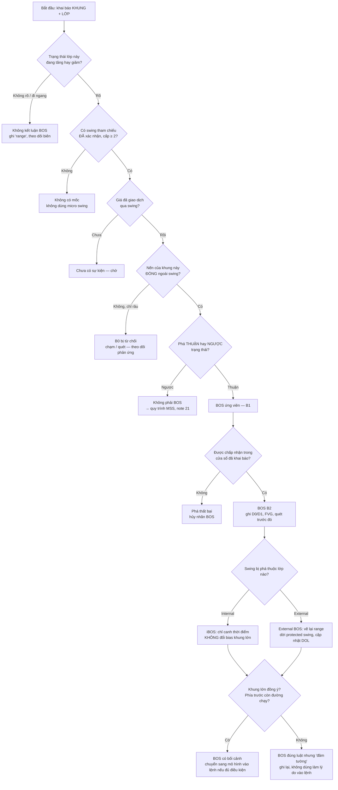

# Break of Structure (BOS)

> [!summary] Tóm tắt 1 câu
> **BOS là cái nhãn ta gắn khi giá ĐÓNG NẾN vượt qua một swing ĐÃ ĐƯỢC XÁC NHẬN và CÓ Ý NGHĨA, THEO ĐÚNG CHIỀU của cấu trúc đang được theo dõi (trên một khung và một lớp đã khai báo trước) — tức là phe đang thắng thế vừa làm được điều mà trong cấu trúc này họ chưa từng làm được. BOS cập nhật "tấm bản đồ"; nó KHÔNG hứa hẹn giá sẽ đi tiếp.**

> [!important] Nguyên tắc cốt lõi (v2)
> 1. **Chạm chưa phải phá. Phá chưa phải được chấp nhận. Được chấp nhận chưa phải sẽ đi tiếp.** Ba câu này là xương sống của cả note.
> 2. **Tên gọi do trạng thái TRƯỚC cú phá quyết định, không do cây nến.** Phá thuận trạng thái = BOS; phá ngược trạng thái = MSS (xem [[21-Market-Structure-Shift]]).
> 3. **Swing nào bị phá quan trọng hơn cây nến phá nó.** Phá một micro swing gần như không nói lên điều gì.
> 4. **Displacement là thước đo CHẤT LƯỢNG, không phải điều kiện ĐỊNH NGHĨA.** Một BOS có thể "bò" qua mức; nó vẫn là BOS, chỉ là BOS chất lượng thấp.
> 5. **BOS ở khung nhỏ không phải BOS ở khung lớn.** Một BOS M5 chưa bao giờ tự động thay đổi D1.
> 6. **Không phân loại bằng thông tin tương lai.** Swing chỉ tồn tại từ lúc được xác nhận; BOS chỉ tồn tại từ lúc nến đóng.

> [!info] Đây là bản v2 (2026-11-07) — đọc trước khi dùng
> - Note được **viết lại toàn bộ** theo protocol "ICT Deep Research — BOS" của bạn: giải thích từ mức "bé 5 tuổi" lên tới mức kỹ thuật, hạn chế công thức và số học, tách bạch sự thật với diễn giải. Bản v1 (2026-06-22 → 2026-07-28) được sao lưu nguyên vẹn tại `Claude outputs/backups/05-BOS-Break-of-Structure.2026-11-07.md.bak`. Những gì đổi so với v1 ghi ở mục [[#Quy tắc BOS v0.1 và nhật ký thay đổi v1 → v2|Quy tắc & Changelog]].
> - **33 hình mới** `BOS-v2-01 … 33` nằm trong `attachments/`. Các hình v1 (`BOS-Advanced-*`, `BOS-EdgeB-*`, `BOS-Case-Study-2`, …) vẫn còn trong thư mục nhưng không được nhúng nữa vì một số chứa số liệu không kiểm chứng được.
> - **Mọi mức giá trong ví dụ là số minh họa** (100, 110, …), không phải dữ liệu thị trường và không phải khuyến nghị. **Chưa có backtest nào** được chạy cho note này. Mọi `RULE-BOS` là **v0.1 — BACKTEST REQUIRED**; mọi `HYP-BOS` là **UNTESTED**.
> - Note nền, không lặp lại chi tiết ở đây: [[01-Advance-Market-Structure-Short-Term-Low-Intermediate-Term-Low-Long-Term-Low]] (STH/ITH/LTH) · [[54-Thuat-toan-phat-hien-swing-turning-point-Directional-Change-va-Nen-tang-dinh-luong]] (thuật toán swing) · [[21-Market-Structure-Shift]] (MSS, thang G0–G3) · [[20-Liquidity-Sweep]] · [[50-Displacement-In-Depth]] · [[13-FVG-Fair-Value-Gap]] · [[12-Dealing-Range]] · [[57-Dealing-Range-Nghien-cuu-chuyen-sau-Swing-Significance-Selection-Algorithm-Backtest]] · [[09-Change-of-Character]] · [[59-Daily-Bias]] · [[32-Top-down-Analysis-Multiple-Timeframes]].

> [!abstract]- Mục lục (bấm để mở)
> - **Cách đọc note** — nhãn, bốn tầng giải thích, ký hiệu journal
> - **1. Executive Summary**
> - **2. BOS giải thích cho bé 5 tuổi**
> - **3. Nền tảng: hiểu market structure** · **4. Vì sao market structure hình thành**
> - **5. BOS là gì?** · **6. Cơ chế cốt lõi đằng sau BOS**
> - **7. Bullish BOS** · **8. Bearish BOS** · **9. Internal vs External BOS**
> - **10. Phân loại swing** · **11. Nhận diện swing có ý nghĩa**
> - **12. Thế nào là một cú phá hợp lệ?** (wick, close, displacement, thang B0–B3)
> - **13. BOS vs Liquidity Sweep** · **14. BOS vs MSS vs CHoCH** · **15. BOS và Displacement**
> - **16. Protected High / Protected Low** · **17. BOS thất bại và reclaim**
> - **18. BOS trong các điều kiện thị trường** · **19. Multi-timeframe: D1 → H1 → M5**
> - **20. Real-time vs hindsight** · **21. Các hiểu lầm phổ biến** · **22. Case studies A–H**
> - **23. Khung quyết định nhận diện BOS** · **24. Checklist manual backtest**
> - **25. Điều ta thật sự biết vs điều ta đang giả định** · **26. Mental model cuối cùng**
> - **Quy tắc BOS v0.1 & Changelog** · **Phụ lục** (câu hỏi, flashcards, lesson learned, liên kết, nguồn, kiểm tra chất lượng)

---

## Cách đọc note

### Hệ thống nhãn

Mỗi khi một câu có thể bị hiểu nhầm giữa "sự thật" và "cách nhìn", note gắn nhãn cho nó:

| Nhãn | Nghĩa | Ví dụ trong note |
|---|---|---|
| **[MARKET MECHANICS]** | Điều quan sát được hoặc giải thích được bằng cơ chế khớp lệnh, thanh khoản, đấu giá | "Mỗi giao dịch có một người mua và một người bán với cùng số lượng." |
| **[ICT FRAMEWORK]** | Cách ICT / cộng đồng ICT–SMC đặt tên và dùng khái niệm | "Phá thuận cấu trúc gọi là BOS." |
| **[INTERPRETATION]** | Cách giải thích hợp lý nhưng biểu đồ OHLC không chứng minh được | "Lệnh dừng lỗ của người bán khống có thể đã bị kích hoạt." |
| **[HYPOTHESIS]** | Giả thuyết cần kiểm chứng | "BOS có displacement được chấp nhận thường xuyên hơn BOS không displacement." |
| **[BACKTEST REQUIRED]** | Không được coi là lợi thế giao dịch trước khi kiểm chứng | Mọi bộ lọc, mọi quy tắc v0.1 |
| **[HEURISTIC]** | Một ngưỡng hay quy ước đề xuất, không phải quy luật | "Chờ 2–3 nến sau cú phá." |

![[BOS-v2-03-Thay-va-Doan.svg|760]]
*Hình 03 — Bốn lớp khi nhìn một cú phá. Lỗi thường gặp nhất là nói một câu thuộc lớp 4 ("Smart Money vừa phá đỉnh để gom hàng") bằng giọng chắc chắn của lớp 1.*

### Bốn tầng giải thích

Mỗi khái niệm quan trọng được giải thích theo thứ tự:

1. **Level 1 — Cho bé 5 tuổi:** ví dụ đời thường, không thuật ngữ. Luôn kèm **giới hạn của phép so sánh** (thị trường không thật sự là trò kéo co).
2. **Level 2 — Chuỗi giá đơn giản:** vài con số như 100 → 110 → 105, đọc từng bước.
3. **Level 3 — Định nghĩa kỹ thuật:** chính xác theo market structure và ICT.
4. **Level 4 — Diễn giải nâng cao:** thanh khoản, khớp lệnh, price discovery, giới hạn của diễn giải.

### Ký hiệu journal cho một BOS

Để mọi BOS trong journal và backtest có thể kiểm tra lại, ghi theo mẫu (đồng bộ với cách ghi MSS ở [[21-Market-Structure-Shift]]):

```text
<khung> BOS-<lớp><hướng> <bậc xác nhận> <chất lượng>
Ví dụ:  H1 BOS-E↑ B2 D1   = BOS tăng, lớp external, khung H1, đã được chấp nhận, có displacement
        M5 BOS-I↓ B1 D0   = BOS giảm, lớp internal, khung M5, mới đóng nến ngoài mức, không displacement
```

- **Lớp:** `I` = internal, `E` = external (mục 9).
- **Bậc xác nhận:** `B0` chạm/xuyên (chưa gọi là BOS) · `B1` đóng nến ngoài mức · `B2` được chấp nhận trong cửa sổ đã khai báo · `B3` có hậu quả cấu trúc (mục 12).
- **Chất lượng:** `D0` không displacement · `D1` có displacement (mục 15).

---

## 1. Executive Summary

1. **BOS là một nhãn, không phải một tín hiệu.** Nó ghi lại rằng giá đã vượt qua một swing có ý nghĩa theo đúng chiều cấu trúc. Nó không nói giá sẽ đi đâu tiếp. **[ICT FRAMEWORK]**
2. **Định nghĩa phổ biến "giá phá swing high/low trước đó" là chưa đủ**, vì nó bỏ qua bốn câu hỏi: swing nào, phá như thế nào, trong trạng thái nào, ở khung nào.
3. **Cơ chế bên dưới rất đơn giản:** giá đi lên khi người mua gấp (lệnh thị trường) mua hết hàng của người bán đang chờ (lệnh giới hạn) ở các mức giá thấp. Vượt đỉnh cũ nghĩa là hàng chờ ở quanh đỉnh cũ đã bị mua hết. **[MARKET MECHANICS]**
4. **Quanh các đỉnh/đáy rõ ràng thường có nhiều lệnh chờ hai phía** (chốt lời, dừng lỗ, lệnh mua/bán đuổi). Bằng chứng học thuật cho thấy lệnh có điều kiện tập trung quanh các mức nổi bật như số tròn; với swing high/low thì đây là diễn giải hợp lý, không quan sát trực tiếp được trên OHLC. **[INTERPRETATION]**
5. **Khi giá chạm vùng đó, có hai ngã:** lực mua bị hấp thụ và giá quay lại (quét — sweep), hoặc giá được chấp nhận ở mức mới (BOS có ý nghĩa). Ngay lúc chạm, **không ai biết** ngã nào sẽ xảy ra.
6. **Thang xác nhận B0 → B3** giúp nói chính xác mình biết đến đâu: chạm (B0) → đóng nến ngoài (B1) → được chấp nhận (B2) → có hậu quả cấu trúc (B3). Mỗi bậc chắc hơn nhưng muộn hơn.
7. **Cùng một cây nến phá có thể là BOS hoặc MSS** — tùy trạng thái trước đó. Vì vậy phải khai báo khung + lớp + trạng thái **trước** khi gọi tên.
8. **Internal BOS không phủ định external structure.** Một nhịp hồi có thể phá lên nhiều lần mà cấu trúc lớn vẫn giảm.
9. **Swing quan trọng vì những gì nó đã gây ra** (chân sóng, cú dịch chuyển, phá cấu trúc khác), không vì nó trông cân đối — nhưng chỉ được dùng thông tin đã có tại thời điểm đánh giá.
10. **Displacement và FVG thường đi cùng BOS nhưng là ba khái niệm khác nhau:** BOS = sự kiện cấu trúc; displacement = cách giá di chuyển; FVG = dấu vết để lại.
11. **Sau mỗi BOS, mức cần giữ (protected low/high) dời theo** và bản đồ (dealing range, premium/discount) phải vẽ lại. Đây là giá trị thực tế lớn nhất của BOS.
12. **BOS đúng luật vẫn có thể là điểm tệ** nếu nó vừa lấy nốt thanh khoản mục tiêu hoặc đâm vào vùng ngược chiều của khung lớn. **[HYPOTHESIS]**
13. **BOS trong đi ngang (range) thường chỉ là quét biên hai chiều.** Nhiều "BOS" liên tiếp hai chiều là dấu hiệu của range, không phải xu hướng.
14. **Trong D1 → H1 → M5:** D1 BOS là bối cảnh, H1 BOS mô tả setup, M5 BOS/MSS là cò thực thi. Ba quy mô này không được trộn lẫn.
15. **Chưa có bằng chứng công khai, đủ chặt chẽ** rằng "trade theo BOS" có lợi thế vượt một baseline đơn giản (ví dụ momentum). Note này dạy cách **nhận diện và ghi nhận nhất quán**; lợi thế phải do chính backtest của bạn chứng minh. **[BACKTEST REQUIRED]**

---

## 2. BOS Explained Like I Am 5 Years Old

### 2.1 Trò kéo co dựng đứng

> [!tip] Level 1 — Kể cho bé 5 tuổi
> Hai nhóm bạn chơi kéo co, nhưng sợi dây dựng đứng. Một nhóm kéo lên, một nhóm kéo xuống. Ở giữa dây có một dải ruy băng đỏ.
>
> Mỗi lần ruy băng lên cao nhất rồi bị kéo xuống lại, cô giáo kẻ một vạch phấn ở chỗ cao nhất đó.
>
> Hôm nay, nhóm kéo lên kéo được ruy băng **vượt qua vạch phấn cao nhất của lần trước**. Cô giáo nói: "À, nhóm kéo lên vừa làm được điều mà lần trước chưa làm được!"
>
> Đó chính là **BOS tăng**: giá vượt qua "vạch cao nhất" (đỉnh cũ) mà trước đó nó chưa vượt qua được.

![[BOS-v2-01-Keo-Co.svg|760]]
*Hình 01 — Trò kéo co dựng đứng và cùng ý tưởng đó trên biểu đồ.*

> [!warning] Giới hạn của phép so sánh
> - Thị trường **không có hai đội cố định**. Một người có thể vừa mua lúc sáng vừa bán lúc chiều; người mới vào và người cũ rời đi liên tục.
> - **Mỗi giao dịch luôn có một người mua và một người bán với cùng số lượng.** Vì vậy "bên mua nhiều hơn bên bán" là câu sai về mặt kỹ thuật. Câu đúng là: **người mua GẤP hơn** (họ chấp nhận trả giá cao hơn để mua ngay) so với người bán. **[MARKET MECHANICS]**
> - Vượt vạch chỉ cho biết **ai gấp hơn ở thời điểm đó**, không cho biết ai sẽ thắng cả trận.

### 2.2 Chạm tay vào vạch, hay đứng hẳn lên bậc cao hơn?

> [!tip] Level 1 — Kể cho bé 5 tuổi
> Bé nhảy lên để với tới một vạch kẻ trên tường. Có hai kiểu:
> - **Kiểu 1:** bé nhảy lên, đầu ngón tay chạm qua vạch một chút, rồi rơi xuống đất. Bé **đã chạm** tới đó, nhưng **không ở lại** được.
> - **Kiểu 2:** bé leo lên một bậc ghế và **đứng hẳn** ở độ cao mới, vượt qua vạch.
>
> Trên biểu đồ, kiểu 1 giống **cây nến chỉ có râu (wick) vượt qua đỉnh cũ rồi đóng lại bên dưới**. Kiểu 2 giống **cây nến đóng cửa (close) bên trên đỉnh cũ**. Note này chỉ bắt đầu gọi là BOS từ kiểu 2 — và còn phải xem bé có đứng vững được một lúc không.

Giới hạn: "đứng vững" trên thị trường không có thời gian chuẩn; bao lâu là đủ là một **quy ước phải khai báo trước** (mục 12), không phải một quy luật tự nhiên.

### 2.3 Leo cầu thang

> [!tip] Level 1 — Kể cho bé 5 tuổi
> Khi bé leo cầu thang **đi lên**, chân bé đặt lên bậc **cao hơn** bậc trước, và tay bé với **cao hơn** lần trước. Khi bé với tay vượt mức cao nhất cũ, ta đánh dấu một BOS.
>
> Khi bé **đi xuống** cầu thang thì ngược lại: chân bé đặt ở bậc **thấp hơn**, và mỗi lần cúi xuống bé chạm **thấp hơn** lần trước.

![[BOS-v2-02-Cau-Thang.svg|760]]
*Hình 02 — Cầu thang lên (HH–HL) và cầu thang xuống (LH–LL). Mỗi lần vượt mức cũ theo đúng chiều = một BOS.*

### 2.4 Toàn bộ BOS trong năm câu cho bé

1. Giá đi lên đi xuống như bé leo cầu thang.
2. Mỗi chỗ cao nhất mà giá từng tới trước khi quay xuống, ta kẻ một vạch.
3. Khi giá đi theo đúng chiều cầu thang và **đứng hẳn** lên trên vạch cũ, ta nói "phá kỷ lục" — đó là BOS.
4. Phá kỷ lục **không có nghĩa** là bé sẽ còn leo cao nữa; nó chỉ có nghĩa là bé đã leo tới đây.
5. Nếu bé tuột xuống dưới bậc chân đang đứng (đáy cần giữ), thì câu chuyện "bé đang leo lên" không còn đúng nữa.

---

## 3. The Foundation: Understanding Market Structure

> [!note] Vì sao phải học market structure TRƯỚC BOS
> BOS là "phá **cấu trúc**". Nếu chưa biết cấu trúc là gì, ta chỉ đang học thuộc một câu: "giá vượt đỉnh cũ". Phần này xây nền: đỉnh, đáy, HH/HL/LH/LL, ba trạng thái. Sau đó BOS sẽ hiện ra gần như tự nhiên.

### 3.1 Market structure là gì?

> [!tip] Level 1 — Cho bé 5 tuổi
> Nếu ta vẽ lại đường đi của một quả bóng nảy trên con dốc, ta sẽ thấy những chỗ quả bóng bay lên cao nhất và những chỗ nó chạm xuống thấp nhất. Nhìn chuỗi những chỗ cao và chỗ thấp đó, ta đoán được quả bóng đang lăn lên dốc, xuống dốc hay nảy tại chỗ.

**Level 3 — Định nghĩa:** market structure (cấu trúc thị trường) là **cách sắp xếp theo thời gian của các đỉnh (swing high) và đáy (swing low)** đã được xác nhận trên một khung thời gian. Nó không phải là một đường kẻ hay một vùng giá; nó là **một bản tóm tắt** của đường đi của giá, giữ lại các điểm quay đầu và bỏ đi phần nhiễu ở giữa. **[MARKET MECHANICS — mô tả]**

**Level 4 — Điều cần nhớ:** market structure là **mô tả**, không phải **dự báo**. Nói "cấu trúc đang tăng" nghĩa là "các đỉnh và đáy gần đây đang cao dần". Nói "vì vậy giá sẽ tiếp tục tăng" là một **giả thuyết** — gần với hiện tượng momentum mà tài chính định lượng đã nghiên cứu ở các khung thời gian dài, nhưng không tự động đúng ở khung trong ngày. **[HYPOTHESIS]**

### 3.2 Swing high và swing low

> [!tip] Level 1 — Cho bé 5 tuổi
> **Swing high** là đỉnh của một ngọn đồi nhỏ: bên trái thấp hơn, bên phải cũng thấp hơn. **Swing low** là đáy của một thung lũng nhỏ: hai bên đều cao hơn.

**Level 3 — Định nghĩa phổ biến trong ICT** (chi tiết ở [[01-Advance-Market-Structure-Short-Term-Low-Intermediate-Term-Low-Long-Term-Low]]): **[ICT FRAMEWORK]**

- **Short-term high (STH):** một nến có đỉnh cao hơn đỉnh của nến ngay trước và ngay sau nó.
- **Short-term low (STL):** một nến có đáy thấp hơn đáy của nến ngay trước và ngay sau nó.
- **Intermediate-term high/low (ITH/ITL):** một STH (STL) có STH thấp hơn (STL cao hơn) ở hai bên.
- **Long-term high/low (LTH/LTL):** một ITH (ITL) có ITH thấp hơn (ITL cao hơn) ở hai bên.

Có nhiều cách định nghĩa khác: số nến mỗi bên lớn hơn, hoặc dùng mức "đảo chiều đủ xa" (directional change, xem [[54-Thuat-toan-phat-hien-swing-turning-point-Directional-Change-va-Nen-tang-dinh-luong]]). **Không có cách nào "đúng" duy nhất**; điều quan trọng là **chọn một cách, viết ra, và dùng nhất quán.**

### 3.3 Bốn nhãn: HH, HL, LH, LL

| Nhãn | Tên đầy đủ | Nghĩa đơn giản | Nói cho bé |
|---|---|---|---|
| **HH** | Higher High | Đỉnh mới **cao hơn** đỉnh trước | "Lần này với tay cao hơn lần trước" |
| **HL** | Higher Low | Đáy mới **cao hơn** đáy trước | "Lần này chân đứng ở bậc cao hơn" |
| **LH** | Lower High | Đỉnh mới **thấp hơn** đỉnh trước | "Lần này không với tới chỗ cũ nữa" |
| **LL** | Lower Low | Đáy mới **thấp hơn** đáy trước | "Lần này tụt xuống sâu hơn" |

Lưu ý: nhãn luôn là **so sánh với swing cùng loại trước đó** trên **cùng khung, cùng lớp**. Một đỉnh có thể là HH trên M5 nhưng chỉ là một điểm nhỏ trong một LH trên H1.

### 3.4 Ba trạng thái: tăng, giảm, đi ngang

![[BOS-v2-05-Ba-Trang-Thai.svg|760]]
*Hình 05 — Ba trạng thái cấu trúc. BOS chỉ có nghĩa khi đã biết mình đang ở trạng thái nào.*

- **Xu hướng tăng (uptrend):** chuỗi **HH + HL**. Mỗi lần lùi dừng lại cao hơn; mỗi lần tăng đi xa hơn đỉnh trước.
- **Xu hướng giảm (downtrend):** chuỗi **LH + LL**. Mỗi lần hồi dừng lại thấp hơn; mỗi lần giảm xuống sâu hơn.
- **Đi ngang (consolidation / range):** đỉnh và đáy **không** cao dần cũng không thấp dần một cách rõ ràng; giá dao động giữa "trần" và "sàn".

> [!question] Một câu hỏi hay bị bỏ qua: trạng thái được quyết định bởi cái gì?
> Không phải bởi màu nến hay độ dốc trung bình. Trong note này, **trạng thái tăng** tồn tại khi swing gần nhất được phá là một **đỉnh** (BOS tăng gần nhất) và **đáy cần giữ** (protected low) chưa bị thủng. **Trạng thái giảm** đối xứng. Nếu cả hai điều kiện đều không rõ, ta ghi "chưa xác định" — và **không gắn nhãn BOS** (mục 23).

### 3.5 Đọc từng bước một chuỗi giá

> [!example] Level 2 — Chuỗi giá 100 → 110 → 105 → 115 → 109 → 120
> Hãy đọc như đang xem trực tiếp, không nhìn trước.

![[BOS-v2-06-Chuoi-Gia.svg|760]]
*Hình 06 — Năm bước, hai BOS, hai đáy cần giữ.*

1. **100 → 110:** giá đi lên. Lúc giá còn đang lên, 110 **chưa phải** là "đỉnh" — nó chỉ là mức cao nhất cho tới lúc đó. Nó chỉ thành đỉnh (swing high) khi giá quay xuống và quy tắc xác nhận swing được thỏa.
2. **110 → 105:** nhịp lùi (pullback). Người mua gấp tạm dừng, người bán chốt lời. 105 **cao hơn** 100, nên khi giá bật lên lại, 105 sẽ được xác nhận là **HL**.
3. **105 → 115:** giá vượt qua 110. Đây là **BOS tăng thứ nhất** — phe mua làm được điều trước đó chưa làm được: giao dịch trên 110. Sau BOS này, đáy 105 trở thành **đáy cần giữ** (vì nó là đáy đã tạo ra cú vượt 110).
4. **115 → 109:** lùi lần nữa. 109 vẫn **cao hơn** 105, nên cấu trúc tăng **còn nguyên**. Đây là chỗ nhiều người hoảng: giá đang giảm, nhưng cấu trúc chưa hề sai.
5. **109 → 120:** vượt 115 → **BOS tăng thứ hai**. Đáy cần giữ **dời lên** 109.

**Và nếu sau 120 giá rơi thủng 109?** Đáy cần giữ mất → câu "cấu trúc đang tăng" không còn đúng, dù 120 vẫn là đỉnh cao nhất. Đó là một **MSS giảm** (mục 14). Bài học: **đỉnh cao nhất không bảo vệ xu hướng; đáy cần giữ mới làm việc đó.**

### 3.6 Nguồn gốc lịch sử: đây không phải phát minh của ICT

Ý tưởng "xu hướng tăng = chuỗi đỉnh cao dần và đáy cao dần" có từ **Dow Theory** (Charles Dow cuối thế kỷ 19, được hệ thống hóa bởi các tác giả sau ông). Nhiều tài liệu SMC/ICT hiện nay cũng thừa nhận BOS "bắt rễ từ Dow Theory". Đóng góp của ICT/SMC là **đặt tên** cho các sự kiện phá cấu trúc, **phân lớp** chúng (internal/external, STH/ITH/LTH) và **gắn chúng với thanh khoản** (vì sao giá bị hút về các đỉnh/đáy). **[ICT FRAMEWORK]**

---

## 4. Why Market Structure Forms

### 4.1 Vì sao giá đi lên, đi xuống?

> [!tip] Level 1 — Cho bé 5 tuổi
> Ở chợ, người bán bày hàng với nhiều mức giá. Nếu có nhiều người **vội** mua táo, họ sẽ mua hết táo ở giá rẻ nhất, rồi phải mua táo ở giá đắt hơn. Giá táo "đi lên" không vì ai đẩy nó, mà vì **táo rẻ đã hết**.

**Level 3 — Cơ chế khớp lệnh** **[MARKET MECHANICS]:**

- **Lệnh giới hạn (limit order):** "Tôi muốn mua/bán **ở giá X hoặc tốt hơn**, tôi chịu chờ." Đây là người **bày hàng**.
- **Lệnh thị trường (market order):** "Tôi muốn mua/bán **ngay bây giờ**, giá nào cũng được." Đây là người **vội**.
- **Lệnh dừng (stop order):** "**Nếu** giá chạm X **thì** biến tôi thành lệnh thị trường." Đây là người **hẹn trước**. Lệnh dừng lỗ và lệnh mua/bán đuổi khi phá đỉnh đều là loại này.
- **Giá dịch chuyển** khi lệnh thị trường ăn hết lệnh giới hạn ở mức giá tốt nhất, buộc giao dịch tiếp theo xảy ra ở mức kế tiếp.

**Level 4 — Khác biệt giữa các thị trường:** trên **futures** (NQ1 ở CME) có một sổ lệnh tập trung, nên mô tả trên gần đúng theo nghĩa đen. Trên **FX giao ngay** (EURUSD, GBPUSD) và **XAUUSD CFD**, không có một sổ lệnh tập trung duy nhất cho toàn thị trường; giá bạn thấy là báo giá của nhà cung cấp thanh khoản qua broker. Cơ chế "bên vội ăn hết bên chờ" vẫn là cách hiểu đúng về bản chất, nhưng chi tiết khớp lệnh do nhiều tầng trung gian quyết định, và mỗi broker có thể in râu nến hơi khác nhau. **[MARKET MECHANICS]**

### 4.2 Vì sao giá ngừng tăng và quay đầu — một swing ra đời

![[BOS-v2-04-Swing-Hinh-Thanh.svg|760]]
*Hình 04 — Một swing high ra đời, và vì sao ta luôn biết nó muộn ít nhất một nến.*

Giá ngừng tăng khi **người mua gấp đã mua xong** và **người bán chờ sẵn ở giá cao** đủ nhiều để đáp ứng mọi lệnh mua còn lại. Khi lệnh bán chủ động bắt đầu lấn lệnh mua chủ động, giá đi xuống — và để lại một "đỉnh". **[MARKET MECHANICS]**

Ai là những người bán ở đó? Có thể là người đã mua từ dưới thấp nay chốt lời; người cho rằng giá đã đắt và bán khống; hoặc nhà tạo lập thị trường điều chỉnh báo giá. **Biểu đồ không cho biết là ai.** **[INTERPRETATION]**

**Độ trễ xác nhận:** một nến chỉ được gọi là swing high khi các nến sau nó **đã đóng** với đỉnh thấp hơn. Với quy ước 3 nến (STH), độ trễ tối thiểu là **một nến**; quy ước chặt hơn (nhiều nến mỗi bên) cho swing "chắc" hơn nhưng **muộn hơn**. Hệ quả cho BOS: **chỉ được dùng swing đã được xác nhận tại thời điểm cú phá xảy ra.**

### 4.3 Vì sao xu hướng tăng thường tạo HH và HL?

Không chỉ học thuộc định nghĩa — hãy xem **điều gì phải xảy ra** để giá in được một HH và một HL:

- **Để có HL** (đáy cao hơn): trong nhịp lùi, người mua phải **quay lại sớm hơn**, tức là chấp nhận mua ở mức giá **cao hơn** đáy trước. Vì sao họ chịu? Các lý do hợp lý: người lỡ chuyến lần trước không muốn lỡ lần nữa; người bán khống ở đỉnh vội chốt lời (mua lại); thông tin mới khiến mặt bằng giá "hợp lý" trong mắt nhiều người đã dịch lên. **[INTERPRETATION]**
- **Để có HH** (đỉnh cao hơn): người mua gấp phải đủ để **ăn hết** lượng hàng chờ quanh đỉnh cũ — gồm cả những người đã bán ở đó lần trước — và vẫn còn lực để giao dịch ở mức cao hơn. **[MARKET MECHANICS]**
- **Một chuỗi HH + HL** vì vậy là bằng chứng mô tả rằng **trong giai đoạn đó**, bên mua gấp liên tục áp đảo bên bán ở các mức giá ngày càng cao. Nó **không chứng minh** rằng điều đó sẽ tiếp tục. **[HYPOTHESIS]**

### 4.4 Vì sao xu hướng giảm thường tạo LH và LL?

Đối xứng: **LH** xuất hiện khi người bán quay lại **sớm hơn** trong nhịp hồi (bán ở mức thấp hơn đỉnh trước); **LL** xuất hiện khi người bán gấp ăn hết hàng chờ mua quanh đáy cũ và vẫn còn lực giao dịch thấp hơn. Lưu ý: thị trường giảm thường **nhanh và giật** hơn thị trường tăng ở nhiều tài sản (chỉ số cổ phiếu là ví dụ điển hình), nên chân giảm hay để lại khoảng trống lớn hơn. Đây là quan sát phổ biến, mức độ khác nhau theo tài sản. **[INTERPRETATION]**

### 4.5 Vì sao có đi ngang?

> [!tip] Level 1 — Cho bé 5 tuổi
> Quả bóng nảy trong một căn phòng: chạm trần thì rơi, chạm sàn thì bật. Nó di chuyển rất nhiều nhưng **không đi đâu cả**.

Trong đi ngang, cả hai phía đều **sẵn sàng giao dịch** trong một vùng giá; ở biên trên có người bán chờ, ở biên dưới có người mua chờ. Theo ngôn ngữ **Auction Market Theory** (lý thuyết thị trường đấu giá), đây là trạng thái **cân bằng (balance)**; xu hướng là trạng thái **mất cân bằng (imbalance)**, khi thị trường phải đi tìm mức giá mới để gặp được đối tác. **[ICT không dùng từ này — khung lý thuyết thay thế]**

**Hệ quả cho BOS:** trong cân bằng, các đỉnh/đáy nhỏ bên trong hộp bị phá liên tục **cả hai chiều**. Gọi chúng là BOS sẽ tạo ra cảm giác "xu hướng đổi liên tục" trong khi thật ra **không có gì đổi cả** (mục 18).

---

## 5. What Is BOS?

### 5.1 Định nghĩa cho người mới

> [!tip] Level 1 — Cho bé 5 tuổi
> BOS là lúc giá **đi theo đúng chiều nó đang đi** và **vượt qua kỷ lục cũ** của chính nó — rồi **đứng vững** được ở đó.

> [!example] Level 2 — Một ví dụ số
> Cấu trúc tăng: 100 → 110 → 105 → **nến đóng ở 112**. Đỉnh 110 đã được xác nhận, đáy 105 cao hơn 100, và nến đóng trên 110 theo đúng chiều tăng → **ứng viên bullish BOS (B1)**. Nếu các nến sau không đóng ngược xuống dưới 110 trong cửa sổ đã khai báo → **B2**.

### 5.2 Định nghĩa cấu trúc (định nghĩa vận hành của note này)

> [!info] DEF-BOS-01 (v2) — Break of Structure
> **BOS là nhãn gắn cho thời điểm một nến của khung đang xét ĐÓNG vượt qua một swing tham chiếu ĐÃ ĐƯỢC XÁC NHẬN TRƯỚC ĐÓ, thuộc một lớp cấu trúc đã khai báo (internal hoặc external), THEO CÙNG CHIỀU với trạng thái hiện tại của lớp đó trên khung đó.** **[ICT FRAMEWORK — dạng vận hành hóa]**

Giải thích từng cụm từ, vì mỗi cụm chặn một lỗi khác nhau:

| Cụm từ | Vì sao phải có | Lỗi nếu bỏ đi |
|---|---|---|
| **"một nến của khung đang xét"** | Cú phá phải được đo bằng nến của chính khung mà swing thuộc về | Dùng nến M1 đóng trên đỉnh H1 rồi gọi là "H1 BOS" |
| **"ĐÓNG vượt qua"** | Râu chỉ chứng minh giá đã chạm; đóng nến chứng minh giá được chấp nhận tới hết nến | Gọi mọi cú quét là BOS |
| **"swing tham chiếu"** | Phải là một đỉnh/đáy cụ thể, gọi tên được | "Giá phá cấu trúc" mà không chỉ được phá cái gì |
| **"đã được xác nhận trước đó"** | Swing chỉ tồn tại từ lúc được xác nhận | Dùng một swing mà chỉ sau này mới thấy (hindsight) |
| **"lớp đã khai báo"** | Internal và external là hai cấu trúc khác nhau | Lấy BOS nhịp hồi để nói về xu hướng lớn |
| **"cùng chiều trạng thái"** | Đây là chỗ phân biệt BOS với MSS | Gọi một cú đảo chiều là "tiếp diễn" |

**Structural swing là gì?** Là swing có **vai trò** trong cấu trúc đang theo dõi: nó là biên của một chân sóng, hoặc là mức mà cấu trúc dựa vào (đỉnh trước trong xu hướng tăng; đáy trước trong xu hướng giảm). Một gợn sóng nhỏ ở giữa một chân sóng không phải structural swing của lớp đó (mục 10–11).

**"Break" nghĩa là gì?** Trong note này: **B1 = một nến đóng ngoài swing**. Râu vượt qua (B0) chỉ là "đang chạm" — trạng thái chờ.

**Cấu trúc nào đang bị phá?** Không phải "cả thị trường". Là **trạng thái của một lớp trên một khung**. Một bullish BOS trên lớp internal của M5 chỉ nói về lớp internal của M5.

**Điều gì thay đổi sau khi phá?** Ba thứ thay đổi **chắc chắn** (theo định nghĩa): (1) đỉnh cao nhất của cấu trúc được cập nhật; (2) mức cần giữ (protected low) dời lên đáy đã tạo ra cú phá; (3) bản đồ (dealing range) cần vẽ lại. Một thứ **không** thay đổi chắc chắn: việc giá sẽ đi tiếp. **[MARKET MECHANICS cho 1–3; HYPOTHESIS cho "đi tiếp"]**

### 5.3 BOS theo ICT và cộng đồng ICT/SMC

**[ICT FRAMEWORK]** Cách dùng phổ biến trong cộng đồng: BOS là **phá cấu trúc thuận xu hướng**, xác nhận xu hướng đang tiếp diễn; ngược lại, phá cấu trúc **ngược** xu hướng là MSS hoặc CHoCH.

Ba điểm cần biết để không bị lẫn khi đọc tài liệu:

1. **Thuật ngữ:** trong các bài giảng của chính ICT, cách nói hay gặp là **"market structure shift"** và **"break in market structure"**; "BOS" và "CHoCH" phổ biến hơn trong tài liệu **SMC** (Smart Money Concepts) và các công cụ vẽ tự động. Kiểm tra trong vault: [[21-Market-Structure-Shift]] mục 12.3 đã ghi nhận điều này (2026-10-07). Note này **không** trích nguyên văn ICT vì chưa đối chiếu lại video gốc.
2. **Không có định nghĩa chuẩn về "phá":** một số hướng dẫn cộng đồng nói **đóng nến là bắt buộc**, râu một mình chỉ là quét; thư viện Python mã nguồn mở `smartmoneyconcepts` thì để **tùy chọn**: tham số `close_break` (mặc định bật) chọn giữa "phá bằng giá đóng cửa" và "phá bằng high/low". Tức là ngay cả công cụ cũng coi đây là **một quy ước để chọn**, không phải một sự thật.
3. **Không có định nghĩa chuẩn về "lớp":** có nguồn nói BOS chỉ áp dụng cho swing external; có công cụ (ví dụ chỉ báo SMC của LuxAlgo) vẽ BOS ở **hai lớp** internal và swing. Note này dùng **hai lớp**, và bắt buộc ghi lớp trong journal.

> [!important] Hệ quả thực hành
> Vì không có văn bản chuẩn, cách duy nhất để BOS trở thành thứ **kiểm tra được** là: **viết ra định nghĩa của mình (DEF-BOS-01), dùng nó nhất quán, và ghi đủ tọa độ** cho mỗi lần gắn nhãn.

### 5.4 Những thứ hay bị gọi chung là "BOS" — cần tách ra

| Sự kiện | Mô tả | Có phải BOS? |
|---|---|---|
| **Giá vượt một mức cao** | Giá giao dịch trên một mức bất kỳ (một đỉnh nhỏ, một số tròn, PDH…) | Chưa. Đó là một **sự kiện giá**, chưa phải sự kiện cấu trúc |
| **Phá một swing** | Nến đóng vượt một swing đã xác nhận | Có thể — tùy lớp và trạng thái |
| **Internal BOS** | Phá thuận chiều một swing **bên trong** một chân sóng/nhịp hồi | Có — ở lớp internal; không nói gì về lớp external |
| **External BOS** | Phá thuận chiều một swing **biên** của dealing range đang dùng | Có — đây là loại "vẽ lại bản đồ" |
| **Bullish BOS** | Phá **lên** một đỉnh khi trạng thái đang **tăng** | Có |
| **Bearish BOS** | Phá **xuống** một đáy khi trạng thái đang **giảm** | Có |
| **Phá lên khi trạng thái đang giảm** | Phá ngược trạng thái | **Không** — đó là MSS / CHoCH |
| **Râu vượt rồi đóng lại bên trong** | Chạm/quét | **Không** (B0 bị từ chối) |

---

## 6. The Core Mechanism Behind BOS

> [!important] Câu hỏi trung tâm
> Không phải "BOS trông như thế nào", mà là: **khi giá phá một swing, chuyện gì thật sự đang xảy ra? Vì sao nó xảy ra? Điều gì đã thay đổi? Và làm sao biết lần phá đó có ý nghĩa?**

### 6.1 Trước BOS: điều gì đã tồn tại?

![[BOS-v2-08-Truoc-Trong-Sau.svg|900]]
*Hình 08 — Ba khung hình: trước, trong, sau một BOS tăng.*

Trước một bullish BOS, thường đã có:

- **Một đỉnh H đã xác nhận.** Ở đó, lần trước, người bán đã đủ để chặn người mua. **[MARKET MECHANICS]**
- **Một nhịp lùi và một đáy HL.** Người mua đã quay lại ở mức cao hơn đáy trước.
- **Lệnh chờ quanh H** — đây là phần **diễn giải**, vì biểu đồ không cho thấy sổ lệnh: **[INTERPRETATION]**
  - *Phía trên H:* lệnh dừng lỗ của những người bán khống ở H (nếu giá vượt H, họ sai → lệnh mua đóng vị thế); lệnh **mua đuổi** của người chờ "phá đỉnh mới vào".
  - *Tại và ngay dưới H:* lệnh **bán chờ** của người mua cũ muốn chốt lời ở đỉnh cũ, và của người muốn bán khống lần nữa.
- **Bằng chứng ngoài ICT:** nghiên cứu của Carol Osler (Journal of Finance, 2003) trên dữ liệu lệnh có điều kiện của một ngân hàng FX cho thấy lệnh chốt lời tập trung **tại** các số tròn, còn lệnh dừng lỗ tập trung **ngay bên ngoài** số tròn — giải thích vì sao giá hay đảo chiều tại số tròn và hay **tăng tốc** sau khi vượt qua chúng. Đây là bằng chứng cho **cơ chế** "lệnh có điều kiện tập trung quanh mức nổi bật"; nó nói về số tròn trong FX, **không** chứng minh trực tiếp điều tương tự cho mọi swing high trên mọi tài sản. **[MARKET MECHANICS — bằng chứng một phần]**

### 6.2 Điều gì khiến giá quay lại vùng đỉnh cũ?

Sau HL, giá quay lên vì người mua gấp lại chiếm ưu thế. **Vì sao** họ gấp thì biểu đồ không nói: có thể là tin tức, dòng tiền theo lịch (mở phiên, cân bằng danh mục), người lỡ chuyến, hoặc đơn giản là bên bán đã rút bớt hàng. Một số người theo ICT nói giá "bị hút" về thanh khoản phía trên đỉnh. Cách nói "bị hút" là ẩn dụ; mô tả cơ học là: **một vùng có nhiều lệnh chờ là nơi một người cần khớp khối lượng lớn có thể khớp được** — nên giá hay ghé qua đó. Đây là lý do hợp lý, nhưng tần suất "ghé qua" cũng phụ thuộc nhiều vào khoảng cách hình học (đỉnh gần thì dễ chạm). Xem [[58-Draw-on-Liquidity-DOL-Tong-hop-Deep-Dive-v0.2-Beginner-Friendly]]. **[INTERPRETATION]**

### 6.3 Trong lúc phá: chuyện gì xảy ra ở cấp khớp lệnh?

![[BOS-v2-07-Cho-va-So-Lenh.svg|760]]
*Hình 07 — Khu chợ và sổ lệnh: giá đi lên vì hàng rẻ bị mua hết; lệnh hẹn trước phía trên đỉnh cũ bật thành lệnh mua khi bị chạm.*

> [!tip] Level 1 — Cho bé 5 tuổi
> Ở cái kệ cao nhất của khu chợ, có một nhóm người đã dặn trước: "Nếu giá táo lên tới đây, mua ngay cho tôi!". Khi giá chạm kệ đó, những người này **tự động** biến thành người mua vội. Nếu phía trên còn ít táo, giá sẽ nhảy lên nhanh. Nếu phía trên có một người bán chất cả xe táo, tất cả lệnh mua bị "nuốt" và giá đứng lại hoặc rơi xuống.

**Level 3–4 — Bốn lực tác động cùng lúc:** **[MARKET MECHANICS]**

1. **Lệnh thị trường mua ăn hết hàng chờ quanh H.** Đây là điều kiện bắt buộc để giá giao dịch trên H.
2. **Lệnh dừng phía trên H bị kích hoạt** và trở thành lệnh thị trường mua. Chúng **cộng thêm** lực mua — nhưng chỉ một lần, rồi hết.
3. **Bên bán phản ứng.** Nếu phía trên có lượng bán lớn chờ sẵn (hoặc người bán mới xuất hiện vì thấy giá "đắt"), toàn bộ lực mua kể cả lệnh dừng bị **hấp thụ** → giá quay lại dưới H. Ta gọi đó là **quét (sweep)**.
4. **Nếu phía trên ít hàng** và người mua tiếp tục tới, giá phải đi lên tìm người bán (**price discovery**). Khi lực mua vượt xa lượng hàng ở từng mức, giá đi rất nhanh qua nhiều mức với ít giao dịch ở mỗi mức → nến thân lớn, ít râu ngược, có thể để lại **FVG**. Đó là cái ta nhìn thấy và gọi là **displacement**.

**Điểm mấu chốt:** khi giá vừa chạm và vượt H, lực (1) và (2) **đã xảy ra** — nhưng kết cục do (3) và (4) quyết định, và **chúng chưa xảy ra**. Vì vậy ngay tại khoảnh khắc chạm, câu trả lời đúng là "chưa biết".

![[BOS-v2-17-Nga-Ba-Duong.svg|760]]
*Hình 17 — Khoảnh khắc vừa vượt đỉnh cũ: ba tương lai có thể xảy ra.*

### 6.4 Sau khi phá: ý nghĩa thật sự của BOS

Sau một bullish BOS được chấp nhận, **điều đã được xác nhận** là:

- Giá **đã giao dịch và đóng cửa** trên H — điều mà trong cấu trúc này chưa từng xảy ra. Bên mua gấp đã **chứng minh** được rằng họ đủ để ăn hết lượng hàng quanh H **ở thời điểm đó**. **[MARKET MECHANICS]**
- Cấu trúc tăng được **"gia hạn"**: mô tả "HH–HL" vẫn đúng và có thêm một đỉnh mới.
- **Đáy cần giữ dời lên**: đáy HL đã tạo ra cú vượt H trở thành protected low mới (mục 16).
- **Bản đồ phải vẽ lại**: dealing range mới, premium/discount mới (hình 23).

**Điều CHƯA được xác nhận:**

- Giá sẽ đi tiếp bao xa, hay có đi tiếp không. **[HYPOTHESIS]**
- Ai đã mua, và vì sao. **[Không biết được từ OHLC]**
- Khung lớn hơn có đồng ý không (mục 19).
- Phía trước còn "đường chạy" không (mục 18.8).

**Điều vẫn có thể làm bullish structure thất bại:** giá đóng ngược lại dưới H ngay sau đó (phá thất bại), hoặc giá thủng đáy cần giữ (MSS giảm).

**Bearish BOS** là phiên bản đối xứng: đáy cũ bị phá xuống, đỉnh LH tạo ra cú phá trở thành **protected high**.

### 6.5 Không dùng "Smart Money" làm lời giải thích mặc định

> [!warning] Phân tích một tuyên bố phổ biến
> **Tuyên bố:** "Smart Money đẩy giá phá đỉnh để lấy thanh khoản, xác nhận họ đang mua."
> - **Điều quan sát được:** giá đã giao dịch và đóng trên đỉnh cũ. Có thể có (hoặc không) một nến thân lớn.
> - **Diễn giải ICT:** đây là bullish BOS; thanh khoản phía trên đỉnh đã bị lấy.
> - **Giải thích thay thế:** một tin tức làm nhiều người cùng mua; lệnh dừng kích hoạt dây chuyền; một quỹ thực thi lệnh lớn theo lịch; thanh khoản mỏng giờ thấp điểm khiến một lượng mua nhỏ cũng đẩy được giá. Nhiều nguyên nhân cho ra **cùng một cây nến**.
> - **Hệ quả thực hành:** "ai" và "vì sao" không thay đổi cách bạn ghi nhãn. Cái thay đổi quyết định là: **cú phá có được chấp nhận không, trong bối cảnh nào.**
> - **Cách kiểm chứng:** không kiểm chứng được "ý định" từ OHLC. Chỉ kiểm chứng được **hệ quả**: sau những BOS như thế này, giá thường làm gì so với baseline (mục 24).

### 6.6 Đối chiếu với các khung lý thuyết khác

| Khung | Khái niệm gần nhất | Giống BOS ở đâu | Khác ở đâu |
|---|---|---|---|
| **Dow Theory** | Xu hướng = đỉnh/đáy cao dần (thấp dần) | Chính là nền tảng của "cấu trúc" | Không phân lớp internal/external, không nói về thanh khoản |
| **Auction Market Theory** (Steidlmayer; Dalton, *Mind Over Markets*) | **Acceptance** (thời gian và khối lượng tích lũy bên ngoài một mức tham chiếu) vs **rejection** (quay lại nhanh) vs **excess** | "Đóng ngoài và giữ được" ≈ acceptance; "râu rồi quay lại" ≈ rejection | AMT đo bằng thời gian và khối lượng tại giá; ICT đo bằng đóng nến — thô hơn. Chính các tài liệu AMT cũng nói nhãn acceptance/excess cần phán đoán, và chưa có bằng chứng công khai chặt chẽ rằng khung này tự nó dự báo được |
| **Wyckoff** | Sign of Strength (SOS), "jump across the creek" | Phá biên range có lực ≈ BOS external có displacement | Wyckoff gắn sự kiện vào một chu kỳ tích lũy/phân phối nhiều pha |
| **Order flow / footprint** | Phá mức với delta mạnh, không có hấp thụ | Displacement BOS ≈ phá mức không gặp hấp thụ | Footprint nhìn trực tiếp dữ liệu khớp lệnh; ICT suy luận từ hình dạng nến |
| **Momentum (tài chính định lượng)** | Giá vừa tăng có xu hướng tăng tiếp (ở một số khung thời gian) | "BOS → tiếp diễn" là một phát biểu kiểu momentum | Bằng chứng momentum kinh điển chủ yếu ở khung tuần–tháng; không tự động chuyển sang M5/H1 |

**Kết luận đối chiếu:** BOS là phiên bản **chỉ cần OHLC** của ý tưởng "phá vỡ được chấp nhận" mà các khung khác đã mô tả. Giá trị riêng của ICT là **gói thành quy trình** (phân lớp, mức cần giữ, gắn với thanh khoản và với mô hình vào lệnh). Giới hạn của nó cũng chính là giới hạn của OHLC: không thấy khối lượng tại giá, không thấy sổ lệnh.

---

## 7. Bullish BOS

![[BOS-v2-09-Bullish-BOS-6-Buoc.svg|900]]
*Hình 09 — Bullish BOS qua sáu bước, kèm điều đã xác nhận, chưa xác nhận và khi nào thất bại.*

### 7.1 Sáu giai đoạn

| Bước | Chuyện gì xảy ra | Cơ chế (đơn giản) | Cái ta biết tại bước này |
|---|---|---|---|
| **① HL1** | Giá dừng giảm và quay lên | Người mua gấp lấn người bán gấp | Chỉ biết sau vài nến rằng đó là một đáy |
| **② HH1** | Giá tăng rồi dừng ở HH1 | Người mua gấp hết; người bán chờ ở trên đủ nhiều | HH1 chỉ được xác nhận khi giá quay xuống |
| **③ Lùi từ HH1** | Giá giảm | Chốt lời + bán khống + người mua tạm vắng | Đây là nhịp lùi bình thường — **chưa** phải đảo chiều |
| **④ HL2** | Giá dừng giảm **cao hơn** HL1 | Người mua quay lại sớm hơn | HL2 chỉ xác nhận khi giá bật lên đủ (theo quy tắc swing) |
| **⑤ Tăng lại** | Giá tiến về HH1 | Người mua gấp trở lại | Vùng HH1 có lệnh chờ hai phía; kết cục chưa rõ |
| **⑥ Vượt HH1** | Nến đóng trên HH1 | Hàng chờ quanh HH1 bị mua hết; lệnh dừng phía trên bị kích hoạt | **Ứng viên BOS (B1)**; cần thêm thời gian để biết có được chấp nhận (B2) |

### 7.2 Những câu hỏi then chốt

- **Vì sao HH1 là cấu trúc cần theo dõi?** Vì nó là **kỷ lục hiện tại** của cấu trúc tăng — nơi lần trước bên bán đã chặn được bên mua. Vượt nó là việc bên mua chưa làm được.
- **Vì sao HL2 quan trọng?** Vì nó là **đáy đã tạo ra cú tăng phá HH1**. Sau BOS, HL2 là **mức cần giữ**: nếu thủng, lời giải thích "cấu trúc tăng" mất cơ sở.
- **Điều gì khiến việc vượt HH1 trở thành bullish BOS?** Ba điều cùng lúc: (a) **trạng thái đang tăng** (nếu đang giảm thì đó là MSS); (b) HH1 là **swing có vai trò** trong lớp đang theo dõi; (c) **nến đóng** trên HH1.
- **Chỉ cần một râu vượt HH1 có đủ không?** **Không** — đó là B0 (đang chạm). Râu chỉ chứng minh lệnh phía trên đã khớp; nó không chứng minh giá được chấp nhận. Nếu nến đóng lại bên dưới, nhiều khả năng đó là quét (mục 13).
- **BOS xác nhận điều gì?** Rằng cấu trúc tăng **còn hiệu lực và được gia hạn** trên khung/lớp đó; rằng mức cần giữ dời lên HL2.
- **BOS có xác nhận giá sẽ tiếp tục tăng không?** **Không.** "Bullish BOS" là chuyện **đã xảy ra**; "bullish continuation" là chuyện **chưa xảy ra**. Câu "sau BOS thường có tiếp diễn" là **[HYPOTHESIS]** cần đo so với baseline.

### 7.3 Khi nào bullish BOS thất bại?

| Kiểu thất bại | Dấu hiệu | Nghĩa là gì |
|---|---|---|
| **Phá thất bại** | Nến sau đóng ngược xuống dưới HH1 (trong cửa sổ đã khai báo) | Cú phá không được chấp nhận; BOS bị hủy; cấu trúc tăng **chưa chắc** sai |
| **Mất đáy cần giữ** | Giá đóng dưới HL2 | Cấu trúc tăng bị phủ định → **MSS giảm** |
| **Không có hậu quả** | Đóng trên, giữ được, nhưng không đi đâu, rồi đi ngang | BOS chưa sai, nhưng cũng không chứng minh thêm gì (mục 17) |

---

## 8. Bearish BOS

![[BOS-v2-10-Bearish-BOS-6-Buoc.svg|900]]
*Hình 10 — Bearish BOS qua sáu bước.*

### 8.1 Sáu giai đoạn

1. **LH1** hình thành: người bán gấp bắt đầu thắng thế, giá quay xuống.
2. **LL1:** giá giảm tới LL1 rồi dừng — lực bán gấp tạm hết, người mua chờ sẵn đỡ giá.
3. **Hồi từ LL1:** người bán khống chốt lời (mua lại), người mua chờ ở dưới đẩy giá lên.
4. **LH2:** giá dừng hồi **thấp hơn** LH1 — người bán quay lại sớm hơn.
5. **Giảm lại:** giá tiến về LL1, nơi có lệnh chờ hai phía (mua chốt lời của người bán khống, dừng lỗ của người mua ở đáy cũ phía dưới).
6. **Thủng LL1:** nến đóng dưới LL1 → **ứng viên bearish BOS (B1)**.

### 8.2 Trả lời các câu hỏi

- **Vì sao LH1 được hình thành?** Vì ở đó bên bán đủ nhiều để chặn bên mua — giống HH1 trong ví dụ tăng.
- **Vì sao giá giảm xuống LL1?** Vì người bán gấp ăn hết hàng chờ mua ở các mức thấp dần, cho đến khi gặp một vùng có đủ người mua chờ.
- **Vì sao giá hồi lên LH2?** Vì chốt lời của người bán khống và người mua ở vùng LL1. Hồi **không có nghĩa** là đảo chiều.
- **Vì sao LL1 trở thành mức quan trọng?** Vì nó là **kỷ lục thấp hiện tại** của cấu trúc giảm. Dưới nó thường có lệnh dừng lỗ của những người đã mua quanh LL1. **[INTERPRETATION]**
- **Điều gì được xác nhận khi giá thủng LL1?** Cấu trúc giảm được gia hạn; **LH2 trở thành protected high**.
- **Khi nào bearish BOS thất bại?** Khi giá đóng ngược trở lại **trên** LL1 ngay sau đó (reclaim — mục 17), hoặc khi giá vượt LH2 (MSS tăng).

> [!note] Không đối xứng hoàn toàn
> Về định nghĩa, bearish BOS đối xứng với bullish BOS. Về **hành vi**, ở nhiều tài sản (đặc biệt chỉ số cổ phiếu như NQ), các cú giảm hay nhanh và giật hơn, nên bearish BOS hay có displacement lớn hơn và cũng hay bị hồi mạnh hơn. Đây là quan sát chung, cần đo trên dữ liệu của chính bạn. **[HYPOTHESIS]**

---

## 9. Internal vs External BOS

> [!important] Vì sao phần này quan trọng nhất trong việc tránh nhầm
> Một biểu đồ có rất nhiều đỉnh và đáy. Nếu mọi lần phá một đỉnh đều được gọi là BOS, khái niệm này mất nghĩa: ta sẽ thấy "BOS tăng" và "BOS giảm" xen kẽ liên tục. Phân lớp internal / external là cách để biết **cú phá đang nói về cấu trúc NÀO**.

### 9.1 Giải thích cho bé

> [!tip] Level 1 — Thang cuốn
> Bé đi **lên** trên một chiếc thang cuốn đang chạy **xuống**. Chân bé bước lên từng bậc (cấu trúc nhỏ đang tăng), nhưng cả chiếc thang đang đưa bé xuống (cấu trúc lớn đang giảm). Muốn biết bé có thật sự "lên lầu" không, phải xem bé có **vượt qua đầu thang** không — không phải đếm xem bé đã bước lên mấy bậc.

![[BOS-v2-12-Thang-Cuon.svg|760]]
*Hình 12 — Thang cuốn: chuyển động nhỏ và chuyển động lớn cùng tồn tại.*

Giới hạn: thị trường không có thang cuốn chạy đều. Nhịp hồi có thể mạnh dần lên và **thật sự** vượt đầu thang (phá external high) — lúc đó cấu trúc lớn đổi.

### 9.2 Định nghĩa

- **External structure:** các swing là **biên của dealing range đang dùng** trên khung đang xét — đỉnh và đáy định nghĩa chân sóng lớn. **External BOS** = phá thuận chiều một swing biên. **[ICT FRAMEWORK]**
- **Internal structure:** các swing **nằm bên trong** một chân sóng hay một nhịp hồi của external structure. **Internal BOS** = phá thuận chiều một swing nội bộ của **chính nhịp đó**.

![[BOS-v2-11-Internal-vs-External.svg|900]]
*Hình 11 — Trong cấu trúc giảm lớn, nhịp hồi tạo cấu trúc tăng nhỏ và phá lên hai lần (iBOS ↑) mà đỉnh external vẫn nguyên.*

### 9.3 Vì sao internal high bị phá mà external structure không đổi?

Vì **trạng thái của external** chỉ phụ thuộc vào **swing biên** của nó. Trong hình 11: cấu trúc lớn giảm được xác định bởi LH (external) và LL (external). Nhịp hồi từ LL tạo đỉnh/đáy nhỏ và phá lên — đó là các **iBOS ↑**, mô tả **nhịp hồi**. Đỉnh LH external **không bị chạm** → mô tả "cấu trúc lớn đang giảm" vẫn đúng. Hai câu cùng đúng: **"nhịp hồi đang tăng"** (internal) và **"cấu trúc lớn đang giảm"** (external). **Không có mâu thuẫn**; chỉ có hai quy mô khác nhau.

### 9.4 External BOS khác internal BOS ở ý nghĩa gì?

| | Internal BOS | External BOS |
|---|---|---|
| **Swing bị phá** | Đỉnh/đáy bên trong một chân sóng | Biên của dealing range đang dùng |
| **Nói về** | Nhịp nhỏ (hồi hay đẩy) | Chân sóng lớn |
| **Hệ quả** | Nhịp nhỏ tiếp tục / đổi; dùng để canh thời điểm | Vẽ lại dealing range, dời mức cần giữ, cập nhật DOL |
| **Có đổi bias khung lớn không?** | **Không** | Có thể (nếu là external của khung bias) |
| **Thường thấy ở** | M5 trong mô hình thực thi | H1 (setup) và D1 (bối cảnh) |

### 9.5 Làm sao phân biệt internal và external?

1. **Xác định dealing range đang dùng trên khung đang xét** (xem [[12-Dealing-Range]] và [[57-Dealing-Range-Nghien-cuu-chuyen-sau-Swing-Significance-Selection-Algorithm-Backtest]]). Hai biên của nó là external swing.
2. **Mọi swing nằm giữa hai biên** là internal **đối với range đó**.
3. **Khi một external BOS xảy ra**, range được vẽ lại — và một số swing trước đây là internal có thể trở thành biên mới (ví dụ HL đã tạo ra cú phá trở thành biên dưới mới).

### 9.6 Timeframe có quyết định hoàn toàn internal/external không?

**Không.** Hai điều đúng cùng lúc:

- **Trên cùng một khung**, có cả internal và external (hình 11 là một khung duy nhất).
- **Giữa các khung**, external của khung nhỏ thường chỉ là internal của khung lớn. Một external BOS trên M5 có thể chỉ là một gợn sóng trong nhịp hồi H1.

Vì vậy nhãn đúng luôn có **hai tọa độ: khung + lớp** — ví dụ `M5 BOS-E↑` khác hẳn `H1 BOS-E↑`.

### 9.7 Thêm ví dụ — bullish internal BOS bên trong bearish external

> [!example] Level 2 — Ví dụ số
> Cấu trúc lớn giảm: 130 (LH external) → 100 (LL external). Nhịp hồi: 100 → 108 → 104 → **112** (vượt 108: iBOS ↑) → 109 → **116** (vượt 112: iBOS ↑) → rồi giảm xuống **96** (thủng 100: **BOS ↓ external**).
> - Hai iBOS ↑ là thật — ở lớp internal.
> - 130 không hề bị chạm → cấu trúc external **chưa bao giờ** đổi.
> - Người chỉ nhìn internal sẽ nghĩ "xu hướng đã đổi sang tăng" ở 112 và 116; người khai báo lớp sẽ ghi "nhịp hồi đang mạnh lên, external vẫn giảm".
> (Xem case C ở mục 22.)

---

## 10. Swing Classification

![[BOS-v2-13-Thang-5-Cap-Swing.svg|900]]
*Hình 13 — Thang 5 cấp swing. Đây là khung nghiên cứu, không phải định nghĩa chính thức của ICT.*

> [!warning] Đây là khung nghiên cứu
> Năm cấp dưới đây giúp nói chính xác "swing này nặng bao nhiêu". Chúng **không** phải quy tắc ICT, và cấp của một swing là **tương đối** theo khung đang xét. Liên hệ với STH/ITH/LTH của ICT: cấp 1–2 thường tương ứng STH, cấp 3 ≈ ITH, cấp 4–5 ≈ LTH hoặc swing của khung lớn hơn — **gần đúng**, không phải ánh xạ một-một.

| Cấp | Đặc điểm | Vai trò trong cấu trúc | Dùng để xác định BOS? | Khi nào KHÔNG nên dùng |
|---|---|---|---|---|
| **1 — Micro** | Vài nến, xuất hiện liên tục | Gần như không có | Không | Luôn luôn — trừ khi đang nghiên cứu vi cấu trúc |
| **2 — Internal** | Đỉnh/đáy bên trong một chân sóng hoặc nhịp hồi | Mô tả nhịp nhỏ | Có, ở lớp internal (iBOS) | Khi dùng để kết luận về xu hướng khung lớn |
| **3 — Intermediate** | Tạo ra một chân sóng rõ, thường kèm dịch chuyển mạnh | Khung setup (H1) | Có | Khi trùng với giữa một range khung lớn mà không có hậu quả |
| **4 — External** | Biên của dealing range đang dùng; nhiều lệnh chờ quanh nó | Bản đồ chính | Có — external BOS | Khi range đã được vẽ lại và swing không còn là biên |
| **5 — Major HTF** | Thấy rõ trên D1/W1, nhiều khung cùng thấy | Bối cảnh lớn | Có — nhưng hiếm | Khi lấy nó làm cò vào lệnh ở M5 |

**Một swing được nâng cấp khi nào?** Khi nó **gây ra hậu quả**: ví dụ một đáy cấp 2 trở thành đáy đã tạo ra một external BOS → nó được nâng thành biên dưới của range mới (cấp 4). Ngược lại, một swing bị "hạ cấp" khi range được vẽ lại và nó nằm lọt vào bên trong.

---

## 11. How to Identify Meaningful Structural Swings

![[BOS-v2-14-Swing-Nao-Quan-Trong.svg|900]]
*Hình 14 — Swing A đẹp nhưng vô nghĩa; swing B xấu nhưng quan trọng.*

### 11.1 Bảy câu hỏi cho một swing

1. **Nó có tạo ra một chân sóng (leg) rõ không?** Swing là điểm khởi đầu của một đoạn đi xa so với các dao động xung quanh.
2. **Nó có bảo vệ một HL/LH quan trọng không?** Ví dụ một đỉnh mà nếu bị vượt sẽ khiến đáy cần giữ dời lên.
3. **Nó có khởi đầu một cú dịch chuyển (displacement) không?**
4. **Nó có dẫn tới một cú mở rộng (expansion) phá swing khác không?** — hậu quả cấu trúc.
5. **Quanh nó có nhiều lệnh chờ không?** — đỉnh/đáy rõ ràng, ai cũng thấy, đỉnh bằng nhau (equal highs), đỉnh/đáy ngày trước (PDH/PDL). Xem [[19-Liquidity]]. **[INTERPRETATION]**
6. **Nó có nhìn thấy được trên khung lớn hơn không?**
7. **Nó là biên của dealing range đang dùng không?**

### 11.2 Hậu quả cấu trúc quan trọng hơn hình dạng đẹp

Swing A trong hình 14 cân đối, "đẹp như sách", nhưng nằm giữa một vùng đi ngang và **không gây ra gì cả**. Swing B là một đỉnh có râu dài, trông lộn xộn, nhưng từ đó giá giảm mạnh và **phá đáy cũ** → B là swing có ý nghĩa: nó là nơi bên bán đã chứng minh được điều gì đó.

### 11.3 Cái bẫy ẩn: "hậu quả" là thông tin tương lai

Câu hỏi 3 và 4 hỏi về những gì xảy ra **sau** swing. Điều đó có nghĩa: **một swing chỉ được nâng cấp từ lúc hậu quả của nó đã xảy ra.** Không được quay lại quá khứ và nói "đỉnh này là external từ đầu" để giải thích một quyết định đã đưa ra trước khi hậu quả xuất hiện. Quy tắc: **ghi thời điểm nâng cấp** (known at) cho mỗi swing quan trọng.

### 11.4 Không dùng một con số làm định nghĩa duy nhất

Số nến mỗi bên, hay một ngưỡng độ dài (ví dụ "chân sóng tối thiểu bằng X lần biên độ trung bình"), là **cách đo hỗ trợ** — giúp nhất quán và giúp backtest. Nhưng chúng không thay thế câu hỏi vai trò cấu trúc. Nếu bạn dùng ngưỡng, hãy ghi rõ là **[HEURISTIC]** và giữ nguyên trong suốt một đợt backtest.

---

## 12. What Counts as a Valid Break?

> [!important] Câu hỏi khó nhất của BOS
> Khi giá vượt một swing, làm sao biết đó là BOS thật? Câu trả lời ngắn: **không có một điểm duy nhất để biết.** Có một **thang** — mỗi bậc cho biết thêm một điều, và mỗi bậc đến muộn hơn bậc trước.

![[BOS-v2-15-Sau-Kieu-Pha.svg|900]]
*Hình 15 — Sáu kiểu "phá" một đỉnh cũ.*

### 12.1 Sáu trường hợp

#### Case A — Chỉ râu vượt (wick break)

- **Quan sát:** râu nến lên trên swing high; nến đóng lại bên dưới.
- **Diễn giải ICT:** thường được đọc là quét thanh khoản (liquidity sweep / stop run).
- **Hệ quả cấu trúc:** chưa có. Cấu trúc **chưa** được gia hạn.
- **Đã xác nhận:** có giao dịch ở trên mức; lệnh chờ phía trên (nếu có) đã khớp.
- **Chưa xác nhận:** đây là quét hay chỉ là lần thử đầu tiên — nến sau vẫn có thể đóng trên.
- **Có gọi là BOS không?** **Không.** Trạng thái: B0 → "đã bị từ chối" khi nến đóng lại bên trong.
- **Cần chờ gì?** Phản ứng sau đó (mục 13). **Đừng mặc định** "râu = sweep = sắp đảo chiều"; một râu cũng có thể là màn dạo đầu của một cú phá thật ở nến kế tiếp.

#### Case B — Đóng nến trên mức (close break)

- **Quan sát:** thân nến kết thúc trên swing high.
- **Diễn giải ICT:** bullish BOS (theo cách dùng phổ biến).
- **Hệ quả:** cấu trúc được gia hạn **tạm thời**.
- **Đã xác nhận:** giá được chấp nhận trên mức **tới hết cây nến đó**.
- **Chưa xác nhận:** các nến sau có giữ được không.
- **Có gọi là BOS không?** **Có — ở bậc B1.** Đây là mức tối thiểu để gắn nhãn trong note này.
- **Lưu ý:** "nến đóng" là nến **của khung đang xét**. Một nến M1 đóng trên đỉnh H1 không phải "H1 đóng trên đỉnh".

#### Case C — Phá bằng displacement

- **Quan sát:** một hoặc vài nến thân lớn liên tiếp, ít râu ngược, đi qua mức và thường để lại FVG.
- **Diễn giải ICT:** cú phá "có lực" — nhiều người theo ICT coi đây là BOS chất lượng cao.
- **Đã xác nhận:** có một phía **rất gấp** ở thời điểm đó.
- **Chưa xác nhận:** có đi tiếp không. Một cú dịch chuyển mạnh **cũng có thể** là cú vét cạn cuối cùng của một chân sóng (mục 18.8).
- **Có gọi là BOS không?** Có (B1 trở lên), ghi chất lượng **D1**.

#### Case D — Phá không có displacement (bò qua)

- **Quan sát:** nhiều nến nhỏ chồng lấn, giá "trôi" dần qua mức.
- **Diễn giải:** về định nghĩa vẫn là đóng trên mức → vẫn là BOS, nhưng **không ai thật sự gấp**.
- **Đã xác nhận:** giá được chấp nhận trên mức.
- **Chưa xác nhận:** liệu có lực để đi tiếp; loại phá này hay bị đẩy ngược (cần đo — **[HYPOTHESIS]**).
- **Có gọi là BOS không?** Có (B1+), ghi **D0** và hạ mức tin cậy.

#### Case E — Phá rồi đảo ngược ngay

- **Quan sát:** nến đóng trên mức, nến tiếp theo đóng ngược xuống dưới.
- **Đã xác nhận:** cú phá **không** được chấp nhận.
- **Có gọi là BOS không?** B1 đã có, nhưng **B2 thất bại** → ghi "phá thất bại" (failed break). Không dùng nó để gia hạn cấu trúc.

#### Case F — Phá và được chấp nhận

- **Quan sát:** đóng trên mức, lùi về chạm lại vùng mức cũ nhưng **không đóng ngược vào trong**, rồi đi tiếp tạo đỉnh mới.
- **Đã xác nhận:** chấp nhận (B2) và hậu quả cấu trúc (B3).
- **Có gọi là BOS không?** Có — và đây là dạng chắc chắn nhất. Cái giá phải trả: **biết muộn nhất**.

### 12.2 Thang xác nhận B0 → B3

![[BOS-v2-16-Thang-Xac-Nhan-B0-B3.svg|900]]
*Hình 16 — Thang xác nhận BOS. Displacement là một trục riêng, không phải một bậc.*

| Bậc | Điều kiện (cộng dồn) | Biết lúc nào | Cách gọi trong journal |
|---|---|---|---|
| **B0** | Giá giao dịch ngoài swing, nến chưa đóng | Ngay lập tức | "đang chạm" — **chưa** là BOS |
| **B1** | Nến của khung đang xét đóng ngoài swing | Khi nến đóng | BOS (ứng viên) |
| **B2** | Trong cửa sổ **đã khai báo trước**, không có nến nào đóng ngược vào trong | Sau cửa sổ | BOS được chấp nhận |
| **B3** | Giá tạo đáy/đỉnh mới cùng chiều và đi tiếp (hoặc có BOS kế tiếp) | Muộn nhất | BOS có hậu quả |

**Quy tắc vàng của thang:** **bậc dùng để lọc phải là bậc đã có tại lúc ra quyết định.** Nếu bạn vào lệnh khi mới có B1, thì trong backtest bạn **không được** chỉ giữ lại những BOS về sau đạt B3 — làm vậy là dùng tương lai để chọn quá khứ (cùng logic với cảnh báo về "lọc bằng BOS kế tiếp" ở [[21-Market-Structure-Shift]] mục 25).

### 12.3 Bao lâu là "được chấp nhận"?

Không có con số tự nhiên. Có ba cách hợp lý, chọn một và **viết ra trước**:

1. **Theo số nến của khung đang xét** — ví dụ quy ước cá nhân hiện có của bạn: một mức chỉ coi là bị phá khi nến **đóng ngoài và giữ được 2–3 nến**. Đây là **[HEURISTIC]**, hợp lý để dùng nhất quán, nhưng con số 2–3 chưa được kiểm chứng.
2. **Theo một mốc thời gian** — ví dụ "tới hết killzone hiện tại".
3. **Theo hậu quả** — chờ B3. Chắc nhất, muộn nhất.

Điều **không** được làm: đổi cửa sổ sau khi đã thấy kết quả ("lần này chờ thêm một nến nữa vì trông nó sắp lên").

### 12.4 Những điều KHÔNG được mặc định

- **Không** mặc định "râu vượt = luôn là sweep". Râu chỉ là B0 bị từ chối **ở nến đó**.
- **Không** mặc định "nến đóng = BOS chắc chắn". B1 vẫn có thể thất bại ở B2.
- **Không** mặc định "có displacement = có BOS". Displacement có thể xảy ra mà không phá swing nào có ý nghĩa (mục 15).
- **Không** mặc định "phá mạnh = external BOS". Lớp do **vai trò của swing** quyết định, không do độ mạnh của nến.

### 12.5 Cộng đồng ICT định nghĩa khác nhau thế nào?

| Cách dùng | Điều kiện "phá" | Ưu | Nhược |
|---|---|---|---|
| **Râu (high/low)** | Chỉ cần giá giao dịch vượt mức | Sớm nhất | Gọi cả các cú quét là BOS |
| **Đóng nến** (phổ biến nhất trong hướng dẫn SMC/ICT cộng đồng) | Thân nến đóng ngoài mức | Lọc bớt quét | Vẫn có phá thất bại; phụ thuộc khung đóng nến |
| **Đóng nến + displacement** (cách v1 của note này dùng) | Đóng ngoài + nến thân lớn/FVG | Lọc mạnh | Trộn hai biến khác nhau vào một nhãn → không đo được riêng tác dụng của displacement |
| **Đóng nến + chấp nhận** (v2 của note này) | Đóng ngoài (B1) + giữ được (B2); displacement ghi riêng (D0/D1) | Tách biến, đo được | Phải khai báo cửa sổ; biết muộn hơn |

---

## 13. BOS vs Liquidity Sweep

### 13.1 Các thuật ngữ hay bị trộn

| Thuật ngữ | Nghĩa trong note này | Là sự kiện loại gì? |
|---|---|---|
| **Liquidity sweep (quét)** | Giá xuyên qua một mức có thể có nhiều lệnh chờ, rồi bị **từ chối** — quay lại bên trong | Sự kiện **thanh khoản** |
| **Liquidity run** | Giá lấy liên tiếp nhiều mức cùng phía và **được chấp nhận** | Sự kiện thanh khoản (kéo dài) |
| **False breakout (phá giả)** | Giá phá và đóng ngoài được một lúc, rồi quay lại vào trong | Cú phá thất bại |
| **Breakout (bứt phá)** | Giá rời khỏi một vùng/biên và đi tiếp | Mô tả chung, không gắn với cấu trúc |
| **Reclaim (lấy lại)** | Sau khi bị phá, giá quay lại và **đóng** ở phía cũ của mức | Sự kiện phủ định cú phá |
| **BOS** | Phá thuận trạng thái một swing có vai trò cấu trúc, đóng ngoài (B1+) | Sự kiện **cấu trúc** |

> [!important] Câu then chốt
> **Sự kiện thanh khoản không tự động là sự kiện cấu trúc.** Một cú quét đỉnh là "lệnh ở trên đỉnh đã khớp". Nó chỉ trở thành chuyện cấu trúc khi **dẫn tới** một cú phá có ý nghĩa — hoặc BOS (nếu giá được chấp nhận phía trên), hoặc MSS (nếu giá quay xuống và phá cấu trúc nhỏ theo chiều ngược lại). Chi tiết về sweep ở [[20-Liquidity-Sweep]].

### 13.2 Bốn kịch bản bắt đầu giống hệt nhau

![[BOS-v2-18-BOS-vs-Sweep-4-Kich-Ban.svg|900]]
*Hình 18 — Cả bốn đều bắt đầu bằng việc giá vượt đỉnh cũ.*

> [!example] Level 2 — Cùng điểm xuất phát: 100 → 110 (đỉnh) → 104 → giá vượt 110
> - **A — Quét đỉnh:** râu lên 111.5, nến đóng 109 → quay lại dưới 110. Không có B1. Nếu sau đó thủng 104 → MSS giảm.
> - **B — BOS:** nến đóng 112; lùi về 110.5 nhưng không đóng dưới 110; đi lên 116. B1 → B2 → B3.
> - **C — Phá thất bại:** nến đóng 111.5 (B1), lên 112, rồi hai nến đóng 109.8 và 108 → B2 thất bại. Cấu trúc trở về trạng thái cũ hoặc thành đi ngang.
> - **D — Quét rồi đảo chiều:** râu lên 111.8, đóng 109, rồi một nến giảm mạnh thủng đáy nhỏ 106 → MSS giảm. Sự kiện thanh khoản (quét) **dẫn tới** sự kiện cấu trúc (MSS).

### 13.3 Vì sao sweep và BOS dễ nhầm?

Vì **khởi đầu của chúng giống hệt nhau**: giá vượt mức, lệnh phía trên khớp, nến có thể to. Sự khác biệt nằm ở **những gì xảy ra sau đó** — điều không có mặt ở thời điểm vượt mức. Bất kỳ ai nói "tôi phân biệt được ngay tại lúc giá vừa vượt" đều đang **đoán** (có thể đoán có cơ sở, nhưng vẫn là đoán).

### 13.4 Có phân biệt được ngay lúc giá vừa vượt không?

**Không chắc chắn.** Có những manh mối làm thay đổi khả năng — mỗi cái đều là **[HYPOTHESIS]** cần đo:

- Cú vượt diễn ra **vào** một vùng ngược chiều của khung lớn (dễ thành quét hơn?).
- Cú vượt diễn ra ở thời điểm thanh khoản thấp, hoặc ngay giờ tin (nhiễu hơn?).
- Nến vượt **có** thân lớn và đóng gần đỉnh nến (dễ được chấp nhận hơn?).
- Phía trước còn một vùng thanh khoản rõ chưa bị lấy (còn "đường chạy"?).

Cách làm đúng: **ghi các manh mối này lúc B0/B1**, rồi để backtest trả lời chúng có giá trị hay không.

### 13.5 Khi nào phải chờ thêm?

Luôn luôn, cho tới khi **bậc xác nhận bạn đã khai báo** xuất hiện. Nếu mô hình của bạn vào lệnh ở B1, hãy chấp nhận rằng một phần các B1 sẽ thành phá thất bại — đó là chi phí của việc vào sớm, không phải "lỗi đọc chart".

### 13.6 Hai câu hỏi ngược

- **Một cú quét có thể phát triển thành breakout thật không?** **Có.** Râu vượt rồi đóng lại (quét) ở nến 1; nến 2 lại vượt và đóng trên; các nến sau giữ được → BOS. Nhãn "quét" ở nến 1 là đúng **tại nến 1**; nhãn BOS ở nến 2 cũng đúng. Đừng ép một chuỗi sự kiện vào một nhãn duy nhất.
- **Một BOS có thể bắt đầu bằng việc lấy thanh khoản không?** **Có — gần như luôn luôn**, vì đỉnh cũ nào cũng có thể có lệnh chờ phía trên. Mọi BOS tăng đều "lấy" thanh khoản phía trên đỉnh bị phá. Câu hỏi không phải "có lấy thanh khoản không" mà là "**sau khi lấy, giá có được chấp nhận không**".

### 13.7 Năm câu hỏi để phân loại (theo thứ tự thời gian)

1. Giá đã **giao dịch** qua mức chưa? (B0)
2. Nến của khung đang xét **đóng** ở đâu? (B1 hay bị từ chối)
3. Trong cửa sổ đã khai báo, có nến nào **đóng ngược** vào trong không? (B2)
4. Sau đó giá tạo **cấu trúc mới cùng chiều**, hay **phá cấu trúc nhỏ theo chiều ngược lại**? (B3 hay MSS ngược)
5. Toàn bộ chuyện này xảy ra **ở đâu** trong bối cảnh khung lớn?

---

## 14. BOS vs MSS vs CHoCH

> [!tip] Level 1 — Cho bé 5 tuổi (bóng đá)
> - **BOS:** đội đang **dẫn** ghi thêm một bàn — họ vẫn đang thắng, chỉ là thắng đậm hơn.
> - **MSS / CHoCH:** đội đang **thua** lần đầu ghi bàn **vượt lên** — trận đấu đổi chiều. Nhưng một bàn vượt lên chưa có nghĩa là họ chắc thắng; họ còn phải **giữ** được tỉ số và ghi thêm.
> - **BOS đầu tiên sau MSS:** đội vừa vượt lên ghi thêm một bàn nữa — lúc này mới thấy rõ họ đang kiểm soát trận đấu.
>
> Giới hạn: trận đấu có tỉ số rõ ràng; thị trường không có "tỉ số", chỉ có các mức giá và các quy ước ta tự đặt ra.

### 14.1 Định nghĩa và cách dùng thuật ngữ

| Thuật ngữ | Cách dùng phổ biến | Nguồn / ghi chú |
|---|---|---|
| **BOS** | Phá swing **thuận** trạng thái → cấu trúc được gia hạn | Chủ yếu SMC; ICT hay nói "break in market structure" |
| **CHoCH** (Change of Character) | **Lần đầu** phá swing **ngược** trạng thái → cảnh báo có thể đổi chiều; thường **không** đòi displacement | Từ gốc Wyckoff; phổ biến trong SMC và các công cụ vẽ tự động |
| **MSS** (Market Structure Shift) | Phá **ngược** trạng thái, thường kèm displacement; trong mô hình ICT 2022 hay đi sau một cú quét thanh khoản | Thuật ngữ của ICT; nhiều nơi dùng gần như đồng nghĩa với CHoCH, một số nơi coi MSS là "CHoCH đã được xác nhận" |

**Kết luận về thuật ngữ:** không có định nghĩa chuẩn; cùng chữ, khác tiêu chí. Vault của bạn đã thống nhất ở [[21-Market-Structure-Shift]]: **dùng thang G0–G3 cho MSS**, coi "CHoCH" trong tài liệu SMC ≈ G0 (phá ngược trạng thái, chưa đòi displacement). Note này dùng thang **B0–B3** cho BOS theo **cùng logic** — chỉ khác hướng. **[ICT FRAMEWORK]**

### 14.2 Cùng một cú phá, hai cái tên

![[BOS-v2-19-Cung-Mot-Cu-Pha-Hai-Ten.svg|900]]
*Hình 19 — Đoạn cuối giống hệt nhau. Nhãn do trạng thái trước đó quyết định.*

Đây là điều quan trọng nhất của phần này: **BOS và MSS không khác nhau ở cây nến phá — chúng khác nhau ở trạng thái mà cây nến đó phá vào.**

- Trước đó đang **tăng** (HH–HL), giá vượt đỉnh → **BOS ↑**.
- Trước đó đang **giảm** (LH–LL), giá vượt đỉnh LH gần nhất (protected high) → **MSS ↑ / CHoCH ↑**.

Vì vậy, **trước khi gọi tên, phải khai báo trạng thái** của lớp và khung đang xét. Nếu không khai báo, hai người nhìn cùng một chart sẽ gọi cùng một cây nến bằng hai tên — và cả hai đều "đúng" theo cách đếm của mình.

### 14.3 Cơ chế: BOS liên quan continuation, MSS liên quan reversal như thế nào?

- **BOS** xảy ra khi bên đang thắng thế **tiếp tục** làm được điều mới theo chiều của họ. Nó **gia hạn** một mô tả đã có. Nó không cần một sự kiện thanh khoản đặc biệt nào trước đó.
- **MSS** xảy ra khi bên đang thắng thế **không bảo vệ được** mức mà cấu trúc của họ dựa vào (protected high/low). Nó **phủ định** một mô tả đã có.
- **Vai trò của liquidity sweep:** trong mô hình ICT 2022, một MSS "chất lượng" thường được yêu cầu đi **sau** một cú quét thanh khoản ở phía ngược lại (ví dụ quét đáy rồi MSS tăng). Đây là một **bộ lọc** của mô hình, không phải một phần định nghĩa của MSS. **[ICT FRAMEWORK / HYPOTHESIS]**
- **Vai trò của displacement:** với cả BOS và MSS, displacement là **thước đo chất lượng**. Nhiều người theo ICT dùng displacement để phân biệt "CHoCH trần" với "MSS thật".
- **Vai trò của protected high/low:** BOS **dời** mức cần giữ theo chiều cấu trúc; MSS **phá** mức cần giữ.

### 14.4 MSS có phải là một loại BOS không?

Theo nghĩa rộng — "phá một cấu trúc" — **có**: cả hai đều là "giá đóng vượt một swing đã xác nhận". Theo nghĩa hẹp mà note này dùng — **không**: BOS dành riêng cho phá **thuận** trạng thái. Lý do giữ hai tên: chúng làm hai việc **ngược nhau** với bản đồ (gia hạn vs phủ định), và gộp chúng lại sẽ làm mất thông tin quan trọng nhất.

### 14.5 BOS có xuất hiện trong đảo chiều không?

**Có — và rất quan trọng.** Một đảo chiều đầy đủ thường có dạng: **cấu trúc cũ → (quét) → MSS → đáy/đỉnh mới đầu tiên → BOS đầu tiên của cấu trúc mới**.

![[BOS-v2-20-MSS-roi-BOS.svg|900]]
*Hình 20 — Đảo chiều theo từng bước: hai chiều.*

**Giảm → Tăng, từng bước:**

1. **Vì sao ban đầu là giảm?** Vì LH1 → LL1 → LH2 → LL2: đỉnh và đáy đều thấp dần; LL2 phá LL1 là một **BOS ↓ (cũ)**.
2. **Swing nào bảo vệ cấu trúc giảm?** **LH2** — đỉnh đã tạo ra cú giảm phá LL1. Nó là **protected high**.
3. **Điều gì xảy ra khi giá phá LH2?** Lần đầu tiên, bên bán không bảo vệ được mức mà cấu trúc giảm dựa vào → mô tả "đang giảm" **không còn đúng**.
4. **Vì sao gọi đó là MSS?** Vì cú phá **ngược** trạng thái và phá đúng swing bảo vệ (không phải một đỉnh nhỏ nội bộ).
5. **Khi nào BOS tăng tiếp theo xuất hiện?** Sau MSS, giá lùi và tạo **một đáy mới cao hơn LL2** (HL mới). Khi giá vượt **đỉnh mới** (đỉnh do cú MSS tạo ra) → **BOS ↑ đầu tiên** của cấu trúc mới.
6. **Vì sao MSS chưa có nghĩa là xu hướng mới chắc chắn?** Vì ngay sau MSS, cấu trúc mới **chưa có hình dạng** — chưa có HL, chưa có BOS cùng chiều. Rất nhiều MSS thất bại ở đúng bước này: giá lùi về và thủng luôn LL2 (MSS bị phủ định, cấu trúc giảm tiếp tục). **[HYPOTHESIS: tỷ lệ thất bại cần đo]**

**Tăng → Giảm:** đối xứng (panel phải của hình 20): HL1 → HH1 → HL2 → HH2 → thủng **HL2** (protected low) = **MSS ↓** → đỉnh mới thấp hơn HH2 (LH mới) → thủng đáy mới = **BOS ↓ đầu tiên**.

### 14.6 Bảng so sánh tổng hợp

| Chiều so sánh | BOS | MSS | CHoCH (cách dùng SMC) |
|---|---|---|---|
| **Hướng phá so với trạng thái** | Thuận | Ngược | Ngược |
| **Swing bị phá** | Đỉnh (tăng) / đáy (giảm) gần nhất của cấu trúc | Protected swing đối diện | Swing ngược chiều gần nhất (thường không đòi phải là protected) |
| **Tác động lên bản đồ** | Gia hạn; dời mức cần giữ | Phủ định; mức cần giữ mới ở phía đối diện | Cảnh báo |
| **Displacement** | Không bắt buộc; là chất lượng | Thường được đòi hỏi (ICT 2022) | Thường không đòi |
| **Quét trước đó** | Không cần | Bộ lọc phổ biến của ICT 2022 | Không cần |
| **Lỗi hay gặp** | Gọi một cú quét là BOS | Gọi một internal break là MSS | Coi CHoCH là đảo chiều chắc chắn |

---

## 15. BOS and Displacement

### 15.1 Displacement là gì?

> [!tip] Level 1 — Cho bé 5 tuổi
> Khi bé **đi chậm** trên cát, các dấu chân nối liền nhau. Khi bé **chạy thật nhanh**, giữa các dấu chân có những khoảng trống. **Displacement** là "chạy thật nhanh". **FVG** là "khoảng trống giữa các dấu chân". Còn **BOS** là "chạy qua vạch đích" — bé có thể chạy nhanh mà không qua vạch nào, hoặc đi chậm mà vẫn qua vạch.

**Level 3:** displacement là một chuyển động giá **nhanh, một chiều, quyết đoán**: một hoặc vài nến thân lớn so với các nến gần đó, đóng gần cực trị của nến, ít râu ngược, thường để lại FVG. Chi tiết và cách đo ở [[50-Displacement-In-Depth]]. **[ICT FRAMEWORK]**

**Level 4 — Cơ chế:** displacement xuất hiện khi lực của một phía **vượt xa** lượng lệnh chờ ở phía kia trên nhiều mức giá liên tiếp, nên giá đi qua những mức đó với rất ít giao dịch. Khoảng trống FVG trên biểu đồ chính là dấu vết của những mức giá mà giá "đi lướt qua". **[MARKET MECHANICS]**

### 15.2 Ba khái niệm — tách hẳn ra

![[BOS-v2-21-BOS-Displacement-FVG.svg|900]]
*Hình 21 — Bốn tổ hợp: BOS có/không displacement; displacement có/không BOS.*

| | Là loại gì? | Trả lời câu hỏi | Ví dụ không có hai cái còn lại |
|---|---|---|---|
| **BOS** | Sự kiện cấu trúc | **Cái gì** bị phá? | Giá bò qua đỉnh bằng nến nhỏ (BOS, không displacement, không FVG) |
| **Displacement** | Đặc tính chuyển động | Giá di chuyển **thế nào**? | Nến rất mạnh ở giữa range, không phá swing nào (displacement, không BOS) |
| **FVG** | Mẫu hình 3 nến để lại | Có **dấu vết** gì? | FVG nhỏ trong một nhịp bình thường không phá gì (FVG, không BOS) |

### 15.3 Các câu hỏi của bạn, trả lời ngắn

- **Vì sao displacement có thể xuất hiện khi BOS xảy ra?** Vì lệnh dừng phía trên đỉnh bị kích hoạt và lệnh mua đuổi vào cùng lúc có thể tạo một đợt lực mua dồn dập; nếu phía trên ít hàng, giá đi nhanh. **[INTERPRETATION]**
- **Vì sao cú phá có displacement thường đáng chú ý hơn?** Vì nó cho thấy phía phá **không chỉ đủ** để ăn hết hàng quanh mức mà còn **dư** lực. Giả thuyết là dư lực thì dễ được chấp nhận hơn. **[HYPOTHESIS — HYP-BOS-001]** Cảnh báo: một cú đóng nến **xa** mức hiển nhiên khó bị đóng ngược lại hơn một cú đóng **sát** mức, ngay cả trên dữ liệu ngẫu nhiên — nên khi đo, phải so với các cú phá **cùng khoảng cách** (cảnh báo tương tự đã được mô phỏng ở [[21-Market-Structure-Shift]]).
- **BOS có bắt buộc phải có displacement không?** **Không** (theo DEF-BOS-01). Displacement được ghi riêng (D0/D1).
- **Có displacement mà không có BOS không?** **Có** — panel 3 của hình 21.
- **Displacement có thể xảy ra trước khi phá swing không?** **Có** — panel 4: cú dịch chuyển khởi động từ xa, đoạn vượt đỉnh chỉ là phần cuối. Khi đó FVG có thể nằm **dưới** mức bị phá.
- **FVG có vai trò gì trong việc đánh giá cú phá?** FVG là **bằng chứng nhìn thấy được** của việc giá đi lướt qua. Có FVG giúp **ghi nhận** displacement một cách nhất quán (thay vì "cảm giác nến to"). FVG cũng là vùng mà mô hình ICT 2022 dùng để vào lệnh sau cú phá — nhưng đó là chuyện của mô hình vào lệnh, không phải của định nghĩa BOS. Xem [[13-FVG-Fair-Value-Gap]].

### 15.4 Ghi chất lượng D0 / D1 mà không cần công thức

Ghi **D1** khi cú phá thỏa **phần lớn** các dấu hiệu sau (nhìn bằng mắt, nhưng luôn cùng một cách):

- Nến phá có **thân lớn rõ rệt** so với các nến gần đó.
- Nến **đóng gần cực trị** (gần đỉnh với nến tăng), râu ngược ngắn.
- Có **từ hai nến cùng chiều liên tiếp** trở lên, hoặc một nến rất lớn.
- Để lại **FVG** rõ ràng.

Ngược lại ghi **D0**. Nếu sau này bạn muốn chính xác hơn, [[50-Displacement-In-Depth]] có các cách đo theo tỷ lệ thân/biên độ và theo biên độ trung bình — dùng khi backtest, không bắt buộc khi đọc chart. **[HEURISTIC]**

---

## 16. Protected High and Protected Low

![[BOS-v2-22-Protected-Low.svg|900]]
*Hình 22 — Protected low dời lên sau mỗi BOS; phá đáy nhỏ phía trên nó không phủ định cấu trúc.*

### 16.1 Định nghĩa

> [!tip] Level 1 — Cho bé 5 tuổi
> Bé leo núi có dây an toàn. Mỗi lần lên tới chỗ cao hơn, bé đóng một cái **chốt** ở chỗ đứng vững gần nhất. Trượt chân nhỏ phía trên chốt thì chưa sao. Tuột qua chốt thì chặng leo coi như hỏng.

- **Protected low (đáy cần giữ):** trong cấu trúc tăng, là **đáy đã tạo ra cú tăng phá đỉnh trước đó** (BOS tăng gần nhất). **[ICT FRAMEWORK]**
- **Protected high (đỉnh cần giữ):** trong cấu trúc giảm, là **đỉnh đã tạo ra cú giảm phá đáy trước đó** (BOS giảm gần nhất).

### 16.2 Vì sao swing đó được "bảo vệ"?

Vì nó là **bằng chứng** của cấu trúc hiện tại. Từ đáy đó, bên mua đã làm được điều mới (vượt đỉnh). Nếu giá quay xuống dưới chính đáy đó, thì "bằng chứng" đã bị xóa: bên mua không giữ được mức mà từ đó họ đã thắng. Nói theo ngôn ngữ thanh khoản: dưới protected low thường có lệnh dừng lỗ của những người mua theo cấu trúc tăng — thủng nó thì những lệnh này bị kích hoạt. **[INTERPRETATION]**

### 16.3 Liên hệ với BOS và MSS

- **BOS dời protected swing** theo chiều cấu trúc: sau BOS 1 → HL1 là protected; sau BOS 2 → HL2 là protected (hình 22).
- **Phá protected swing = MSS** (ở đúng lớp và khung đó).
- **Phá một đáy nhỏ phía trên protected low** (internal low) **không** phủ định cấu trúc — đó là sự kiện của lớp internal.

### 16.4 Ví dụ — câu hỏi của bạn

> [!example] Level 2 — Cấu trúc tăng HL1 → HH1 → HL2 → HH2
> - **HL nào đang bảo vệ?** HL2 — đáy đã tạo ra cú vượt HH1 (BOS gần nhất). HL1 không còn là mức cần giữ nữa; nó đã được "thay thế".
> - **Khi giá thủng HL2 thì điều gì thay đổi?** Mô tả "cấu trúc tăng" bị phủ định ở lớp/khung này → MSS giảm. Bản đồ phải vẽ lại theo chiều giảm.
> - **Một internal low bị phá có đồng nghĩa bullish structure bị phá không?** **Không.** Trong nhịp lùi sau HH2, giá có thể phá các đáy nhỏ bên trong nhịp lùi — đó là cấu trúc internal của nhịp lùi đang giảm, hoàn toàn bình thường, miễn là HL2 còn nguyên.

### 16.5 Không được chọn protected swing sau khi đã biết kết quả

Đây là lỗi hindsight rất phổ biến: nhìn lại chart, thấy giá đã giữ được ở một đáy nào đó, rồi gọi đáy đó là "protected low". Quy tắc: **protected low được xác định NGAY KHI BOS xảy ra, theo định nghĩa đã viết** ("đáy đã tạo ra cú phá"), và ghi vào journal với thời điểm. Không đổi sau đó.

**Trường hợp khó:** nếu giữa đáy và cú phá có nhiều đáy nhỏ, "đáy đã tạo ra cú phá" là đáy nào? Quy ước của note này: **đáy thấp nhất của nhịp lùi ngay trước chân sóng phá đỉnh** (trên đúng lớp đang xét). Ghi rõ quy ước này là **[HEURISTIC]** và dùng nhất quán.

### 16.6 Khi nào protected swing mất ý nghĩa?

1. Khi **một BOS mới** dời nó lên mức cao hơn (nó "nghỉ hưu").
2. Khi nó **bị thủng** (cấu trúc đã đổi; mức cần giữ mới nằm ở phía đối diện).
3. Khi bạn **đổi lớp hoặc khung** — protected low của M5 không phải protected low của H1.

### 16.7 Sau external BOS: vẽ lại bản đồ

![[BOS-v2-23-Ve-Lai-Ban-Do.svg|900]]
*Hình 23 — Cùng một mức giá, trước BOS là "đắt", sau BOS có thể là "rẻ".*

Giá trị thực tế lớn nhất của một external BOS là nó **buộc phải vẽ lại khung tham chiếu**:

1. **Dealing range mới:** đo từ protected low **mới** tới đỉnh mới. Xem [[37-Re-mapping-Dealing-Range-sau-Displacement]] và [[12-Dealing-Range]].
2. **Premium / discount dịch chuyển:** vùng từng là premium của range cũ có thể là discount của range mới ([[27-Premium-Discount]]).
3. **Mức cần giữ dời theo** — kể cả stop của vị thế đang chạy nên được đánh giá lại theo cấu trúc mới, không theo cảm giác.
4. **Bản đồ thanh khoản mới:** đỉnh vừa bị phá không còn là "thanh khoản phía trên"; thanh khoản phía trên bây giờ là các đỉnh xa hơn (cập nhật DOL — [[58-Draw-on-Liquidity-DOL-Tong-hop-Deep-Dive-v0.2-Beginner-Friendly]]).

---

## 17. BOS Invalidation and Reclaim

![[BOS-v2-24-That-Bai-va-Reclaim.svg|900]]
*Hình 24 — Năm kịch bản thất bại.*

### 17.1 Năm kịch bản

| Kịch bản | Điều gì đã xảy ra | BOS có được xác nhận? | Điều gì làm nó mất ý nghĩa | Cấu trúc cũ còn hợp lệ? |
|---|---|---|---|---|
| **A — Phá rồi quay lại ngay** | Râu (hoặc vượt chớp nhoáng) rồi đóng lại bên trong | Không (B0 bị từ chối) | Không có chấp nhận | Có — chưa có gì đổi |
| **B — Đóng trên rồi giảm tiếp** | B1 có; các nến sau đóng ngược vào trong | B1 có, B2 **không** | Mất chấp nhận | Cấu trúc tăng **chưa** sai cho tới khi thủng mức cần giữ |
| **C — Phá đáy rồi reclaim** | Bearish B1, sau đó giá đóng ngược trở lại trên đáy cũ | B2 không | Reclaim | Cấu trúc giảm không được gia hạn; có thể chỉ là quét đáy |
| **D — Không có follow-through** | B1, B2 có; giá đi ngang ngay trên mức | B2 có, B3 **chưa** | Không có hậu quả | Có — nhưng cú phá chưa chứng minh thêm điều gì |
| **E — External khung nhỏ, HTF chưa đổi** | BOS external trên M5/H1, đỉnh/đáy của khung lớn còn nguyên | Có — **ở khung nhỏ** | Không mất; chỉ là **quy mô nhỏ** | Bối cảnh lớn không đổi |

### 17.2 Năm khái niệm hay bị trộn

| Khái niệm | Nghĩa | Hành động |
|---|---|---|
| **Break failure** (phá thất bại) | Cú phá không đạt bậc xác nhận đã khai báo (B1 không thành B2) | Hủy nhãn BOS; cấu trúc quay về trạng thái trước cú phá |
| **Structural invalidation** (cấu trúc bị phủ định) | Mức cần giữ bị thủng | Đổi trạng thái (MSS); vẽ lại bản đồ |
| **Reclaim** | Giá quay lại và đóng ở phía cũ của mức vừa bị phá | Là **cách** một cú phá thất bại; có thể dẫn tới structural invalidation hoặc không |
| **Failed breakout** | Tên chung (thường dùng ngoài ICT) cho phá thất bại khỏi một vùng/biên | Như break failure |
| **Reversal** (đảo chiều) | Cấu trúc mới **ngược chiều** có hình dạng (MSS + HL/LH mới + BOS mới) | Đổi bias của lớp/khung đó |

**Thứ tự nghiêm trọng:** break failure < reclaim dẫn tới đi ngang < structural invalidation (MSS) < reversal có hình dạng.

### 17.3 Khi nào phải xác định lại market structure?

- Khi **mức cần giữ bị thủng** (bắt buộc).
- Khi có **chuỗi phá thất bại hai chiều** liên tiếp — dấu hiệu đang ở trong range; chuyển sang mô tả "đi ngang" thay vì cố gán xu hướng (mục 18.3).
- Khi một **external BOS** xảy ra (vẽ lại range — đây là cập nhật, không phải sửa sai).
- **Không** xác định lại cấu trúc chỉ vì "giá đang đi ngược ý mình" — đó là sửa bản đồ cho hợp với bias (hiểu lầm số 16, mục 21).

---

## 18. BOS Across Different Market Conditions

![[BOS-v2-25-Cac-Che-Do-Thi-Truong.svg|900]]
*Hình 25 — Cùng một sự kiện, ý nghĩa khác nhau theo chế độ thị trường.*

> [!question] BOS có ý nghĩa giống nhau trong mọi chế độ thị trường không?
> **Không.** Định nghĩa thì giống nhau; **thông tin** mà BOS mang lại thì khác. Trong xu hướng rõ, BOS là cập nhật bình thường. Trong đi ngang, phần lớn "BOS" là quét biên. Trong tin tức, BOS có thể chỉ là nhiễu của vài phút thanh khoản mỏng.

### 18.1 Xu hướng tăng mạnh

- **Hành vi:** BOS liên tục, nhịp lùi nông, ít khi chạm sâu vào discount.
- **BOS mang thông tin gì:** chủ yếu là **cập nhật mức cần giữ**; mỗi BOS dời protected low lên.
- **Bẫy:** đuổi theo ngay tại điểm phá thường là mua ở vùng đắt của range mới. Mô hình ICT chờ lùi về một vùng (FVG/OB) hình thành từ cú phá. **[ICT FRAMEWORK]**

### 18.2 Xu hướng giảm mạnh

Đối xứng; thêm một điểm: ở chỉ số cổ phiếu, chân giảm hay nhanh hơn và nhịp hồi hay giật hơn → bearish BOS có thể bị hồi mạnh ngay sau đó dù cấu trúc vẫn giảm. **[HYPOTHESIS]**

### 18.3 Đi ngang (range)

- **Hành vi:** giá phá đỉnh nhỏ rồi phá đáy nhỏ liên tục.
- **Vì sao BOS trong range dễ gây nhầm:** vì các swing bên trong hộp đều là **internal** đối với hộp. Phá chúng tạo cảm giác "xu hướng đổi" mỗi vài giờ. Thực ra **trạng thái của hộp không đổi** chừng nào biên hộp chưa bị phá và chấp nhận.
- **Cách xử lý:** mô tả trạng thái là **"đi ngang, biên trên X, biên dưới Y"**. Chỉ một cú phá **được chấp nhận ra ngoài biên** mới là sự kiện cấu trúc đáng ghi ở lớp external.

### 18.4 Từ xu hướng sang đi ngang

- **Dấu hiệu:** BOS cuối cùng **không có hậu quả** (B3 không xảy ra); các cú phá bắt đầu thất bại; đáy bắt đầu chồng lên nhau.
- **Ý nghĩa:** mô tả "xu hướng" đang mất giá trị trước khi chính thức bị phủ định. Đây là vùng xám — đừng ép nó vào "vẫn tăng" hay "đã đảo".

### 18.5 Từ đi ngang sang bứt phá

- **Dấu hiệu:** sau thời gian tích lũy, một cú phá **có displacement và được chấp nhận** ra ngoài biên hộp.
- **Ý nghĩa:** đây là kiểu BOS (hoặc MSS, tùy trạng thái trước hộp) mang **nhiều thông tin nhất**: thị trường chuyển từ cân bằng sang mất cân bằng. **[ICT FRAMEWORK + Auction Market Theory]**
- **Bẫy:** cú phá đầu tiên ra khỏi hộp hay là quét (phá giả) trước khi cú phá thật xảy ra theo chiều ngược lại. Ghi bậc B và chờ.

### 18.6 Đảo chiều xu hướng

Xem mục 14.5: cấu trúc cũ → MSS → HL/LH mới → BOS đầu tiên. **Cú BOS đầu tiên của một xu hướng mới** rủi ro hơn BOS giữa xu hướng đã chín, vì cấu trúc mới chưa được "chứng minh" bằng nhiều swing. Nên đòi hỏi bối cảnh chặt hơn (khung lớn đồng ý, mức cần giữ cũ đã bị phủ định dứt khoát). **[HYPOTHESIS]**

### 18.7 Tin tức / biến động cực mạnh

- **Hành vi:** nến tin phá cả hai phía trong vài phút; chênh lệch giá mua–bán (spread) trên FX/CFD thường giãn rộng quanh thời điểm công bố; râu nến có thể khác nhau giữa các broker.
- **Ý nghĩa:** "đóng nến vượt mức" trong chính nến tin là **dữ liệu kém tin cậy**. Có thể chỉ phản ánh vài phút thanh khoản mỏng.
- **Cách xử lý:** không đánh giá BOS bằng nến hình thành trong lúc tin ra; chờ các nến **sau** tin đóng cửa rồi mới xét B1/B2. Ghi cờ `news` trong journal. **[HEURISTIC]**

### 18.8 Edge cases từ v1 (giữ ý, bỏ số liệu không kiểm chứng)

![[BOS-v2-26-Con-Duong-Chay.svg|900]]
*Hình 26 — BOS đúng luật vẫn có thể là điểm tệ.*

1. **BOS "hết đường chạy" (exhaustion):** cú phá thỏa mọi tiêu chí nhưng vừa **lấy nốt thanh khoản mục tiêu** của cả chân sóng — phía trước không còn gì rõ ràng để đi tới. **[HYPOTHESIS — HYP-BOS-003]**
2. **BOS đâm vào vùng ngược chiều của khung lớn:** BOS hợp lệ trên H1 nhưng chạy thẳng vào một vùng POI ngược chiều của D1/W1. Cú phá là thật, phần đi tiếp thì ngắn. Đây là lý do top-down tồn tại: không chỉ để tìm chiều, mà để biết **phía trước cú phá có bức tường nào**. Xem [[32-Top-down-Analysis-Multiple-Timeframes]].
3. **BOS bò qua (grind) vs BOS dịch chuyển:** đã nói ở mục 12 và 15. Ghi D0/D1 thay vì tranh cãi "có phải BOS không".
4. **Cú BOS đầu tiên sau MSS:** xem 18.6.
5. **Cụm BOS hai chiều = range (churn):** nhiều "BOS" nhỏ hai chiều trong thời gian ngắn là dấu hiệu đi ngang. **[HYPOTHESIS — HYP-BOS-005]**
6. **BOS trong nến tin:** xem 18.7.
7. **Xung đột giữa các khung (fractal conflict):** M15 vừa có BOS tăng, M5 cùng lúc có BOS giảm. Cả hai đều đúng — ở **hai quy mô**. Giải pháp: khóa một khung phán quyết trước (ví dụ H1 là khung setup), coi các khung nhỏ hơn chỉ là chi tiết trừ khi chúng cũng phá swing tương ứng của khung phán quyết. Xem [[49-Confirmation-Timeframe-Timeframe-Layering-Khu-nhieu-MSS-trong-2022-Model]].

> [!success] Hai câu hỏi sau mọi BOS — trước khi nghĩ tới điểm vào
> 1. **Phía trước cú phá còn thanh khoản nào chưa bị lấy không?**
> 2. **Cú phá đang chạy VÀO vùng gì của khung lớn hơn?**
>
> Hai câu này là bộ lọc **[HYPOTHESIS]**: hợp lý về cơ chế, nhưng phải backtest trước khi thành quy tắc cứng. Liên quan: [[13-Mistake-Trading-Into-Unswept-Liquidity]].

---

## 19. Multi-Timeframe BOS: D1 → H1 → M5

> [!tip] Level 1 — Ba con búp bê lồng nhau
> Con búp bê **lớn** (D1) chứa con **vừa** (H1), con vừa chứa con **nhỏ** (M5). Con nhỏ quay mặt sang trái **không** làm con lớn quay theo.

![[BOS-v2-27-Bup-Be-Long-Nhau.svg|760]]
*Hình 27 — D1 đang tăng, H1 đang lùi, M5 vừa đảo lên: ba câu cùng đúng.*

Khung của bạn: **D1 = CONTEXT · H1 = SETUP · M5 = EXECUTION**. Ba khung **không phải ba hệ thống độc lập**; chúng là ba quy mô của cùng một câu chuyện. Một BOS ở mỗi khung là **một sự kiện ở quy mô của khung đó**.

![[BOS-v2-28-D1-H1-M5.svg|900]]
*Hình 28 — BOS qua ba khung. Minh họa, không phải dữ liệu thật.*

### 19.1 D1 — Bối cảnh: "Tôi đang ở đâu?"

D1 dùng để xác định: cấu trúc lớn (HH/HL hay LH/LL), external BOS gần nhất, mức cần giữ D1, dealing range D1, premium/discount, và chiều bối cảnh.

- **Khi nào D1 BOS đủ ý nghĩa để đổi cách nhìn?** Khi nó phá một swing **cấp 4–5** (biên của dealing range D1) và được chấp nhận (B2, tốt nhất là đóng nến ngày). Phá một đỉnh nhỏ bên trong range D1 chỉ là internal của D1.
- **D1 BOS có bắt buộc tạo Daily Bias mới không?** **Không.** BOS D1 **gia hạn** cấu trúc; Daily Bias là một **giả thuyết về phiên/ngày** dựa trên nhiều yếu tố (DOL, vị trí trong range, thanh khoản đã lấy…). Một BOS D1 tăng có thể đi kèm một ngày có bias giảm (ví dụ ngày lùi về discount). Xem [[59-Daily-Bias]].
- **Khi nào D1 vẫn tăng dù có nhiều nến giảm?** Khi các nến giảm chỉ là **nhịp lùi** và **chưa đóng dưới protected low D1**. Nến đỏ không phải là cấu trúc.
- **Khi nào cấu trúc tăng D1 thật sự bị phá?** Khi nến ngày **đóng dưới protected low D1** (và, theo bậc bạn khai báo, giữ được). Đó là **MSS D1**, không phải chuyện của H1 hay M5.

### 19.2 H1 — Setup: "Giá đang làm gì trong bối cảnh đó?"

H1 dùng để xác định: cấu trúc trung gian, internal/external BOS của H1, thanh khoản H1, protected swing H1, MSS H1, POI, và việc setup có đang phát triển không.

- **H1 bullish BOS bên trong D1 bearish structure nghĩa là gì?** Thường là **nhịp hồi** của D1 đang có cấu trúc tăng riêng (internal đối với D1). Nó có thể là khởi đầu của một MSS D1 — nhưng **chỉ trở thành như vậy** khi giá vượt protected high **của D1**.
- **H1 BOS có được phép override D1 không?** **Không** — trừ khi bạn đang chủ động nghiên cứu mô hình ngược xu hướng và ghi rõ như vậy.
- **Khi nào H1 chỉ đang tạo pullback trong D1 trend?** Khi cấu trúc H1 ngược chiều D1 nhưng giá **chưa** chạm/đổi swing của D1, và đang đi **về phía** vùng discount/premium hoặc POI của D1. Trong hình 28, chuỗi LH–LL của H1 (có BOS ↓ H1) là **hoàn toàn bình thường** trong một nhịp lùi của D1 tăng.
- **Khi nào H1 bắt đầu cho thấy thay đổi lớn hơn?** Khi H1 phá protected high **của nhịp lùi** (MSS H1) **tại** vùng POI của D1, sau khi đã quét thanh khoản. Đó là lúc setup "bắt đầu hình thành" theo khung của bạn.

### 19.3 M5 — Thực thi: "Đã có cò chưa?"

M5 dùng để xác định: quét thanh khoản, MSS, BOS (nếu mô hình thực thi cần), displacement, FVG, xác nhận vào lệnh. Xem [[01 - ICT 2022 Model]] và [[01c - ICT 2022 Model - He thong quyet dinh da khung (State Machine D1-H1-M5)]].

- **Một M5 bullish BOS không đồng nghĩa D1 bullish BOS.** Nó chỉ nói về lớp và khung M5.
- **Một M5 bullish MSS có thể chỉ là thay đổi ngắn hạn bên trong H1 bearish structure.** Vì vậy trong khung của bạn, M5 chỉ được tìm cò **khi** D1 và H1 đã cho phép (tiêu chí bước xuống khung).
- **BOS M5 sau MSS M5** chỉ xác nhận rằng **nhịp ngắn hạn** đã có hình dạng — nó hữu ích để quản lý lệnh (dời stop theo cấu trúc M5), không phải để đổi bias.

### 19.4 Bảng quy mô

| | D1 BOS | H1 BOS | M5 BOS |
|---|---|---|---|
| **Trả lời** | "Tôi đang ở đâu?" | "Giá đang làm gì?" | "Có cò chưa?" / quản lý lệnh |
| **Đổi được** | Bối cảnh, dealing range D1 | Setup, POI, mức cần giữ H1 | Thời điểm vào/ra, stop theo cấu trúc |
| **Không đổi được** | Thời điểm vào lệnh | Bối cảnh D1 | Bias H1/D1 |
| **Lỗi hay gặp** | Coi mọi nến đỏ là "D1 đã đảo" | Lấy BOS ↓ trong nhịp lùi làm lý do bán | Lấy BOS M5 làm lý do đổi bias ngày |

### 19.5 Thẻ BOS trước phiên (mẫu dán vào daily note)

```text
— THẺ CẤU TRÚC TRƯỚC PHIÊN —
D1  trạng thái: ____ (tăng / giảm / đi ngang)
    external BOS gần nhất: ____ (ngày, mức)   bậc: B_
    protected low/high D1: ____                vị trí: premium / discount / EQ
H1  trạng thái: ____  (so với D1: cùng chiều / nhịp lùi / đi ngang)
    protected swing H1: ____    swing H1 cần bị phá để setup hình thành: ____
M5  chỉ tìm cò khi: giá ở POI ____  +  đã quét ____  +  trong killzone ____
Điều làm tôi ĐỨNG NGOÀI hôm nay: ____
```

---

## 20. Real-Time Identification vs Hindsight

> [!tip] Level 1 — Cho bé 5 tuổi
> Xem lại một trận bóng **đã biết tỉ số** thì ai cũng thấy "rõ ràng đội A sẽ thắng ngay từ phút 10". Xem **trực tiếp** thì không ai biết. Phân tích biểu đồ cũ giống xem lại trận đã biết tỉ số — rất dễ tự lừa mình.

![[BOS-v2-29-Real-Time-vs-Hindsight.svg|900]]
*Hình 29 — Cùng một đoạn giá, ở mỗi thời điểm ta biết những gì.*

### 20.1 Ex-post và real-time

- **Ex-post (nhìn lại):** dùng toàn bộ đoạn giá đã xảy ra. Tốt để học, nhưng mọi chuỗi "HL → HH → HL → BOS → HH" đều trông hiển nhiên.
- **Real-time (thời gian thực):** chỉ dùng thông tin **đã tồn tại** tại thời điểm quyết định. Đây là thứ duy nhất bạn có khi giao dịch.

### 20.2 Đi qua từng thời điểm (hình 29)

- **T0:** giá lên 58 rồi giảm. Khi nến sau đóng với đỉnh thấp hơn → 58 được xác nhận là swing high. Chưa có HL.
- **T1:** giá dừng ở 46 rồi nhích lên. 46 **có thể** là HL — nhưng chưa được xác nhận cho tới khi quy tắc swing thỏa.
- **T2:** giá đang vượt 58. Ứng viên BOS (**B0**). Nến chưa đóng → **chưa được gắn nhãn**.
- **T3:** nến đã đóng trên 58 và các nến sau không đóng ngược vào trong → **B2**. 46 trở thành protected low **từ thời điểm này**.
- **T4 (nhìn lại):** mọi thứ trông "rõ ràng". Nhưng ở T0–T2, không ai thấy trước được.

### 20.3 Trả lời các câu hỏi

- **Khi nào một swing high/low được xác nhận?** Khi quy tắc swing bạn chọn được thỏa **bằng các nến đã đóng** (ví dụ STH: nến sau đóng với đỉnh thấp hơn).
- **Có cần đợi nến tiếp theo không?** **Có** — với mọi quy tắc swing dựa trên "hai bên thấp hơn".
- **Khi nào được đánh dấu một BOS?** Khi nến của khung đang xét **đóng** ngoài một swing **đã được xác nhận trước đó** (B1). Ghi B2/B3 khi chúng xảy ra.
- **Có được dùng một swing chỉ xuất hiện trong tương lai để giải thích BOS trước đó không?** **Không.** Đây là lỗi hindsight điển hình.
- **Làm sao tránh chọn swing cho hợp với kết quả?** Viết quy tắc swing và quy tắc lớp **trước**; khi backtest, dùng chế độ chạy lại từng nến (bar replay) và **ghi nhãn trước khi bấm sang nến tiếp theo**.
- **Khi nào BOS chỉ là candidate?** Ở B0 (nến chưa đóng) và B1 (chưa qua cửa sổ chấp nhận). Trong journal ghi đúng bậc, không "làm tròn lên".

### 20.4 Quy tắc chống hindsight

1. Mỗi swing, mỗi BOS ghi **known at** (thời điểm nến xác nhận đóng).
2. Không đổi swing tham chiếu sau khi đã thấy kết quả.
3. Không nâng cấp swing (internal → external) về quá khứ.
4. Khi review lệnh thua, câu hỏi đầu tiên là "**tại thời điểm đó** tôi biết gì?", không phải "đáng lẽ phải thấy gì".

---

## 21. Common BOS Misinterpretations

| # | Hiểu lầm | Vì sao sai | Hiểu đúng | Ví dụ thực hành |
|---|---|---|---|---|
| 1 | Mọi lần phá swing high đều là bullish BOS | Bỏ qua trạng thái, lớp và bậc xác nhận | BOS = phá **thuận trạng thái** một swing **có vai trò**, **đóng** ngoài | Phá đỉnh khi đang giảm là MSS; râu vượt rồi đóng lại là B0 bị từ chối |
| 2 | Mọi lần phá swing low đều là bearish BOS | Như trên | Như trên, đối xứng | Thủng một đáy nhỏ trong nhịp lùi của xu hướng tăng = internal, không phải BOS giảm của cấu trúc lớn |
| 3 | Nhầm internal BOS với external BOS | Hai lớp nói về hai cấu trúc khác nhau | Luôn ghi lớp `I`/`E` | Case C: iBOS ↑ trong nhịp hồi, external vẫn giảm |
| 4 | Nhầm liquidity sweep với BOS | Khởi đầu giống hệt nhau | Phân biệt bằng **đóng nến** và **chấp nhận** | Case D: râu 111.6, đóng 108.6 → không có BOS |
| 5 | Nhầm MSS với BOS | Không khai báo trạng thái trước | Thuận = BOS; ngược = MSS | Hình 19 |
| 6 | BOS luôn cần FVG | FVG là dấu vết của displacement, không phải của BOS | BOS có thể không có FVG (D0) | Case G: bò qua 110 |
| 7 | BOS luôn cần displacement | Trộn chất lượng vào định nghĩa | Displacement = trục riêng D0/D1 | Ghi `BOS B2 D0` thay vì tranh cãi |
| 8 | Đóng nến luôn đủ xác nhận | B1 vẫn có thể thất bại ở B2 | Khai báo cửa sổ chấp nhận | Case F: đóng 111.3 rồi đóng 108.6 |
| 9 | Râu vượt luôn là sweep | Râu có thể là lần thử đầu, nến sau mới phá thật | Râu = B0; phân loại khi có thêm thông tin | Quét ở nến 1, BOS ở nến 2 (mục 13.6) |
| 10 | Chọn swing sau khi đã biết kết quả | Hindsight | Swing và protected swing được xác định theo quy tắc, có known at | Mục 16.5, 20 |
| 11 | Bỏ qua protected high/low | Không biết khi nào cấu trúc thật sự sai | Mỗi BOS → ghi mức cần giữ mới | Hình 22 |
| 12 | Không xác định timeframe của cấu trúc | Lẫn quy mô | Mọi nhãn có khung | `M5 BOS-E↑` ≠ `H1 BOS-E↑` |
| 13 | Nhầm pullback với đảo chiều | Coi nến ngược chiều là cấu trúc đổi | Chỉ thủng mức cần giữ mới là đổi | Bước ④ ở hình 06 |
| 14 | Thấy BOS là vào lệnh ngay | BOS là nhãn bản đồ, không phải mô hình vào lệnh | Entry theo mô hình (POI, FVG, stop, target) | Mục 23, [[04-Mistake-FOMO-Entry]] |
| 15 | Không xem bối cảnh khung lớn | Một BOS khung nhỏ có thể đâm vào bức tường khung lớn | Top-down trước | Hình 26, 28 |
| 16 | Đổi cách đánh dấu BOS liên tục để hợp với bias | Bản đồ bị bẻ theo ý muốn → không còn kiểm chứng được | Quy tắc viết sẵn; đổi quy tắc chỉ qua changelog có lý do | Mục "Quy tắc BOS v0.1" |

> [!danger] Hiểu lầm nguy hiểm nhất trong thực tế
> **Số 16.** Mười lăm hiểu lầm kia là lỗi kỹ năng — sửa được bằng luyện tập. Số 16 là lỗi **quy trình**: nếu cách đánh dấu thay đổi theo cảm xúc, mọi thống kê trong journal đều vô nghĩa, và bạn sẽ không bao giờ biết mình có lợi thế hay không.

---

## 22. Practical Case Studies

> [!info] Cách đọc
> Tám case dưới đây là **ví dụ dựng sẵn với giá minh họa**, không phải giao dịch thật. Mỗi case theo đúng format 11 điểm của protocol. Case thật từ journal của bạn nên được thêm vào theo cùng format (xem mục 24).

![[BOS-v2-30-Case-Studies-A-D.svg|900]]
*Hình 30 — Case A–D.*

### Case A — Bullish BOS trong xu hướng tăng

1. **Cấu trúc ban đầu:** tăng (đã có HH–HL trước đó trên cùng khung).
2. **Swing liên quan:** đỉnh 108 (đã xác nhận), đáy 103 (HL).
3. **Chuỗi giá:** 100 → 108 → 103 → 112 → 109 → 118.
4. **Sự kiện cấu trúc:** nến đóng ở 112, trên 108.
5. **Phân loại:** `BOS-E↑` nếu 108 là biên của range đang dùng; B1 → B2 (lùi về 109, không đóng dưới 108) → B3 (lên 118).
6. **Thanh khoản:** lệnh chờ phía trên 108 (nếu có) đã bị lấy; phía trên 112 là vùng chưa giao dịch trong cấu trúc này.
7. **Displacement:** tùy hình dạng nến từ 103 lên 112 — ghi D0/D1 theo mục 15.4.
8. **Đã xác nhận:** cấu trúc tăng được gia hạn; protected low = 103.
9. **Chưa xác nhận:** giá còn đi xa không; khung lớn có đồng ý không.
10. **Điều làm diễn giải sai:** đóng dưới 108 trong cửa sổ chấp nhận (phá thất bại) hoặc thủng 103 (MSS ↓).
11. **Hàm ý thực hành:** cập nhật bản đồ (range 103 → đỉnh mới); nếu có mô hình vào lệnh, chờ lùi về vùng hình thành từ chân 103 → 112; không đuổi theo ở 112.

### Case B — Bearish BOS trong xu hướng giảm

1. **Cấu trúc ban đầu:** giảm.
2. **Swing liên quan:** đáy 112 (LL), đỉnh 116 (LH).
3. **Chuỗi giá:** 120 → 112 → 116 → 108 → 111 → 102.
4. **Sự kiện:** nến đóng 108, dưới 112.
5. **Phân loại:** `BOS↓`, B1 → B2 (hồi lên 111 vẫn dưới 112) → B3 (xuống 102).
6. **Thanh khoản:** lệnh chờ phía dưới 112 (dừng lỗ của người mua ở đáy cũ, nếu có) đã bị lấy.
7. **Displacement:** ghi theo hình dạng chân 116 → 108.
8. **Đã xác nhận:** cấu trúc giảm được gia hạn; protected high = 116.
9. **Chưa xác nhận:** độ sâu tiếp theo; bối cảnh khung lớn.
10. **Điều làm diễn giải sai:** đóng ngược lên trên 112 (reclaim) hoặc vượt 116 (MSS ↑).
11. **Hàm ý:** đối xứng case A.

### Case C — Internal BOS bên trong external downtrend

1. **Cấu trúc ban đầu:** external giảm, biên 130 (LH) – 100 (LL).
2. **Swing liên quan:** external: 130, 100. Internal của nhịp hồi: 108, 104, 112, 109.
3. **Chuỗi giá:** 130 → 100 → 108 → 104 → 112 → 109 → 116 → 96.
4. **Sự kiện:** vượt 108 (ở 112) và vượt 112 (ở 116) — hai **iBOS ↑**; sau đó thủng 100 — **BOS ↓ external**.
5. **Phân loại:** `iBOS↑ ×2` (lớp internal của nhịp hồi), rồi `BOS-E↓`.
6. **Thanh khoản:** nhịp hồi lấy thanh khoản phía trên các đỉnh nhỏ; không chạm thanh khoản quanh 130.
7. **Displacement:** không quan trọng cho việc phân loại; quan trọng là **130 không bị chạm**.
8. **Đã xác nhận:** nhịp hồi có cấu trúc tăng riêng; external vẫn giảm suốt thời gian đó.
9. **Chưa xác nhận (lúc ở 116):** nhịp hồi sẽ dừng ở đâu — có thể nó tiếp tục và phá 130 (khi đó là MSS external).
10. **Điều làm diễn giải sai:** vượt và được chấp nhận trên 130.
11. **Hàm ý:** đừng đổi bias external vì iBOS. Với khung D1→H1→M5, đây là hình ảnh điển hình của **H1 hồi trong D1 giảm**.

### Case D — Liquidity sweep bị tưởng là BOS

1. **Cấu trúc ban đầu:** tăng nhỏ: 100 → 110 → 104.
2. **Swing liên quan:** đỉnh 110, đáy 104.
3. **Chuỗi giá:** 104 → râu 111.6 (đóng 108.6) → 102 → 97.
4. **Sự kiện:** râu vượt 110 nhưng nến đóng dưới → **không có B1**; sau đó thủng 104.
5. **Phân loại:** sweep đỉnh 110, rồi **MSS ↓** (thủng đáy cần giữ 104).
6. **Thanh khoản:** lệnh phía trên 110 đã khớp nhưng giá **không** được chấp nhận ở trên.
7. **Displacement:** chân giảm 108.6 → 102 (nếu mạnh) là displacement của **MSS**, không phải của BOS.
8. **Đã xác nhận:** không có BOS nào tồn tại; cấu trúc tăng bị phủ định khi thủng 104.
9. **Chưa xác nhận:** xu hướng giảm mới có hình dạng chưa (cần LH mới + BOS ↓).
10. **Điều làm diễn giải sai:** nếu nến sau râu lại đóng trên 110 và giữ được → sẽ thành BOS (mục 13.6).
11. **Hàm ý:** đây chính là lỗi "gọi râu là BOS". Người gắn nhãn BOS ở lúc râu chạm 111.6 đã gắn nhãn cho một tương lai chưa xảy ra.

![[BOS-v2-31-Case-Studies-E-H.svg|900]]
*Hình 31 — Case E–H.*

### Case E — MSS rồi BOS

1. **Cấu trúc ban đầu:** giảm: 120 → 108 → 113 → 102.
2. **Swing liên quan:** protected high 113 (đỉnh đã tạo ra cú thủng 108).
3. **Chuỗi giá:** 102 → 115 → 107 → 119.
4. **Sự kiện:** vượt 113 (ở 115) → **MSS ↑**; lùi về 107 (cao hơn 102) → HL mới; vượt 115 (ở 119) → **BOS ↑ đầu tiên**.
5. **Phân loại:** MSS ↑ (ngược trạng thái cũ) → BOS ↑ (thuận trạng thái mới).
6. **Thanh khoản:** lý tưởng theo ICT 2022 là có quét đáy (ví dụ 102 quét thanh khoản dưới 108) trước MSS — một **bộ lọc**, không phải định nghĩa.
7. **Displacement:** nên ghi riêng cho MSS và cho BOS.
8. **Đã xác nhận:** cấu trúc giảm bị phủ định (ở 115); cấu trúc tăng mới có hình dạng (ở 119).
9. **Chưa xác nhận:** xu hướng tăng mới bền đến đâu.
10. **Điều làm diễn giải sai:** giá lùi về và thủng 102 sau MSS (MSS thất bại).
11. **Hàm ý:** MSS là "cảnh báo có cơ sở"; BOS đầu tiên sau đó là "cấu trúc mới có hình dạng". Nhiều mô hình vào lệnh ở vùng giữa hai mốc này (sau MSS, trước BOS) — với rủi ro tương ứng.

### Case F — False BOS

1. **Cấu trúc ban đầu:** tăng: 100 → 110 → 104.
2. **Swing liên quan:** 110, 104.
3. **Chuỗi giá:** 104 → đóng 111.3 → 110.4 → đóng 108.6 → 104.6 → 101.
4. **Sự kiện:** B1 có (đóng 111.3); trong cửa sổ chấp nhận, nến đóng 108.6 dưới 110 → **B2 thất bại**.
5. **Phân loại:** phá thất bại; sau đó thủng 104 → MSS ↓.
6. **Thanh khoản:** phía trên 110 đã được giao dịch nhưng không ai mua tiếp.
7. **Displacement:** cú phá yếu hay mạnh đều không cứu được nếu không được chấp nhận.
8. **Đã xác nhận:** cú phá không được chấp nhận.
9. **Chưa xác nhận (lúc đóng 108.6):** cấu trúc tăng đã sai chưa — **chưa**, cho tới khi thủng 104.
10. **Điều làm diễn giải sai:** nếu giá quay lại đóng trên 110 lần nữa và giữ được (lần phá thứ hai).
11. **Hàm ý:** ghi rõ "B1 → thất bại" trong journal. Thống kê tỷ lệ B1 thất bại là một trong những con số hữu ích nhất bạn có thể tự đo.

### Case G — BOS không có displacement rõ

1. **Cấu trúc ban đầu:** tăng: 100 → 110 → 104.
2. **Swing liên quan:** 110.
3. **Chuỗi giá:** 104 → 108 → 106.5 → 109.5 → 108.2 → 110.6 → 109.6 → 111.4 → 110.4 → 112.
4. **Sự kiện:** giá bò qua 110 bằng nhiều nến nhỏ chồng lấn; đóng trên và giữ được.
5. **Phân loại:** `BOS↑ B2 D0`.
6. **Thanh khoản:** phía trên 110 được lấy từ từ, không có đợt dồn dập.
7. **Displacement:** không có (D0).
8. **Đã xác nhận:** chấp nhận trên 110.
9. **Chưa xác nhận:** có lực đi tiếp không.
10. **Điều làm diễn giải sai:** quay lại đóng dưới 110 (loại phá này được giả định là hay bị đẩy ngược — **[HYPOTHESIS]**).
11. **Hàm ý:** vẫn ghi là BOS (đừng xóa dữ liệu chỉ vì nó "xấu"); hạ mức tin cậy. Sau vài chục mẫu mỗi nhóm, so D0 với D1 để biết displacement có thật sự quan trọng với **bạn** không.

### Case H — BOS trong đi ngang

1. **Cấu trúc ban đầu:** đi ngang trong hộp 100–110.
2. **Swing liên quan:** biên hộp 110 và 100.
3. **Chuỗi giá:** 105 → 110.5 → 102 → 109 → 99.5 → 108 → 104 → 110.8 → 101 → 99.2 → 106.
4. **Sự kiện:** bốn lần "phá" biên (hai lên, hai xuống), không lần nào được chấp nhận.
5. **Phân loại:** quét biên trong range; **không** có BOS ở lớp external.
6. **Thanh khoản:** mỗi lần chạm biên lấy thanh khoản phía ngoài biên rồi quay lại.
7. **Displacement:** có thể có ở một vài cú, nhưng không đi kèm chấp nhận.
8. **Đã xác nhận:** trạng thái "đi ngang" vẫn đúng.
9. **Chưa xác nhận:** khi nào và theo chiều nào hộp sẽ bị phá thật.
10. **Điều làm diễn giải sai:** một cú phá **được chấp nhận** ra ngoài hộp (khi đó mô tả đổi).
11. **Hàm ý:** ghi trạng thái "range" và các biên; đứng ngoài hoặc dùng mô hình riêng cho range ([[12 - Consolidation Trading Strategy]]). Đừng đếm bốn lần quét như bốn BOS.

---

## 23. BOS Identification Decision Framework

### 23.1 Đánh giá framework ban đầu của bạn

Framework ban đầu (Identify structure → swing → internal/external → role → break? → wick/close/displacement → liquidity → consequence → classify) **đúng hướng**. Năm chỗ cần sửa:

| # | Vấn đề | Vì sao quan trọng | Sửa |
|---|---|---|---|
| 1 | **Thiếu bước khai báo khung + lớp + trạng thái ở đầu** | Không có trạng thái thì không phân biệt được BOS với MSS | Bước 1 = khai báo; nếu không khai báo được → dừng |
| 2 | **Không đòi swing phải "đã xác nhận"** | Mở cửa cho hindsight | Bước 2 có điều kiện known at |
| 3 | **Gộp wick / close / displacement vào một bước** | Đó là ba biến khác nhau: bậc xác nhận (B) và chất lượng (D) | Tách: bước 5 (đóng nến), bước 7 (chấp nhận), bước 8 (chất lượng) |
| 4 | **Hướng phá đặt quá muộn** | Hướng so với trạng thái quyết định cái tên | Bước 6 rẽ nhánh BOS / MSS ngay sau khi có đóng nến |
| 5 | **Thiếu bước bối cảnh khung lớn và "đường chạy"** | BOS đúng luật vẫn có thể là điểm tệ | Bước 9 |

### 23.2 Quy trình 9 bước

![[BOS-v2-32-Quy-Trinh-Nhan-Dien.svg|900]]
*Hình 32 — Mỗi bước có một lối ra "không kết luận BOS".*

| Bước | Tại sao cần? | Giải quyết vấn đề gì? | Bỏ qua thì sai thế nào? | Điều kiện sang bước tiếp |
|---|---|---|---|---|
| **1. Khai báo khung + lớp + trạng thái** | BOS là phá **thuận trạng thái** | Phân biệt BOS / MSS; tránh trộn quy mô | Gọi cùng một nến bằng hai tên tùy tâm trạng | Trạng thái rõ (tăng/giảm). Nếu đi ngang → ghi "range", chỉ theo dõi biên |
| **2. Chọn swing tham chiếu đã xác nhận** | BOS phải phá **một thứ cụ thể** | Chống hindsight | Dùng swing chỉ thấy sau này | Swing có known at trước cú phá |
| **3. Xếp cấp & vai trò của swing** | Không phải swing nào cũng đáng | Lọc micro swing; biết internal hay external | Gọi gợn sóng là BOS | Swing cấp ≥ 2 và biết lớp |
| **4. Giá có giao dịch qua swing?** | Không có giao dịch thì không có gì | — | — | Có giao dịch qua (B0) |
| **5. Nến của khung đang xét đóng ngoài?** | Phân biệt chạm với phá | Lọc phần lớn cú quét | Gọi râu là BOS | Có đóng ngoài (B1) |
| **6. Thuận hay ngược trạng thái?** | Quyết định cái tên | — | Gọi MSS là BOS và ngược lại | Thuận → BOS. Ngược → sang quy trình MSS ([[21-Market-Structure-Shift]]) |
| **7. Được chấp nhận trong cửa sổ đã khai báo?** | Loại phá thất bại | Giảm nhãn sai | Đếm cả các cú phá thất bại là BOS | Không có nến đóng ngược vào trong (B2) |
| **8. Ghi chất lượng** | Displacement, FVG, quét trước đó là **biến**, không phải điều kiện | Dữ liệu cho backtest | Không biết sau này cái gì thật sự quan trọng | Luôn đi tiếp (bước ghi nhận) |
| **9. Hậu quả & bối cảnh** | BOS chỉ có giá trị trong bối cảnh | Internal vs external; khung lớn; đường chạy | Dùng iBOS để đổi bias; đuổi theo BOS đâm tường | Ghi kết luận cuối |

### 23.3 Cây quyết định (Mermaid — chỉnh sửa được trong Obsidian)



### 23.4 Khi nào KHÔNG được kết luận BOS

- Không khai báo được trạng thái (đi ngang, lộn xộn, vừa có MSS chưa có cấu trúc mới).
- Swing tham chiếu chưa được xác nhận, hoặc chỉ là micro swing.
- Nến của khung đang xét **chưa đóng**.
- Chỉ có râu vượt.
- Cú phá **ngược** trạng thái (đó là MSS).
- Nến phá nằm **trong** nến tin tức và chưa có nến sau tin đóng cửa.
- Bạn đang dùng nến khung nhỏ để kết luận về swing khung lớn.
- Bạn chỉ "thấy" BOS sau khi đã nhìn đoạn giá phía sau (hindsight).

> [!warning] BOS không phải tín hiệu vào lệnh
> Kể cả khi đi hết 9 bước, kết quả chỉ là **một nhãn trên bản đồ**. Vào lệnh cần một **mô hình** riêng (ví dụ ICT 2022: bối cảnh → POI → quét → MSS → displacement → FVG → entry, stop, target). Xem [[01 - ICT 2022 Model]].

---

## 24. Manual Backtesting Checklist

> [!info] Mục tiêu của phần này
> Xây khả năng **nhận diện và phân loại BOS nhất quán**. Không cần thống kê phức tạp: chỉ cần **đếm** và **so sánh**. Nhận diện tốt **không** đồng nghĩa với có lợi thế giao dịch — hai chuyện được kiểm riêng.

### 24.1 Phiếu ghi cho mỗi sự kiện

**A. Bối cảnh thị trường**
- [ ] Công cụ: ____ (NQ1 / EURUSD / GBPUSD / XAUUSD)
- [ ] Khung: ____ · Lớp: internal / external
- [ ] Điều kiện thị trường: xu hướng mạnh / xu hướng / đi ngang / chuyển tiếp / tin tức
- [ ] Trạng thái cấu trúc trước cú phá (khai báo **trước** khi xem nến tiếp theo): ____
- [ ] Phiên / killzone: ____

**B. Bối cảnh swing**
- [ ] Swing bị phá: mức ____ · loại (high/low) · cấp 1–5
- [ ] Vai trò: biên range / đỉnh-đáy của chân sóng / đỉnh-đáy nhỏ trong nhịp
- [ ] Swing được xác nhận lúc: ____ (known at)

**C. Bối cảnh cú phá**
- [ ] Vượt bằng râu hay đóng nến? (B0 / B1)
- [ ] Có displacement? (D0 / D1)
- [ ] Có FVG? (có / không)
- [ ] Có quét thanh khoản phía đối diện trước đó? (có / không)
- [ ] Trong cửa sổ chấp nhận đã khai báo, có nến đóng ngược vào trong? (→ B2 hay thất bại)
- [ ] Sau đó có tạo đáy/đỉnh mới cùng chiều và đi tiếp? (B3)
- [ ] Có reclaim không?

**D. Phân loại cuối**
- [ ] Bullish BOS · Bearish BOS · Internal BOS · External BOS · MSS · Liquidity sweep · Phá thất bại · Không rõ / không có sự kiện xác nhận

**E. Review**
- [ ] Cách xác định có nhất quán với DEF-BOS-01 không?
- [ ] Có dùng thông tin tương lai không (swing, lớp, protected swing)?
- [ ] Có nhầm swing nhỏ với swing lớn không?
- [ ] Có nhầm BOS với MSS không?
- [ ] Kết quả sau BOS có đúng với giả thuyết ban đầu không? (ghi, đừng sửa nhãn)

### 24.2 Bảng log mẫu (dán vào note backtest)

| # | Ngày giờ (NY) | Công cụ | Khung | Lớp | Trạng thái trước | Swing (cấp) | B đạt được | D | FVG | Quét trước | Kết cục | Ghi chú |
|---|---|---|---|---|---|---|---|---|---|---|---|---|
| 1 | | | | | | | | | | | | |
| 2 | | | | | | | | | | | | |

**Kết cục** ghi bằng chữ đơn giản, ví dụ: "đi tiếp tới đỉnh/đáy kế tiếp trước khi thủng mức cần giữ" / "thủng mức cần giữ trước" / "đi ngang". Khai báo định nghĩa kết cục **trước** khi bắt đầu.

### 24.3 Đề xuất trường frontmatter (chưa sửa template nào)

Template backtest hiện có các khóa `mss`, `displacement`, `fvg_valid`, `liquidity_swept`. Nếu muốn dashboard đếm được BOS, có thể thêm (khi bạn đồng ý sửa `08 - Templates/Backtest templete.md`):

```yaml
bos_tf: H1            # khung của BOS
bos_layer: external   # internal | external
bos_dir: up           # up | down
bos_stage: B2         # B0 | B1 | B2 | B3 | failed
bos_quality: D1       # D0 | D1
bos_into_htf_poi: false
```

### 24.4 Hypothesis register (tất cả UNTESTED — BACKTEST REQUIRED)

| ID | Giả thuyết | Cách kiểm (đơn giản) | Điều sẽ bác bỏ nó |
|---|---|---|---|
| **HYP-BOS-001** | BOS có displacement (D1) được chấp nhận (B2) thường xuyên hơn BOS D0 | Đếm tỷ lệ B1 → B2 cho D1 và D0, **cùng khoảng cách đóng nến so với mức** | Hai tỷ lệ gần như bằng nhau khi so cùng khoảng cách |
| **HYP-BOS-002** | H1 external BOS **cùng chiều** D1 đi tới đỉnh/đáy kế tiếp thường xuyên hơn H1 external BOS **ngược** D1 | Tách hai nhóm, đếm kết cục | Không khác biệt |
| **HYP-BOS-003** | BOS còn "đường chạy" (phía trước có thanh khoản chưa lấy, không đâm vào POI ngược HTF) tốt hơn BOS "đâm tường" | Gắn cờ trước, đếm kết cục sau | Không khác biệt |
| **HYP-BOS-004** | BOS trong killzone được chấp nhận thường xuyên hơn BOS ngoài killzone | Tách theo giờ NY | Không khác biệt |
| **HYP-BOS-005** | Sau ≥ 2 lần phá thất bại hai chiều liên tiếp, BOS kế tiếp trên cùng khung có tỷ lệ thất bại cao hơn bình thường | Đếm | Không khác biệt |
| **HYP-BOS-006** | Quy ước "đóng nến" tạo ít nhãn sai hơn quy ước "râu", với cái giá là vào muộn hơn | Gắn nhãn cùng một mẫu theo cả hai quy ước | Không giảm nhãn sai, hoặc giảm không đáng kể so với độ trễ |

### 24.5 Nguyên tắc ghi chép để kết quả có ý nghĩa

1. **Ghi cả các lần thất bại.** Journal chỉ có BOS thành công là journal tự lừa mình.
2. **Ghi nhãn trước, xem kết quả sau** (bar replay, che phần phải của chart).
3. **Không đổi quy tắc giữa chừng** một đợt backtest. Muốn đổi → mở đợt mới, ghi changelog.
4. **Đừng kết luận từ vài ví dụ.** Một vài mẫu chỉ cho thấy "có thể"; cần nhiều mẫu ở mỗi nhóm trước khi tin một khác biệt.
5. **Luôn có một nhóm so sánh** (baseline): ví dụ cùng điều kiện nhưng không có BOS, hoặc nhóm D0 so với D1. Không có nhóm so sánh thì "70% thắng" không có nghĩa gì.
6. **Tách hai câu hỏi:** "tôi nhận diện BOS có nhất quán không?" (kiểm bằng cách gắn nhãn lại một mẫu cũ sau vài tuần và so sánh) và "BOS có giúp kết quả giao dịch không?" (kiểm bằng kết cục).

Liên quan: [[12-Mistake-Log-Data-Mismatch-Backtest]].

---

## 25. What We Actually Know vs What We Assume

### 25.1 Bảng tổng hợp

| Tuyên bố | Loại | Mức tin cậy |
|---|---|---|
| Giá dịch chuyển khi lệnh thị trường ăn hết lệnh giới hạn ở mức tốt nhất | [MARKET MECHANICS] | Cao |
| Lệnh dừng khi bị chạm trở thành lệnh thị trường | [MARKET MECHANICS] | Cao |
| Lệnh có điều kiện tập trung quanh các mức nổi bật (số tròn) và có thể làm giá tăng tốc khi vượt | [MARKET MECHANICS — bằng chứng FX, Osler 2003] | Trung bình–cao cho số tròn; **suy rộng** sang swing high là diễn giải |
| Có nhiều lệnh dừng ngay trên mọi swing high | [INTERPRETATION] | Trung bình — không thấy được trên OHLC |
| "Smart Money" phá đỉnh để lấy thanh khoản | [SPECULATIVE] | Không kiểm chứng được từ biểu đồ |
| Đóng nến ngoài mức tốt hơn râu để lọc cú quét | [HYPOTHESIS — HYP-BOS-006] | Hợp lý; cần đo |
| Displacement làm BOS đáng tin hơn | [HYPOTHESIS — HYP-BOS-001] | Hợp lý; dễ bị nhiễu bởi hiệu ứng khoảng cách |
| Sau BOS, xu hướng thường tiếp diễn | [HYPOTHESIS] | Gần với momentum; chưa có bằng chứng công khai chặt chẽ cho khung trong ngày |
| BOS giữa range ít giá trị | [HYPOTHESIS — HYP-BOS-005] | Hợp lý |
| Internal BOS không đổi external structure | [ICT FRAMEWORK — đúng theo định nghĩa] | Cao (vì là quy ước) |

### 25.2 Ba phân tích phản biện

> [!question] Tuyên bố 1: "BOS xác nhận xu hướng sẽ tiếp diễn."
> - **Quan sát được:** giá đã đóng vượt đỉnh cũ theo chiều cấu trúc.
> - **Diễn giải ICT:** order flow đang tiếp tục theo chiều đó.
> - **Giải thích thay thế:** ở dữ liệu ngẫu nhiên, sau khi giá vượt một mức, khả năng nó đi tiếp hay quay lại phụ thuộc phần lớn vào **khoảng cách** tới các mức tiếp theo, không cần "order flow". Một phần cảm giác "BOS hay tiếp diễn" có thể chỉ là hình học + trí nhớ chọn lọc.
> - **Hàm ý:** đừng dùng BOS làm lý do duy nhất; dùng nó để cập nhật bản đồ.
> - **Kiểm chứng:** so tỷ lệ "đi tới đỉnh kế tiếp" sau BOS với một baseline cùng khoảng cách (ví dụ thời điểm ngẫu nhiên có cùng khoảng cách tới đỉnh kế tiếp).

> [!question] Tuyên bố 2: "Râu vượt đỉnh là sweep, nên giá sẽ đảo chiều."
> - **Quan sát được:** râu vượt, nến đóng lại bên trong.
> - **Diễn giải ICT:** thanh khoản đã bị lấy, chuẩn bị đảo.
> - **Giải thích thay thế:** đó có thể chỉ là lần thử đầu; nến sau có thể phá thật. Rất nhiều râu vượt không dẫn tới đảo chiều nào đáng kể.
> - **Hàm ý:** râu là B0 bị từ chối — **chưa** là tín hiệu đảo chiều. Đảo chiều cần MSS (hậu quả cấu trúc).
> - **Kiểm chứng:** đếm sau các râu vượt, bao nhiêu lần có MSS ngược chiều trong một cửa sổ đã khai báo, so với số lần giá phá thật.

> [!question] Tuyên bố 3: "BOS có displacement và FVG là BOS thật; không có là BOS giả."
> - **Quan sát được:** hình dạng nến phá.
> - **Diễn giải:** có lực → thật.
> - **Giải thích thay thế:** nến lớn cũng xuất hiện ở cú vét cạn cuối, ở nến tin, ở thời điểm thanh khoản mỏng.
> - **Hàm ý:** ghi D0/D1 như một biến; đừng dùng nó để quyết định cái gì "là" BOS.
> - **Kiểm chứng:** HYP-BOS-001.

### 25.3 ICT đáng giá ở đâu, kể cả khi câu chuyện chưa được chứng minh?

- Nó **ép** bạn có một bản đồ rõ ràng (trạng thái, mức cần giữ, range) trước khi hành động.
- Nó cho một **ngôn ngữ chung** để ghi journal và review lỗi.
- Nó gắn cấu trúc với **thanh khoản** — một cơ chế có thật, dù mức độ ảnh hưởng ở từng swing là chưa đo được.
- Nó tách **bối cảnh / setup / thực thi**, giúp tránh lỗi trộn quy mô.

Giá trị đó là **giá trị tổ chức tư duy**, chưa phải **bằng chứng lợi thế**. Hai thứ này phải được giữ riêng.

---

## 26. Final Mental Model

![[BOS-v2-33-Mental-Model.svg|900]]
*Hình 33 — BOS trong bốn câu hỏi.*

### 26.1 Mười hai câu hỏi, trả lời bằng ngôn ngữ đơn giản nhất

1. **BOS là gì trong một câu?** Là lúc giá làm được điều chưa từng làm trong cấu trúc này, theo đúng chiều của cấu trúc này — và điều đó được chấp nhận.
2. **Tại sao BOS xảy ra?** Vì người mua (hoặc bán) gấp đã ăn hết hàng chờ quanh đỉnh (đáy) cũ, kể cả lệnh hẹn trước, và phía sau mức đó không đủ người chặn lại.
3. **Điều gì thật sự thay đổi khi BOS xảy ra?** Kỷ lục của cấu trúc được cập nhật, mức cần giữ dời theo, bản đồ phải vẽ lại. **Không** thay đổi: việc giá chắc chắn sẽ đi tiếp.
4. **Tại sao phải quan tâm swing high/low?** Vì đó là nơi lần trước một bên đã chặn được bên kia, và thường là nơi nhiều lệnh chờ tụ lại.
5. **Tại sao không phải mọi swing đều quan trọng?** Vì phần lớn chúng chỉ là gợn sóng; chỉ swing có vai trò và có hậu quả mới mang thông tin.
6. **Phân biệt BOS với sweep thế nào?** Bằng chuyện xảy ra **sau** khi giá vượt mức: đóng ngoài và được chấp nhận → BOS; quay lại vào trong → quét.
7. **Phân biệt BOS với MSS thế nào?** Bằng trạng thái **trước** cú phá: thuận → BOS; ngược → MSS.
8. **Displacement có vai trò gì?** Nó mô tả **chất lượng** cú phá (gấp hay chậm). Nó không quyết định cú phá có phải là BOS.
9. **Một BOS có xác nhận xu hướng mới không?** BOS **gia hạn** xu hướng đang có. Xu hướng **mới** cần MSS rồi BOS đầu tiên theo chiều mới.
10. **Khi nào không nên công nhận BOS?** Khi nến chưa đóng, khi chỉ có râu, khi phá ngược trạng thái, khi swing chưa xác nhận hoặc quá nhỏ, khi đang đi ngang, khi chỉ thấy nó nhờ nhìn lại.
11. **Nhận diện BOS trong real-time thế nào?** Khai báo trước (khung, lớp, trạng thái, cửa sổ chấp nhận), chỉ dùng swing đã xác nhận, ghi đúng bậc B0–B3 tại từng thời điểm.
12. **BOS giúp ích gì cho quyết định trading?** Nó giữ bản đồ luôn đúng: biết mình đang ở đâu, mức nào phải giữ, range nào đang dùng. Quyết định vào lệnh thuộc về mô hình — BOS chỉ là một trong các đầu vào.

### 26.2 Câu thần chú để nhớ lâu

> [!success] Ghi nhớ
> **"Cái gì bị phá? Phá thế nào? Trong bối cảnh nào? Cái gì thay đổi?"**
>
> **"Chạm chưa phải phá. Phá chưa phải được chấp nhận. Được chấp nhận chưa phải sẽ đi tiếp."**

---

## Quy tắc BOS v0.1 và nhật ký thay đổi v1 → v2

### Bộ quy tắc v0.1 (BACKTEST REQUIRED)

| ID | Quy tắc | Loại |
|---|---|---|
| **RULE-BOS-001** | Không gắn nhãn BOS khi nến của khung đang xét chưa đóng. Râu vượt = B0 (trạng thái chờ). | Định nghĩa |
| **RULE-BOS-002** | Trước khi gọi tên một cú phá, khai báo khung + lớp + trạng thái hiện tại. Không khai báo được → không kết luận. | Định nghĩa |
| **RULE-BOS-003** | Chỉ dùng swing đã được xác nhận trước cú phá; ghi known at cho swing và cho BOS. | Chống hindsight |
| **RULE-BOS-004** | Displacement và FVG được ghi riêng (D0/D1, có/không FVG), không là điều kiện của nhãn BOS. | Định nghĩa |
| **RULE-BOS-005** | Cửa sổ chấp nhận (B2) phải được khai báo trước mỗi đợt backtest và không đổi giữa chừng. Quy ước hiện dùng: giữ được 2–3 nến của khung đang xét **[HEURISTIC]**. | Quy trình |
| **RULE-BOS-006** | Internal BOS không được dùng để đổi bias của khung lớn hơn. | Đa khung |
| **RULE-BOS-007** | Sau external BOS: vẽ lại dealing range và dời protected swing **trước** khi tìm điểm vào. | Quy trình |
| **RULE-BOS-008** | BOS không phải tín hiệu vào lệnh; vào lệnh theo mô hình riêng (ICT 2022). | Phạm vi |
| **RULE-BOS-009** | Sau mỗi BOS, trả lời hai câu: phía trước còn thanh khoản chưa lấy không; cú phá đang chạy vào vùng gì của HTF. **[HYPOTHESIS — chưa là bộ lọc cứng]** | Bộ lọc thử nghiệm |
| **RULE-BOS-010** | Bậc dùng để lọc phải là bậc đã có tại thời điểm ra quyết định. | Chống hindsight |

### Nhật ký thay đổi (theo quy ước version control của bạn)

**Thay đổi 1 — Điều kiện của nhãn BOS**
- **OLD RULE (v1):** "BOS là sự kiện giá ĐÓNG NẾN với displacement qua một swing point… Phải có body close + displacement."
- **NEW RULE (v2):** BOS cần **đóng nến** (B1); **chấp nhận** (B2) và **hậu quả** (B3) là các bậc riêng; **displacement là chất lượng** (D0/D1), không phải điều kiện.
- **REASON:** (1) Các nguồn ICT/SMC không thống nhất về điều kiện "phá"; (2) gộp displacement vào định nghĩa làm **mất khả năng đo** xem displacement có thật sự quan trọng không; (3) đồng bộ với note MSS v2 (thang G0–G3).
- **EXPECTED EFFECT:** Số nhãn BOS tăng (gồm cả BOS bò qua), nhưng mỗi nhãn có bậc và chất lượng → backtest so sánh được D0 vs D1.
- **BACKTEST REQUIRED?** Có — HYP-BOS-001, HYP-BOS-006.

**Thay đổi 2 — "Thuận trend" được làm rõ**
- **OLD:** "phá thuận xu hướng hiện tại".
- **NEW:** "phá thuận **trạng thái của lớp đã khai báo trên khung đã khai báo**".
- **REASON:** "xu hướng hiện tại" mơ hồ khi internal và external ngược chiều nhau.
- **EXPECTED EFFECT:** Ít tranh cãi "BOS hay MSS" hơn.
- **BACKTEST REQUIRED?** Không (thay đổi định nghĩa).

**Thay đổi 3 — Nội dung bị gỡ khỏi note**
- Ba "war stories" viết ở ngôi thứ nhất và ba case study ES / GBPUSD / ETHUSD có giá, giờ, R-multiple cụ thể **không đến từ journal của bạn** (ES và ETHUSD không nằm trong danh sách thị trường bạn giao dịch). Câu "17/24 trường hợp quan sát bị reclaim trong 15 phút" và "spread giãn 3–8 lần" **không có nguồn**. Theo quy tắc của vault (không bịa dữ liệu giao dịch), các phần này được gỡ khỏi note; bản gốc vẫn còn trong file sao lưu. Ý tưởng có giá trị của chúng (exhaustion, BOS đâm vào POI HTF, grind vs displacement, churn, nến tin, xung đột khung) được giữ lại ở mục 18.8 dưới dạng **[HYPOTHESIS]**.

**Thay đổi 4 — Thứ được giữ nguyên tinh thần từ v1**
- "Thuận trend là BOS, ngược trend là MSS" (làm rõ thêm ở thay đổi 2).
- "Wick là sweep, body close mới tính" → giữ dưới dạng chính xác hơn: râu = B0, chưa phải BOS; nhưng râu **không tự động** là sweep.
- "Sau external BOS: remap trước, tìm entry sau" → RULE-BOS-007.
- "Đừng chase điểm phá; chờ vùng hình thành từ cú phá" → giữ, chuyển về đúng chỗ của nó (mô hình vào lệnh, không phải định nghĩa BOS).

---

## Phụ lục A — Câu hỏi tự kiểm tra

1. Cú phá tôi đang nhìn **thuận hay ngược** trạng thái của lớp tôi đã khai báo?
2. Swing bị phá đã được xác nhận **trước** cú phá chưa? Nó cấp mấy?
3. Đây là internal hay external **đối với dealing range đang dùng**?
4. Nến **của khung đang xét** đã đóng chưa? Đóng ở đâu?
5. Tôi đã khai báo cửa sổ chấp nhận chưa? Cú phá đang ở bậc nào: B0, B1, B2, B3?
6. Cú phá có displacement không? Tôi có đang dùng displacement để **định nghĩa** BOS thay vì để **đánh giá** nó?
7. Sau BOS này, protected low/high mới là mức nào? Tôi đã vẽ lại range chưa?
8. Phía trước cú phá còn thanh khoản chưa lấy không? Nó đang chạy vào vùng gì của khung lớn?
9. Nếu đây là M5, nó có đang bị tôi dùng để nói về H1 hay D1 không?
10. Nếu tôi che phần phải của chart, tôi có còn gọi được tên sự kiện này ở đúng thời điểm không?

## Phụ lục B — Flashcards / Active Recall

**Q1.** BOS là gì trong một câu?
**A.** Nhãn cho thời điểm nến đóng vượt một swing đã xác nhận, có vai trò cấu trúc, theo đúng chiều trạng thái của lớp/khung đã khai báo.

**Q2.** Râu vượt đỉnh cũ rồi nến đóng lại bên dưới — gọi là gì?
**A.** B0 bị từ chối (chạm/quét). Chưa phải BOS, và cũng **chưa** chắc là tín hiệu đảo chiều.

**Q3.** BOS và MSS khác nhau ở đâu?
**A.** Ở trạng thái **trước** cú phá: thuận → BOS (gia hạn); ngược → MSS (phủ định). Cây nến có thể giống hệt nhau.

**Q4.** Bốn bậc xác nhận BOS là gì?
**A.** B0 chạm/xuyên → B1 đóng ngoài → B2 được chấp nhận trong cửa sổ khai báo trước → B3 có hậu quả cấu trúc.

**Q5.** Displacement có phải điều kiện của BOS?
**A.** Không. Là trục chất lượng riêng (D0/D1).

**Q6.** Protected low trong cấu trúc tăng là đáy nào?
**A.** Đáy đã tạo ra cú tăng phá đỉnh trước đó (BOS gần nhất). Thủng nó = MSS giảm ở lớp/khung đó.

**Q7.** Internal BOS tăng trong external downtrend có mâu thuẫn không?
**A.** Không. Nhịp hồi có cấu trúc tăng riêng; external vẫn giảm cho tới khi đỉnh external bị phá và chấp nhận.

**Q8.** Vì sao không được lọc backtest bằng "BOS kế tiếp" khi vào lệnh ở B1?
**A.** Vì đó là thông tin tương lai; nó tạo ra lợi thế giả.

**Q9.** Một BOS M5 có đổi Daily Bias không?
**A.** Không. M5 là thực thi; D1 là bối cảnh.

**Q10.** Hai câu hỏi sau mọi BOS là gì?
**A.** Phía trước còn thanh khoản chưa lấy không? Cú phá đang chạy vào vùng gì của khung lớn?

## Phụ lục C — Lesson Learned

### Bài học chính
- BOS là **nhãn bản đồ**, không phải tín hiệu vào lệnh.
- **Trạng thái trước cú phá** quyết định tên gọi.
- **Bậc xác nhận** và **chất lượng** là hai thứ khác nhau; ghi cả hai.
- **Mức cần giữ** mới là thứ bảo vệ cấu trúc, không phải đỉnh cao nhất.
- **Khung nhỏ không nói thay khung lớn.**

### Quy tắc cá nhân rút ra
- [ ] Tôi không gắn nhãn BOS khi nến chưa đóng.
- [ ] Tôi khai báo khung + lớp + trạng thái trước khi gọi tên một cú phá.
- [ ] Tôi ghi D0/D1 thay vì tranh cãi "có phải BOS không".
- [ ] Sau external BOS, tôi vẽ lại range trước khi nghĩ đến entry.
- [ ] Tôi không đổi cách đánh dấu để hợp với bias.

### Câu nhắc khi trade
> **"Chạm chưa phải phá. Phá chưa phải được chấp nhận. Được chấp nhận chưa phải sẽ đi tiếp."**

Liên quan trong Mistake Database: [[08-Mistake-Weak-Displacement]] · [[06-Mistake-Not-Have-Market-Structure-Shift]] · [[09-Mistake-Wrong-daily-bias]] · [[02-Mistake-Enter-before-liquidity-sweep]] · [[13-Mistake-Trading-Into-Unswept-Liquidity]] · [[04-Mistake-FOMO-Entry]].

## Phụ lục D — Liên hệ với các note khác

| Note | Quan hệ với BOS |
|---|---|
| [[01-Advance-Market-Structure-Short-Term-Low-Intermediate-Term-Low-Long-Term-Low]] | Định nghĩa STH/ITH/LTH — nền của swing |
| [[54-Thuat-toan-phat-hien-swing-turning-point-Directional-Change-va-Nen-tang-dinh-luong]] | Thuật toán swing, độ trễ xác nhận |
| [[21-Market-Structure-Shift]] | Phiên bản "ngược trạng thái" của BOS; thang G0–G3 |
| [[09-Change-of-Character]] | CHoCH theo cách dùng SMC |
| [[20-Liquidity-Sweep]] | Sự kiện thanh khoản dễ nhầm với BOS |
| [[50-Displacement-In-Depth]] | Cách đo chất lượng cú phá |
| [[13-FVG-Fair-Value-Gap]] | Dấu vết của displacement |
| [[12-Dealing-Range]] · [[37-Re-mapping-Dealing-Range-sau-Displacement]] | Vẽ lại bản đồ sau external BOS |
| [[57-Dealing-Range-Nghien-cuu-chuyen-sau-Swing-Significance-Selection-Algorithm-Backtest]] | Swing significance, protected swing |
| [[27-Premium-Discount]] | Vị trí trong range mới |
| [[19-Liquidity]] · [[16-Internal-External-Range-Liquidity-IRL-ERL]] | Thanh khoản quanh swing |
| [[58-Draw-on-Liquidity-DOL-Tong-hop-Deep-Dive-v0.2-Beginner-Friendly]] | "Đường chạy" phía trước BOS |
| [[59-Daily-Bias]] · [[32-Top-down-Analysis-Multiple-Timeframes]] | Bối cảnh D1, top-down |
| [[49-Confirmation-Timeframe-Timeframe-Layering-Khu-nhieu-MSS-trong-2022-Model]] | Xung đột khung |
| [[01 - ICT 2022 Model]] · [[01c - ICT 2022 Model - He thong quyet dinh da khung (State Machine D1-H1-M5)]] | Nơi BOS được dùng trong mô hình vào lệnh |
| [[18-Kill-Zones]] | Thời điểm — HYP-BOS-004 |

## Phụ lục E — Nguồn

**Đã kiểm tra trong phiên này (2026-11-07):**
- Backtrex — *Break of Structure (BOS) in SMC and ICT Trading*: định nghĩa BOS bằng đóng nến, "râu một mình không xác nhận BOS", BOS "bắt rễ từ Dow Theory". (Tier 4 — hướng dẫn cộng đồng, quy tắc không dẫn nguồn.) https://backtrex.com/en/blog/break-of-structure-bos-smc-ict
- Backtrex — *Break of structure vs change of character: SMC guide*: BOS/CHoCH theo hướng so với xu hướng HTF; "chỉ áp dụng cho swing external"; CHoCH và MSS "thường cùng một tín hiệu". (Tier 4.) https://backtrex.com/en/blog/bos-vs-choch-smc-guide
- joshyattridge / `smartmoneyconcepts` (GitHub) — hàm `bos_choch(..., close_break=True)`: phá bằng giá đóng cửa hoặc bằng high/low là **tùy chọn**. (Tier 3 — mã nguồn.) https://github.com/joshyattridge/smart-money-concepts
- LuxAlgo — *Auction Market Theory*: acceptance / rejection / excess; Steidlmayer, Dalton (*Mind Over Markets*); "nhãn acceptance/excess cần phán đoán", "chưa có bằng chứng công khai chặt chẽ rằng khung này tự dự báo". (Tier 3.) https://www.luxalgo.com/library/concept/auction-market-theory/
- Mind Math Money — *ICT Trading Concepts Explained: The Truth Without the Hype*: góc nhìn phản biện (BOS là Dow Theory; không có khái niệm ICT nào tự tạo lợi thế). Bài không kèm phương pháp kiểm chứng. (Tier 4.) https://www.mindmathmoney.com/articles/ict-trading-concepts-explained-the-truth-without-the-hype
- Osler, C. (2003). *Currency Orders and Exchange Rate Dynamics: An Explanation for the Predictive Success of Technical Analysis.* Journal of Finance 58(5), 1791–1819 (bản Staff Report 125 của NY Fed). (Tier 2 — học thuật; nội dung tóm tắt theo hiểu biết đã có, chưa đọc lại toàn văn trong phiên này.) https://econpapers.repec.org/RePEc:bla:jfinan:v:58:y:2003:i:5:p:1791-1819

**Từ vault (đã kiểm tra trước đó):** bảng nguồn thuật ngữ BOS/MSS/CHoCH ở [[21-Market-Structure-Shift]] mục 13.1 (kiểm tra 2026-10-07).

**Chưa kiểm tra:** video gốc của ICT. Note này **không** trích nguyên văn ICT.

## Phụ lục F — Kiểm tra chất lượng (mục 27 của protocol)

| Câu hỏi | Ở đâu |
|---|---|
| Đã giải thích BOS cho người hoàn toàn mới chưa? | Mục 2, các khung Level 1 ở mọi mục |
| Giải thích WHY trước HOW? | Mục 4 và 6 trước mục 12 và 23 |
| Cơ chế hình thành swing? | 4.2, hình 04 |
| Vì sao giá phá cấu trúc? | 6.1–6.3, hình 07, 08 |
| Internal vs external? | Mục 9, hình 11, 12 |
| Cách chọn swing quan trọng? | Mục 10–11, hình 13, 14 |
| Wick break vs candle close? | Mục 12, hình 15, 16 |
| BOS vs liquidity sweep? | Mục 13, hình 17, 18 |
| BOS vs MSS? | Mục 14, hình 19, 20 |
| Displacement? | Mục 15, hình 21 |
| Protected high/low? | Mục 16, hình 22, 23 |
| BOS failure và reclaim? | Mục 17, hình 24 |
| Các điều kiện thị trường? | Mục 18, hình 25, 26 |
| D1 → H1 → M5? | Mục 19, hình 27, 28 |
| Real-time vs hindsight? | Mục 20, hình 29 |
| Counterexamples? | Mục 13.2, 17, 21, case D, F, H |
| FACT vs ICT interpretation? | Nhãn xuyên suốt; mục 6.5, 25 |
| Decision framework? | Mục 23, hình 32, Mermaid |
| Checklist backtest? | Mục 24 |
| Trường hợp KHÔNG kết luận BOS? | 23.4, 26.1 câu 10 |
