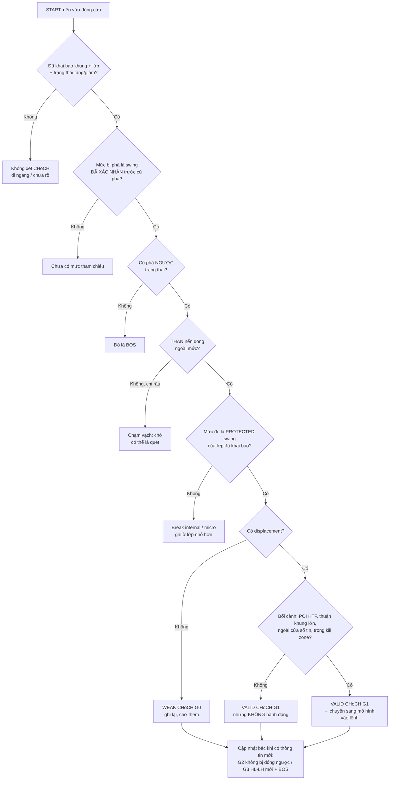

# Change of Character (CHoCH)

> [!summary] Tóm tắt 1 câu
> **Change of Character là lần ĐẦU TIÊN, kể từ khi một trạng thái cấu trúc được thiết lập, mà THÂN NẾN đóng cửa vượt qua cái đỉnh/đáy mà cả trạng thái đó dựa vào (protected swing) theo hướng NGƯỢC LẠI — tức là chân sóng ngược chiều lần đầu làm được việc mà trước đây chỉ chân sóng thuận chiều làm được. Nó thay đổi chắc chắn TẤM BẢN ĐỒ cấu trúc của một lớp trên một khung; nó KHÔNG cho biết chắc chắn giá sẽ đi đâu.**

> [!important] Nguyên tắc cốt lõi (v2)
> 1. **Không có “tính cách” thì không có “thay đổi tính cách”.** Trước khi gọi CHoCH, phải khai báo: khung nào, lớp nào (internal / protected / external), trạng thái đang tăng hay giảm. Vùng đi ngang không có CHoCH.
> 2. **Swing bị phá quan trọng hơn cây nến phá nó.** Nhìn thấy ≠ có ý nghĩa ≠ được bảo vệ. Chỉ phá **protected swing** của lớp đã khai báo mới là CHoCH của lớp đó.
> 3. **Chạm chưa phải phá. Phá chưa phải được chấp nhận. Được chấp nhận chưa phải đảo chiều.** Râu nến = chạm; thân đóng = phá (G0); có displacement = G1; đứng vững = G2; có đỉnh/đáy mới + BOS mới = G3.
> 4. **CHoCH là một CÂU HỎI, không phải câu trả lời.** Nó cho phép hỏi “xu hướng cũ còn không?”; nó chưa cho phép nói “xu hướng mới đã bắt đầu”.
> 5. **Displacement, liquidity sweep, FVG, POI là bằng chứng CHẤT LƯỢNG và BỐI CẢNH — không phải định nghĩa.** Ghi chúng thành các cột riêng để có thể đo xem chúng có thật sự quan trọng không.
> 6. **Mỗi CHoCH chỉ có quyền đổi kết luận ở chính khung và lớp của nó.** M5 CHoCH không đổi Daily Bias.
> 7. **Không dùng thông tin tương lai.** Swing chỉ tồn tại từ lúc được xác nhận; CHoCH chỉ tồn tại từ lúc nến đóng cửa. Bậc dùng để lọc lệnh phải là bậc đã có lúc vào lệnh.

> [!info] Đây là bản v2 (2026-11-10) — đọc trước khi dùng
> - Note được **viết lại toàn bộ** theo protocol “ICT Deep Research — Change of Character” của bạn: mỗi khái niệm đi từ mức **bé 5 tuổi** lên mức kỹ thuật, hạn chế công thức và số học, tách bạch quan sát với diễn giải. Bản v1 (2026-06-24 → 2026-07-28) được sao lưu nguyên vẹn tại `Claude outputs/backups/09-Change-of-Character.2026-11-10.md.bak`. Thay đổi so với v1 ghi ở mục [[#Quy tắc CHoCH v0.1 và nhật ký thay đổi v1 → v2|Quy tắc & Changelog]].
> - **54 hình mới** `CHoCH-v2-01 … 54` nằm trong `attachments/`. Mã sinh hình ở `Claude outputs/CHoCH-v2-figures/`. Các hình v1 (`CHoCH-Advanced-*`, `CHoCH-EdgeB-*`, `CHoCH-Case-Study*`…) vẫn còn trong thư mục nhưng không được nhúng nữa vì một số chứa số liệu không kiểm chứng được.
> - **Mọi mức giá trong ví dụ là số minh họa** (54.6, 72.3, 100, 110…), không phải dữ liệu thị trường, không phải khuyến nghị. **Chưa có backtest nào** được chạy cho note này. Mọi `RULE-CHOCH` là **v0.1 — BACKTEST REQUIRED**; mọi `HYP-CHOCH` là **UNTESTED**.
> - Note này là phần **“vì sao”** dành cho việc hiểu khái niệm. Phần **“đo thế nào”** (state machine, pseudocode, mô phỏng) nằm ở [[21-Market-Structure-Shift]] — hai note dùng chung thang G0–G3 và định nghĩa protected swing. Note nền liên quan: [[05-BOS-Break-of-Structure]] · [[01-Advance-Market-Structure-Short-Term-Low-Intermediate-Term-Low-Long-Term-Low]] · [[54-Thuat-toan-phat-hien-swing-turning-point-Directional-Change-va-Nen-tang-dinh-luong]] · [[57-Dealing-Range-Nghien-cuu-chuyen-sau-Swing-Significance-Selection-Algorithm-Backtest]] · [[20-Liquidity-Sweep]] · [[50-Displacement-In-Depth]] · [[41-Change-in-State-of-Delivery]] · [[59-Daily-Bias]].

> [!abstract]- Mục lục (bấm để mở)
> - **Cách đọc note** — nhãn, tám bước giải thích, cách ghi journal
> - **1. Executive Summary** · **2. CHoCH cho bé 5 tuổi**
> - **3. Nền tảng market structure** · **4. Swing high / swing low** · **5. HH / HL / LH / LL**
> - **6. Internal vs External structure** · **7. Protected high / protected low**
> - **8. Market character là gì?** · **9. Change of Character là gì?** · **10. Vì sao CHoCH xảy ra?** · **11. Cơ chế thị trường bên dưới**
> - **12. Bullish CHoCH** · **13. Bearish CHoCH** · **14. CHoCH vs BOS vs MSS**
> - **15. CHoCH + Liquidity** · **16. CHoCH + Displacement** · **17. CHoCH + FVG / OB / POI**
> - **18. Internal vs External CHoCH** · **19. False CHoCH** · **20. CHoCH trong các điều kiện thị trường**
> - **21. Real-time vs Hindsight** · **22. D1 → H1 → M5** · **23. Khung nhận diện thực hành** · **24. Cây quyết định**
> - **25. Case studies A–H** · **26. Counterexamples** · **27. Lỗi thường gặp** · **28. Điều ta thật sự biết** · **29. Mental model cuối cùng**
> - **Quy tắc v0.1 & Changelog** · **Phụ lục** (câu hỏi, flashcards, lesson learned, liên kết, nguồn, kiểm tra chất lượng)

---

## Cách đọc note

### Hệ thống nhãn

Mỗi khi một câu có thể bị hiểu nhầm giữa “điều nhìn thấy” và “điều mình nghĩ”, note gắn nhãn cho nó:

| Nhãn | Nghĩa | Ví dụ |
|---|---|---|
| **[OBSERVABLE]** | Thấy được trực tiếp trên chart, ai nhìn cũng thấy giống nhau | “Thân nến đóng cửa thấp hơn đáy 67.7.” |
| **[MARKET MECHANICS]** | Giải thích bằng cách lệnh mua bán được khớp | “Giá giảm khi lệnh bán chủ động ăn hết lệnh chờ mua ở các mức bên dưới.” |
| **[ICT FRAMEWORK]** | Cách ICT / cộng đồng ICT–SMC đặt tên và sử dụng | “Phá ngược trạng thái lần đầu gọi là CHoCH.” |
| **[INTERPRETATION]** | Hợp lý nhưng OHLC không chứng minh được | “Phe mua đã không bảo vệ mức này.” |
| **[HYPOTHESIS]** | Có thể kiểm chứng, chưa kiểm chứng | “CHoCH sau một cú quét ít thất bại hơn.” |
| **[FRAMEWORK-DEPENDENT]** | Đúng hay sai tùy định nghĩa của từng trường phái | “Râu nến vượt đáy là đủ để gọi CHoCH.” |
| **[NOT ESTABLISHED]** | Chưa có đủ bằng chứng để khẳng định | “Smart Money đã quyết định đảo chiều ở đây.” |
| **[BACKTEST REQUIRED]** | Không được coi là lợi thế giao dịch trước khi đo | Mọi bộ lọc, mọi quy tắc v0.1 |
| **[HEURISTIC]** | Một quy ước hay ngưỡng đề xuất, không phải quy luật | “Chờ 2–3 nến sau cú phá.” |

![[CHoCH-v2-04-Tam-Loai-Cau-Noi.svg|900]]
*Hình 04 — Cùng một cây nến CHoCH có thể sinh ra tám loại câu nói. Chỉ câu đầu là chắc chắn.*

### Tám bước giải thích

Theo yêu cầu của protocol, mỗi khái niệm quan trọng đi theo thứ tự:

1. **Cho bé 5 tuổi** — ví dụ đời thường, chưa có thuật ngữ.
2. **Ví dụ đơn giản** — một tình huống nhỏ.
3. **Chuỗi giá** — vài con số như 100 → 110 → 105, đọc từng bước.
4. **Định nghĩa kỹ thuật** — chính xác.
5. **Cơ chế bên dưới** — vì sao điều đó xảy ra.
6. **ICT diễn giải ra sao.**
7. **Nhận diện trên chart thế nào.**
8. **Phản ví dụ** — thứ trông giống nhưng không phải.

Mỗi phép so sánh “cho bé” đều kèm **giới hạn của nó** — vì thị trường không thật sự là cầu thang, thủy triều hay cánh cửa.

### Ghi CHoCH vào journal thế nào?

Để không tạo ra hai khái niệm trùng nhau trong vault, **journal dùng ký hiệu của [[21-Market-Structure-Shift]]**:

```text
<khung> MSS-<lớp><hướng> G<bậc>      (ghi thêm "CHoCH" trong ghi chú nếu muốn)
Ví dụ:  M5 MSS-I↑ G1   = cú phá ngược trạng thái ở lớp internal, khung M5, có displacement
        H1 MSS-P↓ G0   = phá protected low của H1 bằng thân nến, chưa có displacement
```

- **Lớp:** `I` = internal, `P` = protected (lớp swing chính của khung đó).
- **Bậc:** `G0` thân nến đóng qua mức · `G1` + displacement · `G2` + được chấp nhận · `G3` + đỉnh/đáy mới và BOS mới (mục 14).
- Trong note này, chữ **CHoCH** được dùng để **giải thích khái niệm** (“tính cách” đổi). Khi ghi chép, **một CHoCH = một MSS ở bậc G0 trở lên** trên lớp và khung đã khai báo.

---

## 1. Executive Summary

1. **“Character” không phải là “trend”.** Trend là HƯỚNG. Character là CÁCH giá đi theo hướng đó: chân nào tạo được đỉnh/đáy mới, đợt lùi dừng ở đâu, chân đẩy và chân hồi trông khác nhau thế nào, và mức nào chưa bao giờ bị đóng nến xuyên qua. **[OBSERVABLE]**
2. **Điều thực sự thay đổi khi có CHoCH:** chân sóng **ngược chiều**, lần đầu tiên, làm được việc mà trước đó chỉ chân **thuận chiều** làm được — nó phá cái mức mà cả cấu trúc dựa vào (protected swing), và bằng cách đó **xoá toàn bộ cú đẩy gần nhất** của xu hướng cũ. **[OBSERVABLE + ICT FRAMEWORK]**
3. **Protected swing** là gốc của chân sóng đã tạo ra BOS gần nhất. Nó “được bảo vệ” theo nghĩa **cả câu chuyện cấu trúc dựa vào nó**, không phải theo nghĩa “có ai đó đang canh giữ nó”. **[ICT FRAMEWORK, định nghĩa vận hành của vault]**
4. **CHoCH có nhiều cấp độ.** Phá một đáy nhỏ trong đợt hồi (internal) khác hoàn toàn với phá protected low của khung H1, và khác nữa với phá ranh dealing range của D1. Một xu hướng lớn chứa rất nhiều CHoCH nhỏ. **[OBSERVABLE]**
5. **CHoCH không phải đảo chiều.** Có năm bậc bằng chứng: thay đổi tính cách → cảnh báo sớm → shift internal → shift external → đảo chiều được xác nhận. Trong truyền thống Wyckoff (nơi cụm từ “change of character” xuất hiện từ trước SMC), lần đổi tính cách đầu tiên thường đánh dấu xu hướng **dừng lại và chuyển sang đi ngang**, không phải xu hướng mới bắt đầu. **[ICT FRAMEWORK / FRAMEWORK-DEPENDENT]**
6. **CHoCH, BOS, MSS** khác nhau ở **trạng thái trước cú phá**, không ở cây nến phá. Phá thuận trạng thái = BOS; phá ngược lần đầu = CHoCH; nhiều nguồn ICT gọi cú phá ngược **có displacement** là MSS. Không có định nghĩa chuẩn; vault dùng thang **G0–G3** để dịch mọi nguồn về một ngôn ngữ. **[FRAMEWORK-DEPENDENT]**
7. **Liquidity sweep không tạo ra CHoCH.** Nó là một sự kiện **có thể** đi trước CHoCH, xảy ra ở **đầu bên kia** của chart (quét đáy rồi CHoCH ở đỉnh). Có CHoCH không có quét, có quét không có CHoCH. **[OBSERVABLE]**
8. **Displacement là thước đo chất lượng của cú phá, không phải định nghĩa.** Cú phá có displacement cho thêm thông tin về lực; nó vẫn có thể thất bại. **[HYPOTHESIS cho mọi khẳng định “tốt hơn”]**
9. **CHoCH là bằng chứng cấu trúc, không phải tín hiệu vào lệnh.** Ba câu hỏi phải tách riêng: *Ở đâu?* (location / POI) — *Cấu trúc đã đổi chưa?* (CHoCH) — *Vào lệnh khi nào?* (mô hình vào lệnh). **[ICT FRAMEWORK]**
10. **CHoCH luôn đẹp hơn khi nhìn lại.** Lúc đang chạy, swing có thể chưa được xác nhận, cú phá chưa biết có giữ được không, xu hướng mới chưa có hình dạng. Mọi phân tích phải ghi rõ “lúc đó biết gì”. **[OBSERVABLE]**
11. **Trong ICT 2022 (D1 → H1 → M5):** D1 cho bối cảnh, H1 cho setup và POI, M5 CHoCH/MSS tại POI H1 là **điều kiện kích hoạt**. M5 CHoCH không có quyền đổi H1 hay D1. **[ICT FRAMEWORK + quy tắc của vault]**
12. **Chưa có bằng chứng thống kê công khai** nào cho thấy CHoCH — ở bất kỳ phiên bản nào — tự nó tạo lợi thế giao dịch. Các nguồn đã đối chiếu đều trình bày điều kiện (đóng nến, displacement, quét) như **quy ước**, không kèm số liệu. **[NOT ESTABLISHED → BACKTEST REQUIRED]**

---

## 2. CHoCH Mental Model — giải thích cho bé 5 tuổi

### 2.1 Bạn Nam leo cầu thang kiểu “tiến ba, lùi một”

![[CHoCH-v2-01-ELI5-Nam-Leo-Cau-Thang.svg|900]]
*Hình 01 — Bốn khoảnh khắc của bạn Nam. Bậc màu cam là “bậc lấy đà”: cái bậc Nam đứng để bắt đầu lần leo gần nhất.*

> [!tip] Cho bé 5 tuổi
> Bạn Nam leo cầu thang rất lạ: **leo lên ba bậc, rồi lùi xuống một bậc để nghỉ**, rồi lại leo lên ba bậc, lùi một bậc… cứ thế mãi.
>
> - Mỗi lần **lùi**, Nam vẫn đứng **cao hơn** chỗ nghỉ lần trước.
> - Mỗi lần **leo**, Nam lên **cao hơn** chỗ cao nhất lần trước.
>
> Nhìn Nam một lúc, bé sẽ nói: “Nam đang **đi lên**”. Và bé cũng biết **thói quen** của Nam: “tiến ba, lùi một”. Thói quen đó chính là **“tính cách”** (character) của cách Nam leo.
>
> Một hôm, Nam lùi **hai** bậc. Hơi lạ — nhưng Nam vẫn đứng **trên** cái bậc mà Nam đã dùng để lấy đà cho lần leo gần nhất. Thói quen chưa bị phá hẳn.
>
> Rồi một hôm khác, Nam đi xuống **thấp hơn cả bậc lấy đà**. Lần leo gần nhất coi như **bị xoá**: Nam đang đứng ở chỗ còn thấp hơn trước khi leo. Lúc này bé có quyền nói: **“Ơ, tính cách leo của Nam vừa thay đổi!”**
>
> Nhưng bé **chưa** có quyền nói “Nam sẽ đi xuống tầng trệt”. Có thể Nam mỏi chân và đứng nghỉ lâu. Có thể Nam leo tiếp. Có thể Nam đi xuống thật. **Thay đổi tính cách là một lời cảnh báo, chưa phải câu trả lời.**

**Ví dụ đơn giản.** Hãy tưởng tượng bạn đứng dưới chân cầu thang và chỉ được nhìn Nam mỗi 10 giây. Ba lần đầu, Nam luôn đứng cao hơn lần trước. Lần thứ tư, Nam đứng thấp hơn — nhưng vẫn trên bậc lấy đà. Lần thứ năm, Nam đứng dưới bậc lấy đà. Bạn chỉ có một quan sát mới: “Nam đã đứng dưới bậc lấy đà”. Mọi thứ khác (Nam mệt? Nam đánh rơi đồ? Nam quyết định đi xuống?) là đoán.

**Chuỗi giá.** Thay bậc thang bằng giá:

```text
100 → 110 → 105 → 118 → 111 → 125 → 116 → 108
       HH    HL    HH    HL    HH    (lùi)  (lùi tiếp)
```

- 105 và 111 là các **chỗ nghỉ** (Higher Low – HL).
- Cú leo gần nhất là từ **111 lên 125** (vượt đỉnh cũ 118). Vậy **111 là bậc lấy đà** — tên kỹ thuật: **protected low**.
- Giá lùi về **116**: vẫn trên 111. Chưa có gì đổi.
- Giá lùi về **108**, và một cây nến **đóng cửa** dưới 111: **Change of Character**.

**Định nghĩa kỹ thuật (bản rút gọn).** CHoCH là lần đầu tiên kể từ khi một xu hướng được thiết lập, thân nến đóng cửa vượt qua protected swing theo hướng ngược lại xu hướng đó (định nghĩa đầy đủ ở mục 9).

**Giới hạn của ví dụ.** Nam là một người, có ý chí. Giá thì không có ý chí của “một người” — nó là kết quả của rất nhiều lệnh mua bán gặp nhau. Ví dụ giúp nhớ **hình dạng** và **ý nghĩa của bậc lấy đà**, nhưng đừng mang ví dụ đi xa hơn: không có “ai” đã “quyết định” bước xuống.

### 2.2 Từ câu chuyện sang chart nến

![[CHoCH-v2-03-Tu-Cau-Chuyen-Len-Chart.svg|900]]
*Hình 03 — Câu chuyện cầu thang vẽ lại bằng nến. Đường cam là “bậc lấy đà” (protected low). Ở ⑤ giá nhô qua đỉnh cũ một chút rồi rút về; ở ⑥ thân nến đóng dưới protected low.*

Đọc hình 03 theo số:

1. **Chỗ nghỉ** (HL1) — đáy cao hơn đáy trước.
2. **Chỗ cao nhất** (HH1) — vượt đỉnh trước: một **BOS** tăng.
3. **Bậc lấy đà** (HL2 — protected low) — đáy đã phóng ra cú tăng vượt HH1.
4. **Lùi hơi sâu** — một đáy nhỏ bên trong bị phá, nhưng vẫn trên HL2. Chỉ là chuyện nội bộ.
5. **Chạm cao hơn một chút** — râu nến nhô qua đỉnh HH2 rồi đóng lại bên dưới (một cú quét, mục 15).
6. **Lùi dưới bậc lấy đà** — thân nến đóng dưới HL2. Thói quen “đáy sau cao hơn đáy trước” bị phá: **Change of Character**.

### 2.3 Một ví dụ khác: “tính cách” của sóng biển

![[CHoCH-v2-02-ELI5-Thuy-Trieu.svg|900]]
*Hình 02 — Khi thủy triều lên, mỗi con sóng vào xa hơn và mỗi lần rút cũng không rút sâu bằng lần trước. Khi triều đổi, một con sóng không vào tới vạch cũ, rồi một lần rút sâu hơn vạch rút cuối cùng.*

> [!tip] Cho bé 5 tuổi
> Đứng trên bãi cát, bé đánh dấu chỗ xa nhất nước tràn tới và chỗ nước rút về. Lúc triều lên, mỗi con sóng vào xa hơn con trước, mỗi lần rút cũng không rút sâu bằng lần trước. Rồi một lúc, có con sóng **không vào tới vạch cũ** (dấu hiệu sớm). Sau đó nước **rút về sâu hơn vạch rút cuối cùng** — bé biết triều đang đổi.

Ví dụ này hay ở chỗ nó cho thấy **dấu hiệu yếu đi thường đến trước** (con sóng không vào tới vạch cũ), rồi **phán quyết** mới đến (rút sâu hơn vạch cũ). Trên chart cũng vậy (mục 8.4).

**Giới hạn:** thủy triều đổi theo mặt trăng, đoán trước được bằng lịch. Giá **không có mặt trăng** — không có lịch nào nói trước khi nào xu hướng đổi.

### 2.4 Toàn bộ CHoCH trong sáu câu cho bé

1. Giá thường có **thói quen**: đi lên thì đáy sau cao hơn đáy trước; đi xuống thì đỉnh sau thấp hơn đỉnh trước.
2. Mỗi lần giá leo được lên chỗ mới, có một **bậc lấy đà** — chỗ giá đứng để bắt đầu leo.
3. Nếu giá quay xuống **dưới bậc lấy đà** (và **đứng hẳn** ở đó, không chỉ thò chân xuống), lần leo gần nhất bị **xoá**.
4. Lúc đó ta nói **tính cách đã đổi**: Change of Character.
5. Nhưng tính cách đổi **chưa có nghĩa** là giá sẽ đi ngược lại. Có thể giá chỉ đứng nghỉ, hoặc leo tiếp.
6. Muốn biết chắc hơn, phải **chờ thêm**: giá có tạo một thói quen mới theo hướng ngược lại không?

---

## 3. Market Structure Foundation

### 3.1 Market structure là gì?

> [!tip] Cho bé 5 tuổi
> Nếu bé đi bộ trên bãi cát, bé để lại **dấu chân**. Nhìn dấu chân, người khác biết bé đã đi hướng nào, đi nhanh hay chậm, có quay lại không. **Market structure** là “dấu chân” của giá: các đỉnh và đáy mà giá để lại.

**Định nghĩa kỹ thuật.** Market structure là cách ta **mô tả** chuỗi đỉnh (swing high) và đáy (swing low) của giá trên một khung thời gian, để trả lời: giá đang có xu hướng tăng, giảm, hay không có xu hướng? **[OBSERVABLE + quy ước]**

**Điều cần hiểu sớm:** market structure là **một cách phân loại do con người đặt ra**, không phải một vật thể có sẵn trong giá. Hai người dùng hai quy tắc chọn swing khác nhau sẽ thấy hai cấu trúc khác nhau trên cùng một chart (xem [[54-Thuat-toan-phat-hien-swing-turning-point-Directional-Change-va-Nen-tang-dinh-luong]]). Vì vậy câu hỏi “đây có phải CHoCH không?” luôn kèm theo câu hỏi ngầm: “theo **quy tắc nào**?”. **[FRAMEWORK-DEPENDENT]**

### 3.2 Ba trạng thái — và vì sao CHoCH cần một trạng thái

![[CHoCH-v2-08-Ba-Trang-Thai-CHoCH-Can-Co-Trang-Thai.svg|900]]
*Hình 08 — Tăng, giảm, đi ngang. CHoCH chỉ có nghĩa ở hai panel đầu.*

- **Tăng:** đáy sau cao hơn đáy trước, đỉnh sau cao hơn đỉnh trước.
- **Giảm:** đỉnh sau thấp hơn đỉnh trước, đáy sau thấp hơn đáy trước.
- **Đi ngang:** đỉnh và đáy chồng lên nhau, không có thói quen nào rõ.

Trong vùng đi ngang, mọi cú phá đều “ngược chiều” với **một cái gì đó** — phá đỉnh nhỏ thì ngược với nhịp giảm vừa rồi, phá đáy nhỏ thì ngược với nhịp tăng vừa rồi. Vì không có thói quen chung, **không có tính cách nào để thay đổi**. Đó là lý do bước đầu tiên của mọi nhận diện CHoCH là **khai báo trạng thái** (RULE-CHOCH-001).

### 3.3 Nguồn gốc: đây không phải phát minh của ICT

- **Dow Theory** (cuối thế kỷ 19) đã mô tả xu hướng bằng chuỗi đỉnh–đáy cao dần / thấp dần, và coi việc chuỗi đó bị phá là dấu hiệu xu hướng có thể kết thúc. Các tài liệu SMC hiện đại (ví dụ LuxAlgo) cũng ghi nhận gốc Dow này. **[ICT FRAMEWORK — lịch sử]**
- **Wyckoff** dùng chính cụm từ **“change of character”** để chỉ sự thay đổi trong **hành vi** của giá (và khối lượng) khi phe kiểm soát đổi. Trong cách giảng phổ biến của phương pháp Wyckoff, Phase A — “chặn xu hướng trước đó” — là nơi xảy ra lần đổi tính cách đầu tiên (từ **xu hướng sang đi ngang**), và lần đổi tính cách thứ hai xảy ra khi giá **rời** vùng đi ngang (từ **đi ngang sang xu hướng**). Nguồn đã đối chiếu (tradingwyckoff.com) còn nói rõ: ngay sau Phase A “ta chưa thể biết liệu thay đổi tính cách có thật sự xảy ra” cho tới khi các phép thử tiếp theo hoàn tất. **[ICT FRAMEWORK — lịch sử; nguồn Tier 3]**
- **SMC / ICT** lấy lại cụm từ này, rút gọn thành “CHoCH”, và định nghĩa nó **thuần bằng cấu trúc giá** (không cần khối lượng). ICT trong mô hình 2022 thường dùng chữ **Market Structure Shift (MSS)** và về sau là **CISD** ([[41-Change-in-State-of-Delivery]]) cho những ý tưởng gần giống. Note này **chưa đối chiếu video gốc** của ICT và không trích nguyên văn ICT. **[ICT FRAMEWORK]**

> [!note] Bài học từ lịch sử
> Ở nơi khái niệm ra đời (Wyckoff), lần “đổi tính cách” đầu tiên **không** được hiểu là “xu hướng mới bắt đầu” mà là “xu hướng cũ có thể đã dừng”. Phiên bản SMC hay bị dạy thành “CHoCH = đảo chiều” — đó là một bước rút gọn **mất thông tin**.

---

## 4. Swing High / Swing Low

### 4.1 Swing là gì? (tám bước)

![[CHoCH-v2-05-Swing-Sinh-Ra-Nhu-The-Nao.svg|900]]
*Hình 05 — Trái: quả bóng ném lên. Phải: một đỉnh fractal 5 nến. Một đỉnh chỉ được xác nhận khi giá đã đi xuống khỏi nó một đoạn.*

1. **Cho bé 5 tuổi.** Ném quả bóng lên trời. Bóng bay lên, chậm dần, dừng một chút trên cao, rồi rơi xuống. **Điểm cao nhất** là “đỉnh”. Nhưng đúng lúc bóng ở điểm cao nhất, bé **không biết** đó là điểm cao nhất — có thể bóng còn bay tiếp. Chỉ khi thấy bóng rơi xuống một đoạn, bé mới nói “À, đỉnh là chỗ đó”.
2. **Ví dụ đơn giản.** Bạn đếm số người xếp hàng mua kem mỗi phút: 3, 5, 8, 6, 4. Con số 8 là “đỉnh” — nhưng bạn chỉ biết điều đó sau khi thấy 6 và 4.
3. **Chuỗi giá.** Nến đóng: 100 → 104 → 108 → **111** → 107 → 103. Đỉnh 111 chỉ được coi là swing high sau khi có đủ nến thấp hơn ở bên phải.
4. **Định nghĩa kỹ thuật.** **Swing high** là một nến (hoặc một điểm) có giá cao hơn các nến lân cận ở cả hai bên theo một quy tắc đã chọn (ví dụ: cao hơn 2 nến bên trái và 2 nến bên phải — “fractal 5 nến”). **Swing low** đối xứng. **[quy ước — HEURISTIC]**
5. **Cơ chế.** Giá đi lên khi người muốn mua ngay (lệnh chủ động) nhiều hơn lượng hàng người bán đang treo sẵn ở các mức giá phía trên. Đến một lúc, ở các mức cao hơn, lượng hàng treo bán nhiều hơn hoặc người mua chủ động ít đi — giá ngừng đi lên và quay xuống. Chỗ quay đầu đó là swing. **[MARKET MECHANICS]**
6. **ICT diễn giải.** ICT coi các đỉnh/đáy rõ ràng là nơi **thanh khoản** tụ lại (lệnh dừng lỗ, lệnh chờ breakout nằm bên kia). **[ICT FRAMEWORK]**
7. **Nhận diện.** Chọn một quy tắc swing và giữ nguyên nó khi backtest. Ghi lại **lúc nào** swing được xác nhận (“known at”).
8. **Phản ví dụ.** Một cây nến có râu cao hơn hai nến bên cạnh nhưng nằm giữa một cụm nến đi ngang — về hình học là “swing”, về thông tin thì gần như không nói gì (hình 06, “chỉ nhìn thấy”).

### 4.2 Vì sao swing luôn đến trễ — và vì sao điều đó quan trọng với CHoCH

Vì một swing chỉ được xác nhận **sau** khi giá đã rời nó, nên:

- Một cú phá chỉ có nghĩa nếu swing bị phá **đã được xác nhận trước** cú phá (RULE-CHOCH-003).
- Nếu bạn “thấy” một HL trên chart lưu nhưng tại lúc giá phá nó, HL đó **chưa từng được xác nhận** theo quy tắc của bạn, thì CHoCH bạn thấy là **hindsight** (mục 21, hình 39).

### 4.3 Vì sao có swing quan trọng và swing không quan trọng?

Vì mỗi swing **đã làm** những việc khác nhau. Một đáy nhỏ trong cụm nến đi ngang chưa làm gì cả. Một đáy đã phóng ra cú tăng vượt đỉnh cũ (BOS) đã làm một việc cấu trúc. Một đáy là ranh dưới của dealing range D1 làm việc còn lớn hơn. Mục 7 và mục 10 tách các loại này ra.

---

## 5. HH / HL / LH / LL

![[CHoCH-v2-07-Cau-Truc-Tang-va-Giam.svg|900]]
*Hình 07 — Hai cấu trúc với số minh họa. Mỗi nhãn đi kèm một câu tiếng Việt nói nó có nghĩa gì.*

### 5.1 Cấu trúc tăng: HH → HL → HH → HL

> [!tip] Cho bé 5 tuổi
> **HH** (Higher High – đỉnh cao hơn): “Lần này mình leo cao hơn lần trước!”
> **HL** (Higher Low – đáy cao hơn): “Lần này mình nghỉ ở chỗ cao hơn chỗ nghỉ lần trước.”

**Chuỗi giá (hình 07 trái):** 100 → **110** (HH) → **105** (HL) → **118** (HH) → **111** (HL) → **125** (HH).

- **HH thể hiện điều gì?** Bên mua đẩy được giá **lên chỗ chưa từng giao dịch** trong cấu trúc này. **[OBSERVABLE]** Diễn giải: lực mua đủ để hấp thụ hết lượng bán treo ở vùng đỉnh cũ. **[INTERPRETATION]**
- **HL thể hiện điều gì?** Khi giá lùi, nó **dừng ở mức cao hơn lần lùi trước**. **[OBSERVABLE]** Diễn giải: người mua sẵn sàng trả giá cao hơn lần trước để tham gia — họ không chờ giá về tận đáy cũ. **[INTERPRETATION]**
- **Vì sao HL quan trọng?** Vì HH có thể xảy ra trong bất kỳ cú giật nào; còn **chuỗi HL** cho thấy **sự chấp nhận** giá cao hơn lặp lại nhiều lần. Đó là phần “thói quen” của xu hướng.
- **Vì sao việc bảo vệ HL có ý nghĩa?** Vì nếu đáy sau không còn cao hơn đáy trước, câu “đang tăng” mất một nửa định nghĩa của nó.
- **Điều gì xảy ra nếu giá phá một HL quan trọng?** Tùy HL nào (mục 7, 10). Nếu đó là HL **đã phóng ra cú vượt đỉnh gần nhất** (111 trong ví dụ) → câu “cấu trúc đang tăng” ở lớp này **không còn đúng** → CHoCH. Nếu đó chỉ là một đáy nhỏ giữa đường → đợt hồi đang sâu hơn, chưa đổi gì ở lớp chính.

### 5.2 Cấu trúc giảm: LL → LH → LL → LH

**Chuỗi giá (hình 07 phải):** 125 → **112** (LL) → **119** (LH) → **104** (LL) → **112** (LH) → **96** (LL).

- **LL** (Lower Low – đáy thấp hơn): bên bán đẩy được giá xuống chỗ mới.
- **LH** (Lower High – đỉnh thấp hơn): khi giá hồi, nó dừng ở mức **thấp hơn** lần hồi trước — người bán chấp nhận bán ở giá thấp hơn trước. **[INTERPRETATION]**
- **Protected high** ở đây là **112** — đỉnh đã phóng ra cú giảm thủng đáy 104. Thân nến đóng trên 112 → CHoCH tăng ở lớp này.

### 5.3 Đọc từng bước một chuỗi giá — bài tập nhỏ

```text
Giá: 100 → 110 → 105 → 118 → 111 → 125 → 116 → 121 → 108
```

| Bước | Giá | Nhãn | Điều thay đổi |
|---|---|---|---|
| 1 | 110 | HH | đỉnh đầu tiên |
| 2 | 105 | HL | đáy đầu tiên cao hơn 100 |
| 3 | 118 | HH | vượt 110 → BOS ↑; **105** thành protected low |
| 4 | 111 | HL | đáy mới, **chưa** protected (chưa phóng ra BOS) |
| 5 | 125 | HH | vượt 118 → BOS ↑; protected low **dời lên 111** |
| 6 | 116 | — | đáy ứng viên, chưa protected |
| 7 | 121 | — | đỉnh nhỏ, **không** vượt 125 → không có BOS, protected vẫn là 111 |
| 8 | 108 | CHoCH ↓ | thân nến đóng dưới **111** → tính cách đổi ở lớp này |

Chú ý bước 7: đỉnh 121 **không vượt** được 125 — đó là một dấu hiệu tính cách đang yếu đi **trước** khi CHoCH xảy ra (mục 8.4).

---
## 6. Internal vs External Structure

### 6.1 Cho bé 5 tuổi: con tàu, hành khách và con kiến

![[CHoCH-v2-09-ELI5-Con-Tau-Hanh-Khach-Con-Kien.svg|900]]
*Hình 09 — Ba chuyển động lồng vào nhau: con tàu đi sang phải, hành khách đi sang trái trên boong, con kiến bò sang phải trên giày hành khách.*

> [!tip] Cho bé 5 tuổi
> Một con tàu chạy sang phải. Trên boong, một hành khách đi bộ sang trái. Trên giày của hành khách, một con kiến bò sang phải.
> - Hỏi: “Con tàu có quay đầu không?” — Không. Hành khách đi ngược chiều tàu không làm tàu quay đầu.
> - Hỏi: “Hành khách có quay đầu không?” — Phải nhìn hành khách, không phải nhìn con kiến.
>
> Thị trường cũng có những chuyển động lồng nhau như vậy. **Cái nhỏ đi ngược cái lớn không có nghĩa là cái lớn đã đổi hướng.**

**Giới hạn của ví dụ:** con tàu, hành khách và con kiến là ba vật **riêng biệt**. Trên chart, ba “chuyển động” là **cùng một đường giá** nhìn ở ba độ phân giải khác nhau — chúng không độc lập.

### 6.2 Định nghĩa

- **External structure:** “bộ xương” lớn của thị trường — các đỉnh/đáy quan trọng xác định xu hướng hoặc range hiện tại của một khung. **[ICT FRAMEWORK]**
- **Internal structure:** mọi thứ được in ra **bên trong một chân sóng external** — các đỉnh/đáy nhỏ giá tạo ra trên đường đi giữa hai điểm lớn. **[ICT FRAMEWORK]**
- Sự phân chia này là **tương đối với một chân sóng / range đã chọn**, không cố định theo khung thời gian. LuxAlgo (nguồn đã đối chiếu) cũng viết: sự phân chia là “phân cấp, không gắn với khung thời gian cố định”, và phụ thuộc tham số. **[FRAMEWORK-DEPENDENT]**

### 6.3 Vì sao một xu hướng lớn chứa nhiều xu hướng nhỏ?

Vì giá không đi thẳng. Một chân tăng của H1 khi nhìn ở M5 là nhiều đợt đẩy và nhiều đợt hồi; mỗi đợt hồi có thể đủ dài để tự có đỉnh thấp dần, đáy thấp dần — tức là một “xu hướng giảm” nhỏ. **[OBSERVABLE]**

![[CHoCH-v2-10-Internal-vs-External-Tren-Chart.svg|900]]
*Hình 10 — Một chân tăng external chứa cả một cấu trúc giảm internal. Lớp nhỏ đổi chiều hai lần (CHoCH ↓ rồi CHoCH ↑), lớp lớn không đổi lần nào.*

### 6.4 Vì sao phá internal swing không đồng nghĩa với đổi external trend?

Trong hình 10:
- Đầu đợt hồi, giá phá cái **HL nhỏ 68** trong chân tăng → lớp internal đổi sang giảm (**CHoCH ↓ internal**).
- Protected low **external** là **40** — tận dưới đáy chart. Cú phá 68 không chạm tới nó.
- Cuối đợt hồi, giá vượt **LH nhỏ 67.5** → lớp internal đổi lại sang tăng (**CHoCH ↑ internal**). Sau đó external tạo BOS ↑ qua 78.

Kết luận: **cùng một chart có hai câu trả lời đúng** cho câu “đang tăng hay giảm?” — tùy lớp. Vì vậy câu hỏi phải luôn kèm lớp và khung.

### 6.5 CHoCH xuất hiện ở nhiều cấp độ cấu trúc

Mỗi lớp có protected swing riêng, nên mỗi lớp có thể có CHoCH riêng. Một CHoCH M5 internal, một CHoCH H1 protected, một CHoCH D1 external là **ba sự kiện khác nhau** với ba mức độ ý nghĩa khác nhau. Mục 18 đi sâu vào chuyện này.

---

## 7. Protected High / Protected Low

### 7.1 Cho bé 5 tuổi: chỗ giậm nhảy

![[CHoCH-v2-11-Protected-Low-La-Cho-Lay-Da.svg|900]]
*Hình 11 — Protected low là chỗ “giậm nhảy” của cú tăng vượt đỉnh gần nhất. Giá về dưới nó = cả cú tăng đó bị xoá.*

> [!tip] Cho bé 5 tuổi
> Bé đứng ở vạch cam, giậm chân và nhảy xa thật xa. Nếu sau đó bé bị kéo lùi về **sau vạch giậm**, cú nhảy coi như chưa từng có — bé còn đứng ở chỗ tệ hơn trước khi nhảy.

**Ví dụ đơn giản.** Bạn để dành tiền: tuần 1 có 52 nghìn, tuần 2 có 64 (kỷ lục lúc đó), tuần 3 tiêu bớt còn 57, tuần 4 để dành mạnh lên 76 (phá kỷ lục cũ 64). Tuần 5 tiêu còn 66 — vẫn ổn. Tuần 6 chỉ còn 54: bạn đang có **ít hơn** cả tuần 3. Toàn bộ phần để dành từ tuần 3 đến tuần 4 — phần đã giúp bạn phá kỷ lục — đã mất. Mốc 57 của tuần 3 là “chỗ giậm nhảy”.

**Chuỗi giá (hình 11 phải):** 52 → 64 → **57** → 76 (vượt 64 = BOS) → 66 → 70 → **54**.
- Đáy 57 là gốc của cú tăng vượt đỉnh 64 → **protected low**.
- Đáy 66 nằm giữa đường, chưa phóng ra BOS nào → phá nó chỉ là pullback sâu hơn.
- Thân nến đóng dưới 57 → cú tăng 57 → 76 bị trả lại hoàn toàn → **CHoCH ↓**.

### 7.2 Định nghĩa vận hành

Vault dùng định nghĩa đã thống nhất ở [[21-Market-Structure-Shift]] (DEF-MSS-03) và [[57-Dealing-Range-Nghien-cuu-chuyen-sau-Swing-Significance-Selection-Algorithm-Backtest]]:

- **Protected low** = **đáy thấp nhất** nằm giữa đỉnh bị phá và nến phá của **BOS tăng gần nhất** — tức là **gốc của chân sóng đã tạo ra BOS tăng gần nhất**.
- **Protected high** = **đỉnh cao nhất** giữa đáy bị phá và nến phá của **BOS giảm gần nhất**.
- Khi một CHoCH xảy ra, protected swing **mới** của phía bên kia là **cực trị của chân sóng ngay trước cú phá** (ví dụ: đáy quét trong bullish CHoCH).

Định nghĩa này khớp với khái niệm **“strong low / strong high”** trong tài liệu SMC: LuxAlgo viết rằng strong low là “cái đáy đã phát động một break of structure đi lên”, và thị trường “không nên giao dịch xuyên qua nó khi xu hướng tăng còn nguyên”. **[ICT FRAMEWORK + định nghĩa của vault]**

> [!warning] “Protected” KHÔNG có nghĩa là “có người đang bảo vệ”
> Câu “tổ chức đang bảo vệ mức này” là **[NOT ESTABLISHED]** và không cần thiết cho định nghĩa. Một mức là protected vì **cả kết luận cấu trúc của lớp này dựa vào nó**. Nếu nó bị phá, kết luận đó sai — vậy thôi.

### 7.3 Visible ≠ Significant ≠ Protected

![[CHoCH-v2-06-Visible-Significant-Protected.svg|900]]
*Hình 06 — Ba vòng tròn lồng nhau. Tại cuối chart: rất nhiều đáy nhìn thấy, vài đáy có ý nghĩa, và chỉ MỘT protected low.*

| Loại | Là gì | Số lượng | Phá nó có nghĩa gì |
|---|---|---|---|
| **Visible swing** | Bất kỳ chỗ giá quay đầu | Rất nhiều | Gần như không gì |
| **Significant swing** | Swing đã xác nhận VÀ đã làm một việc cấu trúc (phóng ra BOS, là ranh range, bị quét…) | Vài cái | Một phần câu chuyện bị xoá |
| **Protected swing** | Swing mà nếu bị phá thì câu “đang tăng/giảm” ở lớp này sai | **Một** mỗi lớp, mỗi thời điểm | Trạng thái của lớp đổi = CHoCH |

Ba khái niệm này **không được đánh đồng**. Phần lớn “CHoCH sai” đến từ việc coi một swing nhìn thấy (hoặc một swing có ý nghĩa nhưng đã cũ) là protected.

### 7.4 Xác định protected low trong cấu trúc tăng — từng bước

1. Tìm **BOS tăng gần nhất**: cây nến đóng cửa vượt đỉnh cũ gần nhất.
2. Nhìn **ngược lại** từ cây nến đó về đỉnh cũ vừa bị phá.
3. Trong đoạn đó, tìm **đáy thấp nhất**. Đó là protected low.
4. Kiểm tra: đáy đó đã được **xác nhận** là swing theo quy tắc của bạn chưa? (thường là rồi, vì sau nó giá đã đi lên vượt đỉnh).
5. Mỗi khi có BOS tăng mới, lặp lại: protected low **dời lên**.

Protected high trong cấu trúc giảm: làm đối xứng.

### 7.5 Vòng đời của một protected low

![[CHoCH-v2-12-Vong-Doi-Protected-Low.svg|900]]
*Hình 12 — Ứng viên → được bảo vệ → bị dời lên → bị tiêu thụ (CHoCH).*

- **Ứng viên:** một HL mới hình thành nhưng **chưa** phóng ra BOS nào. Nó chưa phải protected.
- **Được bảo vệ:** giá đi từ HL đó vượt đỉnh cũ (BOS). HL được “thăng chức”.
- **Bị dời:** có BOS mới hơn từ một HL cao hơn → protected dời lên; HL cũ thành **mức tham chiếu sâu** (vẫn có ý nghĩa, nhưng không còn là protected).
- **Bị tiêu thụ:** thân nến đóng xuyên qua → đó chính là CHoCH ở lớp này.

### 7.6 Khi protected swing bị phá — cái gì đổi, cái gì không

Tóm tắt từ [[21-Market-Structure-Shift]] §7.5:

| Đổi **tự động** | **Không** đổi tự động |
|---|---|
| Chuỗi BOS của lớp đó mất hiệu lực | Hướng đi tiếp theo của giá |
| Mô tả trạng thái của lớp (“đang tăng” → “đang thử giảm”) | Trạng thái (bias) của **khung lớn hơn** |
| Mức tham chiếu phía bên kia (đỉnh vừa tạo trở thành mức cần vượt) | Việc đây là đảo chiều, pullback sâu hay range |
| Dealing range của lớp đó phải vẽ lại | Ai đã bán, vì sao |

### 7.7 Hai quy ước đang tồn tại song song [FRAMEWORK-DEPENDENT]

| Quy ước | “Mức bị phá” là | Hệ quả |
|---|---|---|
| **A — HL/LH gần nhất** (nhiều indicator, lớp internal) | Đáy (đỉnh) gần nhất đã xác nhận | Nhiều CHoCH hơn, sớm hơn, nhiễu hơn |
| **B — Protected** (vault, lớp chính) | Gốc của chân tạo BOS gần nhất | Ít CHoCH hơn, muộn hơn, mỗi cái mang nhiều thông tin hơn |

Không quy ước nào “đúng”. Vault **dùng cả hai** nhưng **tách lớp**: quy ước A cho lớp internal (`MSS-I`), quy ước B cho lớp protected (`MSS-P`). Điều cấm là **trộn** hai quy ước mà không khai báo. Theo mô phỏng trên dữ liệu ngẫu nhiên ở [[21-Market-Structure-Shift]] (MSS-Sim-01 — không phải dữ liệu thị trường), lớp internal sinh ra số “đảo chiều” khoảng gấp đôi lớp protected — nhầm hai lớp làm bạn nhìn thấy gấp đôi số lần “đổi tính cách”.

---

## 8. What Is Market Character?

### 8.1 Cho bé 5 tuổi: tính cách của một người

> [!tip] Cho bé 5 tuổi
> Bạn Bin **lúc nào cũng** đến lớp sớm. Đó là tính cách của Bin. Một hôm Bin đến muộn 1 phút — Bin có đổi tính cách không? Chưa chắc: có thể kẹt xe. Nhưng nếu Bin đến muộn **đúng vào hôm có bài kiểm tra quan trọng nhất**, cái hôm mà trước giờ Bin chưa bao giờ muộn — cô giáo sẽ bắt đầu để ý: “Bin dạo này có chuyện gì không?”
>
> - Đến muộn một hôm bình thường = phá một swing nhỏ.
> - Đến muộn đúng hôm quan trọng nhất = phá **protected swing**.
> - Cô giáo **để ý** = CHoCH. Cô giáo **chưa kết luận** Bin hư — cần xem những ngày sau.

**Giới hạn:** Bin có lý do riêng mà ta có thể hỏi. Thị trường không trả lời câu hỏi “vì sao”.

### 8.2 Bốn đặc điểm quan sát được của “character”

![[CHoCH-v2-13-Market-Character-La-Gi.svg|900]]
*Hình 13 — Một character tăng khỏe: chân tăng ít nến, thân to; chân giảm nhiều nến nhỏ, chồng lên nhau; protected low chưa bao giờ bị đóng nến xuyên.*

| # | Đặc điểm | Bullish character | Bearish character |
|---|---|---|---|
| ① | **Ai tạo được cực trị mới?** | Chỉ chân tăng vượt được đỉnh cũ | Chỉ chân giảm thủng được đáy cũ |
| ② | **Pullback dừng ở đâu?** | Cao hơn lần trước (HL) | Thấp hơn lần trước (LH) |
| ③ | **Chân đẩy vs chân hồi** | Chân tăng dài/nhanh; chân giảm ngắn/chậm/chồng chéo | Ngược lại |
| ④ | **Mức nào được giữ?** | Protected low chưa bị đóng nến xuyên | Protected high chưa bị đóng nến xuyên |

Cả bốn là **[OBSERVABLE]**. Câu “phe mua đang mạnh” là **[INTERPRETATION]** của bốn quan sát đó.

**Định nghĩa của note này:** *Market character là tập hợp các khuôn mẫu hành vi mà giá đã lặp lại một cách nhất quán trong trạng thái hiện tại của một lớp trên một khung — đặc biệt là sự **bất đối xứng** giữa chân sóng thuận chiều và chân sóng ngược chiều.*

### 8.3 Trend có phải là character không?

**Không hoàn toàn.** Trend là **hướng** (đặc điểm ① và ②). Character rộng hơn: nó còn gồm **cách đi** (③) và **mức nào được tôn trọng** (④). Vì vậy:

- **Character có thể thay đổi mà trend lớn vẫn tiếp tục.** Ví dụ: một xu hướng tăng chuyển từ “đẩy mạnh, hồi nông” sang “đẩy yếu, hồi sâu, nến chồng chéo” — vẫn tạo HH/HL, nhưng character đã khác (đặc điểm ③ suy yếu). Hoặc lớp internal đổi chiều trong khi lớp external vẫn tăng (hình 10).
- **CHoCH theo nghĩa SMC chỉ đo đặc điểm ① và ④** — bằng sự kiện “chân ngược chiều phá protected swing”. Đặc điểm ② và ③ thường suy yếu **trước** đó và là **thông tin bổ sung**, không phải định nghĩa.

### 8.4 Character thường suy yếu trước khi CHoCH xuất hiện

![[CHoCH-v2-14-Character-Suy-Yeu-Truoc-CHoCH.svg|900]]
*Hình 14 — Trái: có báo trước (chân tăng ngắn lại, pullback sâu hơn, đỉnh thấp hơn sau CHoCH). Phải: không báo trước.*

Những dấu hiệu sớm **có thể** gặp (không phải luôn luôn): **[OBSERVABLE]**

- Chân thuận chiều **ngắn lại** — đỉnh mới chỉ nhỉnh hơn đỉnh cũ.
- **Không tạo được** cực trị mới (đỉnh thấp hơn trong xu hướng tăng = “weak high”, “failed high”).
- Pullback **sâu hơn và nhanh hơn** thường lệ; nến của chân ngược chiều bắt đầu to hơn nến của chân thuận chiều.
- Một cú quét đỉnh (hoặc đáy) **không có follow-through**.

LuxAlgo (tài liệu indicator) gọi CHoCH có dấu hiệu báo trước như “failed higher high” là **CHoCH+ / “supported”**, và CHoCH không có dấu hiệu nào là **“leading”**. Đây là **quy ước của một công cụ**, không phải định nghĩa chuẩn ICT. Việc CHoCH+ có tốt hơn không là **[HYPOTHESIS — HYP-CHOCH-005]**.

### 8.5 Đối chiếu với các khung lý thuyết khác

| Khung | Gọi hiện tượng này là gì | Nhấn mạnh |
|---|---|---|
| **Dow Theory** | Chuỗi đỉnh/đáy bị phá | Cấu trúc đỉnh–đáy |
| **Wyckoff** | Change of character (Phase A → range; SOS/SOW → xu hướng) | Hành vi giá **và khối lượng**; đổi tính cách đầu tiên thường dẫn tới đi ngang |
| **Auction Market Theory** | Chuyển từ mất cân bằng (imbalance) sang cân bằng (balance) hoặc ngược lại | Giá được “chấp nhận” hay “từ chối” ở vùng mới |
| **SMC / ICT** | CHoCH / MSS / CISD | Cấu trúc giá, thanh khoản, displacement |

Các khung này **mô tả cùng một hiện tượng quan sát được** bằng ngôn ngữ khác nhau. Không khung nào chứng minh được *ai* gây ra nó.

---

## 9. What Is Change of Character?

### 9.1 Năm tầng định nghĩa

1. **Cho bé:** Thói quen của giá vừa bị phá ở đúng chỗ quan trọng nhất.
2. **Cho người mới:** Lần đầu tiên trong một xu hướng tăng, giá **đóng cửa** dưới cái đáy đã giúp nó tạo đỉnh mới gần nhất (hoặc đối xứng trong xu hướng giảm).
3. **Định nghĩa vận hành của note (DEF-CHOCH-01, v2):** CHoCH là nhãn gắn tại thời điểm **thân nến đóng cửa** vượt qua **protected swing đã được xác nhận trước đó**, theo hướng **ngược** trạng thái đã khai báo của **một lớp** trên **một khung**, lần đầu tiên kể từ khi trạng thái đó được thiết lập.
4. **Theo cộng đồng SMC:** “cú phá cấu trúc đầu tiên ngược xu hướng đang có” (LuxAlgo); “mẫu hình hình thành khi thị trường đổi cấu trúc, báo hiệu một khả năng đảo chiều” (ATAS). Đa số **không bắt buộc** displacement hay quét; một số khuyến nghị đóng nến như **bộ lọc**. **[ICT FRAMEWORK]**
5. **Nâng cao:** CHoCH là một **sự kiện kế toán cấu trúc** — nó đổi trạng thái của một máy trạng thái (state machine) mà ta tự định nghĩa. Ý nghĩa thị trường của nó (đổi dòng lệnh thật hay chỉ là nhiễu) là câu hỏi **thực nghiệm**.

### 9.2 Năm tọa độ bắt buộc của một CHoCH

Một CHoCH chỉ được ghi khi trả lời được cả năm:

| Tọa độ | Câu hỏi | Ví dụ |
|---|---|---|
| **Khung** | Trên khung nào? | H1 |
| **Lớp** | Internal hay protected (hay external của range lớn)? | Protected |
| **Hướng** | Trạng thái trước là gì, phá theo hướng nào? | Trước: tăng → phá xuống |
| **Mức** | Swing nào, xác nhận lúc nào? | HL2 = 67.7, xác nhận lúc nến X |
| **Known at** | Nến nào đóng cửa xác nhận? | Nến 31 |

### 9.3 Điều gì THỰC SỰ thay đổi?

![[CHoCH-v2-15-Truoc-Luc-Sau-CHoCH.svg|900]]
*Hình 15 — Ba ảnh chụp ở ba thời điểm. Dòng xanh lá = biết chắc; xanh dương = đổi tự động; cam = chưa biết.*

Đây là câu hỏi trung tâm của protocol. Trả lời ngắn:

> [!important] Câu trả lời
> **Thứ thay đổi chắc chắn là một QUAN HỆ:** trước đây, chân sóng ngược chiều **luôn dừng lại trước** mức mà cấu trúc dựa vào; bây giờ, lần đầu tiên, nó **vượt qua và đóng cửa bên kia**. Sự bất đối xứng giữa chân thuận chiều (“tạo được cực trị mới”) và chân ngược chiều (“không bao giờ xoá được cú đẩy gần nhất”) — chính là “character” — đã bị phá vỡ ở điểm quan trọng nhất.
>
> **Thứ KHÔNG thay đổi chắc chắn:** hướng đi tiếp theo của giá, bias của khung lớn hơn, và lý do tại sao điều đó xảy ra.

Nói theo cầu thang: trước đây Nam “tiến ba lùi một” và **chưa bao giờ** lùi qua bậc lấy đà. Bây giờ Nam đã lùi qua. Điều đó thay đổi **cách ta mô tả Nam** ngay lập tức. Nó **không** cho ta biết Nam sẽ đi đâu.

### 9.4 Chữ “lần đầu tiên” — đầu tiên kể từ khi nào?

Từ **khi trạng thái hiện tại được thiết lập**. Ví dụ: cấu trúc tăng → CHoCH ↓ → trạng thái chuyển sang “đang thử giảm”. Nếu sau đó giá quay lên và đóng trên đỉnh vừa tạo, đó **không** phải BOS tăng — đó là một **CHoCH ↑ mới** (phá ngược trạng thái “đang thử giảm”), và cũng là bằng chứng CHoCH ↓ trước đó **đã thất bại**. Vì vậy cần một **máy trạng thái** rõ ràng (đã viết ở [[21-Market-Structure-Shift]] §22), nếu không “lần đầu” sẽ bị đếm tùy hứng.

### 9.5 CHoCH KHÔNG phải là gì

- **Không phải mọi cú phá ngược chiều** — phá một micro/internal swing ở lớp protected không phải CHoCH của lớp đó.
- **Không phải râu nến xuyên qua mức** — đó là “chạm vạch”, có thể là quét (mục 15).
- **Không phải BOS** — BOS là phá **thuận** trạng thái.
- **Không phải đảo chiều đã xác nhận** — mục 10.6.
- **Không phải tín hiệu vào lệnh** — mục 17.
- **Không phải bằng chứng về ý định của “Smart Money”** — **[NOT ESTABLISHED]**.
- **Không phải CISD** — CISD đo bằng giá **mở** của chuỗi nến giao hàng, CHoCH đo bằng **swing**. (v1 từng để “Change in State of Delivery” làm alias của note này — đã gỡ, xem changelog.)

---

## 10. Why Does CHoCH Happen?

### 10.1 Cho bé 5 tuổi: hàng rào bằng người

> [!tip] Cho bé 5 tuổi
> Tưởng tượng một quả bóng lăn xuống dốc. Ở lưng chừng dốc có một **hàng rào bằng người** đứng chặn (những người muốn “bắt” bóng ở giá đó). Mấy lần trước, bóng lăn xuống, chạm hàng rào, rồi bị đẩy ngược lên. Lần này, hàng rào **thưa hơn** — có người đã bỏ về — còn bóng thì lăn **mạnh hơn**. Bóng xuyên qua hàng rào. Phía sau hàng rào lại có những người đứng sẵn **để chạy theo bóng** khi nó qua (lệnh dừng lỗ) — bóng càng lăn nhanh.

**Giới hạn:** ta **không nhìn thấy** hàng rào. Ta chỉ thấy bóng đã đi qua.

### 10.2 Trước cú phá: vì sao xu hướng giữ được HL?

**[MARKET MECHANICS + INTERPRETATION]** Trong một xu hướng tăng, mỗi lần giá lùi về, có đủ người muốn mua ở mức **cao hơn** lần trước (người đã lỡ đợt tăng trước, người chốt lời trước đó muốn mua lại, người có lý do cơ bản…). Lệnh chờ mua của họ (bị động) cộng với lệnh mua chủ động mới **hấp thụ** lượng bán, giá dừng giảm và quay lên. Mỗi HL là dấu vết của một lần hấp thụ như vậy.

### 10.3 Vì sao một cú phá cấu trúc lại quan trọng?

![[CHoCH-v2-17-Nam-Cap-Do-Pha-Cau-Truc.svg|900]]
*Hình 17 — Năm cấp độ swing bị phá. Trọng lượng của một swing đến từ việc nó đã LÀM gì, không phải từ việc nó “trông to”.*

| Cấp | Phá nó có nghĩa gì | Ví dụ |
|---|---|---|
| **L1 Micro** | Gần như không gì | Một đáy trong cụm 3–4 nến đi ngang |
| **L2 Internal** | Đợt hồi đang sâu hơn; lớp nhỏ có thể đổi | Đáy nhỏ trong đợt hồi của H1 |
| **L3 Trung gian** | Một nhịp con của chân sóng bị xoá | Đáy giữa hai BOS |
| **L4 Protected** | Cú đẩy gần nhất bị xoá — trạng thái của lớp/khung đổi | Gốc chân tạo BOS gần nhất |
| **L5 External / HTF** | Câu chuyện của khung lớn đổi | Ranh dealing range D1 |

Thang L1–L5 dùng chung với note 21 và 57; nó là **khung nghiên cứu**, không phải luật. **[FRAMEWORK-DEPENDENT]**

**Vì sao mức độ ý nghĩa khác nhau?** Vì cú phá ở cấp càng cao càng **xoá được nhiều thành quả** của bên đang thắng, và càng nhiều người tham gia thị trường **dùng chính mức đó** để đặt dừng lỗ, ra quyết định (đỉnh/đáy càng rõ, càng nhiều người nhìn thấy). **[INTERPRETATION]**

### 10.4 Những nguyên nhân có thể — và vì sao ta không phân biệt được chúng

Một CHoCH có thể xuất hiện vì nhiều lý do khác nhau. Trên OHLC, **chúng trông giống hệt nhau**:

1. **Thông tin mới** (tin kinh tế, sự kiện) làm thay đổi giá mà nhiều người chấp nhận. **[MARKET MECHANICS]**
2. **Giá chạm mục tiêu khung lớn** (một DOL của H1/D1 đã được lấy) → người đang thắng chốt lời, người mới không vào nữa. **[INTERPRETATION]**
3. **Giá đâm vào một vùng đối ứng khung lớn** (POI ngược chiều) nơi nhiều lệnh chờ ngược chiều. **[INTERPRETATION]**
4. **Chuỗi lệnh dừng lỗ** bên dưới một đáy rõ ràng bị kích hoạt, tự đẩy giá đi nhanh. **[MARKET MECHANICS]**
5. **Ngẫu nhiên.** Trên dữ liệu mô phỏng hoàn toàn ngẫu nhiên (không có ai “quyết định” gì), các mẫu hình giống CHoCH vẫn xuất hiện đều đặn — mô phỏng ở [[21-Market-Structure-Shift]] (MSS-Sim-01) đếm được nhiều lần mỗi ngày trên M5. **Việc một CHoCH tồn tại không chứng minh có ý đồ đằng sau.** **[OBSERVABLE trên mô phỏng]**

### 10.5 “Failure to continue” — thất bại trong việc đi tiếp

Trước nhiều CHoCH có một giai đoạn bên đang thắng **cố mà không làm được**: không tạo được đỉnh mới, hoặc tạo được nhưng không giữ được (hình 14 trái). Đây là phần “character” đang mòn đi. Cú phá protected swing là lúc sự mòn đó trở thành **một sự kiện cấu trúc** có thể đánh dấu.

### 10.6 CHoCH có thực sự là đảo chiều không?

![[CHoCH-v2-18-CHoCH-Khong-Phai-Dao-Chieu.svg|900]]
*Hình 18 — Năm bậc bằng chứng. Mỗi bậc cần thêm thông tin và đến muộn hơn.*

| Bậc | Tên | Cần gì | Cho phép nói gì |
|---|---|---|---|
| 1 | **Change of character** | Một cú phá ngược trạng thái ở một lớp, một khung | “Thói quen cũ vừa bị phá” |
| 2 | **Early warning** | + displacement, cú quét trước đó, vị trí HTF hợp lý | “Đáng chú ý hơn bình thường” |
| 3 | **Internal structure shift** | Lớp nhỏ có đỉnh/đáy mới đúng chiều mới | “Lớp nhỏ đã đổi” |
| 4 | **External structure shift** | Protected swing của lớp lớn bị phá | “Lớp lớn đặt câu hỏi” |
| 5 | **Confirmed trend reversal** | Lớp lớn có đỉnh/đáy mới đúng chiều mới **và** BOS đầu tiên theo chiều mới | “Xu hướng mới có hình dạng” |

**Kết luận:** CHoCH **không** được dùng như từ đồng nghĩa với Trend Reversal. Ngay cả bậc 5 cũng chỉ nói “xu hướng mới đã có hình dạng”, không nói “nó sẽ kéo dài”.

---

## 11. Underlying Market Mechanism

### 11.1 Cho bé 5 tuổi: chợ cá

> [!tip] Cho bé 5 tuổi
> Ở chợ, có người **ngồi đợi** với giá đã viết sẵn (“tôi mua cá ở giá 50”) — gọi là **người chờ**. Có người **đi tới và lấy ngay** giá đang có (“bán cho tôi ngay!”) — gọi là **người vội**. Giá chỉ thay đổi khi người vội **lấy hết** chỗ của người chờ ở một mức, và phải sang mức tiếp theo.

### 11.2 Định nghĩa kỹ thuật

- **Lệnh chờ (limit order, bị động):** treo ở một mức giá, đợi người khác đến khớp. Chúng tạo ra “độ sâu” của thị trường.
- **Lệnh chủ động (market order):** khớp ngay với lệnh chờ tốt nhất đang có.
- **Lệnh dừng lỗ (stop order):** nằm im cho tới khi giá chạm mức, rồi **biến thành lệnh chủ động**.
- **Giá di chuyển** khi lệnh chủ động một phía **ăn hết** lệnh chờ ở mức giá tốt nhất phía kia. **[MARKET MECHANICS]**

### 11.3 Áp vào CHoCH

![[CHoCH-v2-16-Co-Che-Khop-Lenh-Sau-CHoCH.svg|900]]
*Hình 16 — Mô hình đơn giản hóa sổ lệnh quanh một đáy. Lần trước: bán không ăn hết → HL. Lần này: lệnh chờ mua mỏng + lệnh dừng lỗ bị kích hoạt → giá trượt qua nhiều mức.*

**Lần trước (tạo HL):** lệnh bán chủ động đến, ăn bớt lệnh chờ mua ở các mức trên, tới đáy thì gặp lượng lệnh chờ mua dày. Bán **không ăn hết** → giá ngừng giảm → HL.

**Lần này (CHoCH):** lệnh chờ mua ở mức đó **mỏng hơn** (có thể đã bị rút, có thể người mua không muốn mua ở đó nữa). Lệnh bán ăn xuyên qua đáy → **kích hoạt các lệnh dừng lỗ bán** của người đã mua với dừng lỗ dưới đáy → chúng thành lệnh bán chủ động mới → giá trượt qua nhiều mức rất nhanh → một hoặc vài nến **thân to** (displacement), thường để lại **FVG**.

**Bằng chứng học thuật hỗ trợ phần cơ chế:** nghiên cứu của Carol Osler (2003, *Journal of Finance*) về lệnh của khách hàng ở thị trường ngoại hối cho thấy lệnh dừng lỗ và lệnh chốt lời **tụ quanh các mức số tròn**, và lệnh dừng lỗ có thể làm chuyển động giá kéo dài khi bị kích hoạt. Điều này ủng hộ ý “thanh khoản tụ quanh mức dễ thấy”. Nó **không** chứng minh rằng CHoCH tạo lợi thế giao dịch. **[MARKET MECHANICS — Tier 2]**

### 11.4 Ta thật sự biết gì từ một cây nến?

| Ta thấy | Ta KHÔNG thấy |
|---|---|
| Mở, cao, thấp, đóng | Ai mua, ai bán |
| Thân to hay nhỏ, râu dài hay ngắn | Bao nhiêu lệnh chờ ở mỗi mức |
| Giá đã đi qua mức nào | Có lệnh nào bị rút trước đó không |
| (Nếu có) khối lượng | Lý do của bất kỳ ai |

### 11.5 Không dùng “Smart Money” làm lời giải thích

Câu “Smart Money đã hút thanh khoản rồi đảo chiều” nghe như một giải thích, nhưng nó **không thể bị kiểm chứng** từ chart: mọi CHoCH thành công có thể được kể là “Smart Money đảo chiều”, mọi CHoCH thất bại có thể được kể là “Smart Money bẫy”. Một câu chuyện giải thích được **mọi** kết quả thì không dự báo được kết quả nào. Note này dùng các câu có thể quan sát hoặc kiểm chứng: “thân nến đóng dưới mức”, “chân sóng có displacement”, “E[R] của nhóm A tốt hơn nhóm B?”. **[NOT ESTABLISHED cho mọi câu về ý định]**

---
## 12. Bullish CHoCH

> [!warning] Sửa một chi tiết trong sơ đồ ASCII của protocol
> Sơ đồ bullish trong protocol vẽ chuỗi `LL1 → LH1 → LL2 → LH2` theo hướng **đi lên** (LL1 ở dưới cùng bên trái). Trên chart thật, một cấu trúc giảm phải **đi xuống**: mỗi LH thấp hơn LH trước, mỗi LL thấp hơn LL trước. Tương tự, sơ đồ bearish vẽ `HH1 → HL1 → HH2 → HL2` theo hướng đi xuống. Note này vẽ lại đúng hướng (hình 19, 21). Ý tưởng của protocol (phá LH2 / HL2) vẫn giữ nguyên.

### 12.1 Bảy giai đoạn

![[CHoCH-v2-19-Bullish-CHoCH-7-Giai-Doan.svg|900]]
*Hình 19 — Bullish CHoCH từng giai đoạn (sơ đồ dựng). Cú phá đỉnh nhỏ ở ⑤ đến TRƯỚC cú phá protected high ở ⑥.*

| # | Giai đoạn | Điều xảy ra | Tại thời điểm đó ta biết gì? |
|---|---|---|---|
| 1 | Cấu trúc giảm | LH1 (79.3) → LL1 (62.7): đỉnh, đáy thấp dần | Trạng thái: GIẢM |
| 2 | Thêm một LL | LH2 (72.3) → giá thủng LL1 → LL2 (56.2): BOS ↓ | **LH2 = protected high** (gốc chân giảm vừa thủng đáy) |
| 3 | Quét đáy | Râu nến chọc xuống 54.6 (dưới LL2) rồi thân đóng lại 57.3 | Một cú quét sell-side. Chưa biết giá sẽ làm gì |
| 4 | Giá đi lên | Nến tăng thân to xuất hiện | Có lực mua. Chưa phá gì quan trọng |
| 5 | Phá đỉnh nhỏ | Vượt đỉnh internal 61.8 | **CHoCH ↑ internal** — lớp nhỏ đổi. Lớp protected chưa đổi |
| 6 | CHoCH | Thân nến đóng 77 > LH2 72.3, chân sóng có displacement, để lại FVG | **CHoCH ↑ ở lớp protected, G1** |
| 7 | Cấu trúc mới thành hình | Hồi về 69.2 (trong FVG), giữ được, rồi vượt đỉnh 77.3 lên 84.3 | G2 khi hồi giữ được; **G3** khi có BOS ↑ đầu tiên |

### 12.2 Các câu hỏi then chốt

**LH nào cần bị phá?** LH là **gốc của chân giảm đã tạo ra BOS giảm gần nhất** (LH2 trong hình 19). Không phải đỉnh nhỏ gần nhất (61.8), cũng không phải đỉnh cao nhất (LH1).

**Tại sao không phải mọi LH đều quan trọng?** Vì LH1 đã bị “thay thế” khi có BOS giảm mới từ LH2 — nó là mức tham chiếu sâu. Còn đỉnh 61.8 nằm bên trong chân giảm cuối, chưa phóng ra BOS nào — nó là internal. Phá 61.8 nói “lớp nhỏ đổi”; phá 72.3 nói “lớp chính đổi”.

**Cần close vượt swing hay wick vượt cũng đủ?** Note này dùng **thân nến đóng cửa** (RULE-CHOCH-002). Râu vượt = “chạm vạch”, chờ. Một số nguồn chấp nhận râu, một số không — **[FRAMEWORK-DEPENDENT]**; quan trọng là khai báo và giữ nguyên một quy ước trong backtest. Lý do chọn thân nến: râu vượt rồi quay lại thường là dấu hiệu của **quét** — điều ngược nghĩa với “được chấp nhận ở bên kia”.

**Displacement có bắt buộc không?** **Không**, theo định nghĩa CHoCH của note này (G0 vẫn là CHoCH). Displacement nâng lên G1 — bằng chứng mạnh hơn về lực. Nhiều bản ICT 2022 **đòi** displacement cho “MSS”; đó là bộ lọc của mô hình, không phải của định nghĩa. **[FRAMEWORK-DEPENDENT]**

**Liquidity sweep có bắt buộc không?** **Không**. Quét là **bối cảnh**. CHoCH không quét vẫn hợp lệ (Case D). Câu “có quét thì tốt hơn” là **[HYPOTHESIS — HYP-CHOCH-002]**.

**FVG có bắt buộc không?** **Không**. FVG là **dấu vết** của displacement và là **ứng viên vùng vào lệnh**. Có CHoCH G1 không để lại FVG rõ (displacement bằng một nến rất lớn chẳng hạn).

**Khi nào chỉ là internal bullish CHoCH?** Khi mức bị phá là đỉnh nhỏ bên trong chân giảm cuối (giai đoạn 5), hoặc khi cả cấu trúc giảm đang xét chỉ là một **đợt hồi** của xu hướng tăng khung lớn (mục 18).

**Khi nào có thể là external bullish CHoCH?** Khi mức bị phá là protected high của **khung/lớp lớn** — ví dụ protected high H1, hoặc ranh trên của dealing range đang chi phối.

### 12.3 Ba ví dụ

![[CHoCH-v2-20-Bullish-CHoCH-Tot-Yeu-That-Bai.svg|900]]
*Hình 20 — Ba bullish CHoCH phá cùng một protected high. Khác nhau ở trước, trong và sau cú phá.*

**(1) Bullish CHoCH chất lượng tốt.**
```text
76 → 66 → 72 → 58 → 63 (protected high) → 50 (quét đáy 58) → 74 (phá 63 bằng nến to, FVG) → 68 (hồi giữ trên FVG) → 80 (BOS ↑)
```
Có quét, có displacement, đóng xa trên mức, hồi giữ được, rồi có BOS mới. Tại lúc phá: **Valid CHoCH G1**. Sau đó lên G2, G3.

**(2) Bullish CHoCH yếu.**
```text
76 → 66 → 72 → 58 → 63 → 56 (đáy cao hơn, không quét) → 60 → 58.5 → 64 (bò qua 63 bằng nến nhỏ) → 62 → 65
```
Hợp lệ theo định nghĩa (G0) nhưng thiếu lực, thiếu quét, đóng sát mức. **Weak CHoCH — chờ thêm.**

**(3) Bullish CHoCH thất bại.**
```text
76 → 66 → 72 → 58 → 63 → 52 → 66 (CHoCH ↑) → 60 → 62 → 46 (thủng đáy 52 vừa tạo)
```
Có CHoCH, nhưng giá không tạo được đáy cao hơn mà thủng luôn đáy 52. Cấu trúc giảm tiếp diễn. **Nhãn “thất bại” chỉ biết được SAU** — tại lúc CHoCH, ví dụ (3) có thể trông giống (1).

---

## 13. Bearish CHoCH

### 13.1 Bảy giai đoạn

![[CHoCH-v2-21-Bearish-CHoCH-7-Giai-Doan.svg|900]]
*Hình 21 — Ảnh gương của hình 19. Cú phá đáy nhỏ ở ⑤ đến trước cú phá protected low ở ⑥.*

| # | Giai đoạn | Điều xảy ra (số minh họa) |
|---|---|---|
| 1 | Cấu trúc tăng | HL1 (60.7) → HH1 (77.3): đáy, đỉnh cao dần |
| 2 | Thêm một HH | HL2 (67.7) → giá vượt HH1 → HH2 (83.8): BOS ↑. **HL2 = protected low** |
| 3 | Quét đỉnh | Râu nến nhô lên 85.4 (trên HH2), thân đóng lại bên dưới: quét buy-side |
| 4 | Giá đi xuống | Nến giảm thân to |
| 5 | Phá đáy nhỏ | Thủng đáy internal 78.2 → **CHoCH ↓ internal** |
| 6 | CHoCH | Thân nến đóng 63 < HL2 67.7, có displacement, để lại FVG → **CHoCH ↓ G1** |
| 7 | Cấu trúc mới thành hình | Hồi lên 70.8 (vào FVG), bị từ chối, rồi thủng đáy CHoCH xuống 55.7 → BOS ↓ = **G3** |

### 13.2 Trả lời các câu hỏi

**HL nào cần bị phá?** HL là gốc của chân tăng đã tạo ra BOS tăng gần nhất — **HL2**. Không phải đáy nhỏ 78.2, không phải HL1.

**Protected low có vai trò gì?** Nó là **ranh giới của câu “đang tăng”** ở lớp này. Còn trên nó: cấu trúc tăng còn nguyên dù giá lùi sâu đến đâu. Đóng dưới nó: câu đó sai.

**Khi nào chỉ là internal bearish CHoCH?** Khi mức bị phá là đáy nhỏ trong chân tăng cuối (giai đoạn 5), hoặc khi cả cấu trúc tăng này chỉ là một đợt hồi trong xu hướng giảm khung lớn.

**Khi nào có thể là external bearish CHoCH?** Khi mức bị phá là protected low của khung/lớp lớn hoặc ranh dưới của dealing range đang chi phối.

**Tại sao phá một HL nhỏ không nhất thiết là bearish reversal?** Vì (a) HL nhỏ thường không phải protected; (b) kể cả khi là protected, đó mới là **bậc 1** trong năm bậc bằng chứng (hình 18); (c) trong một xu hướng tăng khỏe, các đợt hồi sâu **thường xuyên** phá một HL nhỏ rồi tiếp tục — LuxAlgo viết thẳng: CHoCH “dễ thất bại: các đợt hồi sâu trong xu hướng khỏe thường phá một higher low nhỏ rồi tiếp tục”. **[OBSERVABLE theo nguồn Tier 3–4]**

### 13.3 Ba ví dụ

![[CHoCH-v2-22-Bearish-CHoCH-Tot-Yeu-That-Bai.svg|900]]
*Hình 22 — Ba bearish CHoCH phá cùng một protected low.*

- **Tốt:** quét đỉnh cũ → nhiều nến giảm thân to → đóng xa dưới protected low, để lại FVG → hồi bị từ chối → BOS ↓.
- **Yếu:** không quét; giá trôi xuống bằng nến nhỏ, đóng nhỉnh dưới protected low. G0.
- **Thất bại:** có CHoCH ↓ nhưng giá vượt luôn đỉnh vừa tạo. Cấu trúc tăng tiếp diễn.

---

## 14. CHoCH vs BOS vs MSS

### 14.1 Cho bé 5 tuổi: nắng và mưa

> [!tip] Cho bé 5 tuổi
> Cả tuần trời nắng.
> - Hôm nay lại **nắng thêm một ngày** → không có gì mới, “mùa nắng” tiếp tục. Đó là **BOS**.
> - Hôm nay, **lần đầu tiên sau cả tuần**, trời mưa → “Ơ, thời tiết đổi tính rồi!”. Đó là **CHoCH**. Nhưng một cơn mưa chưa phải là mùa mưa.
> - Nếu cơn mưa đó **rất to, có sấm chớp** → đáng chú ý hơn nhiều. Nhiều người gọi kiểu “mưa có sấm” này là **MSS**.
> - **Mùa mưa thật sự** đến khi mưa lặp lại nhiều ngày — tương đương **G3**: có đáy/đỉnh mới và BOS mới theo chiều mới.
>
> Giới hạn: thời tiết có mùa theo lịch; thị trường thì không.

### 14.2 Cùng một cú phá, tên do trạng thái trước đó quyết định

![[CHoCH-v2-23-BOS-CHoCH-MSS-Cung-Mot-Cu-Pha.svg|900]]
*Hình 23 — Đoạn cuối giống hệt nhau ở ba panel. Tên khác nhau vì trạng thái trước đó khác nhau, và vì có hay không có displacement.*

**BOS và CHoCH không khác nhau ở cây nến phá — chúng khác nhau ở trạng thái mà cây nến đó phá vào.** Vì vậy luôn **khai báo trạng thái trước**, rồi mới gọi tên.

### 14.3 Các nguồn dùng từ như thế nào

| Nguồn (tier) | CHoCH | MSS | BOS | Ghi chú |
|---|---|---|---|---|
| **Wyckoff** (tradingwyckoff.com, Tier 3) | Thay đổi hành vi giá/khối lượng; lần đầu thường là xu hướng → đi ngang | — | — | Khái niệm có khối lượng, không chỉ cấu trúc |
| **LuxAlgo — thư viện khái niệm** (Tier 3–4) | “Cú phá cấu trúc đầu tiên ngược xu hướng”; đóng nến + displacement là **bộ lọc thường dùng** | Thường dùng thay thế CHoCH; đôi khi dành cho cú phá có displacement sau quét | Phá thuận xu hướng | Gọi CHoCH là “bằng chứng, không phải xác nhận” |
| **LuxAlgo — tài liệu indicator** (Tier 3–4) | CHoCH “đôi khi cũng được gọi là market structure shift”; CHoCH+ = có dấu hiệu báo trước | ≈ CHoCH | “Chỉ xảy ra sau một CHoCH” | Nhãn swing được vẽ lùi về quá khứ |
| **ATAS** (Tier 3) | Mẫu hình báo hiệu **khả năng** đảo chiều; nên phá bằng **đóng nến**; “không bao giờ là bảo đảm” | “Xung lực lớn hơn” | Mẫu hình tiếp diễn | Tự mâu thuẫn ở một bước (không đòi đóng nến) |
| **innercircletrader.net** (Tier 3–4, qua note 21) | Phá ngược trend **không** cần displacement | Cùng cú phá **có** displacement | — | “CHoCH đặt câu hỏi, MSS trả lời” |
| **ICT 2022 Mentorship** (qua bản tóm tắt bên thứ ba, note 21) | — | Phá short-term high/low sau khi thanh khoản bị lấy, có FVG trong chân displacement | — | Chưa đối chiếu video gốc |
| **Vault (note 21, 05)** | ≈ G0 | G1 trở lên | B0–B3 (thuận) | Thang G0–G3 dịch mọi nguồn |

**Kết luận:** **không có định nghĩa chuẩn.** Cùng chữ, khác tiêu chí; cùng tiêu chí, khác chữ. **[FRAMEWORK-DEPENDENT]**

### 14.4 Vì sao nhiều nguồn ICT dùng CHoCH và MSS gần như đồng nghĩa?

Vì cả hai mô tả **cùng một sự kiện cấu trúc** (cú phá ngược trạng thái đầu tiên). Khác biệt — nếu có — nằm ở **mức độ đòi hỏi bằng chứng** (displacement, quét). Thêm nữa, CHoCH lớn lên trong cộng đồng SMC và các indicator tự động (nơi không đo displacement), còn MSS đi theo ngôn ngữ của ICT 2022 (nơi displacement là trung tâm). Hai cộng đồng chồng lên nhau, nên hai chữ bị dùng lẫn.

### 14.5 Dùng nhất quán trong framework của bạn: thang bằng chứng

![[CHoCH-v2-24-Thang-G0-G3-Cho-CHoCH.svg|900]]
*Hình 24 — Thang G0–G3 của note 21, thêm bậc “chạm vạch” ở dưới. Mỗi bậc thêm thông tin và thêm độ trễ.*

| Bậc | Tên cho bé | Tiêu chí (cộng dồn) | Biết khi nào |
|---|---|---|---|
| — | Chạm vạch | Râu xuyên qua protected swing, thân đóng bên trong | Ngay khi râu xuất hiện — **chưa phải CHoCH** |
| **G0** | Bước qua vạch | Thân nến đóng ngoài protected swing, ngược trạng thái | Lúc nến phá đóng cửa |
| **G1** | Bước MẠNH qua vạch | G0 + displacement (FVG thường có) | Nến phá (FVG: nến kế tiếp) |
| **G2** | Đứng vững bên kia | G1 + không đóng ngược qua mức trong cửa sổ đã khai báo | Sau vài nến |
| **G3** | Xây nhà mới bên kia | G2 + đáy/đỉnh mới đúng chiều mới + BOS đầu tiên theo chiều mới | Muộn nhất |

**Quy tắc vàng (RULE-MSS-012, dùng chung):** bậc dùng để **lọc** lệnh phải là bậc **đã có** tại thời điểm vào lệnh.

### 14.6 Bảng so sánh theo yêu cầu protocol

| Tiêu chí | CHoCH | BOS | MSS |
|---|---|---|---|
| **Ý nghĩa** | Thói quen của trạng thái hiện tại bị phá lần đầu | Trạng thái hiện tại được gia hạn | Như CHoCH, với bằng chứng lực (displacement) |
| **Hướng phá** | Ngược trạng thái | Thuận trạng thái | Ngược trạng thái |
| **Quan hệ với trend** | Đặt câu hỏi về trend | Khẳng định trend | Đặt câu hỏi mạnh hơn |
| **Swing bị phá** | Protected swing đối diện (vault); “swing ngược chiều gần nhất” (nhiều indicator) | Đỉnh (tăng) / đáy (giảm) gần nhất của cấu trúc | Protected / short-term swing đối diện (ICT 2022 hay dùng lớp internal) |
| **Displacement** | Không bắt buộc (G0) | Không bắt buộc (chất lượng) | Thường được đòi (G1) |
| **Liquidity sweep** | Không bắt buộc (bối cảnh) | Không cần | Bộ lọc phổ biến của ICT 2022 — không phải định nghĩa |
| **Ý nghĩa cấu trúc** | Phủ định mô tả cũ ở một lớp | Dời protected swing theo chiều cấu trúc | Phủ định mô tả cũ ở một lớp |
| **Vai trò trong ICT 2022** | Tên khác của sự kiện kích hoạt (thường ở SMC) | Xác nhận cấu trúc mới sau MSS; mục tiêu đi qua | Điều kiện kích hoạt ở khung thực thi |

### 14.7 BOS xuất hiện sau CHoCH như thế nào?

Sau CHoCH ↑, giá lùi lại và tạo một đáy **cao hơn** đáy quét (HL mới). Khi giá vượt **đỉnh do cú CHoCH tạo ra**, đó là **BOS ↑ đầu tiên** của cấu trúc mới — tương ứng G3. Đây là lý do nhiều nguồn coi “CHoCH + BOS đầu tiên” mới là đảo chiều đầy đủ. Xem thêm [[05-BOS-Break-of-Structure]] §14.5.

---

## 15. CHoCH + Liquidity

### 15.1 Các loại thanh khoản cần phân biệt

| Thuật ngữ | Cho bé | Kỹ thuật |
|---|---|---|
| **Buy-side liquidity (BSL)** | Những người “đứng đợi phía trên đỉnh” | Lệnh nằm **trên** đỉnh: dừng lỗ của người bán khống, lệnh mua breakout |
| **Sell-side liquidity (SSL)** | Những người “đứng đợi phía dưới đáy” | Lệnh nằm **dưới** đáy: dừng lỗ của người mua, lệnh bán breakout |
| **Internal liquidity** | Đồ chơi ở giữa phòng | Thanh khoản trong range (đỉnh/đáy nhỏ, FVG) |
| **External liquidity** | Đồ chơi ở mép phòng | Thanh khoản ở ranh range (đỉnh/đáy lớn) |
| **Equal highs / lows** | Hai đỉnh (đáy) bằng nhau — rất dễ thấy | Nơi nhiều người đặt dừng lỗ ở cùng chỗ |
| **Swing high / low** | Chỗ giá đã quay đầu | Mọi swing rõ ràng đều là một điểm tập trung lệnh tiềm năng |

Chi tiết: [[19-Liquidity]] · [[16-Internal-External-Range-Liquidity-IRL-ERL]] · [[20-Liquidity-Sweep]]. Câu “lệnh dừng lỗ tụ ở đây” là **[INTERPRETATION]** dựa trên **[MARKET MECHANICS]** (Osler 2003) — ta không thấy sổ lệnh.

### 15.2 Năm kịch bản A–E

![[CHoCH-v2-25-Thanh-Khoan-5-Kich-Ban.svg|900]]
*Hình 25 — Năm kịch bản. Không kịch bản nào là “luật”; chúng là các trường hợp phải phân biệt.*

**A. Quét → CHoCH.** Giá quét đáy cũ (SSL), đảo lên, phá protected high. *Vì sao có thể xảy ra:* lệnh dừng lỗ bán bên dưới đáy cũ trở thành lệnh bán chủ động; ai muốn mua lượng lớn có thể khớp được với chúng; khi lượng bán đó cạn, giá đi lên dễ hơn. **[INTERPRETATION]** Đây là thứ tự “đẹp” mà ICT 2022 tìm kiếm.

**B. CHoCH không có quét.** Giá tạo đáy cao hơn (không chạm đáy cũ) rồi phá protected high. **Hợp lệ** theo định nghĩa. Thiếu một bằng chứng bối cảnh. Có thể bên bán đã yếu từ trước; cũng có thể đáy cũ vẫn là “nam châm” chưa được lấy. **[FRAMEWORK-DEPENDENT]**

**C. Quét nhưng không có CHoCH.** Giá quét đáy, bật lên, **không tới** protected high, rồi giảm tiếp. Rất thường gặp. Quét không tự tạo đảo chiều (Case E).

**D. CHoCH trước, quét sau.** Giá phá protected high, rồi quay xuống quét đáy cũ, rồi mới đi lên thật. Ai vào lệnh ngay tại CHoCH với dừng lỗ trên đáy cũ bị dừng lỗ. **[OBSERVABLE — có thể xảy ra]**

**E. Quét đáy internal → CHoCH.** Đáy bị quét chỉ là một đáy nhỏ, không phải external. Ít thanh khoản hơn, ý nghĩa thấp hơn A. **[HYPOTHESIS]**

### 15.3 Câu hỏi trung tâm: quét có tạo ra CHoCH không?

**Không.** Quét là một sự kiện **có thể** đi trước CHoCH. Nó không gây ra CHoCH theo nghĩa “có quét thì chắc chắn sẽ có CHoCH” (kịch bản C phủ định điều này), và CHoCH không cần nó (kịch bản B phủ định chiều ngược lại). Điều còn mở là: **khi cả hai cùng có, kết quả có tốt hơn không?** → **HYP-CHOCH-002, BACKTEST REQUIRED.**

### 15.4 Quét và CHoCH xảy ra ở HAI ĐẦU khác nhau

![[CHoCH-v2-26-Sweep-va-CHoCH-O-Hai-Dau.svg|900]]
*Hình 26 — Trong bullish case: quét ở đáy (bên dưới, bằng râu), CHoCH ở đỉnh (bên trên, bằng thân nến).*

Người mới hay nhầm vì cả hai đều là “giá vượt một mức”. Bảng trong hình 26 tách chúng ra: **ở đâu** (đáy cũ vs protected high), **bằng gì** (râu vs thân đóng), **nói về gì** (thanh khoản vs cấu trúc), **đến lúc nào** (thường trước vs sau).

---

## 16. CHoCH + Displacement

### 16.1 Cho bé 5 tuổi: hé cửa hay đạp tung cửa?

![[CHoCH-v2-27-Displacement-ELI5-Canh-Cua.svg|900]]
*Hình 27 — Cả hai cách đều qua được cửa. Cách đi qua cho thêm thông tin về lực.*

> [!tip] Cho bé 5 tuổi
> Có hai cách đi qua một cánh cửa: **hé từng chút một** (kẽo kẹt…) hoặc **đạp tung** (RẦM!). Cả hai đều qua được cửa. Nhưng nghe tiếng “RẦM”, ai cũng biết người kia rất mạnh hoặc rất vội. **Displacement** là tiếng “RẦM” của giá.
>
> Giới hạn: đạp tung cửa không có nghĩa người đó sẽ chạy mãi. Displacement nói về lực **lúc đi qua**, không nói về quãng đường phía sau.

### 16.2 Định nghĩa

**Displacement** là một chuyển động giá **nhanh, một chiều, quyết đoán**: một hoặc vài nến thân lớn so với các nến gần đó, đóng gần cực trị của nến, ít râu ngược, thường để lại **FVG** (khoảng trống giữa râu nến 1 và râu nến 3 của cú đẩy). Cách đo chi tiết ở [[50-Displacement-In-Depth]]. **[ICT FRAMEWORK]**

**Vì sao displacement có ý nghĩa?** **[MARKET MECHANICS]** Nó xảy ra khi lệnh chủ động một phía **vượt xa** lệnh chờ phía kia trên nhiều mức giá liên tiếp, nên giá đi qua những mức đó với rất ít giao dịch. FVG là dấu vết của những mức giá giá “đi lướt qua”.

**Displacement khác một cú di chuyển thường thế nào?** Một cú di chuyển thường: nến vừa phải, chồng lên nhau, có râu hai phía, đi tới đâu “được giao dịch” tới đó. Displacement: ít nến, thân to, ít chồng chéo, để lại khoảng trống.

### 16.3 Bốn thứ khác nhau hay bị gộp làm một

![[CHoCH-v2-28-Pha-Displacement-FVG-Xac-Nhan-Tach-Roi.svg|900]]
*Hình 28 — Ma trận phá × displacement: cả bốn ô đều xảy ra ngoài thị trường.*

| Khái niệm | Câu hỏi nó trả lời | Thời điểm |
|---|---|---|
| **Structural break** | Mức nào bị vượt bằng thân nến? | Nến phá đóng cửa |
| **Displacement** | Giá đi qua mức đó **bằng cách nào**? | Chân sóng chứa nến phá |
| **FVG formation** | Có để lại khoảng trống không? | Nến sau nến giữa của cú đẩy |
| **Confirmation** | Giá có **ở lại** bên kia và xây cấu trúc mới không? | Các nến SAU (G2, G3) |

Bốn ô của ma trận:
- **Phá + displacement:** G1 — bằng chứng mạnh nhất mà một cú phá cho được. Vẫn có thể thất bại.
- **Phá, không displacement:** G0 — vẫn là CHoCH. Ít thông tin về lực.
- **Displacement, không phá:** một cú hồi mạnh dừng dưới protected high — **không có CHoCH**. Trạng thái chưa đổi.
- **Không phá, không displacement:** không có gì để gọi tên.

### 16.4 Năm ví dụ

![[CHoCH-v2-29-Nam-Vi-Du-Pha-va-Displacement.svg|900]]
*Hình 29 — Mỗi ô thay đổi đúng một yếu tố. Ô 4 và ô 5 trông giống nhau ở nến phá, khác nhau ở thân nến đóng cửa và ở tương lai.*

1. **Phá có displacement và FVG** — ví dụ sách giáo khoa; hồi giữ trên FVG.
2. **Phá không displacement** — đóng qua bằng nến nhỏ. G0.
3. **Displacement nhưng không phá** — chân tăng mạnh dừng dưới mức. Không có CHoCH; giảm tiếp.
4. **Râu phá rồi quay về** — chỉ râu vượt, thân đóng bên dưới. Chưa phải CHoCH; nhiều khả năng là quét đỉnh.
5. **Displacement mạnh rồi thất bại** — CHoCH G1 thật, nhưng giá rơi lại qua cả gốc cú đẩy. Bằng chứng mạnh vẫn có thể sai.

### 16.5 Displacement có xác nhận CHoCH không?

**Không theo nghĩa “làm cho nó chắc chắn”.** Displacement nâng **chất lượng bằng chứng tại thời điểm phá** (G0 → G1). “Xác nhận” theo nghĩa thời gian là chuyện của G2–G3.

> [!warning] Cẩn thận với một ảo giác hình học (từ note 21, MSS-Sim-04)
> Trên dữ liệu ngẫu nhiên, cú phá có displacement mạnh **trông như** “ít thất bại hơn” — chỉ vì giá đã đi xa khỏi mức, nên cần một cú đảo lớn hơn mới “đóng ngược lại”. Điều đó không có nghĩa displacement mang thông tin thật. Khi backtest, so sánh **kỳ vọng E[R] của cả mô hình vào lệnh**, không chỉ “tỷ lệ CHoCH bị đóng ngược”. **[HYPOTHESIS — HYP-CHOCH-001]**

---

## 17. CHoCH + FVG / OB / POI

### 17.1 Ba câu hỏi khác nhau

![[CHoCH-v2-30-Vi-Tri-Bang-Chung-Kich-Hoat.svg|900]]
*Hình 30 — Location, Structural evidence, Entry trigger. CHoCH chỉ trả lời câu thứ hai.*

| Câu hỏi | Cho bé | Trả lời bằng |
|---|---|---|
| **Location** — giá đang ở đâu? | “Đúng nhà chưa?” | HTF POI, premium/discount, thanh khoản xung quanh |
| **Structural evidence** — cấu trúc đã đổi chưa? | “Cửa đã mở chưa?” | CHoCH / MSS ở lớp và khung đã khai báo, bậc G |
| **Entry trigger** — vào lệnh khi nào, ở đâu? | “Được mời vào chưa?” | Quy tắc của mô hình: hồi về FVG/OB, dừng lỗ, mục tiêu, R:R |

**CHoCH không tự động là entry signal.** Một CHoCH đẹp ở sai nhà vẫn là “không có lệnh”. Một CHoCH đúng nhà nhưng giá không hồi về vùng vào lệnh cũng là “không có lệnh”.

### 17.2 Một CHoCH để lại gì trên chart?

![[CHoCH-v2-31-CHoCH-De-Lai-Gi-Tren-Chart.svg|900]]
*Hình 31 — Ngay khi nến CHoCH đóng cửa, có thể vẽ lại bản đồ: mức vô hiệu mới, FVG, OB gốc, dealing range mới, thanh khoản phía trước.*

1. **Mức vô hiệu mới** — đáy quét (54.6). Đóng nến dưới nó = câu chuyện tăng sai. Thường là chỗ đặt dừng lỗ.
2. **FVG trong cú phá** — ứng viên vùng vào lệnh ([[13-FVG-Fair-Value-Gap]]).
3. **Order Block gốc** — nến giảm cuối cùng trước cú đẩy ([[25-OB-Order-Block]], [[55-Order-Block-OB-Nghien-cuu-chuyen-sau-Selection-Hierarchy-Backtest]]).
4. **Dealing range mới** — từ đáy quét đến đỉnh CHoCH; dưới đường giữa là discount ([[12-Dealing-Range]], [[37-Re-mapping-Dealing-Range-sau-Displacement]], [[27-Premium-Discount]]).
5. **Thanh khoản phía trước** — đỉnh cũ chưa bị lấy: ứng viên mục tiêu ([[58-Draw-on-Liquidity-DOL-Tong-hop-Deep-Dive-v0.2-Beginner-Friendly]]).

Tất cả đều là **ứng viên** — chưa cái nào được chứng minh là có lợi thế. **[BACKTEST REQUIRED]**

### 17.3 Trả lời sáu câu hỏi của protocol

1. **CHoCH có tạo ra POI không?** Có — theo nghĩa nó **để lại** các vùng ứng viên (FVG, OB, dealing range mới). Nó không “tạo ra” giá trị cho các vùng đó; giá trị là câu hỏi thực nghiệm.
2. **FVG trong cú CHoCH có thể thành vùng entry không?** Có, đó chính là cách ICT 2022 dùng nó. Điều kiện: giá phải **quay lại**; nhiều lần giá không quay lại.
3. **OB trước displacement có vai trò gì?** Là gốc của cú đẩy. Nếu giá quay về tận OB, lệnh có dừng lỗ ngắn hơn nhưng xác suất chạm thấp hơn FVG. Nếu giá đóng xuyên OB và đáy quét, câu chuyện sai.
4. **CHoCH có cần xảy ra bên trong HTF POI không?** Không — **theo định nghĩa**. Có — **theo mô hình ICT 2022** của bạn (RULE-CHOCH-009). Đừng trộn hai thứ.
5. **CHoCH ngoài POI có giá trị gì?** Nó vẫn là thông tin cấu trúc (bản đồ đổi). Nó thiếu **lý do vị trí** để hành động. Có thể dùng để **chuẩn bị** (vẽ lại range, khoanh vùng mới), không dùng để vào lệnh trong mô hình hiện tại.
6. **POI và CHoCH có phải hai bằng chứng độc lập không?** **Không hoàn toàn** — xem 17.4.

### 17.4 Cái bẫy đếm hai lần

![[CHoCH-v2-32-POI-va-CHoCH-Co-Doc-Lap-Khong.svg|900]]
*Hình 32 — Ma trận vị trí × cấu trúc, và câu hỏi về tính độc lập.*

Nếu một POI là nơi giá **hay đảo chiều**, thì **mỗi lần** giá đảo chiều ở đó, khung nhỏ **gần như chắc chắn** in ra một CHoCH — vì đảo chiều nào cũng phải phá một đỉnh/đáy nhỏ. Như vậy CHoCH tại POI **một phần là hệ quả** của việc giá đảo chiều tại POI. Cộng “điểm POI” với “điểm CHoCH” như hai lý do độc lập có thể là **đếm trùng**.

Điều CHoCH thật sự thêm vào là **thời điểm** và **mức vô hiệu** (cho phép đặt dừng lỗ có lý do). Điều nó có thêm **thông tin về hướng** hay không là câu hỏi thực nghiệm. **Cách kiểm tra:** so sánh “POI + CHoCH” với “POI + vào lệnh ở lần chạm đầu (cùng dừng lỗ tương đương)” và với “CHoCH ngoài POI”. **[HYPOTHESIS — HYP-CHOCH-004]**

### 17.5 Liên hệ với Breaker Block và Mitigation Block

Theo quy ước Breaker v3 của vault ([[04-Breaker-Block]]): Breaker cần ba mắt xích — **nến ngược màu cuối cùng tại swing giữa → cực trị cũ bị vi phạm → thân nến đóng qua swing giữa**. Đặt cạnh CHoCH:

- **Quét đáy cũ rồi bullish CHoCH qua protected high** (kịch bản A, Case A) **chính là** chuỗi ba mắt xích đó. Nến tăng cuối cùng ở protected high trở thành **ứng viên Bullish Breaker**.
- **CHoCH không quét** (kịch bản B, Case D) thiếu mắt xích 2 → vùng đó là **Mitigation Block** ([[22-Mitigation-Block]]), không phải Breaker.

Như vậy câu hỏi “Breaker hay Mitigation Block?” thực chất là câu hỏi “CHoCH này có đi sau một cú quét không?”. **[ICT FRAMEWORK — theo quy ước vault]**

### 17.6 Premium / discount sau CHoCH

Sau bullish CHoCH, dealing range mới (đáy quét → đỉnh CHoCH) cho ta vùng discount bên dưới đường giữa. Mô hình ICT 2022 tìm vào lệnh mua ở **discount** của range mới — thường trùng với FVG/OB của cú phá. Vào lệnh ngay tại nến CHoCH nghĩa là mua ở **premium** của chính range đó, với dừng lỗ xa. **[ICT FRAMEWORK]**

---
## 18. Internal vs External CHoCH

### 18.1 Định nghĩa

- **Internal CHoCH:** cú phá ngược trạng thái **ở lớp internal** — tức là phá một đỉnh/đáy nằm **bên trong** một chân sóng external. Nó đổi trạng thái của lớp nhỏ.
- **External CHoCH:** cú phá ngược trạng thái **ở lớp external/protected** của khung đang xét — phá protected swing hoặc ranh của range đang chi phối. Nó đổi trạng thái của lớp lớn trên khung đó.

**Một external trend có thể chứa nhiều internal CHoCH không?** Có — và gần như luôn như vậy. Mỗi đợt hồi đủ dài đều có thể tạo một internal CHoCH ngược chiều ở đầu đợt hồi và một internal CHoCH thuận chiều ở cuối đợt hồi (hình 10).

### 18.2 Vì sao internal CHoCH có thể chỉ là một đợt pullback?

Vì “pullback” **chính là** một xu hướng ngược chiều nhỏ nằm trong xu hướng lớn. Một xu hướng ngược chiều nhỏ thì phải bắt đầu bằng việc phá một đỉnh/đáy nhỏ — tức là một internal CHoCH. Nói cách khác: **mọi pullback đủ dài đều tạo ra internal CHoCH**, nên internal CHoCH một mình không phân biệt được pullback với reversal.

### 18.3 Ví dụ protocol: D1 tăng → H1 hồi giảm → M5 CHoCH tăng

![[CHoCH-v2-33-D1-H1-M5-Long-Nhau.svg|900]]
*Hình 33 — Ba câu chuyện lồng nhau. M5 CHoCH ↑ ở POI H1 là gợi ý đầu tiên đợt hồi H1 có thể kết thúc — không phải tín hiệu đổi D1.*

- **D1 vẫn tăng trong trường hợp nào?** Khi protected low D1 **chưa bị đóng nến xuyên**. Đợt hồi D1 sâu đến đâu cũng vậy — nó chỉ đổi khi chạm và phá mức đó.
- **H1 giảm có nhất thiết đảo chiều D1 không?** Không. H1 giảm bên trong đợt hồi D1 là **cấu trúc internal so với D1**. Nó là “hành khách đi ngược con tàu”.
- **M5 bullish CHoCH đang phản ánh điều gì?** Lớp nhỏ nhất vừa đổi sang tăng. Nếu điều đó xảy ra **tại POI H1 nằm trong discount của D1**, nó là dấu hiệu sớm nhất (và yếu nhất) rằng đợt hồi H1 có thể kết thúc.
- **Khi nào M5 CHoCH chỉ là tín hiệu kết thúc pullback?** Khi nó xảy ra ở đúng nơi một pullback **có lý do để dừng** (POI H1/D1, discount) và **thuận** hướng D1. Ngoài những nơi đó, nó thường chỉ là nhiễu.
- **Khi nào cấu trúc H1 bắt đầu thay đổi?** Khi H1 đóng nến qua **protected high của H1** (hình 34, ô 3).

### 18.4 Khi nào internal CHoCH “lớn lên” thành external?

![[CHoCH-v2-34-Internal-Lon-Dan-Thanh-External.svg|900]]
*Hình 34 — Bốn bước: chỉ M5 CHoCH → M5 có cấu trúc tăng → H1 CHoCH → H1 có cấu trúc mới. Phần lớn M5 CHoCH dừng lại ở bước 1 hoặc 2.*

Mỗi bước, một lớp lớn hơn mới đổi. Không có quy luật nào nói một M5 CHoCH sẽ đi hết bốn bước. **Tỷ lệ chuyển giữa các bước là thứ cần đo trên dữ liệu của chính bạn** (HYP-CHOCH-006).

### 18.5 Vì sao CHoCH M5 không thể tự động đổi Daily Bias?

1. **Khác lớp:** protected swing của M5 nằm sâu bên trong một chân sóng của H1, mà chân H1 lại nằm bên trong một chân của D1. Phá mức M5 không chạm tới mức D1.
2. **Khác lượng thông tin:** một cây nến D1 chứa khoảng 288 cây M5 (với thị trường giao dịch 24 giờ). Một sự kiện trên vài cây M5 không thể phủ định một kết luận dựa trên nhiều tuần.
3. **Khác lượng nhiễu:** khung càng nhỏ, càng nhiều CHoCH “ngẫu nhiên”.

Quy tắc: **mỗi CHoCH chỉ có quyền đổi kết luận ở chính khung và lớp của nó** (RULE-CHOCH-006, đồng bộ RULE-MSS-004).

---

## 19. False CHoCH — Khi nào CHoCH thất bại?

> [!important] Hai loại “thất bại” khác nhau
> - **Sai nhận diện:** thứ ta gọi là CHoCH thực ra không đủ điều kiện (chỉ râu, sai lớp, không có trạng thái…). Lỗi của **người đọc chart**.
> - **CHoCH hợp lệ nhưng không dẫn tới đảo chiều:** đủ mọi điều kiện, vẫn thất bại. Đây là **xác suất**, không phải lỗi. Không được “sửa” loại này bằng cách thêm điều kiện sau khi đã biết kết quả.

![[CHoCH-v2-35-False-CHoCH-1-5.svg|900]]
*Hình 35 — Kiểu 1–5: phần lớn là sai nhận diện hoặc thiếu bối cảnh.*

![[CHoCH-v2-36-False-CHoCH-6-10.svg|900]]
*Hình 36 — Kiểu 6–10: ô 6 là CHoCH đủ bằng chứng vẫn thất bại.*

### 19.1 Phá bằng râu
- **Chuỗi giá:** cấu trúc tăng, protected low 57 → râu nến xuống 55.5 → thân đóng 58 → giá tăng tiếp.
- **Trông giống CHoCH vì:** giá đã “đi qua” protected low.
- **Còn thiếu:** thân nến đóng bên kia.
- **Vì sao thất bại / chưa đủ:** râu vượt rồi đóng lại là dấu hiệu bên kia **không chấp nhận** giá mới — ngược nghĩa với CHoCH. Nhiều khả năng là quét.
- **Khi nào từ chối:** luôn, cho tới khi có nến đóng.
- **Cấu trúc còn hiệu lực:** tăng, protected low vẫn là 57.

### 19.2 Phá không displacement
- **Chuỗi giá:** giá trôi qua mức bằng nến nhỏ, chồng chéo, rồi quay lại.
- **Trông giống vì:** có thân nến đóng qua (G0).
- **Còn thiếu:** lực.
- **Vì sao chưa đủ:** G0 chỉ nói “trạng thái đổi theo định nghĩa”, không nói gì về việc có ai chủ động đẩy giá qua hay chỉ là thanh khoản mỏng. **[INTERPRETATION]**
- **Khi nào từ chối hành động:** khi mô hình của bạn yêu cầu G1. Vẫn **ghi lại** nó.
- **Cấu trúc còn hiệu lực:** về định nghĩa đã đổi; về thực hành: “chờ G2”.

### 19.3 Phá internal swing khi external trend mạnh
- **Chuỗi giá:** H1 tăng mạnh; M15 trong đợt hồi phá một đáy nhỏ → indicator in “CHoCH”.
- **Trông giống vì:** nhãn CHoCH đúng ở lớp nhỏ.
- **Còn thiếu:** tầm vóc — protected low external còn ở tận dưới.
- **Khi nào từ chối:** khi bạn định dùng nó như tín hiệu đảo chiều lớp external.
- **Cấu trúc còn hiệu lực:** external tăng. (Case C.)

### 19.4 CHoCH trong vùng đi ngang
- **Trông giống vì:** đỉnh và đáy liên tục bị phá.
- **Còn thiếu:** một trạng thái để bị phá.
- **Khi nào từ chối:** luôn — bước 1 của cây quyết định. (Case G.)
- **Cấu trúc còn hiệu lực:** range — đọc như range (thanh khoản ở hai cạnh).

### 19.5 CHoCH ngoài HTF POI
- **Chuỗi giá:** CHoCH ở giữa dealing range, không có POI, không có quét.
- **Còn thiếu:** lý do vị trí.
- **Vì sao hay thất bại (giả thuyết):** giữa range, giá có thanh khoản ở cả hai phía; không có lý do để một chiều thắng. **[HYPOTHESIS — HYP-CHOCH-003]**
- **Khi nào từ chối:** trong mô hình ICT 2022 của bạn — luôn (RULE-CHOCH-009).

### 19.6 CHoCH sau liquidity sweep nhưng giá vẫn tiếp tục xu hướng cũ
- **Chuỗi giá:** quét đáy → CHoCH ↑ → hồi → giá thủng đáy cũ và giảm tiếp.
- **Trông giống CHoCH “đẹp” vì:** có đủ quét và CHoCH.
- **Còn thiếu:** không thiếu gì có thể biết trước.
- **Vì sao thất bại:** không có bộ điều kiện nào biến một cảnh báo thành chắc chắn. Đây là thất bại **bình thường** của xác suất.
- **Bài học:** quản trị rủi ro, không phải thêm điều kiện. Ghi nó lại trong backtest như mọi mẫu khác.

### 19.7 CHoCH tạo FVG nhưng FVG không được giữ
- **Chuỗi giá:** CHoCH G1 có FVG → giá hồi về xuyên qua FVG, đóng bên dưới.
- **Còn thiếu:** sự chấp nhận (G2).
- **Khi nào từ chối:** khi thân nến đóng xuyên toàn bộ FVG — lý do để vào lệnh ở đó đã mất (vùng vào lệnh khác vẫn có thể còn, ví dụ OB).
- **Cấu trúc còn hiệu lực:** chưa chắc; nếu tiếp tục đóng dưới đáy quét → câu chuyện tăng sai.

### 19.8 Phá rồi reclaim nhanh
- **Chuỗi giá:** đóng qua mức một nến → nến kế tiếp đóng ngược trở lại.
- **Còn thiếu:** G2.
- **Khi nào từ chối:** khi giá đóng ngược lại trong cửa sổ đã khai báo (**[HEURISTIC]**: 2–3 nến của khung đang xét — cùng quy ước bạn dùng cho sweep/invalidation).
- **Cấu trúc còn hiệu lực:** về định nghĩa, đây là một CHoCH rồi một CHoCH ngược lại; thực hành: coi CHoCH ban đầu là **failed**.

### 19.9 CHoCH ngược D1
- **Chuỗi giá:** D1 tăng, không ở POI lớn nào; M5 CHoCH ↓.
- **Còn thiếu:** sự cho phép của khung lớn.
- **Vì sao hay thất bại (giả thuyết):** thường chỉ là một nhịp hồi. **[HYPOTHESIS — HYP-CHOCH-009]**
- **Khi nào từ chối:** trong mô hình thuận xu hướng — luôn. Nếu nghiên cứu mô hình ngược xu hướng: phải khai báo trước.

### 19.10 CHoCH trong nến tin tức
- **Chuỗi giá:** một hai nến quét cả hai phía; mọi mức đều bị “phá”.
- **Còn thiếu:** cấu trúc có ý nghĩa — spread giãn, râu dài, giá khớp không liên tục.
- **Khi nào từ chối:** trong cửa sổ quanh tin quan trọng. Vẽ lại cấu trúc **sau** khi biến động lắng. **[HYPOTHESIS — HYP-CHOCH-008]**

---

## 20. CHoCH in Different Market Conditions

![[CHoCH-v2-37-CHoCH-Trong-Bon-Dieu-Kien-Thi-Truong.svg|900]]
*Hình 37 — Cùng một định nghĩa, giá trị thông tin rất khác nhau tùy bối cảnh.*

### 20.1 Trending market
- **CHoCH trong xu hướng mạnh:** gần như chỉ có CHoCH internal (trong các đợt hồi). Protected swing của lớp chính hiếm khi bị chạm.
- **CHoCH trong pullback:** CHoCH ngược chiều ở đầu pullback (thường vô hại), CHoCH thuận chiều ở cuối pullback (thường là thứ mô hình ICT 2022 tìm).
- **CHoCH tại điểm có khả năng kết thúc xu hướng:** khi giá đã tới một mục tiêu HTF (DOL đã lấy), hoặc đâm vào POI ngược chiều của khung lớn, kèm dấu hiệu suy yếu (hình 14). Đây là nơi CHoCH ngược chiều đáng đọc nhất — vẫn chỉ là bậc 1–2.

### 20.2 Ranging market
- CHoCH internal xuất hiện **liên tục** theo cả hai chiều.
- **Vì sao dễ gây nhiễu:** range là nơi lệnh hai phía cân bằng; mỗi cạnh range có thanh khoản; giá phá cạnh rồi quay lại là chuyện thường. **[INTERPRETATION]**
- **Đọc thế nào:** như range. Thay đổi thật là khi giá **rời** range bằng displacement và **được chấp nhận** bên ngoài — đúng như Wyckoff gọi là lần đổi tính cách thứ hai (từ đi ngang sang xu hướng).

### 20.3 Trend reversal
- **Dấu hiệu thay đổi cấu trúc:** suy yếu (chân thuận chiều ngắn lại, không tạo cực trị mới) → quét → CHoCH ở lớp chính → đỉnh/đáy mới đúng chiều mới → BOS đầu tiên theo chiều mới.
- **Vai trò của protected swing:** nó là ranh giới giữa “pullback sâu” và “cấu trúc đã đổi”.
- **Liquidity và displacement:** làm bằng chứng mạnh hơn, không làm nó chắc chắn.
- **Khi nào xác định được xu hướng mới:** sớm nhất ở G3 của lớp đang xét. Với khung lớn hơn: khi chính khung đó đi hết các bậc.

### 20.4 News volatility
- Một nến tin có thể phá đỉnh **và** đáy trong vài phút.
- Râu dài, spread giãn, giá có thể “nhảy” qua nhiều mức không giao dịch — **displacement giả** (thân to vì thanh khoản rút, không vì lực một phía).
- **Thận trọng:** không gọi CHoCH trong cửa sổ tin đã khai báo; vẽ lại cấu trúc sau khi biến động lắng; ghi riêng nhóm “CHoCH gần tin” trong backtest.

---

## 21. Real-time CHoCH vs Hindsight CHoCH

### 21.1 Hai cách nhìn

- **Ex-post CHoCH:** nhận diện sau khi đã biết kết quả. Chart lưu luôn đẹp: swing rõ, cú phá rõ, xu hướng mới rõ.
- **Real-time CHoCH:** nhận diện bằng thông tin có sẵn **tại thời điểm xảy ra**. Lúc giá vừa phá: swing mới có thể chưa hoàn thiện; chưa biết có follow-through không; chưa biết là reversal hay pullback; chưa biết cấu trúc mới có được duy trì không.

![[CHoCH-v2-38-Real-Time-T0-T5.svg|900]]
*Hình 38 — Cùng một CHoCH ở sáu thời điểm. Ở mỗi thời điểm, chỉ được dùng thứ nằm bên trái vùng xám.*

| Thời điểm | Trader biết gì | Trader chưa biết gì |
|---|---|---|
| **T0** | Cấu trúc giảm; protected high = 65 | Đáy hiện tại có giữ không |
| **T1** | Có đáy mới 53 (thấp hơn 55) | Đó là quét hay giảm tiếp |
| **T2** | Giá đang đi lên, chưa tới 65 | Đây là hồi hay bắt đầu đảo |
| **T3** | **Thân nến đóng trên 65 → CHoCH G0/G1** | Có giữ được không; có HL mới không |
| **T4** | Hồi giữ trên 60 → HL ứng viên → G2 | Có BOS mới không |
| **T5** | Vượt đỉnh 68 → BOS ↑ đầu tiên → G3 | Xu hướng mới kéo dài bao lâu |

### 21.2 Bảy câu hỏi của protocol

1. **Khi nào một swing được xác nhận?** Khi đủ điều kiện của quy tắc swing bạn đã chọn (ví dụ: 2 nến bên phải có đỉnh thấp hơn). Trước đó nó chỉ là **ứng viên**.
2. **Khi nào một cú phá được xác nhận?** Ở mức tối thiểu: khi nến phá **đóng cửa** (G0). Mức chấp nhận: G2.
3. **Có cần đợi candle close không?** **Có** — trong note này. Trước khi đóng cửa, “cú phá” có thể biến thành râu.
4. **Wick break có đủ điều kiện không?** **Không** — trong note này (“chạm vạch”). Một số nguồn chấp nhận. **[FRAMEWORK-DEPENDENT]**
5. **Có cần displacement không?** Không để gọi CHoCH (G0); có, nếu mô hình của bạn đòi G1.
6. **Có cần follow-through không?** Không để gọi CHoCH; có để gọi G2/G3 và để nói về “cấu trúc mới”.
7. **Khi nào có thể gọi là CHoCH nhưng chưa thể gọi là trend reversal?** Từ T3 đến trước G3 của lớp lớn — tức là gần như suốt thời gian bạn phải ra quyết định.

### 21.3 Hindsight hiện ra như thế nào

![[CHoCH-v2-39-Hindsight-Swing-Va-Nhan-Ve-Lai.svg|900]]
*Hình 39 — Trái: chart lưu, mắt thấy ngay một “HL” và một “CHoCH”. Phải: tại lúc nến phá đóng cửa, cái “HL” đó chưa bao giờ là swing đã xác nhận.*

Hai lỗi phổ biến:
1. **Chọn swing sau khi biết giá đi đâu.** Nếu giá giảm mạnh sau đó, mắt sẽ tự chọn cái đáy nhỏ vừa bị phá làm “HL quan trọng”. Nếu giá tăng lại, mắt sẽ bỏ qua nó.
2. **Dùng nhãn indicator vẽ lùi.** Nhiều indicator vẽ nhãn swing/CHoCH **lùi về** đúng cây nến đỉnh/đáy, nhưng nhãn chỉ xuất hiện vài nến sau. Tài liệu của LuxAlgo ghi rõ các swing point “được hiển thị theo kiểu hồi tố” và không nên dùng cho ứng dụng thời gian thực. **[OBSERVABLE theo nguồn]**

### 21.4 Giao thức chống hindsight khi học và backtest

1. Kéo chart về **trước** sự kiện; che phần bên phải (bar replay).
2. **Khai báo** khung, lớp, trạng thái, protected swing — ghi ra giấy — **trước** khi cho chạy tiếp.
3. Cho chạy từng nến. Ghi **known at** cho mỗi swing và mỗi cú phá.
4. Phân loại cú phá bằng cây quyết định (mục 24) **tại** nến đóng cửa.
5. Chỉ sau đó mới cho chạy tiếp để xem kết quả. **Không** sửa phân loại sau khi thấy kết quả.
6. Định nghĩa (quy tắc swing, cửa sổ G2, thế nào là displacement) được **khóa trước** mỗi đợt backtest.

> [!warning] Không được làm
> Không được dùng các swing chỉ xuất hiện trong tương lai để giải thích rằng CHoCH đã hình thành từ trước. Mọi ví dụ trong note này đều ghi “lúc đó biết gì”.

---

## 22. CHoCH in ICT 2022 Model — D1 → H1 → M5

![[CHoCH-v2-40-D1-H1-M5-Ai-Duoc-Doi-Gi.svg|900]]
*Hình 40 — Bối cảnh chảy từ trên xuống. CHoCH ở khung nhỏ không có quyền đổi kết luận khung lớn.*

### 22.1 D1 — CONTEXT

D1 dùng để xác định: major market structure, Daily Bias, major swing high/low, external liquidity, primary dealing range, premium/discount, HTF POI (xem [[59-Daily-Bias]], [[12-Dealing-Range]]).

- **D1 CHoCH có ý nghĩa gì?** Protected swing D1 bị đóng nến xuyên → câu chuyện cấu trúc của D1 ở lớp đó **không còn đúng**. Daily Bias **được đặt câu hỏi**.
- **Khi nào D1 CHoCH có thể cảnh báo Daily Bias thay đổi?** Khi nó phá protected swing D1 thật (không phải một đáy nhỏ trong đợt hồi D1), nhất là sau khi D1 đã lấy một DOL lớn hoặc đâm vào POI D1 ngược chiều.
- **Khi nào chưa nên đổi Daily Bias?** Ngay lúc D1 CHoCH G0 xuất hiện, khi chưa có G2 (nến D1 tiếp theo đóng ngược lại là chuyện thường), và khi cú phá đến từ một nến tin. Hợp lý hơn: chuyển bias sang **“trung lập / chờ”** thay vì lật ngay sang chiều ngược lại. **[HEURISTIC]**
- **Phá một daily internal swing có đủ không?** Không. Đó là chuyện của đợt hồi D1.
- **Phá một protected daily swing có ý nghĩa gì?** Trạng thái D1 ở lớp chính đổi — bậc 4 trong hình 18. Bậc 5 cần thêm đỉnh/đáy mới và BOS mới trên D1 (thường mất nhiều ngày).

### 22.2 H1 — SETUP

H1 dùng để xác định: intermediate structure, internal/external liquidity, H1 CHoCH/MSS, displacement, H1 POI, setup development.

- **H1 CHoCH có vai trò gì trong việc xác nhận setup?** Khi H1 đang hồi ngược D1, một H1 CHoCH **thuận D1** cho thấy đợt hồi H1 có thể đã kết thúc → setup chuyển từ “chờ hồi” sang “theo dõi tiếp diễn”.
- **Khi nào H1 CHoCH phù hợp với D1 context?** Khi nó **thuận** Daily Bias và xảy ra **tại/sau** POI D1 trong vùng phù hợp (discount cho Long, premium cho Short).
- **Khi nào H1 CHoCH chỉ là pullback?** Khi nó **ngược** D1 và D1 không ở POI ngược chiều nào — thường là đầu một đợt hồi H1.
- **Khi nào H1 CHoCH có thể refine cấu trúc D1?** Nó có thể giúp **chọn** POI D1 nào đang hoạt động, và **sớm** báo hiệu D1 có thể sắp CHoCH (khi H1 CHoCH ngược D1 xảy ra ngay tại protected swing D1). Nó **không** thay D1 ra quyết định.
- **Khi nào H1 không được override D1?** Luôn luôn — trừ khi bạn đang chạy một mô hình ngược xu hướng đã khai báo trước.

### 22.3 M5 — EXECUTION

M5 dùng để xác định: liquidity sweep, MSS/CHoCH, displacement, FVG, entry, stop loss, target.

- **Tại sao cần CHoCH trên M5?** Vì POI H1 là một **vùng**, không phải một điểm. Giá có thể xuyên qua vùng. M5 CHoCH cho biết **lớp nhỏ nhất đã đổi chiều trong vùng** và cho một **mức vô hiệu** cụ thể (đáy quét) để đặt dừng lỗ ngắn.
- **CHoCH nào đủ quan trọng?** Theo quy ước ICT 2022 (theo các bản tóm tắt), thường là phá **short-term high/low** (lớp internal M5) sau khi thanh khoản bị lấy, có displacement. Đó là `M5 MSS-I G1`. Phá micro swing (L1) không đủ.
- **Tại sao không vào lệnh chỉ vì M5 phá một swing nhỏ?** Vì trên M5, phá swing nhỏ xảy ra rất nhiều lần mỗi phiên (kể cả trên dữ liệu ngẫu nhiên — note 21). Không có POI H1 và D1 cho phép, nó gần như không mang thông tin.
- **Khi nào M5 CHoCH phù hợp với H1 POI?** Khi xảy ra **bên trong** POI H1 (hoặc ngay sau khi giá chạm nó), **thuận** hướng D1, trong khung giờ giao dịch bạn đã khai báo (kill zone — [[18-Kill-Zones]]).
- **Khi nào CHoCH xảy ra nhưng không nên vào lệnh?** Ngoài POI; ngược D1; gần tin; G0 khi mô hình đòi G1; mục tiêu quá gần (R:R không đủ); giá không hồi về vùng vào lệnh; đã chạm giới hạn lỗ ngày.

### 22.4 Trình tự nghiên cứu của protocol — đánh giá và chỉnh

![[CHoCH-v2-41-ICT-2022-Trinh-Tu-Co-CHoCH.svg|900]]
*Hình 41 — Protocol liệt kê “CHoCH → Displacement → FVG” như ba bước nối tiếp. Trên nến, đó là ba thuộc tính của CÙNG MỘT chân sóng.*

Trình tự trong protocol:
```text
D1 Context → H1 Structure + POI → Price reaches H1 POI → M5 Liquidity Event
→ M5 CHoCH / MSS → Displacement → FVG → FVG Retest → Entry
```

**Điều đúng:** thứ tự bối cảnh → vị trí → sự kiện → vào lệnh; việc ghi rõ “cần nghiên cứu và kiểm chứng”.

**Điều cần chỉnh:** “M5 CHoCH/MSS”, “Displacement” và “FVG” không phải ba bước **nối tiếp nhau** — chúng thường xảy ra **trong cùng vài cây nến**:
- **Displacement** là **cách** chân sóng đi.
- **CHoCH** là **mức** mà chân sóng đó vượt qua (thường ở nến thứ 2–4 của chân sóng).
- **FVG** là **dấu vết** chân sóng để lại (biết được sau nến kế tiếp).

Viết lại như sau (đề xuất, **[BACKTEST REQUIRED]**):

```text
D1 Context (bias, range, POI D1)
    ↓
H1 Structure + POI (trong vùng D1 cho phép)
    ↓
Giá tới POI H1 (trong kill zone)
    ↓
(Thường) M5 liquidity event — quét đỉnh/đáy gần
    ↓
M5: MỘT chân sóng có displacement, trong đó thân nến đóng qua mức tham chiếu (CHoCH/MSS G1), để lại FVG
    ↓
Chờ hồi về FVG / OB của chân sóng đó   ← giá có thể không quay lại: không đuổi
    ↓
Entry · Stop: bên kia đáy/đỉnh quét · Target: thanh khoản phía trước · R:R đạt kế hoạch
```

**CHoCH = Structural Evidence. KHÔNG đồng nghĩa: CHoCH = Entry Trigger trong mọi trường hợp.**

---

## 23. Practical Identification Framework

![[CHoCH-v2-42-Quy-Trinh-Nhan-Dien-12-Buoc.svg|900]]
*Hình 42 — Mười hai bước, chia ba nhóm. Bước 1–5 phải xong TRƯỚC khi nến phá xuất hiện.*

| # | Bước | Quan sát gì | Vì sao | Bằng chứng đủ | Khi nào không hợp lệ / đứng ngoài |
|---|---|---|---|---|---|
| 1 | **Current market structure** | Khung, lớp, chuỗi đỉnh–đáy | Không có trạng thái thì không có CHoCH | Chuỗi HH–HL hoặc LH–LL rõ ở lớp đã chọn | Đỉnh/đáy chồng chéo → đi ngang → dừng |
| 2 | **Current directional behavior** | Chân đẩy vs chân hồi; dấu hiệu suy yếu | Biết character đang khỏe hay mòn | Ghi “khỏe / suy yếu” trước khi có cú phá | — (thông tin bổ sung) |
| 3 | **Relevant swing high/low** | Swing nào **đã xác nhận** | Chỉ swing đã xác nhận mới bị “phá” được | Ghi known-at của swing | Swing chỉ thấy được sau cú phá → hindsight |
| 4 | **Protected high/low** | Gốc chân tạo BOS gần nhất | Đây là mức mà câu “đang tăng/giảm” dựa vào | Xác định được theo định nghĩa 7.2 | Không xác định được → chưa có lớp protected |
| 5 | **Internal vs external** | Mức đó thuộc lớp nào so với range lớn | Quyết định CHoCH đổi được cái gì | Ghi `I` hoặc `P` | Không khai báo được → không kết luận |
| 6 | **Liquidity context** | Có quét phía đối diện không, quét cái gì | Bối cảnh, không phải định nghĩa | Ghi có/không, loại pool | — (ghi riêng) |
| 7 | **Structural break** | Thân nến đóng ngoài mức? | Râu không phải phá | Thân đóng ngoài → G0 | Chỉ râu → “chạm”, chờ |
| 8 | **Displacement** | Chân sóng có lực không | Chất lượng bằng chứng | Thân to, ít chồng chéo, một chiều → G1 | Không → G0, ghi lại |
| 9 | **FVG** | Có khoảng trống không | Ứng viên vùng vào lệnh | Ghi vị trí FVG | — (ghi riêng) |
| 10 | **Follow-through** | Vài nến sau có đóng ngược lại không | Chấp nhận (G2) | Không đóng ngược trong cửa sổ đã khai báo | Đóng ngược → failed |
| 11 | **HTF context** | POI? Thuận/ngược khung lớn? Tin tức? Kill zone? | Quyết định có nên hành động | Đúng POI, thuận HTF, ngoài cửa sổ tin | Ngoài POI / ngược HTF / tin → không hành động |
| 12 | **Phân loại** | Tổng hợp | Ghi được, so sánh được | **Valid CHoCH / Weak CHoCH / Not CHoCH**, kèm bậc G và known-at | — |

---

## 24. Decision Tree

### 24.1 Đánh giá cây quyết định ban đầu của protocol

Cây của protocol: *Identify structure → Identify relevant swing → Is it significant? → Identify protected → Did price break it? → Was the break meaningful? → Check displacement → Check liquidity → Check internal/external → Check HTF → Classify.*

**Điểm mạnh:** đi từ cấu trúc tới phân loại; có protected, displacement, liquidity, HTF.

**Điểm cần sửa:**
1. **Thiếu bước khai báo khung + lớp + trạng thái** ở đầu — và thiếu nhánh “đi ngang → dừng”.
2. **“Internal vs external” đặt quá muộn.** Lớp phải được khai báo **trước** khi tìm protected swing, vì protected swing **phụ thuộc** lớp.
3. **“Was the break meaningful?” dễ thành hindsight** — nếu “meaningful” được đánh giá bằng điều xảy ra sau đó. Thay bằng các câu hỏi đo được **tại nến đóng**: thân hay râu? đúng mức protected không? có displacement không?
4. **Thiếu câu hỏi “swing đã xác nhận trước cú phá chưa?”** (chống hindsight).
5. **Thiếu nhánh “thuận trạng thái → BOS”.**
6. **Liquidity đặt trước internal/external** khiến người dùng dễ coi quét là điều kiện định nghĩa. Note này chuyển nó vào **bối cảnh** (bước 7 của cây mới).
7. **Đầu ra chỉ có ba nhãn**; nên kèm **bậc G** và **known-at**, và tách “Valid nhưng không hành động”.

### 24.2 Cây quyết định v0.1

![[CHoCH-v2-43-Cay-Quyet-Dinh-CHoCH.svg|900]]
*Hình 43 — Cây quyết định v0.1. Mỗi câu hỏi chỉ dùng thông tin đã có tại lúc nến đóng cửa.*

Bản chỉnh sửa được trong Obsidian:



### 24.3 Đầu ra ghi vào journal

```text
Ví dụ: 2026-11-10 09:35 NY | M5 MSS-I↑ G1 (CHoCH) | mức: 72.3 (xác nhận 09:05) | quét: SSL 56.2 | FVG: 67.1–71.8
       | bối cảnh: POI H1 + discount D1 + NY AM | phân loại: VALID → mô hình ICT 2022
```

(Số và giờ là minh họa.)

---
## 25. Case Studies

> [!info] Cách đọc các case
> Tám case là **sơ đồ dựng** với số minh họa — không phải trade thật, không lấy từ journal. Mỗi case đi theo chuỗi: **Context → Market Structure → Swing Selection → Price Sequence → Structural Break → CHoCH Classification → Interpretation → Trading Implication → Invalidation**, và ghi rõ **lúc đó biết gì**.

### Case A — Bullish CHoCH hợp lệ

![[CHoCH-v2-44-Case-A-Bullish-CHoCH-Hop-Le.svg|900]]
*Hình 44 — Cấu trúc giảm → quét → protected high bị phá bằng displacement → cấu trúc tăng thành hình.*

- **Context:** (giả định) D1 tăng, H1 đang hồi giảm vào POI H1 nằm trong discount của dealing range D1. Phiên NY AM.
- **Market structure (M5, lớp protected):** GIẢM — LH1 79.3 → LL 62.7 → LH2 72.3 → LL 56.2.
- **Swing selection:** LH2 (72.3) là gốc của chân giảm đã thủng 62.7 → **protected high**. Đỉnh 61.8 là internal. Cả hai đã được xác nhận trước cú phá.
- **Price sequence:** râu nến quét xuống 54.6 (dưới 56.2), thân đóng lại 57.3 → bốn nến tăng thân to → nến thứ tư đóng 77.
- **Structural break:** thân nến đóng 77 > 72.3. Trước đó, nến thứ nhất đã vượt đỉnh internal 61.8 (CHoCH internal).
- **Classification:** **Valid CHoCH, G1** tại lúc nến đóng (có displacement, FVG 67.1–71.8). Lên G2 khi hồi về 69.2 và giữ; G3 khi vượt 77.3 lên 84.3.
- **Interpretation:** lớp protected M5 đổi sang “đang thử tăng”, đúng tại nơi D1/H1 cho phép mua. **[INTERPRETATION]** Bên bán có thể đã kiệt sức sau cú quét. **[NOT ESTABLISHED]**
- **Trading implication:** ứng viên Long theo ICT 2022 khi giá hồi vào FVG; dừng lỗ dưới 54.6; mục tiêu: đỉnh LH1 79.3 rồi thanh khoản xa hơn. Nến tăng ở LH2 là ứng viên **Bullish Breaker** (mục 17.5).
- **Invalidation:** thân nến đóng dưới 54.6.
- **Lúc CHoCH đóng nến, chưa biết:** giá có quay lại FVG không; HL mới; BOS mới.

### Case B — Bearish CHoCH hợp lệ

![[CHoCH-v2-45-Case-B-Bearish-CHoCH-Hop-Le.svg|900]]
*Hình 45 — Ảnh gương của Case A.*

- **Context:** (giả định) D1 ở premium của range, giá tới POI giảm của H1.
- **Market structure:** TĂNG — HL1 60.7 → HH 77.3 → HL2 67.7 → HH 83.8.
- **Swing selection:** HL2 (67.7) = gốc chân tăng đã vượt 77.3 → **protected low**. Đáy 78.2 là internal.
- **Price sequence:** râu nhô lên 85.4 (quét buy-side), thân đóng lại bên dưới → nến giảm thân to → đóng 63.
- **Structural break:** thân nến đóng 63 < 67.7.
- **Classification:** **Valid CHoCH ↓, G1**; G2 khi hồi lên 70.8 bị từ chối; G3 khi thủng 62.7 xuống 55.7.
- **Trading implication:** ứng viên Short khi hồi vào FVG; dừng lỗ trên 85.4.
- **Invalidation:** thân nến đóng trên 85.4.

### Case C — False CHoCH: phá internal, external vẫn chạy

![[CHoCH-v2-46-Case-C-False-CHoCH-Internal.svg|900]]
*Hình 46 — Nhãn CHoCH đúng ở lớp nhỏ nhưng bị đọc sai thành đảo chiều.*

- **Context:** H1 tăng mạnh. Đang nhìn M15 bên trong chân tăng H1.
- **Market structure:** external tăng (protected low external = 30); trong mỗi đợt hồi có đỉnh/đáy nhỏ.
- **Swing selection:** đáy 50 và 64 là **đáy nội bộ** của đợt hồi, không phải gốc của BOS H1.
- **Price sequence:** mỗi đợt hồi thủng một đáy nhỏ → indicator in “CHoCH” → rồi giá vượt đỉnh mới.
- **Classification:** CHoCH **internal** — đúng ở lớp nhỏ, **Not CHoCH** ở lớp external.
- **Interpretation:** đây là pullback bình thường của một xu hướng khỏe.
- **Implication:** không Short. Các CHoCH ↑ ở cuối mỗi đợt hồi mới là chỗ cần chú ý (thuận chiều lớn).
- **Invalidation của xu hướng lớn:** chỉ khi protected low external bị đóng nến xuyên.

### Case D — CHoCH không có liquidity sweep

![[CHoCH-v2-47-Case-D-CHoCH-Khong-Co-Quet.svg|900]]
*Hình 47 — Hợp lệ về cấu trúc. Câu hỏi là thiếu cú quét làm mất bao nhiêu giá trị.*

- **Context:** giá ở POI H1, phiên London.
- **Market structure:** giảm, protected high = 65.
- **Price sequence:** giá tạo một đáy **cao hơn** đáy LL 56 (dừng ở 59, không quét), rồi đi lên mạnh qua 65 (có FVG), sau đó BOS ↑ qua 74.
- **Classification:** **Valid CHoCH G1** theo định nghĩa. Thiếu một bằng chứng bối cảnh (quét).
- **Interpretation (hai khả năng ngang nhau):** (a) bên bán đã yếu đến mức không đẩy nổi giá về đáy cũ; (b) đáy 56 vẫn là thanh khoản chưa được lấy và có thể kéo giá về sau (kịch bản D, hình 25). Chart không phân biệt được. **[INTERPRETATION]**
- **Implication:** hợp lệ để theo dõi. Có trade hay không tùy quy tắc mô hình của bạn — đó là **HYP-CHOCH-002**. Theo quy ước Breaker v3, vùng ở protected high trong case này là **Mitigation Block**, không phải Breaker.
- **Invalidation:** đóng dưới 59; nghiêm trọng hơn nếu thủng 56.

### Case E — Liquidity sweep nhưng không có CHoCH

![[CHoCH-v2-48-Case-E-Quet-Khong-CHoCH.svg|900]]
*Hình 48 — Một sự kiện thanh khoản không đồng nghĩa với thay đổi cấu trúc.*

- **Market structure:** giảm, protected high = 65.
- **Price sequence:** râu thủng đáy cũ 58 xuống 53, thân đóng lại bên trên → giá bật lên 62.5 → **không tới** 65 → giảm tiếp xuống 46.
- **Classification:** **Sweep only — không có CHoCH.** Trạng thái vẫn GIẢM.
- **Interpretation:** lệnh dừng lỗ dưới 58 có thể đã khớp, nhưng lực mua sau đó không đủ phá mức mà cấu trúc giảm dựa vào. **[INTERPRETATION]**
- **Implication:** không Long chỉ vì “đã quét”. Chờ CHoCH, hoặc chấp nhận giảm tiếp.
- **Bài học:** quét là điều kiện đầu vào **có thể có** của một đảo chiều, không phải chính đảo chiều.

### Case F — Internal CHoCH bên trong xu hướng HTF

![[CHoCH-v2-49-Case-F-Internal-CHoCH-Trong-Trend-HTF.svg|900]]
*Hình 49 — Phân biệt pullback với reversal bằng cách hỏi: protected swing của KHUNG NÀO đã bị phá?*

- **Context:** H1 tăng, protected low H1 = 50 còn nguyên. Giá đang hồi.
- **M5:** đầu đợt hồi có **CHoCH ↓ M5** (lớp nhỏ đổi sang giảm); cuối đợt hồi có **CHoCH ↑ M5** (đổi lại sang tăng).
- **Classification:** cả hai là **internal CHoCH**. Không cái nào đổi H1.
- **Reversal hay pullback?** **Pullback**, vì protected low H1 chưa bị phá. Muốn nói “reversal H1” cần: H1 CHoCH ↓ (thủng 50) + LH mới + BOS ↓ trên H1.
- **Implication:** CHoCH ↓ M5 ở đầu đợt hồi **không** phải lệnh Short. CHoCH ↑ M5 ở cuối đợt hồi, **tại POI**, là ứng viên Long thuận H1.
- **Invalidation:** nến H1 đóng dưới 50.

### Case G — CHoCH trong vùng đi ngang

![[CHoCH-v2-50-Case-G-CHoCH-Trong-Vung-Di-Ngang.svg|900]]
*Hình 50 — Nơi CHoCH gây nhiễu nhiều nhất.*

- **Market structure:** không có trạng thái; đỉnh/đáy chồng chéo trong range 55–66.3.
- **Price sequence:** mỗi cạnh range bị phá rồi quay lại; indicator in CHoCH lên, CHoCH xuống liên tục.
- **Classification:** **Not CHoCH** theo note này — không có “character” để đổi (bước 1 của cây quyết định).
- **Đọc đúng:** như một range — thanh khoản ở hai cạnh, các cú quét. Thay đổi thật là khi giá **rời** range bằng displacement và được chấp nhận bên ngoài.
- **Implication:** đứng ngoài với tư cách “CHoCH trader”.
- **Gợi ý đo:** đếm số CHoCH internal mỗi ngày; ngày đi ngang có thể có nhiều nhãn hơn hẳn — **HYP-CHOCH-007**.

### Case H — CHoCH với displacement yếu

![[CHoCH-v2-51-Case-H-CHoCH-Displacement-Yeu.svg|900]]
*Hình 51 — Hợp lệ nhưng ít thông tin. Quyết định đúng thường là “chờ thêm”.*

- **Context:** giá ở POI H1. Cấu trúc M5 giảm, protected high 64.8.
- **Price sequence:** không quét; giá “bò” lên bằng chuỗi nến nhỏ chồng chéo; một nến đóng nhỉnh trên 64.8.
- **Classification:** **Weak CHoCH (G0).**
- **Bằng chứng có:** trạng thái đổi theo định nghĩa; vị trí đúng.
- **Bằng chứng thiếu:** lực, FVG để vào lệnh, quét, sự chấp nhận.
- **Implication:** không vào lệnh tại G0. Chờ (a) lên G2 rồi một chân sóng có lực tạo vùng vào lệnh, hoặc (b) bị đóng ngược → bỏ.
- **Invalidation:** đóng nến trở lại dưới 64.8 trong cửa sổ đã khai báo.

---

## 26. Counterexamples

Mỗi khẳng định phổ biến về CHoCH, kèm một phản ví dụ trong note:

| Khẳng định | Phản ví dụ | Kết luận |
|---|---|---|
| “CHoCH = đảo chiều” | Case C, Case F, hình 20 ô 3 | CHoCH là bậc 1/5 |
| “Có quét thì sẽ có CHoCH” | Case E, kịch bản C | Quét không tạo ra CHoCH |
| “CHoCH phải có quét” | Case D, kịch bản B | Quét là bối cảnh, không phải định nghĩa |
| “Có displacement thì CHoCH thành công” | Hình 29 ô 5, hình 36 ô 6 | Displacement là chất lượng, không phải bảo đảm |
| “Mọi cú phá đỉnh/đáy ngược chiều là CHoCH” | Case C, hình 17 (L1–L3) | Chỉ protected swing của lớp đã khai báo |
| “Đóng nến qua mức là đủ” | Case G (không có trạng thái), case râu/nhỏ | Còn phải đúng mức, đúng lớp, có trạng thái |
| “M5 CHoCH đổi xu hướng” | Hình 33, 34 | Mỗi khung chỉ đổi chính nó |
| “CHoCH tại POI = hai lý do” | Mục 17.4 | Có thể là đếm trùng |
| “CHoCH nhìn lại rõ ràng thì lúc đó cũng rõ ràng” | Hình 38, 39 | Hindsight |
| “CHoCH là phát minh SMC/ICT” | Mục 3.3 (Dow, Wyckoff) | Khái niệm cũ, tên mới |
| “Một CHoCH đầy đủ điều kiện sẽ không thất bại” | Hình 36 ô 6 | Xác suất, không phải lỗi |

---

## 27. Common Mistakes

![[CHoCH-v2-52-Muoi-Sau-Loi-Thuong-Gap.svg|900]]
*Hình 52 — Mười sáu lỗi, mỗi lỗi một dòng sửa.*

| # | Mistake | Why it happens | Why it is wrong | Correct interpretation | Practical solution |
|---|---|---|---|---|---|
| 1 | Gọi mọi cú phá swing là CHoCH | Indicator in nhãn ở mọi lớp; mắt thấy đỉnh/đáy là phá | Phần lớn là L1–L3 | Chỉ protected swing của lớp đã khai báo | Khai báo lớp trước; dùng `I`/`P` |
| 2 | Nhầm CHoCH với BOS | Cùng là “giá vượt mức” | Hướng so với trạng thái khác nhau | Thuận = BOS, ngược = CHoCH | Ghi trạng thái trước cú phá |
| 3 | Nhầm CHoCH với MSS | Nguồn dùng lẫn | Không có định nghĩa chuẩn | Cùng sự kiện, khác bậc bằng chứng | Dùng thang G0–G3 |
| 4 | Không phân biệt internal / external | Nhìn một khung, một lớp | Hai lớp có thể ngược chiều nhau | Mỗi lớp một trạng thái | Vẽ cả hai lớp, ghi riêng |
| 5 | Không xác định protected high/low | Lấy đỉnh/đáy gần nhất | Gần nhất ≠ protected | Gốc chân tạo BOS gần nhất | Làm theo 7.4 trước mỗi phiên |
| 6 | Chọn swing dựa trên hindsight | Nhìn chart lưu | Swing đó có thể chưa xác nhận | Chỉ swing có known-at trước cú phá | Bar replay; ghi known-at |
| 7 | Coi mọi wick break là CHoCH | Râu trông như “đã phá” | Râu = chưa chấp nhận | Chạm vạch, chờ | Chỉ tính thân nến đóng |
| 8 | Coi mọi candle close vượt swing là CHoCH | Quên kiểm tra lớp, trạng thái | Có thể là micro/internal hoặc đi ngang | Close là điều kiện cần, chưa đủ | Chạy hết cây quyết định |
| 9 | Bỏ qua displacement | Định nghĩa không đòi | Mất thông tin về lực | G0 khác G1 | Ghi D0/D1 cho mọi CHoCH |
| 10 | Mặc định liquidity sweep là bắt buộc | Học từ ICT 2022 | Định nghĩa không đòi; bỏ sót Case D | Quét là bối cảnh | Ghi riêng cột “quét” |
| 11 | Coi CHoCH đồng nghĩa với reversal | Dạy rút gọn | Năm bậc bằng chứng | CHoCH = câu hỏi | Chỉ nói “reversal” ở G3 lớp lớn |
| 12 | Dùng M5 CHoCH để đổi Daily Bias | Thấy tín hiệu gần nhất | Khác lớp, khác lượng thông tin | Mỗi khung đổi chính nó | RULE-CHOCH-006 |
| 13 | Vào lệnh ngay khi có CHoCH | Sợ lỡ | Mua ở premium của range mới, dừng lỗ xa | CHoCH là bằng chứng, không phải trigger | Chờ vùng vào lệnh của mô hình |
| 14 | Bỏ qua HTF POI | CHoCH đẹp quá | Sai nhà | Location trước, evidence sau | Không mở khung M5 khi chưa ở POI |
| 15 | Chọn cấu trúc phù hợp với bias đã có | Thiên kiến xác nhận | Cấu trúc bị “chọn” để khớp ý | Khai báo cấu trúc trước khi có bias | Ghi cấu trúc ra giấy trước phiên |
| 16 | Đổi định nghĩa CHoCH sau khi biết kết quả | Muốn giải thích lệnh thua | Làm backtest đẹp giả | Định nghĩa khóa trước | Version hóa định nghĩa (v0.1, v0.2…) |

Lỗi 15 và 16 nguy hiểm nhất cho backtest: chúng làm kết quả trông tốt hơn thực tế mà người làm không nhận ra.

---

## 28. What We Actually Know

![[CHoCH-v2-53-Dieu-Ta-Biet-va-Dieu-Ta-Gia-Dinh.svg|900]]
*Hình 53 — Càng sang phải, độ chắc chắn càng thấp.*

| Claim | Evidence type | What we can conclude |
|---|---|---|
| CHoCH involves a change in structural behavior | ICT / structural framework | **Đúng theo định nghĩa**: nó là sự kiện đổi trạng thái của một máy trạng thái ta tự định nghĩa |
| Breaking a protected swing is structurally meaningful | Structural interpretation | Có ý nghĩa **cho bản đồ** (mô tả cũ sai). Ý nghĩa **dự báo**: chưa biết |
| CHoCH always indicates trend reversal | Unsupported generalization | **Sai.** Phản ví dụ: Case C, F; Wyckoff: đổi tính cách đầu tiên thường dẫn tới đi ngang |
| Liquidity sweep must precede CHoCH | Hypothesis / framework-dependent | **Không** theo định nghĩa; là bộ lọc của một số bản ICT 2022. Có làm kết quả tốt hơn không: HYP-CHOCH-002 |
| Displacement strengthens the evidence of a break | Observable behavior / hypothesis | Displacement **quan sát được**. “Làm mạnh bằng chứng” về lực: hợp lý. “Làm kết quả tốt hơn”: HYP-CHOCH-001, chú ý ảo giác hình học |
| Every CHoCH creates a trade opportunity | Unsupported generalization | **Sai.** Ba câu hỏi location / evidence / trigger |
| Internal CHoCH can occur inside an HTF trend | Structural observation | **Đúng**, và xảy ra thường xuyên |
| CHoCH at HTF POI is better than CHoCH elsewhere | Hypothesis | Chưa biết; có nguy cơ đếm trùng (HYP-CHOCH-003, 004) |
| CHoCH patterns appear in random data | Simulation (note 21) | **Đúng trên mô phỏng** — sự tồn tại của CHoCH không chứng minh ý đồ |
| Stop orders cluster around obvious levels | Academic (Osler 2003) | Có bằng chứng ở FX; ủng hộ cơ chế, không chứng minh lợi thế của CHoCH |
| “Smart Money decided to reverse here” | Narrative | **[NOT ESTABLISHED]** — không kiểm chứng được từ OHLC |
| CHoCH has a trading edge | — | **[NOT ESTABLISHED]**. Không nguồn nào đã đối chiếu đưa ra số liệu. BACKTEST REQUIRED |

**Phân biệt năm loại:**
- **Quan sát được:** đỉnh/đáy, thân nến đóng ở đâu, chân sóng nhanh/chậm, râu đi qua đâu.
- **ICT định nghĩa:** tên gọi, protected swing, internal/external, các bậc.
- **Diễn giải hợp lý:** bên mua/bán không bảo vệ được mức; lệnh dừng lỗ bị kích hoạt.
- **Còn chưa chắc:** CHoCH có đổi hướng thật không; bộ lọc nào có giá trị.
- **Cần backtest:** mọi câu có chữ “tốt hơn”, “ít thất bại hơn”, “có lợi thế”.

---

## 29. Final Mental Model

![[CHoCH-v2-54-Mental-Model-Cuoi-Cung.svg|900]]
*Hình 54 — CHoCH trên một trang: câu cho bé ở trên, câu kỹ thuật ở dưới.*

### 29.1 Mười hai câu hỏi, trả lời bằng ngôn ngữ đơn giản nhất

1. **Trước đó thị trường đang hoạt động như thế nào?** Nó có một thói quen: đáy sau cao hơn đáy trước (hoặc đỉnh sau thấp hơn đỉnh trước), chân thuận chiều làm được việc mà chân ngược chiều không làm được.
2. **Swing nào đang có ý nghĩa?** Swing đã xác nhận và đã làm một việc cấu trúc.
3. **Swing nào là quan trọng nhất?** Protected swing — gốc của cú đẩy gần nhất đã tạo đỉnh/đáy mới.
4. **Tại sao nó quan trọng?** Vì câu “đang tăng / đang giảm” ở lớp này dựa vào nó. Mất nó = cú đẩy gần nhất bị xoá.
5. **Điều gì đã xảy ra khiến cấu trúc cũ bị phá?** Chân ngược chiều, lần đầu, đóng nến bên kia mức đó. (Vì sao thì ta chỉ đoán được.)
6. **Điều gì thực sự thay đổi?** Sự bất đối xứng giữa chân thuận chiều và chân ngược chiều — “character” — bị phá ở điểm quan trọng nhất. Bản đồ đổi.
7. **Đây là thay đổi nội bộ hay lớn?** Hỏi: protected swing của **lớp nào, khung nào** bị phá?
8. **Bằng chứng nào hỗ trợ?** Thân nến đóng, displacement, FVG, cú quét trước đó, vị trí HTF, sự chấp nhận sau đó.
9. **Bằng chứng nào còn thiếu?** Thường là: chưa có đỉnh/đáy mới theo chiều mới, chưa có BOS mới, khung lớn chưa đổi.
10. **Reversal hay pullback?** Pullback nếu protected swing của khung lớn còn nguyên. Reversal chỉ khi khung lớn đi tới G3.
11. **Dùng thế nào mà không hindsight?** Khai báo trước, ghi known-at, phân loại tại nến đóng, không sửa sau khi biết kết quả.
12. **Khi nào không dùng CHoCH?** Đi ngang; nến tin; ngoài POI; ngược khung lớn mà không có lý do đã khai báo; chỉ có râu; chỉ phá micro swing.

### 29.2 Câu thần chú

> [!quote] Để nhớ lâu
> **“Có thói quen → có bậc lấy đà → bước hẳn qua bậc lấy đà → đó là câu hỏi, chưa phải câu trả lời.”**
>
> Chạm chưa phải phá. Phá chưa phải được chấp nhận. Được chấp nhận chưa phải đảo chiều. Và đảo chiều ở khung nhỏ chưa phải đảo chiều ở khung lớn.

---
## Quy tắc CHoCH v0.1 và nhật ký thay đổi v1 → v2

### Bộ quy tắc v0.1 (BACKTEST REQUIRED)

| ID | Quy tắc | Loại |
|---|---|---|
| **RULE-CHOCH-001** | Trước khi gọi CHoCH, khai báo khung + lớp (`I`/`P`) + trạng thái (tăng/giảm). Không khai báo được hoặc đang đi ngang → không gọi CHoCH. | Định nghĩa |
| **RULE-CHOCH-002** | CHoCH chỉ được ghi khi **thân nến** của khung đang xét **đóng cửa** ngoài mức. Râu vượt = “chạm vạch”, trạng thái chờ. | Định nghĩa |
| **RULE-CHOCH-003** | Mức bị phá phải là swing **đã xác nhận trước** cú phá; ghi known-at cho swing và cho cú phá. | Chống hindsight |
| **RULE-CHOCH-004** | Ở lớp protected, mức bị phá phải là **protected swing** theo định nghĩa 7.2 (gốc chân tạo BOS gần nhất). Phá swing khác = ghi ở lớp internal. | Định nghĩa |
| **RULE-CHOCH-005** | Displacement, FVG, quét, POI được **ghi thành cột riêng**, không là điều kiện của nhãn CHoCH. Bậc G0/G1 ghi theo displacement. | Định nghĩa / đo lường |
| **RULE-CHOCH-006** | Mỗi CHoCH chỉ được đổi kết luận ở **chính khung và lớp** của nó. M5 CHoCH không đổi H1/D1; H1 CHoCH không đổi Daily Bias. (Đồng bộ RULE-MSS-004.) | Đa khung |
| **RULE-CHOCH-007** | Cửa sổ chấp nhận (G2) được khai báo trước mỗi đợt backtest và không đổi giữa chừng. Quy ước hiện dùng: không đóng ngược qua mức trong **2–3 nến** của khung đang xét **[HEURISTIC]**. | Quy trình |
| **RULE-CHOCH-008** | CHoCH không phải tín hiệu vào lệnh. Vào lệnh theo mô hình riêng (ICT 2022): hồi về FVG/OB của chân sóng phá, dừng lỗ bên kia cực trị quét, R:R đạt kế hoạch, rủi ro ≤ 0.5%. | Phạm vi |
| **RULE-CHOCH-009** | Trong mô hình ICT 2022 của bạn: chỉ hành động với M5 CHoCH xảy ra **trong POI H1** nằm trong vùng D1 cho phép, **thuận** Daily Bias, trong kill zone, ngoài cửa sổ tin đã khai báo. | Bộ lọc mô hình |
| **RULE-CHOCH-010** | Bậc dùng để lọc phải là bậc **đã có** tại thời điểm ra quyết định (đồng bộ RULE-MSS-012). | Chống hindsight |
| **RULE-CHOCH-011** | Sau một D1 CHoCH ở G0/G1: chuyển Daily Bias sang “trung lập / chờ”, không lật ngay sang chiều ngược lại; chỉ lật khi D1 lên G2 trở lên. **[HEURISTIC]** | Đa khung |

### Hypothesis register (tất cả UNTESTED — BACKTEST REQUIRED)

| ID | Giả thuyết | Biến cần ghi | Cách bác bỏ | Status |
|---|---|---|---|---|
| **HYP-CHOCH-001** | CHoCH G1 (có displacement) cho E[R] tốt hơn G0 khi dùng cùng mô hình vào lệnh | bậc G, R của lệnh | E[R] của G1 không tốt hơn G0 (khoảng tin cậy chồng lên nhau) | UNTESTED |
| **HYP-CHOCH-002** | CHoCH có quét trước (kịch bản A) cho E[R] tốt hơn CHoCH không quét (B) tại cùng loại POI | quét có/không, loại pool | Không khác biệt | UNTESTED |
| **HYP-CHOCH-003** | CHoCH trong HTF POI tốt hơn ngoài POI | trong/ngoài POI | Không khác biệt | UNTESTED |
| **HYP-CHOCH-004** | Thêm CHoCH vào “POI” có cải thiện E[R] so với vào lệnh ở lần chạm POI đầu tiên (cùng mức rủi ro) | nhóm POI-only vs POI+CHoCH | Không cải thiện → CHoCH chỉ đang cho thời điểm, không cho thông tin hướng | UNTESTED |
| **HYP-CHOCH-005** | CHoCH có báo trước (CHoCH+: chân thuận chiều ngắn lại / failed high) tốt hơn CHoCH “leading” | có/không dấu hiệu báo trước (ghi trước cú phá) | Không khác biệt | UNTESTED |
| **HYP-CHOCH-006** | Tỷ lệ M5 CHoCH tại POI H1 phát triển thành H1 CHoCH (hình 34, ô 3) đủ cao để có ý nghĩa | bước 1→2→3→4 | Tỷ lệ không khác các vị trí ngẫu nhiên | UNTESTED |
| **HYP-CHOCH-007** | Ngày có nhiều CHoCH internal là ngày đi ngang; số CHoCH/ngày là bộ lọc “đứng ngoài” | số CHoCH-I/ngày, biên độ ngày | Không tương quan | UNTESTED |
| **HYP-CHOCH-008** | CHoCH trong cửa sổ tin tức cho E[R] kém hơn | thời điểm so với tin | Không khác biệt | UNTESTED |
| **HYP-CHOCH-009** | CHoCH thuận HTF tốt hơn CHoCH ngược HTF | thuận/ngược D1, H1 | Không khác biệt | UNTESTED |

> [!warning] Về cách đo
> So sánh bằng **kỳ vọng E[R] của cả mô hình vào lệnh** và cỡ mẫu đủ lớn cho mỗi nhóm, không bằng “tỷ lệ thắng” hay “tỷ lệ CHoCH bị đóng ngược” (ảo giác hình học, mục 16.5). Vài ví dụ đẹp không phải bằng chứng.

### Phiếu ghi tối thiểu cho mỗi CHoCH (đề xuất — chưa sửa template nào)

```text
thời gian (known_at) | symbol | khung | lớp (I/P) | trạng thái trước | hướng
mức bị phá | known_at của swing | bậc G lúc phá (G0/G1) | displacement (D0/D1) | FVG (có/không, vùng)
quét trước (có/không, loại pool) | trong POI H1? | thuận D1? | kill zone? | gần tin?
phân loại (Valid / Weak / Not) | hành động (có/không, lý do) | G2 đạt? (khi nào) | G3 đạt? (khi nào) | R nếu có lệnh
```

### Nhật ký thay đổi (theo quy ước version control của bạn)

**Thay đổi 1 — Điều kiện của nhãn CHoCH**
- **OLD RULE (v1):** “Tôi không gọi một cú phá là CHoCH nếu chưa có body close + displacement.” và “CHoCH chỉ đáng tin khi đi kèm displacement + một liquidity sweep, nếu không nó chỉ là inducement / false break.”
- **NEW RULE (v2):** CHoCH cần **thân nến đóng** qua **protected swing** của lớp đã khai báo (G0). Displacement nâng lên G1. Quét và POI là **bối cảnh**, ghi riêng.
- **REASON:** (1) Các nguồn không thống nhất; (2) gộp displacement và quét vào định nghĩa làm **mất khả năng đo** xem chúng có thật sự quan trọng không; (3) đồng bộ với note 21 (G0–G3) và note 05 (B0–B3); (4) câu “không có sweep thì là inducement” là một khẳng định thực nghiệm chưa được kiểm chứng.
- **EXPECTED EFFECT:** Số nhãn CHoCH tăng (gồm G0), nhưng mỗi nhãn có bậc và bối cảnh → backtest so sánh được G0 vs G1, có quét vs không quét.
- **BACKTEST REQUIRED?** Có — HYP-CHOCH-001, 002.

**Thay đổi 2 — “Ngược trend” được làm rõ**
- **OLD (v1):** “lần phá cấu trúc đầu tiên đi NGƯỢC hướng xu hướng hiện tại”.
- **NEW (v2):** “ngược **trạng thái của lớp đã khai báo trên khung đã khai báo**, lần đầu kể từ khi trạng thái đó được thiết lập”.
- **REASON:** “xu hướng hiện tại” mơ hồ khi internal và external ngược nhau; “lần đầu” cần một mốc.
- **EXPECTED EFFECT:** Ít tranh cãi “CHoCH hay BOS”, ít đếm trùng.
- **BACKTEST REQUIRED?** Không (định nghĩa).

**Thay đổi 3 — CHoCH và đảo chiều**
- **OLD (v1):** “CHoCH là đèn vàng, BOS hướng mới là đèn xanh.”
- **NEW (v2):** Giữ ý, chi tiết hóa thành **năm bậc bằng chứng** (hình 18) và thang G0–G3; thêm bằng chứng lịch sử (Wyckoff: đổi tính cách đầu tiên thường dẫn tới đi ngang).
- **REASON:** “Đèn xanh” của lớp nhỏ chưa phải “đèn xanh” của lớp lớn.
- **BACKTEST REQUIRED?** Một phần — HYP-CHOCH-006.

**Thay đổi 4 — Alias sai**
- **OLD (v1):** alias “Change in State of Delivery”.
- **NEW (v2):** gỡ alias. CISD là khái niệm khác, có note riêng [[41-Change-in-State-of-Delivery]].
- **REASON:** CISD đo bằng giá mở của chuỗi nến giao hàng; CHoCH đo bằng swing. Alias làm Obsidian gộp hai khái niệm.
- **BACKTEST REQUIRED?** Không.

**Thay đổi 5 — Nội dung bị gỡ khỏi note**
- Các mục v1 **15 (Edge cases), 16 (Case studies GBPUSD / XAUUSD / ES / BTCUSD), 19 (War stories)** chứa giá, giờ, R-multiple và các câu kể ngôi thứ nhất **không đến từ journal của bạn** (ES và BTCUSD/ETH không nằm trong danh sách thị trường bạn giao dịch); một số con số (tỷ lệ thất bại, “minh chứng số liệu”) **không có nguồn**. Theo house rule của vault (không bịa dữ liệu giao dịch), chúng được gỡ khỏi note; bản gốc còn trong file sao lưu.
- Ý tưởng có giá trị của chúng được giữ dưới dạng **[HYPOTHESIS]**: nến tin / giờ rollover / gap đầu tuần tạo CHoCH giả (mục 19.10, 20.4, HYP-CHOCH-008); CHoCH khác nhau giữa feed CFD và futures (xem note 21 EC1); M1 CHoCH ngược HTF (mục 19.9).
- Các hình v1 (`CHoCH-Advanced-*`, `CHoCH-EdgeB-*`, `CHoCH-Case-Study*`, `CHoCH-CaseStudy-B*`, `CHoCH-Deep-Mechanism`, `CHoCH-Example-*`, `CHoCH-Anatomy`) không được nhúng nữa nhưng **không bị xoá**.

**Thay đổi 6 — Thứ được giữ nguyên tinh thần từ v1**
- “CHoCH = cảnh báo, không phải đảo chiều xong.”
- “HTF cho hướng, LTF cho thời điểm; đừng để LTF phủ định HTF” → RULE-CHOCH-006.
- “Đừng chase tại điểm CHoCH; chờ hồi về FVG/OB” → RULE-CHOCH-008, mục 17.6.
- “Phá đúng protected swing, không phải micro swing” → RULE-CHOCH-004.
- “Wick không phải CHoCH” → RULE-CHOCH-002 (râu = chạm vạch; râu **không tự động** là quét).

---

## Phụ lục A — Câu hỏi tự kiểm tra

1. Giải thích CHoCH cho một bé 5 tuổi trong ba câu, không dùng thuật ngữ.
2. “Character” khác “trend” ở đâu? Cho một ví dụ character đổi mà trend lớn vẫn tiếp tục.
3. Trong chuỗi 100 → 110 → 105 → 118 → 111 → 125 → 116, protected low là bao nhiêu? Vì sao không phải 105, không phải 116?
4. Vì sao phá protected low lại “xoá” cú tăng gần nhất?
5. Visible, significant, protected swing khác nhau thế nào?
6. Một cây nến có râu xuống dưới protected low rồi đóng lại bên trên. Bạn gọi nó là gì? Bạn làm gì tiếp?
7. Cùng một cây nến phá đỉnh, khi nào gọi là BOS, khi nào gọi là CHoCH?
8. Vì sao quét và CHoCH xảy ra ở hai đầu khác nhau của chart?
9. Kể tên năm bậc bằng chứng từ “thay đổi tính cách” đến “đảo chiều được xác nhận”.
10. D1 tăng, H1 đang hồi giảm, M5 vừa CHoCH ↑ tại POI H1. Điều gì đã đổi, điều gì chưa đổi?
11. Vì sao “POI + CHoCH” có thể là đếm trùng? Bạn sẽ kiểm tra thế nào?
12. Ở thời điểm T3 (hình 38), bạn biết gì và chưa biết gì?
13. Kể hai cách hindsight làm CHoCH trông đẹp hơn thực tế.
14. Trong Wyckoff, lần đổi tính cách đầu tiên thường dẫn tới điều gì? Điều đó dạy gì về CHoCH?
15. Khi nào bạn **không** dùng CHoCH?

## Phụ lục B — Flashcards / Active Recall

**Q1.** CHoCH đo sự thay đổi của cái gì?
**Đ:** Của sự bất đối xứng giữa chân thuận chiều và chân ngược chiều — cụ thể là lần đầu chân ngược chiều đóng nến qua protected swing của lớp đã khai báo.

**Q2.** Protected low là gì?
**Đ:** Đáy thấp nhất giữa đỉnh bị phá và nến phá của BOS tăng gần nhất — gốc của cú tăng gần nhất.

**Q3.** Râu nến vượt protected swing là gì?
**Đ:** “Chạm vạch” — chưa phải CHoCH. Chờ thân nến đóng.

**Q4.** G0, G1, G2, G3?
**Đ:** Thân đóng qua · + displacement · + được chấp nhận · + đỉnh/đáy mới và BOS mới.

**Q5.** Quét có tạo ra CHoCH không?
**Đ:** Không. Quét là bối cảnh có thể đi trước. Có CHoCH không quét, có quét không CHoCH.

**Q6.** M5 CHoCH có đổi Daily Bias không?
**Đ:** Không. Mỗi CHoCH chỉ đổi khung và lớp của nó.

**Q7.** Ba câu hỏi phải tách riêng là gì?
**Đ:** Ở đâu (location) — cấu trúc đổi chưa (evidence) — vào lệnh khi nào (trigger).

**Q8.** Vì sao CHoCH trong vùng đi ngang vô nghĩa?
**Đ:** Không có trạng thái → không có “tính cách” để thay đổi.

**Q9.** Displacement trong CHoCH là định nghĩa hay chất lượng?
**Đ:** Chất lượng (G0 → G1). Nó không làm CHoCH chắc chắn thành công.

**Q10.** Một CHoCH đủ mọi điều kiện rồi thất bại — đó là lỗi gì?
**Đ:** Không phải lỗi. Đó là xác suất. Không thêm điều kiện sau khi biết kết quả.

## Phụ lục C — Lesson Learned

### Bài học chính
- CHoCH là **câu hỏi**, không phải câu trả lời. Nó đổi bản đồ, không đổi tương lai.
- **Swing bị phá quan trọng hơn cây nến phá.** Khai báo lớp và protected swing trước.
- **Tách định nghĩa khỏi chất lượng và bối cảnh** — để đo được.
- **Mỗi khung chỉ có quyền với chính nó.**
- **Mọi thứ trông rõ hơn khi nhìn lại.**

### Quy tắc cá nhân rút ra
- [ ] Trước mỗi phiên, tôi ghi ra: trạng thái D1, H1; protected swing của H1 và của M5 tại POI.
- [ ] Tôi chỉ gọi CHoCH khi thân nến đóng qua protected swing đã xác nhận trước đó.
- [ ] Tôi ghi bậc G và các cột quét / displacement / FVG / POI cho mọi CHoCH, kể cả CHoCH tôi không trade.
- [ ] Tôi không vào lệnh tại nến CHoCH; tôi chờ vùng vào lệnh của mô hình.
- [ ] Tôi không đổi Daily Bias vì một CHoCH khung nhỏ.
- [ ] Tôi không sửa phân loại sau khi đã biết kết quả.

### Câu nhắc khi trade
> **“Thói quen bị phá ở đúng chỗ quan trọng — đó là câu hỏi. Nhà đúng chưa? Cửa mở chưa? Được mời vào chưa?”**

## Phụ lục D — Liên hệ với các note khác

| Note | Quan hệ với CHoCH |
|---|---|
| [[21-Market-Structure-Shift]] | Phiên bản “đo lường” của cùng sự kiện: thang G0–G3, state machine, pseudocode, mô phỏng trên dữ liệu ngẫu nhiên |
| [[05-BOS-Break-of-Structure]] | Cú phá thuận trạng thái; thang B0–B3; BOS đầu tiên sau CHoCH = G3 |
| [[41-Change-in-State-of-Delivery]] | Trigger khác (đo bằng giá mở của chuỗi nến), thường in sớm hơn |
| [[01-Advance-Market-Structure-Short-Term-Low-Intermediate-Term-Low-Long-Term-Low]] | STL/ITL/LTL — nền của phân cấp swing |
| [[54-Thuat-toan-phat-hien-swing-turning-point-Directional-Change-va-Nen-tang-dinh-luong]] | Thuật toán swing, độ trễ xác nhận |
| [[57-Dealing-Range-Nghien-cuu-chuyen-sau-Swing-Significance-Selection-Algorithm-Backtest]] | Swing significance, protected swing, L1–L5 |
| [[20-Liquidity-Sweep]] · [[19-Liquidity]] · [[16-Internal-External-Range-Liquidity-IRL-ERL]] | Thanh khoản quanh CHoCH |
| [[15-Inducement]] | Thanh khoản internal hay bị nhầm với “CHoCH giả” |
| [[50-Displacement-In-Depth]] · [[13-FVG-Fair-Value-Gap]] | Chất lượng và dấu vết của cú phá |
| [[25-OB-Order-Block]] · [[04-Breaker-Block]] · [[22-Mitigation-Block]] | Vùng để lại bởi cú phá; Breaker = CHoCH sau quét, Mitigation = CHoCH không quét |
| [[12-Dealing-Range]] · [[37-Re-mapping-Dealing-Range-sau-Displacement]] · [[27-Premium-Discount]] | Vẽ lại bản đồ sau CHoCH |
| [[59-Daily-Bias]] · [[32-Top-down-Analysis-Multiple-Timeframes]] · [[49-Confirmation-Timeframe-Timeframe-Layering-Khu-nhieu-MSS-trong-2022-Model]] | Bối cảnh đa khung, xung đột khung |
| [[01 - ICT 2022 Model]] · [[01c - ICT 2022 Model - He thong quyet dinh da khung (State Machine D1-H1-M5)]] | Nơi CHoCH/MSS được dùng làm điều kiện kích hoạt |
| [[18-Kill-Zones]] | Thời điểm |
| [[45-ICT-Reversal-Patterns]] · [[33-Turtle-Soup]] | Các mẫu đảo chiều có CHoCH bên trong |

## Phụ lục E — Nguồn

**Đã kiểm tra trong phiên này (2026-11-10):**
- LuxAlgo — *Change of Character* (thư viện khái niệm): CHoCH là “cú phá cấu trúc đầu tiên ngược xu hướng”; đóng nến, lý tưởng có displacement, là “bộ lọc thường dùng”; CHoCH “dễ thất bại” vì các đợt hồi sâu thường phá một HL nhỏ rồi tiếp tục; là bằng chứng, không phải xác nhận. (Tier 3–4.) https://www.luxalgo.com/library/concept/change-of-character/
- LuxAlgo — *Strong vs Weak Swings*: strong low là đáy “đã phát động một BOS đi lên”, coi là protected; nhãn được gán lại sau mỗi BOS/CHoCH; gốc Dow Theory. (Tier 3–4.) https://www.luxalgo.com/library/concept/strong-vs-weak-swings/
- LuxAlgo — *Internal vs External Structure*: external là “bộ xương swing lớn”, internal là “mọi thứ trong một chân external”; phân cấp, không gắn khung thời gian; phụ thuộc tham số. (Tier 3–4.) https://www.luxalgo.com/library/concept/internal-vs-external-structure/
- LuxAlgo — tài liệu indicator *Market Structures*: CHoCH “đôi khi còn được gọi là market structure shift”; CHoCH+ (có dấu hiệu báo trước) vs CHoCH “leading”; swing được hiển thị hồi tố, không dùng cho thời gian thực. (Tier 3–4; khác thư viện khái niệm ở định nghĩa CHoCH+ và strong/weak.) https://docs.luxalgo.com/docs/algos/price-action-concepts/market-structures
- Trading Wyckoff — *Phases of a Wyckoff structure*: Phase A “dừng xu hướng trước đó”; sau Phase A “chưa thể biết liệu thay đổi tính cách có thật sự xảy ra”; FAQ: ChoCh đầu tiên “xu hướng → range”, thứ hai “range → xu hướng” (FAQ có chi tiết không khớp phần thân bài — độ tin cậy thấp hơn). (Tier 3.) https://tradingwyckoff.com/en/phases-of-a-wyckoff-structure/
- ATAS — *Understanding Change of Character (CHoCH) in Trading*: CHoCH là mẫu hình báo hiệu khả năng đảo chiều; nên phá bằng đóng nến; “không bao giờ là bảo đảm”; MSS là “xung lực lớn hơn”; bài tự mâu thuẫn ở một bước về điều kiện đóng nến. (Tier 3.) https://atas.net/blog/understanding-change-of-character-choch-in-trading/

**Từ vault (đã kiểm tra trước đó):** bảng nguồn thuật ngữ CHoCH/MSS ở [[21-Market-Structure-Shift]] §13.1 (kiểm tra 2026-10-07: ICT 2022 Mentorship qua bản tóm tắt, innercircletrader.net, ATAS, AlphaEx, `smartmoneyconcepts`, LuxAlgo); nguồn BOS ở [[05-BOS-Break-of-Structure]] Phụ lục E.

**Học thuật (chưa đọc lại toàn văn trong phiên này):** Osler, C. (2003). *Currency Orders and Exchange Rate Dynamics: An Explanation for the Predictive Success of Technical Analysis.* Journal of Finance 58(5), 1791–1819. (Tier 2.)

**Chưa kiểm tra:** video gốc của ICT. Note này **không** trích nguyên văn ICT. Không nguồn nào đã đối chiếu cung cấp thống kê về hiệu quả của CHoCH.

## Phụ lục F — Kiểm tra chất lượng (mục 24 của protocol)

| # | Câu hỏi | Trả lời ở đâu |
|---|---|---|
| 1 | Đã giải thích CHoCH như cho bé 5 tuổi chưa? | Mục 2 (cầu thang, thủy triều), các khung “Cho bé 5 tuổi” ở mục 3, 4, 6, 7, 8, 10, 11, 14, 16; hình 01, 02, 09, 11, 27, 54 |
| 2 | Đã giải thích ý nghĩa của chữ Character chưa? | Mục 8 (bốn đặc điểm, trend vs character), hình 13 |
| 3 | Đã giải thích tại sao CHoCH xuất hiện chưa? | Mục 10 (hàng rào người, năm nguyên nhân, failure to continue) |
| 4 | Đã giải thích cơ chế thay đổi hành vi giá chưa? | Mục 9.3, 10, 11; hình 15, 16 |
| 5 | Đã giải thích market structure trước khi nói về CHoCH chưa? | Mục 3–5 trước mục 9 |
| 6 | Đã giải thích protected high/low chưa? | Mục 7; hình 06, 11, 12 |
| 7 | Đã phân biệt internal và external chưa? | Mục 6, 18; hình 09, 10, 33, 34 |
| 8 | Đã giải thích bullish và bearish CHoCH chưa? | Mục 12, 13; hình 19–22 |
| 9 | Đã phân biệt CHoCH, BOS và MSS chưa? | Mục 14; hình 23, 24 |
| 10 | Đã giải thích vai trò của liquidity sweep chưa? | Mục 15; hình 25, 26; Case D, E |
| 11 | Đã giải thích vai trò của displacement chưa? | Mục 16; hình 27–29 |
| 12 | Đã phân tích CHoCH không có displacement chưa? | Mục 16.3–16.4, 19.2; Case H |
| 13 | Đã giải thích vì sao CHoCH ≠ trend reversal chưa? | Mục 3.3 (Wyckoff), 10.6, 28; hình 18 |
| 14 | Đã phân tích false CHoCH chưa? | Mục 19 (mười kiểu); hình 35, 36 |
| 15 | Đã phân biệt real-time và hindsight chưa? | Mục 21; hình 38, 39 |
| 16 | Đã áp dụng vào D1 → H1 → M5 chưa? | Mục 18.3, 22; hình 33, 40, 41 |
| 17 | Đã đưa ra counterexamples chưa? | Mục 26; mọi mục có “phản ví dụ” |
| 18 | Đã giải thích khi nào không nên dùng CHoCH chưa? | Mục 19, 20, 22.3, 29.1 câu 12; cây quyết định mục 24 |

**Kiểm tra bổ sung:** không dùng công thức toán học; số trong ví dụ chỉ là giá minh họa; mọi câu về ý định thị trường được gắn [INTERPRETATION] hoặc [NOT ESTABLISHED]; mọi câu “tốt hơn” được gắn HYP và BACKTEST REQUIRED; khi nguồn mâu thuẫn, note trình bày sự khác biệt (mục 14.3) thay vì chọn một.
