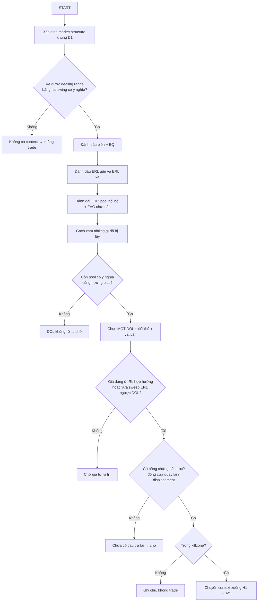

# Internal & External Range Liquidity (IRL & ERL) · v2

> [!summary] Tóm tắt 1 câu
> **Vẽ một hàng rào (dealing range). Những chỗ lệnh chờ có thể nằm NGAY NGOÀI hàng rào — trên đỉnh và dưới đáy — là ERL. Những chỗ giá có thể ghé BÊN TRONG hàng rào — đỉnh/đáy nhỏ và FVG — là IRL. Giá thường đi qua lại giữa hai loại này, nhưng “thường” không phải “luôn luôn”.**

> [!important] Nguyên tắc cốt lõi của bản v2
> 1. **IRL/ERL là nhãn của một QUAN HỆ, không phải của một mức giá.** Một mức là “trong” hay “ngoài” chỉ khi đã nói rõ: so với range NÀO, trên khung NÀO.
> 2. **IRL có hai họ.** Họ 1: đỉnh/đáy ngắn hạn bên trong range (có thể có stop). Họ 2: imbalance/FVG (không phải cụm stop). ICT xếp cả hai vào IRL; trộn lẫn chúng là nguồn của nhiều lỗi.
> 3. **Nhịp “ERL → IRL → ERL” là một trình tự thường gặp, không phải định luật.** Giá có thể bỏ qua IRL, đi ERL → ERL, hoặc dao động mãi trong range.
> 4. **Chart không cho biết ai làm gì và vì sao.** Ta chỉ thấy giá đã đi qua đâu. “Liquidity đã bị lấy” là cách ICT gọi tên; “Smart Money cố tình lấy” là diễn giải.

> [!abstract] Cách đọc note này
> **Năm nhãn dùng xuyên suốt** (đúng yêu cầu §3 của protocol):
>
> | Nhãn trong note | Protocol | Nghĩa |
> |---|---|---|
> | **[QUAN SÁT]** | Observable market fact | Thấy trực tiếp trên chart; ai nhìn cũng thấy giống nhau |
> | **[ICT]** | ICT framework | Tên gọi và cách ICT dùng hiện tượng đó |
> | **[CƠ CHẾ]** | Market mechanics | Giải thích bằng cách lệnh được đặt và khớp (market, limit, stop) |
> | **[DIỄN GIẢI]** | Interpretation | Hợp lý, nhưng không xác nhận được chỉ từ chart OHLC |
> | **[GIẢ THUYẾT]** | Hypothesis | Cần ghi trước và kiểm chứng bằng dữ liệu của chính bạn |
>
> **Năm tầng giải thích** cho mỗi khái niệm khó: **Ví dụ đời thường → Trực giác → Định nghĩa ICT → Cơ chế thị trường → Đọc trên chart.**
> Tất cả hình `IRL-ERL-v2-*` là **sơ đồ dựng (synthetic)** — giá trong hình là minh họa, không phải dữ liệu thị trường. Note này **hạn chế số học**: không công thức, không thống kê.

![[IRL-ERL-v2-03-Nam-Loai-Thong-Tin.svg|960]]
*Hình 3 — Cùng một sự kiện “giá vượt đỉnh cũ rồi đóng nến lại bên dưới”, năm câu nói thuộc năm loại sự thật khác nhau. Đây là kỹ năng nền của cả note: biết mình đang nói loại câu nào.*

> [!warning]- Thay đổi so với bản v1 (theo quy ước version hóa quy tắc)
> | # | OLD RULE (v1) | NEW RULE (v2) | Lý do đổi | Hiệu ứng kỳ vọng | Backtest? |
> |---|---|---|---|---|---|
> | 1 | “Giá **luôn** di chuyển external → internal → external.” | “Sau khi lấy một loại, giá **thường** hướng tới loại đối diện; xác nhận bằng sweep + displacement + MSS trước khi tin.” | Không có bằng chứng cho chữ “luôn”; nhiều phản ví dụ (§25). | Ít vào lệnh sớm theo “luật con lắc”. | Có |
> | 2 | “IRL = FVG/OB bên trong range.” | “IRL có hai họ: đỉnh/đáy ngắn hạn bên trong (pool) **và** imbalance (FVG). OB là vùng tham chiếu.” | Định nghĩa của ICT (2022 Ep. 3) rộng hơn FVG. | Không bỏ sót SSL/BSL nội bộ làm target trung gian. | Không (định nghĩa) |
> | 3 | “Giá **phải** dọn IRL trước khi với tới ERL.” | “IRL trên đường đi là **vật cản tiềm năng**; giá có thể dừng ở đó **hoặc** chạy thẳng qua.” | Có trường hợp giá bỏ qua IRL (§25, ca 1 và 15). | Đặt T1 tại IRL nhưng không coi đó là điều kiện bắt buộc. | Có |
> | 4 | Không nói rõ range tham chiếu cho mỗi nhãn. | Mọi nhãn ghi kèm khung: “ERL-D1”, “IRL-H1”. | Cùng một mức có thể mang hai nhãn (§10, §23). | Giảm nhầm lẫn khi chuyển khung. | Không |
>
> Bản v1 được lưu ở file `.v1-2026-11-07.md.bak` cùng thư mục.

### Bản đồ note

| Phần | Câu hỏi được trả lời |
|---|---|
| §1–§2 | Tóm tắt; giải thích cho trẻ 5 tuổi |
| §3–§5 | Liquidity là gì, vì sao tồn tại, Dealing Range là gì |
| §6–§9 | Định nghĩa IRL, ERL, so sánh, vì sao cách phân loại này tồn tại |
| §10–§14 | Quan hệ với Dealing Range, phân loại chi tiết, IRL–FVG, ERL–swing |
| §15–§18 | Sweep nội bộ vs ngoài range, IRL → ERL, ERL → IRL, liquidity engineering |
| §19–§21 | Market Structure, DOL, D1 → H1 → M5 |
| §22–§26 | Chu kỳ đầy đủ, range lồng nhau, hiểu lầm, edge cases, case studies |
| §27–§30 | Quy trình nhận diện, checklist hằng ngày, biết vs giả định, mental model |

---

## 1. Executive Summary

**Câu chuyện ngắn nhất:** giá giống một quả bóng lăn trong khu vườn có hàng rào. Ta tự vẽ hàng rào (dealing range). Những đống đồ chơi nằm sát bên ngoài hàng rào là **ERL**; những món đồ chơi và hố cát bên trong vườn là **IRL**. Quả bóng có lúc ghé đồ bên trong, có lúc vượt rào lấy đồ bên ngoài rồi lăn vào lại, có lúc vượt rào và đi luôn.

**Mười ý quan trọng nhất của note:**

1. **Liquidity** ở nghĩa gốc là khả năng tìm được người đứng phía bên kia để khớp lệnh. ICT dùng chữ này hẹp hơn: **cụm lệnh chờ có thể bị buộc khớp ở một vị trí đoán trước được** — chủ yếu là stop-loss và lệnh breakout quanh đỉnh/đáy dễ thấy. [ICT] [CƠ CHẾ]
2. Chart **không hiển thị** lệnh stop. Mọi đường “BSL/SSL” bạn kẻ là chỗ lệnh **có thể** nằm, không phải lượng lệnh đo được. [QUAN SÁT]
3. **ERL** = liquidity nằm Ở hoặc NGOÀI hai biên của dealing range đang tham chiếu (BSL trên đỉnh range, SSL dưới đáy range, và các mốc như PDH/PWH nếu chúng cũng nằm ngoài biên). [ICT]
4. **IRL** = liquidity nằm BÊN TRONG range đó. Theo transcript 2022 Mentorship Ep. 3, ICT mô tả nó là “a short-term higher low with stops above or below it, or an imbalance in that same range”. Tức là IRL gồm **đỉnh/đáy ngắn hạn** lẫn **imbalance (FVG)** — không chỉ FVG. [ICT]
5. Không có range tham chiếu thì câu hỏi “IRL hay ERL?” **không có nghĩa**. Đổi range → đổi nhãn. Một mức có thể là ERL của range H1 nhưng IRL của range D1. [ICT]
6. Lý do cách phân loại này hữu ích: **ERL trả lời “giá có thể đi XA tới đâu trong range này?”**, **IRL trả lời “trên đường đi, giá có thể DỪNG/HỒI ở đâu?”**. Một bên là ga cuối, một bên là trạm dừng. [DIỄN GIẢI]
7. Trình tự **ERL → IRL → ERL** (con lắc) là một mô tả phổ biến trong cộng đồng ICT về price delivery. Nó **thường gặp** nhưng có rất nhiều phản ví dụ: giá bỏ qua IRL, đi ERL → ERL, quét ERL rồi breakout, đi ngang mãi. [GIẢ THUYẾT]
8. Một cú **sweep ERL** không tự nó là tín hiệu đảo chiều. Nghiên cứu sổ lệnh FX (Osler, NY Fed) cho thấy stop-loss khi kích hoạt **có xu hướng đẩy giá đi tiếp** cùng chiều. Đảo chiều cần bằng chứng SAU cú quét: đóng cửa quay lại, displacement, MSS. [CƠ CHẾ]
9. **Liquidity pool ≠ DOL.** Pool là nơi lệnh có thể nằm (dữ kiện vị trí). DOL là **giả thuyết của bạn** về nơi giá hướng tới trong một khoảng thời gian. Pool gần nhất thường chỉ là trạm T1. [ICT]
10. Trong khung D1 → H1 → M5: **D1** dùng IRL/ERL để biết “đích lớn ở đâu, giá đang ở trạm nào”; **H1** xem giá đang làm gì bên trong IRL của D1; **M5** chỉ tìm bằng chứng (sweep → MSS → displacement → FVG) ở đúng chỗ đó. IRL/ERL **không phải** tín hiệu vào lệnh.

**Mental model một dòng:** *Hàng rào nào? → Đã lấy gì, còn gì? → Đang đi về đâu (giả thuyết)? → Bằng chứng nào?*

---

## 2. Giải thích IRL & ERL cho trẻ 5 tuổi — Khu vườn có hàng rào

### 2.1 Câu chuyện

Hãy tưởng tượng một khu vườn có hàng rào gỗ bao quanh.

- **Quả bóng màu cam** lăn khắp nơi. Đó là **giá**.
- **Hàng rào** có một thanh ở phía trên và một thanh ở phía dưới. Đó là **dealing range** — vùng giá giữa một đỉnh và một đáy mà ta chọn làm mốc.
- **Bên trong vườn** có một cái tháp đồ chơi nhỏ, một đống bi nhỏ và một cái hố cát. Đó là **IRL**: những thứ giá có thể ghé khi đi trong vườn.
- **Ngay bên kia hàng rào**, phía trên có một đống đồ chơi đỏ, phía dưới có một đống đồ chơi xanh. Đó là **ERL**: những đống đồ nằm ngoài biên.

Quả bóng lăn: ① ghé hố cát → ② vượt rào phía trên, lấy đồ chơi đỏ → ③ lăn vào lại trong vườn.

![[IRL-ERL-v2-01-ELI5-Khu-Vuon-Hang-Rao.svg|960]]
*Hình 1 — Khu vườn, hàng rào và đồ chơi. Đây là câu chuyện để NHỚ vai trò, không phải cơ chế thị trường.*

### 2.2 Ghép câu chuyện với thuật ngữ

| Trong câu chuyện | Trong ICT | Ghi chú |
|---|---|---|
| Quả bóng | Giá | Đi qua lại, không theo lịch |
| Hàng rào | Dealing range | **Do ta chọn**, không phải thứ có sẵn |
| Thanh rào trên / dưới | Đỉnh / đáy của range | Hai swing có ý nghĩa |
| Đống đồ chơi trên rào | ERL trên = Buy-side Liquidity (BSL) | Lệnh MUA chờ trên đỉnh |
| Đống đồ chơi dưới rào | ERL dưới = Sell-side Liquidity (SSL) | Lệnh BÁN chờ dưới đáy |
| Tháp nhỏ, đống bi nhỏ trong vườn | Đỉnh/đáy nội bộ = IRL họ 1 | Có thể có stop, nhưng nhỏ |
| Hố cát | FVG = IRL họ 2 | Chỗ giá từng chạy qua quá nhanh |
| Bóng vượt rào rồi lăn vào lại | Sweep ERL rồi quay vào range | Một khả năng, không phải chắc chắn |
| Bóng vượt rào và đi luôn | Breakout — range cũ hết hiệu lực | Phải vẽ hàng rào mới |

### 2.3 Trả lời từng câu hỏi bằng câu chuyện

- **Dealing range là gì?** Là hàng rào ta vẽ quanh khu vườn đang chơi. Không có hàng rào thì không nói được “trong” hay “ngoài”.
- **Bên trong range là gì?** Là mọi thứ nằm giữa thanh rào trên và thanh rào dưới.
- **Bên ngoài range là gì?** Là phía trên thanh rào trên và phía dưới thanh rào dưới. ERL nằm **sát** bên kia rào, không phải ở đâu đó xa tít.
- **Liquidity là gì?** Là những “đống đồ chơi” mà khi bóng chạm vào, có rất nhiều thứ xảy ra cùng lúc (lệnh chờ được khớp).
- **IRL là gì?** Đồ chơi bên trong vườn. Bóng hay ghé chúng trên đường đi.
- **ERL là gì?** Đồ chơi ngay ngoài rào. Khi bóng chạm tới, câu chuyện của khu vườn này kết thúc: hoặc bóng lăn vào lại, hoặc bóng ra một khu vườn mới.
- **Vì sao giá di chuyển giữa chúng?** Trong câu chuyện: vì bóng lăn tới đâu thì “ăn” đồ chơi ở đó, rồi đi tìm đống đồ tiếp theo. Trong thị trường thật: vì lệnh chờ tập trung quanh những mốc ai cũng thấy, và khi giá chạm tới, các lệnh đó được khớp làm giá chuyển động mạnh (§4). Câu chuyện chỉ giúp nhớ, phần cơ chế mới là lời giải thích.

### 2.4 Câu chuyện sai ở đâu

Mọi ẩn dụ đều gãy ở một điểm. Biết nó gãy ở đâu quan trọng không kém biết nó đúng ở đâu.

1. **Đồ chơi thật thì nhìn thấy được. Lệnh chờ thì không.** Chart không hiện stop-loss; ta chỉ đoán chỗ chúng **có thể** nằm dựa trên những mốc ai cũng thấy.
2. **Quả bóng không “muốn” gì cả.** Nói “giá đi tìm liquidity” là cách nói hình ảnh. Giá chuyển động vì có người mua và người bán khớp lệnh; không có ý chí nào trong quả bóng.
3. **Không phải cứ có đồ chơi là bóng sẽ ghé.** Có những hố cát (FVG) mà bóng không bao giờ quay lại.
4. **Hàng rào không có thật.** Hai người khác nhau có thể vẽ hai hàng rào khác nhau trên cùng một chart. Vì thế IRL/ERL luôn phải đi kèm “range nào, khung nào”.

### 2.5 Năm tầng hiểu một khái niệm

![[IRL-ERL-v2-02-Nam-Tang-Hieu-Mot-Khai-Niem.svg|960]]
*Hình 2 — Năm tầng áp cho ERL và IRL. Tầng 3 (ICT) và tầng 4 (cơ chế) luôn được tách riêng.*

Quy tắc của note: **không dùng một thuật ngữ trước khi nó đã được giải thích ở tầng 1–2.** Những thuật ngữ sẽ gặp:

| Thuật ngữ | Giải thích ngắn trước khi dùng |
|---|---|
| **BSL** (Buy-side Liquidity) | Cụm lệnh MUA có thể đang chờ phía trên một đỉnh (stop của người bán khống + lệnh mua khi phá đỉnh) |
| **SSL** (Sell-side Liquidity) | Cụm lệnh BÁN có thể đang chờ phía dưới một đáy |
| **FVG** (Fair Value Gap) | Khoảng giá mà râu nến 1 và râu nến 3 không chạm nhau vì nến 2 chạy quá nhanh — giá chỉ được giao dịch một chiều ở đó |
| **OB** (Order Block) | Vùng nến cuối cùng ngược chiều trước một cú chạy mạnh; ICT dùng làm vùng tham chiếu để chờ phản ứng |
| **Displacement** | Một hoặc vài nến chạy mạnh, rõ ràng một chiều, thường để lại FVG |
| **MSS** (Market Structure Shift) | Giá phá một đỉnh/đáy có ý nghĩa theo hướng ngược lại, kèm displacement — dấu hiệu nhịp giá có thể đã đổi |
| **DOL** (Draw on Liquidity) | Giả thuyết của trader về nơi giá có thể hướng tới tiếp theo |
| **Sweep** | Giá vượt qua một mức có thể có lệnh chờ rồi quay lại |

---

## 3. Liquidity là gì?

### 3.1 Năm tầng

**Tầng 1 — Ví dụ đời thường.** Ở chợ đông, bạn mang rau ra là bán được ngay, giá ổn định. Ở chợ vắng, bạn phải hạ giá thật thấp mới có người mua. “Liquidity” là chuyện **chợ đông hay chợ vắng**.

**Tầng 2 — Trực giác.** Mỗi giao dịch cần hai bên. Muốn mua thì phải có người bán. Liquidity là việc **có sẵn người đứng phía bên kia** hay không, và họ đứng ở mức giá nào.

**Tầng 3 — Định nghĩa ICT.** ICT dùng chữ liquidity hẹp hơn: **cụm lệnh chờ có thể bị buộc khớp ở một vị trí đoán trước được** — trên đỉnh cũ có buy stop (BSL), dưới đáy cũ có sell stop (SSL). Transcript 2022 Mentorship ghi lại cách ICT nói: *“Above old highs, buy stops. Below old lows, sell stops.”* [ICT]

**Tầng 4 — Cơ chế thị trường.** Có ba loại lệnh (Hình 5). Lệnh **limit** đứng chờ ở một giá — chúng **cung cấp** thanh khoản. Lệnh **market** khớp ngay — chúng **lấy** thanh khoản. Lệnh **stop** “ngủ” cho tới khi giá chạm mức kích hoạt rồi biến thành lệnh market. Khi một cụm stop thức dậy cùng lúc, nó tạo ra một đợt lệnh market bất ngờ cùng chiều. [CƠ CHẾ]

**Tầng 5 — Đọc trên chart.** Bạn không thấy lệnh. Bạn thấy **những mốc mà nhiều người có thể dùng để đặt lệnh**: đỉnh/đáy rõ, đỉnh/đáy bằng nhau, đỉnh/đáy ngày hôm qua, tuần trước. Bạn đánh dấu chúng như những chỗ **có thể** có liquidity. [QUAN SÁT]

![[IRL-ERL-v2-04-Hai-Nghia-Cua-Liquidity.svg|960]]
*Hình 4 — Hai nghĩa của liquidity. Bên trái: độ dày của sổ lệnh (nghĩa sách tài chính). Bên phải: cụm lệnh stop đang ngủ trên đỉnh cũ (nghĩa ICT).*

![[IRL-ERL-v2-05-Ba-Loai-Lenh-Va-Stop-Thuc-Day.svg|960]]
*Hình 5 — Ba loại lệnh, và chuyện gì xảy ra khi giá chạm một cụm stop mua.*

### 3.2 Những câu hỏi nền

**Liquidity có phải đơn giản là tiền không?** Không. Một thị trường có thể có rất nhiều tiền nhưng tại một mức giá cụ thể lại không có ai đứng chờ. Liquidity nói về **lệnh đang chờ ở đâu và bao nhiêu**, không phải tổng số tiền. [CƠ CHẾ]

**Liquidity có phải là số lượng người mua và người bán không?** Gần đúng hơn, nhưng vẫn thiếu. Điều quan trọng không phải *bao nhiêu người*, mà là *bao nhiêu khối lượng đang chờ ở mỗi mức giá*. Một người với một lệnh lớn có thể quan trọng hơn trăm người với lệnh nhỏ.

**Liquidity liên quan gì tới việc khớp lệnh?** Mọi lệnh market phải khớp với một lệnh limit đang chờ. Nếu ở mức giá hiện tại không đủ lệnh chờ, lệnh market “ăn” sang mức kế tiếp — giá nhảy. Đây là lý do một đợt lệnh lớn có thể làm giá chạy nhanh. [CƠ CHẾ]

**Vì sao thị trường cần liquidity?** Vì không có người đứng bên kia thì không có giao dịch. Người muốn mua khối lớn cần một nơi có nhiều người muốn bán — và ngược lại.

**Vì sao lệnh có thể tập trung quanh một mức giá?** Vì con người dùng những mốc **dễ thấy** để ra quyết định: “đặt stop ngay trên đỉnh”, “mua nếu phá đỉnh”, “chốt lời ở số tròn”. Nghiên cứu sổ lệnh FX của Osler cho thấy lệnh chờ **tụ mạnh ở các số tròn**; stop mua tụ **ngay trên** số tròn, stop bán tụ **ngay dưới**. [CƠ CHẾ]

**Vì sao stop-loss khi bị kích hoạt lại tạo ra một nguồn lệnh?** Vì stop-loss của người bán khống là một lệnh **mua** đang ngủ. Khi giá chạm, nó thành lệnh mua market. Nhiều stop ở cùng một chỗ ⇒ một đợt lệnh mua cùng lúc. Với ai đang muốn **bán** một khối lớn, đợt lệnh mua đó là “người đứng bên kia” họ cần. Đó là lý do ICT gọi cụm stop là liquidity. [CƠ CHẾ] → [ICT]

### 3.3 Phân biệt các khái niệm hay bị trộn

| Khái niệm | Là gì | Nhìn thấy trên chart? | Ví dụ |
|---|---|---|---|
| **Market liquidity** | Độ dễ mua/bán khối lượng lớn mà giá ít nhảy | Không trực tiếp (cần sổ lệnh) | EURUSD giờ London dày hơn giờ Á |
| **Resting orders** | Lệnh đang nằm chờ (limit, stop) | Không (với chart nến) | Lệnh mua limit ở một giá thấp hơn |
| **Stop orders** | Lệnh ngủ, kích hoạt khi giá chạm | Không | Stop-loss của lệnh short đặt trên đỉnh |
| **Buy-side Liquidity (BSL)** | Cụm lệnh MUA có thể đang chờ phía trên một đỉnh | Chỉ thấy **mốc**, không thấy lệnh | Phía trên đỉnh hôm qua |
| **Sell-side Liquidity (SSL)** | Cụm lệnh BÁN có thể đang chờ phía dưới một đáy | Chỉ thấy mốc | Phía dưới đáy tuần trước |
| **Swing high / low** | Đỉnh/đáy mà hai bên đều thấp hơn/cao hơn nó | **Có** | Một đỉnh nhọn trên H1 |
| **Equal Highs / Lows (EQH/EQL)** | Hai hoặc nhiều đỉnh/đáy gần bằng nhau | **Có** | “Trần nhà” bị chạm hai lần |

**Câu cần nhớ:** *swing high là thứ bạn THẤY; BSL là thứ bạn ĐOÁN có thể nằm phía trên nó.* Không đồng nhất một mức giá nhìn thấy trên chart với một lượng liquidity đo được. [QUAN SÁT] vs [DIỄN GIẢI]

### 3.4 Vì sao swing high thành BSL, swing low thành SSL, và vì sao EQH/EQL được quan tâm

![[IRL-ERL-v2-06-Vi-Sao-Swing-High-La-BSL.svg|960]]
*Hình 6 — Từ swing high tới BSL, từ swing low tới SSL, và vì sao đỉnh bằng nhau trông như một “trần nhà” chắc chắn.*

**Swing high → BSL.** Ai đang bán khống thì cần đặt stop-loss ở đâu đó phía trên. Chỗ tự nhiên nhất là **ngay trên đỉnh gần nhất** — vì nếu giá vượt đỉnh đó, ý tưởng bán khống có vẻ đã sai. Ai muốn mua theo breakout thì đặt buy stop ngay trên đỉnh. Cả hai đều là lệnh **mua**. Gộp lại: phía trên đỉnh có thể có một cụm lệnh mua → **BSL**. [CƠ CHẾ] → [ICT]

**Swing low → SSL.** Đối xứng: stop-loss của người mua nằm dưới đáy (khi kích hoạt là lệnh **bán**), cộng với sell stop của người bán theo breakout → **SSL**.

**Vì sao EQH/EQL được ICT quan tâm?** Hai đỉnh bằng nhau trông như một “trần nhà” đã được kiểm tra hai lần. Nhiều người tin nó chắc chắn, nên nhiều người dùng **cùng một chỗ** để đặt stop hoặc lệnh breakout. ICT gọi đây là liquidity “dày” hơn. [DIỄN GIẢI] — hợp lý, nhưng không đo được trên chart; với futures có thể quan sát một phần qua sổ lệnh, với FX/CFD retail thì gần như không.

---

## 4. Vì sao liquidity tồn tại — và nó tồn tại ở đâu?

### 4.1 Ba lý do lệnh tụ lại ở một chỗ

1. **Điểm hội tụ (focal points).** Khi không có cách nào biết chắc mức nào “đúng”, con người chọn mức **dễ thấy**: đỉnh/đáy rõ, số tròn, đỉnh/đáy ngày và tuần. Đây là hành vi của rất nhiều người độc lập — không cần ai điều phối. [CƠ CHẾ]
2. **Quản lý rủi ro.** Ai có vị thế cũng cần một chỗ thoát nếu sai. Chỗ thoát tự nhiên là “ngay sau mốc mà nếu bị phá thì ý tưởng sai”. [CƠ CHẾ]
3. **Lệnh breakout.** Có những người chỉ muốn vào khi giá **đã** phá một mốc. Họ đặt stop-entry ngay ngoài mốc. [CƠ CHẾ]

Kết quả: ngay ngoài những mốc dễ thấy, **có khả năng** tồn tại một cụm lệnh cùng chiều. Osler (2003/2005) đo trên dữ liệu lệnh thật của một ngân hàng: lệnh chờ tụ mạnh ở số tròn; stop-loss **làm xu hướng mạnh thêm** khi bị kích hoạt (price cascade), còn take-profit **hay làm giá chững hoặc đảo**. [CƠ CHẾ] — lưu ý: dữ liệu FX 1999–2000, không kiểm tra khái niệm ICT.

### 4.2 Liquidity nằm ở đâu

![[IRL-ERL-v2-07-Liquidity-Nam-O-Dau.svg|960]]
*Hình 7 — Pool lệnh chờ (●) khác với mốc tham chiếu/PD array (◆). Cả hai đều có thể là IRL hoặc ERL tùy range.*

| Vị trí | Loại | Có thể có lệnh chờ? | Ghi chú |
|---|---|---|---|
| Trên swing high | ● Pool | Có thể — BSL | Mức độ tùy độ “rõ” của đỉnh |
| Dưới swing low | ● Pool | Có thể — SSL | |
| Trên EQH / dưới EQL | ● Pool | Có thể — thường được diễn giải là dày hơn | [DIỄN GIẢI] |
| PDH / PDL (đỉnh/đáy hôm qua) | ● Pool | Có thể | Mốc ai cũng thấy trên chart ngày |
| PWH / PWL (đỉnh/đáy tuần trước) | ● Pool | Có thể | Mốc khung lớn |
| Đỉnh/đáy nội bộ đáng kể | ● Pool (nhỏ) | Có thể, ít hơn | Nhiều cái chỉ là nhiễu |
| FVG | ◆ Tham chiếu | Không phải “cụm stop” | Có thể có lệnh limit chờ — không chắc |
| Order Block | ◆ Tham chiếu | Không phải cụm stop | Vùng chờ phản ứng |
| EQ 50% của range | ◆ Tham chiếu | Không | Mốc chia premium/discount |

**Câu cần nhớ:** ● là nơi lệnh **có thể nằm**; ◆ là nơi ICT **chờ giá phản ứng**. Hai thứ này đều được gọi là “liquidity” trong ngôn ngữ ICT, nhưng bằng chứng và cách dùng khác nhau.

---

## 5. Dealing Range là gì?

**Tầng 1 — Ví dụ đời thường.** Hàng rào quanh khu vườn. Bạn tự cắm hai cột: một ở chỗ cao nhất, một ở chỗ thấp nhất của khu bạn đang quan tâm.

**Tầng 2 — Trực giác.** Muốn nói “bên trong” hay “bên ngoài”, bạn cần một cái khung. Dealing range là cái khung đó.

**Tầng 3 — Định nghĩa ICT.** Dealing range là vùng giá giữa **một swing low có ý nghĩa và một swing high có ý nghĩa**. Nửa trên là **premium** (đắt), nửa dưới là **discount** (rẻ), đường giữa là **equilibrium (EQ 50%)**. Transcript ICT: *“this here is your range — this is the low of the day and this is the high of the day thus far… anything above that 50 level… is a premium market”*. [ICT]

**Tầng 4 — Cơ chế.** Range không phải thứ thị trường “biết”. Nó là **mốc tham chiếu của trader**. Phần có thật là: hai biên thường là những mốc dễ thấy → quanh chúng có khả năng có lệnh chờ (§4). [CƠ CHẾ]

**Tầng 5 — Đọc chart.** Chọn hai swing đã tạo ra nhịp giá đang được quan tâm (ví dụ đáy trước cú tăng và đỉnh của cú tăng đó). Vẽ hộp, kẻ EQ, ghi khung.

![[IRL-ERL-v2-08-Dealing-Range-La-Hang-Rao.svg|960]]
*Hình 8 — Dealing range là hàng rào. Nó không cần đi ngang; một nhịp tăng từ swing low tới swing high cũng là một dealing range.*

**Vì sao phải có reference range trước khi nói IRL/ERL?** Vì “internal” và “external” là **tính từ so sánh**. “Bên trong” cái gì? Không trả lời được câu này thì nhãn IRL/ERL vô nghĩa. Ví dụ: đỉnh hôm qua nằm **ngoài** range của phiên Á hôm nay (⇒ ERL của range phiên), nhưng nằm **trong** range D1 của 3 tuần gần nhất (⇒ IRL của range D1).

**Chọn swing nào làm biên?** Đây là một bài toán riêng (đã nghiên cứu ở [[12-Dealing-Range]], [[57-Dealing-Range-Nghien-cuu-chuyen-sau-Swing-Significance-Selection-Algorithm-Backtest|Dealing Range — Swing Significance]], [[37-Re-mapping-Dealing-Range-sau-Displacement|Re-mapping sau Displacement]]). Ở note này chỉ cần ba quy tắc:

1. Biên là swing **đã tạo ra hoặc kết thúc** nhịp giá bạn đang theo dõi.
2. Ghi rõ khung: “Range D1”, “Range H1”.
3. Khi giá phá một biên và **được chấp nhận** bên ngoài (đóng cửa và giữ được), vẽ lại range. Biên cũ có thể trở thành IRL của range mới.

---

## 6. Định nghĩa chính xác — Internal Range Liquidity (IRL)

### 6.1 Năm tầng

**Tầng 1 — Ví dụ đời thường.** Đồ chơi và hố cát **bên trong** khu vườn.

**Tầng 2 — Trực giác.** Những chỗ giá có thể dừng chân hoặc quay lại **trên đường đi** từ biên này sang biên kia.

**Tầng 3 — Định nghĩa ICT.** IRL là liquidity nằm **bên trong** dealing range đang tham chiếu. Theo transcript 2022 Mentorship Ep. 3 (bản “No Rant”, khoảng [13:47]–[13:59]): *“internal range liquidity is looking for short-term lows or short-term highs inside a price leg”* và *“internal range liquidity is a short-term higher low with stops above [or] below it, or an imbalance in that same range”*. [ICT]

Đọc kỹ định nghĩa này, có **hai họ**:

- **Họ 1 — pool nội bộ:** đỉnh/đáy ngắn hạn bên trong một nhịp giá, với stop nằm trên/dưới chúng.
- **Họ 2 — imbalance:** khoảng giá mất cân bằng (FVG) trong cùng vùng đó.

**Tầng 4 — Cơ chế.** Họ 1 có cơ chế giống BSL/SSL nhưng nhỏ hơn: stop của những vị thế ngắn hạn nằm ngay ngoài đỉnh/đáy nhỏ. Họ 2 **không phải cụm stop**: FVG là chỗ giá từng chạy một chiều quá nhanh, ít giao dịch hai chiều; khi giá quay lại, có thể có lệnh limit chờ ở đó, và giá thường đi chậm hơn qua vùng từng bị bỏ qua. [CƠ CHẾ] / [DIỄN GIẢI]

**Tầng 5 — Đọc chart.** Sau khi vẽ range: đánh dấu đỉnh/đáy nội bộ **đáng kể** (không phải mọi gợn sóng) và các FVG **chưa lấp** nằm giữa hai biên.

### 6.2 “Internal” — so với cái gì?

So với **dealing range đang tham chiếu**. Không có range thì không có “internal”. Đây là lý do mỗi nhãn IRL nên ghi kèm khung: “IRL-D1”, “IRL-H1”.

### 6.3 Những thứ có thể là IRL — và không được đồng nhất chúng

| Thành phần | Thuộc họ | Bản chất | Ghi chú |
|---|---|---|---|
| **Internal swing high** | 1 | Đỉnh nhỏ giữa hai biên | Phía trên nó có thể có **internal BSL** |
| **Internal swing low** | 1 | Đáy nhỏ giữa hai biên | Phía dưới nó có thể có **internal SSL**; khớp nhất với định nghĩa ICT “short-term higher low” |
| **Internal BSL / SSL** | 1 | Cụm stop quanh swing nội bộ | Nhỏ, dễ bị lấy, nhiều nhiễu |
| **FVG (imbalance)** | 2 | Vùng giá chạy một chiều | Không phải pool stop; ICT xếp vào IRL |
| **Internal liquidity pool** | 1 | Từ chung cho các cụm lệnh bên trong range | Hay bị dùng lẫn với FVG — tránh |
| **Order Block, PD array khác** | Tham chiếu | Vùng chờ phản ứng | ICT Core Content (2016–17) nhắc order block bên trong range như vùng “internal”; không phải pool lệnh theo nghĩa hẹp |

### 6.4 Ba câu hỏi bẫy

- **Internal swing high/low có phải LUÔN là IRL không?** Có — **với range mà nó nằm bên trong**. Nhưng nếu bạn đổi sang range nhỏ hơn mà swing đó là biên, nó thành ERL của range nhỏ đó (§10). Và không phải mọi internal swing đều **đáng** đánh dấu: gợn sóng nhỏ là nhiễu (§14).
- **Có phải mọi FVG đều là IRL không?** Không. FVG nằm **ngoài** range đang dùng thì không phải IRL của range đó (§13, §25 ca 7). FVG nằm trong range là IRL **ứng viên** — nó có thể đã bị lấp, hoặc giá có thể không bao giờ quay lại.
- **Mọi liquidity bên trong range có cùng một loại không?** Không. Họ 1 là **sự kiện liquidity** (stop bị kích hoạt khi giá đi qua). Họ 2 là **sự kiện rebalance** (giá quay lại một vùng mất cân bằng). Bằng chứng khác nhau, cách dùng khác nhau (Hình 14).

---

## 7. Định nghĩa chính xác — External Range Liquidity (ERL)

### 7.1 Năm tầng

**Tầng 1 — Ví dụ đời thường.** Hai đống đồ chơi nằm **sát bên kia** hàng rào, một ở trên, một ở dưới.

**Tầng 2 — Trực giác.** Chỗ mà rất nhiều người cùng nghĩ: “nếu giá vượt đỉnh/đáy này thì tôi sẽ…”.

**Tầng 3 — Định nghĩa ICT.** ERL là liquidity nằm **Ở hoặc NGOÀI hai biên** của dealing range: buy-side liquidity phía trên đỉnh range, sell-side liquidity phía dưới đáy range. Tóm tắt bài giảng ICT Mentorship Core Content (Month 04) mô tả: *external range liquidity là khi range hiện tại có buy-side liquidity phía trên đỉnh range* (và đối xứng với sell-side phía dưới đáy). [ICT] — nguồn là bản tóm tắt AI của bài giảng, cần đối chiếu video gốc trước khi trích nguyên văn.

**Tầng 4 — Cơ chế.** Biên range là những mốc dễ thấy nhất của nhịp giá đó → nơi có khả năng cao nhất có stop và lệnh breakout tụ lại (§3.4, §4.1). [CƠ CHẾ]

**Tầng 5 — Đọc chart.** Kẻ đường ở đỉnh và đáy range; đánh dấu thêm những mốc khác (EQH, PDH, PWH…) **chỉ khi** chúng nằm ở hoặc ngoài biên. Ghi rõ “đã bị lấy” hay “còn”.

### 7.2 “External” — so với cái gì?

Cũng so với **dealing range đang tham chiếu**. ERL không phải là “mọi đỉnh/đáy cũ”. Nó là liquidity nằm **ngoài biên của range bạn đã vẽ**.

### 7.3 Câu hỏi bẫy về ERL

| Câu hỏi | Trả lời ngắn | Vì sao |
|---|---|---|
| Swing high nào đại diện cho ERL? | Swing **định ra** biên trên của range đang dùng | Các swing khác bên trong là IRL |
| EQH/EQL có thể trở thành ERL như thế nào? | Khi chúng **là** biên range, hoặc nằm ngoài biên | EQH nằm giữa range là IRL |
| PDH/PDL có **luôn** là ERL không? | **Không** | Chỉ khi nằm ngoài range đang dùng. Hôm nay đi ngang giữa range D1 thì PDH là IRL của D1 |
| PWH/PWL có luôn là ERL không? | Thường là ERL **của khung lớn**; với range H1 nhỏ là “ERL xa” | Không phải bước kế tiếp của range nhỏ |
| Range boundary có **tự động** là ERL không? | Biên là **mốc**; ERL là liquidity **có thể nằm quanh** mốc đó | Mốc rõ ⇒ khả năng có lệnh cao hơn; nhưng chart không đo được |

### 7.4 Các dạng ERL

- **External Buy-side Liquidity:** cụm lệnh mua có thể nằm trên đỉnh range.
- **External Sell-side Liquidity:** cụm lệnh bán có thể nằm dưới đáy range.
- **External swing high / low:** hai swing định ra range.
- **Old highs / old lows:** đỉnh/đáy cũ ở ngoài biên (ví dụ đỉnh của range trước đó).
- **EQH / EQL ở biên:** biên được chạm nhiều lần.
- **Major structural liquidity:** đỉnh/đáy của khung lớn (PWH/PWL, đỉnh/đáy 20–40–60 ngày) — thường là ERL của range D1/W1.

---

## 8. IRL vs ERL

![[IRL-ERL-v2-09-Giai-Phau-IRL-ERL.svg|960]]
*Hình 9 — Giải phẫu một dealing range. Vùng đỏ nhạt và xanh nhạt là nơi ERL nằm — NGAY NGOÀI biên. Bên trong là hai họ IRL. Một đáy nội bộ đã bị lấy được đánh dấu “✓”.*

| Tiêu chí | IRL | ERL |
|---|---|---|
| **Vị trí** | Giữa hai biên của range đang dùng | Ở hoặc ngoài hai biên |
| **Quan hệ với Dealing Range** | Bên trong hàng rào | Sát bên kia hàng rào |
| **Các dạng phổ biến** | Đỉnh/đáy nội bộ (họ 1), FVG/imbalance (họ 2) | BSL trên đỉnh range, SSL dưới đáy range, EQH/EQL ở biên, PDH/PWH nếu ngoài biên |
| **Bản chất** | Họ 1: cụm stop nhỏ. Họ 2: vùng mất cân bằng | Cụm stop/lệnh breakout quanh mốc rõ nhất của nhịp giá |
| **Câu hỏi nó trả lời** | “Giá có thể DỪNG/HỒI ở đâu trên đường?” | “Giá có thể đi XA tới đâu trong range này?” |
| **Vai trò trong ICT** | Trạm dừng; vùng vào lệnh (POI); mục tiêu trung gian (T1) | Đích của một nhịp; nơi “câu chuyện” của range kết thúc |
| **Khi giá chạm** | Có thể phản ứng nhỏ, hoặc đi xuyên qua | Hoặc quay vào (sweep), hoặc được chấp nhận bên ngoài (range mới) |
| **Ví dụ trên chart** | FVG H1 chưa lấp trong nửa discount; đáy nhỏ của nhịp hồi | Đỉnh của cú tăng vừa rồi; đáy của range 3 tuần |
| **Hiểu nhầm phổ biến** | “IRL chỉ là FVG” | “Mọi đỉnh/đáy cũ đều là ERL” |

### 8.1 Một liquidity pool có LUÔN là IRL hoặc ERL không?

**Không.** Nó là IRL hoặc ERL **đối với một range cụ thể**. Đổi range → đổi nhãn.

![[IRL-ERL-v2-10-Cung-Mot-Muc-Doi-Vai.svg|960]]
*Hình 10 — Mức L là đỉnh của range nhỏ (ERL-H1), nhưng nằm giữa range lớn (IRL-D1). Hai câu đều đúng.*

**Ví dụ cụ thể (chuỗi giá minh họa, không phải dữ liệu thật):**

1. Range H1 hôm nay: đáy ở mức B, đỉnh ở mức L. Đỉnh L là **ERL-H1**.
2. Range D1 ba tuần: đáy rất xa bên dưới, đỉnh rất xa bên trên. Mức L nằm giữa → **IRL-D1**.
3. Giá vượt L và được chấp nhận phía trên. Với H1, “ERL đã bị lấy, range H1 cũ hết hiệu lực”. Với D1, “giá vừa đi qua một trạm bên trong”.
4. Bạn vẽ range H1 mới, đáy là một đáy nhỏ vừa hình thành, đỉnh là đỉnh mới. **L giờ nằm bên trong range H1 mới → IRL-H1.** Cùng một mức, trong vài giờ đã đổi vai.

**Có thể chuyển từ ERL thành IRL không?** Có — khi range được vẽ lại sau breakout (ca phổ biến nhất). **Từ IRL thành ERL?** Có — khi bạn đổi sang một range nhỏ hơn mà mức đó là biên, hoặc khi giá đi xa và một đáy nội bộ cũ trở thành đáy của một range mới.

---

## 9. Vì sao IRL và ERL tồn tại?

Đây không phải câu hỏi “chúng nằm ở đâu”, mà là **vì sao cách chia này có ích** và **vì sao giá tương tác với chúng**.

### 9.1 Vì sao cần phân chia Internal và External?

Vì hai loại trả lời **hai câu hỏi khác nhau** mà mọi trader đều phải trả lời:

- **ERL** → “Nhịp giá này có thể đi **xa** tới đâu?” Đó là giới hạn của range — chỗ câu chuyện hiện tại kết thúc.
- **IRL** → “Trên đường đi, giá có thể **dừng/hồi** ở đâu?” Đó là các trạm — nơi chọn điểm vào (POI) và mục tiêu trung gian.

![[IRL-ERL-v2-12-Ga-Cuoi-Va-Tram-Dung.svg|960]]
*Hình 12 — IRL là trạm dừng, ERL là ga cuối. Giới hạn của ẩn dụ: xe buýt có lịch, giá thì không.*

### 9.2 Sự phân chia giúp hiểu price structure thế nào?

Nó biến một chart đầy đường kẻ thành **ba nhóm có thứ bậc**: hai biên (ERL), các trạm đáng kể bên trong (IRL), và phần còn lại là nhiễu. Thay vì hỏi “giá sẽ đi đâu?” (quá rộng), bạn hỏi: “giá đang ở trạm nào, ga cuối ở đâu, trạm nào còn chặn đường?”.

### 9.3 IRL đại diện cho điều gì? ERL đại diện cho điều gì?

- **IRL họ 1** đại diện cho **dấu vết của các nhịp nghỉ** trong một nhịp giá — nơi những người vừa vào lệnh đặt stop.
- **IRL họ 2** đại diện cho **dấu vết của những đoạn chạy quá nhanh** — nơi giá bỏ qua giao dịch hai chiều.
- **ERL** đại diện cho **giới hạn đã được thị trường kiểm tra** của nhịp giá hiện tại — đỉnh và đáy mà giá chưa vượt qua được (hoặc chưa thử).

### 9.4 Vì sao giá không đi một đường thẳng mà tạo nhiều swing bên trong range?

![[IRL-ERL-v2-11-Vi-Sao-Gia-Khong-Di-Duong-Thang.svg|960]]
*Hình 11 — Mỗi lần đẩy mạnh có thể để lại một FVG; mỗi lần nghỉ để lại một đáy nhỏ. Đó chính là IRL của nhịp đó.*

[CƠ CHẾ] Lệnh không đến đều đặn. Có đợt người mua dồn dập (giá chạy, để lại FVG), có lúc người có lãi chốt lời hoặc người bán mới xuất hiện (giá nghỉ, tạo đáy nhỏ). Mỗi lần nghỉ tạo ra **một mốc mới** để người mua mới đặt stop-loss bên dưới. Vì vậy một nhịp tăng tự nhiên sinh ra một chuỗi IRL họ 1 (các higher low) và IRL họ 2 (các FVG).

### 9.5 Vì sao giá có thể lấy liquidity bên trong trước khi hướng tới bên ngoài?

[CƠ CHẾ] + [DIỄN GIẢI] Ba lý do hợp lý, không cái nào là chắc chắn:

1. **Khoảng cách:** IRL gần hơn. Một nhịp hồi bình thường đi qua chúng trước.
2. **Nhiên liệu:** khi giá quét một đáy nội bộ, stop bán của người mua muộn được khớp — người muốn mua khối lớn có thể dùng đợt lệnh bán đó làm đối ứng. Đây là câu chuyện ICT hay kể; chart không chứng minh được ý định.
3. **Giá tốt hơn:** người muốn vào theo xu hướng chờ giá về vùng rẻ hơn (discount) — thường là quanh FVG hoặc đáy nội bộ.

### 9.6 Vì sao giá đôi khi bỏ qua IRL và đi thẳng tới ERL?

Khi **lực một chiều quá mạnh** (tin tức, mở phiên, một bên phải mua/bán gấp), người chờ “giá về rẻ” không được khớp — giá không cho họ cơ hội. Không có gì sai với thị trường; chỉ là mô hình “chờ về IRL” không có lệnh ở ngày đó. (Hình 23 ô E, §25 ca 1 và 15.)

### 9.7 Vì sao giá đôi khi sweep ERL rồi quay trở lại range?

[CƠ CHẾ] Khi stop trên đỉnh kích hoạt, nó tạo ra một đợt lệnh mua. Nếu **phía bên kia đủ dày** (nhiều người bán chờ sẵn trên đỉnh, hoặc người có lãi chốt lời) và **không có người mua mới** tiếp sức, giá không giữ được bên ngoài và quay vào. Nếu ngược lại, giá đi tiếp (breakout). Chart chỉ cho biết **kết quả**, không cho biết lượng lệnh hai bên.

### 9.8 Có phải thị trường LUÔN cần lấy cả IRL và ERL không?

**Không.** Đây là một câu chuyện hữu ích để sắp xếp quan sát, không phải định luật. Có những range giá đi ngang mà không lấy biên nào trong nhiều ngày; có những nhịp chạy một mạch qua nhiều ERL; có FVG không bao giờ được lấp. Nói “giá **phải** lấy liquidity trước khi di chuyển” là một tuyên bố phổ quát chưa có bằng chứng. [GIẢ THUYẾT]

> [!caution] Những câu KHÔNG dùng làm lời giải thích
> “Smart Money cần liquidity”, “Institutions thao túng thị trường”, “Giá phải đi tìm liquidity” — đều là **diễn giải**. Phần quan sát được chỉ là: giá đi qua một mốc dễ thấy, rồi phản ứng (hoặc không). Phần cơ chế hợp lý là: quanh mốc dễ thấy có thể có lệnh chờ cùng chiều, và khi kích hoạt chúng tạo ra một đợt lệnh market.

---

## 10. Dealing Range + IRL + ERL — quan hệ

### 10.1 Chín câu hỏi

1. **Dealing range tạo ra reference boundary như thế nào?** Hai swing bạn chọn làm biên chia không gian giá thành ba vùng: trên biên trên (vùng ERL trên), giữa hai biên (vùng IRL), dưới biên dưới (vùng ERL dưới).
2. **Internal liquidity xác định dựa trên boundary nào?** Mọi thứ nằm giữa hai biên.
3. **External liquidity xác định dựa trên boundary nào?** Mọi liquidity ở hoặc ngoài hai biên — gần nhất là ngay trên đỉnh/dưới đáy range.
4. **Một range có thể chứa nhiều IRL không?** Có, thường là nhiều: vài đỉnh/đáy nội bộ và vài FVG. Việc của bạn là **xếp hạng** chúng (§11, §14).
5. **Một range có thể có nhiều ERL không?** Có: ERL gần (biên) và “ERL xa” (đỉnh/đáy khung lớn hơn nằm xa hơn bên ngoài).
6. **Một range có thể có nhiều pool ở cả hai phía không?** Có — đó là trạng thái bình thường. DOL là việc chọn **phía nào** (§20).
7. **Có thể có nhiều dealing range đồng thời không?** Có. Range D1, range H1, range phiên… cùng tồn tại trên một chart.
8. **Khi có range lồng nhau, IRL/ERL xác định thế nào?** Mỗi range có bộ IRL/ERL riêng. Luôn ghi kèm khung.
9. **Một pool có thể là IRL của range lớn nhưng ERL của range nhỏ không?** Có — và đây là trường hợp gặp hằng ngày (Hình 10, 13).

### 10.2 Parent Range → Child Range → Internal → External

![[IRL-ERL-v2-13-Range-Long-Nhau-Parent-Child.svg|960]]
*Hình 13 — Range lớn (D1) chứa range nhỏ (H1). A và D là ERL của H1 nhưng IRL của D1. B và E là ERL của D1. C (FVG trong range nhỏ) là IRL của cả hai.*

Ba quy tắc đọc range lồng nhau:

1. **Range lớn trả lời “đích xa”, range nhỏ trả lời “bước tiếp theo”.**
2. **Sự kiện ở range nhỏ không tự động đổi câu chuyện của range lớn.** Lấy ERL-H1 chỉ là “đi qua một IRL” với D1.
3. **Vị trí của range nhỏ bên trong range lớn quan trọng.** Range H1 nằm ở nửa premium của D1 khác hẳn range H1 nằm ở nửa discount (§21).

### 10.3 Sơ đồ ASCII — bản đã hiệu chỉnh

Sơ đồ trong protocol đặt “ERL” như một điểm lơ lửng và đặt hai FVG cùng một “Internal High” xếp chồng. Bản hiệu chỉnh:

```text
              ┄┄┄┄┄┄┄┄┄┄┄┄┄┄┄┄┄┄┄┄┄┄┄┄┄┄┄┄    ERL xa (PWH, đỉnh khung lớn) — nếu nằm ngoài
          ░░░ VÙNG ERL TRÊN: BSL ngay trên đỉnh range ░░░
   ═══════════════ External High = BIÊN TRÊN ═══════════════
   │                                                     │
   │   - - - - internal high (IRL họ 1: BSL nội bộ) - -  │   PREMIUM
   │   [###### FVG giảm (IRL họ 2) ######]               │
   │· · · · · · · · · · · · EQ 50% · · · · · · · · · · · │
   │                 [###### FVG tăng (IRL họ 2) #####]  │
   │   - - - - internal low (IRL họ 1: SSL nội bộ) - - - │   DISCOUNT
   │                                                     │
   ═══════════════ External Low = BIÊN DƯỚI ════════════════
          ░░░ VÙNG ERL DƯỚI: SSL ngay dưới đáy range ░░░
              ┄┄┄┄┄┄┄┄┄┄┄┄┄┄┄┄┄┄┄┄┄┄┄┄┄┄┄┄    ERL xa (PWL, đáy khung lớn) — nếu nằm ngoài
```

Những điểm đã sửa:

- **ERL là một vùng ngay ngoài biên**, không phải một điểm treo phía trên.
- **Biên range tách khỏi ERL**: biên là mốc ta thấy; ERL là lệnh có thể nằm ngay ngoài mốc.
- **IRL có hai họ**, vẽ bằng hai ký hiệu khác nhau (đường đứt cho pool, khối cho FVG).
- Thêm **EQ 50%** để IRL được đặt trong premium hoặc discount — điều quyết định IRL nào hợp với hướng lệnh nào.
- Thêm **“ERL xa”** để nhớ rằng ngoài biên gần còn có các mốc khung lớn hơn.

---

## 11. Phân loại Internal Liquidity

![[IRL-ERL-v2-14-Phan-Loai-IRL.svg|960]]
*Hình 14 — Bốn thứ thường bị gọi chung là “IRL”. Hai loại đầu là POOL lệnh chờ, loại 3 là IMBALANCE, loại 4 là vùng THAM CHIẾU.*

| Loại | Ví dụ đời thường | Là gì | Sự kiện khi giá tới | Bằng chứng cần xem | Cảnh báo |
|---|---|---|---|---|---|
| **1 · Đỉnh nội bộ → BSL nội bộ** | Cái tháp nhỏ trong vườn | Đỉnh nhỏ giữa hai biên | Stop mua (của lệnh short ngắn hạn) có thể được kích hoạt | Giá vượt đỉnh rồi đóng cửa lại bên dưới, hoặc đi tiếp | Phần lớn là nhiễu nếu không chọn lọc |
| **2 · Đáy nội bộ (higher low) → SSL nội bộ** | Đống bi nhỏ trong vườn | Đáy của một nhịp nghỉ trong xu hướng | Stop bán của người mua muộn có thể được kích hoạt | Râu xuyên đáy rồi đóng cửa lại bên trên + displacement lên | Khớp nhất với định nghĩa ICT; vẫn không chắc |
| **3 · FVG / imbalance** | Cái hố cát | Vùng giá chạy một chiều quá nhanh | Rebalance: giá đi lại qua vùng từng bị bỏ qua | Phản ứng (nến từ chối) hay đi xuyên | Không chứa stop; có thể không bao giờ được lấp |
| **4 · Order Block & PD array khác** | Cái ghế đá quen ngồi | Vùng tham chiếu để chờ phản ứng | Có thể phản ứng | Phản ứng + MSS ở khung nhỏ | Không phải pool lệnh theo nghĩa hẹp |

**Xếp hạng IRL (khi có nhiều ứng viên)** — các câu hỏi, không phải công thức:

1. **Khung nào?** IRL trên D1 nặng hơn IRL trên M15.
2. **Nằm ở premium hay discount?** Với hướng tăng, IRL ở discount hợp vai “chỗ vào”; IRL ở premium hợp vai “vật cản/T1”.
3. **Đã bị lấy/lấp chưa?** IRL đã tiêu thì gạch xám.
4. **Có gắn với displacement không?** FVG sinh ra từ một cú displacement rõ thường được coi trọng hơn FVG lẻ.
5. **Có nằm trên đường tới DOL không?** IRL chặn đường là vật cản tiềm năng; IRL phía sau lưng là chỗ hồi tiềm năng.

---

## 12. Phân loại External Liquidity

![[IRL-ERL-v2-15-Phan-Loai-ERL.svg|960]]
*Hình 15 — Bốn dạng ERL và câu hỏi “có LUÔN là ERL không?”. Chỉ swing định ra range mới luôn là ERL của chính range đó.*

| Loại | Luôn là ERL? | Khi nào là ERL | Khi nào KHÔNG | Ghi chú |
|---|---|---|---|---|
| **External swing high/low** | Luôn — với range nó định ra | Theo định nghĩa | Khi bạn đổi sang range khác lớn hơn | Đây là ERL “gần” |
| **EQH / EQL** | Không | Khi chúng là biên, hoặc nằm ngoài biên | EQH nằm giữa range ⇒ IRL | ICT diễn giải là pool “dày” |
| **PDH / PDL** | Không | Khi nằm ngoài range đang dùng (ví dụ range phiên Á) | Khi nằm trong range D1 | Phổ biến nhất trong giao dịch trong ngày |
| **PWH / PWL** | Thường — ở khung lớn | Range D1 nhỏ hơn tuần | Range W1/M1 bao trùm | Với range H1, là “ERL xa” |
| **Đỉnh/đáy 20–40–60 ngày (IPDA)** | Thường — ở khung lớn | Range D1 | — | Xem [[60-IPDA-Tai-sao-gia-di-chuyen-Tu-Price-Discovery-den-Price-Delivery\|IPDA]]; nguồn gốc “thuật toán” chưa kiểm chứng |

**Câu kiểm tra nhanh:** “Nếu giá chạm mức này, nó có ĐI RA NGOÀI range tôi đang vẽ không?” Có ⇒ ERL. Không ⇒ IRL. Chưa vẽ range ⇒ câu hỏi chưa có nghĩa.

---

## 13. IRL + FVG — mối quan hệ cần đặc biệt chú ý

### 13.1 FVG là gì (năm tầng, ngắn)

- **Đời thường:** một đoạn đường cao tốc mà xe chạy quá nhanh, không dừng ở trạm nào.
- **Trực giác:** giá chạy một mạch, bỏ qua một khoảng giá mà gần như không có giao dịch hai chiều.
- **ICT:** khoảng giữa râu nến 1 và râu nến 3 không chạm nhau (nến 2 quá dài). ICT gọi đây là imbalance; theo cách diễn đạt trong transcript Ep. 2, vùng này *“has to have an equal delivery to be efficiently priced”* — ý là giá có xu hướng quay lại để “giao” lại vùng đó theo chiều ngược lại. [ICT]
- **Cơ chế:** trong nến 2, phần lớn lệnh khớp theo một chiều; ít lệnh limit phía bên kia ở các mức giá đó. Khi giá quay lại, các lệnh limit mới (của người chờ giá tốt hơn) có thể nằm sẵn ở đó. [CƠ CHẾ] / [DIỄN GIẢI]
- **Chart:** đánh dấu từ râu nến 1 tới râu nến 3; theo dõi giá có quay lại không, phản ứng ra sao.

![[IRL-ERL-v2-16-FVG-Va-IRL.svg|960]]
*Hình 16 — FVG là khoảng giữa râu nến 1 và râu nến 3. Bên phải: ba thứ hay bị đánh đồng — liquidity pool, FVG và PD array.*

### 13.2 Chín câu hỏi

1. **Vì sao FVG thường được liên hệ với IRL?** Vì FVG thường hình thành **bên trong** nhịp giá giữa hai biên range, và ICT định nghĩa IRL gồm cả “an imbalance in that same range”. [ICT]
2. **FVG có phải một dạng IRL theo ICT không?** Có — **khi nó nằm trong range đang dùng**. Nhưng IRL không chỉ là FVG.
3. **Vì sao giá có thể quay lại FVG?** Ba lý do hợp lý: (a) nhịp hồi tự nhiên đi qua vùng gần nhất; (b) người lỡ tàu chờ giá tốt hơn đặt lệnh ở đó; (c) nhiều trader ICT cùng đánh dấu FVG nên có thể có lệnh chờ thật ở đó (hiệu ứng tự ứng nghiệm — xem [[38-Liquidity-Reflexivity-Bay-dam-dong-ICT]]). Không cái nào đảm bảo. [DIỄN GIẢI]
4. **FVG có đại diện cho resting liquidity không?** Không trực tiếp. Nó đại diện cho **sự thiếu** giao dịch hai chiều trong quá khứ. Có thể có lệnh chờ ở đó bây giờ — không biết được từ chart.
5. **FVG có lúc nào cũng được mitigate không?** **Không.** Hình 17 (c) và §25 ca 15.
6. **Vì sao một FVG có thể trở thành điểm phản ứng?** Nếu ở đó có lệnh limit chờ đủ dày và phía đối diện không đủ lực, giá chững lại. Kết hợp với vị trí (discount cho lệnh mua) và bối cảnh khung lớn, đó là lý do nó được dùng làm POI.
7. **FVG nằm trong dealing range có ý nghĩa gì?** Nó là IRL ứng viên của range đó — một trạm có thể ghé.
8. **FVG nằm ngoài dealing range có phải IRL không?** **Không phải IRL của range đó.** Với một range lớn hơn bao trùm nó thì có thể là IRL. Với range đang dùng, nó là một vùng tham chiếu nằm phía ERL (§25 ca 7).
9. **FVG, liquidity pool và PD array khác nhau thế nào?** Xem bảng dưới.

### 13.3 Sáu khái niệm cần tách

| Khái niệm | Nghĩa | Quan hệ với FVG |
|---|---|---|
| **FVG as ICT PD Array** | FVG là một loại PD array — vùng chờ phản ứng theo premium/discount | Đây là cách dùng FVG làm **POI** |
| **FVG as IRL reference** | FVG là một trạm bên trong range | Đây là cách dùng FVG làm **target trung gian** |
| **Resting liquidity** | Lệnh đang chờ (stop, limit) | FVG **không** đồng nghĩa với cụm stop |
| **Price imbalance** | Mô tả quá khứ: giá chạy một chiều | Đây là **định nghĩa** của FVG |
| **Mitigation** | Giá quay lại một vùng đã đánh dấu | Sự kiện quan sát được |
| **Rebalancing** | Cách ICT gọi việc giá “giao lại” vùng imbalance theo chiều ngược | Diễn giải về **lý do** giá quay lại |

> [!important] Câu cần nhớ
> **Mọi FVG đều là vùng imbalance; không phải FVG nào cũng có lệnh chờ; không FVG nào bắt buộc phải được lấp.** Mỗi lần giá quay về FVG **không** phải là một hành động “lấy liquidity” — đó là một sự kiện rebalance. Lấy liquidity (stop bị kích hoạt) và rebalance (đi lại vùng mất cân bằng) là hai hiện tượng khác nhau.

### 13.4 Bốn kiểu phản ứng tại FVG

![[IRL-ERL-v2-17-Bon-Phan-Ung-Tai-FVG.svg|960]]
*Hình 17 — Cùng một FVG, bốn tương lai: chạm rồi bật, lấp hết rồi xuyên qua, không quay lại, xuyên qua rồi đổi vai (IFVG — xem [[17-Inverse-Fair-Value-Gap-iFVG]]).*

Ghi vào journal **kiểu phản ứng** mỗi lần giá tới một FVG bạn đã đánh dấu **trước**. Đây là cách duy nhất biết FVG ở bối cảnh nào hay giữ giá — với dữ liệu của bạn, không phải lời hứa.

---

## 14. ERL + Swing High / Swing Low

![[IRL-ERL-v2-18-Swing-Nao-La-ERL.svg|960]]
*Hình 18 — Tám swing có tên, nhiều gợn sóng không tên. Chỉ S1 và S6 (định ra range) là ERL. S2–S5, S7, S8 là IRL. Gợn sóng là nhiễu.*

### 14.1 Sáu câu hỏi

1. **Khi nào một swing high trở thành external liquidity?** Khi nó **là biên trên** của range đang dùng, hoặc nằm **ngoài** biên trên. (S1 trong Hình 18.)
2. **Khi nào một swing low trở thành external liquidity?** Đối xứng: biên dưới, hoặc ngoài biên dưới. (S6.)
3. **Có phải mọi swing high/low đều là ERL?** **Không.** Đa số swing nằm **bên trong** range ⇒ IRL. Rất nhiều swing nhỏ còn không đáng làm IRL.
4. **Khác biệt giữa internal swing và external swing?** External swing **định ra** range; internal swing **nằm trong** range. Đây là quan hệ với range, không phải độ lớn tuyệt đối của swing.
5. **Vì sao một số swing có significance lớn hơn?** Vì chúng: (a) định ra range đang dùng; (b) khởi đầu một cú displacement; (c) bị phá làm đổi cấu trúc; (d) là đỉnh/đáy của khung lớn hơn; (e) được giá phản ứng rõ khi quay lại. (Phân cấp chi tiết ở [[01-Advance-Market-Structure-Short-Term-Low-Intermediate-Term-Low-Long-Term-Low|Advance Market Structure]] và [[53-Swing-Density-va-DOL-Precedence-Chon-Draw-khi-cau-truc-day-swing|Swing Density]].)
6. **Một swing có thể là ERL trên H1 nhưng IRL trên D1?** **Có** — Hình 10, 13.

### 14.2 Đọc sơ đồ ASCII của protocol

```text
                BSL / ERL           ← liquidity CÓ THỂ nằm ngay trên High A
                    |
                 High A             ← swing định ra biên trên ⇒ mốc của ERL trên
          ┌─────────────────┐
          │   Internal High │       ← IRL họ 1 (BSL nội bộ) — chỉ nếu đáng kể
          │      FVG        │       ← IRL họ 2 — nếu chưa lấp
          │   Internal Low  │       ← IRL họ 1 (SSL nội bộ)
          └─────────────────┘
                 Low B              ← swing định ra biên dưới ⇒ mốc của ERL dưới
                    |
                SSL / ERL           ← liquidity CÓ THỂ nằm ngay dưới Low B
```

- **High A / Low B** là **mốc quan sát được** (swing). **BSL/SSL** là **liquidity giả định** ngay ngoài mốc. Không đồng nhất hai thứ.
- **Internal High / Internal Low** là IRL họ 1 **nếu** chúng đủ đáng kể (đã tạo phản ứng, nằm trên khung đang dùng).
- **FVG** là IRL họ 2 **nếu** nó nằm giữa A và B và chưa bị lấp.
- Thứ tự dọc trong sơ đồ chỉ là minh họa; trên chart thật, vị trí của FVG so với internal high/low là bất kỳ.

---

## 15. Liquidity Sweep — Internal vs External

**Sweep là gì (năm tầng, ngắn):** đời thường — bóng vượt rào rồi lăn vào lại; trực giác — giá đi qua một mốc rồi không ở lại được bên kia; ICT — “liquidity run/sweep”: stop bên ngoài mốc bị lấy; cơ chế — stop kích hoạt thành lệnh market, khớp với lệnh chờ phía bên kia; chart — râu nến xuyên mốc, thân nến đóng lại bên trong. Chi tiết ở [[20-Liquidity-Sweep]].

![[IRL-ERL-v2-19-Sweep-Noi-Bo-vs-Sweep-Ngoai-Range.svg|960]]
*Hình 19 — Sweep nội bộ thường chỉ là một nhịp hồi. Sweep ngoài range chạm tới giới hạn của cả câu chuyện — nhưng có hai kết cục.*

### 15.1 Internal liquidity sweep

| Tình huống | Đọc thế nào |
|---|---|
| Giá sweep đỉnh nội bộ | Lấy BSL nội bộ; với xu hướng giảm thường là đỉnh của nhịp hồi |
| Giá sweep đáy nội bộ | Lấy SSL nội bộ; với xu hướng tăng thường là đáy của nhịp hồi |
| Sweep nội bộ rồi tiếp tục cùng hướng | Ca phổ biến: nhịp hồi lấy stop của người vào muộn, xu hướng chính tiếp diễn |
| Sweep nội bộ rồi đảo chiều | Chỉ đáng tin khi xảy ra **tại POI khung lớn** và có MSS + displacement theo sau |

### 15.2 External liquidity sweep

| Tình huống | Đọc thế nào |
|---|---|
| Giá sweep đỉnh/đáy range | Chạm ERL — câu chuyện của range đi tới giới hạn |
| Sweep EQH/EQL ngoài biên | Cùng loại, thường được diễn giải là pool dày hơn |
| Sweep PDH/PDL | ERL của range ngày; với D1 có thể chỉ là IRL |
| Sweep ERL rồi quay lại range | Ứng viên đảo chiều — cần đóng cửa quay lại + displacement + MSS |
| Vượt ERL và được chấp nhận | Breakout — vẽ range mới, ERL cũ thành IRL |

### 15.3 So sánh

| Tiêu chí | Internal Sweep | External Sweep |
|---|---|---|
| **Liquidity location** | Giữa hai biên | Ở/ngoài biên |
| **Reference** | Range đang dùng (hàng rào không đổi) | Range đang dùng (hàng rào có thể phải vẽ lại) |
| **Structural significance** | Thường thấp — một nhịp hồi | Cao hơn — giới hạn của cả nhịp |
| **Possible implication** | Tiếp diễn xu hướng chính (thường gặp) | Đảo chiều **hoặc** mở rộng range |
| **Confirmation** | Vị trí tại POI khung lớn + MSS khung nhỏ | Đóng cửa quay lại + displacement + MSS; hoặc ngược lại: chấp nhận bên ngoài |
| **Common mistake** | Đọc mọi cú quét đáy nhỏ là đảo chiều | Đọc mọi cú quét biên là đảo chiều |

### 15.4 External sweep có ý nghĩa đảo chiều lớn hơn internal sweep không?

**Không được giả định câu trả lời là có.** Phân tích:

- **Về tầm:** sweep ngoài range chạm tới giới hạn của **cả** nhịp giá, nên **nếu** nó dẫn tới đảo chiều thì cú đảo có thể lớn hơn (đích là IRL bên trong rồi ERL đối diện). Đây là lý do nó được chú ý.
- **Về xác suất:** không có cơ sở để nói sweep ngoài “dễ đảo” hơn. Cơ chế stop (Osler) gợi ý điều ngược lại: stop kích hoạt có xu hướng **đẩy giá đi tiếp**. Một cú phá biên có thể là bước đầu của breakout.
- **Điều kiện làm sweep ngoài đáng chú ý hơn:** (a) xảy ra tại POI khung lớn hơn (FVG/OB D1, premium cho short / discount cho long); (b) **ngược** hướng DOL khung lớn (vai “Manipulation” — xem [[02-AMD]]); (c) trong killzone; (d) có displacement ngược chiều ngay sau đó.
- **Kết luận:** “External sweep có ý nghĩa đảo chiều lớn hơn” là [GIẢ THUYẾT], phải kiểm chứng bằng journal: ghi mọi lần giá chạm ERL **trước khi biết kết quả**, rồi đếm bao nhiêu lần quay vào, bao nhiêu lần đi tiếp.

### 15.5 Sau khi chạm ERL — ba tương lai

![[IRL-ERL-v2-20-Ba-Tuong-Lai-Sau-Khi-Cham-ERL.svg|960]]
*Hình 20 — Tại thời điểm giá vừa vượt đỉnh range, ba tương lai trông giống hệt nhau. Chỉ những gì xảy ra SAU mới phân biệt được.*

---

## 16. IRL → ERL Price Delivery

![[IRL-ERL-v2-21-IRL-Den-ERL.svg|960]]
*Hình 21 — Năm bước: giá hồi về IRL ở discount → phản ứng → displacement phá đỉnh nội bộ → đi qua IRL phía trên → chạm ERL trên.*

**Điều gì đang xảy ra?** [QUAN SÁT] Giá hồi về một vùng bên trong range (FVG ở discount), dừng lại, rồi chạy mạnh lên, phá một đỉnh nội bộ, và cuối cùng vượt đỉnh range.

**Vì sao trình tự này có thể xảy ra?** [CƠ CHẾ] + [DIỄN GIẢI]

- Ở discount, người muốn mua theo nhịp tăng thấy giá “rẻ” và đặt lệnh — nhiều người nhìn cùng một FVG.
- Khi lực mua quay lại đủ mạnh, giá phá đỉnh nội bộ → stop của người bán khống ngắn hạn kích hoạt → thêm lệnh mua.
- Đỉnh range là mốc rõ nhất → nơi có thể có nhiều stop mua nhất (BSL) → đích tự nhiên của nhịp.

**IRL đóng vai trò gì?** Trạm dừng — nơi nhịp hồi kết thúc và nơi trader chọn điểm vào (POI).

**ERL đóng vai trò gì?** Ga cuối — đích của nhịp giá và nơi đặt mục tiêu lớn.

**Điều gì xác nhận giá đang hướng tới ERL?**

- Phản ứng rõ tại IRL (nến từ chối, không đóng cửa xuyên qua).
- Displacement theo hướng ERL, phá cấu trúc nội bộ.
- Bias khung lớn cùng hướng; ERL đó chưa bị lấy.
- Không còn vật cản lớn (IRL ngược chiều khung lớn) trên đường.

**Điều gì cho thấy giả thuyết không còn hợp lý?**

- Nến đóng cửa xuyên qua FVG và dưới đáy nội bộ gần nhất.
- Giá đi ngang lâu, không có displacement.
- ERL đối diện (SSL dưới đáy range) bị lấy trước.

> [!note] IRL → ERL chỉ là nhãn dán SAU khi đã thấy bước 3
> Ở bước 1, bạn chỉ có một **ứng viên**: “giá đang ở IRL”. Đó là lý do [[01 - ICT 2022 Model|ICT 2022 Model]] chờ sweep + MSS + displacement ở khung nhỏ trước khi vào lệnh.

---

## 17. ERL → IRL Price Delivery

![[IRL-ERL-v2-22-ERL-Den-IRL.svg|960]]
*Hình 22 — Giá vượt đỉnh range (BSL bị chạm), đóng cửa lại bên trong, displacement xuống phá đáy nội bộ, rồi về IRL bên trong.*

**Vì sao giá có thể quay trở lại range sau khi sweep ERL?** [CƠ CHẾ] Đợt lệnh mua từ stop trên đỉnh gặp phía bán đủ dày; không có người mua mới tiếp sức; giá không giữ được bên ngoài. [DIỄN GIẢI] ICT kể rằng bên lớn đã dùng đợt lệnh mua đó để bán — không kiểm chứng được từ chart.

**Khi nào đây là liquidity sweep, khi nào là breakout thật?**

| Dấu hiệu | Nghiêng về SWEEP | Nghiêng về BREAKOUT |
|---|---|---|
| Đóng cửa nến (cùng khung với mốc) | Lại bên trong range | Bên ngoài, và giữ được 2–3 nến |
| Hành vi sau đó | Displacement ngược chiều, phá đáy nội bộ | Test lại mốc cũ từ bên kia và giữ được |
| Bối cảnh khung lớn | Cú vượt ngược hướng DOL lớn; tại POI premium | Cú vượt cùng hướng DOL lớn |
| Thời điểm | Đầu phiên, trong killzone | Có tin lớn đẩy một chiều |

**Vì sao internal liquidity có thể trở thành mục tiêu tiếp theo?** Sau khi một ERL bị lấy, “ga cuối” phía đó đã tới. Thứ **gần nhất** phía ngược lại là các trạm bên trong: FVG, EQ, đáy nội bộ. Trong cách nói “con lắc” của cộng đồng ICT: sau ERL thì về IRL. [ICT] → [GIẢ THUYẾT]

### 17.1 Năm kịch bản A–E

![[IRL-ERL-v2-23-Nam-Kich-Ban-A-E.svg|960]]
*Hình 23 — Năm trình tự thường gặp. Không cái nào là luật.*

| Kịch bản | Price sequence | Phân loại liquidity | Structure | ICT đọc là | Cơ chế có thể | Xác nhận | Phủ nhận |
|---|---|---|---|---|---|---|---|
| **A · IRL → ERL** | Hồi về FVG discount → phản ứng → lên vượt đỉnh range | IRL họ 2 → ERL trên | HL giữ, HH mới | Rebalance xong, giao về BSL | Người mua chờ giá rẻ; stop mua trên đỉnh | Phản ứng + displacement + phá đỉnh nội bộ | Đóng cửa xuyên FVG + đáy nội bộ |
| **B · ERL → IRL** | Vượt đỉnh range → đóng lại bên trong → về FVG | ERL trên → IRL | Có thể MSS giảm | Lấy BSL rồi rebalance | Bên bán đủ dày ở trên đỉnh | Đóng cửa lại + displacement xuống | Chấp nhận trên đỉnh |
| **C · IRL → IRL → ERL** | Ghé nhiều trạm nội bộ, từng bậc | Nhiều IRL → ERL | Bậc thang HL–HH | Giao từng bậc | Lệnh đến theo đợt | Mỗi trạm giữ được | Một trạm bị xuyên mạnh |
| **D · ERL → ERL** | Vượt đỉnh này rồi đi thẳng tới đỉnh kế tiếp | ERL → ERL | Xu hướng mạnh | Giá đang ở trạng thái mở rộng | Stop kích hoạt đẩy giá đi tiếp | Nhịp hồi rất nông | Đóng cửa lại trong range cũ |
| **E · IRL bị bỏ qua** | FVG nằm đó, giá không quay lại, đi tới ERL | IRL không được ghé | Xu hướng một chiều | “Giao” bỏ qua imbalance | Lực một chiều quá mạnh | — | — |

---

## 18. Liquidity Engineering & Price Delivery

![[IRL-ERL-v2-24-Chuoi-Hinh-Thanh-Va-Lay-Liquidity.svg|960]]
*Hình 24 — Chuỗi sáu bước ICT hay kể, kèm nhãn loại sự thật cho từng bước.*

**Liquidity Engineering trong ICT nghĩa là gì?** ICT kể rằng giá được “dẫn” để **xây** liquidity (tạo ra những mốc dễ thấy cho người khác đặt stop) rồi **lấy** nó. [ICT] Phần “có ai đó cố ý dẫn” là [DIỄN GIẢI] không kiểm chứng được.

| Bước | Điều quan sát được | ICT gọi là | Chỉ là giả thuyết |
|---|---|---|---|
| 1 · Đi ngang | Giá chạm hai mép nhiều lần | Accumulation / consolidation | “Bên lớn đang gom hàng” |
| 2 · Swing nội bộ | Đỉnh/đáy nhỏ hình thành | Internal liquidity được tạo | — |
| 3 · Tích tụ | EQH/EQL rõ dần | Liquidity pool dày lên | “Có nhiều stop hơn” (không đo được) |
| 4 · Sweep | Giá vượt mép rồi quay lại | Liquidity bị lấy | “Ai đó cố tình quét” |
| 5 · Displacement | Nến lớn ngược chiều, để lại FVG | Xác nhận | — |
| 6 · Mở rộng | Giá đi xa khỏi vùng cũ | Distribution / expansion | “Bên lớn xả hàng xong” |

**Vì sao swing dễ nhận biết lại quan trọng?** Vì chúng là **điểm hội tụ**: càng nhiều người thấy, càng nhiều người dùng để đặt lệnh (§4.1). Đây là phần [CƠ CHẾ] — không cần giả định có ai điều khiển.

**Vì sao giá có thể tạo nhiều internal swings trước khi sweep external?** Vì trong vùng đi ngang, lệnh hai chiều cân bằng; mỗi lần chạm mép mà không phá làm mép rõ hơn. Không cần ý định nào — đây là hệ quả tự nhiên của một vùng cân bằng.

**Có thể xác định ý định của market participants chỉ bằng chart không?** **Không.** Chart là kết quả của tất cả các lệnh, không mang chữ ký của ai.

**Phân biệt hai chữ:**

- **Liquidity formation** — các mốc dễ thấy dần hình thành (quan sát được).
- **Liquidity taking** — giá đi qua các mốc đó, lệnh chờ được khớp (quan sát được kết quả).
- **Engineering có chủ đích** — “ai đó xây để lấy” (diễn giải). Không mặc định mọi liquidity formation là hành động cố ý.

Liên kết: [[15-Inducement]] (khi một mốc nội bộ được diễn giải là “mồi”), [[02-AMD]] (chuỗi A → M → D).

---

## 19. IRL / ERL + Market Structure

**Nhắc nhanh các thuật ngữ:** HH (Higher High — đỉnh cao hơn), HL (Higher Low — đáy cao hơn), LH (Lower High), LL (Lower Low). **BOS** (Break of Structure) — giá phá đỉnh/đáy theo cùng hướng xu hướng. **MSS** — giá phá đỉnh/đáy theo hướng **ngược lại**, kèm displacement. Chi tiết ở [[05-BOS-Break-of-Structure]], [[21-Market-Structure-Shift]].

![[IRL-ERL-v2-25-Cau-Truc-Noi-Bo-vs-Liquidity-Noi-Bo.svg|960]]
*Hình 25 — Cùng một nhịp hồi: các iLH/iLL là internal STRUCTURE (giá đã đi thế nào); stop quanh chúng và FVG là internal LIQUIDITY (giá có thể đến đâu).*

### 19.1 Chín câu hỏi

1. **Internal structure liên hệ thế nào với IRL?** Các đỉnh/đáy của internal structure **là mốc** của IRL họ 1. Nhưng structure trả lời “nhịp hồi còn chạy hay đã dừng?”, còn IRL trả lời “giá có thể ghé đâu?”.
2. **External structure liên hệ thế nào với ERL?** Các swing external (định ra range) **là mốc** của ERL.
3. **Mọi internal swing đều tạo ra IRL?** Mọi internal swing **đáng kể** là IRL ứng viên. Gợn sóng thì không đáng gọi.
4. **Mọi external swing đều tạo ra ERL?** Có — với range mà nó định ra.
5. **Khi external structure thay đổi, ERL thay đổi thế nào?** Khi giá tạo HH mới (BOS), range được vẽ lại: đỉnh mới là ERL trên mới; đỉnh cũ thành IRL. Khi xảy ra MSS ở khung range, hướng câu chuyện đổi: ERL đối diện thành ứng viên DOL.
6. **Khi internal structure thay đổi, IRL thay đổi thế nào?** Khi nhịp hồi kết thúc (MSS nội bộ), các đỉnh/đáy nội bộ của nhịp hồi đó trở thành mốc **đã dùng** hoặc thành stop cho lệnh mới; FVG mới từ cú displacement trở thành IRL mới.
7. **MSS bên trong range có ý nghĩa gì?** Thường là **nhịp hồi đã kết thúc** — xu hướng của range có thể tiếp diễn. Không đổi cấu trúc lớn.
8. **MSS sau khi sweep ERL có ý nghĩa gì?** Có thể là dấu hiệu **cả range** đổi nhịp — tầm lớn hơn. Vẫn là ứng viên, cần displacement và theo dõi tiếp.
9. **Có thể phân biệt internal/external structure chỉ bằng khung thời gian?** **Không.** “External” nghĩa là **định ra range đang dùng**. Một swing H1 có thể là external của range H1 nhưng internal của range D1.

### 19.2 IRL/ERL chỉ là phân loại theo vị trí, hay còn phản ánh hierarchy của structure?

**Cả hai — nhưng không đồng nhất.**

- **Về định nghĩa:** IRL/ERL là phân loại theo **vị trí so với một range**. Đó là tất cả những gì định nghĩa nói.
- **Về cách dùng:** vì range được chọn bằng những swing có **ý nghĩa cấu trúc** (§5), nên ERL gần như luôn gắn với external structure và IRL gắn với internal structure. Phân loại vị trí “thừa hưởng” thứ bậc của structure qua việc chọn range.
- **Hệ quả:** nếu bạn chọn range bằng những swing **không** có ý nghĩa cấu trúc (ví dụ hai gợn sóng tùy tiện), nhãn IRL/ERL vẫn “đúng định nghĩa” nhưng **vô dụng**. Chất lượng của IRL/ERL phụ thuộc hoàn toàn vào chất lượng của việc chọn range.

| | Internal structure | Internal liquidity |
|---|---|---|
| Câu hỏi | Giá đã đi thế nào? | Giá có thể đến đâu? |
| Thành phần | Chuỗi iLH, iLL (hoặc iHH, iHL) | Stop quanh các iLH/iLL, FVG bên trong |
| Sự kiện quan trọng | Phá iLH/iLL (MSS nội bộ) | Lấy stop nội bộ, chạm FVG |
| Dùng để | Biết nhịp hồi đã xong chưa | Chọn điểm vào, chọn T1 |

---

## 20. IRL / ERL + Draw on Liquidity (DOL)

![[IRL-ERL-v2-26-Liquidity-Pool-vs-DOL.svg|960]]
*Hình 26 — Năm pool (A–E) và một FVG (F). DOL được chọn là B — không phải pool gần nhất (A).*

**DOL là gì (năm tầng, ngắn):** đời thường — điểm đến bạn nhập vào GPS; trực giác — “giá đang có vẻ đi về đâu?”; ICT — Draw on Liquidity, nơi giá được “hút” tới; cơ chế — không có lực hút thật, chỉ có những mốc có thể có lệnh chờ và một bối cảnh làm một phía có khả năng hơn; chart — một đường duy nhất bạn đánh dấu là đích hiện tại, có thời hạn. Nghiên cứu đầy đủ ở [[58-Draw-on-Liquidity-DOL-Tong-hop-Deep-Dive-v0.2-Beginner-Friendly|DOL v0.2]].

### 20.1 Chín câu hỏi

1. **DOL là gì?** Giả thuyết về nơi giá có thể hướng tới tiếp theo, trong một khoảng thời gian.
2. **DOL có thể là IRL không?** **Có.** Ngay sau khi một ERL bị lấy, DOL gần thường là IRL phía ngược lại (FVG, EQ).
3. **DOL có thể là ERL không?** Có — trường hợp phổ biến nhất ở khung lớn.
4. **DOL có nhất thiết nằm ngoài dealing range?** **Không.**
5. **Vì sao một pool có thể là mục tiêu hiện tại?** Vì nó (a) chưa bị lấy, (b) nằm cùng hướng bias khung lớn, (c) không bị IRL lớn chặn đường, (d) phía đối diện không có pool gần hơn và rõ hơn.
6. **Nearest liquidity có phải luôn là DOL?** **Không.** Pool gần nhất thường là T1 (trạm trung gian).
7. **Khi giá đã lấy IRL, DOL có đổi không?** Thường **không** — DOL vẫn là ERL phía trước; IRL chỉ là trạm.
8. **Khi giá đã lấy ERL, DOL có đổi không?** **Có** — DOL đó đã “được giao”. DOL mới thường là IRL bên trong, rồi ERL đối diện (nếu có bằng chứng đảo), hoặc ERL kế tiếp cùng phía (nếu giá được chấp nhận bên ngoài).
9. **Nhiều pool cùng tồn tại thì xác định DOL thế nào?** Đi qua sáu câu hỏi trong Hình 26: còn hay đã lấy → bias → premium/discount → vật cản → đối thủ → khung thời gian.

### 20.2 Năm chữ không được đồng nhất

| Thuật ngữ | Nghĩa | Ví dụ trong Hình 26 |
|---|---|---|
| **Liquidity pool** | Nơi lệnh chờ **có thể** nằm (dữ kiện vị trí) | A, B, C, D, E |
| **Draw on Liquidity** | Giả thuyết về đích hiện tại | B |
| **Liquidity target** | Đích của **một lệnh cụ thể** (TP) | T1 = A, T2 = B |
| **Nearest liquidity** | Pool gần giá nhất theo một hướng | A (phía trên), D (phía dưới) |
| **Major liquidity target** | Đích lớn của khung lớn | C (PWH) |

> [!important] Câu cần nhớ
> **Liquidity là nơi có thể có orders. DOL là mục tiêu mà trader kỳ vọng giá có thể hướng tới. Hai khái niệm này không được đồng nhất.**

---

## 21. IRL / ERL + D1 → H1 → M5

**D1 = CONTEXT · H1 = SETUP · M5 = EXECUTION.** M5 không phải một hệ IRL/ERL độc lập.

![[IRL-ERL-v2-27-D1-H1-M5-Long-Nhau.svg|960]]
*Hình 27 — Ba tầng lồng nhau: D1 cho đích lớn và trạm đang ghé; H1 cho thấy giá đang làm gì trong trạm đó; M5 tìm bằng chứng để vào lệnh.*

### 21.1 D1 — Context

**Việc cần làm:** vẽ range D1 (major dealing range), đánh dấu ERL D1 hai phía, IRL D1 (FVG D1, đỉnh/đáy nội bộ D1), EQ, và các mốc khung lớn (PWH/PWL, đỉnh/đáy 20–40–60 ngày).

| Câu hỏi | Ví dụ câu trả lời (minh họa) |
|---|---|
| ERL D1 nằm ở đâu? | Trên: đỉnh của cú tăng 3 tuần trước (BSL). Dưới: đáy đầu tháng (SSL) |
| IRL D1 nằm ở đâu? | FVG D1 trong nửa discount; một đáy nội bộ D1 ngay dưới EQ |
| Giá hiện tại ở đâu so với range D1? | Nửa discount, đang chạm FVG D1 |
| Liquidity nào đang bị đe dọa? | Đáy nội bộ D1 ngay dưới FVG (nếu FVG không giữ) |
| DOL nằm trong hay ngoài range? | Giả thuyết: ERL D1 trên (ngoài). T1 nằm trong (đỉnh nội bộ D1) |

Đầu ra của D1: **một bias có điều kiện** (“tăng nếu FVG D1 giữ”), **một DOL**, **một POI** (IRL D1 nơi chờ setup) và **một điểm vô hiệu** (D1 đóng cửa xuyên qua POI). Xem [[59-Daily-Bias]].

### 21.2 H1 — Setup

**Việc cần làm:** vẽ range H1 **bên trong** POI D1; đánh dấu IRL/ERL của H1; xem giá có đang “làm việc” trong POI không.

| Câu hỏi | Trả lời |
|---|---|
| H1 IRL có thể là D1 IRL không? | Có — một FVG H1 nằm trong FVG D1 là IRL của cả hai |
| H1 ERL có thể là D1 IRL không? | **Có, và rất thường gặp.** Đỉnh/đáy của range H1 thường nằm bên trong range D1 |
| H1 liquidity có thể thành mục tiêu của D1 không? | Hiếm khi — trừ khi nó trùng với mốc D1. Thường nó là T1 hoặc là “nhiên liệu” cho setup |
| Khi nào H1 range “tinh chỉnh” D1 context? | Khi range H1 hình thành **trong** POI D1 và H1 cho thấy sweep + MSS cùng chiều DOL D1 |
| Khi nào H1 liquidity không đủ quan trọng để đổi bias D1? | Hầu như luôn luôn. Lấy ERL-H1 không đổi bias D1 (Hình 13, Case E). Chỉ D1 đóng cửa xuyên POI mới đổi |

### 21.3 M5 — Execution

```text
D1 Context ──► Vẽ range D1, IRL/ERL D1 ──► Chọn DOL D1 + POI (IRL D1)
     │
     ▼
H1 Setup ──► Giá đang ở trong POI D1? ──► Range H1, IRL/ERL H1 ──► H1 sweep / phản ứng?
     │
     ▼
M5 Execution (chỉ trong killzone) ──► Sweep một đáy/đỉnh M5 trong POI
     ──► MSS (phá đỉnh/đáy M5 gần nhất, bằng thân nến)
     ──► Displacement ──► FVG M5 ──► Entry
     ──► Stop ngoài cực trị cú sweep ──► T1 = ERL-H1 gần nhất ──► T2 = DOL D1
```

![[IRL-ERL-v2-28-Sweep-M5-Co-Y-Nghia-vs-Nhieu.svg|960]]
*Hình 28 — Cùng một cú sweep M5. Ý nghĩa đến từ VỊ TRÍ (trong POI khung lớn), HƯỚNG (cùng DOL) và THỜI ĐIỂM (killzone), không đến từ bản thân cú quét.*

| Câu hỏi | Trả lời |
|---|---|
| M5 sweep có cần là external liquidity không? | **Không.** Nó chỉ cần là một sự kiện liquidity nhỏ, rõ, xảy ra bên trong vùng D1/H1 đã đánh dấu |
| Internal liquidity sweep có thể tạo entry setup không? | Có — một đáy nội bộ H1 bị quét trong POI D1 là kịch bản điển hình của Hình 27 |
| Khi nào M5 liquidity event có ý nghĩa? | Trong POI khung lớn + cùng hướng DOL + trong killzone + có MSS và displacement sau đó |
| Khi nào M5 sweep chỉ là noise? | Giữa range H1, không có POI, ngoài killzone, không có displacement |
| M5 IRL/ERL diễn giải trong bối cảnh D1/H1 thế nào? | M5 IRL/ERL chỉ dùng cho **quản lý lệnh** (stop, T0). Không bao giờ dùng M5 để chọn DOL |

> [!warning] IRL/ERL không phải entry signal độc lập
> “Giá đang ở IRL” không phải lý do vào lệnh. Nó chỉ là lý do để **bắt đầu nhìn** khung nhỏ. Xem [[43-Liquidity-Scale-Alignment-Sweep-cung-khung-MSS-FVG-HTF-la-Target|Liquidity Scale Alignment]] và [[49-Confirmation-Timeframe-Timeframe-Layering-Khu-nhieu-MSS-trong-2022-Model|Confirmation Timeframe]].

---

## 22. Complete Price Delivery Cycle

![[IRL-ERL-v2-29-Chu-Ky-Price-Delivery-Day-Du.svg|960]]
*Hình 29 — Một chu kỳ đầy đủ, mười bước. Đây là MỘT khả năng; nhiều chu kỳ thật bỏ bước hoặc đổi thứ tự.*

| Bước | Điều gì xảy ra | Vì sao có thể xảy ra | Dấu hiệu quan sát được | Xác nhận / phủ nhận |
|---|---|---|---|---|
| 1 · Range hình thành | Giá tạo một đỉnh và một đáy có ý nghĩa | Một nhịp giá dừng lại; lệnh hai chiều cân bằng | Hai swing rõ | Range bị phá ngay ⇒ chưa phải range |
| 2 · Internal liquidity phát triển | Đỉnh/đáy nhỏ, FVG xuất hiện bên trong | Lệnh đến theo đợt | Swing nội bộ, FVG | — |
| 3 · ERL rõ dần | Biên được chạm lại, có thể thành EQH/EQL | Mốc dễ thấy thu hút stop | Đỉnh/đáy gần bằng nhau | — |
| 4 · Giá tương tác với IRL | Ghé FVG hoặc đáy nội bộ | Nhịp hồi; người chờ giá tốt | Phản ứng tại vùng | Xuyên mạnh ⇒ IRL không giữ |
| 5 · Giá đi về phía ERL | Nhịp mới hướng ra biên | Lực một phía chiếm ưu thế | Displacement, phá đỉnh nội bộ | Đi ngang ⇒ chưa có hướng |
| 6 · Sweep ERL | Giá vượt biên | Stop bên ngoài kích hoạt | Râu xuyên biên | — |
| 7 · Quay vào range | Đóng cửa lại bên trong | Phía bên kia đủ dày | Thân nến bên trong | Chấp nhận bên ngoài ⇒ breakout (biến thể c) |
| 8 · Về IRL bên trong | Giá về FVG, EQ | Trạm gần nhất phía ngược lại | Giá chạm IRL | Không có lực ⇒ đi ngang |
| 9 · Displacement mới | Một cú chạy mạnh, theo một hướng | Lực mới xuất hiện | Nến lớn, FVG mới, phá biên | Hướng nào cũng có thể |
| 10 · Range mới | Giá ổn định ở vùng mới | Chu kỳ lặp lại | Swing mới | — |

**Ba biến thể (tối thiểu):**

![[IRL-ERL-v2-30-Ba-Bien-The-Chu-Ky.svg|960]]
*Hình 30 — Tiếp diễn (bậc thang), đảo chiều (con lắc trọn vẹn), dao động trong range.*

1. **Tiếp diễn kiểu bậc thang** — bước 7 không xảy ra: giá được chấp nhận ngoài biên, range được vẽ lại, ERL cũ thành IRL. Chu kỳ “ERL → IRL → ERL” diễn ra **cùng một hướng**.
2. **Đảo chiều (con lắc trọn vẹn)** — đúng như Hình 29: lấy ERL trên → về IRL → đi tới ERL dưới.
3. **Dao động trong range** — bước 6 không xảy ra (hoặc chỉ suýt chạm): giá đi qua lại giữa các IRL, hai biên tích tụ. Không có DOL có hướng cho tới khi một phía bị lấy rõ.
4. **(Thêm) Chạy thẳng** — bước 4 bị bỏ: giá không ghé IRL nào, đi thẳng tới ERL (Hình 23, ô E).

**Câu hỏi phân biệt sau mỗi lần một ERL bị lấy:** giá được **chấp nhận** bên ngoài (→ 1), quay vào **có lực** (→ 2), hay quay vào **không lực** (→ 3)?

---

## 23. Multiple / Nested Ranges

Đã giới thiệu ở §10 (Hình 13) và §21. Phần này gom lại các quy tắc thực hành.

| Quy tắc | Nội dung | Lỗi nó ngăn |
|---|---|---|
| **1 · Ghi khung vào mọi nhãn** | “ERL-D1”, “IRL-H1”, “ERL-phiên Á” | Nói “giá vừa lấy ERL” mà không rõ của range nào |
| **2 · Khung lớn chọn đích, khung nhỏ chọn đường** | DOL lấy từ D1; H1 cho T1 và POI; M5 cho stop | Dùng ERL-M5 làm DOL |
| **3 · Sự kiện khung nhỏ không đổi bias khung lớn** | Lấy ERL-H1 ≠ đổi bias D1 | Đảo bias D1 vì một cú sweep H1 |
| **4 · Vị trí của range nhỏ trong range lớn quyết định hướng ưu tiên** | Range H1 ở premium D1 ⇒ ưu tiên tìm short; ở discount ⇒ ưu tiên long (khi bias D1 cùng chiều) | Long ở premium D1 chỉ vì H1 vừa quét đáy |
| **5 · Khi range nhỏ bị phá, nhìn sang range lớn** | Đích kế tiếp của breakout H1 là IRL/ERL **của D1** | Đặt TP vô căn cứ sau breakout |
| **6 · Không vẽ quá ba tầng** | D1, H1, M5 là đủ | Chart chi chít, mỗi mức mang ba nhãn |

**Một pool có thể là IRL của range lớn nhưng ERL của range nhỏ** (Hình 10, 13). **Ngược lại, một pool có thể là ERL của range lớn nhưng nằm rất xa range nhỏ** — với range nhỏ nó là “ERL xa”: đích nếu range nhỏ bị phá, không phải bước kế tiếp.

---

## 24. Common Misunderstandings

![[IRL-ERL-v2-31-Muoi-Lam-Hieu-Lam.svg|960]]
*Hình 31 — Mười lăm hiểu lầm, mỗi cái kèm cách hiểu đúng hơn.*

| # | Misconception | Vì sao sai | Hiểu đúng | Ví dụ chart |
|---|---|---|---|---|
| 1 | IRL chỉ là FVG | Định nghĩa của ICT (2022 Ep. 3) gồm cả “short-term higher low with stops” | IRL có hai họ: pool nội bộ và imbalance | Hình 9, 14 |
| 2 | ERL chỉ là previous high/low | ERL là liquidity **ở/ngoài biên của range đang dùng**; đỉnh/đáy cũ bên trong range là IRL | Hỏi “so với range nào?” | Hình 15 |
| 3 | Mọi liquidity trong range quan trọng như nhau | Có pool đáng kể và có gợn sóng | Xếp hạng theo khung, vị trí, phản ứng | Hình 18 |
| 4 | Mọi liquidity ngoài range quan trọng như nhau | ERL gần khác “ERL xa”; ERL-M5 khác ERL-D1 | Ghi khung; phân biệt biên kế tiếp và đích xa | Hình 13 |
| 5 | Giá luôn đi từ IRL đến ERL | Không có bằng chứng cho “luôn”; có ERL → ERL, đi ngang | “Thường” + chờ bằng chứng | Hình 23 (D, E), 30 (3) |
| 6 | Giá luôn sweep IRL trước ERL | Giá có thể bỏ qua IRL hoàn toàn | IRL là trạm có thể ghé, không bắt buộc | Hình 32 ca 1 |
| 7 | External luôn mạnh hơn internal | ERL có tầm lớn hơn **với range đó**; IRL khung lớn có thể quan trọng hơn ERL khung nhỏ | So sánh trong cùng một range, cùng một khung | Hình 13 |
| 8 | Pool bị sweep ⇒ giá phải đảo chiều | Stop kích hoạt thường đẩy giá đi tiếp (Osler) | Đảo chiều cần đóng cửa quay lại + displacement + MSS | Hình 20 |
| 9 | FVG luôn chứa liquidity | FVG là vùng imbalance, không phải cụm stop | Có thể có lệnh limit chờ — không chắc | Hình 16 |
| 10 | Range boundary tự động là liquidity | Biên là mốc; liquidity là lệnh có thể nằm quanh mốc | Mốc rõ ⇒ khả năng cao hơn, không đo được | Hình 6 |
| 11 | DOL luôn là liquidity gần nhất | Gần nhất thường chỉ là T1 | DOL phụ thuộc bias, vị trí, vật cản, thời gian | Hình 26 |
| 12 | Liquidity target = entry trigger | Target nói **đi đâu**; trigger nói **khi nào** | Entry cần sweep + MSS + displacement ở khung nhỏ | Hình 27 |
| 13 | Internal structure = internal liquidity | Structure là đường đã đi; liquidity là nơi có thể đến | Hai câu hỏi khác nhau | Hình 25 |
| 14 | Không cần nói rõ reference range | Không có range ⇒ không có trong/ngoài | Luôn ghi “range nào, khung nào” | Hình 8, 10 |
| 15 | Phân loại IRL/ERL bằng hindsight | Nhìn lại thì cái gì cũng rõ | Phân loại **trước**, ghi giờ, rồi so | Hình 34–37 (đường T0) |

---

## 25. Edge Cases & Counterexamples

![[IRL-ERL-v2-32-Edge-Cases-1-8.svg|960]]
*Hình 32 — Edge cases 1–8.*

![[IRL-ERL-v2-33-Edge-Cases-9-16.svg|960]]
*Hình 33 — Edge cases 9–16.*

| # | Tình huống & price sequence | Phân loại & bối cảnh | ICT đọc là | Trader nên hiểu | Lỗi hay gặp |
|---|---|---|---|---|---|
| 1 | **IRL bị bỏ qua hoàn toàn** — giá tạo FVG rồi chạy tiếp, không quay lại | FVG là IRL ứng viên chưa được ghé | “Giá giao bỏ qua imbalance” | Không có lệnh cũng là kết quả hợp lệ | Đuổi giá vì sợ lỡ |
| 2 | **Đi thẳng tới ERL** — từ giữa range lên biên một mạch | ERL bị chạm không qua IRL | Delivery mạnh | Thường gặp khi có tin hoặc mở phiên | Bán ngay khi chạm biên vì “phải quay lại” |
| 3 | **Sweep ERL nhưng không đảo** — râu vượt đỉnh, hồi nhẹ, đi tiếp | Cú “sweep” hóa ra là bước đầu breakout | Range mở rộng | Chờ đóng cửa và hành vi sau đó | Short ngay sau râu |
| 4 | **Sweep IRL rồi đi tiếp cùng hướng** — quét đáy nội bộ trong nhịp tăng, rồi tăng tiếp | IRL họ 1 bị lấy trong xu hướng | Nhịp hồi lấy stop người mua muộn | Đây là dạng **tiếp diễn**, không phải đảo chiều | Đọc là đảo chiều |
| 5 | **Lấy nhiều IRL liên tiếp** — giá đi xuống, lần lượt phá từng đáy nội bộ | Chuỗi IRL họ 1 bị tiêu | Delivery về phía ERL dưới | Mỗi lần “lấy” không phải tín hiệu | Bắt đáy ở mỗi đáy nội bộ |
| 6 | **Lấy nhiều ERL liên tiếp** — mỗi đỉnh mới phá đỉnh cũ | Range liên tục vẽ lại | Xu hướng mạnh, ERL → ERL | ERL hôm qua là IRL hôm nay | Giữ nhãn cũ cho mức đã đổi vai |
| 7 | **FVG nằm ngoài dealing range** — FVG trên đỉnh range (từ nhịp trước) | **Không** là IRL của range này | Vùng tham chiếu phía ERL | Với range lớn hơn có thể là IRL | Gọi mọi FVG là IRL |
| 8 | **Pool nằm đúng trên biên** — EQH chính là đỉnh range | ERL (biên) | Pool “dày” | Biên được chạm nhiều lần, diễn giải pool dày phổ biến | Coi EQH là bảo đảm đảo chiều |
| 9 | **Range nằm trong range lớn** | Biên range nhỏ = ERL nhỏ = IRL lớn | Fractal | Ghi khung vào nhãn | Trộn nhãn hai khung |
| 10 | **H1 ERL nằm bên trong D1 range** | ERL-H1 = IRL-D1 | — | Lấy ERL-H1 không đổi bias D1 | Đảo bias D1 vì sự kiện H1 |
| 11 | **H1 IRL nằm bên ngoài một range khác** — FVG nằm trên range M15 nhỏ nhưng trong range H1 | IRL-H1, “phía ERL” của range M15 | — | Một vùng, hai vai | Tranh cãi “nó là IRL hay ERL?” mà không nêu range |
| 12 | **Breakout rồi reclaim** — vài nến đóng trên đỉnh, rồi mất đà, đóng lại trong range | Breakout thất bại | Có thể là sweep kéo dài | Đây là bằng chứng **ngược** với breakout | Giữ lệnh breakout sau khi giá đã quay vào |
| 13 | **Đỉnh external mới nhưng đáy chưa phá** | Range mở rộng lên; đáy giữ nguyên | — | Vẽ lại range; đỉnh cũ thành IRL; premium/discount đổi | Giữ range cũ |
| 14 | **Đáy external mới nhưng đỉnh chưa phá** | Đối xứng | — | Như trên, hướng ngược lại | Như trên |
| 15 | **Trend tiếp tục không quay lại IRL** — nhịp hồi rất nông | IRL không được ghé | Delivery mạnh | Mô hình “chờ về IRL” không có lệnh — chấp nhận | Hạ tiêu chuẩn để vào lệnh |
| 16 | **Consolidation liên tục tạo internal swings** | IRL vô nghĩa; chỉ hai biên đáng theo dõi | Tích lũy | Chờ một phía bị lấy rõ | Trade từng swing nhỏ bên trong |

---

## 26. Visual Case Studies

Năm case dưới đây là **hình dựng (synthetic)** để luyện cách đọc — không phải dữ liệu thật. Mỗi case có **đường T0 “BÂY GIỜ”**: mọi thứ bên phải là tương lai CÓ THỂ, không phải kết quả. Khi bạn có case thật từ journal, thay dần các case này.

### Case A — Bullish Dealing Range

![[IRL-ERL-v2-34-Case-A-Bullish-Dealing-Range.svg|960]]
*Hình 34 — Giá hồi về IRL ở discount; ERL trên còn nguyên.*

| # | Mục | Nội dung |
|---|---|---|
| 1 | Initial market structure | Nhịp tăng: swing low → phá đỉnh cũ → swing high mới |
| 2 | Reference range | Từ swing low (đáy range) tới swing high vừa tạo |
| 3 | IRL | FVG trong nhịp tăng (nửa discount); đỉnh nội bộ của nhịp hồi; một đáy nội bộ đã bị lấy |
| 4 | ERL | BSL trên đỉnh range; SSL dưới đáy range |
| 5 | Price movement | Giá hồi từ đỉnh xuống, lấy đáy nội bộ, chạm FVG discount |
| 6 | Liquidity taken | Đáy nội bộ của nhịp hồi |
| 7 | Remaining liquidity | BSL trên (đích), SSL dưới (đối thủ), đỉnh nội bộ (T1) |
| 8 | DOL interpretation | Giả thuyết: BSL trên — cùng hướng nhịp vừa tạo, giá đang ở discount |
| 9 | What can be concluded | Vị trí thuận lợi cho kịch bản tăng; điểm vô hiệu rõ (dưới FVG + đáy của nó) |
| 10 | What cannot be concluded | FVG có giữ không; BSL hay SSL bị lấy trước; khi nào |

### Case B — Bearish Dealing Range

![[IRL-ERL-v2-35-Case-B-Bearish-Dealing-Range.svg|960]]
*Hình 35 — Đối xứng Case A: giá hồi lên IRL ở premium; ERL dưới còn nguyên.*

| # | Mục | Nội dung |
|---|---|---|
| 1 | Initial market structure | Nhịp giảm: swing high → phá đáy cũ → swing low mới |
| 2 | Reference range | Từ swing high (đỉnh range) tới swing low vừa tạo |
| 3 | IRL | FVG giảm trong nửa premium; đáy nội bộ của nhịp hồi (T1); một đỉnh nội bộ đã bị lấy |
| 4 | ERL | SSL dưới đáy range (đích); BSL trên đỉnh range (đối thủ) |
| 5 | Price movement | Giá hồi lên, lấy đỉnh nội bộ, chạm FVG premium |
| 6 | Liquidity taken | Đỉnh nội bộ của nhịp hồi |
| 7 | Remaining liquidity | SSL dưới, BSL trên, đáy nội bộ |
| 8 | DOL interpretation | Giả thuyết: SSL dưới |
| 9 | What can be concluded | Vị trí thuận lợi cho kịch bản giảm |
| 10 | What cannot be concluded | FVG có chặn giá không; xu hướng giảm có “chắc chắn” tiếp diễn không |

### Case C — Consolidation

![[IRL-ERL-v2-36-Case-C-Consolidation.svg|960]]
*Hình 36 — Hai phía đều tích tụ ERL; chưa có DOL có hướng.*

| # | Mục | Nội dung |
|---|---|---|
| 1 | Initial market structure | Sau một cú giảm, giá đi ngang trong vùng hẹp |
| 2 | Reference range | Vùng đi ngang (EQH – EQL); thêm range khung lớn bao ngoài |
| 3 | IRL | Rất nhiều đỉnh/đáy nhỏ — hầu hết bị lấy liên tục ⇒ ít giá trị |
| 4 | ERL | EQH trên, EQL dưới (gần); đỉnh/đáy khung lớn (xa) |
| 5 | Price movement | Qua lại giữa hai mép, không phá |
| 6 | Liquidity taken | Nhiều IRL nhỏ |
| 7 | Remaining liquidity | Cả hai ERL gần còn nguyên |
| 8 | DOL interpretation | **Chưa xác định** — chờ một phía bị lấy |
| 9 | What can be concluded | Có hai pool rõ; giá đang ở giữa ⇒ không có lợi thế vị trí |
| 10 | What cannot be concluded | Phía nào bị lấy trước; cú phá đầu là sweep hay breakout; “ai đang tích lũy” |

### Case D — External Liquidity Sweep & Reclaim

![[IRL-ERL-v2-37-Case-D-ERL-Sweep-Reclaim.svg|960]]
*Hình 37 — Đọc theo thời gian T1 → T5; ở mỗi mốc chỉ dùng thông tin đã có.*

| # | Mục | Nội dung |
|---|---|---|
| 1 | Initial market structure | Range đi xuống dần từ đỉnh range về gần đáy range |
| 2 | Reference range | Đỉnh range (trên) – đáy range (dưới) |
| 3 | IRL | FVG giảm cũ ở premium; EQ; sau T3 thêm FVG tăng mới |
| 4 | ERL | SSL dưới đáy range (bị quét ở T1); BSL trên đỉnh range |
| 5 | Price movement | T1 xuyên đáy → T2 đóng lại trong range → T3 displacement + MSS → T4 hồi về FVG mới → T5 chạm FVG giảm cũ |
| 6 | Liquidity taken | SSL dưới đáy range; đỉnh nội bộ (phá ở T3) |
| 7 | Remaining liquidity | BSL trên đỉnh range; FVG giảm cũ (IRL phía trên) |
| 8 | DOL interpretation | Sau T3: DOL gần là IRL phía trên (EQ, FVG giảm cũ); DOL xa là BSL trên — nếu đường đi thông |
| 9 | What can be concluded | Có bằng chứng sweep (T2) và đổi nhịp ngắn hạn (T3) |
| 10 | What cannot be concluded | Tại T1: sweep hay breakdown. Tại T3: ERL trên có bị lấy không. Bất kỳ lúc nào: ai đã quét đáy |

### Case E — Multiple Nested Ranges (D1 + H1)

![[IRL-ERL-v2-38-Case-E-Nested-D1-H1.svg|960]]
*Hình 38 — H1 vừa quét ERL của chính nó, nhưng với D1 đó chỉ là IRL nằm trong premium.*

| # | Mục | Nội dung |
|---|---|---|
| 1 | Initial market structure | D1 giảm; giá đang hồi lên. H1 tạo một range nhỏ bên trong FVG D1 |
| 2 | Reference range | Range D1 (lớn) và range H1 (nhỏ, nằm ở premium D1) |
| 3 | IRL | IRL-D1: FVG D1 ở premium. IRL-H1: đáy nội bộ H1 |
| 4 | ERL | ERL-D1: SSL dưới (DOL), BSL trên (đối thủ). ERL-H1: đỉnh và đáy range H1 |
| 5 | Price movement | H1 quét đỉnh range H1 (vào sâu FVG D1), đóng lại, MSS giảm |
| 6 | Liquidity taken | ERL-H1 trên (= một IRL với D1) |
| 7 | Remaining liquidity | ERL-H1 dưới (T1); IRL-D1 thấp hơn (T2); ERL-D1 dưới (runner) |
| 8 | DOL interpretation | D1: SSL dưới. H1: đáy range H1 là bước kế tiếp |
| 9 | What can be concluded | Hai tầng cùng chiều ⇒ đủ điều kiện xuống M5 tìm trigger |
| 10 | What cannot be concluded | Rằng đây là “đảo chiều lớn” — với D1 nó chỉ là một cú chạm IRL |

---

## 27. Practical Identification Framework

![[IRL-ERL-v2-39-Quy-Trinh-Nhan-Dien-7-Buoc.svg|960]]
*Hình 39 — Bảy bước, mỗi bước một câu hỏi và một thứ phải ghi lại.*

Không dùng những quy tắc mơ hồ như “liquidity lớn”, “swing quan trọng”, “range đẹp”, “FVG mạnh”. Mỗi bước dưới đây có câu hỏi cụ thể.

### Step 1 — Identify the Reference Dealing Range

- Range nào đang dùng? (D1 cho context, H1 cho setup)
- Range thuộc khung nào? Ghi vào nhãn.
- Hai biên ở đâu? Đó là swing nào?
- Vì sao chọn hai swing đó? (Chúng tạo ra/kết thúc nhịp giá đang theo dõi; chúng gây displacement; chúng là đỉnh/đáy rõ nhất của nhịp.)

### Step 2 — Identify External Liquidity

- Phía trên range: BSL ngay trên đỉnh range; EQH ở biên; PDH/PWH **nếu** nằm ngoài.
- Phía dưới range: SSL ngay dưới đáy range; EQL; PDL/PWL **nếu** nằm ngoài.
- Đánh dấu ERL gần (biên) và ERL xa (khung lớn) bằng hai nét khác nhau.

### Step 3 — Identify Internal Liquidity

- Đỉnh/đáy nội bộ **đáng kể**: đã gây phản ứng rõ, hoặc là đỉnh/đáy của nhịp hồi chính.
- BSL/SSL nội bộ quanh chúng.
- FVG chưa lấp nằm giữa hai biên — ghi rõ ở premium hay discount.
- Các PD array khác (OB) nếu bạn dùng chúng — đánh dấu là “tham chiếu”, không phải pool.

### Step 4 — Determine Current Price Location

- Giá đang trong range? Ở premium hay discount?
- Gần IRL nào? Gần ERL nào?
- Giá có đang ở ngoài range không? Có đang quay lại range không?

### Step 5 — Determine Current Liquidity Context

- Cái gì **đã** bị lấy? (đổi sang xám)
- Cái gì **còn**?
- Cái nào liên quan tới hướng bias khung lớn?
- DOL ứng viên là gì? Đối thủ là gì?

### Step 6 — Interpret Price Delivery

- Giá đang đi về IRL hay ERL?
- Có vừa sweep không? Đóng cửa ở đâu?
- Có displacement xác nhận một thay đổi cấu trúc không?
- Diễn giải ban đầu (từ Step 5) còn hợp lý không?

### Step 7 — Pass Context to Lower Timeframe

Chỉ chuyển xuống khung thực thi khi: (a) bias khung lớn rõ; (b) giá đang ở một IRL hợp hướng (discount cho long, premium cho short) hoặc vừa sweep một ERL ngược hướng DOL; (c) đang trong killzone ([[18-Kill-Zones]]). Thiếu một ⇒ không xuống.

### 27.1 Quy ước vẽ

![[IRL-ERL-v2-40-Quy-Uoc-Ve-Tren-Chart.svg|960]]
*Hình 40 — Một hệ màu và nét cố định để chart tự kể trạng thái liquidity.*

### 27.2 Cây quyết định



**Đánh giá phản biện từng bước:**

| Bước | Điểm yếu | Cách giảm |
|---|---|---|
| Vẽ range | Chủ quan: hai người vẽ hai range khác nhau | Quy tắc chọn swing cố định; ghi lý do |
| Đánh dấu ERL/IRL | Quá nhiều đường | Chỉ giữ IRL đáng kể; tối đa 2–3 mỗi phía |
| Chọn DOL | Dễ bị thiên kiến xác nhận | Luôn ghi đối thủ và điểm vô hiệu |
| Chờ vị trí | Bỏ lỡ ngày chạy thẳng | Chấp nhận: “không lệnh” là kết quả hợp lệ |
| Bằng chứng cấu trúc | Đến muộn → R:R xấu | Dùng khung nhỏ để vào sớm hơn, không hạ tiêu chuẩn |
| Killzone | Bỏ qua cơ hội ngoài giờ | Đúng ý đồ: khung này ưu tiên ít mà chất |

> [!caution]
> Cây quyết định này **không dự đoán giá**. Nó chỉ sắp xếp bằng chứng theo thứ tự để bạn không vào lệnh khi thiếu một mảnh.

---

## 28. Daily Chart Analysis Checklist

### A. Trước phiên — D1 (làm một lần, ghi vào Daily Note)

- [ ] Vẽ range D1; ghi hai swing làm biên và lý do chọn.
- [ ] Đánh dấu ERL-D1 trên/dưới; ERL xa (PWH/PWL) nếu có.
- [ ] Đánh dấu IRL-D1: tối đa 2–3 mỗi phía (đỉnh/đáy nội bộ, FVG chưa lấp).
- [ ] Gạch xám mọi mức đã bị lấy.
- [ ] Ghi vị trí giá: premium / discount / ngoài range.
- [ ] Ghi DOL-D1 (một cái), đối thủ, vật cản trên đường.
- [ ] Ghi POI (IRL-D1 nơi chờ setup) và điểm vô hiệu D1.

### B. Setup — H1

- [ ] Giá có đang ở trong POI D1 không? Không ⇒ dừng.
- [ ] Vẽ range H1; đánh dấu ERL-H1 và IRL-H1, **ghi khung vào nhãn**.
- [ ] H1 vừa lấy liquidity gì? (ERL-H1 hay IRL-H1)
- [ ] Có MSS H1 cùng chiều DOL-D1 không?
- [ ] T1 (ERL-H1 hoặc IRL gần nhất theo hướng lệnh) cách bao xa? Đủ R:R không?

### C. Thực thi — M5 (chỉ trong killzone)

- [ ] Sweep một đỉnh/đáy M5 **bên trong** POI.
- [ ] MSS M5 bằng thân nến, có displacement.
- [ ] FVG M5 rõ để vào lệnh.
- [ ] Stop ngoài cực trị cú sweep; T1 / T2 / runner đã ghi trước.
- [ ] Rủi ro ≤ 0.5% tài khoản.

### D. Không-lệnh (bất kỳ ô nào đúng ⇒ đứng ngoài)

- [ ] Không vẽ được range D1 rõ ràng.
- [ ] Giá ở giữa range D1, gần EQ, không ở IRL nào.
- [ ] Đang trong vùng đi ngang, hai phía chưa bị lấy.
- [ ] ERL ngược hướng lệnh nằm quá gần (đối thủ gần hơn đích).
- [ ] Tin lớn sắp ra; ngoài killzone.
- [ ] Đã thua theo giới hạn ngày.

### E. Sau phiên — Journal

- [ ] Mức nào bị lấy hôm nay? (ERL hay IRL, khung nào)
- [ ] Giá phản ứng tại IRL nào? Kiểu a/b/c/d (Hình 17)?
- [ ] DOL buổi sáng đúng hay sai? Bị giao hay đổi?
- [ ] Có lần nào tôi dán nhãn **sau** khi giá đã đi không?

---

## 29. What We Actually Know vs What We Assume

![[IRL-ERL-v2-41-Biet-vs-Gia-Dinh.svg|960]]
*Hình 41 — Sáu cột, từ quan sát được tới tuyên bố phổ quát không có bằng chứng.*

| Claim | Classification | Giải thích |
|---|---|---|
| IRL là liquidity bên trong một reference range | **ICT Definition** | Đúng theo định nghĩa; ý nghĩa phụ thuộc range bạn chọn |
| ERL là liquidity ở/ngoài một reference range | **ICT Definition** | Như trên |
| IRL gồm đỉnh/đáy ngắn hạn và imbalance | **ICT Definition** (transcript 2022 Ep. 3) | Bản ghi là transcript bên thứ ba; nên đối chiếu video gốc |
| FVG gắn với IRL | **ICT Framework** | Đúng khi FVG nằm trong range đang dùng |
| Stop orders có thể tụ quanh đỉnh/đáy, số tròn dễ thấy | **Market Mechanics** | Có nghiên cứu sổ lệnh FX (Osler); với ICT-level cụ thể thì chưa đo |
| Stop kích hoạt có xu hướng đẩy giá đi tiếp | **Market Mechanics** | Osler: stop-loss làm xu hướng mạnh thêm (price cascade) |
| Liquidity có thể bị “target” trong quá trình price delivery | **ICT Interpretation** | Quan sát được là giá đi qua mốc; “target” là diễn giải |
| EQH/EQL là pool dày hơn đỉnh/đáy đơn | **Interpretation** | Hợp lý; không đo được trên chart |
| Sau khi lấy ERL, giá thường về IRL | **Hypothesis — BACKTEST REQUIRED** | Phổ biến trong cộng đồng; cần đếm trên dữ liệu của bạn |
| External liquidity luôn quan trọng hơn | **Hypothesis / Unsupported Universal Claim** | Phụ thuộc khung và range |
| Sweeping ERL gây đảo chiều | **Hypothesis** | Cơ chế stop gợi ý điều ngược lại; cần bằng chứng sau sweep |
| Price always moves from IRL to ERL | **Unsupported Universal Claim** | Nhiều phản ví dụ (§25) |
| Mọi FVG đều sẽ bị lấp | **Unsupported Universal Claim** | Hình 17 (c), §25 ca 15 |
| IPDA là một thuật toán có thật điều khiển giá | **Unverified narrative** | Không tìm được nguồn độc lập |

> [!note] Về độ chắc chắn của định nghĩa ICT
> Các trích dẫn ICT trong note lấy từ **transcript tự động của bên thứ ba** (2022 Mentorship Ep. 2 và 3) và **bản tóm tắt AI** của ICT Core Content Month 04. Cụm “external range liquidity” và nguyên lý “ERL → IRL → ERL” xuất hiện rõ trong các tài liệu cộng đồng (TTrades, innercircletrader.net), nhưng trong các transcript đã kiểm tra trong phiên này **không tìm thấy nguyên văn** câu “price moves from internal to external range liquidity”. Hãy đối chiếu video gốc trước khi trích dẫn như lời ICT.

---

## 30. Final Mental Model

![[IRL-ERL-v2-42-Mental-Model-Cuoi.svg|960]]
*Hình 42 — Hàng rào, kho bên ngoài, trạm bên trong, và bốn câu hỏi.*

**Bốn câu hỏi thay cho mọi định nghĩa:**

1. **Hàng rào nào?** Range tham chiếu, khung nào, hai biên ở đâu. Không có hàng rào ⇒ không có IRL/ERL.
2. **Đã lấy gì, còn gì?** Kho ngoài nào đã bị chạm? Trạm trong nào đã được ghé? Gạch xám ngay.
3. **Đang đi về đâu?** DOL là **một** giả thuyết. Thường là kho ngoài phía chưa bị lấy; ngay sau khi một kho bị lấy, thường là trạm bên trong.
4. **Bằng chứng nào?** Phản ứng tại trạm; sweep + đóng cửa quay lại; displacement; MSS. Không có bằng chứng ⇒ không có lệnh.

**Cách biết mình đang thật sự hiểu IRL/ERL — hay chỉ đang kể chuyện lên chart:**

- Bạn nói được range tham chiếu **trước** khi gọi tên bất kỳ IRL/ERL nào.
- Bạn phân biệt được **sự kiện liquidity** (stop bị kích hoạt) với **sự kiện rebalance** (giá đi lại FVG).
- Bạn chấp nhận được những ngày giá **không** đi theo con lắc mà không đổ lỗi cho thị trường.
- Bạn ghi nhãn **trước**, ghi giờ, rồi so với kết quả — thay vì dán nhãn sau.

> **Câu cho trẻ 5 tuổi:** *“Quả bóng lăn trong vườn, ghé đồ chơi bên trong, rồi có lúc nhảy ra lấy đồ ngoài rào. Ta không biết chắc nó sẽ đi đâu — ta chỉ nhìn xem nó đã lấy gì, còn gì, và chờ nó cho thấy hướng.”*

---

## Hypothesis Register (IRL/ERL)

| ID | Giả thuyết | Biến cần ghi (không cần thống kê phức tạp) | Bị bác bỏ nếu | Trạng thái |
|---|---|---|---|---|
| HYP-IRL-01 | Sau khi một ERL-D1 bị sweep (đóng cửa quay lại), giá chạm một IRL-D1 phía ngược lại trước khi tạo cực trị mới bên ngoài | Ngày sweep; đóng cửa; IRL nào chạm; có tạo cực trị mới không | Đa số lần giá tạo cực trị mới trước | UNTESTED |
| HYP-IRL-02 | FVG ở discount (cho long) có phản ứng kiểu (a) nhiều hơn FVG ở premium | Vị trí FVG; kiểu phản ứng a/b/c/d | Không khác biệt rõ giữa hai nhóm | UNTESTED |
| HYP-IRL-03 | Sweep ERL **ngược** hướng DOL-D1 dẫn tới đảo chiều thường hơn sweep ERL **cùng** hướng DOL-D1 | Hướng sweep so với DOL; kết quả sau 1 ngày | Không khác biệt | UNTESTED |
| HYP-IRL-04 | Trong ngày xu hướng mạnh, IRL bị bỏ qua thường xuyên — mô hình “chờ về IRL” nên đứng ngoài | Biên độ ngày; có chạm IRL không | IRL vẫn được chạm trong đa số ngày mạnh | UNTESTED |
| HYP-IRL-05 | Lấy ERL-H1 bên trong IRL-D1 premium + MSS H1 giảm cho setup short tốt hơn MSS H1 ở giữa range D1 | Vị trí range H1 trong D1; kết quả lệnh | Không khác biệt | UNTESTED |

Ghi các case vào thư mục `04 - Backtesting/` với link `[[16-Internal-External-Range-Liquidity-IRL-ERL]]`. Chỉ đổi trạng thái khi đã có đủ case **ghi trước kết quả**.

## Câu hỏi nghiên cứu tiếp

- Trên chart của tôi, bao nhiêu ngày giá chạm IRL-D1 trước ERL-D1? Ghi đơn giản: có/không mỗi ngày.
- Khi tôi đổi cách chọn range (swing H1 vs swing D1), nhãn IRL/ERL của các mức quan trọng thay đổi thế nào?
- EQH/EQL có thực sự cho phản ứng khác đỉnh/đáy đơn trên NQ (có sổ lệnh) so với EURUSD (không có)?
- FVG nào tôi đã đánh dấu mà giá không bao giờ quay lại? Chúng có điểm gì chung?

---

## Flashcards / Active Recall

### Q1
**Hỏi:** IRL và ERL là nhãn của cái gì — của một mức giá hay của một quan hệ?
**Đáp:** Của **quan hệ** giữa một mức giá và một range tham chiếu. Đổi range ⇒ đổi nhãn.

### Q2
**Hỏi:** Theo transcript ICT 2022 Ep. 3, IRL gồm những gì?
**Đáp:** Đỉnh/đáy ngắn hạn bên trong một nhịp giá (với stop trên/dưới chúng) **hoặc** một imbalance trong cùng vùng đó. Không chỉ FVG.

### Q3
**Hỏi:** PDH có luôn là ERL không?
**Đáp:** Không. Chỉ khi nó nằm ngoài range đang dùng. Hôm nay đi ngang giữa range D1 thì PDH là IRL của D1.

### Q4
**Hỏi:** Sự kiện liquidity khác sự kiện rebalance thế nào?
**Đáp:** Liquidity: stop bên ngoài một mốc bị kích hoạt khi giá đi qua. Rebalance: giá đi lại một vùng FVG từng chạy một chiều. Bằng chứng và cách dùng khác nhau.

### Q5
**Hỏi:** Vì sao một cú sweep ERL không tự nó là tín hiệu đảo chiều?
**Đáp:** Vì stop kích hoạt thường đẩy giá đi **tiếp** (Osler). Đảo chiều cần đóng cửa quay lại + displacement + MSS.

### Q6
**Hỏi:** Liquidity pool khác DOL ở đâu?
**Đáp:** Pool là nơi lệnh **có thể** nằm (dữ kiện vị trí). DOL là **giả thuyết** về đích hiện tại, có thời hạn. Pool gần nhất thường chỉ là T1.

### Q7
**Hỏi:** Lấy ERL-H1 có đổi bias D1 không?
**Đáp:** Thường không. ERL-H1 thường là IRL-D1. Chỉ D1 đóng cửa xuyên POI D1 mới đổi context D1.

### Q8
**Hỏi:** Ngay sau khi một ERL bị lấy (và giá quay vào), DOL gần thường là gì?
**Đáp:** Một IRL phía ngược lại (FVG, EQ, đáy/đỉnh nội bộ) — chưa phải ERL đối diện.

### Q9
**Hỏi:** M5 sweep có cần là ERL không?
**Đáp:** Không. Nó chỉ cần là một sự kiện liquidity rõ, xảy ra **bên trong** POI mà D1/H1 đã đánh dấu, cùng hướng DOL, trong killzone.

### Q10
**Hỏi:** Ba tương lai sau khi giá chạm ERL?
**Đáp:** (1) Sweep → quay vào → về IRL. (2) Được chấp nhận bên ngoài → range mới, ERL cũ thành IRL. (3) Quay vào không lực → đi ngang, chưa có câu trả lời.

---

## Lesson Learned

- IRL/ERL là **bản đồ trạm dừng và ga cuối**, không phải tín hiệu vào lệnh.
- **Vẽ hàng rào trước**, gọi tên sau. Ghi khung vào mọi nhãn.
- IRL có **hai họ**; đừng gọi mọi thứ là “FVG”.
- Con lắc ERL → IRL → ERL là **trình tự thường gặp**, không phải luật.
- Ý nghĩa của một cú sweep đến từ **vị trí và bối cảnh**, không đến từ bản thân cú quét.
- Ghép chặt với [[12-Dealing-Range]], [[20-Liquidity-Sweep]], [[58-Draw-on-Liquidity-DOL-Tong-hop-Deep-Dive-v0.2-Beginner-Friendly|DOL]], [[21-Market-Structure-Shift]], [[01 - ICT 2022 Model|ICT 2022 Model]].

### Quy tắc cá nhân rút ra

- [ ] Không gọi tên IRL/ERL khi chưa viết ra range tham chiếu và khung.
- [ ] Gạch xám mọi mức đã bị lấy ngay khi nó bị lấy.
- [ ] Chỉ một DOL tại một thời điểm; luôn ghi đối thủ và điểm vô hiệu.
- [ ] Không vào lệnh chỉ vì giá chạm IRL hoặc chạm ERL — chờ bằng chứng ở khung nhỏ.
- [ ] Ngày giá bỏ qua IRL: chấp nhận không có lệnh.

### Câu nhắc nhở khi trade

> **“Hàng rào nào? Đã lấy gì, còn gì? Tôi đoán nó đi đâu — và bằng chứng nào cho tôi biết mình sai?”**
>
> *(Bản v1: “External to internal, internal to external.” — được sửa vì câu cũ ngầm khẳng định một luật luôn đúng.)*

---

## Mức độ thành thạo

| Tiêu chí | Điểm 1-5 | Ghi chú |
|---|---:|---|
| Hiểu định nghĩa |  | Hai họ IRL; ERL “ở/ngoài biên”; nhãn phụ thuộc range? |
| Nhận diện real-time |  | Phân loại TRƯỚC khi giá đi, có ghi giờ? |
| Biết khi nào bỏ qua |  | Đi ngang, giữa range, ngày chạy thẳng? |
| Kết hợp HTF |  | ERL-H1 vs IRL-D1; POI D1; DOL D1? |
| Áp dụng thực tế |  | T1 tại IRL/ERL-H1, T2 tại DOL D1? |
| Review bằng dữ liệu |  | Ghi kiểu phản ứng a/b/c/d; HYP-IRL-01…05? |

**Kế hoạch review tiếp theo:**

- [ ] Ghi 20 ngày “bản đồ IRL/ERL D1” trước phiên (ảnh chụp + ghi chú), không trade theo nó — chỉ quan sát.
- [ ] Sau 20 ngày: đếm HYP-IRL-01 (có/không mỗi ngày).
- [ ] Thay Case A–E synthetic bằng case thật từ journal.
- [ ] Chỉ nâng quy tắc lên v0.3 khi có đủ case ghi trước kết quả.

> [!check]- Tự kiểm tra chất lượng (18 câu của protocol §24)
> | # | Câu hỏi | Trả lời ở |
> |---|---|---|
> | 1 | Giải thích Liquidity từ nền tảng? | §3, §4 |
> | 2 | Giải thích IRL/ERL bằng ngôn ngữ đơn giản? | §2, §30 |
> | 3 | Vì sao chúng tồn tại? | §9 |
> | 4 | Vì sao cần reference Dealing Range? | §5, §6.2, §7.2, §10 |
> | 5 | Phân biệt IRL với FVG? | §6.3, §11, §13 |
> | 6 | Phân biệt ERL với Swing High/Low? | §7.3, §14 |
> | 7 | Phân biệt Internal Structure với Internal Liquidity? | §19 |
> | 8 | Quan hệ IRL–ERL? | §8, §9, §16, §17 |
> | 9 | Price delivery giữa IRL và ERL? | §16, §17, §22 |
> | 10 | Trường hợp giá bỏ qua IRL? | §9.6, §17.1 (E), §25 ca 1, 15 |
> | 11 | Sweep ERL nhưng không đảo chiều? | §15.4, §15.5, §25 ca 3, 12 |
> | 12 | Nested ranges & multi-timeframe? | §10, §21, §23, Case E |
> | 13 | DOL? | §20 |
> | 14 | D1 → H1 → M5? | §21, §28 |
> | 15 | Counterexamples? | §17.1, §24, §25 |
> | 16 | ICT interpretation vs observable mechanics? | Nhãn xuyên suốt; §3, §18, §29 |
> | 17 | Quy trình nhận diện thực tế? | §27, §28 |
> | 18 | Tránh kết luận tuyệt đối? | Nguyên tắc cốt lõi; §9.8; §29 |

---

## Nguồn tham khảo

**ICT (qua transcript/tóm tắt của bên thứ ba — đối chiếu video gốc trước khi trích nguyên văn):**

- [2022 ICT Mentorship ep. 3 — Internal Range Liquidity (transcript, Sozai)](https://sozai.app/transcript/ict-mentorship-internal-range-liquidity-market-structure/) — định nghĩa IRL “short-term higher low… or an imbalance in that same range” (~[13:47]–[13:59]).
- [2022 ICT Mentorship Episode 3 (transcript, Sozai)](https://sozai.app/transcript/2022-ict-mentorship-episode-3/)
- [2022 ICT Mentorship ep. 2 — Elements To A Trade Setup (transcript, Sozai)](https://sozai.app/transcript/ict-mentorship-elements-trade-setup/) — “Above old highs, buy stops. Below old lows, sell stops.”; dealing range ngày, premium/discount.
- [ICT Mentorship Core Content — Month 04: Reinforcing Liquidity Concepts & Price Delivery (tóm tắt AI)](https://videohighlight.com/v/npL3ZXJ5zOU) — mô tả external range liquidity và order block bên trong range.

**Cơ chế thị trường (nghiên cứu):**

- [Osler, C. L. — Stop-Loss Orders and Price Cascades in Currency Markets (NY Fed Staff Report 150)](https://www.newyorkfed.org/medialibrary/media/research/staff_reports/sr150.html) — bản công bố trên Journal of International Money and Finance (2005).
- [Osler, C. L. — Currency Orders and Exchange-Rate Dynamics: Explaining the Success of Technical Analysis (NY Fed Staff Report 125)](https://www.newyorkfed.org/medialibrary/media/research/staff_reports/sr125.html) — bản công bố trên Journal of Finance (2003).

**Tài liệu cộng đồng (dùng để biết cộng đồng hiểu thế nào, không phải nguồn định nghĩa):**

- [innercircletrader.net — ICT Internal & External Liquidity](https://innercircletrader.net/tutorials/ict-internal-external-liquidity/) — tác giả bên thứ ba; khẳng định “chỉ FVG là IRL” (khác với transcript Ep. 3).
- [TTrades — Internal & External Liquidity (Daily Bias), tóm tắt](https://videohighlight.com/v/3OivsP1j_UE) — mô tả nhịp ERL → IRL → ERL; tự lưu ý giá không phải lúc nào cũng quay lại.

## Note liên quan

[[19-Liquidity]] · [[20-Liquidity-Sweep]] · [[12-Dealing-Range]] · [[37-Re-mapping-Dealing-Range-sau-Displacement]] · [[13-FVG-Fair-Value-Gap]] · [[17-Inverse-Fair-Value-Gap-iFVG]] · [[25-OB-Order-Block]] · [[27-Premium-Discount]] · [[21-Market-Structure-Shift]] · [[50-Displacement-In-Depth]] · [[58-Draw-on-Liquidity-DOL-Tong-hop-Deep-Dive-v0.2-Beginner-Friendly]] · [[56-Draw-on-Liquidity-DOL-Ontology-Microstructure-Failure-Model-va-Backtest]] · [[60-IPDA-Tai-sao-gia-di-chuyen-Tu-Price-Discovery-den-Price-Delivery]] · [[21-Liquidity-Void]] · [[15-Inducement]] · [[02-AMD]] · [[59-Daily-Bias]] · [[32-Top-down-Analysis-Multiple-Timeframes]] · [[01 - ICT 2022 Model]]
