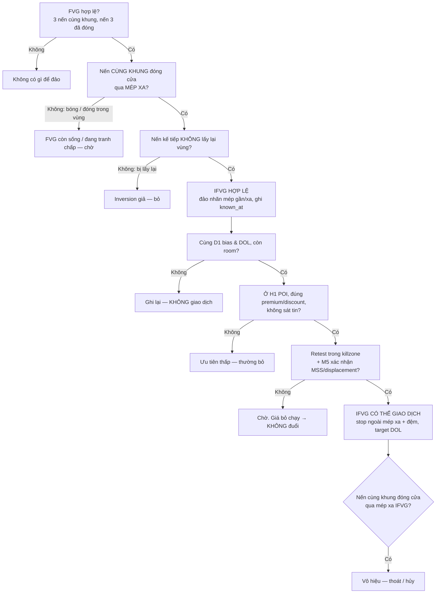

# Inverse Fair Value Gap (IFVG) · v2

> [!summary] Tóm tắt 1 câu
> **IFVG là một FVG đã bị giá ĐÓNG CỬA xuyên qua mép xa — giá đã sang hẳn phía bên kia vùng — nên ta không còn đọc vùng đó là "chỗ đỡ" (hoặc "chỗ chặn") theo hướng cũ nữa, mà đọc nó là nơi giá CÓ THỂ phản ứng theo hướng NGƯỢC LẠI khi quay về. Nó là một VỊ TRÍ để đặt câu hỏi, không phải một tín hiệu vào lệnh.**

> [!important] Nguyên tắc cốt lõi của bản v2
> 1. **Đóng cửa, không phải bóng nến.** Bóng nến cho biết giá đã ĐI TỚI đâu; giá đóng cửa cho biết giá Ở LẠI đâu. IFVG cần thông tin thứ hai — và phải đo trên ĐÚNG khung của FVG.
> 2. **Valid ≠ Tradeable.** "Có phải IFVG không?" là câu hỏi hình học (khách quan). "Có nên giao dịch không?" là câu hỏi bối cảnh (D1 bias, DOL, POI H1, killzone, xác nhận M5). Phần lớn IFVG hợp lệ KHÔNG đáng giao dịch.
> 3. **Định nghĩa ≠ Xác nhận ≠ Confluence.** Sweep, MSS, displacement, retest đều là bằng chứng tốt — nhưng không cái nào nằm trong định nghĩa. Biến mọi thứ tốt thành điều kiện bắt buộc là cách làm framework không thể kiểm chứng.
> 4. **Chart không cho biết ai làm gì và vì sao.** "Người mua bị kẹt", "Smart Money đảo vị thế", "dealer re-hedge" đều là DIỄN GIẢI. Thứ kiểm chứng được là: vùng IFVG có phản ứng KHÁC một vùng ngẫu nhiên hay không.

> [!abstract] Cách đọc note này — hệ thống nhãn
> | Nhãn trong note | Tương ứng protocol | Nghĩa |
> |---|---|---|
> | **[QUAN SÁT]** | Observable market behavior | Thấy trực tiếp trên OHLC, ai nhìn cũng thấy giống nhau |
> | **[CƠ CHẾ]** | Market mechanics | Giải thích bằng cách lệnh được khớp (market, limit, stop, sổ lệnh, đấu giá) |
> | **[ICT]** | ICT framework | Tên gọi và cách ICT / cộng đồng ICT dùng hiện tượng đó |
> | **[DIỄN GIẢI]** | Interpretation | Hợp lý, nhưng không thể xác nhận chỉ từ giá |
> | **[HYPOTHESIS]** | Hypothesis | Giả thuyết có lý do, cần kiểm chứng (mã HYP-IFVG-xx ở §28) |
> | **[BACKTEST REQUIRED]** | Backtest required | Không được coi là lợi thế giao dịch cho tới khi đo trên dữ liệu của chính bạn |
> | **[INSUFFICIENT EVIDENCE]** | Insufficient evidence | Không đủ bằng chứng để kết luận theo hướng nào |
>
> Mỗi khái niệm khó đi theo trình tự: **ELI5 (cho bé 5 tuổi) → Ví dụ đời thường → Giá thực sự làm gì → ICT gọi là gì → Vì sao có thể xảy ra → Phản ví dụ.**
> Tất cả hình `IFVG-v2-*` là **sơ đồ dựng (synthetic)** — giá trong hình là ví dụ để học, không phải dữ liệu thị trường. Note này **hạn chế số học**: không công thức, không thống kê; chỉ dùng vài con số giá đơn giản để chỉ đúng vị trí trên chart.

![[IFVG-v2-04-Nam-Loai-Cau-Noi.svg|960]]
*Hình IFVG-v2-04 — Cùng một sự kiện "FVG 104–106 bị đóng cửa xuyên xuống", năm câu nói thuộc năm loại sự thật khác nhau. Lỗi phổ biến nhất: đọc câu DIỄN GIẢI như thể nó là QUAN SÁT.*

> [!info] Ví dụ xuyên suốt của note (nhớ ba con số này)
> - Một **Bullish FVG 104–106** hình thành trong nhịp tăng. Giữa vùng (CE) = **105**.
> - Sau đó một nến **đóng cửa 103.2** — dưới cả vùng → vùng 104–106 trở thành **ứng viên Bearish IFVG**.
> - Giá hồi lên chọc vào vùng (cao nhất 105.1), bị đẩy xuống, rồi lấy **SSL 100.4**.
> Hầu hết các hình dùng lại đúng câu chuyện này (hoặc ảnh gương của nó) để bạn không phải học lại bối cảnh mỗi lần.

### Bản đồ trả lời: WHAT → WHY → HOW → MECHANISM → INVERSION → WHEN → WHEN NOT → IDENTIFICATION → VALIDATION → APPLICATION → FAILURE → BACKTESTABILITY

| Câu hỏi | Trả lời ngắn | Đọc kỹ ở |
|---|---|---|
| **WHAT** — IFVG là gì? | Một FVG bị đóng cửa qua mép xa, được đọc lại theo hướng ngược | §8 |
| **WHY** — Vì sao tồn tại (như một khái niệm)? | Vì "vùng bị phá thì có thể đổi vai" là một hiện tượng đã được quan sát từ lâu (role reversal); ICT áp nó lên FVG để có biên vùng rõ ràng | §8, §29 |
| **HOW** — Hình thành thế nào? | FVG → giá quay về → một nến đóng cửa qua mép xa → giá ở lại phía bên kia | §10, §11 |
| **MECHANISM** — Điều gì xảy ra khi FVG bị xuyên thủng? | Lệnh chủ động phía mới đã "ăn" hết lệnh chờ phía cũ trong vùng và giá được chấp nhận ở phía bên kia | §9 |
| **INVERSION** — Vì sao vai trò đảo? | Ba thứ thay đổi: vị trí giá (quan sát), cấu trúc (quan sát nếu đã định nghĩa swing), vai trò kỳ vọng (diễn giải) | §9.5 |
| **WHEN** — Khi nào FVG trở thành IFVG? | Khi một nến CÙNG KHUNG đóng cửa qua mép xa | §12, §13 |
| **WHEN NOT** — Khi nào không? | Bóng xuyên; đóng trong vùng; đóng ở khung nhỏ hơn; bị lấy lại ngay; FVG gốc không tồn tại | §12, §24 |
| **IDENTIFICATION** | Cây quyết định 6 bước | §23 |
| **VALIDATION** | Chấp nhận (không bị lấy lại) → retest → phản ứng; cộng thang bằng chứng | §19, §20 |
| **APPLICATION** | IFVG = VỊ TRÍ trong chuỗi D1 → H1 → M5, không phải tín hiệu độc lập | §22 |
| **FAILURE** | Reclaim, nến tin, range churn, lệch khung, retest lặp lại, ngược bối cảnh | §19, §21, §24 |
| **BACKTESTABILITY** | Định nghĩa + kích hoạt + vô hiệu đều viết được thành quy tắc khách quan | §27, §28 |

---

## 0. Ghi chú phiên bản (v1 → v2)

> [!note] Thay đổi chính so với v1 (bản cũ được lưu ở `Claude outputs/backups/17-Inverse-Fair-Value-Gap-iFVG.2026-11-09.md.bak`)
> - **Giữ nguyên tinh thần cốt lõi của v1:** close chứ không phải wick; IFVG ≠ Implied FVG; chờ retest; stop ngoài mép xa; nến tin, lệch khung, nested inversion là bẫy.
> - **Tách bạch nhãn sự thật.** v1 trình bày "lệnh kẹt", "dealer/market maker re-hedge sau MSS", "footprint xác nhận trực tiếp lệnh kẹt" gần như là cơ chế đã biết. v2 hạ chúng xuống **[DIỄN GIẢI]** hoặc **[HYPOTHESIS]**: không cái nào quan sát được trên OHLC.
> - **Bỏ các con số không có nguồn.** Bảng v1 "tỷ lệ inversion thật vs fake (ước lượng thực chiến)" theo thị trường và các ngưỡng như "3–5 tick" được xem là **heuristic chưa kiểm chứng**, không còn trình bày như kiến thức.
> - **Case study của v1 có ngày, giá và R cụ thể** (EURUSD, GBPUSD, BTCUSD) nhưng không có dữ liệu gốc để đối chiếu. v2 giữ **bài học** của chúng nhưng chuyển thành **case dựng (synthetic)**, không kèm kết quả R.
> - **Tách MSS ra khỏi định nghĩa.** v1 có lúc coi "displacement + MSS" gần như bắt buộc. v2: MSS là **xác nhận**, không phải định nghĩa (§13, §14).
> - **Thêm:** nền tảng FVG từ số 0, ba quy ước kích hoạt, vòng đời IFVG, real-time vs hindsight, biến quan sát cho backtest, sổ giả thuyết HYP-IFVG-01…10, và 38 hình minh họa mới.

---

## 1. Executive Summary

1. **FVG** là một khoảng giá giữa bóng nến 1 và bóng nến 3 mà chỉ nến 2 đi qua — dấu vết của một lần giá đi nhanh, một chiều. Nó **có** giao dịch bên trong (nến 2 đã giao dịch ở đó), chỉ là giao dịch rất ngắn. **[QUAN SÁT]**
2. **IFVG** là FVG đó sau khi một nến **cùng khung đóng cửa qua mép xa** của nó. Vùng giá không đổi (vẫn là 104–106); thứ đổi là **giá đang ở phía nào** và **ta kỳ vọng gì** ở vùng. **[QUAN SÁT + ICT]**
3. Hướng của IFVG **ngược** hướng FVG gốc: Bullish FVG bị phá xuống → **Bearish IFVG** (kỳ vọng chặn từ dưới); Bearish FVG bị phá lên → **Bullish IFVG** (kỳ vọng đỡ từ trên). **[ICT]**
4. **Mép gần / mép xa đổi chỗ** sau khi đảo: mép xa của FVG (104) thành mép gần của IFVG (phía giá đang đứng), và ngược lại. IFVG bị **vô hiệu** khi một nến cùng khung đóng cửa quay lại qua **mép xa của IFVG** (với ví dụ: đóng trên 106). **[ICT + định nghĩa vận hành của note]**
5. Vì sao vùng cũ **có thể** phản ứng: role reversal cổ điển, đấu giá chấp nhận/từ chối, cụm lệnh ở các mức dễ thấy, tâm lý muốn gỡ hòa vốn. Tất cả là **[DIỄN GIẢI]** — chart không cho biết ai đang làm gì. **[HYPOTHESIS: HYP-IFVG-01]**
6. Trong framework D1 → H1 → M5: **IFVG cung cấp VỊ TRÍ**; cấu trúc cung cấp HƯỚNG; liquidity cung cấp ĐÍCH; MSS/displacement cung cấp XÁC NHẬN; entry model quyết định THỜI ĐIỂM. IFVG **không bao giờ** tự nó là tín hiệu vào lệnh.
7. Ba sai lầm đắt nhất: (a) gọi IFVG từ **bóng nến** hoặc từ nến **khung nhỏ hơn**; (b) vào lệnh mà **không có điểm vô hiệu** (bị reclaim quét); (c) thấy IFVG ở **mọi nơi** — trong range, trên nến tin, ngược bias.
8. Giá trị dự báo của IFVG **chưa được chứng minh công khai** bằng dữ liệu có đối chứng. Mọi khẳng định "IFVG hoạt động" trong note này là **[BACKTEST REQUIRED]** cho tới khi bạn đo (§28).

---

## 2. IFVG Mental Model — giải thích cho bé 5 tuổi

### 2.1 Chuyện tấm sàn nhà

> [!tip] ELI5
> Bé đứng trên một tấm sàn. Tấm sàn **đỡ** bé. Một hôm tấm sàn bị thủng, bé rơi xuống tầng dưới và **đứng hẳn** ở đó. Bây giờ, tấm sàn bị thủng ấy nằm **trên đầu** bé. Nếu bé nhảy lên, bé có thể **cộc đầu** vào nó. Sàn đã thành **trần**.

![[IFVG-v2-01-ELI5-San-Thanh-Tran.svg|960]]
*Hình IFVG-v2-01 — Sàn nhà thành trần nhà. Bullish FVG (sàn) bị đóng cửa xuyên xuống; giá đứng ở dưới; vùng cũ giờ nằm trên giá và được đọc là Bearish IFVG (trần).*

**Ghép câu chuyện với trading:**

| Trong câu chuyện | Trên chart | Loại thông tin |
|---|---|---|
| Tấm sàn | Bullish FVG 104–106 | [QUAN SÁT] |
| Sàn đỡ bé | Giá chạm vùng rồi bật lên (đáy 105.3) | [QUAN SÁT] — còn "vì sao bật" là [DIỄN GIẢI] |
| Sàn bị thủng, bé **đứng** ở tầng dưới | Một nến **đóng cửa** 103.2, dưới cả vùng | [QUAN SÁT] |
| Sàn cũ thành trần | Vùng 104–106 được đọc là Bearish IFVG | [ICT] |
| Bé nhảy lên, cộc đầu | Giá hồi lên 105.1 rồi bị đẩy xuống | [QUAN SÁT] — còn "vì sao bị đẩy" là [DIỄN GIẢI] |

> [!warning] Phép so sánh dừng ở đâu?
> - Trần nhà làm bằng bê tông. **Vùng giá không có bê tông.** Nó chỉ là nơi giá *có thể* phản ứng.
> - "Trần" này **có thể bị nhảy xuyên qua** — IFVG có thể thất bại, và thất bại rất thường xuyên nếu bối cảnh sai.
> - Không ai "xây" trần. IFVG là cách chúng ta **đọc** hành vi giá, không phải một vật thể có thật trong thị trường.

### 2.2 Chuyện cầu thang bị nhảy bậc — FVG là gì

> [!tip] ELI5
> Bé đi lên cầu thang, **từng bậc một**, bậc nào cũng có dấu chân. Rồi bé **nhảy một bước thật dài**, qua mấy bậc liền. Những bậc bị nhảy qua chỉ có **một bước chân lướt ngang trên đầu**, không ai dừng lại ở đó. Mấy bậc đó chính là **FVG**.

![[IFVG-v2-02-ELI5-Cau-Thang-Nhay-Bac.svg|960]]
*Hình IFVG-v2-02 — FVG giống những bậc thang bị nhảy qua. Nến 1 = bước đi trước, nến 2 = bước nhảy, nến 3 = bước đi sau. Vùng xanh = khoảng giữa đỉnh nến 1 và đáy nến 3.*

Điểm then chốt của phép so sánh: **chân bé CÓ đi ngang qua** những bậc đó — chỉ là không dừng lại. Trên chart cũng vậy: giá **có** giao dịch trong vùng FVG (nến 2 đã đi qua nó), chỉ là giao dịch rất nhanh và một chiều. Câu "FVG là vùng giá không có giao dịch" là **sai** (xem §4.3).

### 2.3 Chuyện những bạn mua kem — vì sao vùng cũ *có thể* thành kháng cự

> [!tip] ELI5
> Nhiều bạn mua kem ở giá **10** vì tin giá sẽ lên **15**. Nhưng giá rơi xuống **8**. Các bạn buồn vì đang lỗ. Khi giá quay lại **10**, nhiều bạn nghĩ: *"May quá, về hòa vốn rồi, bán thôi!"* Nhiều người cùng bán ở 10 → giá khó đi lên qua 10.

![[IFVG-v2-03-ELI5-Nguoi-Mua-Bi-Ket.svg|960]]
*Hình IFVG-v2-03 — Câu chuyện "người bị kẹt". Nó HỢP LÝ, nhưng chart KHÔNG cho thấy ai đã mua, mua bao nhiêu, còn giữ lệnh hay không, và có thật sự bán ở hòa vốn không.*

Đây là câu chuyện phổ biến nhất để giải thích IFVG — và cũng là câu chuyện dễ bị dùng sai nhất. Tài chính hành vi có mô tả xu hướng chung "ngại chốt lỗ, muốn chờ về hòa vốn" (disposition effect) ở nhà đầu tư cá nhân. Nhưng từ đó **không suy ra được** rằng ở vùng 104–106 *cụ thể* này có một khối lượng đáng kể người đang kẹt và sẽ bán đúng ở đó. Vì vậy câu chuyện này mang nhãn **[DIỄN GIẢI]**, và câu "giá quay lại IFVG thường bị từ chối" mang nhãn **[BACKTEST REQUIRED]**.

### 2.4 Ba câu cần nhớ trước khi đọc tiếp

1. **FVG** = chỗ giá chạy nhanh qua, chỉ một nến đi qua. *(cầu thang nhảy bậc)*
2. **IFVG** = chỗ đó sau khi giá đã **đi xuyên qua và đứng hẳn ở phía bên kia**. *(sàn thủng thành trần)*
3. **IFVG là một câu hỏi, không phải câu trả lời**: "Khi giá quay lại đây, nó sẽ bị chặn, hay đi xuyên qua lần nữa?" *(trần bằng giấy)*

---

## 3. Conceptual Foundation — những viên gạch phải có trước

> [!tip] ELI5
> Muốn hiểu "sàn thủng thành trần", trước hết phải biết **sàn là gì**, **thủng là gì**, và **đứng ở tầng dưới là gì**. Trên chart: sàn = FVG, thủng = giá đi xuyên qua, đứng ở tầng dưới = giá **đóng cửa** ở phía bên kia.

### 3.1 Một cây nến kể gì — và không kể gì

**[QUAN SÁT]** Mỗi cây nến chỉ ghi **bốn con số**: giá mở cửa (Open), cao nhất (High), thấp nhất (Low), đóng cửa (Close) trong một khoảng thời gian.

| Nến **kể** cho bạn | Nến **không kể** cho bạn |
|---|---|
| Giá đã đi xa nhất tới đâu (High, Low) | Giá đi theo **thứ tự** nào bên trong nến (lên trước hay xuống trước) |
| Giá dừng ở đâu khi hết giờ (Close) | **Ai** mua, ai bán, mua bán bao nhiêu |
| Cây nến dài hay ngắn so với các nến khác | Có bao nhiêu lệnh **đang chờ** ở mỗi mức giá |
| | Lệnh nào là lệnh mới, lệnh nào là cắt lỗ, lệnh nào là chốt lời |

Đây là lý do note này khắt khe với nhãn: mọi câu nói về "ai", "vì sao", "bao nhiêu lệnh" đều nằm ở cột bên phải — tức là **không quan sát được** từ OHLC.

### 3.2 Ba loại lệnh — đủ để hiểu mọi thứ trong note **[CƠ CHẾ]**

> [!tip] ELI5
> - **Lệnh chờ (limit):** "Tôi mua nếu giá xuống tới 104." Nó **đứng đợi** trong sổ lệnh. Nó tạo ra "lớp đệm" làm giá chậm lại.
> - **Lệnh đi ngay (market):** "Tôi mua NGAY, giá nào cũng được." Nó **ăn** vào các lệnh chờ phía đối diện. Nó làm giá **di chuyển**.
> - **Lệnh dừng (stop):** "Nếu giá xuống tới 103, hãy bán NGAY cho tôi." Nó ngủ cho tới khi giá chạm mức, rồi biến thành **lệnh đi ngay**.

Giá chỉ đi lên khi lệnh **mua đi ngay** ăn hết lệnh **bán chờ** ở mức hiện tại (hoặc người bán rút lệnh). Giá chỉ đi xuống khi điều ngược lại xảy ra. Mọi chuyển động — tạo FVG, phá FVG, retest IFVG — đều là kết quả của cuộc "ăn" này.

### 3.3 Vì sao phải học FVG thật chắc trước

Vì **IFVG kế thừa mọi lỗi của FVG**. Nếu FVG gốc vẽ sai (dùng thân nến thay vì bóng, trộn khung, gọi tên trước khi nến 3 đóng cửa), thì "IFVG" dựng trên nó cũng sai. Note [[13-FVG-Fair-Value-Gap]] đi rất sâu; các mục 4–7 dưới đây chỉ giữ lại phần **tối thiểu cần thiết** để hiểu IFVG.

---

## 4. What Is Fair Value Gap?

### 4.1 Định nghĩa — bốn tầng

> [!tip] ELI5
> FVG là **khoảng trống giữa nến 1 và nến 3** khi nến 2 chạy một mạch quá dài, khiến bóng của nến 1 và bóng của nến 3 **không chạm nhau**.

- **Tầng giá thô [QUAN SÁT]:** Với ba nến liên tiếp cùng khung, nếu **đáy nến 3 cao hơn đỉnh nến 1** → có một khoảng giá mà chỉ nến 2 đi qua → **Bullish FVG**. Nếu **đỉnh nến 3 thấp hơn đáy nến 1** → **Bearish FVG**.
- **Tầng thuật ngữ [ICT]:** ICT gọi Bullish FVG là **BISI** (Buyside Imbalance, Sellside Inefficiency) và Bearish FVG là **SIBI** (Sellside Imbalance, Buyside Inefficiency). FVG thuộc nhóm **PD Arrays** — các vùng giá ICT dùng làm điểm tham chiếu.
- **Tầng cơ chế [CƠ CHẾ]:** Trong lúc nến 2 chạy, lệnh đi ngay một phía đến dồn dập hơn lượng lệnh chờ phía đối diện có thể hấp thụ → giá trượt qua nhiều mức rất nhanh (§6).
- **Tầng diễn giải [DIỄN GIẢI]:** ICT đọc FVG như một vùng mà thị trường "chưa giao hàng hiệu quả cho cả hai phía", nên giá có xu hướng quay lại "cân bằng". Đây là cách đọc, không phải định luật — nhiều FVG không bao giờ được lấp.

### 4.2 Vì sao gọi là "Fair Value Gap"?

"Fair value" ở đây **không** phải "giá trị hợp lý" theo nghĩa định giá tài sản hay kế toán. Trong cách dùng của ICT, nó gần với ý: *"một vùng giá mà thị trường đi qua quá nhanh để hai phía kịp giao dịch qua lại như bình thường"*. Tên gọi là một **nhãn**, không phải một tuyên bố rằng giá ở đó "đúng" hay "sai". **[ICT]**

### 4.3 FVG có phải "vùng không có giao dịch" không? — KHÔNG

**[QUAN SÁT]** Nến 2 có High và Low bao trùm cả vùng FVG → giá **đã giao dịch** ở mọi mức trong vùng (ít nhất là đi ngang qua). Cái "thiếu" chỉ là: **không có nến nào khác** chồng lên vùng đó. Một "khoảng trống thật sự không có giao dịch" chỉ xuất hiện với **gap mở cửa** (giá đóng ở 100 hôm trước, mở ở 103 hôm sau) — đó là một hiện tượng khác.

### 4.4 FVG ≠ Liquidity Void ≠ Imbalance trong sổ lệnh

![[IFVG-v2-09-FVG-vs-LV-vs-Imbalance.svg|960]]
*Hình IFVG-v2-09 — Ba khái niệm hay bị dùng lẫn. FVG và Liquidity Void là hình học trên nến (nhìn thấy được). Imbalance trong sổ lệnh là trạng thái lệnh chờ tại một thời điểm — OHLC không ghi lại.*

| | **FVG** | **Liquidity Void** | **Imbalance trong sổ lệnh** |
|---|---|---|---|
| Là gì | Khoảng giữa bóng nến 1 và nến 3, chỉ nến 2 đi qua | Một đoạn dài giá chạy một chiều, các nến gần như không chồng nhau | Lệnh chờ mua và chờ bán chênh lệch nhau tại một thời điểm |
| Đơn vị | 3 nến | Nhiều nến (cả một "con đường") | Một khoảnh khắc trong sổ lệnh |
| Thấy trên OHLC? | Có | Có | **Không** (cần dữ liệu Level 2 / order book) |
| Quan hệ | — | Thường **chứa** nhiều FVG | Có thể là **một** nguyên nhân khiến FVG xuất hiện, nhưng không đồng nhất với FVG |
| Note liên quan | [[13-FVG-Fair-Value-Gap]] | [[21-Liquidity-Void]] | [[13-FVG-Fair-Value-Gap]] §4 |

> [!warning] Đừng nói "FVG là imbalance trong order flow" như một sự thật
> Bạn **không nhìn thấy** order flow trên OHLC. Câu đúng là: *"FVG là dấu vết hình học của một lần giá di chuyển nhanh; một nguyên nhân hợp lý là lệnh chủ động một phía áp đảo lệnh chờ phía kia trong thời gian ngắn."*

---

## 5. Three-Candle FVG Formation

### 5.1 Bullish FVG — từng con số

![[IFVG-v2-05-Bullish-FVG-OHLC.svg|960]]
*Hình IFVG-v2-05 — Bullish FVG bằng OHLC cụ thể. Hai con số duy nhất cần nhìn: đỉnh nến 1 (104) và đáy nến 3 (106).*

| Nến | Open | High | Low | Close | Vai trò |
|---|---|---|---|---|---|
| Nến 1 | 103.0 | **104.0** | 102.6 | 103.6 | "Bước đi trước" — đỉnh của nó là **mép dưới** của FVG |
| Nến 2 | 103.6 | 108.6 | 103.4 | 108.2 | "Bước nhảy" — cú đẩy (displacement) tạo ra khoảng trống |
| Nến 3 | 108.2 | 109.4 | **106.0** | 109.0 | "Bước đi sau" — đáy của nó là **mép trên** của FVG |

**Kiểm tra bằng lời, không cần công thức:** đáy nến 3 (106) nằm **cao hơn** đỉnh nến 1 (104) → giữa chúng có khoảng 104–106 mà chỉ nến 2 đi qua → **Bullish FVG 104–106**.

### 5.2 Bearish FVG — ảnh gương

![[IFVG-v2-06-Bearish-FVG-OHLC.svg|960]]
*Hình IFVG-v2-06 — Bearish FVG: đỉnh nến 3 (104) nằm THẤP HƠN đáy nến 1 (106) → khoảng 104–106 chỉ có nến 2 đi qua.*

### 5.3 Mép gần (proximal), mép xa (distal) và giữa vùng (CE)

> [!tip] ELI5
> Khi bạn đi bộ về nhà, **cửa trước** là cửa bạn chạm đầu tiên, **cửa sau** là cửa xa nhất. Mép gần là "cửa trước" của vùng — chỗ giá chạm trước khi quay về. Mép xa là "cửa sau".

| | Bullish FVG (giá quay về **từ trên xuống**) | Bearish FVG (giá quay về **từ dưới lên**) |
|---|---|---|
| **Mép gần (proximal)** | Đáy nến 3 = 106 | Đỉnh nến 3 = 104 |
| **Mép xa (distal)** | Đỉnh nến 1 = 104 | Đáy nến 1 = 106 |
| **Giữa vùng (CE)** | 105 | 105 |
| **FVG bị vi phạm khi** | Một nến **đóng cửa dưới 104** | Một nến **đóng cửa trên 106** |

Xem thêm [[10-Consequent-Encroachment-Mean-Threshold]] cho CE.

> [!important] Mép gần/xa ĐỔI CHỖ sau khi FVG thành IFVG
> Sau khi Bullish FVG 104–106 bị đóng cửa xuống dưới, giá đang ở **dưới** vùng. Từ góc nhìn mới:
> - **Mép gần của IFVG = 104** (cũ là mép xa của FVG) — giá chạm nó đầu tiên khi hồi lên.
> - **Mép xa của IFVG = 106** (cũ là mép gần của FVG) — nếu giá **đóng cửa** trên đây, IFVG bị vô hiệu.
> Rất nhiều nhầm lẫn khi đặt stop/vô hiệu đến từ việc quên rằng hai mép đã đổi vai.

### 5.4 Những thứ trông giống FVG nhưng không phải

![[IFVG-v2-07-Khong-Phai-FVG.svg|960]]
*Hình IFVG-v2-07 — Bốn phản ví dụ. Một "IFVG" dựng trên một FVG không tồn tại thì cũng không tồn tại.*

| Trường hợp | Vì sao không phải (hoặc chưa phải) FVG |
|---|---|
| **Bóng chồng lên nhau** | Đáy nến 3 lùi xuống dưới đỉnh nến 1 → không còn khoảng trống |
| **Chỉ thân hở, bóng vẫn chạm** | Theo định nghĩa dùng **bóng** (chuẩn ICT), không có FVG. Khoảng hở giữa các thân nến gần với khái niệm *volume imbalance* — một khái niệm khác |
| **Nến 2 rất to nhưng nến 3 lùi sâu** | Cú đẩy mạnh **không đảm bảo** có FVG |
| **Nến 3 chưa đóng cửa** | Đáy nến 3 còn có thể chạy xuống dưới 104. **Chưa biết** — chỉ gọi tên khi nến 3 đóng cửa |
| *(thêm)* **Trộn khung** | Nến 1 lấy từ H1, nến 2–3 lấy từ M5 → không phải FVG của khung nào cả |

---

## 6. Why FVG Forms

### 6.1 Câu trả lời ba tầng

> [!tip] ELI5
> Tưởng tượng một hàng người đứng chờ **bán** kem ở mỗi bậc giá. Ở vài bậc, hàng rất **dài**; ở vài bậc, hàng rất **ngắn**. Khi một đám đông đến **mua ngay**, họ mua hết hàng ngắn rất nhanh và chạy vèo lên bậc trên. Chỗ hàng ngắn bị **chạy vèo qua** chính là chỗ để lại FVG.

![[IFVG-v2-08-FVG-Hinh-Thanh-Co-Che.svg|960]]
*Hình IFVG-v2-08 — Một sổ lệnh tưởng tượng. Ở vùng "mỏng" (ít lệnh bán chờ), mỗi lệnh mua đi ngay đẩy giá đi xa hơn. Kết quả trên chart: nến 2 dài, FVG 104–106.*

1. **Tầng hình học [QUAN SÁT]:** FVG xuất hiện khi nến giữa **dài hơn đáng kể** so với hai nến bên cạnh — đủ để bóng hai nến bên không chạm nhau. Chỉ vậy thôi. Ngay cả chuỗi giá ngẫu nhiên cũng sinh ra FVG khá thường xuyên (xem [[13-FVG-Fair-Value-Gap]] §9.2), nên **sự tồn tại** của một FVG chưa nói lên gì đặc biệt.
2. **Tầng cơ chế [CƠ CHẾ]:** Điều gì làm nến 2 dài? Lệnh đi ngay một phía **áp đảo** lệnh chờ phía kia trong thời gian ngắn. Có thể vì: (a) nhiều lệnh mua/bán chủ động cùng lúc; (b) người đặt lệnh chờ **rút lệnh** (thanh khoản biến mất); (c) **lệnh dừng** bị kích hoạt dây chuyền; (d) tin tức; (e) phiên vắng, ít lệnh chờ.
3. **Tầng diễn giải [DIỄN GIẢI]:** ICT gắn FVG với "price delivery" của các thuật toán và với **displacement** — dấu hiệu cho thấy một phía nghiêm túc. Đây là cách đọc; OHLC không phân biệt được nguyên nhân (a) – (e).

### 6.2 Vì sao FVG thường đi cùng displacement?

Vì **về mặt hình học**, để bóng nến 1 và nến 3 tách nhau, nến 2 phải dài hơn hẳn — và một nến dài hơn hẳn chính là thứ ta hay gọi là displacement. Đây là mối quan hệ **gần như định nghĩa**, không phải một khám phá. Nhưng chiều ngược lại không đúng: displacement **không đảm bảo** có FVG (Hình IFVG-v2-07, trường hợp 3), và FVG **không đảm bảo** displacement có ý nghĩa cấu trúc. Xem [[50-Displacement-In-Depth]].

### 6.3 Vì sao một số FVG được quay lại, một số thì không?

- **[QUAN SÁT]** Nhiều FVG — nhất là FVG nhỏ, gần giá — được chạm lại; một số thì giá bỏ đi luôn.
- **[CƠ CHẾ / DIỄN GIẢI]** Một phần là hình học thuần túy: FVG càng nhỏ và càng gần giá thì càng dễ bị chạm lại do dao động bình thường. Một phần có thể đến từ bối cảnh: nếu thị trường đang có một "đích" (DOL) ở xa theo hướng cú đẩy, giá có thể không cần quay lại.
- **Hệ quả cho IFVG:** câu "giá luôn lấp FVG" là **sai**; và "FVG bị lấp" **không** có nghĩa là FVG "đã làm xong việc" hay "đã thất bại". Lấp (fill) và bị phá (violation) là **hai sự kiện khác nhau** (§7, §12).

---

## 7. FVG Lifecycle

> [!tip] ELI5
> Một FVG giống một **câu hỏi được ghi lên bảng**. Giá có thể không bao giờ quay lại đọc nó; có thể quay lại đọc rồi đi tiếp; có thể quay lại và **xóa** nó đi. Chỉ khi nó bị xóa và giá **đứng hẳn** ở phía bên kia, câu chuyện IFVG mới bắt đầu.

![[IFVG-v2-10-Vong-Doi-FVG.svg|960]]
*Hình IFVG-v2-10 — Vòng đời của một FVG và chỗ IFVG bước vào. Mỗi mũi tên là một khả năng, không phải thứ tự bắt buộc.*

### 7.1 Các trạng thái — từ vựng chính xác

| Trạng thái | Định nghĩa (cho Bullish FVG; Bearish đối xứng) | Nhìn bằng | IFVG? |
|---|---|---|---|
| **1. Hình thành** | Nến 3 đã đóng cửa, khoảng trống tồn tại | Close nến 3 | — |
| **2. Rời xa** | Giá đi tiếp theo hướng cú đẩy | — | — |
| **3. Chạm (touch)** | Một nến có Low chạm mép gần (106) | Bóng | Không |
| **4a. Phản ứng / tôn trọng (respect)** | Sau khi chạm, giá đi tiếp theo hướng cũ | Bóng + Close | Không |
| **4b. Lấp một phần / tới CE** | Low vào trong vùng, tới hoặc qua 105 | Bóng | Không |
| **4c. Lấp hết (full fill)** | Low chạm mép xa (104) | Bóng | **Không** — lấp hết ≠ đảo ngược |
| **4d. Vi phạm (violation / invalidation)** | Một nến cùng khung **đóng cửa dưới 104** | Close | Ứng viên |
| **5. Ứng viên IFVG** | Đã vi phạm; giá đang ở phía bên kia | Close | Ứng viên |
| **6a. Retest & bị từ chối** | Giá quay lên chạm vùng từ dưới rồi bị đẩy xuống | Bóng + Close | IFVG "hành xử" |
| **6b. Bị lấy lại (reclaim)** | Giá đóng cửa quay lại qua vùng | Close | Inversion giả |
| **6c. Không retest** | Giá đi xa luôn | — | IFVG không được kiểm tra |
| *Bị bỏ lại* | Giá không bao giờ quay về | — | — |

### 7.2 Sáu điều có thể xảy ra khi giá quay về

![[IFVG-v2-11-Sau-Tinh-Huong-Khi-Quay-Ve.svg|960]]
*Hình IFVG-v2-11 — Sáu tình huống khi giá quay về một Bullish FVG. Chỉ tình huống 6 (đóng cửa DƯỚI cả vùng) tạo ra ứng viên IFVG theo định nghĩa của note này.*

> [!note] Mô hình hay quy luật?
> Vòng đời trên là một **mô hình nghiên cứu** — một cách chia nhỏ sự kiện để ghi chép và đo đạc — chứ không phải "luật" của thị trường. Giá trị của nó nằm ở chỗ bắt bạn **ghi đúng trạng thái** FVG đạt được, thay vì gộp mọi thứ thành "FVG đúng / FVG sai" — cách gộp làm mất thông tin và mở cửa cho diễn giải sau sự kiện.

---

## 8. What Is Inverse Fair Value Gap? — bốn cấp độ

### 8.1 Cấp 1 — Beginner

> [!tip] ELI5
> Có một chỗ trên cầu thang bị nhảy qua (FVG). Lúc đầu, mỗi khi bé đi xuống tới đó, bé hay **dừng lại rồi đi lên** — chỗ đó như một bậc đỡ. Rồi một hôm bé **đi tuột qua luôn** và **đứng hẳn** ở bậc dưới. Từ hôm đó, chỗ cũ không còn là bậc đỡ nữa. Nó là chỗ bé **phải trèo qua** nếu muốn lên lại — có khi trèo được, có khi không.

**IFVG = cái FVG cũ, sau khi giá đã đi tuột qua và đứng hẳn ở phía bên kia.** Ta không vứt nó đi; ta đọc nó theo cách mới.

### 8.2 Cấp 2 — Giá thực sự làm gì

**[QUAN SÁT]** Với ví dụ xuyên suốt:

```text
Chuỗi giá của ví dụ xuyên suốt (đọc từ trái sang phải, từ trên xuống dưới)
101 → 103.6 → [nến 2 vọt lên 108.2] → 109.0 → đỉnh 111
    → 108.5 → 107.1 → chạm 105.3 (vào trong vùng 104–106) → bật lên 107.5
    → [một nến ĐÓNG CỬA 103.2 — dưới cả vùng 104–106]
    → 102.0 (vẫn ở dưới vùng) → hồi lên chạm 105.1 (retest từ DƯỚI)
    → đóng 103.7 → rơi 101.0 → 99.9 (lấy SSL 100.4)
```

Năm điều nhìn thấy được: (1) FVG 104–106 hình thành; (2) giá quay về chạm vùng và bật; (3) một nến **đóng cửa** 103.2 — dưới cả vùng; (4) nến sau vẫn ở dưới; (5) giá hồi lên chạm vùng từ dưới rồi đi xuống. Không có điều nào trong năm điều này nói về **ai** hay **vì sao**.

### 8.3 Cấp 3 — ICT định nghĩa và dùng IFVG thế nào **[ICT]**

- **Cách hiểu phổ biến trong cộng đồng ICT:** *một FVG không được tôn trọng — giá đi xuyên qua nó — sau đó vùng đó được dùng như hỗ trợ/kháng cự theo hướng ngược lại.* Bullish FVG thất bại → Bearish IFVG; Bearish FVG thất bại → Bullish IFVG.
- **Sự kiện kích hoạt:** các nguồn mô tả công khai phổ biến (ví dụ trang khái niệm của LuxAlgo) nêu yêu cầu thường gặp là **thân nến đóng cửa vượt qua phía xa của gap**; bóng nến đơn thuần thường được đọc là một lần "thăm dò". Cũng có trader dùng **đóng cửa qua CE** làm mốc. Một số công cụ chỉ ghi chung chung là giá "giao dịch hoàn toàn xuyên qua gap", không nói rõ đóng cửa hay bóng.
- **Vô hiệu:** nguồn mô tả phổ biến coi việc giá **lấy lại (reclaim) cả vùng** là phủ nhận ý tưởng.
- **Cách dùng:** chờ giá retest vùng từ phía bên kia, tìm xác nhận ở khung nhỏ, đặt stop ngoài phía xa của vùng, nhắm tới thanh khoản đối diện. Trong ICT 2022 Model, IFVG thường xuất hiện **ngay sau MSS** như một vùng vào lệnh thay thế khi không có FVG mới đẹp.

> [!warning] [INSUFFICIENT EVIDENCE] — nguồn gốc chính xác
> Khái niệm được cộng đồng gán cho ICT (Michael J. Huddleston), nhưng note này **chưa xác minh được** một định nghĩa nguyên văn có ngày tháng và nguồn gốc cụ thể (bài giảng, tập, thời điểm). Các nguồn công khai đã đọc (LuxAlgo, script TradingView) mô tả khái niệm nhưng không trích dẫn nguồn gốc. Vì vậy: định nghĩa trong note này là **định nghĩa vận hành do chúng ta chọn** (DEF-IFVG-01, §13), không phải "định nghĩa chính thức của ICT".

### 8.4 Cấp 4 — Cơ chế thị trường: vì sao vai trò có thể đảo?

Câu hỏi trung tâm: *Tại sao một vùng ban đầu được kỳ vọng đỡ giá lại có thể chặn giá? (và ngược lại)*

**Cái ta biết chắc [CƠ CHẾ]:** để giá đóng cửa ở 103.2, lệnh **bán đi ngay** đã phải "ăn" hết mọi lệnh **mua chờ** đang có ở 104–106 trong lúc đó (hoặc người mua đã rút lệnh). Nói cách khác: ở thời điểm vi phạm, **phía mua trong vùng đã không đủ** để giữ giá. Đây là sự thật về cách khớp lệnh — nhưng nó không nói gì về chuyện sẽ xảy ra **lần sau** giá quay lại.

**Những câu chuyện hợp lý cho "lần sau" [DIỄN GIẢI]** — mỗi câu chuyện là một cơ chế *có thể*, không cái nào quan sát được trên OHLC:

| # | Câu chuyện | Nó dự đoán gì nếu đúng |
|---|---|---|
| 1 | **Lệnh chờ đã bị tiêu hao.** Lệnh mua chờ trong vùng đã khớp hoặc bị rút trong cú vi phạm → khi giá quay lại, vùng "mỏng" phía mua hơn trước. | Giá đi lên qua vùng không gặp nhiều "đệm" mua — nhưng điều này một mình không giải thích vì sao giá bị **chặn** |
| 2 | **Người mua bị kẹt muốn thoát hòa vốn** (Hình IFVG-v2-03). Ai mua ở vùng và chưa cắt lỗ có thể bán khi giá về lại giá vốn → cung xuất hiện ở đúng vùng. | Phản ứng mạnh nhất ở **lần retest đầu**, yếu dần khi "hàng kẹt" đã được xả |
| 3 | **Người bán mới đặt lệnh ở vùng.** Trader đọc IFVG (rất phổ biến) đặt lệnh bán chờ ở vùng, stop trên 106. | Vùng có phản ứng vì **nhiều người cùng vẽ nó** (tự hiện thực một phần); và **stop trên 106** trở thành thanh khoản dễ bị quét |
| 4 | **Đấu giá: chấp nhận rồi từ chối.** Giá đã được chấp nhận ở dưới; quay lên vùng cũ là "hỏi" thị trường có muốn giao dịch ở đó nữa không. | Nếu bị từ chối: nến bóng trên dài, đóng cửa lại dưới vùng; nếu được chấp nhận: đóng cửa trên 106 và ở lại |
| 5 | **Role reversal cổ điển.** Hỗ trợ bị phá thành kháng cự — mô tả trong phân tích kỹ thuật từ trước ICT rất lâu; nghiên cứu về lệnh ngoại hối cho thấy lệnh chốt lời và dừng lỗ có xu hướng tụ ở các mức dễ thấy (Osler, 2003). | Mọi vùng S/R dễ thấy bị phá đều có thể cho phản ứng — câu hỏi là FVG có **thêm** gì không (§29) |

> [!important] Câu trả lời trung thực cho "vì sao IFVG đảo vai?"
> Chúng ta **không biết chắc**. Ta biết chắc rằng ở lúc vi phạm, phía cũ đã thua trong vùng. Mọi câu chuyện về lần quay lại sau đó là giả thuyết. Điều có thể kiểm chứng là **hệ quả**: vùng IFVG có bị từ chối thường xuyên hơn một vùng đối chứng hay không (**HYP-IFVG-01**, §28).

### 8.5 IFVG KHÔNG đơn giản là "FVG bị lấp"

| Trạng thái | Nghĩa chính xác trong note này | Có phải IFVG? |
|---|---|---|
| **Mitigated** (được "chạm/giảm nhẹ") | Giá quay lại **vào** vùng. Trong cách nói ICT, "mitigation" thường dùng lỏng cho việc giá trở về một PD array | Không |
| **Partially filled** | Giá vào vùng nhưng chưa tới mép xa | Không |
| **Fully filled** | Bóng nến chạm/qua mép xa nhưng **đóng cửa không ở bên kia** | **Không** — đây là lỗi nhầm lẫn số 1 |
| **Violated** | Một nến cùng khung **đóng cửa qua mép xa** | Ứng viên |
| **Invalidated** (với FVG) | Đồng nghĩa với violated: FVG không còn được đọc theo hướng gốc | Ứng viên |
| **Became IFVG** (kích hoạt) | Đã violated **và** nến kế tiếp không lấy lại vùng (theo quy tắc kích hoạt bạn chọn) | Có — IFVG hợp lệ |
| **IFVG "hành xử"** | Retest từ phía bên kia bị từ chối | IFVG có bằng chứng hành vi (vẫn chưa phải "edge") |

---

## 9. The Inversion Mechanism — trước, trong và sau

### 9.1 Trước khi đảo — vì sao Bullish FVG được kỳ vọng đỡ giá?

> [!tip] ELI5
> Chỗ bé từng nhảy qua là chỗ bé đi **rất nhanh và rất tự tin**. Nếu bé quay lại đó, người ta đoán bé sẽ lại tự tin đi lên.

- **[ICT]** Bullish FVG là vùng "giao hàng" một chiều phía mua; khi giá quay về, ICT kỳ vọng phía mua "bảo vệ" vùng → hỗ trợ.
- **[CƠ CHẾ]** Không có cơ chế nào **bắt buộc** vùng phải đỡ. Có những lý do *hợp lý*: phía đã tạo cú đẩy có thể còn muốn mua ở giá tốt hơn; và rất nhiều trader dùng FVG làm điểm vào → **lệnh mua chờ** thật sự có thể tụ ở đó (tự hiện thực một phần).
- **[QUAN SÁT]** Trong ví dụ, giá chạm 105.3 rồi bật — phù hợp với kỳ vọng. Nhưng một lần bật **không chứng minh** vùng "có lực đỡ"; nó cũng có thể là dao động bình thường.

### 9.2 Trong lúc đảo — điều gì thay đổi?

> [!tip] ELI5
> Lần này bé không dừng lại ở bậc đỡ. Bé **đi tuột qua** và — quan trọng nhất — **đứng lại** ở bậc dưới khi tiếng chuông hết giờ vang lên. Chuông hết giờ chính là lúc **nến đóng cửa**.

**Điều gì thay đổi [QUAN SÁT]:**
- Giá không chỉ vào vùng mà **ra khỏi vùng ở phía bên kia**, và **đóng cửa** ở đó (103.2 < 104).
- Kỳ vọng "vùng đỡ giá" đã bị phủ nhận **ít nhất một lần** — đúng vào lúc có kết luận (close).

**Vì sao đóng cửa quan trọng hơn bóng nến:**
- Bóng nến = giá đã **thăm** mức đó. Trong lúc thăm, có thể chỉ một vài lệnh lớn hoặc một chuỗi lệnh dừng đẩy giá đi, rồi giá quay về.
- Đóng cửa = mức giá thị trường **chốt lại** khi khoảng thời gian kết thúc. Đó là thông tin "kết luận" của cây nến, và là thứ duy nhất **không thay đổi** sau khi nến đóng.

![[IFVG-v2-12-Bong-Nen-vs-Dong-Cua.svg|960]]
*Hình IFVG-v2-12 — Ba cách một nến có thể đi xuyên qua vùng. Chỉ C (đóng cửa dưới cả vùng) đổi trạng thái FVG.*

**Có cần displacement không? Có cần MSS không? Có cần phá một swing không?**

| Điều kiện | Thuộc loại | Vì sao |
|---|---|---|
| Đóng cửa qua mép xa, cùng khung | **ĐỊNH NGHĨA** | Không có nó thì FVG vẫn còn sống (hoặc đang tranh chấp) |
| Nến kế tiếp không lấy lại vùng | **KÍCH HOẠT** (quy tắc vận hành) | Lọc cú quét rồi lấy lại; viết ra trước, dùng nhất quán |
| Displacement trong cú phá | **XÁC NHẬN** | Cho thấy phía mới chủ động, không phải trôi dạt — nhưng IFVG vẫn tồn tại khi phá chậm (Hình IFVG-v2-22) |
| Phá một swing có ý nghĩa (MSS) | **XÁC NHẬN** | Cho thấy cấu trúc gãy, không chỉ một vùng nhỏ bị phá — nhưng IFVG vẫn tồn tại khi swing chưa gãy (Hình IFVG-v2-20B) |
| Liquidity sweep trước đó | **BỐI CẢNH** | Gợi ý giá đã "lấy" thanh khoản một phía và có thể đi tìm phía kia — không tạo ra IFVG |

### 9.3 Sau khi đảo — retest, từ chối, thất bại

> [!tip] ELI5
> Bé ở tầng dưới và nhìn lên tấm sàn thủng. Bé có thể: (A) nhảy lên, cộc đầu, rơi xuống; (B) trèo được lên lại và đứng trên sàn; (C) bỏ đi chỗ khác, không bao giờ nhảy lên.

- **Vì sao retest có thể xảy ra?** [CƠ CHẾ + DIỄN GIẢI] Sau một cú đẩy mạnh, giá thường hồi lại một phần (người chốt lời, người đặt lệnh ngược). Vùng IFVG nằm ngay trên đường hồi → dễ được chạm. Đây phần lớn là **hình học**, không phải "giá bị hút về IFVG".
- **Vì sao có thể bị từ chối?** Các câu chuyện 2–5 ở §8.4. Không cái nào quan sát được trực tiếp.
- **Vì sao có thể thất bại?** (a) phía cũ quay lại mạnh hơn (cú phá chỉ là quét thanh khoản dưới 104); (b) bối cảnh lớn hơn vẫn ngược hướng (H1/D1 vẫn tăng); (c) tin tức; (d) range — không ai thắng lâu dài.
- **Có thể tiếp diễn mà không retest không?** Có. Đây là kịch bản C. Hướng đúng nhưng **không có điểm vào** ở IFVG. Không đuổi.
- **Có thể retest nhiều lần không?** Có. **[HYPOTHESIS: HYP-IFVG-06]** lần đầu thường quan trọng nhất; các lần sau có thể yếu dần (nếu câu chuyện "hàng kẹt được xả" đúng) — chưa kiểm chứng.
- **Khi nào IFVG hết relevant?** (1) Bị vô hiệu (đóng cửa quay lại qua mép xa của IFVG); (2) giá đã tới DOL và bối cảnh mới hình thành; (3) vùng đã bị đảo qua đảo lại trong range; (4) quá "cũ" so với khung đang dùng (đặt quy tắc hết hạn khi backtest — §27).

### 9.4 Kịch bản ngược lại — Bearish FVG thành Bullish IFVG

Mọi thứ lật trên–dưới: Bearish FVG 104–106 (mép gần 104, mép xa 106); một nến **đóng cửa trên 106** → ứng viên Bullish IFVG; mép gần của IFVG thành 106, mép xa thành 104; retest từ trên xuống; vô hiệu khi đóng cửa **dưới 104**. Chi tiết ở §11 và Hình IFVG-v2-15.

### 9.5 Cơ chế lõi — điều gì THỰC SỰ đảo ngược?

![[IFVG-v2-16-Dieu-Gi-Dao-Nguoc.svg|960]]
*Hình IFVG-v2-16 — Ba thứ thay đổi khi FVG thành IFVG; chỉ hai thứ đầu nhìn thấy được. Và có một thứ không hề thay đổi: bản thân vùng giá.*

| Khía cạnh | Trước | Sau | Loại |
|---|---|---|---|
| **1. Quan hệ giá – vùng** | Giá ở TRÊN 104–106 | Giá ở DƯỚI 104–106 | [QUAN SÁT] |
| **2. Quan hệ cấu trúc** | Đáy 105.3 còn giữ (đáy sau cao hơn đáy trước) | Đáy 105.3 bị phá (đáy thấp hơn xuất hiện) | [QUAN SÁT]* |
| **3. Cách đọc giao dịch** | Vùng được kỳ vọng ĐỠ | Vùng được kỳ vọng CHẶN | [ICT / DIỄN GIẢI] |

\* Quan sát được **nếu** bạn đã định nghĩa swing bằng một quy tắc cố định trước khi nhìn kết quả (xem [[54-Thuat-toan-phat-hien-swing-turning-point-Directional-Change-va-Nen-tang-dinh-luong]]).

> [!warning] Về câu "Buyers become sellers"
> Câu này hay được dùng để giải thích IFVG. Nó **có thể** đúng theo nghĩa: một số người từng mua ở vùng sẽ bán ở vùng khi giá quay lại (để thoát hòa vốn), và một số người mới sẽ bán ở đó vì đọc IFVG. Nhưng chart **không cho phép** kết luận danh tính hay ý định của bất kỳ ai. Cùng một phản ứng ở vùng có thể đến từ: người kẹt thoát lệnh, người bán mới, thuật toán tạo lập thị trường điều chỉnh báo giá, hay đơn giản là dao động ngẫu nhiên. Hãy nói *"vùng đổi vai trò kỳ vọng"* thay vì *"người mua đã thành người bán"*.

---

## 10. Bullish FVG → Bearish IFVG

![[IFVG-v2-14-Bullish-FVG-Thanh-Bearish-IFVG.svg|960]]
*Hình IFVG-v2-14 — Câu chuyện 9 bước của ví dụ xuyên suốt. Bước 1–4: chuyện của FVG. Bước 5–6: biến nó thành IFVG. Bước 7–9: IFVG "hành xử" — thứ phải kiểm chứng.*

### 10.1 Chín bước — mỗi bước một câu hỏi

| Bước | Sự kiện | Nến (O / H / L / C) | Câu hỏi bạn nên hỏi lúc đó |
|---|---|---|---|
| 1 | Cú đẩy tăng (displacement) | 103.6 / 108.6 / 103.4 / 108.2 | Cú đẩy này có lấy thanh khoản nào không? Có phá cấu trúc không? |
| 2 | Bullish FVG 104–106 hình thành | (nến 3) 108.2 / 109.4 / 106.0 / 109.0 | FVG nằm ở premium hay discount của dealing range? Cùng hay ngược bias D1? |
| 3 | Giá rời vùng, lên đỉnh 111 | — | Đỉnh 111 có phải là thanh khoản (BSL) ai đó sẽ nhắm không? |
| 4 | Quay về chạm vùng (105.3), bật nhẹ | 107.1 / 107.4 / 105.3 / 106.4 | FVG đang được tôn trọng — đáy 105.3 trở thành swing cần theo dõi |
| 5 | **Nến đóng cửa 103.2** — dưới cả vùng, dưới đáy 105.3 | 106.0 / 106.2 / 102.8 / 103.2 | Đóng cửa hay chỉ bóng? Cùng khung với FVG chưa? Có displacement không? |
| 6 | Nến sau vẫn đóng dưới vùng | 103.2 / 103.6 / 101.6 / 102.0 | Có bị lấy lại không? → **kích hoạt** ứng viên Bearish IFVG |
| 7 | Giá hồi lên chọc vào vùng từ dưới (105.1) | 103.1 / 105.1 / 102.9 / 103.7 | Retest lần mấy? Sâu tới đâu (mép gần 104 / CE 105 / mép xa 106)? Trong killzone? |
| 8 | Bị từ chối: đóng lại dưới vùng, rồi nến giảm mạnh | 103.7 / 104.0 / 100.6 / 101.0 | Có xác nhận ở khung nhỏ (MSS M5) không? |
| 9 | Tiếp diễn, lấy SSL 100.4 | 101.0 / 101.3 / 99.6 / 99.9 | Đích (DOL) đã đạt — IFVG còn relevant nữa không? |

### 10.2 Những gì thuộc định nghĩa, những gì không

- **Định nghĩa đã thỏa ở bước 5** (đóng cửa qua mép xa, cùng khung). **Kích hoạt ở bước 6.** Từ đây vùng 104–106 là **Bearish IFVG hợp lệ**.
- **Bước 7–8 là hành vi**, không phải định nghĩa. Nếu bước 7 không bao giờ xảy ra, vùng vẫn là IFVG hợp lệ — chỉ là không được kiểm tra.
- **Bước 9 là kết quả.** Một kết quả đẹp không chứng minh IFVG "đúng"; một kết quả xấu không chứng minh IFVG "sai". Một lần là một lần.

---

## 11. Bearish FVG → Bullish IFVG

![[IFVG-v2-15-Bearish-FVG-Thanh-Bullish-IFVG.svg|960]]
*Hình IFVG-v2-15 — Ảnh gương của Hình 14. Bearish FVG 104–106 bị đóng cửa lên trên 106 → Bullish IFVG; retest từ trên xuống (thấp nhất 104.9) bị từ chối; tiếp diễn lên lấy BSL.*

```text
Chuỗi giá ảnh gương (mọi thứ lật trên–dưới)
108.6 → 106.4 → [nến 2 rơi xuống 101.8] → 101.0 → đáy 99
    → 101.5 → 102.9 → chạm 104.7 (vào trong vùng 104–106) → rơi xuống 102.5
    → [một nến ĐÓNG CỬA 106.8 — trên cả vùng 104–106]
    → 108.0 (vẫn ở trên vùng) → hồi xuống chạm 104.9 (retest từ TRÊN)
    → đóng 106.3 → lên 109.0 → 110.1 (lấy BSL 109.6)
```

### 11.1 So sánh song song

| Khía cạnh | Bullish FVG → **Bearish IFVG** | Bearish FVG → **Bullish IFVG** |
|---|---|---|
| Hướng FVG gốc | Tăng (nến 2 tăng) | Giảm (nến 2 giảm) |
| Hướng vi phạm | Xuống: đóng cửa **dưới mép dưới** (104) | Lên: đóng cửa **trên mép trên** (106) |
| Hướng IFVG | **Giảm** — kỳ vọng chặn | **Tăng** — kỳ vọng đỡ |
| Giá đứng ở đâu sau đảo | Dưới vùng | Trên vùng |
| Retest đến từ | Dưới lên | Trên xuống |
| Mép gần / mép xa của IFVG | 104 / 106 | 106 / 104 |
| Vô hiệu | Đóng cửa **trên 106** | Đóng cửa **dưới 104** |
| Xác nhận thường dùng | M5 MSS giảm trong lúc retest | M5 MSS tăng trong lúc retest |
| Đích tiềm năng | SSL / đáy cũ bên dưới | BSL / đỉnh cũ bên trên |
| Vị trí lý tưởng trong dealing range | Premium | Discount |

> [!warning] Lỗi gọi tên phổ biến
> "Bullish IFVG" **không** có nghĩa "IFVG sinh ra từ Bullish FVG". Tên IFVG gọi theo **hướng kỳ vọng sau khi đảo**. Bullish FVG thất bại → **Bearish** IFVG. Khi ghi journal, ghi cả hai trường: `fvg_origin: bullish` và `ifvg_direction: bearish` để không bao giờ nhầm.

---

## 12. FVG Mitigation vs Violation vs IFVG

### 12.1 Bảng phân biệt (theo định nghĩa vận hành của note này)

| Điều kiện | Nghĩa | IFVG? |
|---|---|---|
| Giá vào vùng | Giá quay về gap (touch / mitigation) | Không |
| Giá lấp một phần | Vào sâu, chưa tới mép xa | Không |
| Giá lấp hết | Bóng chạm/qua mép xa, **đóng cửa không ở bên kia** | Không |
| Bóng vượt mép xa | Giá **đã đi tới** bên kia nhưng không ở lại | Không — FVG còn sống |
| Đóng cửa trong vùng (qua CE) | Đang tranh chấp | Không (theo quy ước B); **có** nếu bạn chọn quy ước A |
| **Đóng cửa qua mép xa** | Vi phạm | **Ứng viên** |
| Vi phạm + nến sau không lấy lại | Chấp nhận ở phía bên kia | **IFVG hợp lệ** |
| Retest từ phía bên kia bị từ chối | Hành vi phù hợp với IFVG | Bằng chứng hành vi — **không** phải bằng chứng edge |

> [!note] Bảng trên là quy ước của note, không phải "luật ICT"
> Các nguồn không thống nhất hoàn toàn (§12.3). Bảng này là lựa chọn có lý do: dùng **đóng cửa qua mép xa** vì nó rõ ràng, khách quan, và trùng với quy ước phổ biến nhất trong các nguồn mô tả công khai.

### 12.2 Trả lời thẳng các câu hỏi về close / wick / retest

| Câu hỏi | Trả lời của note | Lý do |
|---|---|---|
| IFVG có cần đóng cửa qua **toàn bộ** FVG không? | **Có** (qua mép xa) | Đóng cửa trong vùng = hai bên còn giằng co |
| Phá mép gần có đủ không? | **Không** | Phá mép gần chỉ là **vào** vùng |
| Phải đóng cửa qua mép xa? | **Có** | Đây là định nghĩa |
| Bóng nến xuyên qua có tính không? | **Không** | Bóng = thăm, không phải ở lại |
| "Đóng cửa" nghĩa là cả thân nến phải nằm ngoài vùng? | **Không** — chỉ giá Close | Thân nến có thể bắt đầu trong vùng; Close là kết luận |
| Retest **định nghĩa** IFVG hay chỉ **xác nhận**? | Chỉ **xác nhận hành vi** | Nếu retest là định nghĩa, ta chỉ biết IFVG sau khi nó đã "làm việc" → hindsight |
| IFVG có hợp lệ khi chưa retest không? | **Có** — hợp lệ nhưng **chưa được kiểm tra** | Có giao dịch được hay không là chuyện của entry model |
| Đo trên khung nào? | **Khung của chính FVG** (hoặc cao hơn) | Nến M1 đóng dưới ≠ nến H1 đóng dưới (Hình IFVG-v2-25) |

### 12.3 Ba quy ước kích hoạt — chọn một và dùng nhất quán

![[IFVG-v2-13-Ba-Quy-Uoc-Kich-Hoat.svg|960]]
*Hình IFVG-v2-13 — Cùng một chuỗi nến, ba quy ước cho ba thời điểm khác nhau. Note này dùng B làm ĐỊNH NGHĨA và C làm XÁC NHẬN.*

| Quy ước | Kích hoạt khi | Ưu | Nhược |
|---|---|---|---|
| **A — CE** | Đóng cửa qua giữa vùng | Sớm nhất; vùng vào lệnh còn gần | Nhiều lần "đảo" giả: giá đóng dưới CE rồi bật lên lại |
| **B — Mép xa** *(note dùng)* | Đóng cửa qua mép xa | Rõ ràng, khách quan, phổ biến | Muộn hơn A; đôi khi giá chạy xa luôn |
| **C — Mép xa + retest bị từ chối** | B và sau đó retest đóng cửa lại ngoài vùng | Lọc được nhiều cú lấy lại | Muộn nhất; lỡ những lần giá không retest; dễ lẫn "định nghĩa" với "kết quả" |

**[HYPOTHESIS: HYP-IFVG-08]** A cho nhiều tín hiệu hơn nhưng tỷ lệ bị lấy lại cao hơn B; C ít tín hiệu nhất. Đo bằng cùng một tập FVG.

---

## 13. Essential IFVG Formation Conditions

![[IFVG-v2-19-Dinh-Nghia-Xac-Nhan-Boi-Canh.svg|960]]
*Hình IFVG-v2-19 — Định nghĩa trả lời "CÓ PHẢI IFVG không?". Xác nhận và bối cảnh trả lời "CÓ ĐÁNG chú ý / giao dịch không?". Cột 4 là những thứ hay bị nhầm vào cột 1.*

### 13.1 Định nghĩa vận hành v0.1 (viết bằng lời, không công thức)

> [!abstract] DEF-IFVG-01 — Ứng viên IFVG
> Trên một khung thời gian K:
> 1. Có một FVG hợp lệ theo [[13-FVG-Fair-Value-Gap]] (DEF-FVG-01): ba nến liên tiếp cùng khung K, dùng **bóng nến**, và nến 3 **đã đóng cửa**.
> 2. Sau khi FVG được biết, một nến của **khung K** **đóng cửa vượt qua mép xa** của FVG, theo hướng ngược với FVG.
> 3. **Vùng IFVG = đúng vùng FVG gốc** (không vẽ lại biên). **Hướng IFVG = ngược hướng FVG.**
> 4. **Thời điểm biết** = lúc nến ở bước 2 đóng cửa. Không dùng bất kỳ thông tin nào sau thời điểm này để quyết định "có phải ứng viên không".

> [!abstract] DEF-IFVG-02 — Kích hoạt
> Ứng viên được **kích hoạt** khi nến cùng khung **ngay sau** nến vi phạm cũng đóng cửa **ngoài vùng ở phía mới** (với ví dụ: dưới 104).
> - Nếu nến đó đóng cửa **trong vùng** → "chưa kích hoạt, theo dõi" (đặt giới hạn: tối đa vài nến, viết ra trước).
> - Nếu nến đó đóng cửa **qua cả vùng về phía cũ** (với ví dụ: trên 106) → **inversion giả**, hủy ứng viên.

> [!abstract] DEF-IFVG-03 — Retest và phản ứng
> - **Retest:** một nến cùng khung (hoặc khung thực thi nhỏ hơn, ghi rõ) chạm **mép gần của IFVG** (với Bearish IFVG ví dụ: High ≥ 104).
> - **Độ sâu retest:** ghi một trong bốn mức — chạm mép gần / tới CE / quá CE / bóng qua mép xa.
> - **Phản ứng (bị từ chối):** sau retest, giá đóng cửa trở lại ngoài vùng ở phía mới, và sau đó tạo một **đáy mới thấp hơn đáy sau vi phạm** trước khi IFVG bị vô hiệu. (Định nghĩa không cần con số; bạn có thể thêm ngưỡng khoảng cách khi backtest — ghi rõ là HEURISTIC.)

> [!abstract] DEF-IFVG-04 — Vô hiệu
> IFVG bị **vô hiệu** khi một nến **cùng khung** **đóng cửa vượt qua mép xa của IFVG** theo hướng cũ (với Bearish IFVG ví dụ: đóng cửa trên 106). Bóng nến vượt qua **chưa** đủ. Sau khi vô hiệu, ngừng dùng vùng này làm IFVG.

### 13.2 Bốn nhóm điều kiện

| Nhóm | Gồm | Vai trò |
|---|---|---|
| **Bắt buộc (định nghĩa)** | FVG hợp lệ · đóng cửa qua mép xa cùng khung · thời điểm biết | Quyết định **có / không** |
| **Xác nhận** | Không bị lấy lại (kích hoạt) · cú phá có displacement · cú phá gãy một swing có ý nghĩa (MSS) · retest bị từ chối | Tăng niềm tin về **hành vi** |
| **Bối cảnh (confluence)** | D1 bias & DOL · sau liquidity sweep · premium/discount đúng phía · trong HTF POI · killzone · không sát giờ tin | Tăng **mức phù hợp với kế hoạch** |
| **Không bắt buộc (hay bị nhầm)** | "phải có sweep" · "phải có MSS" · "phải retest mới là IFVG" · "FVG gốc phải to" · "phải ở HTF POI" | Thật ra thuộc nhóm 2 hoặc 3 |

### 13.3 Trả lời từng câu hỏi

| Câu hỏi | Định nghĩa? | Xác nhận? | Bối cảnh? | Ghi chú |
|---|---|---|---|---|
| IFVG có bắt buộc xuất phát từ một FVG mạnh? | Không | — | Có thể | FVG gốc mạnh/yếu là **biến** để ghi, không phải điều kiện |
| Cần liquidity sweep trước? | Không | — | Có | Sweep là lý do để chú ý, không tạo ra IFVG (§15) |
| Cần MSS? | Không | Có | — | MSS là bằng chứng cấu trúc gãy (§14) |
| Cần displacement? | Không | Có | — | Displacement ở **cú phá** khác displacement **tạo FVG** (§16) |
| Cần ở HTF POI? | Không | — | Có | Không ở POI → hợp lệ nhưng thường không đáng giao dịch |
| Cần retest? | Không | Có (hành vi) | — | Retest là điều kiện của **entry model**, không phải của IFVG |
| Có thể hình thành trong consolidation? | **Có** | — | Bối cảnh xấu | Hợp lệ theo định nghĩa; giá trị thấp (§21, Hình IFVG-v2-34) |

> [!warning] Vì sao không biến mọi điều kiện tốt thành bắt buộc?
> Vì nếu định nghĩa đã chứa "sweep + MSS + displacement + POI + retest", bạn **không còn cách nào** đo xem từng yếu tố có đóng góp gì. Tách "IFVG là gì" khỏi "IFVG nào đáng dùng" là điều kiện để backtest có ý nghĩa (§28).

---

## 14. IFVG and Market Structure

> [!tip] ELI5
> Cấu trúc thị trường giống **bậc thang của giá**: đi lên thì mỗi bậc cao hơn bậc trước (đỉnh cao hơn, đáy cao hơn); đi xuống thì mỗi bậc thấp hơn. **IFVG hỏi:** "*cái hộp* nào vừa bị phá?". **Cấu trúc hỏi:** "*cái bậc thang* có gãy không?". Một cái hộp có thể vỡ mà bậc thang vẫn nguyên; bậc thang có thể gãy trước khi hộp vỡ.

### 14.1 Nhắc nhanh từ vựng cấu trúc

| Thuật ngữ | Nghĩa ngắn | Note |
|---|---|---|
| HH / HL | Đỉnh cao hơn / đáy cao hơn — cấu trúc tăng | [[05-BOS-Break-of-Structure]] |
| LH / LL | Đỉnh thấp hơn / đáy thấp hơn — cấu trúc giảm | |
| BOS | Phá một swing **theo** hướng cấu trúc hiện tại (tiếp diễn) | [[05-BOS-Break-of-Structure]] |
| MSS | Phá swing quan trọng **ngược** hướng hiện tại, thường kèm displacement — dấu hiệu đổi hướng | [[21-Market-Structure-Shift]] |
| Internal / External structure | Swing bên trong dealing range / swing tạo biên dealing range | [[16-Internal-External-Range-Liquidity-IRL-ERL]] |

### 14.2 Ba quan hệ có thể có

![[IFVG-v2-20-IFVG-va-MSS.svg|960]]
*Hình IFVG-v2-20 — A: cùng một nến vừa tạo IFVG vừa tạo MSS. B: IFVG nhưng đáy cấu trúc lớn hơn còn nguyên. C: MSS xảy ra trước (vẫn ở trên FVG), IFVG đến sau.*

| Trường hợp | Mô tả | Đọc thế nào |
|---|---|---|
| **A. Cùng lúc** | Nến đóng dưới FVG phá luôn đáy 105.3 | Bằng chứng mạnh nhất cho **đổi hướng ngắn hạn**: vùng bị phá *và* bậc thang gãy |
| **B. IFVG không MSS** | FVG nhỏ bị đóng cửa xuyên, nhưng đáy 102.4 (nơi bắt đầu cú tăng) còn nguyên | IFVG **hợp lệ** nhưng là **chuyện cục bộ**; cấu trúc lớn hơn vẫn tăng. Thường là một nhịp hồi |
| **C. MSS trước, IFVG sau** | Đáy 106.8 bị phá trước; về sau giá mới đóng dưới FVG | Thứ tự hay gặp trong ICT 2022 Model: MSS cho **HƯỚNG**, IFVG cho **VỊ TRÍ** |

### 14.3 Trả lời bảy câu hỏi

1. **IFVG có tự xác nhận MSS không?** — **Không.** IFVG nói về một *vùng*; MSS nói về một *swing*. Chúng trùng nhau khi mép xa của FVG nằm gần/dưới swing quan trọng, nhưng không tự động trùng.
2. **MSS có thể xảy ra trước IFVG không?** — **Có** (Hình 20C).
3. **IFVG có thể hình thành mà không có MSS không?** — **Có** (Hình 20B).
4. **IFVG có thể xuất hiện trong một pullback không?** — **Có, rất thường.** Một FVG nhỏ hình thành trong nhịp hồi ngược xu hướng, rồi bị phá khi xu hướng chính quay lại → IFVG **tiếp diễn** (Hình IFVG-v2-29A).
5. **IFVG có thể là dấu hiệu continuation không?** — **Có.** Đó là trường hợp 4.
6. **IFVG có thể là dấu hiệu reversal không?** — **Có thể là một mảnh** của câu chuyện đảo chiều, khi nó đi kèm sweep + MSS ở swing quan trọng. Một mình nó không phải reversal.
7. **IFVG có thể xuất hiện ngược HTF bias không?** — **Có, rất thường** — vì khung nhỏ luôn có nhịp ngược. Trong framework của bạn, IFVG ngược D1 bias là **hợp lệ nhưng không giao dịch** (trừ khi đang test một model countertrend được ghi riêng).

### 14.4 Ba thứ không được đồng nhất

| | Trả lời câu hỏi | Ví dụ |
|---|---|---|
| **Structural confirmation** | Bậc thang có gãy chưa? | MSS phá đáy H1 105.3 |
| **IFVG formation** | Vùng nào vừa bị phá đúng cách? | Đóng cửa dưới 104 trên H1 |
| **Entry confirmation** | Lúc này, ở đây, có đủ để bấm lệnh chưa? | M5 MSS giảm khi giá retest IFVG H1, trong killzone |

> [!important] Câu hỏi đúng
> Không phải "có MSS không?" mà là **"MSS NÀO — phá đỉnh/đáy NÀO, của khung NÀO, đỉnh/đáy đó quan trọng đến mức nào?"**. Một IFVG phá một đáy M5 nhỏ khác hẳn một IFVG phá đáy H1 đã tạo ra cả nhịp tăng. Xem phân loại swing ở [[57-Dealing-Range-Nghien-cuu-chuyen-sau-Swing-Significance-Selection-Algorithm-Backtest]].

---

## 15. IFVG and Liquidity

> [!tip] ELI5
> Thanh khoản (liquidity) giống **những túi kẹo** nằm ngay trên các đỉnh và ngay dưới các đáy dễ thấy — chỗ nhiều người đặt lệnh dừng lỗ hoặc lệnh chờ. Giá hay chạy tới lấy kẹo. **Sweep** = giá chạy qua lấy kẹo rồi quay đầu. IFVG **không phải** túi kẹo; nó là một **cái hộp** trên đường đi. Sweep chỉ cho ta biết "túi kẹo bên này đã bị lấy, có lẽ giá sẽ đi tìm túi bên kia".

### 15.1 Hai chuỗi chỉ khác một cây nến

![[IFVG-v2-21-IFVG-va-Liquidity-Sweep.svg|960]]
*Hình IFVG-v2-21 — Trái: có cú quét đỉnh bằng 110.8 trước khi FVG bị phá. Phải: không có sweep. Cả hai đều là IFVG theo định nghĩa.*

### 15.2 Trả lời sáu câu hỏi

1. **Tại sao IFVG thường được tìm sau một liquidity sweep?** Vì trong mô hình ICT, sweep + MSS là "chữ ký" của một cú đổi hướng: một phía thanh khoản bị lấy, cấu trúc gãy, và vùng FVG cuối cùng của nhịp cũ bị phá → nơi tự nhiên để chờ retest. Đây là **cách kể chuyện có thứ tự**, không phải quy luật nhân quả.
2. **IFVG có luôn cần sweep không?** — **Không.** (Hình 21B)
3. **Sweep có làm tăng ý nghĩa của IFVG không?** — **[HYPOTHESIS: HYP-IFVG-03]** Có lý do để nghĩ vậy (thanh khoản một phía đã được dùng; vị trí giá thường ở cực của range). Chưa đo thì chưa biết.
4. **IFVG có thể xuất hiện TRƯỚC khi liquidity bị lấy không?** — **Có.** Ví dụ: Bearish IFVG hình thành, giá retest, rồi mới đi lấy SSL. Thực ra đó là trình tự bình thường: IFVG là **điểm vào**, SSL là **đích**.
5. **IFVG có thể là kết quả của một liquidity event không?** — Có thể theo nghĩa *thứ tự*: sweep → cú đẩy ngược → cú đẩy đó phá FVG. Nhưng "kết quả" theo nghĩa *nhân quả* thì OHLC không chứng minh được.
6. **IFVG và DOL quan hệ thế nào?** — IFVG cho **chỗ đứng**; DOL cho **chỗ đến**. Một IFVG không có DOL rõ phía trước (hoặc DOL đã gần sát) = **không có room** → hợp lệ nhưng không đáng giao dịch. Xem [[58-Draw-on-Liquidity-DOL-Tong-hop-Deep-Dive-v0.2-Beginner-Friendly]].

### 15.3 Sweep TẠO ra IFVG hay chỉ là bối cảnh?

> [!warning] Correlation ≠ causation
> - **Thiên lệch chọn mẫu:** trader nhớ những IFVG "đẹp" có sweep đi trước và quên những IFVG có sweep nhưng thất bại, hoặc IFVG không sweep nhưng chạy tốt. Lâu dần, sweep trông như "điều kiện".
> - **Kết luận của note:** sweep là **bối cảnh** (lý do để chú ý), không phải **nguyên nhân** tạo ra IFVG. Muốn biết sweep có làm IFVG tốt hơn không, phải so **nhóm có sweep** với **nhóm không sweep** dùng **cùng định nghĩa IFVG** — HYP-IFVG-03.

### 15.4 IFVG cũng TẠO ra thanh khoản

**[DIỄN GIẢI]** Người giao dịch IFVG thường đặt stop ngay ngoài mép xa của nó. Như vậy ngay phía trên một Bearish IFVG (trên 106) có thể có một cụm lệnh dừng mua — tức là **buy-side liquidity**. Điều này giải thích một kiểu thất bại phổ biến: giá chọc qua 106 (quét stop) rồi mới đi xuống — hoặc chọc qua, đóng cửa trên và đi lên luôn (vô hiệu). Hệ quả thực tế: stop **sát** mép xa là stop **dễ bị quét**; cân nhắc đặt stop ngoài mép xa **cộng một khoảng đệm** hoặc ngoài swing gần nhất (§22.4).

---

## 16. IFVG and Displacement

> [!tip] ELI5
> Có hai lần "chạy thật nhanh" khác nhau: lần thứ nhất là lúc bé **nhảy bậc** tạo ra chỗ trống (tạo FVG). Lần thứ hai là lúc bé **lao xuống xuyên qua** chỗ đó (phá FVG). Hai lần chạy là hai chuyện riêng — bé có thể nhảy bậc rất hăng nhưng lúc đi xuống lại lê từng bước.

![[IFVG-v2-22-Displacement-Tao-vs-Pha.svg|960]]
*Hình IFVG-v2-22 — Sự kiện 1: cú đẩy TẠO vùng. Sự kiện 2a: PHÁ vùng bằng một cú đẩy (impulsive). Sự kiện 2b: PHÁ vùng bằng nhiều nến nhỏ (gradual).*

### 16.1 Trả lời các câu hỏi

| Câu hỏi | Trả lời |
|---|---|
| Displacement có vai trò gì trong **FVG formation**? | Gần như là điều kiện hình học: nến 2 phải dài hơn hẳn để bóng nến 1 và 3 tách nhau (§6.2) |
| Displacement có vai trò gì trong **FVG inversion**? | **Xác nhận**, không phải định nghĩa. Nó cho thấy phía mới chủ động |
| IFVG có cần displacement ngược hướng ban đầu không? | **Không** (theo định nghĩa). Có thì mạnh hơn — **[HYPOTHESIS: HYP-IFVG-02]** |
| FVG bị xuyên bằng nhiều nến nhỏ có thể thành IFVG không? | **Có** — miễn là có một nến đóng cửa qua mép xa (Hình 22, 2b) |
| Impulsive vs gradual violation khác gì? | Impulsive: một nến lớn đóng xa ngoài vùng, thường để lại một **FVG mới cùng hướng phá**. Gradual: giá "gặm" dần — hai bên giằng co lâu, dễ bị lấy lại hơn **[HYPOTHESIS]** |
| Displacement có xác nhận thay đổi cấu trúc không? | Không tự động. Displacement **cộng** với phá một swing có ý nghĩa mới là MSS |
| Displacement làm IFVG relevant hơn? | **[HYPOTHESIS: HYP-IFVG-02]** — có lý do để nghĩ vậy, chưa đo thì chưa biết |

### 16.2 Một chi tiết hay bị bỏ qua: cú phá impulsive thường để lại FVG mới

Khi nến phá đi rất mạnh (Hình 22, 2a), ba nến quanh nó thường tạo một **Bearish FVG mới** nằm chồng lên hoặc ngay dưới vùng cũ. Lúc đó trên chart có **hai vùng** cùng chỉ một hướng: Bearish IFVG (vùng cũ đã đảo) và Bearish FVG (vùng mới). Đó là **hai cách gọi tên cho cùng một khu vực giá**, không phải hai bằng chứng độc lập. Khi chọn chỗ vào lệnh: vùng nào gần giá hơn sẽ được chạm trước; vùng nào sâu hơn cho giá tốt hơn nhưng dễ lỡ hơn. Đây là một biến để ghi, không phải quy tắc.

> [!important] Ghi riêng hai biến
> Khi journal hoặc backtest, đừng gộp thành một ô "có displacement". Ghi riêng:
> - `origin_displacement`: FVG gốc có được tạo bởi cú đẩy rõ ràng không?
> - `violation_displacement`: cú PHÁ có phải cú đẩy rõ ràng không?
> Gộp lại là mất đúng thông tin bạn cần kiểm chứng. Xem [[50-Displacement-In-Depth]] để định nghĩa "cú đẩy rõ ràng" cho nhất quán.

---

## 17. IFVG and Other PD Arrays

> [!tip] ELI5
> Có nhiều loại "hộp" trên chart: hộp FVG, hộp Order Block, hộp Breaker… Mỗi loại hộp được **sinh ra** theo một cách khác nhau. IFVG, Breaker và Mitigation Block là ba loại hộp **đã bị phá rồi đổi vai** — giống ba người anh em cùng một "nghề" nhưng sinh ra ở ba nhà khác nhau.

![[IFVG-v2-23-IFVG-vs-Breaker-vs-Mitigation.svg|960]]
*Hình IFVG-v2-23 — Ba họ hàng "đổi vai", minh họa dạng bearish. Khác nhau ở vùng gốc và ở chuyện giá có quét đỉnh cũ trước khi phá hay không.*

### 17.1 Bảng so sánh

| Khía cạnh | **IFVG** | **[[04-Breaker-Block\|Breaker Block]]** | **[[22-Mitigation-Block\|Mitigation Block]]** | **[[25-OB-Order-Block\|Order Block]]** | **[[14-Implied-Fair-Value-Gap\|Implied FVG]]** |
|---|---|---|---|---|---|
| Vùng gốc | Một FVG (3 nến) | OB ở đáy/đỉnh trước một swing mới **quét** swing cũ | OB ở đáy/đỉnh trước một swing **không** quét được swing cũ | Nến ngược màu cuối cùng trước cú đẩy | Vùng "ngầm" giữa các bóng nến lớn chồng lấp |
| Bị phá chưa? | **Có** (đã đóng cửa qua mép xa) | **Có** | **Có** | **Chưa** | **Chưa** |
| Hướng dùng | **Ngược** hướng FVG gốc | Ngược hướng OB gốc | Ngược hướng OB gốc | **Cùng** hướng cú đẩy | **Cùng** hướng cú đẩy |
| Cần sweep trước? | Không | Gần như định nghĩa (swing mới quét swing cũ) | Không (thất bại quét) | Không | Không |
| Thấy trên OHLC? | Có | Có | Có | Có (nhưng chọn OB rất chủ quan) | Có (bán khách quan) |
| Lỗi hay gặp | Gọi từ bóng nến | Nhầm với Mitigation | Nhầm với Breaker | Chọn OB gần nhất cho tiện | **Nhầm với IFVG** vì tên viết tắt gần giống |

> [!warning] IFVG ≠ Implied FVG (giữ từ v1 — vẫn đúng)
> Inverse/Inversion FVG là FVG **đã bị phá** và được đọc **ngược hướng**. Implied FVG là một dạng FVG "ngầm" **chưa bị phá**, được đọc **cùng hướng**. Nhầm hai cái = giao dịch **sai hướng hoàn toàn**. Hãy luôn viết đủ chữ "Inversion" hoặc "Implied" trong journal.

### 17.2 Trả lời các câu hỏi

1. **IFVG khác Breaker thế nào?** — Khác ở **vùng gốc**: IFVG bắt đầu từ một FVG; Breaker bắt đầu từ một Order Block tạo swing. Khác ở **sự kiện trước cú phá**: Breaker gắn với việc swing mới quét swing cũ; IFVG không yêu cầu gì. Giống ở **playbook**: chờ retest từ phía bên kia, xác nhận, stop ngoài vùng.
2. **IFVG và Breaker có thể ở cùng một vùng không?** — **Có, khá thường.** Order Block ở đáy trước cú đẩy và FVG do chính cú đẩy đó tạo ra thường **nằm sát nhau**. Khi cả hai bị phá, chúng thành một khu vực đảo vai liền nhau.
3. **IFVG có thể overlap với OB không?** — Có. Ví dụ: một Bearish OB còn nguyên nằm chồng lên một Bearish IFVG. Đó là hai lý do để quan tâm tới **cùng một vị trí**.
4. **IFVG có thể hình thành bên trong một FVG lớn hơn không?** — **Có.** Đặc biệt giữa các khung: một FVG M5 nằm trong FVG H1. Nếu M5 FVG bị phá trong khi H1 FVG vẫn sống, ta có tín hiệu **ngược nhau** (Hình IFVG-v2-34A, §18.4).
5. **Một vùng vừa là IFVG vừa là PD Array khác có nghĩa gì?** — Có nghĩa là **nhiều cách gọi tên cùng chỉ vào một vùng giá**. Điều đó có thể làm vùng *đáng chú ý hơn*, nhưng **không phải** bằng chứng độc lập cộng dồn.
6. **Khi nhiều PD Arrays overlap, đánh giá thế nào?** — Tách ba lớp: **Location** (vùng nào? chồng lấp ở đâu?) → **Market structure evidence** (cấu trúc đã gãy theo hướng phù hợp chưa?) → **Entry confirmation** (lúc retest có MSS/displacement ở khung nhỏ không?). Overlap chỉ nằm ở lớp đầu tiên.

> [!note] Reaper IFVG
> [[46-Reaper-Inversion-Fair-Value-Gap]] là một IFVG **được định vị đặc biệt**: nằm sâu bên trong chân giá của một Breaker. Nó không phải một loại gap mới — mọi quy tắc định nghĩa, kích hoạt, vô hiệu trong note này áp dụng nguyên vẹn. Câu chuyện "giá 'gặt' người vào Breaker sớm rồi mới đảo từ Reaper IFVG" trong note đó là **[DIỄN GIẢI]** và cần đo riêng.

---

## 18. IFVG Timeframe Hierarchy

> [!tip] ELI5
> Nhìn bản đồ thành phố (khung lớn) bạn biết **mình ở khu nào**. Nhìn bản đồ con phố (khung nhỏ) bạn biết **bước tiếp theo đặt chân ở đâu**. Bản đồ con phố không bao giờ được cãi bản đồ thành phố về chuyện "mình đang ở khu nào".

### 18.1 IFVG ở từng khung — vai trò khác nhau

| Khung | IFVG thường đóng vai | Ghi chú |
|---|---|---|
| **D1 / H4** | Bối cảnh, HTF POI | Ít, chậm, vùng rộng. Một D1 IFVG gần giá có thể là nơi H1 setup hình thành |
| **H1** | Setup / POI đã tinh chỉnh | Phù hợp nhất để làm "chỗ chờ" trong framework của bạn |
| **M15** | Cầu nối, tinh chỉnh thêm | Dùng khi H1 POI quá rộng |
| **M5** | Điểm vào + điểm vô hiệu | Nhiều, nhanh, nhiễu. Chỉ có nghĩa khi nằm trong H1 POI cùng hướng D1 |
| **M1** | Tinh chỉnh điểm vào | Rất nhiễu; dễ bị nến tin, spread làm sai lệch |

### 18.2 IFVG qua nhiều khung — H1 cho vị trí, M5 cho bằng chứng

![[IFVG-v2-24-Da-Khung-H1-M5.svg|960]]
*Hình IFVG-v2-24 — D1 bias giảm (giả định). Giá H1 hồi vào Bearish FVG H1 (POI). Phóng to M5: Bullish FVG M5 hình thành trong cú hồi, đỉnh M5 bị quét vào trong POI, rồi M5 đóng cửa dưới FVG đó → M5 Bearish IFVG; retest bị từ chối → vùng vào lệnh.*

### 18.3 Bẫy lệch khung

![[IFVG-v2-25-Lech-Khung-Thoi-Gian.svg|960]]
*Hình IFVG-v2-25 — Bốn nến M1 đóng dưới 104 trong lúc nến H1 còn chạy. Khi giờ kết thúc, nến H1 đóng 105.4 — trong vùng. Trên H1 chỉ là một cái bóng. Không có IFVG H1.*

**Quy tắc:** violation phải được đo trên **khung của chính FVG** (hoặc cao hơn). Muốn dùng M1 thì đó là câu hỏi khác: *"có IFVG M1 bên trong vùng H1 không?"* — không phải *"FVG H1 đã bị phá chưa?"*.

### 18.4 Trả lời các câu hỏi đa khung

1. **HTF IFVG khác LTF IFVG thế nào?** — HTF: vùng rộng, ít, chậm thay đổi, dùng làm **bối cảnh/POI**. LTF: vùng hẹp, nhiều, nhiễu, dùng làm **điểm vào**. Quy tắc định nghĩa giống nhau; vai trò khác nhau.
2. **LTF IFVG có thể refine HTF IFVG không?** — **Có.** Đó chính là cách dùng chuẩn: khi giá vào một H1 IFVG, tìm M5 IFVG/FVG bên trong nó để có điểm vào và stop hẹp hơn.
3. **Một IFVG M5 nằm trong D1 FVG có ý nghĩa gì?** — Phụ thuộc **hướng**. Nếu D1 FVG là bearish (kháng cự) và M5 IFVG cũng bearish → **cùng hướng**: khung nhỏ đang cho bằng chứng rằng vùng khung lớn làm việc. Nếu ngược hướng → xem câu 4.
4. **Bullish IFVG M5 trong Bearish IFVG H1 nên hiểu thế nào?** — Hai tín hiệu **ngược nhau**. Theo framework D1 → H1 → M5, khung lớn là bối cảnh: tín hiệu M5 ngược H1 là **ưu tiên thấp**. Nó có thể là (a) nhịp hồi nhỏ bên trong vùng H1 trước khi H1 làm việc; (b) dấu hiệu sớm rằng H1 IFVG sắp bị vô hiệu. Cách phân xử: **chờ H1 nói** — nếu H1 đóng cửa qua mép xa của H1 IFVG thì vùng H1 hết hiệu lực; nếu không, coi M5 là nhiễu. Hình IFVG-v2-34A minh họa trường hợp tương tự (M5 bearish IFVG trong H1 bullish FVG còn sống).
5. **Khi các khung conflict, ưu tiên thế nào?** — Thứ tự của bạn: **D1 (bối cảnh) > H1 (setup) > M5 (thực thi)**. M5 không bao giờ được đổi bias D1; nó chỉ được phép nói "chưa phải lúc" hoặc "bây giờ".
6. **IFVG càng lớn khung càng mạnh?** — **Không mặc định.** IFVG khung lớn có **ý nghĩa bối cảnh** lớn hơn, nhưng vùng rộng → stop rộng → R:R có thể xấu; và nó ít khi được "kiểm tra" rõ ràng. "Mạnh hơn" theo nghĩa phản ứng tốt hơn là **[HYPOTHESIS]**.

| Khái niệm | Câu hỏi | Ví dụ |
|---|---|---|
| **Timeframe significance** | IFVG này thuộc khung nào? | D1 IFVG vs M5 IFVG |
| **Structural significance** | Cú phá tạo ra nó có gãy swing quan trọng không? | M5 IFVG phá đáy H1 > H1 IFVG không phá swing nào |
| **Trading relevance** | Nó có nằm trong kế hoạch D1 → H1 → M5 hôm nay không? | Một D1 IFVG xa giá 3 ngày đi → không relevant cho hôm nay |

---

## 19. IFVG Lifecycle and Invalidation

> [!tip] ELI5
> IFVG giống một **câu hỏi được đặt lại**. Lần đầu giá quay lại hỏi, câu trả lời thường rõ nhất. Hỏi đi hỏi lại nhiều lần thì câu trả lời mờ dần. Đến khi giá **đi xuyên qua và đứng hẳn** ở phía cũ, câu hỏi bị xóa khỏi bảng.

![[IFVG-v2-26-Vong-Doi-IFVG.svg|960]]
*Hình IFVG-v2-26 — Năm giai đoạn: hình thành → kích hoạt → retest 1 (bị từ chối rõ) → retest 2 (đóng trong vùng, yếu hơn) → vô hiệu (đóng cửa trên cả vùng).*

### 19.1 Năm giai đoạn

| Giai đoạn | Khi nào | Bạn làm gì |
|---|---|---|
| **Hình thành (ứng viên)** | Nến cùng khung đóng cửa qua mép xa FVG (DEF-IFVG-01) | Đánh dấu vùng, ghi thời điểm biết. **Chưa** dùng |
| **Kích hoạt** | Nến kế tiếp không lấy lại vùng (DEF-IFVG-02) | Từ đây vùng được phép dùng làm vị trí chờ |
| **Retest** | Giá chạm mép gần của IFVG (DEF-IFVG-03) | Ghi lần thứ mấy, độ sâu, thời gian (killzone?) |
| **Mitigation của IFVG** | Giá vào sâu trong IFVG (qua CE, hoặc bóng qua mép xa) nhưng đóng cửa lại ngoài | Vẫn còn hiệu lực, nhưng đã "bị dùng" một phần |
| **Vô hiệu** | Nến cùng khung đóng cửa qua mép xa của IFVG (DEF-IFVG-04) | Xóa vùng khỏi kế hoạch. Không "vẽ lại" để cứu |

### 19.2 Độ sâu retest

![[IFVG-v2-27-Ba-Do-Sau-Retest.svg|960]]
*Hình IFVG-v2-27 — Retest nông (chạm mép gần), tới CE, và sâu (bóng qua mép xa nhưng đóng lại dưới). Cả ba đều chưa vô hiệu.*

Độ sâu retest là **biến**, không phải quy tắc. Đánh đổi cơ bản: vào ở mép gần → dễ khớp, stop xa, R:R kém; vào ở CE → cân bằng; vào sâu → giá tốt, stop gần, nhưng **dễ lỡ** và **gần điểm vô hiệu**. Cái nào tốt hơn trên thị trường của bạn → **[BACKTEST REQUIRED]**.

### 19.3 Phân biệt các kiểu "đi xuyên" IFVG

| Sự kiện | IFVG còn hiệu lực? | Ghi chú |
|---|---|---|
| Bóng nến xuyên qua mép xa IFVG, đóng cửa lại trong/ngoài phía mới | **Còn** | Có thể là cú quét stop ngay ngoài mép xa (§15.4) |
| Đóng cửa **trong** IFVG | **Còn, nhưng yếu đi** | Ghi "retest đóng trong vùng" — thường là dấu hiệu xấu **[HYPOTHESIS]** |
| Đóng cửa **qua mép xa** IFVG | **Hết** | Vô hiệu (DEF-IFVG-04) |
| Xuyên qua bằng một cú đẩy mạnh | **Hết** (khi đóng cửa) | Thường để lại FVG mới theo hướng cũ — câu chuyện đổi lại |
| Retest lặp lại nhiều lần | **Còn, nhưng mờ dần** | **[HYPOTHESIS: HYP-IFVG-06]** |
| Cấu trúc gãy **ngược** hướng IFVG (ví dụ MSS tăng trong khi đang chờ Bearish IFVG) | Vùng còn, **kế hoạch thì không** | Bối cảnh đã đổi; đánh giá lại từ D1/H1 |
| Không có phản ứng mong đợi (giá đi ngang trong vùng) | Còn về định nghĩa | Đặt **hạn thời gian** cho kế hoạch, viết ra trước |

> [!warning] Không dùng quy tắc tùy tiện
> Những câu như "ba nến đóng ngoài vùng là invalid" hay "chờ 2 nến không reclaim" chỉ là **heuristic**. Note này dùng định nghĩa **đóng cửa qua mép xa** cho vô hiệu vì nó khách quan. Nếu bạn muốn thêm điều kiện thời gian (ví dụ: "IFVG hết hạn sau một số nến nhất định"), hãy ghi nó là `expiry_rule` trong backtest và **kiểm tra** nó, đừng mặc định nó đúng.

---

## 20. Strong vs Weak IFVG

> [!tip] ELI5
> Có những lời hứa "chắc nịch" (nhiều người làm chứng, nói rõ ràng, đúng lúc) và những lời hứa "lí nhí" (nói nhỏ, không ai nghe, sai lúc). Cả hai đều là lời hứa — nhưng bạn tin cái nào hơn? IFVG cũng vậy: tất cả đều hợp lệ, nhưng **bằng chứng đi kèm** khác nhau.

![[IFVG-v2-28-Thang-Bang-Chung.svg|960]]
*Hình IFVG-v2-28 — Thang bằng chứng bốn mức theo bốn câu hỏi: FVG gốc, cú phá, sau cú phá, bối cảnh. Không có điểm số.*

### 20.1 Năm nhóm yếu tố

**A. Chất lượng FVG gốc**
- Sinh ra từ cú đẩy rõ ràng hay không?
- Kích thước so với các nến xung quanh (quá nhỏ → dễ bị "phá" bởi dao động bình thường; quá to → stop rộng).
- Vị trí trong cấu trúc: FVG của **nhịp cuối cùng** trước khi đổi hướng thường được chú ý hơn FVG giữa đường.
- Bối cảnh lúc FVG hình thành (killzone? tin?).

**B. Chất lượng cú phá (violation)**
- Đóng cửa qua mép xa — xa hay sát?
- Có displacement không? Impulsive hay gradual?
- Có gãy swing có ý nghĩa không (MSS)?
- Có follow-through không (nến sau tiếp tục phía mới)?

**C. Chất lượng retest**
- Bao lâu sau thì retest? (rất nhanh / vừa / rất lâu)
- Giá tiếp cận vùng thế nào: lao vào nhanh hay trôi lên chậm?
- Phản ứng: có nến từ chối rõ, có MSS khung nhỏ, có displacement rời vùng?
- Lần retest thứ mấy?

**D. Chất lượng bối cảnh**
- Cùng D1 bias và DOL? Còn room?
- Có sweep trước đó?
- Đúng premium (bearish) / discount (bullish) của dealing range?
- Trong killzone? Xa giờ tin?

**E. Dấu hiệu thất bại**
- Không có follow-through sau cú phá.
- Giá đi xuyên qua IFVG (đóng cửa).
- Giá **được chấp nhận** ở phía đối diện (nhiều nến đóng cửa qua mép xa).
- Bối cảnh cấu trúc đổi (MSS ngược hướng ở khung cao hơn).

### 20.2 Bốn mức bằng chứng

| Mức | Mô tả ngắn |
|---|---|
| **Mạnh** | Hầu hết bốn câu hỏi A–D có câu trả lời tốt; nhiều bằng chứng **độc lập** cùng chỉ một hướng |
| **Vừa** | Định nghĩa thỏa, xác nhận có một phần, bối cảnh thiếu vài yếu tố |
| **Yếu** | Định nghĩa thỏa sát nút; không xác nhận; bối cảnh ngược hoặc trung tính |
| **Không phải IFVG** | Một trong các điều kiện định nghĩa không thỏa (bóng, đóng trong vùng, sai khung, bị lấy lại, FVG không tồn tại) |

> [!warning] [HYPOTHESIS] — thang này chưa được đo
> Thứ tự "mạnh → yếu" có lý do, nhưng **chưa phải kết quả đo**. Cách dùng đúng: gắn nhãn **trước khi** biết kết quả, rồi sau 50–100 mẫu xem các nhãn có thật sự cho kết quả khác nhau không. Nếu không khác, thang này chỉ là trang trí.

---

## 21. IFVG in Different Market Conditions

> [!tip] ELI5
> Cùng một trò chơi, chơi ở **sân rộng** (xu hướng) khác chơi ở **phòng chật** (đi ngang), khác chơi **lúc có bão** (tin tức). Luật chơi không đổi, nhưng chuyện gì hay xảy ra thì đổi.

![[IFVG-v2-29-Bon-Che-Do-Thi-Truong.svg|960]]
*Hình IFVG-v2-29 — Cùng định nghĩa, bốn chế độ thị trường: xu hướng (IFVG tiếp diễn), range (đảo qua đảo lại), đảo chiều (sweep + MSS + IFVG), tin tức (xuyên rồi giật ngược).*

### 21.1 Xu hướng (trending)

- **IFVG tiếp diễn trong pullback:** một FVG nhỏ ngược xu hướng hình thành trong nhịp hồi; khi xu hướng chính quay lại, nó bị phá → IFVG **cùng hướng** xu hướng. Đây thường là trường hợp **dễ đọc nhất**: bối cảnh và vị trí cùng chiều.
- **IFVG ngược xu hướng (countertrend):** FVG cùng hướng xu hướng bị phá → IFVG ngược xu hướng. Có thể là dấu hiệu sớm của đổi hướng — hoặc chỉ là một nhịp hồi sâu. Trong framework của bạn: **ghi lại, không giao dịch** trừ khi bối cảnh D1 đã đổi.

### 21.2 Đi ngang (consolidation / range)

- FVG hình thành và bị phá liên tục ở cả hai phía; **IFVG chồng IFVG** (nested inversion).
- Mỗi lần "đảo" chủ yếu chỉ quét người vừa vào.
- Dấu hiệu nhận biết: không có displacement rõ, không có DOL HTF, giá loanh quanh một vùng hẹp, các đỉnh/đáy bằng nhau ở hai biên.

![[IFVG-v2-34-Long-Nhau-va-Chong-Chap.svg|960]]
*Hình IFVG-v2-34 — A: M5 Bearish IFVG nằm trong H1 Bullish FVG còn sống — tín hiệu ngược nhau; khung lớn thắng. B: trong range, vùng bị đảo ba lần — nhận ra range, đừng trade từng cú đảo.*

> [!example] Quy tắc gợi ý v0.1 — `range_churn_rule`
> Khi một vùng đã bị đảo **từ hai lần trở lên** trong cùng một range, ngừng gọi tên IFVG ở đó. Chờ một cú phá **ra khỏi range** có displacement và có DOL rõ. *(Heuristic — kiểm tra bằng backtest trước khi tin.)*

### 21.3 Đảo chiều (reversal)

- Trình tự điển hình trong ICT: **sweep** một phía thanh khoản → **displacement** ngược → **MSS** → FVG cuối cùng của nhịp cũ bị phá → **IFVG** → retest → tiếp diễn theo hướng mới.
- IFVG là **một mảnh** trong câu chuyện, không phải toàn bộ. Thiếu sweep hoặc thiếu MSS thì câu chuyện yếu đi, nhưng IFVG vẫn tồn tại theo định nghĩa.
- Nhiều nhịp "đảo chiều" khung nhỏ thực ra là **pullback** khung lớn — luôn hỏi D1/H1 trước.

### 21.4 Tin tức / biến động cao

- Nến tin có thể đóng cửa rất xa qua bất kỳ FVG nào → "đúng định nghĩa" nhưng chất liệu khác: thanh khoản mỏng đi, spread giãn, giá có thể **giật ngược** rất nhanh.
- **Rủi ro thực thi:** trượt giá (slippage) khi vào/ra lệnh; stop có thể khớp xa hơn mức đặt.
- **Quy tắc giữ từ v1:** không đọc IFVG trên **chính nến tin**; chờ cấu trúc **sau tin** hình thành. Ghi cờ `news_window = true` cho mọi IFVG hình thành trong khoảng quanh tin quan trọng để đo riêng (**HYP-IFVG-10**).

| Chế độ | IFVG hữu ích khi | Nên tránh khi |
|---|---|---|
| Xu hướng | IFVG cùng hướng xu hướng, trong pullback, có room tới DOL | IFVG ngược xu hướng mà D1 chưa đổi |
| Range | Gần như không (trừ khi range là một phần của AMD rõ ràng — xem [[02-AMD]]) | Vùng đã bị đảo ≥ 2 lần |
| Đảo chiều | Sau sweep + MSS ở swing quan trọng, cùng hướng bias mới | Chỉ có IFVG khung nhỏ, không có bằng chứng khung lớn |
| Tin tức | Sau khi cấu trúc sau tin đã hình thành | Trên chính nến tin và vài nến ngay sau |

---

## 22. D1 → H1 → M5 Application

> [!tip] ELI5
> Đi câu cá: **D1** cho biết **hồ nào** có cá và cá đang bơi về phía nào. **H1** cho biết **góc hồ nào** nên ngồi chờ. **M5** cho biết **lúc nào** phao nhúc nhích để giật cần. IFVG là **một cái góc hồ** — ngồi đúng góc mà sai hồ thì vẫn không có cá.

![[IFVG-v2-30-D1-H1-M5.svg|960]]
*Hình IFVG-v2-30 — Mỗi khung hỏi một câu khác nhau về IFVG. Dải dưới cùng: IFVG cung cấp VỊ TRÍ; cấu trúc cung cấp HƯỚNG; liquidity cung cấp ĐÍCH; MSS/displacement cung cấp XÁC NHẬN; entry model quyết định THỜI ĐIỂM.*

### 22.1 D1 — CONTEXT

D1 xác định: Daily Bias ([[59-Daily-Bias]]) · cấu trúc lớn · dealing range chính ([[12-Dealing-Range]]) · external liquidity · DOL · premium/discount ([[27-Premium-Discount]]) · HTF POI · D1 FVG/IFVG nếu có.

| Câu hỏi | Trả lời |
|---|---|
| **Khi nào D1 IFVG có ý nghĩa?** | Khi nó **gần giá** (có khả năng được chạm trong vài phiên tới), nằm **trên đường đi** tới DOL hoặc ngay ở phía đối diện DOL (chỗ giá có thể hồi lên/xuống trước khi đi tiếp), và ở **đúng phía** của dealing range (Bearish IFVG ở premium, Bullish IFVG ở discount) |
| **D1 IFVG có thể thay đổi Daily Bias không?** | Nó là **một** mảnh bằng chứng. Một D1 FVG quan trọng bị đóng cửa xuyên qua, kèm phá swing D1 có ý nghĩa, là dấu hiệu "trạng thái giao hàng" có thể đã đổi (xem [[41-Change-in-State-of-Delivery]]). Nhưng bias được quyết định bởi **cấu trúc + DOL + vị trí**, không bởi một IFVG đơn lẻ |
| **D1 IFVG có thể là POI cho H1 không?** | **Có.** Đó là cách dùng tự nhiên: D1 IFVG là "hồ", H1 tìm "góc hồ" bên trong nó |
| **Khi nào D1 IFVG không còn relevant?** | Bị vô hiệu (D1 đóng cửa qua mép xa); DOL đã đạt và bối cảnh mới hình thành; quá xa giá hiện tại; đã bị retest nhiều lần |

### 22.2 H1 — SETUP

H1 xác định: cấu trúc trung gian · internal/external liquidity ([[16-Internal-External-Range-Liquidity-IRL-ERL]]) · dealing range H1 · POI H1 · FVG/IFVG H1 · liquidity sweep · setup đang phát triển.

| Câu hỏi | Trả lời |
|---|---|
| **Khi nào H1 IFVG phù hợp với D1?** | Khi hướng IFVG **cùng** D1 bias; nằm **trong** hoặc **sát** D1 POI; và còn **room** tới DOL |
| **Khi nào H1 IFVG ngược D1?** | Khi nó là nhịp hồi khung nhỏ bên trong xu hướng D1 — rất thường gặp. **Ghi lại, không giao dịch** (trừ model countertrend ghi riêng) |
| **H1 IFVG có thể refine D1 POI không?** | **Có** — một H1 IFVG bên trong vùng D1 cho vùng **hẹp hơn** → stop gọn hơn |
| **Khi nào nên bỏ qua H1 IFVG?** | Ngược D1; nằm giữa range H1 không có DOL; đã bị đảo nhiều lần; cú phá tạo ra nó xảy ra trên nến tin; không còn room |

### 22.3 M5 — EXECUTION

```text
D1 Context (bias, DOL, premium/discount)
    ↓
H1 Setup (POI cùng hướng D1: FVG / IFVG / OB / Breaker)
    ↓
Giá vào H1 POI — trong killzone
    ↓
M5 Liquidity Sweep (quét đỉnh/đáy M5 vào trong POI)
    ↓
M5 MSS + Displacement (phá swing M5 ngược với nhịp vào POI)
    ↓
M5 FVG (mới, từ cú displacement)  và/hoặc  M5 IFVG (FVG của nhịp vào POI bị phá)
    ↓
Entry ở retest · Stop ngoài mép xa (+ đệm) hoặc ngoài sweep · Target: internal liquidity → DOL
```

**IFVG nào đóng vai trò gì?**

| Vai trò | IFVG ở khung | Ví dụ |
|---|---|---|
| **Context** | D1 (đôi khi H4) | D1 Bearish IFVG phía trên giá: nơi một cú hồi có thể dừng |
| **POI** | H1 (đôi khi M15) | H1 Bearish IFVG nằm trong vùng D1, cùng hướng bias |
| **Entry location** | M5 (đôi khi M1) | M5 Bearish IFVG hình thành **bên trong** H1 POI sau sweep + MSS |

**Có cần M5 MSS không? Có cần M5 displacement không?** Trong ICT 2022 Model mà bạn đang dùng, chuỗi **sweep → MSS → displacement** là phần **xác nhận** của giai đoạn thực thi. M5 IFVG thường **chính là** sản phẩm của MSS M5 (FVG của nhịp vào POI bị phá bởi cú displacement). Vì vậy trong thực thi: **có** — không phải vì IFVG cần chúng để tồn tại, mà vì **entry model** của bạn cần chúng. Xem tiêu chí bước xuống khung ở [[01c - ICT 2022 Model - He thong quyet dinh da khung (State Machine D1-H1-M5)]] và [[01 - ICT 2022 Model]].

### 22.4 Stop và target — logic, không phải con số

- **Điểm vô hiệu** = mép xa của IFVG (DEF-IFVG-04). Nhưng nhớ §15.4: ngay ngoài mép xa thường có stop của nhiều người → **stop đặt sát mép xa dễ bị quét**. Lựa chọn hợp lý: ngoài mép xa **cộng một khoảng đệm** (theo spread và biến động của thị trường), hoặc ngoài **đỉnh/đáy sweep** gần nhất — chọn cái có ý nghĩa cấu trúc hơn, và **ghi lại bạn đã chọn cái nào**.
- **Target:** thanh khoản nội bộ gần nhất (chốt một phần) → DOL chính. Không có DOL rõ = không có lý do giao dịch.
- **Quản lý:** một nến cùng khung đóng cửa vào **trong** IFVG sau khi bạn đã vào lệnh là cảnh báo sớm; đóng cửa qua mép xa là thoát.

### 22.5 Mẫu ghi nhanh

```text
BEARISH IFVG (từ Bullish FVG thất bại) — mẫu kế hoạch
D1 : Bias giảm | Vị trí: premium | DOL: SSL [mức]
H1 : POI = [Bearish FVG / IFVG / OB] [low]–[high], cùng hướng D1
M5 : Sweep đỉnh M5 [mức] vào trong POI → MSS giảm (phá đáy M5 [mức])
     M5 Bullish FVG [low]–[high] bị đóng cửa dưới → M5 Bearish IFVG (kích hoạt lúc [giờ])
Plan : Chờ retest IFVG trong killzone → xác nhận (nến từ chối / MSS M1) → Short
Entry: [mép gần / CE] | Stop: trên mép xa + đệm / trên đỉnh sweep | Target: [internal] → SSL
Vô hiệu: M5 đóng cửa trên mép xa IFVG → hủy | Hết hạn: [quy tắc thời gian]
```

```text
BULLISH IFVG (từ Bearish FVG thất bại) — mẫu kế hoạch
D1 : Bias tăng | Vị trí: discount | DOL: BSL [mức]
H1 : POI = [Bullish FVG / IFVG / OB] [low]–[high], cùng hướng D1
M5 : Sweep đáy M5 [mức] vào trong POI → MSS tăng (phá đỉnh M5 [mức])
     M5 Bearish FVG [low]–[high] bị đóng cửa trên → M5 Bullish IFVG (kích hoạt lúc [giờ])
Plan : Chờ retest IFVG trong killzone → xác nhận → Long
Entry: [mép gần / CE] | Stop: dưới mép xa − đệm / dưới đáy sweep | Target: [internal] → BSL
Vô hiệu: M5 đóng cửa dưới mép xa IFVG → hủy | Hết hạn: [quy tắc thời gian]
```

### 22.6 Khi nào KHÔNG vào lệnh dù giá chạm IFVG

- [ ] IFVG ngược D1 bias.
- [ ] Không có H1 POI phía sau nó (IFVG "giữa hư không").
- [ ] Không còn room tới DOL, hoặc DOL đã đạt.
- [ ] Ngoài killzone, hoặc sát giờ tin quan trọng.
- [ ] Không có xác nhận M5 ở lần retest (giá trôi vào vùng, không có từ chối).
- [ ] Đây là lần retest thứ 3+ hoặc vùng đã bị đảo trong range.
- [ ] Cú phá tạo ra IFVG là nến tin, hoặc đóng cửa **sát** mép xa (vùng xám — §24.4).
- [ ] R:R tới target không đạt kế hoạch.

---

## 23. Practical IFVG Identification Framework

### 23.1 Đánh giá quy trình 15 bước trong brief

Quy trình gốc trong brief (Identify FVG → … → Tradeable / Not Tradeable) **đúng hướng** nhưng có ba vấn đề:

1. **Trộn định nghĩa với bối cảnh.** "Check Market Structure / Displacement / Liquidity / HTF" được đặt **giữa** các bước định nghĩa và bước "Determine IFVG Validity" — làm như thể chúng quyết định IFVG có hợp lệ hay không. Theo §13, chúng quyết định **có đáng giao dịch** hay không.
2. **"Evaluate Retest" đứng trước "Determine Validity".** Nếu validity phụ thuộc retest, ta chỉ biết IFVG hợp lệ **sau khi** nó đã làm việc → hindsight.
3. **Thiếu bước "kích hoạt" và "vô hiệu"** rõ ràng — hai bước làm cho framework khách quan và backtest được.

**Phiên bản sửa:** ba giai đoạn tách bạch.

| Giai đoạn | Bước | Tính chất |
|---|---|---|
| **A. Định nghĩa** | 1. FVG hợp lệ? → 2. Hướng & biên (mép gần/xa, CE) → 3. Nến cùng khung đóng cửa qua mép xa? → 4. Nến kế tiếp không lấy lại? → 5. Đánh dấu IFVG, đảo nhãn mép gần/xa, ghi thời điểm biết | **Khách quan** |
| **B. Bối cảnh** | 6. Cùng D1 bias & DOL, còn room? → 7. Trong H1 POI / đúng premium–discount? → 8. Cú phá có displacement/MSS không? → 9. Có sweep trước? Có tin gần? | **Bán khách quan** — phải viết quy tắc trước |
| **C. Thực thi** | 10. Retest trong killzone? → 11. Xác nhận khung nhỏ? → 12. Entry / stop / target / vô hiệu / hết hạn | **Theo entry model** |

![[IFVG-v2-31-Cay-Quyet-Dinh.svg|960]]
*Hình IFVG-v2-31 — Cây quyết định. Nửa trên (bước 1–3) trả lời "có phải IFVG?"; nửa dưới (bước 4–6) trả lời "có nên giao dịch?". Mỗi "KHÔNG" đưa bạn ra khỏi cây.*

### 23.2 Cây quyết định (Mermaid — dùng trực tiếp trong Obsidian)



### 23.3 Checklist in ra được

**A. Định nghĩa (tất cả phải ✓)**
- [ ] FVG gốc hợp lệ: bóng nến, cùng khung, nến 3 đã đóng.
- [ ] Ghi `fvg_origin` (bullish/bearish), mép gần, mép xa, CE.
- [ ] Một nến **cùng khung** đã **đóng cửa** qua **mép xa**.
- [ ] Nến kế tiếp không lấy lại vùng (kích hoạt).
- [ ] Đã đổi nhãn: mép gần IFVG = mép xa FVG cũ; mép xa IFVG = mép gần FVG cũ.
- [ ] Ghi `known_at` = thời điểm đóng cửa của nến vi phạm.

**B. Bối cảnh (ghi lại, không cần tất cả ✓ — nhưng thiếu cái nào phải biết)**
- [ ] Cùng D1 bias? Cùng hướng DOL? Còn room?
- [ ] Nằm trong H1 POI? Đúng premium/discount?
- [ ] Cú phá có displacement? Gãy swing nào (khung nào)?
- [ ] Có sweep trước? Có tin trong khoảng gần?
- [ ] Vùng đã bị đảo lần nào chưa (range churn)?

**C. Thực thi**
- [ ] Retest trong killzone.
- [ ] Xác nhận khung nhỏ (MSS / displacement / nến từ chối đóng cửa).
- [ ] Entry, stop (mép xa + đệm hoặc ngoài sweep), target (internal → DOL) đã viết trước.
- [ ] Quy tắc vô hiệu và hết hạn đã viết trước.
- [ ] R:R đạt kế hoạch.

---

## 24. Edge Cases and Counterexamples

![[IFVG-v2-33-Nam-Thu-Giong-IFVG.svg|960]]
*Hình IFVG-v2-33 — Năm cái bẫy hay gặp: chỉ bóng xuyên; đóng trong vùng; đóng dưới ở M1 trong khi FVG là của H1; nến tin xuyên rồi lấy lại; FVG vẽ sai (dùng thân nến).*

### 24.1 Hai mươi trường hợp

| # | Hành vi giá | Đọc theo ICT | Hệ quả cấu trúc | Phân loại | Hệ quả giao dịch |
|---|---|---|---|---|---|
| 1 | Bullish FVG được lấp hết, không bị đóng cửa xuyên | FVG đã được "cân bằng" | Không đổi | **Không phải IFVG** | Vẫn có thể là hỗ trợ; không trade ngược |
| 2 | Bóng xuyên qua, nến đóng cửa trên vùng | FVG được bảo vệ | Có thể là sweep đáy nhỏ | **Không phải IFVG** | Nếu cùng bias tăng: có thể là tín hiệu **tăng** |
| 3 | Một nến đóng cửa dưới mép xa | FVG thất bại | Phụ thuộc swing bị phá | **Ứng viên** | Chờ kích hoạt |
| 4 | Xuyên qua bằng nhiều nến nhỏ | Phá chậm | Thường chưa gãy swing quan trọng | **Ứng viên / IFVG hợp lệ** nếu kích hoạt | Mức bằng chứng thấp hơn; ghi `violation_displacement = no` |
| 5 | Xuyên qua bằng một cú đẩy mạnh | Đổi hướng giao hàng | Thường kèm MSS | **IFVG hợp lệ** nếu kích hoạt | Ứng viên tốt cho kế hoạch — nếu bối cảnh hợp |
| 6 | Phá xong, giá bỏ chạy, không retest | IFVG không được test | Xu hướng mới mạnh | **IFVG hợp lệ, chưa test** | Không có điểm vào ở IFVG — không đuổi |
| 7 | Retest nhiều lần | Vùng đang bị "tiêu hao" | Có thể đang thành range | **IFVG hợp lệ, mờ dần** | Ưu tiên lần đầu; lần 3+ thường bỏ |
| 8 | Phản ứng ở IFVG nhưng không có follow-through | Phản ứng yếu | Không có đáy mới | **IFVG hợp lệ, phản ứng thất bại** | Thoát sớm theo quy tắc hết hạn; ghi lại |
| 9 | IFVG không có sweep trước | Thiếu một lớp bối cảnh | — | **IFVG hợp lệ** | Ghi `prior_sweep = no`; đánh giá bằng phần còn lại |
| 10 | IFVG ngay sau sweep | "Chữ ký" đảo chiều | Thường kèm MSS | **IFVG hợp lệ** | Bối cảnh tốt hơn **[HYP-IFVG-03]** |
| 11 | IFVG không có MSS | Chuyện cục bộ | Cấu trúc lớn chưa gãy | **IFVG hợp lệ** | Thường chỉ là pullback; cẩn trọng |
| 12 | IFVG sau MSS | MSS cho hướng, IFVG cho vị trí | Đã gãy | **IFVG hợp lệ** | Trình tự ICT 2022 điển hình |
| 13 | IFVG ngược HTF bias | Nhịp ngược khung nhỏ | Khung lớn chưa đổi | **IFVG hợp lệ** | **Ghi lại, không giao dịch** |
| 14 | IFVG nằm giữa một dealing range lớn | Vị trí trung tính | — | **IFVG hợp lệ** | Ưu tiên thấp (không premium/discount rõ) |
| 15 | IFVG chồng lên OB | Hai lý do cho một vị trí | — | **IFVG hợp lệ** | Vị trí đáng chú ý hơn, không phải bằng chứng gấp đôi |
| 16 | IFVG chồng lên Breaker | Như trên | Thường sau sweep | **IFVG hợp lệ** | Playbook giống nhau; đừng tốn thời gian tranh cãi tên khi đang live |
| 17 | IFVG trong consolidation | Đảo qua đảo lại | Không có hướng | **IFVG hợp lệ** | Áp `range_churn_rule`; thường bỏ |
| 18 | IFVG hình thành trên nến tin | Spike thanh khoản | Không đáng tin | **Ứng viên, cờ `news_window`** | Không đọc trên chính nến tin; chờ cấu trúc sau tin |
| 19 | IFVG bị xuyên nhiều lần (đảo rồi đảo lại) | Nested inversion | Range | **Vô hiệu** sau lần đóng cửa ngược | Nhận ra range; ngừng gọi tên |
| 20 | Giá quay lại IFVG sau rất lâu | Vùng cũ | Bối cảnh đã khác | **Hợp lệ về định nghĩa**, có thể đã hết hạn | Đánh giá lại từ D1; áp `expiry_rule` |

### 24.2 Năm trường hợp NHÌN GIỐNG IFVG nhưng chưa đủ điều kiện

1. **Bóng nến xuyên qua** mép xa, đóng cửa lại trên — FVG vẫn sống.
2. **Đóng cửa trong vùng** (dù đã qua CE) — đang tranh chấp (theo quy ước B).
3. **Nến khung nhỏ đóng cửa qua** trong khi nến khung của FVG chưa đóng (lệch khung — Hình IFVG-v2-25).
4. **Đóng cửa qua rồi nến sau lấy lại ngay** — inversion giả (không kích hoạt).
5. **FVG gốc không tồn tại**: vẽ bằng thân nến, bóng thật ra chồng nhau; hoặc trộn khung khi xác định 3 nến.

### 24.3 Năm trường hợp IFVG HỢP LỆ nhưng KHÔNG nên giao dịch

1. **Ngược D1 bias** — nhịp hồi khung nhỏ.
2. **Không còn room** — DOL đã đạt hoặc ngay sát.
3. **Trong range đã bị đảo nhiều lần** — churn.
4. **Hình thành từ nến tin** — chất liệu khác, rủi ro thực thi cao.
5. **Retest ngoài killzone / lần thứ 3+ / không có xác nhận khung nhỏ.**

### 24.4 Năm trường hợp IFVG làm việc TỐT dù thiếu confluence quen thuộc

*(Mục đích: nhắc rằng confluence không phải định nghĩa — và tránh thiên lệch chỉ nhớ những ca "đủ bộ".)*

1. **Không có sweep**: xu hướng giảm mạnh, FVG tăng nhỏ trong pullback bị phá, retest, tiếp diễn — không có cú quét nào trước đó.
2. **Không có MSS rõ ở khung thực thi**: giá chỉ trôi qua vùng, nhưng cùng D1 bias, retest bị từ chối và đi tiếp.
3. **Cú phá chậm (gradual)**: giá gặm dần qua vùng, vẫn được chấp nhận ở phía dưới, rồi vùng chặn retest.
4. **Ngoài HTF POI**: IFVG H1 nằm giữa đường đi tới DOL, không ở POI nào, nhưng làm điểm "nghỉ chân" trong một xu hướng mạnh.
5. **Retest rất nông**: giá chỉ chạm mép gần rồi đi luôn — ai chờ CE thì lỡ.

> [!note] Bài học từ 24.4
> Những ca này **không chứng minh** confluence vô dụng; chúng chứng minh rằng **thiếu confluence không có nghĩa là không phải IFVG**, và rằng nếu bạn chỉ ghi lại những ca "đủ bộ", dữ liệu của bạn sẽ nói dối. Ghi **tất cả** IFVG hợp lệ, kể cả những cái bạn không giao dịch.

### 24.5 Vùng xám: đóng cửa sát mép xa và khác biệt nguồn dữ liệu (giữ từ v1)

- Khi giá đóng cửa của nến vi phạm nằm **rất sát** mép xa, chỉ một chênh lệch nhỏ giữa các nguồn dữ liệu (broker CFD khác nhau, CFD vs hợp đồng tương lai gốc) cũng có thể biến "đóng dưới" thành "đóng trong". **[HYPOTHESIS: HYP-IFVG-09]** những ca sát biên có tỷ lệ bị lấy lại cao hơn.
- Cách xử lý thực tế: (a) đặt một khoảng "vùng xám" quanh mép xa (độ rộng là **HEURISTIC** — tùy thị trường), ca nào rơi vào vùng xám thì gắn cờ `close_near_edge = true` và hạ mức bằng chứng; (b) với chỉ số (NQ/ES), cân nhắc đối chiếu với dữ liệu hợp đồng tương lai gốc; với FX, đối chiếu hai nguồn khi ca nằm sát biên.

### 24.6 Bốn case dựng (synthetic) — bài học giữ lại từ v1

> [!warning] Về case study của v1
> v1 có các case với ngày, giá và kết quả R cụ thể (EURUSD, GBPUSD, BTCUSD, NQ). Không có dữ liệu gốc để đối chiếu, nên v2 **không trình bày chúng như giao dịch thật**. Dưới đây là các case **dựng để học**, giữ nguyên bài học, bỏ con số kết quả. Khi bạn có trade thật, hãy thay bằng chart và journal của chính bạn.

**Case A — "Đúng sách": Bearish IFVG sau MSS thật, cùng bias D1**
- *T0:* D1 bias giảm, giá ở premium, DOL = SSL dưới xa. H1 có một Bullish FVG từ nhịp hồi.
- *T1:* Phiên London, một nến H1 đóng cửa dưới mép xa FVG, đồng thời phá đáy H1 gần nhất (MSS). Hai nến sau không lấy lại vùng → kích hoạt.
- *T2:* Phiên New York, giá hồi lên quanh CE của IFVG; M15/M5 xuất hiện MSS giảm.
- *T3:* Vào lệnh, stop trên mép xa + đệm, target internal liquidity rồi SSL.
- **Bài học:** khi định nghĩa + kích hoạt + xác nhận + bối cảnh cùng có mặt, IFVG đúng là thứ nó được thiết kế để làm: một **vị trí** trong một câu chuyện đã rõ. Không phải vì IFVG "mạnh", mà vì mọi lớp còn lại đều chỉ cùng hướng.

**Case B — "Đẹp như sách nhưng thua": IFVG trong range D1**
- *T0:* D1 đi ngang nhiều phiên, không có bias rõ — trader bỏ qua vì "checklist H1 vẫn đủ".
- *T1:* H1 Bullish FVG bị đóng cửa xuyên, kèm một MSS H1 rất nhỏ (phá một đáy sát bên).
- *T2:* Retest bị từ chối nhẹ, rồi giá đóng cửa **ngược lên qua** chính vùng IFVG — nested inversion.
- *T3:* Giá đảo qua đảo lại thêm vài lần; hướng thật chỉ rõ khi D1 phá ra khỏi range nhiều ngày sau.
- **Bài học:** một MSS "đủ điều kiện kỹ thuật" trong một D1 đang range **không** nặng bằng MSS khi D1 có bias. Checklist định tính "có MSS" là không đủ — cần hỏi **MSS nào, khung nào, trong bối cảnh nào**. Đây là trường hợp `range_churn_rule` sinh ra để chặn.

**Case C — "Đứng ngoài đúng": close-through trong thanh khoản mỏng**
- *T0:* Một thị trường giao dịch 24/7 (ví dụ crypto), thời điểm thanh khoản thấp (cuối tuần, giờ khuya so với các trung tâm tài chính lớn).
- *T1:* Một nến H1 đóng cửa qua Bullish FVG, phá một đáy nhỏ — hình học đúng định nghĩa.
- *T2:* Ba cờ đỏ: thanh khoản mỏng; nến phá không nổi bật so với các nến xung quanh; không có bằng chứng nào từ các khung lớn hơn.
- *T3:* Trader **không vào**. Khi thanh khoản quay lại, giá lấy lại cả vùng → inversion giả.
- **Bài học:** với thị trường không có phiên rõ ràng, **thời điểm** là một phần của bối cảnh. Một close-through lúc thanh khoản mỏng là bằng chứng yếu hơn **[HYPOTHESIS]**.

**Case D — "Bẫy nến tin" (NQ, giữ từ v1)**
- *T0:* NQ, NY AM, ngay trước một tin lớn; trong nhịp tăng có một Bullish FVG rõ; bias trong ngày nghiêng tăng.
- *T1:* Tin ra, nến tin đóng cửa rất xa dưới FVG. Trader đọc ngay "Bearish IFVG" và vào Short khi nến đóng.
- *T2:* Vài phút sau, giá giật ngược, lấy lại cả vùng, quét stop của lệnh Short.
- **Bài học:** đóng cửa qua là điều kiện **cần**; nhưng trên nến tin, nó là bằng chứng yếu. Quy tắc: không đọc IFVG trên chính nến tin; chờ cấu trúc **sau tin**.

---

## 25. Common Misconceptions and Failure Modes

| # | Sai lầm | Vì sao xảy ra | Hiểu đúng | Cách sửa thực tế |
|---|---|---|---|---|
| 1 | Nhầm **mitigation** với IFVG | Thấy giá vào vùng là nghĩ vùng "đã xong" | Vào vùng = mitigation; IFVG cần đóng cửa qua mép xa | Dùng bảng §12.1 |
| 2 | Nhầm **full fill** với inversion | Bóng chạm mép xa trông như "đã xuyên" | Lấp hết ≠ đảo ngược | Chỉ nhìn giá **Close** |
| 3 | Coi mọi **bóng xuyên** là IFVG | Bóng dài gây ấn tượng mạnh | Bóng = thăm; Close = ở lại | Không đặt lệnh trước khi nến đóng |
| 4 | Không phân biệt **Bullish FVG** và **Bearish IFVG** | Tên gọi theo hai logic khác nhau | IFVG gọi theo hướng **sau** đảo | Ghi cả `fvg_origin` và `ifvg_direction` |
| 5 | **Đánh dấu sai biên** FVG | Dùng thân nến; trộn khung | Biên = bóng nến 1 và nến 3, cùng khung | Định nghĩa DEF-FVG-01, kiểm tra hai con số |
| 6 | Xác định IFVG **sau khi biết kết quả** | Chart quá khứ trông hiển nhiên | Dùng `known_at`; replay từng nến | §26 |
| 7 | **Chọn IFVG cho hợp bias** | Muốn thấy điều mình tin | Ghi mọi IFVG hợp lệ, kể cả ngược bias | Journal "không giao dịch" vẫn là dữ liệu |
| 8 | Coi mọi IFVG là **POI chất lượng cao** | Tên gọi nghe "chuyên nghiệp" | Hầu hết IFVG hợp lệ không đáng giao dịch | Thang bằng chứng §20 |
| 9 | Coi IFVG là **S/R chắc chắn** | Ví dụ đẹp trong video | Nó là nơi **có thể** phản ứng | Luôn có điểm vô hiệu |
| 10 | Coi IFVG **tự xác nhận MSS** | Hay xảy ra cùng lúc | Hai câu hỏi khác nhau | §14 |
| 11 | Coi IFVG **tự xác nhận reversal** | Kể chuyện đảo chiều từ một mảnh | Thường chỉ là pullback | Hỏi D1/H1 trước |
| 12 | **Bỏ qua HTF context** | Tập trung vào M5 đẹp | M5 không được cãi D1 | Framework D1 → H1 → M5 |
| 13 | **Bỏ qua liquidity** | Chỉ nhìn vùng | Không có DOL = không có lý do | Viết DOL trước khi tìm IFVG |
| 14 | **Bỏ qua market structure** | Coi vùng quan trọng hơn bậc thang | Vùng không có cấu trúc đỡ là vùng trơ trọi | §14 |
| 15 | **Vào lệnh chỉ vì giá chạm IFVG** | Lệnh limit cho tiện | Chạm là câu hỏi, không phải câu trả lời | Cần xác nhận theo entry model |
| 16 | **Quá nhiều IFVG** trên chart | Mỗi khung một đống | Chỉ giữ IFVG trong kế hoạch hôm nay | Xóa IFVG đã vô hiệu, đã hết hạn, ngoài POI |
| 17 | **Không có tiêu chí vô hiệu** | Sợ bị "quét rồi chạy" | Không vô hiệu = không thể sai = không học được | DEF-IFVG-04 |
| 18 | Không phân biệt **valid** và **tradeable** | Gộp hai câu hỏi | Hai cánh cổng khác nhau | Hình IFVG-v2-37 |
| 19 | **Ôm lệnh theo FVG đã bị đóng cửa xuyên** (giữ từ v1) | Hy vọng | FVG đã thất bại ít nhất một lần | Thoát theo quy tắc; chuyển sang góc nhìn IFVG |
| 20 | Nhầm IFVG với **Implied FVG** (giữ từ v1) | Viết tắt giống nhau | Một cái đã bị phá (ngược hướng), một cái chưa (cùng hướng) | Luôn viết đủ chữ |

> [!example] Ba tình huống tâm lý hay gặp (viết lại từ "war stories" của v1)
> - **Gọi inversion khi nến chưa đóng.** Giá đang lao qua vùng, ngón tay đã đặt trên nút bán. Nến đóng lại trong vùng — chỉ là bóng. → Quy tắc cứng: *không đặt lệnh dựa trên một nến chưa đóng.*
> - **Dời stop về hòa vốn quá sớm.** Sau vài lần thắng, mọi lệnh đều bị dời stop ở 1R. Với IFVG từ MSS yếu trong range, lệnh bị đá ra rồi giá đi đúng hướng. → Quản lý lệnh phải phụ thuộc **chất lượng bằng chứng**, không "một cỡ cho tất cả".
> - **Tranh cãi tên gọi lúc đang live.** "IFVG hay Breaker?" mất 30 giây, R:R xấu đi. → Khi live, hỏi *"có xác nhận chưa, điểm vô hiệu ở đâu"*; để chuyện tên gọi cho lúc review.

---

## 26. Real-time vs Hindsight Identification

> [!tip] ELI5
> Xem lại trận bóng đá đã kết thúc, ai cũng biết cú sút nào sẽ vào. Còn khi đang đá, không ai biết. Chart quá khứ giống trận đã kết thúc: **mọi IFVG "đẹp" đều đẹp vì ta biết kết quả.**

![[IFVG-v2-17-Biet-Gi-O-Moi-Thoi-Diem.svg|960]]
*Hình IFVG-v2-17 — Ở mỗi thời điểm T0…T5, chỉ những nến bên trái đường T là thông tin thật sự có trong tay.*

### 26.1 Ex-post vs real-time

| | **Ex-post IFVG** | **Real-time IFVG** |
|---|---|---|
| Nhận diện khi nào | Sau khi đã thấy giá phản ứng | Tại thời điểm có thể ra quyết định |
| Dùng thông tin | Cả tương lai (retest, kết quả) | Chỉ những nến đã đóng |
| Trông như thế nào | Luôn "hoàn hảo" | Luôn là một **câu hỏi mở** |
| Nguy hiểm | Thổi phồng tỷ lệ thành công | Ít — nhưng chậm và nhiều lần "chờ không có gì" |

![[IFVG-v2-32-Real-Time-vs-Ex-Post.svg|960]]
*Hình IFVG-v2-32 — Trái: chart sau khi mọi chuyện đã xong. Phải: cùng chart tại lúc nến vi phạm vừa đóng — tương lai còn trống.*

### 26.2 Ba tương lai tại cùng một khoảnh khắc

![[IFVG-v2-18-Ba-Tuong-Lai-Sau-Cu-Pha.svg|960]]
*Hình IFVG-v2-18 — Ngay sau T3, cả ba tương lai đều có thể: (A) retest bị từ chối, (B) bị lấy lại — inversion giả, (C) bỏ chạy không retest.*

Chỉ A tạo cơ hội giao dịch ở IFVG. B là lý do bắt buộc phải có điểm vô hiệu. C là lý do không đuổi theo. Tỷ lệ A/B/C trên thị trường của bạn là bao nhiêu → **[BACKTEST REQUIRED]**.

### 26.3 Trả lời các câu hỏi real-time

| Câu hỏi | Trả lời |
|---|---|
| Khi nào một IFVG được **xác nhận** (là ứng viên)? | Khi nến vi phạm **cùng khung đã đóng cửa** qua mép xa |
| Có cần đợi nến đóng cửa không? | **Có.** Trước đó chỉ là trạng thái "đang theo dõi" |
| Có thể xác định IFVG khi giá đang chạy không? | Chỉ như một **khả năng** ("nếu nến này đóng dưới 104…"). Không hành động dựa trên nó |
| Khi nào được phép **đánh dấu** vùng? | FVG: khi nến 3 đóng. Ứng viên IFVG: khi nến vi phạm đóng |
| Khi nào vùng được coi là **active**? | Sau khi thỏa quy tắc kích hoạt (DEF-IFVG-02) |
| Khi nào retest được coi là **xác nhận**? | Khi nến retest (hoặc nến kế tiếp) **đóng cửa** lại ngoài vùng ở phía mới — và, nếu entry model yêu cầu, có MSS khung nhỏ |

### 26.4 Quy tắc chống hindsight

> [!important] Không dùng dữ liệu tương lai để xác định IFVG tại thời điểm quá khứ
> 1. **Mọi nhãn có `known_at`.** FVG biết ở close nến 3; ứng viên IFVG biết ở close nến vi phạm; kích hoạt biết ở close nến kế tiếp; phản ứng biết ở close nến từ chối.
> 2. **Luyện bằng replay**, che phần bên phải. Viết quyết định (vào / chờ / bỏ) **trước** khi mở nến tiếp theo.
> 3. **Ghi cả những IFVG bạn không giao dịch** — kể cả những cái "xấu". Nếu journal chỉ có những ca đẹp, nó đang kể chuyện, không phải ghi dữ liệu.
> 4. **Không vẽ lại vùng sau sự kiện.** Nếu IFVG bị vô hiệu, đừng "dời biên" để nó trở thành đúng.

---

## 27. Objective Identification — những gì có thể quan sát và biến thành quy tắc

> [!tip] ELI5
> Muốn biết "cái hộp này có hay chặn giá không", bạn phải **ghi giống nhau mỗi lần**: hộp ở đâu, bị phá lúc nào, giá có quay lại không, rồi chuyện gì xảy ra. Ghi kiểu "hôm nay thấy hộp đẹp" thì không đếm được.

**Ba mức khách quan:**
- **Khách quan (O):** hai người dùng cùng quy tắc sẽ ghi **giống hệt** nhau.
- **Bán khách quan (S):** khách quan **sau khi** bạn viết ra một quy tắc cụ thể (ví dụ: thuật toán xác định swing, định nghĩa displacement). Trước đó là chủ quan.
- **Chủ quan (C):** phụ thuộc phán đoán; nên giảm thiểu hoặc chuyển thành S.

### 27.1 Biến của FVG gốc

| Biến | Mức | Ghi chú |
|---|---|---|
| `fvg_direction` (bullish / bearish) | O | Từ hai con số: bóng nến 1 và nến 3 |
| `fvg_upper`, `fvg_lower`, `fvg_ce` | O | Theo DEF-FVG-01 |
| `fvg_known_at` | O | Thời điểm đóng cửa nến 3 |
| `timeframe` | O | Một khung duy nhất cho cả 3 nến |
| OHLC của nến 1, 2, 3 | O | Lưu lại để kiểm tra sau |
| `fvg_size_rel` (to/nhỏ so với các nến gần đây) | S | Cần quy tắc so sánh cố định — HEURISTIC |
| `origin_displacement` | S | Cần định nghĩa displacement cố định ([[50-Displacement-In-Depth]]) |
| `fvg_location` (premium / equilibrium / discount) | S | Khách quan **sau khi** đã chốt dealing range; chọn dealing range là S/C |

### 27.2 Biến của cú phá (violation)

| Biến | Mức | Ghi chú |
|---|---|---|
| `near_edge_breach_time` | O | Lúc giá chạm mép gần |
| `max_wick_penetration` (mép gần / CE / mép xa / qua mép xa) | O | Theo bóng |
| `close_beyond_near_edge` | O | Có / không |
| `close_inside_zone` | O | Có / không |
| `close_beyond_far_edge` (= violation) | O | **Định nghĩa** |
| `violation_time` (= candidate known_at) | O | |
| `close_near_edge` (vùng xám) | O | Sau khi chốt độ rộng vùng xám (HEURISTIC) |
| `violation_displacement` | S | Cần định nghĩa cố định |
| `structure_break` (swing nào bị phá, khung nào) | S | Khách quan sau khi dùng thuật toán swing cố định ([[54-Thuat-toan-phat-hien-swing-turning-point-Directional-Change-va-Nen-tang-dinh-luong]]) |
| `news_window`, `session`, `killzone` | O | Theo lịch tin và giờ cố định |

### 27.3 Biến của IFVG

| Biến | Mức | Ghi chú |
|---|---|---|
| `fvg_origin` / `ifvg_direction` | O | Luôn ngược nhau |
| `activated` + `activation_time` | O | Theo DEF-IFVG-02 |
| `retest_occurred` (trong cửa sổ đã định) | O | Cửa sổ là quy tắc bạn chọn trước |
| `retest_depth` (mép gần / CE / quá CE / bóng qua mép xa) | O | |
| `retest_count` | O | |
| `retest_session` | O | |
| `invalidated` + `invalidation_time` | O | Theo DEF-IFVG-04 |
| `expired` | O | Theo `expiry_rule` đã định |
| `prior_sweep` | S | Cần quy tắc xác định "đỉnh/đáy bị quét" |
| `htf_alignment` (cùng / ngược D1 bias) | S/C | Bias D1 là phần chủ quan nhất — ghi bias **trước phiên** để tránh hindsight |

### 27.4 Biến kết quả

| Biến | Mức | Ghi chú |
|---|---|---|
| `reaction` (bị từ chối theo DEF-IFVG-03) | O | |
| `continued_beyond` (giá xuyên qua IFVG) | O | |
| `target_before_invalidation` | O | Khi target đã được định nghĩa trước (chọn target là S) |
| `mfe_r`, `mae_r` (đi được bao xa có lợi / bất lợi, tính bằng R) | O | Cần stop và entry quy ước trước |
| `outcome_r` sau chi phí | O | Trừ spread, trượt giá |

> [!important] Bộ biến TỐI THIỂU để backtest IFVG
> `fvg_*` (định nghĩa) · `close_beyond_far_edge` + `violation_time` · `activated` · `retest_occurred` + `retest_depth` · `invalidated` · `target_before_invalidation` — cộng một **nhóm đối chứng** (§28). Mọi biến khác dùng để **so sánh nhóm**, không cần cho câu hỏi gốc.

---

## 28. Practical Backtest Design

> [!tip] ELI5
> Muốn biết "cái hộp IFVG có hay chặn giá hơn một cái hộp bất kỳ không", bạn làm hai việc: (1) **đếm** thật nhiều hộp IFVG và xem chuyện gì xảy ra; (2) **đếm** thật nhiều hộp vẽ ngẫu nhiên cùng kích thước và xem chuyện gì xảy ra. Nếu hai con số giống nhau, cái tên "IFVG" không giúp gì.

![[IFVG-v2-36-Thiet-Ke-Backtest.svg|960]]
*Hình IFVG-v2-36 — Một cái phễu để ĐẾM và các cặp nhóm để SO SÁNH. Không cần công thức: chỉ cần định nghĩa cố định, ghi chép trung thực và một nhóm đối chứng.*

### 28.1 Mười bước

1. **Chốt định nghĩa FVG** (DEF-FVG-01): khung, bóng nến, nến 3 đã đóng. Viết ra. Không đổi giữa chừng.
2. **Chốt điều kiện vi phạm** (quy ước B: đóng cửa qua mép xa, cùng khung).
3. **Chốt điều kiện kích hoạt** (DEF-IFVG-02) và **vô hiệu** (DEF-IFVG-04), cửa sổ retest, `expiry_rule`.
4. **Ghi thời điểm biết** cho mọi sự kiện.
5. **Ghi có retest hay không** (trong cửa sổ), độ sâu, lần thứ mấy.
6. **Ghi phản ứng** sau retest theo DEF-IFVG-03.
7. **Ghi vô hiệu / hết hạn.**
8. **Ghi bối cảnh cấu trúc** (swing bị phá theo thuật toán cố định; D1 bias ghi **trước** phiên).
9. **Ghi bối cảnh liquidity** (sweep trước đó; DOL đã chốt trước).
10. **So sánh nhóm** (§28.2) và **so với đối chứng** (§28.3).

### 28.2 Các cặp nhóm để so sánh (cùng một định nghĩa IFVG)

| Cặp nhóm | Giả thuyết |
|---|---|
| Cú phá **có** displacement vs **không** | HYP-IFVG-02 |
| **Có** sweep trước vs **không** | HYP-IFVG-03 |
| **Kèm** MSS (swing có ý nghĩa) vs **không** | HYP-IFVG-04 |
| **Cùng** D1 bias/DOL vs **ngược** | HYP-IFVG-05 |
| Retest **lần đầu** vs **lần 2+** | HYP-IFVG-06 |
| **Trong** killzone vs **ngoài** | HYP-IFVG-07 |
| Quy ước **A** vs **B** vs **C** | HYP-IFVG-08 |
| Đóng cửa **sát** mép xa vs **xa** mép xa | HYP-IFVG-09 |
| **Trong** news window vs **ngoài** | HYP-IFVG-10 |

### 28.3 Nhóm đối chứng — phần quan trọng nhất mà hầu hết mọi người bỏ qua

- **Đối chứng 1 — vùng ngẫu nhiên:** cùng kích thước, cùng khoảng cách tới giá, đặt ở thời điểm ngẫu nhiên. Đo cùng các biến (có retest? bị từ chối?).
- **Đối chứng 2 — S/R thường bị phá:** một đỉnh/đáy swing bị đóng cửa xuyên, rồi đo retest từ phía bên kia. Đây là "role reversal cổ điển" — nếu IFVG không tốt hơn nó, thì phần "FVG" không thêm thông tin.

### 28.4 Ba câu hỏi KHÁC nhau — đừng trộn

| Câu hỏi | Đo bằng | Ví dụ câu trả lời (dạng) |
|---|---|---|
| **IFVG có tồn tại không?** | Đếm theo định nghĩa | "Trên khung H1 của thị trường X, IFVG xuất hiện thường xuyên/hiếm" |
| **IFVG có phản ứng không?** | So retest bị từ chối với đối chứng | "Vùng IFVG bị từ chối nhiều hơn / bằng / ít hơn vùng ngẫu nhiên" |
| **IFVG có tạo edge không?** | Kết quả bằng R sau chi phí, gồm cả lệnh lỡ | "Sau spread và trượt giá, kỳ vọng dương / âm / không rõ" |

Một vùng phản ứng đẹp trên chart **không đồng nghĩa** với một edge lặp lại được: phản ứng có thể quá nhỏ so với stop; có thể chỉ xảy ra khi bạn không có mặt; có thể bị chi phí ăn hết.

### 28.5 Những cái bẫy khi backtest (nói bằng lời, không cần thống kê)

- **Nhìn trước (lookahead):** dùng thông tin chưa có ở thời điểm quyết định (ví dụ: biết retest bị từ chối rồi mới gọi là IFVG). Chặn bằng `known_at`.
- **Chọn mẫu:** chỉ ghi những IFVG "đẹp". Chặn bằng cách ghi **mọi** IFVG thỏa định nghĩa trong khoảng thời gian đã chọn.
- **Chọn thị trường/giai đoạn:** chỉ test trên thị trường và thời kỳ mà bạn đã biết là "chạy tốt". Chọn trước, rồi mới test.
- **Thử quá nhiều biến thể:** thử 20 cách định nghĩa, giữ cái đẹp nhất → cái đẹp nhất có thể chỉ là may mắn. Ghi lại **mọi** biến thể đã thử.
- **Mẫu quá nhỏ:** vài chục mẫu chia ra nhiều nhóm thì mỗi nhóm chỉ còn một nhúm — kết quả gần như ngẫu nhiên. Đừng kết luận từ nhóm nhỏ; gom thêm dữ liệu trước.
- **Bỏ quên chi phí:** spread, trượt giá (nhất là quanh tin), lệnh không khớp vì giá không chạm điểm vào.

### 28.6 Sổ giả thuyết (Hypothesis Register)

| ID | Giả thuyết | Biến chính | So với | Bác bỏ nếu | Status |
|---|---|---|---|---|---|
| HYP-IFVG-01 | Vùng IFVG bị retest-từ-chối thường xuyên hơn vùng đối chứng | `reaction` | Đối chứng 1 & 2 | Không khác đối chứng | UNTESTED |
| HYP-IFVG-02 | Cú phá có displacement → phản ứng tốt hơn | `violation_displacement` | Không displacement | Không khác / tệ hơn | UNTESTED |
| HYP-IFVG-03 | IFVG sau sweep → phản ứng tốt hơn | `prior_sweep` | Không sweep | Không khác | UNTESTED |
| HYP-IFVG-04 | IFVG kèm MSS (swing có ý nghĩa) → tốt hơn | `structure_break` | Không MSS | Không khác | UNTESTED |
| HYP-IFVG-05 | IFVG cùng D1 bias/DOL → tốt hơn | `htf_alignment` | Ngược hướng | Không khác | UNTESTED |
| HYP-IFVG-06 | Retest lần đầu tốt hơn lần 2+ | `retest_count` | Lần 2+ | Không khác | UNTESTED |
| HYP-IFVG-07 | IFVG trong killzone tốt hơn | `killzone` | Ngoài killzone | Không khác | UNTESTED |
| HYP-IFVG-08 | Quy ước A nhiều tín hiệu nhưng nhiều lấy lại hơn B; C ít tín hiệu nhất | quy ước | A vs B vs C | Thứ tự không như dự đoán | UNTESTED |
| HYP-IFVG-09 | Đóng cửa sát mép xa → tỷ lệ bị lấy lại cao hơn | `close_near_edge` | Đóng xa mép | Không khác | UNTESTED |
| HYP-IFVG-10 | IFVG trong news window → tỷ lệ bị lấy lại cao hơn | `news_window` | Ngoài tin | Không khác | UNTESTED |

Status dùng: UNTESTED · TESTING · SUPPORTED · WEAK EVIDENCE · REJECTED · REQUIRES MORE DATA. **"Có vài ví dụ đẹp" không phải SUPPORTED.**

---

## 29. Alternative Interpretations

> [!tip] ELI5
> Năm người cùng nhìn một cái cây: người thợ mộc thấy gỗ, người họa sĩ thấy màu, con chim thấy nhà… Cái cây không đổi. Hành vi giá cũng vậy: cùng một hiện tượng, nhiều "câu chuyện" khác nhau.

![[IFVG-v2-35-Nam-Lang-Kinh.svg|960]]
*Hình IFVG-v2-35 — Cùng hành vi quan sát được, năm lăng kính giải thích. Không câu chuyện nào được OHLC chứng minh.*

| Lăng kính | Nó nói gì về "vùng bị phá rồi chặn" | Nó dự đoán thêm điều gì có thể kiểm tra |
|---|---|---|
| **ICT** | FVG thất bại → đảo cực → IFVG; giao dịch retest theo hướng giao hàng mới | IFVG trong bối cảnh ICT đầy đủ (sweep, MSS, killzone, DOL) tốt hơn IFVG thiếu bối cảnh |
| **Price action cổ điển** | Role reversal / polarity: hỗ trợ bị phá thành kháng cự | **Mọi** S/R dễ thấy bị phá đều có hiệu ứng tương tự — FVG không đặc biệt |
| **Auction theory** | Giá được **chấp nhận** ở vùng mới; quay lại vùng cũ để **kiểm tra**; bị **từ chối** nếu thị trường không muốn giao dịch ở đó nữa | Thời gian giá ở lại phía mới (acceptance) quan trọng hơn khoảng cách đóng cửa |
| **Price discovery / order matching** | Lệnh chờ trong vùng đã bị tiêu hao trong cú phá; vùng thành "mỏng" | Retest đi nhanh qua phần mỏng; phản ứng (nếu có) đến từ lệnh **mới** đặt ở vùng |
| **Vi cấu trúc** | Lệnh có xu hướng tụ ở các mức dễ thấy: lệnh chốt lời tụ ở số tròn (làm chậm/đảo xu hướng), lệnh dừng lỗ tụ ngay sau số tròn (làm xu hướng tăng tốc khi bị phá) — Osler (2003) cho thị trường ngoại hối | Cú phá đi nhanh **qua** mép xa (stop bị kích hoạt); phản ứng mạnh hơn khi biên IFVG trùng mức dễ thấy |
| **Tài chính hành vi** | Neo giá & ngại chốt lỗ (disposition effect — Shefrin & Statman 1985; Odean 1998): người kẹt lệnh có thể thoát ở giá vốn | Lần retest đầu mạnh nhất; vùng càng được nhiều người giao dịch trước khi bị phá thì phản ứng càng rõ |

> [!note] Vì sao trình bày nhiều lăng kính?
> Không để chứng minh ICT đúng hay sai, mà để thấy: **cùng một quan sát có thể đến từ nhiều cơ chế**, và mỗi cơ chế gợi ra một phép thử khác nhau. Lăng kính "price action cổ điển" đặc biệt hữu ích như **giả thuyết đối chứng**: nếu IFVG không tốt hơn S/R thường bị phá, thì cái tên mới không thêm thông tin.

---

## 30. What We Actually Know vs What We Assume

| Mệnh đề | Trạng thái | Ghi chú |
|---|---|---|
| FVG là khoảng giữa bóng nến 1 và 3 mà chỉ nến 2 đi qua | **BIẾT** (định nghĩa) | Hình học |
| Giá có giao dịch bên trong FVG | **BIẾT** | Nến 2 bao trùm vùng |
| Một nến đóng cửa qua mép xa nghĩa là ở thời điểm đó phía cũ không giữ được vùng | **BIẾT** | Cơ chế khớp lệnh |
| FVG luôn được lấp | **SAI** | Nhiều FVG bị bỏ lại |
| Bóng xuyên qua = FVG thất bại | **SAI** (theo định nghĩa của note) | Bóng ≠ đóng cửa |
| IFVG bị retest thường xuyên | **CHƯA BIẾT** cho thị trường của bạn — phần lớn do hình học (nhịp hồi) | Đo `retest_occurred` |
| Vùng IFVG bị từ chối nhiều hơn vùng ngẫu nhiên | **GIẢ THUYẾT** | HYP-IFVG-01 |
| IFVG tốt hơn S/R thường bị phá | **GIẢ THUYẾT** | Đối chứng 2 |
| Người mua bị kẹt bán ở hòa vốn → kháng cự | **DIỄN GIẢI** | Không quan sát được |
| "Smart Money" tạo ra/đảo IFVG có chủ đích | **KHÔNG KIỂM CHỨNG ĐƯỢC** từ OHLC | Tránh dùng làm giải thích mặc định |
| Dealer/market maker re-hedge sau MSS làm giá rời IFVG (v1) | **DIỄN GIẢI / INSUFFICIENT EVIDENCE** | Cần dữ liệu vị thế phái sinh, không có trên chart |
| Displacement, sweep, MSS, killzone làm IFVG tốt hơn | **GIẢ THUYẾT** | HYP-IFVG-02…07 |
| Retest lần đầu mạnh nhất | **GIẢ THUYẾT** | HYP-IFVG-06 |
| ICT là người đặt ra khái niệm và định nghĩa chính xác như note này | **INSUFFICIENT EVIDENCE** | Định nghĩa ở đây là định nghĩa vận hành do note chọn |
| IFVG có edge sau chi phí | **CHƯA BIẾT** | BACKTEST REQUIRED |

---

## 31. Final IFVG Mental Model

![[IFVG-v2-37-Valid-vs-Tradeable.svg|960]]
*Hình IFVG-v2-37 — Hai cánh cổng. Cổng 1 hỏi về hình học (khách quan). Cổng 2 hỏi về bối cảnh và thực thi. Phần lớn IFVG hợp lệ dừng ở cổng 2 — và như vậy là đúng.*

![[IFVG-v2-38-Mental-Model.svg|960]]
*Hình IFVG-v2-38 — IFVG là câu hỏi giá đặt ra LẦN THỨ HAI tại cùng một chỗ.*

> [!tip] ELI5 — toàn bộ note trong một đoạn
> Có một chỗ giá từng chạy rất nhanh qua (FVG). Lần đầu quay lại, giá hay bật ra (sàn). Một hôm giá **đi tuột qua và đứng hẳn** ở phía bên kia (đóng cửa qua mép xa). Từ đó chỗ cũ là **trần** — nhưng trần bằng **giấy**. Khi giá quay lại, nó có thể bị chặn, có thể đi xuyên qua, hoặc không bao giờ quay lại. Bạn chỉ chơi khi **cả khu nhà** (D1), **cả tầng** (H1) và **khoảnh khắc** (M5) cùng nói một điều; và bạn luôn biết trước **lúc nào thì mình sai** (đóng cửa qua mép xa của trần).

**Mental model của chuyên gia — năm câu:**
1. **Định nghĩa cho bạn CHỖ** — một vùng giá rõ biên, khách quan, biết được ở một thời điểm cụ thể.
2. **Bối cảnh cho bạn LÝ DO** — D1 bias, DOL, POI H1, premium/discount, killzone.
3. **Hành vi lúc retest cho bạn CÂU TRẢ LỜI** — và câu trả lời có thể là "không".
4. **Điểm vô hiệu cho bạn CÁCH SAI MỘT CÁCH RẺ** — đóng cửa qua mép xa của IFVG.
5. **Backtest cho bạn biết câu trả lời đó có đáng tiền không** — so với đối chứng, sau chi phí.

> [!quote] Cách biết mình đang nhìn thấy một IFVG thật — hay đang kể chuyện IFVG lên chart
> Nếu bạn có thể nói **trước** (1) nến nào sẽ tạo ra nó, (2) nến nào sẽ kích hoạt nó, (3) nến nào sẽ vô hiệu nó, và (4) bạn sẽ làm gì ở retest — thì bạn đang dùng một khái niệm. Nếu bạn chỉ nhận ra nó **sau khi** giá đã phản ứng — bạn đang kể chuyện.

---

## 32. Research Questions for Further Study

1. **HYP-IFVG-01:** Trên H1 của thị trường bạn giao dịch chính, vùng IFVG có bị retest-từ-chối nhiều hơn vùng ngẫu nhiên cùng kích thước không? Nhiều hơn S/R thường bị phá không?
2. Quy ước kích hoạt nào (A — CE, B — mép xa, C — mép xa + retest) cho **kết quả sau chi phí** tốt nhất, khi tính cả những lần lỡ lệnh?
3. Độ sâu retest nào (mép gần / CE / sâu) cho R tốt nhất — và có khác nhau giữa các thị trường không?
4. Khoảng thời gian từ vi phạm tới retest có liên quan tới kết quả không (retest rất nhanh vs rất chậm)?
5. Lần retest thứ 2, 3 có thật sự yếu hơn lần đầu (HYP-IFVG-06)?
6. "Kích hoạt" (nến sau không lấy lại) có lọc được inversion giả không, hay chỉ làm chậm điểm vào?
7. IFVG có phản ứng tốt hơn khi biên của nó trùng một mức dễ thấy khác (số tròn, đỉnh/đáy ngày trước, opening price)?
8. M5 IFVG bên trong H1 POI cùng hướng D1 có kết quả khác M5 IFVG ngoài POI không — tức là, **bối cảnh** đóng góp bao nhiêu so với **hình dạng**?
9. `range_churn_rule` (ngừng gọi tên sau 2 lần đảo) có cải thiện kết quả không?
10. Với crypto (24/7), thời điểm thanh khoản (cuối tuần, giờ khuya) có thay đổi tỷ lệ inversion giả không?
11. Khi cú phá impulsive để lại một FVG mới chồng lên IFVG, nên vào ở vùng nào (gần hơn hay sâu hơn) — và có khác biệt không?
12. Có thể viết toàn bộ §23 (cây quyết định) thành một script đánh dấu tự động trên dữ liệu lịch sử, để loại bỏ chủ quan khỏi giai đoạn A?

---

## Liên kết với Trade Journal

### Lệnh áp dụng khái niệm này
```dataview
TABLE date, symbol, position, pnl, r_multiple, ifvg_direction, ifvg_timeframe, retest_depth
FROM ""
WHERE contains(file.outlinks, this.file.link)
SORT date DESC
```

### Lệnh mắc lỗi liên quan
```dataview
TABLE date, symbol, position, pnl, r_multiple, Mistake
FROM ""
WHERE contains(string(Mistake), this.file.name)
SORT date DESC
```

> [!note]
> Nếu muốn giới hạn phạm vi, thay `FROM ""` bằng folder journal, ví dụ: `FROM "05 - Live Trading Journal"` hoặc `FROM "04 - Backtesting"`.

### Gợi ý frontmatter bổ sung cho mỗi trade / mỗi mẫu backtest
```yaml
fvg_origin: bullish            # bullish | bearish  (FVG gốc)
ifvg_direction: bearish        # luôn ngược fvg_origin
ifvg_zone: "104.0 → 106.0"     # biên vùng (không vẽ lại)
ifvg_timeframe: H1             # khung của FVG = khung đo vi phạm
violation_type: close_far_edge # close_far_edge | close_inside | wick_only | ltf_close
violation_displacement: true   # cú PHÁ có displacement không
origin_displacement: true      # FVG gốc có được tạo bởi displacement không
structure_break: "H1 low 105.3" # swing nào bị phá (hoặc none)
prior_sweep: true              # có sweep trước đó không
activated: true                # nến sau không lấy lại vùng
close_near_edge: false         # đóng cửa vi phạm có nằm trong vùng xám không
news_window: false
retest_count: 1
retest_depth: ce               # near_edge | ce | beyond_ce | wick_far_edge
htf_alignment: aligned         # aligned | counter (ghi bias D1 TRƯỚC phiên)
in_h1_poi: true
killzone: NY_AM
invalidated: false
outcome: target_hit            # target_hit | invalidated | expired | not_triggered
```

> [!tip]
> Ghi cả những IFVG **không giao dịch** (với `outcome: not_triggered` hoặc một tag riêng). Đó là nhóm so sánh tự nhiên cho §28 — không có nó, journal chỉ còn những ca bạn đã chọn.

---

## Flashcards / Active Recall

### Q1
**Hỏi:** IFVG là gì, nói trong một câu không dùng thuật ngữ?
**Đáp:** Một chỗ giá từng chạy nhanh qua (FVG), sau khi giá đã đi xuyên qua và **đứng hẳn** ở phía bên kia — nên ta đọc chỗ đó theo hướng ngược lại khi giá quay về.

### Q2
**Hỏi:** Điều kiện định nghĩa của IFVG trong note này?
**Đáp:** Có FVG hợp lệ; một nến **cùng khung** **đóng cửa qua mép xa** của FVG. (Kích hoạt: nến kế tiếp không lấy lại vùng.)

### Q3
**Hỏi:** Bullish FVG bị phá thành IFVG hướng nào? Vô hiệu khi nào?
**Đáp:** Thành **Bearish** IFVG. Vô hiệu khi một nến cùng khung **đóng cửa trên mép trên** của vùng (mép xa của IFVG).

### Q4
**Hỏi:** Vì sao "lấp hết" không phải là đảo ngược?
**Đáp:** Lấp hết chỉ là **bóng** chạm mép xa. Đảo ngược cần giá **đóng cửa** và **ở lại** phía bên kia.

### Q5
**Hỏi:** MSS, sweep, displacement, retest — cái nào thuộc định nghĩa IFVG?
**Đáp:** **Không cái nào.** MSS, displacement, retest là xác nhận; sweep là bối cảnh.

### Q6
**Hỏi:** Valid IFVG khác Tradeable IFVG thế nào?
**Đáp:** Valid = qua cổng hình học (định nghĩa). Tradeable = qua thêm cổng bối cảnh & thực thi (D1 bias/DOL, room, H1 POI, killzone, xác nhận M5, R:R).

### Q7
**Hỏi:** Nến M1 đóng dưới một FVG H1 — đã có IFVG H1 chưa?
**Đáp:** **Chưa.** Phải đo trên khung của FVG: chờ nến H1 đóng cửa.

### Q8
**Hỏi:** Sau khi đảo, mép gần và mép xa thay đổi thế nào?
**Đáp:** Đổi chỗ. Mép xa của FVG cũ thành mép gần của IFVG; mép gần cũ thành mép xa (điểm vô hiệu).

### Q9
**Hỏi:** "Người mua bị kẹt bán ở hòa vốn" thuộc loại thông tin nào?
**Đáp:** **DIỄN GIẢI.** Hợp lý, nhưng không quan sát được trên OHLC.

### Q10
**Hỏi:** IFVG ≠ Implied FVG — khác ở đâu?
**Đáp:** Inversion FVG đã bị phá, đọc **ngược** hướng. Implied FVG chưa bị phá, đọc **cùng** hướng.

### Q11
**Hỏi:** Ba tương lai sau một cú đóng cửa xuyên vùng là gì, và cái nào cho điểm vào?
**Đáp:** (A) retest bị từ chối — cho điểm vào; (B) bị lấy lại — inversion giả; (C) bỏ chạy không retest — không có điểm vào.

### Q12
**Hỏi:** Vì sao cần nhóm đối chứng khi backtest IFVG?
**Đáp:** Để biết IFVG có phản ứng **khác** một vùng ngẫu nhiên hay một S/R thường bị phá không. Không có đối chứng thì không biết cái tên "IFVG" có thêm thông tin gì.

---

## Câu hỏi tự kiểm tra (diagnostic)

1. Một nến có bóng dưới chọc qua mép xa của Bullish FVG, nhưng đóng cửa đúng **bằng** mép xa. Theo DEF-IFVG-01, đây là gì? Vì sao bạn nên ghi `close_near_edge = true`?
2. Bạn đang chờ một H1 Bearish IFVG. Trên M5, giá tạo một Bullish IFVG ngay bên trong vùng H1. Bạn làm gì, và điều gì sẽ khiến bạn hủy kế hoạch H1?
3. Một IFVG hợp lệ, cùng D1 bias, nhưng DOL chỉ còn cách một đoạn ngắn. Valid hay tradeable?
4. Giải thích cho một người mới, không dùng chữ "Smart Money", vì sao vùng IFVG **có thể** chặn giá — và vì sao bạn không chắc chắn điều đó.
5. Viết ra quy tắc vô hiệu của một Bullish IFVG có vùng 104–106.

---

## Mức độ thành thạo

| Tiêu chí | Điểm 1–5 | Câu hỏi tự chấm |
|---|---:|---|
| Hiểu định nghĩa | | Phân biệt được mitigation / fill / violation / inversion? Close vs wick? Đúng khung? |
| Nhận diện trên chart | | Đánh dấu đúng biên, đảo nhãn mép gần/xa, ghi `known_at`? |
| Biết khi nào KHÔNG phải IFVG | | Bắt được 5 cái bẫy ở §24.2? |
| Biết khi nào KHÔNG giao dịch | | Áp được cổng 2 (§31)? |
| Kết hợp D1 → H1 → M5 | | IFVG đặt đúng vai trò (context / POI / entry)? |
| Real-time discipline | | Không hành động trước khi nến đóng? Replay có che phần bên phải? |
| Ghi chép để backtest | | Ghi đủ bộ biến tối thiểu (§27) cho cả IFVG không giao dịch? |

**Kế hoạch review tiếp theo:**
- [ ] Replay 2 tuần dữ liệu H1 của một thị trường, đánh dấu **mọi** IFVG theo §23 giai đoạn A (không nhìn kết quả).
- [ ] Ghi bộ biến tối thiểu cho từng IFVG; dựng đối chứng 1 (vùng ngẫu nhiên).
- [ ] Sau khi đủ mẫu, cập nhật status HYP-IFVG-01 và HYP-IFVG-08.

---

## Lesson Learned & quy tắc cá nhân

### Bài học chính
- IFVG = FVG bị **đóng cửa qua mép xa** trên **đúng khung** → đọc ngược hướng. Vùng không đổi; vị trí giá và kỳ vọng đổi.
- **Close, không phải wick. Khung của FVG, không phải khung nhỏ hơn.**
- Định nghĩa ≠ xác nhận ≠ bối cảnh. MSS, sweep, displacement, retest đều tốt — nhưng không phải định nghĩa.
- **Valid ≠ tradeable.** Phần lớn IFVG hợp lệ không đáng giao dịch.
- Mọi câu "vì sao" là diễn giải; mọi câu "hay hoạt động" là BACKTEST REQUIRED.

### Quy tắc cá nhân (v0.1)
- [ ] Tôi chỉ gọi IFVG khi một nến **cùng khung** đã **đóng cửa** qua **mép xa**.
- [ ] Tôi không đặt lệnh dựa trên nến chưa đóng.
- [ ] Tôi đảo nhãn mép gần/xa ngay khi đánh dấu IFVG, và viết điểm vô hiệu trước khi nghĩ tới điểm vào.
- [ ] Tôi chỉ giao dịch IFVG cùng D1 bias, trong H1 POI, trong killzone, có xác nhận M5 và còn room tới DOL.
- [ ] Tôi không đọc IFVG trên nến tin; tôi ngừng gọi tên IFVG ở vùng đã bị đảo ≥ 2 lần trong range.
- [ ] Tôi ghi cả những IFVG tôi không giao dịch.

### Câu nhắc nhở khi trade
> **"Đóng cửa qua mép xa — đúng khung — không bị lấy lại. Rồi mới hỏi: có đúng hướng, đúng chỗ, đúng lúc không? Và tôi sai ở đâu?"**

---

## Nguồn tham khảo

**Mô tả khái niệm (Tier 3 — tài liệu giáo dục / công cụ; dùng cho quy ước, không phải bằng chứng hiệu quả):**
- LuxAlgo — *Inversion FVG* (concept library): https://www.luxalgo.com/library/concept/inversion-fvg/ — nêu yêu cầu thường gặp là thân nến đóng cửa vượt phía xa của gap; bóng nến thường được coi là "probe"; reclaim cả vùng phủ nhận ý tưởng; có trader dùng CE làm mốc.
- HuntsPip — *Inverse Fair Value Gaps* (TradingView script): https://www.tradingview.com/script/VDuT2dJF-Inverse-Fair-Value-Gaps-HuntsPip — mô tả iFVG hình thành khi giá "giao dịch hoàn toàn xuyên qua gap theo hướng ngược lại" (không nói rõ close hay wick); khuyến nghị dùng như confluence.

**Nghiên cứu học thuật (Tier 2 — cho các lăng kính thay thế, không nói riêng về FVG/IFVG):**
- Osler, C. L. (2003). *Currency Orders and Exchange Rate Dynamics: An Explanation for the Predictive Success of Technical Analysis.* Journal of Finance, 58(5), 1791–1819. https://ideas.repec.org/a/bla/jfinan/v58y2003i5p1791-1819.html — bản working paper: https://www.newyorkfed.org/medialibrary/media/research/staff_reports/sr125.pdf
- Osler, C. L. (2000). *Support for Resistance: Technical Analysis and Intraday Exchange Rates.* FRBNY Economic Policy Review.
- Shefrin, H. & Statman, M. (1985). *The Disposition to Sell Winners Too Early and Ride Losers Too Long.* Journal of Finance.
- Odean, T. (1998). *Are Investors Reluctant to Realize Their Losses?* Journal of Finance.

**Trong vault:** [[13-FVG-Fair-Value-Gap]] · [[50-Displacement-In-Depth]] · [[21-Market-Structure-Shift]] · [[20-Liquidity-Sweep]] · [[04-Breaker-Block]] · [[22-Mitigation-Block]] · [[46-Reaper-Inversion-Fair-Value-Gap]] · [[14-Implied-Fair-Value-Gap]] · [[41-Change-in-State-of-Delivery]] · [[59-Daily-Bias]] · [[01 - ICT 2022 Model]].

> [!warning] [INSUFFICIENT EVIDENCE]
> Note này chưa xác minh được nguồn gốc nguyên văn (bài giảng, ngày) của định nghĩa IFVG từ chính ICT. Nếu bạn có đoạn video/transcript gốc, hãy thêm vào đây và so sánh với DEF-IFVG-01.
