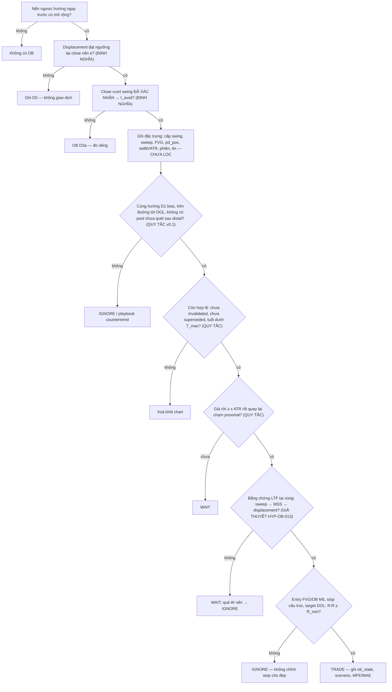

# Order Block (OB)

> [!summary] Tóm tắt 1 câu
> **Order Block là NHÃN ICT gắn cho vùng giá của (chuỗi) nến ngược hướng cuối cùng ngay trước một cú displacement có hệ quả cấu trúc — tức là "địa chỉ gốc" của một cú mất cân bằng đo được. Điều chart cho biết chắc chắn: cú mất cân bằng bắt đầu từ đây. Điều chart KHÔNG cho biết: ai đã giao dịch ở đó, còn lệnh nào nằm chờ không, và giá quay lại thì có phản ứng nhiều hơn một vùng bất kỳ cùng hình học hay không — câu cuối là một giả thuyết phải đo so với đối chứng.**

> [!important] Nguyên tắc cốt lõi (v2)
> 1. **OB là VỊ TRÍ để lắng nghe, không phải TÍN HIỆU để bóp cò** *(giữ tinh thần v1: "OB chỉ là một mắt xích trong sequence")*. Lệnh chỉ đến từ bằng chứng tại vùng (LTF sweep → MSS → displacement) trong bối cảnh D1 → H1 → M5 (§54).
> 2. **Định nghĩa tối thiểu, đặc trưng phong phú** *(kế thừa 55 §3.2)*. Định nghĩa = nến ngược hướng + displacement + BOS (biết tại `t_avail`). Sweep, FVG, premium/discount, HTF, freshness, phiên… là **biến để đo**, không phải điều kiện "hợp lệ". v1 mâu thuẫn ở chỗ này (§1 nói sweep bắt buộc, §3 nói chỉ "tăng xác suất") — v2 thống nhất.
> 3. **Không có OB trước `t_avail`.** Gọi tên một nến là OB trước khi displacement và BOS được xác nhận là dùng thông tin tương lai. Trên random walk, chỉ riêng lỗi này tạo ra "edge" **+1.31R** (OB-Sim-05).
> 4. **"Giá quay lại" không phải bằng chứng.** ~80% OB trên random walk bị chạm lại trong 4 giờ M5; xác suất phản ứng khi chạm khớp đúng công thức hình học (OB-Sim-02). Mọi claim về OB phải ghi **so với baseline cùng hình học**.
> 5. **Tách ba thứ có thể sai:** OB (vùng), lệnh (stop), luận điểm (D1/H1 narrative). "OB fail" mà không nói cái nào là câu không kiểm chứng được (§31–32).

> [!info] Đây là bản v2 (2026-10-08) — đọc trước khi dùng
> - Note **viết lại** bản v1 (2026-06-22 → 2026-07-28) theo protocol nghiên cứu 68 mục của bạn, theo đúng 65 mục đầu ra. Nội dung trùng lặp của v1 đã được **gộp**: bảy bộ checklist gần như giống nhau (v1 §2 ×2, §3 ×3, §5 ×2, §8, §12) → **một** checklist ở §64; định nghĩa lặp (v1 §1, §2, §11 Q1) → §4; hai mục "OB trong nến tin" (v1 §14.2 và §14.6) → §42; bảng "mitigate sạch vs fail" (v1 §5) trùng kịch bản A–E (v1 §7.2) → §29–31; mẫu Long/Short đối xứng → một mẫu ở §54. Nội dung có giá trị riêng của v1 (Edge Cases, Case Studies, War Stories, bảng lỗi, flashcards, best practices, ví dụ chart) được **giữ** và đánh dấu *(v1)*, gắn nhãn v2 ngay cạnh. Bản đồ di chuyển ở [[#Changelog]]. Bản v1 nguyên vẹn: `Claude outputs/backups/25-OB-Order-Block.2026-10-08.md.bak`.
> - **Phân vai với note 55.** [[55-Order-Block-OB-Nghien-cuu-chuyen-sau-Selection-Hierarchy-Backtest]] là lớp nghiên cứu về **chọn lọc**: OB-DEF v0.1, phân cấp L1–L4, 8 cổng lọc, OBQS, kịch bản A–F, 24 edge cases, HYP-OB-001…016. Note này là lớp **nền tảng + kiểm chứng**: OB là gì, cơ chế, cái gì quan sát được, và mô phỏng null/toy để biết hiện tượng nào xuất hiện cả khi không có edge. Không chép lại 55 — chỉ tóm tắt và liên kết. Phụ lục A (13 điểm audit note 25) của 55 đã được áp dụng toàn bộ (Changelog).
> - Ba loạt hình: `OB-Deep-01…37` = sơ đồ khái niệm mới; `OB-Sim-01…08` = **mô phỏng null model và toy model** — baseline, **không phải dữ liệu thị trường**; `Order-Block-*` = hình của v1.
> - Mọi ngưỡng số là **HEURISTIC**; mọi `RULE-OB` là **v0.1 — BACKTEST REQUIRED**; mọi `HYP-OB` là **UNTESTED**. Không thành phần nào trong note là edge đã được kiểm chứng trên dữ liệu thị trường thật.

> [!abstract]- Mục lục (bấm để mở)
> - **Cách đọc note** — nhãn, thang giải thích 6 tầng, ký hiệu
> - **1** Executive Summary · **2** ELI5 · **3** Vấn đề OB cố mô tả · **4** OB thực sự là gì · **5** OB KHÔNG phải là gì · **6** Vì sao khái niệm tồn tại
> - **7** Cơ chế thị trường · **8** Quan sát vs diễn giải · **9** Cơ chế hình thành · **10** Vì sao giá rời đi · **11** Vì sao giá quay lại · **12** Vì sao đôi khi phản ứng · **13** Vì sao đôi khi thất bại
> - **14** Bullish OB · **15** Bearish OB · **16** Nến hay vùng giá · **17** Điều gì làm OB có ý nghĩa · **18** OB vs nến ngẫu nhiên
> - **19** Displacement · **20** Cấu trúc · **21** Liquidity · **22** Liquidity sweep · **23** FVG · **24** Premium/Discount · **25** Dealing range
> - **26** Bối cảnh HTF · **27** Đa khung · **28** Lồng nhau & tinh chỉnh · **29** Mitigation · **30** Vòng đời · **31** Invalidation · **32** Thất bại · **33** Chạm lần đầu vs nhiều lần
> - **34** Chất lượng · **35** Khách quan vs chủ quan · **36** Định nghĩa thuật toán · **37** Biến định lượng · **38** Chấm điểm
> - **39** Regime · **40** Biến động · **41** Thời gian/phiên · **42** Tin tức
> - **43** Real-time vs hindsight · **44** Look-ahead · **45** OB như giả thuyết · **46** Phản ứng là gì · **47** MFE/MAE · **48** Backtest · **49** Baseline · **50** Kiểm định thống kê · **51** Falsification · **52** Overfitting
> - **53** OB vs FVG vs Breaker vs Mitigation vs S/D · **54** Áp dụng D1 → H1 → M5 · **55** Cây quyết định · **56** Failure modes · **57** Phản ví dụ (50) · **58** Case studies A–O · **59** Diễn giải thay thế · **60** Devil's Advocate
> - **61** Điều ta thực sự biết · **62** Điều ta chỉ đang giả định · **63** Mô hình tư duy cuối cùng · **64** Checklist thực hành · **65** Câu hỏi nghiên cứu (+ registers)
> - Phụ lục A — Mô phỏng · Phụ lục B — Ôn tập (v1) · Tài liệu tham khảo · Changelog

---

## Cách đọc note này — hệ thống nhãn

| Nhãn | Ý nghĩa | Mức tin cậy mặc định |
|---|---|---|
| **[OBSERVABLE]** | Đọc trực tiếp từ OHLC + thời gian ("nến H1 09:00 đóng giảm; close 11:00 vượt 1.0852") | Cao — nhưng chỉ mô tả |
| **[DEFINITIONAL]** | Đúng vì cách ta định nghĩa ("sau t_avail, OB tồn tại") — đúng tuyệt đối, rỗng về dự báo | Cao, không dự báo |
| **[MATHEMATICAL]** | Đúng theo toán học (martingale, xác suất chạm rào, cỡ mẫu) | Cao về logic |
| **[SIMULATION]** | Kết quả mô phỏng null model / toy model (seed cố định) | Cao về *mô hình*; không phải dữ liệu thị trường |
| **[MARKET MECHANICS]** | Khớp lệnh, sổ lệnh, impact, đấu giá — có tài liệu thực nghiệm khi ghi nguồn | Cao → trung bình |
| **[ICT FRAMEWORK]** | Cách ICT / cộng đồng ICT–SMC định nghĩa hoặc dùng thuật ngữ | Cao về định nghĩa; không nói gì về hiệu quả |
| **[INTERPRETATION]** | Diễn giải hợp lý nhưng không chứng minh được từ OHLC | Trung bình → thấp |
| **[HYPOTHESIS]** | Claim kiểm chứng được, chưa kiểm chứng | Chưa biết |
| **[BACKTEST REQUIRED]** | Không được coi là edge cho tới khi test đúng phương pháp | — |
| **[HEURISTIC]** | Ngưỡng số chọn để có quy tắc nhất quán, không phải hằng số thị trường | — |
| **[BACKTEST RESULT]** | Số liệu từ backtest/journal của chính bạn — kèm cỡ mẫu và cảnh báo chọn mẫu | Tùy thiết kế |
| **[PERSONAL OBSERVATION]** | Kinh nghiệm thực chiến (War Stories v1) — sinh giả thuyết, chưa thống kê | Thấp → trung bình |
| **[MINH HỌA]** | Ví dụ dựng để giải thích — không phải dữ liệu, không phải trade thật | Không dùng làm bằng chứng |

**Về nguồn ICT.** Giáo trình gốc của ICT (Michael J. Huddleston) chủ yếu là video; không có văn bản định nghĩa chính thức. "[ICT FRAMEWORK]" trong note = cách hiểu phổ biến trong tài liệu cộng đồng (Tier 3–4) và các bản trích lại (55 [^S12]). Note **không** trích nguyên văn ICT và không gán cho ICT những câu chưa kiểm chứng.

**Về "Smart Money" và "institutions".** Luôn được hiểu là **một nhân vật trong câu chuyện của mô hình ICT**, không phải nhóm người tham gia quan sát được. Khi cần nói về người tham gia, note dùng từ vi cấu trúc định nghĩa được: *maker* (người cung cấp thanh khoản bằng lệnh limit), *taker* (người tiêu thụ thanh khoản bằng lệnh market), *lệnh stop* (lệnh có điều kiện), *metaorder* (lệnh mẹ chia nhỏ), *dòng lệnh ròng*.

**Về mô phỏng.** Tám hình `OB-Sim-01…08` chạy trên đường giá tổng hợp (random walk Gaussian/GARCH/Student-t, ba regime tổng hợp, và một **toy model bốn cơ chế**). Mục đích không phải "chứng minh ICT sai" mà để biết **một hiện tượng xuất hiện thường xuyên tới mức nào khi không có ý định, không có edge** — hiện tượng xuất hiện dày đặc trong nhiễu thì sự xuất hiện của nó trên chart thật không phải bằng chứng. Chi tiết: [[#Phụ lục A — Ghi chú mô phỏng]].

**Thang giải thích 6 tầng** (yêu cầu "5-year-old test" của protocol):

| Tầng | Tên | Mục tiêu |
|---|---|---|
| L1 | Trực giác | Ngôn ngữ đời thường, không thuật ngữ |
| L2 | Ví dụ giá | Một chuỗi giá / sơ đồ |
| L3 | Trading | Thuật ngữ trading chính xác |
| L4 | Cơ chế thị trường | Lệnh, sổ lệnh, khớp lệnh, impact, đấu giá |
| L5 | ICT | "ICT gọi hiện tượng này là…" — chỉ sau L4 |
| L6 | Giới hạn | Chart **không thể** cho biết điều gì |

**Ký hiệu dùng xuyên suốt**

| Ký hiệu | Nghĩa |
|---|---|
| τ | Khung thời gian của OB (D1, H1, M5…) |
| ATR | ATR(14) của khung τ, lấy tại nến **trước** displacement (`ATR_base`, 55 §3.3) |
| s, e | Nến bắt đầu / nến đạt ngưỡng của leg displacement |
| `t_avail` | Close của nến muộn nhất trong {e, nến BOS} — thời điểm OB **bắt đầu tồn tại** |
| known_at | Thời điểm một mức/nhãn trở nên biết được (swing fractal n: i + n) |
| proximal / distal | Mép gần giá / mép xa giá của vùng (bullish OB: đỉnh / đáy) |
| `ob_full`, `ob_body` | Vùng tính cả râu / chỉ thân (55 §3.3) |
| `mt_body`, `ce_range` | 50% thân / 50% cả nến — **hai mức khác nhau** (§16) |
| pen | Tọa độ xuyên: 0 = proximal, 1 = distal, > 1 = bên ngoài (§29) |
| w | Độ rộng vùng / ATR |
| p_null | Xác suất martingale chạm target trước stop = (entry − stop)/(target − stop); target K·R → 1/(1+K) |
| excess | win − p_null (từng lệnh, tại giá khớp thực tế) — phần thắng **vượt hình học**; E[R] vượt hình học = (1+K)·excess |
| C1…C5 | Nhóm đối chứng (§49) |
| D0…D4 | Các định nghĩa OB (§4) |

---

## 1. Executive Summary

Hai mươi kết luận. Mỗi kết luận được phát triển ở mục tương ứng.

**1. OB là một nhãn đặt lên một vùng giá được suy ra, không phải một "khối lệnh" quan sát được.** Thứ quan sát được: một (chuỗi) nến đóng ngược hướng, ngay sau đó một cú dịch chuyển lớn so với ATR, đóng vượt một swing đã xác nhận. "Khối lệnh" là phần diễn giải (§4, §8). **[OBSERVABLE + INTERPRETATION]**

**2. Không có một định nghĩa OB.** Ít nhất sáu định nghĩa lưu hành (D0–D5) chọn ra những nến khác nhau trên cùng một chart (OB-Deep-04). "OB win rate" của người khác không chuyển sang định nghĩa của bạn (§4, §36). **[ICT FRAMEWORK]**

**3. OB là một vùng, và cách cắt vùng là một quy tắc giao dịch.** Full (có râu) vs body, `mt_body` vs `ce_range` cho mức giá khác nhau. v1 gọi "CE/Mean Threshold = 50% cả cây nến" — nhiều nguồn ICT đo MT trên thân; v2 ghi cả hai (§16). **[DEFINITIONAL]**

**4. Dữ liệu không có edge sinh OB dày đặc.** Random walk M5: **250** "nến ngược trước 2 nến" / 1.000 nến (D0) → **168** có displacement ≥ 1.5 ATR → **75** có BOS (≈ **21,5 OB/ngày**) → **50** có FVG → **10** có cả sweep (≈ **3 OB 'đủ narrative'/ngày**). Gần như không đổi với GARCH hay đuôi dày (OB-Sim-01, §18). **[SIMULATION]**

**5. Số OB do bạn quyết định.** Đổi ngưỡng displacement 1.0 → 3.0 ATR: 87 → 31 OB/1.000 nến; đổi fractal n = 1 → 5: 112 → 39 (OB-Sim-01). **[SIMULATION]**

**6. "Giá quay lại OB" là chuyện bình thường.** ~**80%** OB D3b trên random walk bị chạm lại trong 48 nến M5; vùng đối chứng cùng hình học: 80%; FVG: 89% (OB-Sim-02, §11). **[SIMULATION]**

**7. Xác suất phản ứng khi chạm = hình học.** Trên random walk, P(đạt +1 ATR trước khi phá distal | chạm) ≈ (w + 0.1)/(w + 1.1) với w = độ rộng/ATR. OB: **53,5%** quan sát vs **53,3%** dự đoán; FVG (vùng hẹp hơn): 35,7% vs 35,7%. Chênh lệch "thô" giữa các loại vùng tới 21 điểm % — **toàn bộ** do độ rộng (§12, §49). **[SIMULATION + MATHEMATICAL]**

**8. Sau khi trừ hình học, không loại vùng nào có edge trên dữ liệu ngẫu nhiên** — OB, vùng ngẫu nhiên khớp hình học, nến ngược không displacement, swing cũ (S/R), FVG, OB H1: excess từ −0,3 tới +0,3 điểm % (CI ±0,3), OB H1 +2,2 ± 2,3 (n nhỏ). Đây là **bài kiểm tra hiệu chuẩn bắt buộc** cho mọi backtester OB (RULE-OB-010). **[SIMULATION]**

**9. Cơ chế "lệnh chưa khớp" (câu chuyện ICT) để lại một dấu vết riêng — và các cơ chế khác để lại dấu vết NGƯỢC lại.** Toy model bốn loại cú sốc: chỉ khi có **lệnh limit thật nằm chờ** ở gốc, OB mới phản ứng vượt hình học (**+9 điểm %**, lệnh limit tại OB E[R] ≈ **+0,39R**). Khi cú đẩy là **thanh khoản tạm thời**, giá quay lại nhiều nhất (**82%**) nhưng **xuyên qua** (phản ứng −23 điểm %, E[R] ≈ **−0,46R**) (OB-Sim-03, §11–13). **[SIMULATION — toy model]**

**10. Chọn ngược (adverse selection) là thật ngay cả trong thế giới "ICT đúng một phần tư".** Trong toy model 1/4 OB có lệnh chờ thật, nhưng lệnh limit **khớp** chủ yếu ở các OB từ cú sốc thanh khoản (46% số lệnh khớp) → trade mọi OB sinh từ cú sốc cho E[R] ≈ **−0,15R** (OB-Sim-03). Một lần quay lại **nhanh và sâu** tự nó là thông tin chống lại OB (HYP-OB-024). **[SIMULATION]**

**11. "First touch mạnh hơn" và "OB yếu dần theo tuổi" xuất hiện trên random walk — ở dạng thô.** Tỷ lệ phản ứng thô **tăng** theo số lần chạm (52,5% → 57,8%) và **giảm** theo tuổi (53,8% → 50,1%) dù không có cơ chế nào — do chọn lọc theo độ rộng/khoảng cách vùng. Sau khi trừ hình học: phẳng. Chỉ lệnh chờ **có lượng hữu hạn** mới cho "tap decay" thật (OB-Sim-04, §33). **[SIMULATION]**

**12. Mức entry đổi phân phối, không đổi expectancy.** Proximal → 75% độ sâu: tỷ lệ khớp 80% → 65%, khoảng stop 1,27 → 0,39 ATR, win (2R) 31% → 27%; E[R] ≈ 0 ở mọi mức trên random walk. "CE là entry tốt nhất" là một đánh đổi, không phải định luật (OB-Sim-06, §16). **[SIMULATION]**

**13. "Reclaimed OB" và "sweep distal" xảy ra tự nhiên.** Sau lần chạm đầu trên random walk: 63% phản ứng trước khi xuyên distal; 15% râu qua distal rồi đóng lại; 11% đóng ngoài rồi quay về ≤ 3 nến; 10% chấp nhận bên ngoài (OB-Sim-06, §29–31). **[SIMULATION]**

**14. Năm kiểu hindsight biến dữ liệu ngẫu nhiên thành chiến lược OB "thắng lớn".** Trung thực: −0,01R. Coi OB "đã biết" từ nến OB: **+1,31R** (win 60%); chỉ giữ OB "đã giữ được": **+0,80R**; chọn OB nơi giá quay đầu: **+0,39R**; "là OB vì sau đó giá chạy xa": **+0,21R**; phân xử OHLC lạc quan: **+0,26R** (OB-Sim-05, §44). **[SIMULATION]**

**15. Khu vườn rẽ nhánh.** 3.240 biến thể OB "hợp lý" trên một random walk: 2,3% có t > 2 (đúng kỳ vọng dưới H0), biến thể tốt nhất in-sample **+0,19R** (n = 501) → out-of-sample **+0,04R** (CI chứa 0) (OB-Sim-08, §52). **[SIMULATION]**

**16. Regime quyết định dấu của E[R] cho MỌI vùng.** Trong regime trending tổng hợp, OB "thắng" vùng ngẫu nhiên hướng-ngẫu-nhiên **+0,16R** — nhưng **không thắng** một quy tắc chỉ cần đi theo hướng momentum 1h (−0,01R). Phần hơn của OB = thông tin về **hướng**, thứ momentum cũng có (OB-Sim-07, §39). **[SIMULATION]**

**17. Có cơ sở vi cấu trúc để kỳ vọng các mức nổi bật có ảnh hưởng — nhưng hẹp hơn câu chuyện.** Stop tụ sau mức hiển nhiên và kích hoạt cascade (Osler 2003, 2005); S/R trùng độ sâu sổ lệnh (Kavajecz & Odders-White 2004); giá bật tại S/R nhiều hơn xuyên trên cổ phiếu (Garzarelli et al. 2014); impact của metaorder hồi một phần (Bucci et al. 2019). **Không nghiên cứu peer-reviewed nào kiểm định ICT Order Block trực tiếp** (§7, §61). **[MARKET MECHANICS]**

**18. Dữ liệu của bạn: tốt cho kỷ luật, chưa đủ cho edge.** 8 backtest trong vault có `poi_type` = OB: 6 thắng / 2 thua (Wilson 95% CI 41–93%), E[R] = +1,47R trên 7 lệnh có R; nhóm FVG 8/1. Fisher p = 0,58 — không phân biệt được; mẫu chọn tay; ≥ 3/8 lệnh "OB" thực ra khớp tại FVG/BPR; 1/8 không có displacement (không phải OB theo định nghĩa) (§50). **[BACKTEST RESULT]**

**19. Cỡ mẫu cần thiết lớn hơn trực giác.** Phát hiện edge thật +0,2R với target 2R cần ~**393** lệnh độc lập; +0,1R cần ~**1.570**; target 3R: 589 và 2.355 (α = 0,05, power 80%) (§50). **[MATHEMATICAL]**

**20. Kết luận thực hành.** Dùng OB như **một vị trí có định nghĩa chính xác** (OB-DEF + `t_avail` + vùng khai báo), đặt trong D1 → H1 → M5, vào lệnh chỉ khi có bằng chứng LTF, quản trị rủi ro bằng hình học (stop ở nơi luận điểm sai), và đo mọi biến thể **so với C1 (vùng khớp hình học) và C5 (quy tắc momentum)**. Nếu OB có edge, giả thuyết hợp lý nhất (chưa kiểm chứng) là nó đến từ **bối cảnh và loại cú đẩy** (lệnh chờ thật vs thanh khoản tạm thời) — và câu hỏi nghiên cứu số một là tìm **đặc trưng quan sát được** phân biệt hai loại đó trước khi giá quay lại (§45, §65).

> [!tip] Trả lời ngắn cho câu hỏi trung tâm của protocol
> *"OB có thực sự chứa predictive information, hay tôi chỉ đang nhìn chart sau khi mọi thứ đã xảy ra và kể một câu chuyện rất hợp lý?"* — **Cả hai đều có thể, và chart quá khứ không phân biệt được.** Câu chuyện sẽ luôn hợp lý vì (a) OB xuất hiện dày đặc ngay cả trong nhiễu, (b) giá quay lại và "phản ứng" với tần suất mà hình học đã quy định sẵn, (c) mắt người tự động chọn OB "đã đúng". Predictive information chỉ được chứng minh khi: định nghĩa khóa trước → mọi sự kiện được thu thập ở `t_avail` → kết cục đo theo quy tắc → so với C1/C5 cùng hình học, cùng regime → sống sót out-of-sample sau chi phí. Note này cho bạn công cụ làm từng bước đó; nó không — và không thể — cho bạn kết quả.

---

## 2. Order Block Explained Like I'm 5

![[OB-Deep-01-ELI5-Phien-Cho-Cam.svg|760]]
*Hình OB-Deep-01 — Phiên chợ cam: một người mua rất lớn xuất hiện, giá vọt lên, rồi giá quay lại "khu cũ". Câu hỏi là điều gì xảy ra tiếp theo — và vì sao.*

### 2.1 L1 — Trực giác: phiên chợ cam

Hãy tưởng tượng một khu chợ có rất nhiều sạp bán cam. Cả buổi sáng giá lên xuống nhẹ: người bán hạ giá một chút, người mua trả thêm một chút. Rồi có một lúc, **người bán cuối cùng** hạ giá xuống để bán cho được.

Ngay sau đó, **một người mua rất lớn** bước vào chợ. Anh ta cần thật nhiều cam. Anh ta mua sạch sạp này, rồi sạp kế bên — và vì cam rẻ đã hết, anh ta phải trả giá cao hơn ở sạp tiếp theo, rồi cao hơn nữa. **Giá vọt lên rất nhanh.**

Một lúc sau, giá cam dần quay lại gần **khu giá trước cơn sốt** — chỗ người bán cuối cùng đã hạ giá.

Câu hỏi: **khi giá về lại khu đó, chuyện gì sẽ xảy ra?** Có ba khả năng:

- **A.** Người mua lớn **chưa mua đủ**. Anh ta đứng chờ ở đúng khu giá cũ — giá về là anh ta mua tiếp, giá lại bật lên. *(Đây là câu chuyện ICT kể về Order Block.)*
- **B.** **Chẳng ai quan tâm nữa**. Khu giá cũ chỉ là một con số; giá trôi qua trôi lại.
- **C.** Cơn sốt **chỉ là tin đồn**, hoặc người mua lớn **đã mua xong**. Giá về khu cũ rồi rơi tiếp, xuyên qua.

### 2.2 L2 → L5 — Ánh xạ dần sang thuật ngữ

| Ở chợ | Trên chart | Thuật ngữ |
|---|---|---|
| người bán cuối cùng hạ giá | nến đóng giảm cuối cùng | "nến ngược hướng cuối" |
| người mua lớn quét các sạp | chuỗi nến tăng thân dài, ít chồng lấp | **displacement** |
| giá vượt mức cao của buổi sáng | close vượt swing high đã xác nhận | **BOS / MSS** |
| khu giá trước cơn sốt | vùng giá của nến giảm cuối | **Order Block** |
| giá về lại khu cũ | retest | **mitigation** |
| người mua lớn còn mua tiếp? | ? | **giả thuyết** — không quan sát được |

### 2.3 L6 — Ba chỗ ẩn dụ sai (bắt buộc đọc)

1. **Ở chợ ta NHÌN THẤY người mua lớn.** Trên chart nến chỉ có dấu vết các lệnh đã khớp: không thấy ai mua, mua bao nhiêu, còn muốn mua nữa không. Mọi câu "smart money đang chờ ở OB" là suy diễn (§8).
2. **Cơn sốt giá có ít nhất ba nguyên nhân khác nhau** — người mua thật; phe bán khống bị ép mua đóng lệnh (stop cascade); tin tức khiến người bán rút giá chào — và **trên nến chúng trông giống nhau** (§7, §10).
3. **Giá quay lại khu cũ rất thường xuyên ngay cả khi không có người mua lớn nào** — ~80% OB trên random walk bị chạm lại trong 4 giờ M5 (OB-Sim-02). Việc giá quay lại không chứng minh ai đang chờ ở đó.

> [!note] Câu hỏi đúng
> Không phải "OB có phải nơi người mua lớn chờ không?" — câu đó không trả lời được từ chart. Mà là: **"Khi giá quay lại vùng này, phản ứng có KHÁC một vùng bất kỳ cùng độ rộng, cùng khoảng cách không?"** — câu này đo được.

---

## 3. The Problem Order Block Attempts to Describe

![[OB-Deep-02-Tu-Thi-Truong-Den-Nhan.svg|760]]
*Hình OB-Deep-02 — Chín giai đoạn quan sát được. ICT gắn nhãn OB vào vùng ở giai đoạn ③, nhưng nhãn chỉ BIẾT được sau giai đoạn ⑥ (t_avail).*

### 3.1 Bắt đầu từ thị trường, không phải từ nhãn

Một trader nhìn chart muốn trả lời ba câu hỏi thực dụng:

1. **Vào lệnh ở đâu** để không "đuổi giá" giữa không trung sau một cú chạy mạnh?
2. **Đặt stop ở đâu** cho có lý do — tại nơi mà nếu giá tới thì ý tưởng của mình sai?
3. **Vùng nào trong quá khứ** có khả năng còn "liên quan" tới hành vi giá tương lai?

Order Block là câu trả lời ICT đề xuất cho cả ba: *chờ giá quay về gốc của cú đẩy gần nhất, vào lệnh ở đó, stop ở phía bên kia gốc*. Để đánh giá câu trả lời này, phải tách quá trình thành các giai đoạn quan sát được (OB-Deep-02):

| Giai đoạn | Quan sát được (OHLC) | Diễn giải cơ chế (không quan sát trực tiếp) | Nhãn ICT |
|---|---|---|---|
| ①② giá trôi, tạm dừng | nến nhỏ, chồng lấp | cân bằng tạm thời giữa người mua/bán | — |
| ③ đấu giá hai chiều | một nến đóng giảm | người bán thắng trong khoảng thời gian của nến đó | ứng viên OB (chưa biết) |
| ④⑤ mở rộng, displacement | chuỗi nến tăng thân dài, ít chồng lấp, có thể để FVG | dòng mua chủ động > tốc độ bổ sung lệnh bán chờ | displacement |
| ⑥ hệ quả cấu trúc | close vượt swing đã xác nhận | đổi trạng thái cấu trúc (kế toán, 21-MSS §11) | BOS/MSS → **OB tồn tại (t_avail)** |
| ⑦⑧ rời đi, quay lại | giá đi xa rồi trở về vùng gốc | nhịp hồi — vì nhiều lý do khả dĩ (§11) | retest / mitigation |
| ⑨ kết cục | bật / đi ngang / xuyên | ? | "OB worked" / "OB failed" |

### 3.2 Ba vấn đề OB cố giải quyết — và cái giá của mỗi lời giải

| Vấn đề | Lời giải OB | Điều lời giải thực sự cung cấp | Điều nó KHÔNG cung cấp |
|---|---|---|---|
| Vào ở đâu | gốc của cú đẩy | một mức giá **xác định trước**, khách quan hoá được | bằng chứng mức đó tốt hơn mức khác (§49) |
| Stop ở đâu | phía bên kia OB | stop gắn với **điểm luận điểm sai** → R:R bất đối xứng (55 §1 mệnh đề 5) | xác suất cao hơn |
| Vùng nào còn liên quan | vùng gốc chưa bị "mitigate" | một **bộ lọc** giảm số vùng cần theo dõi | bằng chứng "vùng tươi" mạnh hơn (§33) |

> [!important] Kết luận mục 3
> Giá trị ít tranh cãi nhất của OB là **hình học rủi ro và kỷ luật** — một mức vào, một mức stop, một quy tắc chọn vùng, tất cả xác định trước. Giá trị **dự báo** (giá phản ứng ở đây nhiều hơn chỗ khác) là một giả thuyết riêng, phải tách ra và đo (§45).

---

## 4. What Order Block Actually Is

### 4.1 Câu trả lời trực tiếp

**Order Block là một vùng giá được suy ra từ (chuỗi) nến đóng ngược hướng cuối cùng trước một cú displacement có hệ quả cấu trúc, được gắn nhãn tại thời điểm hệ quả cấu trúc đó được xác nhận (`t_avail`).** Nó là một **đối tượng có điều kiện**: tồn tại hay không phụ thuộc vào định nghĩa displacement, thuật toán swing, timeframe và feed dữ liệu đã khai báo.

### 4.2 Năm tầng định nghĩa — từ quan sát tới câu chuyện

| Tầng | Nội dung | Loại mệnh đề | Ví dụ |
|---|---|---|---|
| T0 — Mẫu hình | một nến đóng giảm, sau đó các nến tăng | [OBSERVABLE] | "nến 09:00 đóng giảm, ba nến sau đóng tăng" |
| T1 — Ứng viên (necessary) | + displacement đo được (Net ≥ x·ATR trong ≤ 5 nến, thân/range ≥ y) | [DEFINITIONAL] | "Net = 2,1 ATR" |
| T2 — Hợp lệ (necessary, nghĩa ICT) | + close vượt một swing **đã xác nhận trước khi leg bắt đầu** | [DEFINITIONAL] | "close 11:00 > swing high 1.0852 (known_at 08:00)" |
| T3 — Đủ điều kiện giao dịch | + đặc trưng: sweep, FVG, cấp swing, pd_pos, HTF, freshness, room tới DOL, phiên | **biến để đo** | "có sweep L2, có FVG 0,6 ATR, pd_pos = 0,28" |
| T4 — Câu chuyện | "smart money đã mua ở đây và còn lệnh chưa khớp" | [INTERPRETATION] | — |

T1 + T2 = **DEF-OB-01** (trùng OB-DEF v0.1 của 55 §3.3, không lặp lại thông số ở đây). T3 là **cột dữ liệu**, không phải điều kiện. T4 là **giả thuyết A** của §11 — một trong bảy giả thuyết cạnh tranh.

### 4.3 Có một định nghĩa duy nhất không? — Không

![[OB-Deep-04-Mot-Duong-Gia-Sau-Dinh-Nghia.svg|760]]
*Hình OB-Deep-04 — Cùng 14 nến, sáu định nghĩa cho 0, 1 hoặc 4 OB, và những vùng rộng hẹp khác nhau.*

Bảng đầy đủ các định nghĩa ở 55 §3.1. Ở đây chỉ đánh giá theo bốn tiêu chí protocol yêu cầu:

| Định nghĩa | Gần ICT? | Dễ backtest? | Chủ quan? | Rủi ro hindsight |
|---|---|---|---|---|
| **D0** nến ngược trước một cú di chuyển | thấp | rất dễ | thấp | thấp — nhưng vô dụng thống kê (250 / 1.000 nến) |
| **D1** ICT cổ điển: nến down-close thấp nhất, thân lớn nhất, "gần support" | cao (bản trích lại) | khó: "gần support", "lớn nhất so với gì" | cao | **cao** — "thấp nhất" chỉ biết sau khi leg kết thúc |
| **D1b** điểm chuyển "sell program → buy program" | cao | không (mô tả chức năng) | rất cao | rất cao |
| **D2** cả chuỗi nến ngược | trung bình | dễ | thấp | thấp — vùng rộng hơn ~2× |
| **D3** + displacement + BOS (± FVG) | cao (SMC chính dòng) | dễ nếu khai báo tham số | thấp → trung bình | **thấp nếu dùng t_avail**; cao nếu không |
| **D4** "grab + engulf" | biến thể | dễ | thấp | thấp — nhưng rất ít mẫu |
| **D5** absorption trên footprint | ngoài ICT | cần dữ liệu tick/volume | trung bình | thấp |

**Lựa chọn của v2:** D3 với tham số khai báo (DEF-OB-01), ghi thêm cờ D2 (`ob_series`) và các biến T3. Lý do: gần với cách vault đang dùng, khách quan hoá được, và rủi ro hindsight kiểm soát được bằng `t_avail`. Đây là **lựa chọn phương pháp**, không phải khẳng định D3 "đúng" hơn.

### 4.4 OB là sự kiện khách quan hay khung phân loại?

Cả hai, ở hai tầng khác nhau. **Khi đã khai báo thuật toán**, việc một nến có là OB hay không là khách quan — hai người (hoặc một đoạn code) cho cùng kết quả. **Việc chọn thuật toán** là chủ quan và thay đổi tập OB rất mạnh (OB-Sim-01: ×3 khi đổi ngưỡng displacement). Vì vậy câu "đây là một OB" luôn cần đi kèm: *định nghĩa nào, timeframe nào, feed nào, vùng đo thế nào* — bốn tọa độ bắt buộc (RULE-OB-002).

---

## 5. What Order Block Is NOT

Gộp danh sách "OB không phải là gì" của v1 §1 với các điểm mới; mỗi dòng có lý do.

| OB KHÔNG phải là… | Vì sao | Nguồn |
|---|---|---|
| "nến to cuối cùng" bất kỳ | phải có displacement + hệ quả cấu trúc theo sau; nến lớn cô lập giữa range không phải OB (D3) | v1 §1 |
| vùng supply/demand vẽ kiểu price action | S/D không đòi BOS và không có `t_avail`; nhiều vùng S/D không thỏa D3 (§53) | v1 §1 |
| lý do vào lệnh khi giá vừa chạm | OB = vị trí; lệnh cần bằng chứng tại vùng (§54) | v1 §1, v2 |
| Breaker Block | OB đang giữ vai trò; breaker là OB đã fail rồi đổi phe (§53) | v1 §1 |
| cái cớ để Long ở premium / Short ở discount | vị trí trong range là biến cần đo, và ảnh hưởng R:R trực tiếp (§24) | v1 §1 |
| một **khối lệnh quan sát được** | OHLC không chứa sổ lệnh; trên FX spot không có sổ lệnh hợp nhất (§7) | v2 |
| một **xác suất cố định** ("OB win 70%") | xác suất phụ thuộc định nghĩa, hình học, bối cảnh, regime (§12, §39) | v1 §17.3, v2 |
| bằng chứng cho chính nó khi giá phản ứng | phản ứng đúng bằng tỷ lệ hình học xảy ra cả trên dữ liệu ngẫu nhiên (OB-Sim-02) | v2 |
| một thứ tồn tại trước `t_avail` | trước khi BOS đóng nến, "OB" là dự đoán, không phải quan sát (§43) | v2 |
| độc quyền của ICT | AMT, Wyckoff, order flow mô tả cùng hiện tượng bằng thước đo khác (§59) | v1 §16.3 |

---

## 6. Why Order Block Exists as a Concept

Áp dụng "WHY DOES THIS EXIST? test" (protocol §4) cho chính khái niệm OB:

| Câu hỏi | Trả lời | Nhãn |
|---|---|---|
| **1. What?** | vùng giá gốc của một cú displacement có hệ quả cấu trúc | [DEFINITIONAL] |
| **2. Why tồn tại?** | trader cần một **mức vào xác định trước** sau khi giá đã chạy, thay vì đuổi giá; ICT cần một ngôn ngữ cho "nơi dòng tiền bắt đầu di chuyển" | [ICT FRAMEWORK] |
| **3. Giải quyết vấn đề gì?** | (a) chọn điểm vào, (b) neo stop vào nơi luận điểm sai, (c) giảm số vùng cần theo dõi | [INTERPRETATION] |
| **4. Hành vi quan sát nào sinh ra khái niệm?** | giá thường hồi một phần sau cú đẩy mạnh và đôi khi dừng/bật quanh gốc cú đẩy | [OBSERVABLE] — nhưng tần suất "đôi khi" chưa được so baseline |
| **5. Hình thành thế nào?** | nến ngược hướng → displacement → BOS (§9) | [DEFINITIONAL] |
| **6. Vì sao có thể có information value?** | nếu cú đẩy do dòng lệnh chủ động **chưa hoàn tất** (metaorder, lệnh limit chờ), vùng gốc có thể vẫn có cầu; stop của phe sai nằm sau vùng tạo đối ứng | [HYPOTHESIS] — giả thuyết A, C (§11) |
| **7. Khi nào vô dụng?** | khi cú đẩy là thanh khoản tạm thời hoặc tin tức đã định giá lại; khi thanh khoản chưa quét nằm ngay sau distal; khi regime trending không cho hồi về (§13, §39) | [HYPOTHESIS] + [SIMULATION] |
| **8. Kiểm chứng thế nào?** | so P(phản ứng | OB) với P(phản ứng | vùng ngẫu nhiên cùng hình học) và với quy tắc momentum, trên dữ liệu khóa trước, out-of-sample (§45–52) | phương pháp |

> [!note] Một quan sát lịch sử [ESTABLISHED + INTERPRETATION]
> Ý tưởng "vùng gốc của một cú đi mạnh là vùng cung/cầu chưa được lấp" có trước ICT nhiều thập kỷ — Wyckoff (đầu thế kỷ 20) với khái niệm tích lũy/phân phối, và trường phái supply/demand ("drop-base-rally"). Phần ICT thêm vào là **bộ lọc cấu trúc** (BOS/MSS, sweep, premium/discount) và **đóng gói thành một quy trình dạy được** (v1 §16.3). Đóng góp đó có giá trị sư phạm; nó không tự chứng minh giá trị dự báo.

---

## 7. Market Mechanics Behind an Order Block

![[OB-Deep-06-So-Lenh-Vi-Sao-Gia-Roi-Di.svg|760]]
*Hình OB-Deep-06 — Cùng một lượng lệnh mua market: sổ lệnh dày → giá đi 2 tầng; sổ lệnh mỏng → giá đi 5+ tầng và nến dài. Chart nến chỉ thấy kết quả, không thấy sổ lệnh.*

### 7.1 L4 — Bốn sự thật vi cấu trúc cần trước khi nói về OB [MARKET MECHANICS]

1. **Mọi giao dịch có hai phía.** Mỗi lô được mua là một lô được bán. "Người mua áp đảo" không có nghĩa là có nhiều người mua hơn — mà là **người mua chủ động** (taker, dùng lệnh market) sẵn sàng trả giá của **người bán bị động** (maker, đặt lệnh limit).
2. **Giá chỉ đổi khi lệnh market tiêu thụ hết lệnh limit ở một mức.** Khi lệnh mua market ăn hết ask ở 1.0850, giao dịch tiếp theo xảy ra ở 1.0851. Độ dài nến = (lượng tiêu thụ) / (độ dày sổ lệnh).
3. **Sổ lệnh được bổ sung liên tục.** Displacement xảy ra khi tốc độ tiêu thụ > tốc độ bổ sung trong một khoảng thời gian — vì dòng chủ động lớn, **hoặc** vì maker rút lệnh (tin tức, biến động).
4. **Impact có một phần tạm thời.** Trên ~8 triệu metaorder cổ phiếu, khi lệnh mẹ kết thúc, giá hồi lại khoảng 1/3 impact đỉnh trong ngày và tiếp tục suy giảm (Bucci et al. 2019 — 55 [^S6]). Đây là cơ sở cơ học cho việc giá **hay hồi** sau cú đẩy — không riêng gì OB.

### 7.2 Sáu kịch bản sổ lệnh có thể nằm sau cùng một hình dạng OB

| # | Kịch bản (protocol §8) | Chuyện gì xảy ra trong sổ lệnh | Hàm ý cho vùng OB khi giá quay lại | Quan sát được trên OHLC? |
|---|---|---|---|---|
| 1 | Lượng lớn lệnh market xuất hiện | taker mua ăn nhiều tầng ask | nếu taker đã mua xong → không còn cầu ở gốc | không phân biệt được với 3, 5 |
| 2 | Lệnh limit hấp thụ thanh khoản | một maker lớn đặt bid dày ở gốc, hấp thụ bán → giá không xuống được, rồi đi lên | **có** cầu còn lại nếu bid chưa khớp hết → **giả thuyết A** | không (cần footprint/DOM) |
| 3 | Mất cân bằng order flow | dòng mua ròng kéo dài (metaorder chia nhỏ) | nếu metaorder còn chạy → giá ít quay lại; nếu quay lại khi nó còn chạy → bật | không |
| 4 | Giá đi tìm thanh khoản mới | lệnh stop của phe short phía trên bị kích hoạt dây chuyền | cầu ở gốc là **ép buộc**, không phải ý định → gốc yếu (55 §4.2 (b)) | một phần (vượt mức hiển nhiên) |
| 5 | Người vào sớm còn lệnh chưa khớp | lệnh mẹ khớp một phần, phần còn lại chờ ở giá tốt hơn | gốc có cầu cho tới khi phần còn lại khớp/hủy → **tiêu hao theo lần chạm** | không |
| 6 | Giá quay lại vì thanh khoản / đấu giá | stop của phe long đặt dưới OB là đối ứng hấp dẫn; vùng "một chiều" (FVG) ít người giao dịch | giá về để **lấy** thanh khoản dưới OB, không phải để **tôn trọng** OB | một phần (pool đã xác nhận) |

> [!warning] Giới hạn cốt lõi [MARKET MECHANICS]
> FX spot là thị trường OTC phi tập trung — **không có sổ lệnh hợp nhất, không có volume tập trung** (v1 §16.1). Futures (NQ, ES) có sổ lệnh và volume CME nhưng **ẩn danh**. Vì vậy trên chart nến: không phân biệt được kịch bản 1–6, không biết danh tính, không biết lệnh còn lại. "Ngân hàng đặt lệnh ở OB" là một diễn giải không kiểm chứng được trực tiếp.

### 7.3 Phản biện narrative "ngân hàng đặt lệnh ở OB" *(v1 §16.1, rút gọn + nhãn v2)*

1. **Không có dữ liệu để xác minh** — kể cả ICT cũng không có sổ lệnh của một ngân hàng cụ thể. [OBSERVABLE: thiếu dữ liệu]
2. **Futures cho volume nhưng không cho danh tính** — volume lớn ở vùng OB có thể là retail, HFT, dealer hedging. [MARKET MECHANICS]
3. **Nếu lệnh thật sự "nằm chờ", OB phải phản ứng ở lần chạm đầu với tỷ lệ cao bất thường** — nhưng OB "đạt chuẩn" vẫn fail thường xuyên (v1 Case 15.1). Lời giải thích đơn giản hơn: phản ứng phụ thuộc bối cảnh thanh khoản lúc retest, không phụ thuộc một "kho lệnh" bất biến. [INTERPRETATION — Occam]

**Lưu ý công bằng:** điểm 3 không bác bỏ giả thuyết A — trong toy model, một thế giới mà **1/4** OB có lệnh chờ thật vẫn cho đa số OB thất bại (OB-Sim-03). "OB hay fail" và "một số OB có lệnh chờ thật" **không mâu thuẫn**. Vấn đề là chart không cho biết OB nào thuộc loại nào — trừ khi tìm được đặc trưng phân biệt (§65 RQ-1).

---

## 8. Observable Behavior vs Interpretation

![[OB-Deep-03-Thang-Bang-Chung.svg|760]]
*Hình OB-Deep-03 — Sáu loại mệnh đề về cùng một OB. Câu ở tầng dưới không được dùng làm bằng chứng cho câu ở tầng trên.*

### 8.1 Mười hai mệnh đề thường gặp — phân loại

| # | Mệnh đề | Nhãn | Ghi chú |
|---|---|---|---|
| 1 | "Nến giảm cuối trước cú tăng 2 ATR là nến 09:00" | [OBSERVABLE] | cần khai báo cửa sổ tìm lùi (≤ 3 nến) |
| 2 | "Cú tăng phá swing high đã xác nhận" | [OBSERVABLE] | với thuật toán swing đã khai báo |
| 3 | "Vùng này là bullish OB" | [DEFINITIONAL] | đúng theo DEF-OB-01, từ `t_avail` |
| 4 | "Giá tăng nhanh vì lệnh mua chủ động vượt lệnh bán chờ" | [MARKET MECHANICS] | đúng về cơ chế chung; không nói AI mua |
| 5 | "Smart money đã mua ở đây" | [INTERPRETATION] | không quan sát được |
| 6 | "Còn lệnh mua chưa khớp ở vùng này" | [HYPOTHESIS] (giả thuyết A) | để lại dấu vết thống kê đo được (§11) |
| 7 | "Giá sẽ quay lại mitigate" | [ICT FRAMEWORK] → [HYPOTHESIS] | trên RW ~80% quay lại trong 48 nến — cần baseline |
| 8 | "First touch mạnh hơn second touch" | [HYPOTHESIS] (HYP-OB-006, 022) | dạng thô xuất hiện cả trên RW, theo chiều ngược (§33) |
| 9 | "OB có sweep tốt hơn OB không sweep" | [HYPOTHESIS] (HYP-OB-003) | chưa đo |
| 10 | "OB phản ứng tại 50% nhiều nhất" | [HYPOTHESIS] (HYP-OB-007) | trên RW không có "khuỷu" nào ở 50% (FVG-Sim-04) |
| 11 | "Stop dưới OB có R:R bất đối xứng" | [MATHEMATICAL] (hình học) | đúng về R:R; không nói về xác suất |
| 12 | "OB có edge" | [BACKTEST REQUIRED] | §45–52 |

### 8.2 Quy tắc dịch ngôn ngữ ICT sang ngôn ngữ đo được

| Khi đọc/nghe… | Hãy viết lại thành… |
|---|---|
| "Smart money bảo vệ vùng này" | "Giả thuyết: P(phản ứng | chạm) > P(phản ứng | vùng C1 cùng hình học)" |
| "Giá được thuật toán giao về OB" | "Giá chạm proximal trong W nến sau t_avail" (một kết cục, không phải cơ chế) |
| "OB mạnh" | "OB có đặc trưng X (định nghĩa số), giả thuyết: E[R] cao hơn nhóm không-X" |
| "OB đã được mitigate" | "pen_max ≥ 0,5 ở lần chạm thứ k" |
| "OB fail" | "≥ k close ngoài distal, không reclaim trong m nến" (§31) |

---

## 9. Order Block Formation Mechanism

![[OB-Deep-09-Chuoi-Hinh-Thanh-9-Buoc.svg|760]]
*Hình OB-Deep-09 — Chín bước: quan sát được bằng gì, có bắt buộc không, biết được lúc nào.*

### 9.1 Chuỗi hình thành — đánh giá từng bước (protocol §14)

**① Điều kiện trước đó.** *What:* xu hướng/range trên khung cao hơn; vị trí trong dealing range. *Why:* cùng một hình dạng OB ở hai bối cảnh mang thông tin khác nhau (§24–26). *Observable:* có. *ICT:* "OB phải đồng hướng HTF". *Bắt buộc?* **Không** — là biến. *Thiếu thì sao?* OB vẫn tồn tại; chất lượng (giả thuyết) thấp hơn.

**② Điều kiện thanh khoản.** *What:* có swing/equal lows đã xác nhận phía dưới, có bị quét không. *Why:* stop tụ sau mức hiển nhiên tạo đối ứng (Osler 2005). *Observable:* có (với swing đã xác nhận). *ICT:* "OB lý tưởng hình thành ngay sau sweep". *Bắt buộc?* **Không** — HYP-OB-003. *Thiếu:* OB continuation (Case G) — một lớp OB riêng.

**③ Nến/vùng ngược hướng.** *What:* close < open (bullish OB). *Why:* đánh dấu khoảng thời gian cuối cùng mà phía ngược lại "thắng". *Observable:* có. *Bắt buộc?* **Có** (T1). *Thiếu:* có displacement nhưng không có OB — "FVG không có OB" (55 EC).

**④ Displacement.** *What:* Net ≥ x·ATR trong ≤ 5 nến, thân chiếm ≥ y range. *Why:* đây là "cú mất cân bằng" — không có nó thì không có gốc nào để nói tới. *Observable:* có (ngưỡng HEURISTIC). *Bắt buộc?* **Có** (T1). *Thiếu:* chỉ là một nến (v1 "Ví dụ sai"; Case L).

**⑤ Hệ quả cấu trúc.** *What:* close vượt swing đã xác nhận trước leg (BOS/MSS); ghi cấp swing (L1–L5). *Why:* phân biệt cú đẩy "có ý nghĩa cấu trúc" với cú nảy trong nhiễu. *Observable:* có. *Bắt buộc?* **Có** theo nghĩa ICT (T2). *Thiếu:* OB D3a — đo riêng (Case B của OB-Deep-12).

**⑥ Xác định OB.** *What:* gắn nhãn + đo vùng (full/body, mt_body, ce_range, open). *When:* **t_avail**. *Bắt buộc?* — (đây là định nghĩa).

**⑦ Giá rời đi.** *What:* khoảng cách giá ↔ proximal tại t_avail (median 1,24 ATR trên RW). *Bắt buộc?* Không. *Thiếu:* nếu giá vẫn trong vùng tại t_avail → không có lệnh limit sạch (ghi `offset_atr ≤ 0`).

**⑧ Giá quay lại** và **⑨ phản ứng/thất bại** là **kết cục** — thứ cần dự báo. Dùng chúng để chọn OB = chọn theo kết quả (OB-Sim-05: +0,21R đến +1,31R ảo).

### 9.2 Thời gian trễ — OB tồn tại muộn hơn bạn nghĩ

Trên random walk M5 (OB-Sim-01): trung vị **2 nến** từ nến OB tới t_avail; khi đó giá đã cách proximal trung vị **1,24 ATR**. Trên chart quá khứ, OB và cú đẩy hiện ra "cùng lúc" — đó là ảo giác của việc nhìn ngược. **[SIMULATION]**

---

## 10. Why Price Leaves an Order Block

Đầu tiên là cái quan sát được, sau đó mới là cơ chế, cuối cùng mới là câu chuyện.

**[OBSERVABLE]** Sau nến OB: các nến cùng hướng, thân dài so với ATR, ít chồng lấp, đóng gần cực trị; thường để lại khoảng không giao dịch một chiều (FVG); close vượt một swing đã xác nhận.

**[MARKET MECHANICS] — những gì có thể nằm sau quan sát đó:**

| Cơ chế | Mô tả | Dấu hiệu gợi ý (không chứng minh) |
|---|---|---|
| Tiêu thụ thanh khoản | lệnh market ăn hết nhiều tầng sổ lệnh | thân dài, râu ngắn |
| Mở rộng biến động | khoảng biến động tăng đột ngột so với ATR | range nến ≫ ATR(14) |
| Mất cân bằng dòng lệnh | dòng mua ròng kéo dài nhiều nến | nhiều nến cùng hướng liên tiếp |
| Hung hăng của taker | taker chấp nhận trả giá xấu dần | gap giữa các nến (FVG) |
| "Đấu giá thất bại" ở mức cũ [AMT] | không tìm được người bán đủ ở mức cũ → giá phải lên tìm người bán | giá rời vùng nhanh, ít thời gian ở mỗi mức |
| Kích hoạt stop dây chuyền | vượt mức hiển nhiên → buy-stop của short khớp → thêm lực | tăng tốc ngay sau khi vượt đỉnh cũ (Osler 2005) |
| Rút báo giá (tin tức) | maker kéo lệnh, spread giãn | nến tin; thời điểm trùng lịch kinh tế (§42) |
| Đổi vị thế | người tham gia đổi quan điểm (thông tin mới) | không quan sát được trên OHLC |

**[ICT FRAMEWORK]** "Smart money bắt đầu đẩy giá" / "chuyển từ sell program sang buy program" (D1b).

**[INTERPRETATION — v2]** Câu chuyện ICT là **một** khả năng (dòng mua chủ động có ý định), nhưng không thể loại trừ các khả năng còn lại từ chart. Điều quan trọng: **mỗi cơ chế ở trên có hàm ý khác nhau cho việc giá quay lại** (§11) — đó là lý do câu hỏi "vì sao giá rời đi" không phải câu hỏi học thuật.

---

## 11. Why Price Returns to an Order Block

![[OB-Deep-07-Bay-Gia-Thuyet-Gia-Quay-Lai.svg|760]]
*Hình OB-Deep-07 — Bảy giả thuyết. Mỗi giả thuyết dự đoán một dấu vết thống kê khác nhau; phần lớn trùng với M1–M6 của 55 §4.3 (không lặp bảng dấu vết của 55 ở đây).*

### 11.1 Đánh giá bảy giả thuyết (protocol §12)

| Giả thuyết | Giải thích được | KHÔNG giải thích được | Bằng chứng hiện có | Quan sát được? | Kiểm chứng thế nào |
|---|---|---|---|---|---|
| **A. Lệnh chưa khớp / khớp một phần** | vì sao gốc "được bảo vệ" | vì sao nhiều OB bị xuyên thẳng | metaorder splitting có thật (Lillo et al. 2005); không có bằng chứng trực tiếp về "lệnh chờ ở OB" | không | OB > C1; tiêu hao theo lần chạm **sau khi trừ hình học**; suy giảm theo tuổi |
| **B. Hồi tự nhiên sau mở rộng** | vì sao giá **hay** quay lại | vì sao phản ứng **đúng** ở OB | impact hồi một phần (Bucci et al. 2019) | gián tiếp | độ sâu hồi phân bố trơn, không tụ ở OB |
| **C. Thị trường tìm thanh khoản** | các cú quét distal | hướng sau cú quét | stop cascade (Osler 2005) | một phần | hành vi tại distal lưỡng cực (55 M5) |
| **D. Đấu giá về vùng đã giao dịch** | lấp FVG, dừng ở vùng hai chiều | — | AMT: lý thuyết, có cộng đồng thực hành rộng; bằng chứng học thuật hạn chế | cần volume | vùng volume cao giữ giá hơn vùng mỏng |
| **E. Mean reversion / bình thường hoá** | cú đẩy lớn hay hồi | vì sao mức OB đặc biệt | phụ thuộc regime (OB-Sim-07) | có (autocorrelation) | đo theo regime, so C1 trong cùng regime |
| **F. Vị trí + chọn lọc (null)** | vì sao chart quá khứ "quá đẹp" | không gì — đó là điểm của nó | **đúng trên RW** (OB-Sim-02) | — | phải bác bỏ trước tiên |
| **G. Hỗn hợp** | vì sao kết quả OB không đồng nhất | — | khả năng cao nhất | — | tìm đặc trưng tăng tỷ lệ A so với B/F |

### 11.2 Mô phỏng: "giá quay lại" phụ thuộc loại cú đẩy — theo cách ngược với trực giác

![[OB-Sim-03-Bon-Co-Che-Bon-Dau-Vet.png|820]]
*Hình OB-Sim-03 — Toy model: cùng một quy tắc OB, bốn loại cú sốc tạo bốn dấu vết khác nhau. Toy model — không phải thị trường thật.*

Toy model (Phụ lục A): nhiễu Gaussian + cú sốc ngẫu nhiên thuộc bốn loại đồng xác suất — **thanh khoản** (impact tạm thời, tự hồi), **thông tin** (nhảy vĩnh viễn), **metaorder** (nhảy + dòng cùng chiều tiếp diễn 2 giờ), **lệnh chờ** (nhảy + một lệnh limit thật nằm ở gốc, hấp thụ 80% áp lực ngược chiều cho tới khi hết lượng hoặc hết hạn 24h — *đúng câu chuyện ICT*). Kết quả với OB gắn được vào cú sốc (≈ 1.000 OB mỗi loại):

| Loại cú đẩy | P(quay lại trong 48 nến) | Phản ứng − hình học (điểm %) | Lệnh limit giữa OB, 2R: excess (điểm %) | E[R] ≈ |
|---|---|---|---|---|
| thanh khoản (tạm thời) | **82%** | **−23,5 ± 3,2** | −15,4 ± 2,5 | **−0,46R** |
| thông tin (vĩnh viễn) | 45% | −8,6 ± 4,6 | −5,6 ± 4,3 | −0,17R |
| metaorder (tiếp diễn) | 18% | +1,1 ± 7,1 | +3,8 ± 7,8 | +0,11R (không ý nghĩa) |
| **lệnh chờ (chuyện ICT)** | 46% | **+9,2 ± 4,4** | **+12,9 ± 5,0** | **+0,39R** |
| nhiễu (không cú sốc) | 78% | −2,9 ± 0,4 | −2,5 ± 0,4 | −0,08R |
| *đối chứng C1 cùng đường giá* | 63–79% | −3 đến −6 | −2 đến −6 | — |

(± = 95% CI. Đối chứng âm nhẹ vì trong toy model mọi vùng đều có thể bị một cú sốc thật đi xuyên qua.) **[SIMULATION — toy model]**

**Đọc thế nào:**

1. **Giá quay lại nhiều nhất chính khi cú đẩy KHÔNG mang thông tin** (thanh khoản tạm thời: impact tự hồi về mức cũ — và hồi **xuyên qua** gốc). Cảm giác "OB rất hay được test" có thể đến chủ yếu từ loại cú đẩy tệ nhất.
2. **Chỉ thế giới "lệnh chờ" tạo ra phản ứng vượt hình học.** Nếu câu chuyện ICT đúng cho một phần OB, dấu vết phải là: phản ứng > C1, *và* (nếu lượng lệnh hữu hạn) yếu dần theo lần chạm/tuổi **sau khi trừ hình học** (§33).
3. **Chọn ngược (adverse selection).** Trong thế giới mà 26% OB-gắn-cú-sốc có lệnh chờ thật, các lệnh limit **khớp** lại đến 46% từ cú sốc thanh khoản, chỉ 23% từ lệnh chờ → trade mọi OB-từ-cú-sốc: excess **−5,1 ± 2,1 điểm %** (E[R] ≈ **−0,15R**). Nghĩa là: **ngay cả khi một phần câu chuyện ICT đúng, một chiến lược "limit tại mọi OB" vẫn có thể thua** — vì những OB bạn được khớp là những OB mà giá quay lại dễ nhất.
4. Hệ quả nghiên cứu: biến số quan trọng nhất có thể không phải "OB có đẹp không" mà là **"giá quay lại thế nào"** — nhanh/chậm, sâu/nông, có displacement ngược không (HYP-OB-024). Đó chính là lý do ICT 2022 đòi **bằng chứng LTF tại vùng** thay vì lệnh limit mù — một lựa chọn có lý do cơ chế, cần đo (HYP-OB-013).

> [!warning] Giới hạn của toy model
> Tỷ lệ bốn loại cú sốc, kích cỡ, thời gian hồi, lượng lệnh chờ là **giả định**. Toy model không nói thị trường thật gồm bao nhiêu % mỗi loại. Nó chỉ cho thấy: (a) mỗi cơ chế để lại một **chữ ký thống kê khác nhau**; (b) những chữ ký đó **đo được** trên dữ liệu thật; (c) "giá hay quay lại OB" không phải bằng chứng của cơ chế A.

---

## 12. Why Price Sometimes Reacts at an Order Block

![[OB-Deep-08-Quay-Lai-Phan-Ung-Dao-Chieu.svg|760]]
*Hình OB-Deep-08 — Sáu kết cục khác nhau. Mỗi cái cần một định nghĩa khách quan khai báo trước (§46).*

### 12.1 Quay lại ≠ phản ứng ≠ đảo chiều ≠ xuyên qua

| Kết cục | Định nghĩa vận hành (DEF-OB-06, HEURISTIC) | Tần suất trên RW (OB D3b, M5) |
|---|---|---|
| ① không quay lại | proximal không bị chạm trong W = 48 nến từ t_avail | ~21% |
| ② quay lại, không phản ứng | chạm; trong W không đạt +1 ATR, không phá distal | hiếm (đa số được phân định) |
| ③ phản ứng nhỏ rồi xuyên | max excursion < ngưỡng trước khi phá distal | phần của 37% "xuyên distal" |
| ④ phản ứng | đạt proximal + 1 ATR trước distal − 0,1 ATR | **53,5%** khi đã chạm |
| ⑤ đảo chiều tới DOL | đạt đỉnh leg / DOL trước khi phá distal | 1/(1+R) theo R tới đỉnh leg (OB-Sim-06 B) |
| ⑥ xuyên & chấp nhận | ≥ k close ngoài distal, không lấy lại | ~10% (k = 3, OB-Sim-06 C) |

### 12.2 Tầng toán học — vì sao "phản ứng" xảy ra cả khi không có gì [MATHEMATICAL]

Với một quá trình không drift (martingale), xuất phát tại proximal p, xác suất chạm mức trên (p + a) trước mức dưới (p − b) là **b / (a + b)** (gambler's ruin). Với a = 1 ATR (ngưỡng phản ứng), b = độ rộng vùng + buffer 0,1 ATR:

> **P(phản ứng | chạm) = (w + 0,1) / (w + 1,1)**, w = độ rộng vùng / ATR.

- OB rộng 1,2 ATR (trung vị D3b trên RW): ≈ 56%; mô phỏng (tính từ giá chạm thực tế): **53,3%** dự đoán vs **53,5%** quan sát.
- FVG rộng 0,54 ATR: ≈ 39%; mô phỏng 35,7% vs 35,7%.
- **Vùng càng rộng, "phản ứng" càng nhiều** — không phải vì vùng rộng "mạnh hơn", mà vì phải đi xa hơn mới bị coi là phá.

![[OB-Sim-02-Nhom-Doi-Chung.png|820]]
*Hình OB-Sim-02 — A: tỷ lệ phản ứng thô khác nhau 21 điểm % giữa các loại vùng — chấm cam (hình học) khớp gần như tuyệt đối. B: sau khi trừ hình học, mọi nhóm ≈ 0. C: ~75–89% vùng bị chạm lại trong 48 nến.*

### 12.3 Khi nào phản ứng có thể là THÔNG TIN (trên dữ liệu thật)

Chỉ phần **vượt** công thức hình học mới có thể là thông tin. Các cơ chế khả dĩ cho phần vượt đó:

| Cơ chế | Hướng tác động | Nguồn / nhãn |
|---|---|---|
| lệnh limit thật tại vùng (A) | + | toy model (§11.2) — [HYPOTHESIS] trên dữ liệu thật |
| take-profit tụ tại mức hiển nhiên → đảo chiều tại mức | + (tại mức) | Osler 2003 [MARKET MECHANICS], ở số tròn FX |
| S/R trùng đỉnh độ sâu sổ lệnh | + | Kavajecz & Odders-White 2004 [MARKET MECHANICS] |
| bật nhiều hơn xuyên tại S/R, tăng theo số lần bật | + | Garzarelli et al. 2014 (LSE, 45–180 giây) [MARKET MECHANICS, thang ngắn] |
| impact tạm thời của cú đẩy đang hồi | − (đi xuyên) | Bucci et al. 2019; toy "thanh khoản" |
| stop cluster dưới distal làm nhiên liệu | − (cascade) | Osler 2005 |

> [!important] Kết luận mục 12
> "Giá chạm OB rồi bật" là **kết cục được hình học quy định một phần**. Một bộ sưu tập ảnh "OB đã hoạt động" không chứng minh gì — ảnh của vùng ngẫu nhiên cùng độ rộng cũng "hoạt động" với tỷ lệ gần như bằng. Thông tin, nếu có, nằm ở **phần chênh so với C1**.

---

## 13. Why Order Block Sometimes Fails

Tám lý do — sắp theo câu hỏi "lỗi nằm ở đâu":

| # | Lý do | Lỗi nằm ở | Nhận diện được trước? | Nhãn |
|---|---|---|---|---|
| 1 | Không có gì đặc biệt ở vùng (null): phản ứng chỉ bằng hình học | khái niệm / kỳ vọng | không — chỉ thống kê | [SIMULATION] |
| 2 | Cú đẩy là thanh khoản tạm thời: impact hồi xuyên qua gốc | loại cú đẩy | một phần (tin tức, giờ thấp thanh khoản, cú đẩy không có follow-through) | [SIMULATION toy] + [HYPOTHESIS] |
| 3 | Thanh khoản chưa quét nằm ngay sau distal (OB "unprotected") — draw thật ở phía đó | vị trí so với DOL | **có** — 55 HYP-OB-011, v1 Case 15.1 | [INTERPRETATION] |
| 4 | Draw khung lớn ngược chiều (OB nằm giữa giá và DOL đối diện) | bối cảnh HTF | **có** — draw gate (v1 Case 15.1) | [ICT FRAMEWORK] |
| 5 | Lượng lệnh (nếu có) đã tiêu hao: lần chạm thứ k | lịch sử chạm | một phần | [HYPOTHESIS] (§33) |
| 6 | Thông tin mới định giá lại (tin tức, phiên mới) | thời điểm | có (lịch kinh tế) | [MARKET MECHANICS] |
| 7 | Stop cluster dưới distal bị dùng làm nhiên liệu cho cascade | cấu trúc thanh khoản | một phần — pool hiển nhiên dưới distal | [MARKET MECHANICS] + [INTERPRETATION] |
| 8 | "OB" chưa bao giờ là OB: không displacement / chọn ex-post / sai TF | định nghĩa | **có** — checklist §64 | [DEFINITIONAL] |

**Giải thích thay thế của v1 §16.2 (giữ nguyên ý, nhãn v2):**

- **Stop cluster** tại cực trị trước displacement: người vào ngược ngay trước cú đẩy có stop ngay phía sau; khi giá quay lại, nó có thể quét cụm stop đó — kèm limit của những người vẽ OB (hiệu ứng phản xạ, [[38-Liquidity-Reflexivity-Bay-dam-dong-ICT]]). [INTERPRETATION]
- **Mean reversion sau impulse**: cú đẩy mạnh thường hồi một phần — hiện tượng thống kê có trước ICT. v1 đưa con số "38–79% Fibonacci hoặc 1×ATR" — **không có nguồn, đã bỏ** (55 Phụ lục A #7); ý "hồi tự nhiên" được giữ với dẫn chứng Bucci et al. 2019. [MARKET MECHANICS]
- **Lịch thực thi thuật toán (TWAP/VWAP)** tạo các nhịp kéo-đẩy đều đặn có thể trùng ngẫu nhiên với OB đã vẽ. [INTERPRETATION]

> [!note] Phân biệt quan trọng
> Lý do 3, 4, 8 nhận diện được **trước** khi vào lệnh → chúng là lỗi quy trình, sửa được bằng checklist. Lý do 1, 2, 5, 7 chỉ nhận diện được **qua thống kê** → chúng là bản chất rủi ro của chiến lược, quản lý bằng sizing và kỳ vọng. Trộn hai nhóm này là gốc của cả hai thái cực: "OB không bao giờ sai, chỉ có tôi sai" và "OB vô dụng vì tôi thua 3 lệnh".

---

## 14. Bullish Order Block

![[Order-Block-Sec-01-Dinh-Nghia.svg|720]]
*Hình (v1) — Bullish OB (nến giảm cuối trước displacement tăng) và Bearish OB (nến tăng cuối trước displacement giảm). Lưu ý v2: "Mean Threshold 50%" trong hình v1 phải khai báo là `mt_body` hay `ce_range` (§16).*

### 14.1 Chuỗi điển hình

```text
PRIOR: giá giảm hoặc đi ngang (thường trong discount của dealing range — biến, không bắt buộc)
 ↓
(tùy chọn) giá quét một đáy đã xác nhận / equal lows       ← sweep = BIẾN (HYP-OB-003)
 ↓
nến (chuỗi nến) ĐÓNG GIẢM cuối cùng                          ← ứng viên OB  [T0]
 ↓
displacement TĂNG: Net ≥ x·ATR trong ≤ 5 nến                ← [T1]  biết ở close nến e
 ↓
close vượt swing high đã xác nhận (BOS/MSS)                  ← [T2]  t_avail: OB TỒN TẠI
 ↓
ghi đặc trưng: cấp swing, FVG, sweep, pd_pos, width/ATR, phiên, tin
 ↓
giá rời đi → (có thể) quay lại chạm proximal → bằng chứng LTF? → lệnh / không lệnh
```

### 14.2 Sequence mẫu — Long từ Bullish OB *(v1 §6, giữ nguyên + nhãn v2)*

```text
HTF Bullish Bias (Daily Bias)                                         [bối cảnh — HYP-OB-010]
→ Giá về Discount của Dealing Range                                    [biến pd_pos — HYP-OB-008]
→ Sweep Sell-Side Liquidity (đáy ngắn hạn / equal lows)                [biến sweep — HYP-OB-003]
→ Bullish Displacement phá swing high nội bộ (BOS/MSS) + để lại FVG    [ĐỊNH NGHĨA + biến FVG]
→ Xác định Bullish OB = nến giảm cuối trước displacement                [t_avail]
→ Giá retrace về OB / mt_body hoặc ce_range (khai báo)                 [kết cục — chưa biết trước]
→ Refine entry tại OB + FVG đi kèm (M5/M1) SAU bằng chứng LTF           [RULE-OB-007]
→ Stop qua đáy OB / qua điểm sweep                                      [hình học rủi ro]
→ Target: internal liquidity trước, external BSL sau                     [DOL — 52/56]
```

Bản Short đối xứng hoàn toàn về định nghĩa (đổi giảm ↔ tăng, discount ↔ premium, SSL ↔ BSL, đáy ↔ đỉnh) — không chép lại (đây là một trùng lặp của v1 đã gộp).

### 14.3 Các mức của một bullish OB

| Mức | Giá trị | Vai trò |
|---|---|---|
| proximal (full) | High của nến/chuỗi OB | mép chạm đầu tiên; entry "aggressive" |
| open = đỉnh thân | Open của nến OB cuối (nến giảm → open là đỉnh thân) | ICT: "giá hay quay về đúng open của OB" — [ICT FRAMEWORK]; tính đặc biệt: [HYPOTHESIS] HYP-OB-007 |
| `mt_body` | (Open + Close)/2 | "Mean Threshold" theo nhiều nguồn ICT thứ cấp |
| `ce_range` | (High + Low)/2 | "CE" theo cách v1 dùng |
| close = đáy thân | Close nến OB | — |
| distal (full) | Low | mép cuối; stop đặt ngoài mép này + buffer |

---

## 15. Bearish Order Block

![[OB-Deep-10-Bullish-vs-Bearish.svg|760]]
*Hình OB-Deep-10 — Hình học đối xứng; cơ chế CÓ THỂ không đối xứng.*

### 15.1 Định nghĩa

**Bearish OB** = vùng của (chuỗi) nến **đóng tăng** cuối cùng trước một cú displacement **giảm** đóng vượt một swing low đã xác nhận. Proximal = đáy vùng (Low), distal = đỉnh vùng (High). Mọi thứ ở §14 đảo dấu. **[DEFINITIONAL]**

### 15.2 Cơ chế có đối xứng không? — Không chắc

Đảo bullish thành bearish là đúng **về định nghĩa**. Về **hành vi**, có lý do để nghi ngờ tính đối xứng — tất cả là [HYPOTHESIS]:

| Thị trường | Bất đối xứng khả dĩ | Hệ quả cho test |
|---|---|---|
| Chỉ số cổ phiếu (NQ, ES) | giá giảm nhanh hơn tăng; biến động tăng khi giá giảm (leverage effect, volatility skew); bán tháo kích hoạt stop dây chuyền sâu hơn; rally thường do short-covering (cầu "ép buộc", 55 §4.2 (b)) | tách bullish/bearish; chuẩn hoá ATR theo regime |
| FX majors | "tăng" của cặp = "giảm" của đồng kia → gần đối xứng hơn | vẫn tách để kiểm tra; kỳ vọng chênh nhỏ |
| Vàng, crypto | phản ứng tin theo chiều "trú ẩn"; liquidation cascade theo cả hai chiều với độ lớn khác | ghi news/funding làm biến |
| Mọi thị trường | drift dài hạn làm một chiều "dễ thắng" trong mẫu ngắn | so với đối chứng **cùng chiều, cùng giai đoạn** |

**RULE-OB-009 (v0.1):** mọi thống kê OB báo cáo **riêng** bullish và bearish; chỉ gộp khi kiểm định không thấy khác biệt (HYP-OB-017).

---

## 16. Candle vs Price Zone

![[OB-Deep-05-Nen-Hay-Vung-Gia.svg|760]]
*Hình OB-Deep-05 — OB là một VÙNG được SUY RA từ nến. Mỗi cách cắt vùng là một quy tắc giao dịch với tỷ lệ khớp và khoảng stop khác nhau.*

### 16.1 Câu trả lời: OB là một vùng giá được suy ra từ một (chuỗi) nến

Một cây nến là một **bản tóm tắt** (4 con số) của mọi giao dịch trong một khoảng thời gian. OB không phải bản thân bản tóm tắt đó mà là **một khoảng giá được trích ra từ nó**. Mỗi cách trích có một lập luận:

| Cách cắt | Lập luận | Điểm yếu |
|---|---|---|
| **Full (High–Low)** | bao trọn mọi mức đã giao dịch trong nến; không bỏ sót "phần lệnh còn sót" | vùng rộng → stop xa → R:R thấp nếu vào ở proximal |
| **Body (Open–Close)** | thân = nơi giá "được chấp nhận" (mở và đóng); râu = mức bị từ chối | giá hay quét sâu vào râu → stop sát bị quét |
| **Open** | ICT nhấn mạnh open của nến OB; với nến giảm, open = đỉnh thân | là một mép, không phải mức bí ẩn thứ tư (55 §3.1) |
| **Chuỗi (D2)** | khi có nhiều nến ngược liên tiếp, "gốc" là cả chuỗi | biên phụ thuộc cách gom; vùng ~2× rộng hơn |
| **Nến rất lớn** | — | vùng quá rộng: luôn "đúng", không thể sai, R:R xấu |
| **Nến rất nhỏ** | — | vùng hẹp: hay hụt khớp, dễ bị nhiễu quét |

### 16.2 Sửa một sai sót của v1: "CE/Mean Threshold" là HAI mức

v1 §7.1 viết: *"CE / Mean Threshold = mốc 50% của CẢ cây nến (tính râu)"*. Nhiều nguồn ICT thứ cấp đo **Mean Threshold của OB trên thân** (50% Open↔Close), còn **CE** là thuật ngữ cho điểm giữa của FVG / râu (55 §3.1, [[10-Consequent-Encroachment-Mean-Threshold]]). Hai định nghĩa cho **hai mức giá khác nhau**; với một nến có râu dưới dài, chênh lệch có thể vượt 25% chiều cao vùng.

**DEF-OB-03 (v2):** luôn ghi riêng `mt_body` và `ce_range`; khai báo dùng cái nào trong mỗi quy tắc.

### 16.3 Mức entry thay đổi phân phối — không thay đổi expectancy (trên dữ liệu không có edge)

![[OB-Sim-06-Hinh-Hoc-Vung-OB.png|820]]
*Hình OB-Sim-06 — A: entry sâu hơn → ít khớp hơn, stop gần hơn, win (2R) thấp hơn — E[R] ≈ 0 mọi mức. B: target "đỉnh leg" cho win rate bám đúng đường 1/(1+R). C: các kịch bản phá/giành lại sau lần chạm đầu.*

| Mức entry (stop = distal + 0,1 ATR, target 2R) | Tỷ lệ khớp (48 nến) | Khoảng stop (trung vị) | Win | p_null | E[R] vượt hình học |
|---|---|---|---|---|---|
| proximal (râu) | 80% | 1,27 ATR | 31,3% | 31,2% | +0,00R |
| open = mép thân | 76% | 1,06 ATR | 30,4% | 30,5% | −0,00R |
| `mt_body` | 70% | 0,71 ATR | 29,1% | 29,1% | +0,00R |
| `ce_range` | 70% | 0,68 ATR | 29,2% | 29,5% | −0,01R |
| 75% độ sâu | 65% | 0,39 ATR | 26,8% | 26,6% | +0,00R |

(Gaussian RW, 34.112 OB; ±0,009R SE.) **[SIMULATION]**

**Đọc thế nào.** Trên dữ liệu không có edge, việc chọn mức entry là chọn **hình dạng phân phối kết quả**: nhiều lệnh nhỏ thắng/thua, hay ít lệnh với R lớn. "CE là entry sách giáo khoa" (v1 §7.2 kịch bản B) là một **đánh đổi hợp lý**, không phải nơi xác suất "cao nhất" — HYP-OB-007 (55) yêu cầu đo xem trên dữ liệu thật có "khuỷu" mật độ quay đầu ở 50% không. Kết quả tương tự cho FVG (FVG-Sim-04 trong [[13-FVG-Fair-Value-Gap]]): xác suất xuyên quá q·độ rộng theo đúng 1/(1+q), không có điểm gãy tại CE.

**Theo độ rộng (quintile w):** từ 0,28–0,81 ATR tới 1,71–3,84 ATR, win (2R) tăng 27,6% → 31,1% và p_null tăng tương ứng 27,5% → 31,1%; E[R] ≈ 0 mọi nhóm. **[SIMULATION]**

### 16.4 Cách vẽ thực dụng *(v1 §7.1 tip, sửa theo v2)*

> [!tip] Cách vẽ OB — v2
> 1. **Vẽ vùng full (High–Low)** để biết ranh giới proximal/distal; **ghi thêm body**. *(v1)*
> 2. **Khai báo mức entry trước** (proximal / open / `mt_body` / `ce_range` / FVG-CE) — và ghi `rr_if_ce`, `fill_depth_pct` cho mọi lệnh (CS-02 trong vault). *(v2)*
> 3. **Stop qua distal + buffer** (vd 0,1 ATR) → không bị quét bởi đúng mép râu. *(v1)*
> 4. **Nếu OB chồng FVG**, giao dịch phần GIAO (§23). *(v1)*
> 5. **Đừng tranh luận "râu hay thân đúng hơn"** — đó là câu hỏi thực nghiệm; ghi cả hai, để dữ liệu trả lời. *(v2)*

**Ảnh hưởng khung thời gian** *(v1)*: OB khung lớn thường vẽ full vì mỗi nến chứa nhiều thông tin; OB khung nhỏ có thể tinh chỉnh bằng thân hoặc FVG bên trong. [HEURISTIC]

---

## 17. What Makes an OB "Meaningful"?

### 17.1 "Valid" phải được thay bằng các điều kiện có loại

| Điều kiện | Necessary? | Sufficient? | Bằng chứng hiện có | Khách quan? | Kiểm chứng được? |
|---|---|---|---|---|---|
| nến ngược hướng cuối trước cú đẩy | **có** (định nghĩa) | không | — | có | — |
| displacement ≥ x ATR | **có** (định nghĩa) | không | trên RW: ngưỡng không đổi E[R] (OB-Sim-08) | có (HEURISTIC) | có (HYP-OB-002) |
| close vượt swing đã xác nhận | **có** (nghĩa ICT) | không | — | có (khai báo swing algo) | có |
| cấp swing bị phá ≥ L3 | không | không | 55 §8: lập luận cấu trúc | có | HYP-OB-005 |
| sweep trước OB | **không** | không | lý do cơ chế (Osler); chưa đo | có | HYP-OB-003 |
| FVG trong leg | **không** | không | 68% OB RW có FVG — đi kèm displacement | có | HYP-OB-004 |
| premium/discount đúng phía | **không** | không | trộn hình học R:R + xác suất (§24) | có | HYP-OB-008 |
| đồng hướng HTF bias | **không** (quy tắc framework) | không | — | bán khách quan | HYP-OB-010 |
| freshness (chưa chạm) | **không** | không | thô: ngược chiều trên RW (§33) | có | HYP-OB-006, 022 |
| còn room tới DOL / không có pool chưa quét sau distal | **không** (quy tắc) | không | v1 Case 15.1 (n = 1) | có | HYP-OB-011 |
| bằng chứng LTF khi chạm | không (cho OB); **có** cho lệnh (2022 Model) | không | — | có | HYP-OB-013 |

**Đọc bảng:** không điều kiện nào là *sufficient* — không tổ hợp nào đảm bảo phản ứng. Ba điều kiện đầu **định nghĩa** OB; phần còn lại là **giả thuyết về chất lượng**. "Meaningful" vì vậy có hai nghĩa phải tách: *có ý nghĩa cấu trúc* (định nghĩa, đúng ngay) và *có ý nghĩa dự báo* (thực nghiệm, chưa biết).

### 17.2 Ma trận nhận diện OB *(v1 §3, nguyên văn + cột nhãn v2)*

| Thành phần | Bullish OB hợp lệ | Bearish OB hợp lệ | Cảnh báo / dễ nhầm | Nhãn v2 |
|---|---|---|---|---|
| **Nến gốc** | Nến giảm cuối cùng trước đợt tăng | Nến tăng cuối cùng trước đợt giảm | Nến lớn cô lập, không có đợt đẩy theo sau | định nghĩa |
| **Displacement** | Bullish displacement thân lớn ngay sau OB | Bearish displacement thân lớn ngay sau OB | Đẩy yếu, nhiều wick, không quyết đoán | định nghĩa (ngưỡng HEURISTIC) |
| **Cấu trúc** | Phá swing high nội bộ → BOS/MSS bullish | Phá swing low nội bộ → BOS/MSS bearish | Không phá cấu trúc, chỉ dao động trong range | định nghĩa |
| **Imbalance** | Để lại bullish FVG phía trên OB | Để lại bearish FVG phía dưới OB | Không có FVG; giá đi "lấp đầy" không bỏ trống | **biến** (HYP-OB-004) |
| **Liquidity** | Sweep SSL/đáy ngay trước OB | Sweep BSL/đỉnh ngay trước OB | Chưa sweep gì; OB tạo giữa không trung | **biến** (HYP-OB-003) |
| **Location** | OB nằm ở discount của dealing range | OB nằm ở premium của dealing range | OB quanh 50% equilibrium; vị trí mơ hồ | **biến** (HYP-OB-008) |

---

## 18. OB vs Random Candle

![[OB-Deep-11-Pheu-Loc-OB.svg|760]]
*Hình OB-Deep-11 — Phễu lọc trên random walk. Lọc càng chặt, OB càng ít và càng "đẹp" — vẫn sinh ra từ nhiễu thuần túy.*

![[OB-Sim-01-Tan-Suat-OB-Tren-Random-Walk.png|820]]
*Hình OB-Sim-01 — A: tần suất theo định nghĩa (Gaussian, GARCH, Student-t gần như trùng nhau). B: theo ngưỡng displacement. C: theo thuật toán swing.*

### 18.1 Điều gì khiến một nến đáng chú ý hơn nến khác?

| | Nến ngẫu nhiên | Ứng viên OB (T1) | OB (T2) | OB "chất lượng" (T3, giả thuyết) |
|---|---|---|---|---|
| nến ngược hướng | có thể | có | có | có |
| displacement sau đó | không | **có** | có | có, mạnh (percentile cao) |
| hệ quả cấu trúc | không | không nhất thiết | **có** | phá swing cấp L3+ |
| bối cảnh thanh khoản | — | — | ghi lại | sweep pool có ý nghĩa; không có pool chưa quét sau distal |
| vị trí | — | — | ghi lại | đúng phía dealing range; trên đường tới DOL |
| tần suất trên RW (M5) | ~1.000 / 1.000 nến | 168 | 75 | ~10 (D3d) |

**Phản biện tự thân:** bảng trên giảm **false positives theo định nghĩa** (ít OB hơn), không chứng minh giảm **false positives theo kết cục** (ít OB thất bại hơn). Trên random walk, mọi tầng của phễu cho E[R] ≈ 0 (OB-Sim-08: ngưỡng, FVG, sweep đều không tạo edge). Việc lọc chỉ có giá trị dự báo nếu dữ liệu thật cho chênh lệch so với C1 — điều chưa được đo.

### 18.2 Vì sao cần biết tần suất?

1. **Tần suất là mẫu số.** Nếu một ngày M5 có ~21 OB D3b và bạn giao dịch 1, câu hỏi là quy tắc chọn 1 trong 21 có khai báo trước không — hay mắt bạn chọn cái "đẹp" (thường là cái đã đúng).
2. **Tần suất cao không có nghĩa OB vô dụng** — nó có nghĩa sự xuất hiện của một OB đẹp **không phải bằng chứng** gì cả.
3. **Thống kê sweep/FVG tự nhiên:** 18% OB D3b trên RW có sweep, 68% có FVG — hai "confluence" này xuất hiện tự nhiên với tần suất cao; giá trị của chúng là giá trị **gia tăng** so với OB không có chúng.

---

## 19. OB and Displacement

![[OB-Deep-12-Displacement-va-Cau-Truc.svg|760]]
*Hình OB-Deep-12 — Bốn trường hợp: displacement và hệ quả cấu trúc là hai câu hỏi độc lập.*

### 19.1 Displacement tạo ý nghĩa cho OB hay chỉ xác nhận OB?

- **Theo quy ước (DEF-OB-01):** displacement **xác nhận** — không có nó thì không có OB. Đây là điều kiện định nghĩa, đúng tuyệt đối và không nói gì về dự báo. **[DEFINITIONAL]**
- **Theo giả thuyết:** displacement **tạo** ý nghĩa — cú đẩy càng lớn càng chứng tỏ dòng lệnh chủ động lớn → gốc càng "đáng giá". **[HYPOTHESIS]** HYP-OB-002 (quan hệ đơn điệu giữa percentile displacement và E[R]).
- **Trên random walk:** đổi ngưỡng 1,0 → 3,0 ATR không tạo edge (OB-Sim-08). Vậy nếu dữ liệu thật cho quan hệ đơn điệu, nó đến từ **thị trường**, không từ định nghĩa. **[SIMULATION]**

### 19.2 Đo displacement — những gì cần khai báo

Chi tiết ở [[50-Displacement-In-Depth]] và 55 §3.3. Tóm tắt các biến (không lặp ngưỡng):

| Biến | Định nghĩa | Ghi chú |
|---|---|---|
| `disp_net_atr` | (C_e − O_s)/ATR_base | ATR **trước** leg để không bị chính cú đẩy làm phồng |
| `disp_pctile` | percentile của `disp_net_atr` theo instrument × phiên | tốt hơn ngưỡng cố định (55 §19.3) |
| `disp_bars` | số nến của leg | 1–5 |
| `body_ratio` | trung bình |thân|/range trong leg | |
| `fvg_present`, `fvg_size_atr` | FVG trong leg | đi kèm displacement — HYP-OB-004 |
| `disp_start_vs_sweep` | leg bắt đầu trước hay sau khi vượt một mức stop hiển nhiên | phân biệt sponsored vs cascade (55 §4.2) — HYP-OB-025 |

> [!warning] Không gọi mọi nến lớn là displacement
> Nến lớn trong phiên thanh khoản thấp (ATR co lại) "trông" như displacement (v1 §16.4); nến tin lớn vì thanh khoản bị rút (§42). Chuẩn hoá theo percentile trong cùng phiên giảm (không loại bỏ) vấn đề này.

---

## 20. OB and Market Structure

### 20.1 Bốn trường hợp (OB-Deep-12)

| Trường hợp | Mô tả | Theo DEF-OB-01 | Thông tin cấu trúc | Đánh giá |
|---|---|---|---|---|
| **A** OB → displacement → MSS phá swing được bảo vệ | đổi trạng thái lớp swing/protected | OB (T2) | **nhiều nhất** — luận điểm cấu trúc mới, OB là gốc của nó | ứng viên mạnh nhất về lý thuyết (HYP-OB-005) |
| **B** OB → displacement, không phá cấu trúc | cú đẩy mạnh dừng dưới swing | D3a, không phải OB | ít | đo riêng nếu muốn — "OB không cấu trúc" |
| **C** OB → cú đi mạnh, chỉ phá swing internal | BOS internal (L2) | OB (T2), cấp thấp | ít — "trạm dừng giữa leg" | v1 §14.1: OB nông hay bị xuyên (HYP-OB-014) |
| **D** cú đi không displacement (bò lên) | phá swing bằng nhiều nến nhỏ | không phải OB | có cấu trúc, không có "gốc" rõ | không phải OB theo D3 |

### 20.2 Một OB có cần gây ra structural change không?

**Theo DEF-OB-01: có** (T2). Lý do chọn: không có hệ quả cấu trúc thì "gốc của cú mất cân bằng" chỉ là gốc của một cú nảy trong nhiễu — và OB-Sim-01 cho thấy D3a (chỉ displacement) gấp 2,2 lần D3b. **Theo nghĩa dự báo:** chưa biết — giả thuyết là OB phá swing cấp cao hơn có E[R] cao hơn (HYP-OB-005), cần chuẩn hoá theo độ rộng.

### 20.3 Quan hệ với MSS — đọc chéo [[21-Market-Structure-Shift]]

- "MSS" phải ghi đủ 5 tọa độ (khung, lớp, mức bị phá + known_at, close/wick, bậc G0–G3) — OB thừa hưởng đúng các tọa độ đó. Một "OB tạo ra MSS M5" và một "OB tạo ra MSS H1" là hai vật thể khác nhau.
- MSS khung nhỏ không có quyền ở khung lớn (21-MSS §20.2) → OB M5 cũng không (RULE-OB-007).
- Trên random walk, MSS trung thực có E[R] ≈ 0 (MSS-Sim-03) — OB D3b được xây trên chính sự kiện đó và cũng ≈ 0 (OB-Sim-02). Không có "cộng hưởng" nào tự sinh ra từ việc ghép hai khái niệm.

---

## 21. OB and Liquidity

![[OB-Deep-13-Thanh-Khoan-va-Sweep.svg|760]]
*Hình OB-Deep-13 — Ba trình tự sweep/OB; năm trạng thái của một pool thanh khoản.*

### 21.1 Năm trạng thái của liquidity (protocol §20)

| Trạng thái | Định nghĩa vận hành | Quan hệ với OB |
|---|---|---|
| **tồn tại** | cụm mức hiển nhiên đã xác nhận (equal lows, PDL, swing low L2+) | pool **phía sau distal** = rủi ro (OB "unprotected") |
| **bị quét** | giá giao dịch qua mức rồi quay lại (wick hoặc close rồi reclaim) | sweep **trước** OB = bối cảnh "narrative" ICT |
| **bị tiêu thụ** | stop ở mức đó đã khớp — không còn là nhiên liệu tại mức đó | pool đã quét **không** còn kéo giá |
| **còn lại** | pool chưa chạm | **phía trước** = mục tiêu; **phía sau** = rủi ro |
| **thành DOL** | pool được chọn làm đích của giả thuyết hướng ([[59-Daily-Bias]], [[56-Draw-on-Liquidity-DOL-Ontology-Microstructure-Failure-Model-va-Backtest]]) | OB phải nằm **trên đường** tới DOL, không chặn đường |

### 21.2 Cơ chế [MARKET MECHANICS + INTERPRETATION]

Stop-loss tụ ngay sau mức hiển nhiên và khi bị chạm chuyển thành lệnh market cùng chiều (Osler 2005) → một cú quét đáy **cung cấp lệnh bán** đúng lúc một người mua lớn cần đối ứng. Đó là lý do **hợp lý** để kỳ vọng OB-sau-sweep tốt hơn — không phải bằng chứng là nó tốt hơn. Đọc kỹ máy trạng thái liquidity ở [[20-Liquidity-Sweep]].

---

## 22. OB and Liquidity Sweep

### 22.1 Ba mô hình (OB-Deep-13)

| Mô hình | Trình tự | Ví dụ | Đánh giá |
|---|---|---|---|
| **A** sweep → OB → displacement | râu nến OB (hoặc nến ngay trước) quét pool rồi đóng lại | v1 Case 15.2 "OB tự quét" | stop logic gọn: ngay dưới râu quét; narrative ICT đầy đủ |
| **B** OB → displacement → sweep SAU | pool dưới distal chưa quét khi OB hình thành; giá sau đó quay xuống lấy pool | 55 Plan D, HYP-OB-011 | entry ở proximal dễ bị quét; chờ sweep distal rồi reclaim (HYP-OB-015) |
| **C** không có sweep rõ | OB continuation giữa trend | Case G | vẫn là OB theo D3 — **một lớp riêng** để đo |

### 22.2 Sweep là nguyên nhân hay bối cảnh?

**Không thể trả lời từ một chart.** Ba khả năng, mỗi cái có dự đoán khác:

1. **Nhân quả** (sweep cung cấp đối ứng → cho phép displacement): dự đoán OB-có-sweep có E[R] cao hơn **kể cả khi** kiểm soát hình học và độ lớn displacement.
2. **Bối cảnh thường đi kèm** (cả sweep và OB cùng là hệ quả của một biến khác, ví dụ phiên mở cửa): dự đoán hiệu ứng biến mất khi kiểm soát biến đó.
3. **Tình cờ hình học**: 18% OB trên RW có "sweep" — dự đoán không khác biệt.

v1 §1 viết OB "bắt buộc có narrative: liquidity bị quét → displacement → …"; v1 §3 lại xếp sweep vào "điều kiện tăng xác suất". v2 thống nhất: **sweep là biến**, không bắt buộc (55 Phụ lục A #13). Giao dịch: một quy tắc framework có thể đòi sweep (bộ lọc) — nhưng phải ghi rõ đó là **bộ lọc đang được kiểm chứng**, và vẫn ghi lại OB không sweep để có nhóm so sánh.

---

## 23. OB and FVG

![[OB-Deep-14-OB-va-FVG.svg|760]]
*Hình OB-Deep-14 — Năm cấu hình OB/FVG.*

### 23.1 Hai cách mô tả cùng một sự kiện?

OB = gốc của cú đẩy (giao dịch **hai chiều**). FVG = vùng giữa cú đẩy (giao dịch **một chiều**). Cả hai sinh ra từ **cùng một displacement** → tương quan rất mạnh (68% OB D3b trên RW có FVG). Câu hỏi "FVG có làm OB đáng tin hơn không?" vì vậy phải được hỏi **khi kiểm soát độ lớn displacement**: nếu hiệu ứng biến mất → FVG chỉ là một cách mô tả khác của cùng cú đẩy (HYP-OB-004).

| Cấu hình | Mô tả | Khi nào xảy ra |
|---|---|---|
| OB không FVG | displacement có râu chồng lấp | cú đẩy nhiều nến nhỏ / thị trường giật |
| FVG không OB | không có nến ngược trước cú đẩy | cú đẩy xuất phát từ chuỗi nến cùng hướng — "FVG trôi" |
| OB + FVG kề nhau | cổ điển | displacement mạnh 2–3 nến |
| OB nằm trong FVG khung lớn | FVG H1 bao trọn OB M5 | lồng khung |
| OB và FVG chồng một phần | vùng giao nhỏ | thường gặp nhất trong thực tế (v1) |

### 23.2 OB chồng FVG — chọn mức nào? *(v1 §14.4, nguyên văn + nhãn v2)*

Trường hợp lý tưởng (OB và FVG trùng khít) hiếm hơn trường hợp thực tế: **FVG thường nằm lệch, chỉ chồng một phần lên OB**, hoặc FVG nằm hẳn phía trong thân displacement còn OB nằm ở gốc — hai vùng có 4 mép (proximal/distal của OB, top/bottom của FVG).

**Quy tắc phân xử theo thứ tự ưu tiên (không phải cảm giác)** — [HEURISTIC v0.1]:
1. **Vùng giao (intersection) của OB và FVG ưu tiên số một.** Nếu hai vùng chồng nhau dù chỉ một phần, chỉ giao dịch trong phần giao — nơi hai mô tả cùng chỉ về một mức giá. *(v2: "hai bằng chứng độc lập" của v1 được sửa thành "hai mô tả" — chúng không độc lập, §23.1.)*
2. **Nếu không giao nhau:** FVG luôn nằm gần đỉnh/đáy displacement hơn OB → giá thường chạm FVG trước, OB sau. Xử lý như hai POI riêng theo thứ tự chạm, **không gộp thành một vùng rộng** — gộp làm stop xa vô lý.
3. **CE của vùng giao**, không phải CE của từng vùng riêng.
4. **Khi FVG "nuốt" toàn bộ OB**: dùng biên OB làm entry primary, biên ngoài FVG làm biên invalidation.

> [!warning] Sai lầm phổ biến *(v1)*
> Vẽ OB bằng cả râu, vẽ FVG riêng, rồi kẻ entry ở "khoảng giữa cho chắc" khi hai vùng không chồng nhau — entry không nằm đúng ở vùng nào.

**Bằng chứng mô phỏng:** trên random walk, cả OB (excess +0,3 ± 0,6 điểm %) và FVG (−0,2 ± 0,5) đều ≈ 0 so với hình học (OB-Sim-02). Trên toy model FVG (FVG-Sim-04 của note 13) cũng không có lợi thế riêng. Việc ưu tiên phần giao là **quy tắc nhất quán** để giảm lựa chọn ex-post — không phải nguồn edge đã chứng minh.

---

## 24. OB and Premium / Discount

![[OB-Deep-15-OB-Trong-Dealing-Range.svg|760]]
*Hình OB-Deep-15 — Bốn vị trí của bullish OB trong một dealing range.*

### 24.1 Premium/discount trộn hai hiệu ứng — phải tách

1. **Hiệu ứng hình học (chắc chắn):** bullish OB càng sâu trong discount → càng xa range high → **room tới đích lớn hơn → R:R tốt hơn** với cùng stop. Điều này đúng cả trên random walk. **[MATHEMATICAL]**
2. **Hiệu ứng xác suất (giả thuyết):** bullish OB ở discount có P(phản ứng) cao hơn OB ở premium — ICT: "mua rẻ, bán đắt". **[HYPOTHESIS]** HYP-OB-008.

Một backtest dùng target = range high sẽ thấy OB discount "tốt hơn" chỉ vì (1). Để đo (2): dùng **target cố định theo R** (vd 2R) và so E[R] theo `pd_pos` — hoặc mô hình logit có offset p_null (21-MSS §31.3).

### 24.2 Bốn vị trí

| Vị trí bullish OB | Room tới range high | Giả thuyết ICT | Câu hỏi cần đo |
|---|---|---|---|
| ① discount sâu | lớn | ưu tiên long | `pd_pos` có quan hệ đơn điệu với E[R] (target cố định)? |
| ② quanh EQ | trung bình | tránh — mơ hồ (v1 "khi nào bỏ qua") | có thật kém hơn sau khi kiểm soát R:R? |
| ③ premium | nhỏ | không long | kém vì R:R hay vì xác suất? |
| ④ dưới range low (sau sweep) | rất lớn | range đã đổi? | phải re-map range trước khi tính pd_pos ([[37-Re-mapping-Dealing-Range-sau-Displacement]]) |

> [!note] OB bearish ở discount / bullish ở premium không "vô hiệu"
> Theo DEF-OB-01 chúng vẫn là OB. Quy tắc framework của bạn có thể loại chúng (bộ lọc), nhưng loại vì **lý do R:R** (đo được ngay) khác với loại vì **niềm tin xác suất** (chưa đo).

---

## 25. OB and Dealing Range

### 25.1 Range nào? — câu hỏi phải trả lời trước

`pd_pos` chỉ có nghĩa khi đã chọn dealing range: anchor swing nào, cấp nào, khung nào. Cùng một OB có thể ở discount của range H1 và premium của range D1. Chọn range: [[12-Dealing-Range]] · [[57-Dealing-Range-Nghien-cuu-chuyen-sau-Swing-Significance-Selection-Algorithm-Backtest]]. Re-map sau displacement: [[37-Re-mapping-Dealing-Range-sau-Displacement]].

### 25.2 OB trong vòng đời của dealing range

| Quan hệ | Mô tả | Hàm ý |
|---|---|---|
| OB **neo** range mới | displacement từ OB phá external range → OB thành gốc (protected low) của range mới | OB này là "structural OB" (55 §8, cấp L3–L4) |
| OB **bên trong** range | OB internal giữa range | ít thông tin cấu trúc; hay bị xuyên (v1 §14.1) |
| OB **ở biên** range | OB tại range low/high | trùng với liquidity của range — sweep hay xảy ra ở đó |
| OB **sau khi range bị thay thế** | range cũ superseded | OB cũ có thể hết vai trò → `ob_state = SUPERSEDED` (§30) |

**[HYPOTHESIS]** HYP-OB-008 bổ sung: `pd_pos` tính trên range **đã re-map** dự đoán tốt hơn range cũ (55).

---

## 26. OB and Higher-Timeframe Context

### 26.1 Một OB D1 có ý nghĩa khác OB M5 không?

**Về hình học: không nhất thiết.** Một khung thời gian chỉ là một cách **gộp** cùng một chuỗi giá. Trên random walk (bất biến theo thang), tỷ lệ OB trên mỗi nến cùng bậc ở M5 (75/1.000) và H1 (54/1.000 — chênh do số bước/nến đổi tỷ lệ body/range), và OB H1 cũng ≈ 0 so với hình học như OB M5 (OB-Sim-02: +2,2 ± 2,3 điểm %, n = 2.375). **[SIMULATION]**

**Về thị trường thật: có thể** — nhưng vì những lý do phải đo, không phải vì phép gộp nến:

| Lý do khả dĩ | Cơ chế | Nhãn |
|---|---|---|
| nhiều người tham gia nhìn thấy cùng mức hơn | sự chú ý → lệnh limit tụ (Kavajecz & Odders-White 2004) | [HYPOTHESIS] |
| metaorder lớn thực thi trong nhiều giờ/ngày | gốc D1 có thể chứa phần lệnh mẹ lớn hơn | [INTERPRETATION] |
| chi phí giao dịch tương đối nhỏ hơn | spread/slippage nhỏ so với biên độ H1/D1 | [MARKET MECHANICS] |
| ít sự kiện hơn → ít khả năng "data mining" | số OB/ngày giảm theo khung | [MATHEMATICAL] |

### 26.2 Vai trò của HTF trong framework của bạn

D1 = **context** (ở đâu, DOL nào, cấu trúc lớn còn nguyên không). HTF OB vì vậy là **vùng chú ý**, không phải điểm vào. Quy tắc phân quyền (RULE-OB-007): một OB khung thấp không được lật kết luận khung cao; OB khung thấp **ngược** HTF bias chỉ được giao dịch trong playbook countertrend có khai báo (HYP-OB-010 đo giá trị của quy tắc này).

> [!warning] *(v1 §4, giữ nguyên)*
> **OB nhỏ trên M1/M5 không "tạo" bias.** Một LTF OB chỉ là điểm execution sau khi HTF narrative + location đã đúng bối cảnh. Không vẽ OB rồi vào lệnh tách rời khỏi context.

---

## 27. Multi-Timeframe Order Block

![[OB-Deep-16-Da-Khung-Long-Nhau.svg|760]]
*Hình OB-Deep-16 — A: một nến H1 chứa 12 nến M5 với cấu trúc riêng. B: lồng nhau D1 ⊃ H1 ⊃ M5 và quyền của từng khung. C: refinement được gì, mất gì.*

### 27.1 HTF OB vs LTF OB

| | HTF OB (D1/H4/H1) | LTF OB (M15/M5/M1) |
|---|---|---|
| trả lời câu hỏi | "vùng nào đáng chờ?" (location) | "giá nào để vào, stop ngắn nhất?" (execution) |
| tần suất | thấp | cao (~21/ngày D3b trên M5 random walk) |
| độ rộng tuyệt đối | lớn | nhỏ |
| rủi ro chính | stop xa, R:R thấp | nhiễu, lựa chọn ex-post |
| thông tin về người tham gia | có thể nhiều hơn (HYP) | có thể chỉ là vi cấu trúc ngắn hạn |

### 27.2 HTF OB + LTF confirmation

Đây chính là ICT 2022 Model ở dạng D1 → H1 → M5: H1 OB làm POI, M5 cho sweep → MSS → displacement → FVG để vào lệnh (§54). Câu hỏi thực nghiệm: **LTF confirmation có thêm giá trị so với lệnh limit tại HTF OB không?** — so cả E[R] **và** fill rate × E[R] (tổng R), vì confirmation làm lỡ nhiều lệnh (55 HYP-OB-013). Toy model gợi ý một lý do cơ chế để kỳ vọng có: confirmation lọc bớt các lần quay lại do cú sốc thanh khoản (§11.2) — **[HYPOTHESIS]**.

---

## 28. OB Nesting and Refinement

### 28.1 Câu hỏi protocol

| Câu hỏi | Trả lời v2 |
|---|---|
| OB càng nhỏ càng tốt? | Không — nhỏ hơn = stop gần hơn + khớp ít hơn + nhiều lựa chọn hơn. Trên RW E[R] ≈ 0 ở mọi độ rộng (OB-Sim-06). [SIMULATION] |
| Có nên refine HTF OB bằng LTF OB? | Có — **để quản trị rủi ro** (stop theo cấu trúc LTF thật), nhưng **chỉ sau khi** giá vào vùng HTF và có sự kiện LTF. [RULE-OB-007] |
| Refinement tăng precision hay tăng overfit? | Cả hai. Precision về giá vào tăng; nguy cơ chọn OB con "đúng" **sau khi** thấy giá phản ứng ở đó (OB-Sim-05 L3: +0,39R ảo) tăng mạnh. [SIMULATION] |
| HTF OB và LTF OB conflict thì sao? | Khung cao thắng về hướng; khung thấp chỉ quyết định thời điểm. LTF OB ngược hướng bên trong HTF OB = nhiễu cho tới khi có MSS khung setup. [RULE] |

### 28.2 Refined OB trên LTF khác full OB trên HTF — và vì sao cả hai đều "đúng" *(v1 §14.5, nguyên văn + nhãn v2)*

Một OB H4 rộng 40 pip trên EURUSD, khi xuống M5 tìm refine, thường lộ ra 2–3 OB nhỏ bên trong — mỗi cái chỉ rộng 4–8 pip. *[MINH HỌA]*

**Cả hai đều thật, vì chúng trả lời hai câu hỏi khác nhau:**
- **Full OB (H4):** "vùng giá nào có khả năng đảo chiều?" — công cụ định vị (location), không phải công cụ entry.
- **Refined OB (M5):** "chính xác giá nào để entry với stop ngắn nhất?" — công cụ execution.

**Quy tắc nesting** [HEURISTIC v0.1]:
- Chỉ tìm refined OB **sau khi giá đã vào vùng H4 OB** và có LTF MSS xác nhận — không tìm trước (đó là đoán).
- Ưu tiên refined OB **gần mép distal** của full OB *(v1 — [HYPOTHESIS]: chưa đo; ghi `refined_pos_in_parent` để kiểm tra)*.
- Stop theo refined OB (M5), **không đặt lại theo full OB (H4)** cho cùng lệnh — lỗi khiến R:R tính sai 5–10 lần.
- Không tìm được refined OB rõ → chấp nhận entry theo full OB với stop rộng hơn; đừng "tự vẽ" refined OB không có cơ sở.

**Kiến thức bổ sung *(v1 §7.4 — Nesting HTF → LTF)*:** không entry trực tiếp tại H4 OB với stop H4; H4 OB xác định vùng → chờ giá vào vùng → tìm M15/M5 OB hoặc FVG bên trong sau LTF MSS → entry/stop theo block LTF. "Được cả xác suất HTF + R:R LTF" — v2: phần "xác suất HTF" là [HYPOTHESIS], phần "R:R LTF" là [MATHEMATICAL].

---

## 29. OB and Mitigation

![[OB-Deep-17-Mitigation-va-Toa-Do-Xuyen.svg|760]]
*Hình OB-Deep-17 — Từ vựng chính xác và tọa độ xuyên. Mỗi từ phải quy về một con số.*

### 29.1 Định nghĩa

**Mitigation** [ICT FRAMEWORK]: giá quay về vùng OB để "lệnh cũ được cân bằng/khớp nốt". **Vận hành (DEF-OB-05):** chạm = pen ≥ 0; mitigate = pen_max ≥ m (khai báo, vd 0,5); phản ứng, xuyên tạm thời, vô hiệu là các khái niệm **khác** (OB-Deep-17, DEF-OB-06…08).

| Từ | Câu hỏi nó trả lời | Biến |
|---|---|---|
| returns | giá có về không? | `touched` (bool), `touch_bar` |
| mitigates | giá vào sâu bao nhiêu? | `pen_max` |
| reacts | giá có đi ngược lại đủ xa không? | `react_atr`, `react_R` |
| xuyên tạm thời | có quét qua distal rồi lấy lại không? | `distal_swept`, `reclaim_bars` |
| invalidates | vùng có còn vai trò không? | `closes_outside_n`, `ob_state` |

### 29.2 Kịch bản giá quay về OB *(v1 §7.2 — giữ hình, ánh xạ sang 55 A–F)*

![[Order-Block-Mitigation-Scenarios.svg|720]]
*Hình (v1) — Phổ kịch bản A → E. v2 dùng thống nhất thang A–F của 55 §12.*

| v1 | Mô tả v1 | 55 §12 | pen | Cách đọc v1 | Nhãn v2 |
|---|---|---|---|---|---|
| A | touch & go tại proximal | B | ≈ 0 | "OB rất mạnh… entry aggressive" | "rất mạnh" = [HYPOTHESIS]; entry proximal là lựa chọn hình học (khớp 80%) |
| B | về đúng CE 50% rồi bật | C | ≈ 0,5 | "entry sách giáo khoa… xác suất cao" | "xác suất cao" chưa đo (HYP-OB-007); trên RW E[R] như mọi mức |
| C | lấp gần trọn tới distal | C (sâu) | → 1 | "phòng tuyến cuối, cần LTF confirm" | hợp lý về quản trị rủi ro |
| D | đóng cửa xuyên qua OB + acceptance | F | > 1, k close | "invalidation — OB đã chết" | đúng theo DEF-OB-07 với k khai báo |
| E | OB fail → Breaker | F → breaker | > 1 | "flip vai trò" | [ICT FRAMEWORK] (§53) |
| — | (v1 thiếu) near miss — gần chạm rồi đảo | A | < 0 | — | lệnh limit lỡ — phải đếm (HYP-OB-013) |
| — | (v1 thiếu) râu qua distal, đóng lại trong | D | > 1 (wick) | — | xảy ra 15% sau chạm đầu trên RW |
| — | (v1 thiếu) đóng ngoài 1–3 nến rồi quay lại | E | > 1 (close) | — | 11% trên RW |

> [!warning] Ranh giới sống–chết *(v1, giữ nguyên + v2)*
> **Râu chọc qua = chưa chết; thân đóng qua + acceptance = đã chết.** *(v1)* — v2 bổ sung: "acceptance" phải có **k** (số close ngoài) khai báo theo **khung của OB** (55 §12 nguyên tắc 2), và trên random walk, 27% lần chạm đầu có râu/close qua distal rồi quay về — "reclaim" không tự nó là tín hiệu (§31).

### 29.3 OB có "yếu đi" sau mỗi lần mitigation không?

Xem §33 — câu trả lời ngắn: **dạng thô thì ngược lại** (trên RW tỷ lệ phản ứng thô tăng theo số lần chạm), **sau khi trừ hình học thì phẳng**, và chỉ một cơ chế cụ thể (lệnh chờ có lượng hữu hạn) mới tạo ra suy yếu thật. v1 viết "first touch mạnh hơn second touch… vì thanh khoản dần cạn" như fact — v2 hạ xuống [HYPOTHESIS] (55 Phụ lục A #3).

---

## 30. OB Lifecycle

![[OB-Deep-18-Vong-Doi-State-Machine.svg|760]]
*Hình OB-Deep-18 — Máy trạng thái. Các trạng thái là ĐỊNH NGHĨA; xác suất chuyển trạng thái mới là câu hỏi thực nghiệm.*

### 30.1 Các trạng thái (DEF-OB-09)

| Trạng thái | Điều kiện vào (quan sát được tại thời điểm đó) |
|---|---|
| CANDIDATE | nến ngược hướng đóng; chưa có displacement |
| FORMED | displacement đạt ngưỡng + BOS → t_avail |
| ARMED | giá cách proximal ≥ x·ATR (RULE-OB-003; x HEURISTIC, vd 0,5) |
| TOUCHED (k) | pen ≥ 0 lần thứ k |
| REACTED | +x ATR trước distal − b ATR → quay về ARMED cho lần chạm k+1 |
| ABSORBING | ở trong vùng > N nến không phản ứng (RULE-OB-006) |
| DISTAL SWEPT | râu/close qua distal |
| RECLAIMED | close lại vào vùng ≤ k nến |
| INVALIDATED | ≥ k close ngoài, không reclaim (RULE-OB-004) |
| BREAKER-CANDIDATE | cấu trúc đổi phe qua vùng (§53) |
| EXPIRED | tuổi > T_max (RULE-OB-005) |
| SUPERSEDED | range re-map / DOL đã bị lấy / OB mới thay thế |

### 30.2 Lifecycle có thật không, hay chỉ là khung phân tích?

**Là khung phân tích** — các trạng thái do ta định nghĩa. Giá trị của nó: (1) **journal nhất quán** (mỗi OB có `ob_state` tại mỗi thời điểm, không phải cảm nhận); (2) **backtest được** (chuyển trạng thái là sự kiện có timestamp); (3) **vệ sinh chart** (EXPIRED/SUPERSEDED → xoá, v1 Best Practice 8). Điều nó **không** cho: bằng chứng rằng chuyển trạng thái của OB khác vùng ngẫu nhiên. Trên random walk: P(REACTED | TOUCHED) đúng bằng hình học; 37% lần chạm đầu đi qua DISTAL SWEPT, và trong số đó ~72% quay về (D + E) (OB-Sim-06 C). **[SIMULATION]**

**Thời gian trong block** *(v1 §7.4 — "phản ứng đúng nghĩa phải NHANH… thời gian giá ở trong OB tỉ lệ nghịch với chất lượng phản ứng")* → v2: [HYPOTHESIS] (55 Phụ lục A #5), biến `time_in_zone_bars`, ngưỡng N phải quy đổi theo khung của OB (55 #6). Ghi chú cơ chế: trên RW, thời gian ở trong vùng **không** dự báo kết cục sau khi biết vị trí hiện tại (tính Markov) — nên nếu dữ liệu thật cho hiệu ứng, đó là thông tin thật (ví dụ lệnh limit đang bị hấp thụ dần).

---

## 31. OB Invalidation

![[OB-Deep-19-Bon-Loai-Invalidation.svg|760]]
*Hình OB-Deep-19 — Bốn thứ có thể "sai": vùng, lệnh, luận điểm, hay chỉ là xuyên tạm thời.*

### 31.1 "Xuyên" nghĩa là gì? — sáu định nghĩa

| # | Định nghĩa "xuyên OB" | Ưu | Nhược |
|---|---|---|---|
| 1 | râu chạm distal | sớm nhất | 37% lần chạm đầu trên RW đạt mức này |
| 2 | râu qua distal + buffer b·ATR | lọc nhiễu nhỏ | b là HEURISTIC |
| 3 | 1 close ngoài distal | phổ biến (v1) | 11% trên RW quay lại ≤ 3 nến |
| 4 | k close ngoài distal (k khai báo theo khung OB) | ổn định hơn | chậm; mất nhiều R nếu dùng làm stop |
| 5 | close ngoài + không reclaim trong m nến | gần "acceptance" ICT | cần hai tham số |
| 6 | phá cấu trúc qua OB (BOS ngược đóng qua swing phía sau OB) | gắn với luận điểm | có thể rất xa vùng |

**DEF-OB-07 (v2):** OB INVALIDATED khi định nghĩa 5 xảy ra với k, m khai báo (RULE-OB-004). **Stop của lệnh là quy tắc riêng** — có thể sát distal (dễ "good loss" trong khi OB còn sống) hoặc ở định nghĩa 6 (stop xa, R nhỏ).

### 31.2 Bốn loại invalidation không được trộn

| Sự kiện | OB | Lệnh | Luận điểm D1/H1 | Ghi journal |
|---|---|---|---|---|
| râu qua distal, close trong | còn | stop nếu sát | còn | scenario D; `distal_swept = 1` |
| close ngoài 1–3 nến rồi về | tranh luận | thường đã stop | còn | scenario E; `reclaim_bars` |
| ≥ k close ngoài, không về | **chết** | sai | xem lại (chưa chắc sai) | scenario F; `ob_state = INVALIDATED` |
| DOL bị lấy không qua OB / cấu trúc D1 đổi | hết vai trò | — | hoàn tất / sai | `ob_state = SUPERSEDED` |

![[Order-Block-Edge-Cases.svg|720]]
*Hình (v1) — Panel A: wick chạm (vùng còn hợp lệ); Panel B: đóng thân xuyên + acceptance (vùng chết, chuyển vai trò breaker).*

### 31.3 Phân biệt "mitigate sạch" vs "OB đã fail" *(v1 §5, giữ bảng — nhãn v2)*

| Quan sát | Cách đọc hợp lý (v1) | Nhãn v2 |
|---|---|---|
| Giá retrace vào OB/MT, để lại wick, rồi reject với displacement ngược | OB còn vai trò; mitigation hợp lệ, tìm entry | quy tắc entry 2022 Model; hiệu quả: HYP-OB-013 |
| Giá đóng thân xuyên đầu kia OB, giữ giá ngoài, pullback không reclaim | OB fail → có thể thành Breaker; ngừng đọc như OB | DEF-OB-07 |
| Giá chạm OB lần đầu và phản ứng rõ | phản ứng "tươi", giá trị cao nhất | "giá trị cao nhất" = [HYPOTHESIS] (§33) |
| Giá vào OB nhiều lần, mỗi lần phản ứng yếu dần | OB suy yếu | dạng thô ≠ suy yếu thật (§33) |
| Giá phá OB rồi quay lại test mặt ngoài từ phía bên kia | dấu hiệu breaker flip | [ICT FRAMEWORK] (§53) |

![[Order-Block-Sec-05-Xac-Nhan.svg|720]]
*Hình (v1) — Mitigation sạch vs OB đã fail → Breaker.*

---

## 32. OB Failure

![[OB-Deep-20-Sau-Kieu-That-Bai.svg|760]]
*Hình OB-Deep-20 — Sáu kiểu "thất bại". Chấm điểm QUY TRÌNH tách khỏi KẾT CỤC.*

| Case (protocol §29) | OB failed? | Trade failed? | Thesis failed? | Bài học |
|---|---|---|---|---|
| **A** chạm rồi đảo ngay | không | không (nếu khớp) | không | kết cục tốt — vẫn chưa phải bằng chứng (p_null) |
| **B** xuyên sâu rồi đảo | không | **có** nếu stop sát distal | không | lỗi đặt stop (MAE của lệnh thắng), không lỗi OB |
| **C** đóng xuyên rồi đảo | **có** theo luật k = 1 | có | không | luật invalidation quá chặt? đo hazard (HYP-OB-016) |
| **D** phá hẳn OB | có | có | có hoặc chưa | "thua đúng sách" nếu mọi bước đúng quy trình — chấp nhận |
| **E** bỏ qua OB, đi thẳng | — | không có lệnh | không | missed trade — phải đếm (fill rate) |
| **F** phản ứng nhưng quá nhỏ | "phản ứng" (mô tả) | có | — | phản ứng ≠ cơ hội giao dịch (§12) |

> [!important] Outcome bias
> Một lệnh thắng không chứng minh quy trình đúng; một lệnh thua không chứng minh quy trình sai. Với target 2R, p_null ≈ 33% — **hai phần ba số lệnh thua là bình thường** ngay cả khi mọi thứ "đúng". Xem CS-05 (outcome bias & hindsight) trong `04 - Backtesting/Case Studies/`.

---

## 33. First Touch vs Multiple Touches

![[OB-Sim-04-Lan-Cham-va-Tuoi-OB.png|820]]
*Hình OB-Sim-04 — Hàng trên: tỷ lệ phản ứng THÔ. Hàng dưới: sau khi trừ dự đoán hình học. Random walk (cam) tạo ra cả "chạm nhiều lần bật tốt hơn" lẫn "OB già yếu hơn" ở dạng thô — rồi phẳng khi trừ hình học.*

### 33.1 Kết quả

**Random walk — thô:**

| Lần chạm | n | P(phản ứng) thô | Dự đoán hình học | Độ rộng trung vị |
|---|---|---|---|---|
| 1 | 64.783 | 52,5% | 52,8% | 1,18 ATR |
| 2 | 32.457 | 54,5% | 54,5% | 1,28 ATR |
| 3 | 16.785 | 56,7% | 56,1% | 1,39 ATR |
| 4 | 9.016 | 57,8% | 57,8% | 1,51 ATR |

**Tuổi khi chạm lần đầu (RW):** 0–1h 53,8% → 1–4h 50,3% → 4–12h 49,5% → 12–58h 50,1%; excess ≈ 0 mọi nhóm. **[SIMULATION]**

**Toy model — excess so với hình học (điểm %, ±95% CI):**

| Thế giới | Chạm 1 | Chạm 2 | Chạm 3 | Chạm 4 |
|---|---|---|---|---|
| lệnh chờ LỚN (Q = 0,6·|M|) | +7,5 ± 3,3 | +9,1 ± 4,3 | +11,8 ± 5,7 | +12,6 ± 7,1 |
| lệnh chờ NHỎ (Q = 0,25·|M|) | +2,5 ± 3,3 | +1,9 ± 4,7 | +0,1 ± 6,5 | −4,9 ± 9,2 |
| cú sốc thanh khoản | −21,0 | −10,2 | −4,9 | −8,9 |

Theo tuổi (lệnh chờ lớn, hết hạn 24h): +0,6 (0–1h) · **+14,0** (1–4h) · +9,3 (4–12h) · +0,5 (12–58h). **[SIMULATION — toy]**

### 33.2 Đọc thế nào

1. **Mẫu hình thô xuất hiện không cần cơ chế.** Trên RW, vùng **rộng** phản ứng nhiều hơn (hình học) → sống sót tới lần chạm sau → lần chạm 3–4 toàn vùng rộng → tỷ lệ phản ứng thô **tăng** theo số lần chạm. Đồng thời, OB rộng (râu dài về phía giá) có proximal **gần** giá hơn tại t_avail → bị chạm **sớm** → nhóm "OB trẻ" chứa nhiều vùng rộng → phản ứng thô cao hơn nhóm "OB già". **Chọn lọc theo hình học** sinh ra cả hai "quy luật". **[SIMULATION]**
2. **Bằng chứng S/R lân cận cần đọc lại.** Garzarelli et al. (2014) và Chung & Bellotti (2021) thấy mức có nhiều lần bật trước dễ bật hơn — một phần hiệu ứng đó **có thể** là chọn lọc theo độ rộng/biến động tương tự (nghiên cứu của họ có đối chứng xáo trộn chuỗi, nên không phải toàn bộ). [INTERPRETATION]
3. **"First touch mạnh hơn" chỉ xuất hiện khi có lượng lệnh hữu hạn bị tiêu hao** (lệnh chờ nhỏ: +2,5 → −4,9, CI rộng). Lệnh chờ lớn: excess **tăng** theo lần chạm (lệnh chưa cạn sau 4 lần; OB sống sót là OB có lệnh mạnh). Cùng một câu chuyện ICT, hai dấu vết ngược nhau tùy lượng lệnh. [SIMULATION — toy]
4. **Suy giảm theo tuổi chỉ khi lệnh có hạn sống** (hết hạn 24h → excess về 0 ở 12–58h). [SIMULATION — toy]

**Kết luận v2:** v1 viết "First touch mạnh hơn second touch… mỗi lần bị chạm lại là mỗi lần yếu đi vì thanh khoản dần cạn" — đây là **một giả thuyết cụ thể** (A với lượng lệnh nhỏ), và chỉ kiểm tra được **sau khi trừ hình học**: HYP-OB-022 (excess giảm theo k), HYP-OB-023 (excess giảm theo tuổi). Đo thô sẽ cho câu trả lời sai theo chiều không đoán trước được.

> [!example] Số liệu "tap decay" mồ côi trong vault — không dùng
> File `attachments/Order-Block-EdgeB-TapDecayStats.svg` (không được note v1 nhúng) ghi "Backtest 520 OB… 71% / 52% / 31% / 14%" theo lần chạm. Không tìm thấy backtest nào như vậy trong vault (22 backtest, 8 có POI là OB). Con số này **không xác minh được** và còn mâu thuẫn với chiều mà chọn lọc hình học tạo ra trên RW. v2 **không nhúng** hình này; đề xuất xoá hoặc đánh dấu [MINH HỌA] (Changelog).

---

## 34. OB Quality

### 34.1 Không dùng "strong OB" nếu không định nghĩa "strong"

"Strong" phải được thay bằng **một đặc trưng có định nghĩa số + một giả thuyết về hướng tác động + một phép đo so baseline**. Danh sách đặc trưng ứng viên — tách **evidence** (mô tả điều đã xảy ra) với **predictive feature** (biết được tại t_avail, dùng được để dự báo):

| Đặc trưng | Biết tại t_avail? | Loại | Giả thuyết |
|---|---|---|---|
| cấp swing bị phá (L1–L5) | có | predictive | HYP-OB-005 |
| percentile displacement | có | predictive | HYP-OB-002 |
| sweep trước OB, cấp pool bị quét | có | predictive | HYP-OB-003 |
| FVG, độ rộng FVG | có | predictive | HYP-OB-004 |
| pd_pos (range đã re-map) | có | predictive | HYP-OB-008 |
| đồng hướng D1 bias | có | predictive (quy tắc) | HYP-OB-010 |
| pool chưa quét sau distal (unprotected) | có | predictive | HYP-OB-011 |
| vị trí trong leg (origin / mid / shallow) | **một phần** — "origin" chỉ chắc chắn khi leg đã có đỉnh | predictive có trễ | HYP-OB-014 |
| width/ATR | có | predictive (hình học!) | phải kiểm soát, không phải "chất lượng" |
| phiên hình thành / phiên chạm | có / khi chạm | predictive | HYP-OB-012 |
| tin tức ±N phút | có | predictive | HYP-OB-020 |
| **cách giá quay lại** (tốc độ, độ sâu, displacement ngược) | **khi chạm** | predictive tại thời điểm vào lệnh | HYP-OB-024 |
| "phản ứng đẹp" sau chạm | **không** | evidence (kết cục) | không dùng để chọn |
| "đã được tôn trọng" | **không** | evidence | không dùng để chọn |

Mô hình chấm điểm có cấu trúc: **OBQS v0.1** ở 55 §9.5 (giả thuyết nghiên cứu) — không lặp ở đây; so sánh các cách chấm điểm ở §38.

### 34.2 Cụm OB chồng nhau trong một leg — OB nông nhất là inducement, OB gốc mới là entry *(v1 §14.1, nguyên văn rút gọn + nhãn v2)*

![[Order-Block-Advanced-Stacked-OBs.svg|720]]

Một displacement leg dài hiếm khi chỉ để lại một OB — thường **2–4 cụm nến ngược hướng** dọc leg. v1 ghi nhận một pattern lặp lại: giá retrace **xuyên OB gần nhất, xuyên tiếp OB thứ hai, rồi mới phản ứng ở OB tại gốc leg**. [PERSONAL OBSERVATION — v1, chưa thống kê]

**Why — ba tầng v1, gắn nhãn v2:**
1. *Position building* — "vị thế lớn cần đối ứng; nơi đối ứng dày nhất là gốc leg (stop bị quét + breakout trader vào ngược)". [INTERPRETATION] — hợp lý theo Osler (2005), không quan sát được.
2. *Reflexivity* — "mọi trader đánh dấu OB gần nhất → limit và stop của họ chất đống ở đó → thành pool để lấy" ([[38-Liquidity-Reflexivity-Bay-dam-dong-ICT]]). [INTERPRETATION]
3. *Repricing to fair value* — "OB gốc nằm trong vùng discount sâu của leg (OTE 62–79%), OB nông nằm ở retrace 30–50%". [OBSERVABLE về hình học] — và đó cũng là lý do **hình học**: OB gốc xa hơn → ít được chạm hơn; khi được chạm, retrace đã sâu.

**Phản biện v2:** "OB gốc" chỉ được biết chắc là gốc **sau khi** leg kết thúc và giá đã quay đầu — nếu chọn "OB nơi giá đã phản ứng" là L3 của OB-Sim-05 (+0,39R ảo). Quy tắc thực hành phải dùng thứ tự **biết tại t_avail**: OB có sweep riêng ngay trước nó, OB ứng với swing cấp cao nhất bị phá. Log `ob_position_in_leg` **tại thời điểm vào lệnh** (không cập nhật sau) — HYP-OB-014.

**Các đặc trưng khác của v1 §7.4 — nhãn v2:**
- *"OB tự sweep liquidity = chất lượng cao nhất"* (râu nến OB quét pool) → [HYPOTHESIS]; ưu điểm chắc chắn là **stop gọn** ngay dưới râu quét (hình học).
- *"OB tại origin của leg > OB giữa leg"* → [HYPOTHESIS] HYP-OB-014.
- *"Thuật toán thường trả giá về đúng open"* → [ICT FRAMEWORK]; với nến giảm open = đỉnh thân; đo như một mức entry (HYP-OB-007).
- *"Phản ứng đúng nghĩa phải nhanh; thời gian trong block tỉ lệ nghịch chất lượng"* → [HYPOTHESIS], biến `time_in_zone_bars`.

---

## 35. Objective vs Subjective Definitions

| Khái niệm | Định nghĩa discretionary hiện tại | Vấn đề | Định nghĩa khách quan ứng viên (v0.1) | Ưu | Giới hạn | Cách test |
|---|---|---|---|---|---|---|
| meaningful swing | "swing quan trọng" | mắt chọn | fractal n / DC θ + cấp L1–L5 (57, 54) | lặp lại được | đổi n đổi mọi thứ | so tập OB giữa các n |
| meaningful displacement | "nến mạnh, quyết đoán" | thang đổi theo phiên | Net ≥ percentile p theo instrument × phiên | thích nghi | cần lịch sử để tính percentile | HYP-OB-002 |
| valid OB | "OB đúng chuẩn" | trộn định nghĩa & chất lượng | DEF-OB-01 (T1 + T2) | tách khỏi chất lượng | không nói gì về dự báo | — |
| strong OB | "OB đẹp" | thẩm mỹ | không dùng; thay bằng vector đặc trưng §34 | đo được | nhiều biến → overfit | mô hình §38 |
| fresh OB | "chưa bị chạm" | "chạm" là râu hay thân? | `touch_count = 0` với chạm = pen ≥ 0 | rõ | không phải chất lượng | HYP-OB-022 |
| mitigated OB | "đã lấp" | độ sâu bao nhiêu? | `pen_max ≥ m` (m khai báo) | rõ | m tùy ý | so nhiều m |
| invalid OB | "đã chết" | râu hay close? bao lâu? | DEF-OB-07 (k close, m reclaim) | rõ | hai tham số | hazard theo k (HYP-OB-016) |
| significant liquidity | "pool lớn" | không thấy volume | pool = swing L2+ / equal lows (tolerance ε·ATR) / PDL-PDH | lặp lại được | không biết số lệnh thật | HYP-OB-003 |
| structural break | "phá cấu trúc" | wick hay close? swing nào? | close vượt swing đã xác nhận known_at < s | rõ | phụ thuộc swing algo | — |
| reaction | "giá phản ứng đẹp" | thẩm mỹ, hậu kiểm | DEF-OB-06: +x ATR trước distal − b ATR | rõ | x, b tùy ý | so nhiều x |

---

## 36. Algorithmic OB Definition

### 36.1 Bốn phiên bản — từ đơn giản tới định lượng

| Phiên bản | Định nghĩa | Ưu | Nhược | Số OB/1.000 nến M5 trên RW |
|---|---|---|---|---|
| **V1 — Simple** | nến ngược cuối trước ≥ 2 nến cùng hướng | dễ code | vô dụng thống kê | 250 |
| **V2 — Structural** | V1 + displacement ≥ 1,5 ATR (≤ 5 nến, thân ≥ 0,5) + BOS close qua swing fractal-2 đã xác nhận | gần ICT; có t_avail | tham số tùy ý | 75 |
| **V3 — Liquidity-aware** | V2 + ghi sweep (pool cấp nào), pool sau distal, khoảng cách tới DOL | đúng narrative 2022 | cần định nghĩa pool/DOL khách quan | 75 (lọc sweep: 13) |
| **V4 — Quantitative** | V2 + vector đặc trưng §37 + mô hình P(phản ứng) có offset hình học (§38) | đo được giá trị gia tăng | cần dữ liệu lớn; rủi ro overfit | 75 + điểm số |

Những câu hỏi mà "last bearish candle before bullish displacement" bỏ ngỏ — và câu trả lời v0.1 (DEF-OB-01, HEURISTIC):

| Câu hỏi | v0.1 |
|---|---|
| "last" = bao nhiêu nến? | nến down-close ngay trước nến đầu leg; chuỗi tối đa 3 nến |
| displacement định nghĩa thế nào? | Net ≥ 1,5·ATR_base trong ≤ 5 nến cùng hướng liên tiếp, thân/range trung bình ≥ 0,5 |
| structure break là swing nào? | swing fractal n = 2 gần nhất, đã xác nhận trước s, chưa bị close xuyên |
| wick hay body? | ghi cả hai |
| timeframe? | khai báo; D1/H1/M5 là ba quần thể riêng |
| displacement tối thiểu? | ngưỡng trên; đánh giá theo percentile |
| return tối thiểu? | ARMED: giá cách proximal ≥ 0,5 ATR (RULE-OB-003) |
| zone width? | ghi `ob_width_atr`; không lọc |

### 36.2 Pseudocode (nhân quả — chỉ dùng thông tin ≤ t)

```python
# OB engine v0.1 — mọi hàm chỉ đọc bars[: t+1]. Bản chạy được (numba): Claude outputs/ob-v2-sims/obcore.py (detect_obs)
# Tham số khai báo TRƯỚC: thr=1.5, maxleg=5, mafter=3, body_min=0.5, swing fractal n=2, series<=3
for s in bars:                                  # s = nến đầu leg, chỉ xét khi bar s đã đóng
    for d in (+1, -1):                          # +1 bullish OB, -1 bearish OB
        if not (up_close(s, d) and down_close(s - 1, d)):
            continue
        A = ATR[s - 1]                          # ATR trước leg
        e = first j in [s, s+maxleg) with all bars s..j up_close(d)
              and (C[j] - O[s]) * d / A >= thr and mean_body_ratio(s..j) >= body_min
        if e is None: continue                  # không displacement -> không OB
        ref = last_confirmed_unbroken_swing(opposite_side(d), known_at < s)
        bos = first j in [s, e + mafter] with (C[j] - ref) * d > 0
        t_avail = max(e, bos) if bos else None  # OB chỉ tồn tại nếu có BOS
        i1 = s - 1; i0 = extend back while down_close(i0 - 1, d) and i0 - 1 >= s - 3
        record(OB(d, i0, i1, t_avail,
                  full=[min L, max H](i0..i1), body=[min(O,C), max(O,C)](i0..i1), open=O[i1],
                  features=dict(fvg=any_fvg(s..t_avail), sweep=swept_opposite_swing(i0-2..e),
                                disp_net_atr=..., swing_level=..., pd_pos=..., session=..., news=...)))
# Sau t_avail: máy trạng thái §30 cập nhật tại mỗi close; kết cục chỉ được ghi, không được dùng để lọc.
```

**Kiểm tra bắt buộc trước khi tin backtester (RULE-OB-010):** chạy cùng engine trên random walk → E[R] (và excess so với hình học) phải ≈ 0. Engine trong note này: V0 trung thực −0,008R ± 0,009 (OB-Sim-05). Nếu backtester của bạn cho > +0,05R trên random walk → có lỗi rò rỉ (§44).

---

## 37. Quantitative OB Variables

Từ điển đầy đủ ở 55 §19.1 và Phụ lục B của 55 (các trường YAML đề xuất cho backtest). Bảng dưới chỉ liệt kê **nhóm** + **biến mới của v2** (in đậm).

| Nhóm | Biến (đã có trong 55) | Biến bổ sung v2 |
|---|---|---|
| Hình thành | `disp_net_atr`, `disp_pctile`, `disp_bars`, `body_ratio`, `fvg_present`, `fvg_size_atr`, `ob_series` | **`disp_start_vs_sweep`** (leg bắt đầu trước/sau khi vượt mức stop hiển nhiên), **`t_avail_lag_bars`** |
| Vị trí | `pd_pos_h1`, `pd_pos_d1`, `dist_to_dol_R` | **`dist_to_opposing_pool_atr`** (pool phía sau distal) |
| Cấu trúc | `broken_swing_level`, `internal/external`, BOS/MSS | **`levels_broken_count`** |
| Thanh khoản | `sweep_prior`, `swept_level_class`, `unprotected` | — |
| Vùng | `ob_width_atr`, `age_bars`, `touch_count`, `penetration` | **`geo_p`** = (w + b)/(w + b + x) — xác suất hình học của phản ứng, dùng làm offset |
| Cách quay lại | — | **`approach_bars`**, **`approach_speed_atr_per_bar`**, **`opp_displacement_on_return`** (có displacement ngược khi tiến về OB?), **`news_on_return`** |
| Kết cục | `mfe_R`, `mae_R`, `react_atr`, `scenario` (A–F), `time_to_mfe` | **`excess`** = win − p_null (từng lệnh), **`fill`**, **`missed`** |

**Phân biệt "biến quan sát" và "ngưỡng đề xuất".** Biến là thứ đo (vd `disp_net_atr = 2,1`). Ngưỡng là một quyết định (vd "≥ 1,5"). Lưu biến dạng liên tục; quyết định ngưỡng sau, bằng dữ liệu (IS), kiểm tra trên OOS.

---

## 38. OB Quality Scoring

### 38.1 So sánh sáu cách kết hợp đặc trưng

| Cách | Mô tả | Diễn giải được | Nguy cơ overfit | Cần dữ liệu | Robust | Phụ thuộc regime |
|---|---|---|---|---|---|---|
| **Rule-based** (gates) | điều kiện bắt buộc tuần tự (55 §9.3) | rất cao | thấp nếu ít cổng | ít | trung bình | cao — cổng cố định |
| **Weighted additive** (OBQS) | Σ wᵢ·fᵢ (55 §9.5) | cao | **cao** nếu tối ưu trọng số | trung bình | thấp với trọng số tối ưu | cao |
| **Decision tree** | phân nhánh theo đặc trưng | cao (cây nông) | cao (cây sâu) | trung bình | thấp | cao |
| **Bayesian** | prior từ lý thuyết, cập nhật theo dữ liệu | trung bình | thấp (prior co lại) | ít → nhiều | cao | có thể mô hình hoá |
| **Logistic có offset** | logit P(win) = logit(p_null) + β·X | cao (β = giá trị gia tăng) | trung bình | ~300+ / biến | cao | thêm biến regime |
| **ML** (GBM, RF) | phi tuyến | thấp | **rất cao** | rất nhiều | thấp nếu ít dữ liệu | — |

### 38.2 Khuyến nghị v2

1. **Giai đoạn hiện tại (dưới vài trăm OB):** rule-based **ít cổng** (bias, không unprotected, room tới DOL, bằng chứng LTF) — để kỷ luật, không phải để tối ưu.
2. **Khi có ≥ 300–400 OB được thu thập theo DEF-OB-01:** **logistic có offset hình học** — `logit(P(win)) = logit(p_null) + β₀ + β·X`. Offset p_null bảo đảm **mọi β đo giá trị gia tăng so với hình học**; β₀ ≈ 0 trên random walk là kiểm tra hiệu chuẩn (21-MSS §31.3 dùng cùng mô hình).
3. **Không** tối ưu trọng số additive trên cùng dữ liệu dùng để đánh giá (OB-Sim-08). **[HYPOTHESIS]** — mọi điểm số là giả thuyết cho tới khi OOS.

> [!warning] Additive scoring có một giả định ẩn
> Cộng điểm giả định các đặc trưng **độc lập và tác động cộng**. Nhưng sweep, FVG và displacement mạnh **tương quan với nhau** (cùng sinh ra từ một cú đẩy lớn) → cộng điểm đếm cùng một thông tin nhiều lần. Logistic hoặc kiểm soát percentile displacement xử lý vấn đề này; additive thì không.

---

## 39. OB and Market Regimes

![[OB-Deep-31-Regime.svg|760]]
*Hình OB-Deep-31 — Sáu regime, sáu giả thuyết về hành vi OB, mỗi cái có biến để đo.*

![[OB-Sim-07-Regime.png|820]]
*Hình OB-Sim-07 — Cùng quy tắc OB trên ba quá trình tổng hợp: mean-reverting, random walk, trending. A: E[R] vượt hình học của OB và hai loại đối chứng. B: phần thông tin riêng của OB.*

### 39.1 Có một mô hình OB universal không? — Không có lý do để tin vậy

| Regime | E[R] OB | Đối chứng hướng ngẫu nhiên | Đối chứng hướng = momentum 1h | Fill OB | AC1(M5) / VR(60/5) |
|---|---|---|---|---|---|
| mean-reverting (OU, half-life 2h) | +0,01R | **+0,04R** | +0,01R | 76% | −0,01 / 0,88 |
| random walk | +0,00R | −0,01R | +0,01R | 70% | 0,00 / 1,00 |
| trending (drift bền, half-life 4h) | −0,02R | **−0,18R** | −0,01R | 51% | +0,07 / 1,79 |

(±0,02–0,03R 95% CI; 32–34 nghìn OB mỗi regime.) **[SIMULATION]**

**Ba bài học:**

1. **Regime đổi E[R] của MỌI vùng.** Trong regime trending, một vùng limit ngẫu nhiên (hướng ngẫu nhiên) thua −0,18R: lệnh ngược xu hướng khớp dễ và thua; trong regime mean-reverting nó thắng nhẹ. Một backtest OB làm trong giai đoạn trending vs ranging sẽ cho hai kết luận khác nhau mà không liên quan gì tới OB.
2. **"OB thắng vùng ngẫu nhiên" có thể chỉ là "OB đi theo hướng".** Trong trending, OB hơn đối chứng hướng-ngẫu-nhiên **+0,16R** — nhưng bằng đối chứng chỉ cần **cùng hướng momentum 1h**. Displacement mang thông tin về **hướng drift hiện tại** — thứ một quy tắc momentum đơn giản cũng có. Muốn chứng minh OB có giá trị riêng, phải thắng **C5** (§49), không chỉ C1.
3. **Retracement entry bị chọn ngược trong trend.** Fill rate của OB giảm còn 51% trong trending — lần quay lại đủ sâu để khớp thường xảy ra khi drift **đã đổi chiều**. Đây là phiên bản regime của adverse selection ở §11.2.

### 39.2 Điều kiện làm OB mạnh lên / yếu đi *(v1 §16.4 — giữ, gắn nhãn)*

- **Trending vs ranging:** v1 — "OB hoạt động tốt hơn trong trending có pullback rõ; trong ranging 'OB' dễ chỉ là biên range". → [HYPOTHESIS]; mô phỏng gợi ý đo **cùng regime, so với C5** (HYP-OB-019, 021).
- **Volatility cao vs thấp:** v1 — "volatility quá thấp làm displacement 'trông mạnh' so với ATR co lại; quá cao (quanh tin) làm nhiễu". → [INTERPRETATION] có cơ sở (§40, §42).
- **Session:** v1 — "OB trong kill zone có tỷ lệ phản ứng cao hơn — vì có đủ người tham gia thật để thực hiện phản ứng". → [HYPOTHESIS] HYP-OB-012 (§41).
- **Độ dày tham chiếu:** v1 — "OB tại vùng nhiều tham chiếu trùng (PDH/PDL, equal highs/lows, HTF POI) mạnh hơn OB trôi nổi". → [HYPOTHESIS] — liên hệ Kavajecz & Odders-White (sự chú ý ↔ độ sâu).

### 39.3 Trend mạnh — OB có còn ý nghĩa đảo chiều? *(v1 §14.8, nguyên văn rút gọn + nhãn v2)*

Trong trend một chiều mạnh (ví dụ NQ chạy suốt phiên NY không hồi về OTE), phần lớn OB vẽ theo lối "đảo chiều" **không bao giờ được test**. Đây không phải OB "sai", mà là OB đúng nhưng **không đúng bối cảnh dùng để đảo chiều**. *[PERSONAL OBSERVATION — v1]*

**Cách xử lý (v1):** trong regime trending mạnh (ATR H1 giãn, pullback ngày càng nông), hạ kỳ vọng về OB lớn làm POI; dùng các OB **internal nhỏ** trong từng pullback để vào tiếp diễn (gần với Mitigation Block tiếp diễn, [[22-Mitigation-Block]]). Nhầm lẫn này khiến trader đứng ngoài cả một trend. → v2: [HYPOTHESIS] HYP-OB-019 — đo **fill rate, missed-trade, tổng R/tuần**, không chỉ E[R]/lệnh (Case N).

### 39.4 Hành vi OB theo loại thị trường *(v1 §16.5, giữ phần định tính; bỏ số liệu không nguồn)*

| Tiêu chí | FX majors | Index futures (NQ/ES) | Crypto (BTC/ETH) |
|---|---|---|---|
| Độ tin cậy dữ liệu sweep trước OB | trung bình — phụ thuộc feed broker | cao — CME có volume thật | thấp cuối tuần / giờ mỏng |
| Rủi ro đặc thù | feed lệch giữa broker CFD, rollover 00:00 | rollover hợp đồng, gap mở phiên | funding, liquidation cascade tạo wick |
| Khung giờ v1 cho là đáng tin nhất | London / NY kill zone | NY AM | overlap Á–Âu–Mỹ, tránh cuối tuần |

v1 có cột "stop-distance điển hình" (vd "200–600 USD, BTC ở vùng 60–70k") — **đã bỏ** (55 Phụ lục A #8: minh họa, dễ lỗi thời). Thay bằng thống kê từ log của chính bạn (`ob_width_atr`, `risk_atr`).

---

## 40. OB and Volatility

### 40.1 Chuẩn hoá theo biến động — bắt buộc, nhưng có bẫy

| Đo | Vì sao | Bẫy |
|---|---|---|
| `ob_width_atr` = độ rộng / ATR | so sánh được giữa phiên, instrument, khung | ATR sau cú đẩy bị phồng → dùng ATR **trước** leg |
| `disp_net_atr` | độ lớn cú đẩy tương đối | phiên co hẹp (Á) → ATR nhỏ → mọi cú đi trông lớn |
| `disp_pctile` theo instrument × phiên | khử mùa vụ trong ngày | cần lịch sử ổn định |
| ATR percentile (regime) | phân lớp volatility regime | — |

### 40.2 OB hình thành trong mở rộng biến động vs trong co hẹp

- **Trong mở rộng:** vùng rộng tuyệt đối, stop xa, trượt giá lớn hơn khi khớp; cú đẩy có thể là định giá lại (thông tin) — giá ít quay lại (toy "thông tin": 45%). [HYPOTHESIS] HYP-OB-018.
- **Trong co hẹp:** nến nhỏ, ATR nhỏ → ngưỡng ATR dễ đạt → nhiều OB "giả displacement" (v1 §16.4; CX2 của 55). [INTERPRETATION]
- **Trên GARCH (biến động cụm):** tần suất và excess của OB **không khác** Gaussian sau chuẩn hoá ATR (OB-Sim-01, 02). Volatility clustering một mình không tạo edge cho OB. [SIMULATION]

---

## 41. OB and Time / Sessions

### 41.1 Cùng một OB, khác giờ chạm — khác hẳn kết quả *(v1 §14.3, nguyên văn rút gọn + nhãn v2)*

Một OB H1 hợp lệ chạm lần đầu lúc 21:00 (NY AM kill zone, giờ VN) và cùng OB đó bị chạm lúc 09:00 sáng (giữa phiên Á) là **hai sự kiện xác suất khác nhau**, dù trên chart tĩnh là một. *[PERSONAL OBSERVATION — v1]*

**Why (v1):** phản ứng tại POI cần **người thực thi** — thuật toán của các desk lớn hoạt động quanh session opens và [[40-Macro-Times]]; phiên Á với index/major chủ yếu là drift định vị. Giá "bò" vào OB trong phiên Á thường không có displacement phía sau để bật — thẩm thấu qua vùng từng chút. → v2: [INTERPRETATION] (danh tính "desk lớn" không quan sát được), nhưng phần quan sát được — **khối lượng và biến động theo giờ khác nhau rất mạnh** — là [ESTABLISHED].

**Quy tắc v1 (giữ, nhãn v2):** ưu tiên OB được chạm lần đầu **trong kill zone** ([[18-Kill-Zones]]); giá đã "ngâm" trong OB suốt phiên Á → hạ cấp setup; đòi hỏi LTF MSS mới trong kill zone. → [HEURISTIC v0.1], HYP-OB-012.

### 41.2 Bằng chứng hiện có

- **Không có thống kê trong vault** đủ để tách hiệu ứng phiên cho OB (8 lệnh OB; phiên ghi không chuẩn hoá: "London", "London Open KZ", "New York (sau NY Open KZ)"…). [BACKTEST RESULT]
- Vault backtest 2021-05-07 (thua, Case H) có `session: Asia`, `in_macro_time: No` — một quan sát, không phải bằng chứng.
- Quy tắc killzone trong framework của bạn được ghi là "không thương lượng" — v2 giữ nó như **quy tắc kỷ luật** và đề nghị **đo** nó: HYP-OB-012 (phiên lúc chạm), so với C1 tạo trong cùng phiên.

> [!note] Chuẩn hoá trường `session`
> Đề xuất giá trị cố định: `Asia | London-KZ | London | NY-AM-KZ | NY-AM | NY-PM | other`, theo giờ New York có DST ([[18-Kill-Zones]] EC4 trong 21-MSS). Không chuẩn hoá thì không thống kê được.

---

## 42. OB and News

*(Gộp v1 §14.2 và §14.6 — hai mục cùng tên, nội dung chồng lấp.)*

### 42.1 Nến tin: displacement thật hay ảo ảnh thanh khoản?

Trên chart, một nến tin (CPI, NFP, FOMC) và một nến displacement do dòng tiền chủ động **trông giống hệt nhau**: thân lớn, đóng quyết đoán, để lại FVG. Cơ chế có thể **ngược nhau** *(v1)*:

- **Displacement do dòng chủ động** — khối lượng lớn đánh vào sổ lệnh bình thường; thân lớn vì lực mua/bán thật áp đảo. [INTERPRETATION]
- **Nến tin** — sổ lệnh bị **rút** (maker kéo báo giá, spread giãn nhiều lần, độ sâu mỏng) → lượng lệnh nhỏ cũng tạo thân khổng lồ. Thân lớn phản ánh **sự vắng mặt** của thanh khoản. [MARKET MECHANICS — hành vi maker quanh tin công bố là hiện tượng được ghi nhận rộng rãi; độ lớn cụ thể phụ thuộc thị trường]

**Liên hệ toy model:** một cú đẩy "thông tin" (định giá lại vĩnh viễn) cho OB ít được chạm lại (45%) và phản ứng thấp hơn hình học (−8,6 điểm %); cú đẩy "thanh khoản" (tạm thời) cho OB bị chạm nhiều và bị xuyên (−23,5). Nến tin có thể là một trong hai — hoặc pha trộn — tùy tin có làm đổi "giá hợp lý" hay không. [SIMULATION — toy]

### 42.2 Hệ quả thực chiến *(v1 §14.2 + §14.6, hợp nhất, nhãn v2)*

| Tình huống | Quy tắc (v1) | Nhãn v2 |
|---|---|---|
| OB hình thành trong ±N phút quanh tin high-impact | **không đánh dấu OB mới**; nếu muốn dùng, chờ giá **accept** (vài nến giữ hướng sau khi spread bình thường lại, 15–30 phút) | RULE-OB-008 [HEURISTIC]; HYP-OB-020 |
| OB hình thành TRƯỚC tin, bị xuyên TRONG tin | không vội flip thành breaker — repricing cưỡng bức không phải "phe cũ mất kiểm soát"; chờ xem post-news | [INTERPRETATION] |
| OB hợp lệ (trước tin) nhưng retest ĐÚNG lúc tin ra | rủi ro không phải OB giả mà là **fill xấu** (trượt 5–15 pip trong 30–60 giây — *v1, chưa đo*); hủy mọi limit 5 phút trước tin, đặt lại sau khi spread ổn định | quản trị rủi ro thực thi, tách khỏi câu hỏi "OB có hợp lệ" |
| Đang có lệnh, OB mới hình thành trong nến tin cùng hướng | không dời stop / cộng size theo OB đó | [HEURISTIC] |
| Backtest không có lịch tin lịch sử | tối thiểu loại nến có range > 3·ATR(14) khỏi việc "sản xuất" OB | proxy thô — ghi rõ |
| Stop-out bởi wick tin trong khi chart CFD cho thấy vùng vẫn giữ | fill thực xảy ra trên spread giãn, không trên mid — loại thua không tái hiện được bằng backtest chart-only | [MARKET MECHANICS]; [[36-Forex-CFD-Basics-Pip-Lot-Spread-Swap-Leverage-Margin]] |

---

## 43. Real-Time vs Hindsight

![[OB-Deep-21-Real-Time-Tap-Thong-Tin.svg|760]]
*Hình OB-Deep-21 — Tập thông tin I(T): tại mỗi thời điểm ta thật sự biết gì.*

### 43.1 Ex-post OB vs real-time OB

| | Ex-post OB | Real-time OB |
|---|---|---|
| được xác định khi | sau khi biết cú đẩy, BOS, phản ứng, kết cục | tại t_avail, chỉ với I(t_avail) |
| chọn bằng | "nến gốc của cú chạy mà ta thấy" | DEF-OB-01 áp dụng tuần tự |
| số lượng | ít, "đẹp" | nhiều (~21/ngày M5 D3b) |
| tỷ lệ "đúng" | rất cao (vì được chọn theo kết quả) | ≈ hình học + (nếu có) edge |
| dùng để | học hình dạng, kể chuyện | giao dịch, backtest |

### 43.2 Hình thức hoá

> **OB(T) = f(I(T))**, với I(T) = mọi thông tin có tại close của nến T.
> Không được: OB(T) = f(I(T + future)).

Một OB "tồn tại" từ t_avail. Một quy tắc giao dịch dùng OB chỉ được kích hoạt ở nến > t_avail. Một đặc trưng của OB (sweep, FVG, cấp swing, pd_pos) chỉ được dùng nếu nó **biết được tại t_avail** — "origin of leg" và "OB đã được tôn trọng" không thỏa (§34.1).

### 43.3 Giao thức thực hành chống hindsight (cho backtest tay)

1. **Chọn ngày ngẫu nhiên** (hoặc liên tục), không chọn ngày "có setup đẹp" sau khi đã thấy.
2. **Replay nến từng nến** (bar replay), che phần bên phải.
3. **Ghi OB tại t_avail** với timestamp, đặc trưng, kế hoạch — **trước** khi replay tiếp.
4. Ghi **mọi** OB thỏa định nghĩa trong cửa sổ, kể cả OB không giao dịch (để có nhóm so sánh).
5. Kết cục điền **theo quy tắc**, không theo cảm nhận.

---

## 44. Look-Ahead Bias

![[OB-Deep-22-Bay-Kieu-Look-Ahead.svg|760]]
*Hình OB-Deep-22 — Bảy cách hindsight lọt vào nghiên cứu OB và "edge" giả nó tạo ra.*

![[OB-Sim-05-Ro-Ri-Tuong-Lai-Tao-Edge-Ao.png|820]]
*Hình OB-Sim-05 — Cùng dữ liệu ngẫu nhiên, cùng quy tắc vào lệnh. Chỉ khác: có dùng thông tin tương lai hay không.*

### 44.1 Kết quả

| Biến thể (Gaussian RW, 34.053 OB, CE limit, 2R) | Win | p_null | E[R] vượt hình học | Ghi chú |
|---|---|---|---|---|
| **V0 trung thực** — limit từ t_avail | 29,2% | 29,4% | **−0,01R ± 0,02** | đúng như phải thế |
| **L1** coi OB "đã biết" từ nến OB | **59,8%** | 16,2% | **+1,31R** | 95% số lệnh khớp **trước** khi OB tồn tại theo định nghĩa |
| **L2** chỉ giữ OB "đã giữ được" (không close qua distal 12 nến sau chạm) | 56,8% | 30,0% | **+0,80R** | giữ 58% OB |
| **L3** chọn OB nơi giá đã quay đầu | 43,2% | 30,3% | **+0,39R** | giữ 16% OB |
| **L4** "là OB vì sau đó giá chạy xa (≥ 3 ATR)" | 36,5% | 29,5% | **+0,21R** | giữ 64% OB |
| **L5** phân xử bằng OHLC, cùng nến → target trước | 42,0% | 33,3% | **+0,26R** | lỗi backtester, không lỗi định nghĩa |

**[SIMULATION]**

### 44.2 Từng rò rỉ — nó xảy ra thế nào trong đời thực

- **L1 — "OB từ lúc nến đóng".** Đặt limit tại nến giảm cuối *rồi* mới thấy displacement xảy ra: các lần giá nhúng vào vùng **trong lúc** cú đẩy hình thành được tính là "khớp tại OB" — chỉ những lần cú đẩy thực sự xảy ra mới được ghi. Trên chart quá khứ đây là lỗi phổ biến nhất: mắt thấy nến OB và cú đẩy cùng lúc.
- **L2 — "OB đã giữ".** Loại bỏ OB bị phá vì "đó không phải OB thật, đó là breaker" — thông tin chỉ có sau lần chạm. Phiên bản tinh vi: v1 "khả năng unfalsifiable" (§60) — mọi OB thua đều được gán lại nhãn.
- **L3 — "OB nơi giá quay đầu".** Trong chuỗi OB của một leg, chọn cái giá "tôn trọng" (v1 §14.1 nếu áp dụng ex-post). Đây là cơ chế tạo ra "chart mẫu" trên mạng xã hội.
- **L4 — "OB vì cú chạy sau đó".** "Đây là OB vì sau đó giá tăng 500 pip" — protocol §42 nêu đúng ví dụ này.
- **L5 — phân xử OHLC.** Khi stop và target cùng nằm trong một nến, backtester (hoặc người) giả định target trước. Sửa: dùng dữ liệu M1/tick, hoặc giả định xấu nhất.
- **L6 — swing chưa xác nhận.** Dùng một đỉnh làm mức BOS khi nó chỉ được biết là đỉnh sau n nến (21-MSS §24) → t_avail sai.
- **L7 — thử nhiều biến thể, báo cáo cái tốt nhất** → §52.

### 44.3 Chuỗi thời gian bắt buộc (GOOD)

```text
close nến OB (T0)            → chỉ là một nến; KHÔNG đặt lệnh
close nến e (displacement)   → ứng viên T1; vẫn KHÔNG đặt lệnh nếu chưa BOS
close nến BOS = t_avail      → OB tồn tại; ghi đặc trưng; có thể ARM
giá cách proximal ≥ x ATR    → ARMED
chạm proximal (T4)           → TOUCHED; tìm bằng chứng LTF
lệnh / không lệnh            → theo quy tắc khai báo trước
kết cục                      → ghi; KHÔNG quay lại sửa đặc trưng
```

---

## 45. OB as a Testable Hypothesis

### 45.1 Giả thuyết trung tâm (protocol §43)

> **H1:** Giá quay về một OB được định nghĩa đúng (DEF-OB-01, t_avail) có xác suất phản ứng có ý nghĩa **cao hơn** một vùng giá ngẫu nhiên có cùng hình học (hướng, độ rộng/ATR, khoảng cách/ATR), trong cùng thị trường, cùng giai đoạn, cùng regime.

| Thành phần | Đặc tả v0.1 |
|---|---|
| **H0 (null)** | P(phản ứng | OB, chạm) − P(phản ứng | C1, chạm) = 0; tương đương: β₀ = 0 trong logit P(win) = logit(p_null) + β₀ |
| **H1 (alternative)** | chênh lệch > 0 (một phía, khai báo trước) |
| **Baseline** | C1 khớp hình học (bắt buộc) + C5 momentum (bắt buộc nếu thị trường có trend rõ) |
| **Biến kết cục** | (a) phản ứng: +1 ATR trước distal − 0,1 ATR; (b) lệnh: CE limit, stop distal + 0,1 ATR, target 2R — báo cáo **excess** |
| **Cửa sổ đo** | chạm trong W = 48 nến của khung OB; kết cục trong horizon H (khai báo) |
| **Biến giải thích (cho H2…)** | §37 |
| **Cỡ mẫu** | ≥ 400 lệnh khớp cho phát hiện +0,2R ở 2R (§50) |
| **Tiêu chí thành công** | CI 95% của chênh lệch (OB − C1) > 0 trên **OOS**, sau chi phí (spread + trượt ước lượng) |
| **Tiêu chí thất bại** | CI chứa 0 trên OOS với power ≥ 80% cho hiệu ứng tối thiểu có ý nghĩa kinh tế (vd +0,1R) |
| **Độ tin cậy** | bootstrap theo ngày (lệnh trong cùng ngày không độc lập) |
| **Ý nghĩa thống kê** | α = 0,05 một phía cho H1; hiệu chỉnh Holm cho họ giả thuyết H2… |

### 45.2 Giả thuyết thứ cấp — chữ ký cơ chế (từ toy model)

> **H2 (chữ ký "lệnh chờ"):** Nếu giả thuyết A đúng cho một phần OB, thì sau khi trừ hình học: (a) excess > 0 ở lần chạm đầu; (b) excess **giảm** theo số lần chạm (HYP-OB-022); (c) excess **giảm** theo tuổi (HYP-OB-023); (d) excess **cao hơn** khi lần quay lại chậm, không có displacement ngược (HYP-OB-024).
>
> **H3 (chữ ký "thanh khoản tạm thời"):** OB có lần quay lại nhanh, sâu, kèm displacement ngược có excess **âm** — và chiếm tỷ trọng lớn trong số lệnh limit được khớp.

H2/H3 quan trọng hơn H1 về mặt thực hành: kể cả khi H1 thất bại (OB trung bình ≈ đối chứng), một **lớp con** OB nhận diện được tại thời điểm chạm vẫn có thể có giá trị.

---

## 46. What Counts as "Reaction"?

![[OB-Deep-24-Dinh-Nghia-Phan-Ung-MFE-MAE.svg|760]]
*Hình OB-Deep-24 — Năm định nghĩa phản ứng trên cùng một đường giá, và MFE/MAE.*

| Định nghĩa | Đo gì | Điểm mạnh | Điểm yếu | Khuyến nghị |
|---|---|---|---|---|
| **A** +x ATR từ proximal trước distal − b ATR | biên độ tuyệt đối | chuẩn hoá giữa khung; có công thức hình học | không nói về lệnh | **chính** cho nghiên cứu OB vs vùng (dùng trong note) |
| **B** +x R từ entry | kết cục lệnh | ra tiền trực tiếp | phụ thuộc stop/entry | **chính** cho chiến lược |
| **C** xuất hiện displacement ngược trên LTF | chất lượng phản ứng | gần ICT | định nghĩa displacement trôi | biến phụ |
| **D** MSS trên LTF | đổi cấu trúc LTF | gần 2022 Model | phụ thuộc swing algo | điều kiện vào lệnh, không phải kết cục |
| **E** đạt thanh khoản đối diện / DOL | đạt mục tiêu | khớp narrative | ít mẫu; target trôi | kết cục phụ |

**Không dùng:** "giá phản ứng đẹp", "bật mạnh", "tôn trọng OB" — chủ quan và hậu kiểm.

**Mỗi định nghĩa có một baseline hình học:** A → (w + b)/(w + b + x); B → 1/(1 + K) tại giá khớp; E → (entry − stop)/(DOL − stop). Báo cáo **tỷ lệ quan sát − baseline**, không báo cáo tỷ lệ thô.

---

## 47. MFE / MAE Analysis

### 47.1 Đo gì

| Biến | Định nghĩa | Đơn vị |
|---|---|---|
| MFE | excursion thuận lớn nhất từ entry tới khi lệnh đóng (hoặc trong cửa sổ cố định) | R và ATR |
| MAE | excursion ngược lớn nhất trong cùng khoảng | R và ATR |
| time to MFE | số nến tới MFE | nến của khung OB |
| time to invalidation | số nến tới DEF-OB-07 | nến |
| max penetration | pen_max trước phản ứng | tọa độ 0–1+ |
| reaction magnitude | MFE trước khi chạm distal | ATR |

### 47.2 "OB có tạo excursion bất đối xứng không?"

Trên random walk, đường đi sau khi khớp là đối xứng **quanh giá khớp** — mọi bất đối xứng của MFE/MAE tính theo R đến từ **vị trí stop/target** (hình học), không từ vùng. Câu hỏi đúng: **phân phối MFE/MAE của OB có khác của C1 (cùng hình học) không?** — ví dụ OB có MAE ngắn hơn (giá bật sớm hơn) ở lần chạm đầu (một dấu vết của giả thuyết A).

### 47.3 Dùng MFE/MAE thế nào — và không được dùng thế nào

- **Được:** chọn stop từ phân phối MAE của lệnh **thắng** trên dữ liệu IS, kiểm trên OOS; phát hiện kết cục ③ "phản ứng nhỏ" (MFE ∈ (0, 1R)); thiết kế quản lý lệnh (dời BE khi MFE ≥ x).
- **Không được:** tối ưu stop/target trên MAE/MFE của **cùng** mẫu rồi báo cáo E[R] của mẫu đó — đó là overfit (§52).

---

## 48. Backtesting Methodology

![[OB-Deep-25-Quy-Trinh-Backtest.svg|760]]
*Hình OB-Deep-25 — Mười bước, thứ tự không được đảo; chia dữ liệu khai báo trước.*

### 48.1 Mười bước (protocol §46)

1. **Định nghĩa OB khách quan** — DEF-OB-01 + 4 tọa độ (định nghĩa, TF, feed, vùng). Khóa.
2. **Entry** — một quy tắc chính (vd CE limit sau bằng chứng LTF) + biến thể khai báo trước (proximal, FVG-CE).
3. **Stop** — distal + b·ATR, hoặc cấu trúc LTF. Một quy tắc chính.
4. **Target** — K·R cố định **và** target cấu trúc (DOL) — hai biến thể để tách hình học R:R khỏi xác suất (§24).
5. **Invalidation** — DEF-OB-07 + T_max + supersession.
6. **Cửa sổ thời gian** — W nến từ t_avail để chạm; horizon H cho lệnh.
7. **Thu thập TẤT CẢ** — mọi OB thỏa định nghĩa trong giai đoạn, kể cả không giao dịch; code hoặc bar replay mù kết cục.
8. **Baseline** — C1 (bắt buộc), C5 (nếu có trend), C2–C4 (tùy câu hỏi) — cùng quy tắc, cùng giai đoạn.
9. **Expectancy** — E[R], CI (bootstrap theo ngày), win vs p_null, excess, MFE/MAE, fill rate, missed trades.
10. **Out-of-sample** — giai đoạn khóa, thị trường khác, sau chi phí; walk-forward nếu có tối ưu tham số.

### 48.2 Hai track song song (theo 55 §20.4)

- **Track 1 (code):** chạy DEF-OB-01 trên dữ liệu lịch sử (vd EURUSD, NQ M5/H1 nhiều năm) — trả lời H1, H2 với n lớn. Bắt đầu bằng hiệu chuẩn trên random walk (RULE-OB-010).
- **Track 2 (tay, bar replay):** tiếp tục backtest theo template vault + các trường của 55 Phụ lục B + §37 — trả lời các câu hỏi bối cảnh khó code (DOL, narrative) và **luyện quy trình**.

### 48.3 Mẫu ghi một sự kiện OB (bổ sung cho 55 Phụ lục B)

```yaml
ob_def_version: "DEF-OB-01 v0.1"
ob_tf: H1
ob_dir: bull            # bull | bear
t_avail: 2026-10-08T10:00
ob_full: [1.08412, 1.08520]
ob_body: [1.08430, 1.08505]
mt_body: 1.084675
ce_range: 1.08466
ob_width_atr:
disp_net_atr:
disp_pctile:
disp_start_vs_sweep:    # before | after | none
broken_swing_level:     # L1..L5
sweep_prior:            # true | false
fvg_present:
pd_pos_h1:
pd_pos_d1:
unprotected:            # pool chưa quét ≤ 0.5 ATR sau distal
session_formed:
news_within_30m:
# --- khi chạm ---
touch_k:
approach_bars:
approach_speed_atr_per_bar:
opp_displacement_on_return:
session_touch:
ltf_evidence:           # none | sweep | sweep+MSS | sweep+MSS+FVG
# --- kết cục (điền sau, theo quy tắc) ---
scenario:               # A..F (55 §12)
react_atr:
filled:
missed:
r_multiple:
p_null:
excess:                 # win - p_null
mfe_R:
mae_R:
ob_state_end:           # REACTED | INVALIDATED | EXPIRED | SUPERSEDED
```

---

## 49. Baseline Comparison

![[OB-Deep-23-Nhom-Doi-Chung.svg|760]]
*Hình OB-Deep-23 — Dựng đối chứng khớp hình học và bảng kết quả trên random walk.*

### 49.1 Năm nhóm đối chứng — mỗi nhóm trả lời một câu hỏi

| Nhóm | Dựng thế nào | Câu hỏi | Bắt buộc? |
|---|---|---|---|
| **C1** vùng ngẫu nhiên khớp hình học | cùng hướng, cùng độ rộng/ATR, cùng khoảng cách/ATR tới giá, thời điểm ngẫu nhiên | "OB có hơn một mức giá bất kỳ không?" | **có** |
| **C2** nến ngược hướng không displacement | nến ngược + nến cùng hướng nhưng leg không đạt ngưỡng; **bắt đầu đo sau khi nhãn 'không displacement' được biết** | "displacement thêm gì?" | nên |
| **C3** swing cũ / S/R | swing đã xác nhận, chưa bị phá, vùng cùng độ rộng | "OB có hơn S/R cổ điển không?" | nên |
| **C4** FVG cùng leg | FVG ≥ 0,25 ATR | "OB có hơn FVG không?" | tùy |
| **C5** quy tắc momentum | thời điểm ngẫu nhiên, hướng = dấu lợi nhuận 1h (hoặc theo D1 bias), hình học khớp OB | "OB có hơn đi theo xu hướng đơn giản không?" | **có** nếu thị trường có trend |

### 49.2 Kết quả trên dữ liệu không có edge

| Nhóm | Gaussian: phản ứng thô | Gaussian: excess (điểm %) | GARCH: excess (điểm %) |
|---|---|---|---|
| OB (D3b) | 53,5% | +0,3 ± 0,6 | +0,4 ± 0,6 |
| C1 khớp hình học | 53,1% | −0,2 ± 0,6 | +0,0 ± 0,6 |
| C2 nến ngược không displacement | 45,6% | +0,2 ± 0,6 | −0,1 ± 0,6 |
| C3 swing cũ (S/R) | 49,9% | −0,3 ± 0,6 | +0,6 ± 0,6 |
| C4 FVG | 35,7% | −0,2 ± 0,5 | +0,3 ± 0,5 |
| OB H1 | 56,9% | +2,2 ± 2,3 | +0,5 ± 2,2 |

**[SIMULATION]** — phản ứng thô khác nhau tới 21 điểm %; excess ≈ 0 mọi nhóm.

> [!warning] Ngay cả đối chứng cũng có thể rò rỉ tương lai
> Lần chạy đầu tiên của OB-Sim-02 dựng C2 = "nến ngược không có displacement" nhưng **bắt đầu đo ngay sau nến đó** — trong khi nhãn "không displacement" chỉ biết sau khi cửa sổ leg 5 nến kết thúc. Kết quả: C2 cho phản ứng **−5 điểm %** so với hình học — một "bằng chứng" giả rằng OB tốt hơn nến không displacement. Sửa (đo từ khi nhãn được biết) → −0,3. Bài học: mọi nhóm so sánh cũng phải tuân theo t_avail của chính nó.

---

## 50. Statistical Validation

### 50.1 Chỉ số (protocol §47)

| Nhóm | Chỉ số |
|---|---|
| Phát hiện | số OB / 1.000 nến, theo TF, theo định nghĩa; tỷ lệ có sweep/FVG |
| Phản ứng | P(chạm trong W), P(phản ứng | chạm) **và baseline hình học**, MFE/MAE trung bình & trung vị, pen_max |
| Giao dịch | fill rate, win, p_null, **excess**, E[R] (CI), profit factor, max drawdown, phân phối R, tần suất lệnh, missed trades |
| Robustness | theo instrument, TF, năm, regime, bull/bear, IS/OOS |

### 50.2 Cỡ mẫu cần thiết [MATHEMATICAL]

Lệnh nhị phân (+K / −1), kiểm định một mẫu, α = 0,05 hai phía, power 80%, phương sai tại p₀ = 1/(1+K):

| Target | +0,1R | +0,2R | +0,3R | +0,5R |
|---|---|---|---|---|
| 1R | 785 | 197 | 88 | 32 |
| 2R | 1.570 | 393 | 175 | 63 |
| 3R | 2.355 | 589 | 262 | 95 |

Chưa tính phụ thuộc giữa các lệnh (cùng ngày, cùng regime) và kiểm định nhiều giả thuyết — cả hai làm con số **lớn hơn**. 30 mẫu (v1 §13 "thu thập 20–30 setup") đủ để **luyện quy trình và phát hiện lỗi định nghĩa**, không đủ để kết luận về edge dưới ~+0,8R.

### 50.3 Dữ liệu của chính bạn [BACKTEST RESULT]

Nguồn: frontmatter 22 note `type: backtest` trong `04 - Backtesting/` (đọc 2026-10-08).

| Nhóm `poi_type` | n | Thắng | Thua | Win (Wilson 95%) | E[R] |
|---|---|---|---|---|---|
| Order Block | 8 | 6 | 2 | 75% (41–93%) | +1,47R (7 lệnh có R; SD 1,78) |
| FVG (kể cả BPR) | 9 | 8 | 1 | 89% (57–98%) | +2,34R |
| Unicorn / IFVG | 3 | 3 | 0 | — | — |
| Breaker / Rejection Block | 2 | 0 | 2 | — | — |

Fisher exact OB vs FVG: p = **0,58**. (Khớp với CS-03 "Nghịch lý POI rank" trong vault.)

**Đọc trung thực:**
1. **Mẫu được chọn tay**, không phải mọi OB thỏa định nghĩa trong một giai đoạn → không ước lượng được E[R] của OB.
2. **Nhãn POI trộn context và execution:** ≥ 3/8 lệnh "OB" thực ra khớp lệnh tại FVG/BPR M5 (2016-06-12, 2014-06-25, 2024-12-04 với fill 21% vào FVG — CS-02). Không tách được đóng góp OB vs FVG.
3. **1/8 không phải OB theo định nghĩa:** 2005-05-02 (`displacement: No`, `mss: No`, grade D, thua) — "misidentified OB" (55 §14.1 loại C).
4. **Win 75% với R thắng ~2,5** so với p_null ~29% — khoảng cách quá lớn để tin ở n = 8 chọn tay; giải thích khả dĩ nhất là chọn mẫu và nhận diện ex-post (22 backtest thực hiện trong 07–17/07/2026, đọc chart quá khứ).
5. **Giá trị thật:** phát hiện lỗi định nghĩa (#3), lỗi gán nhãn (CS-03), và một bài học draw (Case H) — đúng mục đích giai đoạn foundation.

**Live journal:** 25 lệnh trong `05 - Live Trading Journal/Trades/` **không có trường POI** → không phân tích được OB. Đề xuất thêm `poi_type`, `ob_tf`, `entry_array` vào template live.

---

## 51. Falsification

### 51.1 Điều gì sẽ chứng minh OB KHÔNG có predictive value?

| Kết quả quan sát (trên dữ liệu thật, đúng phương pháp) | Kết luận |
|---|---|
| P(phản ứng | OB) ≈ P(phản ứng | C1) với CI hẹp, OOS, power đủ | OB không chứa thông tin vượt hình học **ở mức trung bình** |
| OB > C1 nhưng OB ≈ C5 (momentum) | thông tin của OB = thông tin về hướng; không có giá trị riêng của "vùng" |
| OB > C1 chỉ trong một regime, ≈ 0 hoặc âm ở regime khác | OB là proxy regime; cần mô hình regime, không cần OB |
| edge > 0 trước chi phí, ≤ 0 sau spread + trượt | không có edge thực thi được |
| edge chỉ xuất hiện khi dùng định nghĩa/biến biết sau t_avail | edge là rò rỉ |
| edge của biến thể tốt nhất biến mất OOS | overfit |
| không lớp con nào (theo §37) có excess > 0 sau hiệu chỉnh nhiều phép thử | H2 cũng thất bại — kể cả "OB đúng loại" không nhận diện được |

### 51.2 Vì sao v1 có nguy cơ unfalsifiable *(v1 §17.1 — giữ ý)*

"Khi một OB fail, luôn có lối thoát: chưa đủ confluence, thiếu FVG, sai premium/discount, đó là breaker rồi." — Một khái niệm mà mọi phản chứng đều có thể được gán là "áp dụng sai" thì không kiểm định được (Popper). **Lời giải v2:** khóa định nghĩa và bộ lọc **trước**; ghi mọi OB (kể cả không đạt bộ lọc) → "OB đủ confluence" vs "OB thiếu confluence" trở thành **hai nhóm so sánh được** — và chính câu "OB fail vì thiếu confluence" trở thành một giả thuyết falsifiable (v1 §17.2 đã chỉ ra điểm này).

---

## 52. Overfitting

![[OB-Deep-26-Khu-Vuon-Re-Nhanh.svg|760]]
*Hình OB-Deep-26 — Khu vườn rẽ nhánh: số đường đi nhân lên theo mỗi lựa chọn "hợp lý".*

![[OB-Sim-08-Khu-Vuon-Re-Nhanh.png|820]]
*Hình OB-Sim-08 — 3.240 biến thể OB trên một random walk: phân phối E[R] in-sample, IS vs OOS, và số phận của biến thể "tốt nhất".*

### 52.1 Kết quả

Lưới 5 ngưỡng displacement × 2 cách đo vùng × 3 mức entry × 3 buffer stop × 3 target × FVG bắt buộc (có/không) × sweep bắt buộc (có/không) × 3 "phiên" = **3.240 biến thể**; nửa đầu đường giá = IS, nửa sau = OOS. **[SIMULATION]**

| Chỉ số | Giá trị |
|---|---|
| biến thể có t > 2 in-sample | **2,3%** (≈ kỳ vọng dưới H0 một phía) |
| t lớn nhất in-sample | 3,14 |
| biến thể tốt nhất IS | **+0,19R** (n = 501): ngưỡng 2,0, full, CE, buffer 0, target 3R, FVG + sweep bắt buộc, "phiên 1" |
| … cùng biến thể OOS | **+0,04R ± 0,15** (không ý nghĩa) |
| top-10 IS → OOS | +0,15R → +0,06R |
| tương quan IS ~ OOS giữa các biến thể | +0,21 (yếu) |

Biến thể "thắng" là một câu chuyện ICT hoàn toàn hợp lý — *displacement mạnh, có FVG, có sweep, đúng phiên, target 3R* — cho một kết quả **thuần ngẫu nhiên**.

### 52.2 Nguồn overfitting trong nghiên cứu OB

| Nguồn | Ví dụ | Phòng vệ |
|---|---|---|
| look-ahead / hindsight | §44 | t_avail; replay mù |
| selection bias | chỉ backtest "ngày có setup đẹp" | thu thập liên tục / ngẫu nhiên |
| cherry-picking | chụp OB đã đúng | ghi mọi OB |
| data snooping | thử nhiều định nghĩa trên cùng dữ liệu | OOS khóa; báo cáo số phép thử |
| multiple testing | 16+ HYP-OB trên cùng mẫu | Holm/Bonferroni; White's Reality Check (Sullivan, Timmermann & White 1999; White 2000) |
| parameter optimization | chọn ngưỡng tốt nhất | walk-forward; độ ổn định quanh tham số; PBO–CSCV (Bailey et al. 2017) |
| regime dependence | backtest toàn giai đoạn trending | báo cáo theo regime; C5 |
| garden of forking paths | quyết định phân tích phụ thuộc dữ liệu (Gelman & Loken 2014) | đăng ký trước kế hoạch phân tích |

### 52.3 Các lớp filter của v1 *(v1 §17.1, giữ ý)*

"Mỗi lớp điều kiện thêm vào (unmitigated, low-resistance, đúng premium/discount, có sweep, có FVG, đúng kill zone…) làm giảm cỡ mẫu mạnh — dễ dẫn tới 'tinh chỉnh' bộ lọc cho tới khi khớp hoàn hảo dữ liệu lịch sử." — OB-Sim-08 là minh họa định lượng của đúng câu này: bộ lọc "đẹp nhất" trên IS là FVG + sweep + phiên — và nó không sống sót.

---

## 53. OB vs FVG vs Breaker vs Mitigation vs Supply/Demand

![[OB-Deep-27-Ho-Block-So-Sanh.svg|760]]
*Hình OB-Deep-27 — Họ "block" và các khái niệm dễ nhầm.*

### 53.1 Bảng so sánh (protocol §50, gộp v1 §7.3)

| Khái niệm | Mô tả điều gì | Hình thành | Cơ chế giả định | Khác OB ở đâu | Note |
|---|---|---|---|---|---|
| **Order Block** | gốc của cú mất cân bằng | nến ngược cuối + displacement + BOS | lệnh chờ / đối ứng ở gốc (giả thuyết A) | — | note này |
| **FVG** | vùng giữa cú đẩy chỉ giao dịch một chiều | 3 nến, râu nến 1 & 3 không chồng | đấu giá "chưa hoàn tất" → lấp | mô tả **thân** cú đẩy, không phải gốc; không cần BOS | [[13-FVG-Fair-Value-Gap]] |
| **Breaker Block** | OB đã **fail** sau khi quét thanh khoản, đổi vai trò | OB tạo đỉnh/đáy mới (sweep) → bị phá bằng close → retest từ phía kia | phe cũ bị kẹt, thoát lệnh khi giá quay lại | OB **đang** giữ vai trò vs block **đã đổi phe** | [[04-Breaker-Block]] |
| **Mitigation Block** | như breaker nhưng swing **không** quét được đỉnh/đáy cũ | failure swing → phá → retest | như breaker, thiếu liquidity event | breaker có sweep, mitigation không | [[22-Mitigation-Block]] |
| **Rejection Block** | vùng râu dài tại cực trị sau sweep | râu bị từ chối tại đỉnh/đáy | từ chối giá tại cực trị | dùng **râu** thay thân | [[28-Rejection-Block]] |
| **Propulsion Block** *(v1)* | nến test một OB cũ rồi tạo displacement mới | "OB sinh trong OB" | OB gốc "tiếp lửa" | lồng trên một OB đã có | — |
| **Reclaimed OB** *(v1)* | OB bị quét qua ngắn hạn rồi được lấy lại ngay | sweep distal + displacement lấy lại | quét thêm thanh khoản rồi tiếp tục | không có acceptance bên ngoài | §29–31 |
| **Vacuum Block** *(v1)* | gap sự kiện, hai bên không giao dịch | gap | rebalance | không phải nến ngược, là khoảng trống | [[34-Vacuum-Block]] |
| **Hidden OB** | OB chỉ thấy ở khung thấp hơn | — | — | OB nằm "bên trong" nến khung cao | [[44-Hidden-Order-Block]] |
| **Supply/Demand zone** | vùng giá từng đổi chiều mạnh (drop-base-rally…) | base + cú đi mạnh | cung/cầu chưa khớp | không đòi BOS, không có t_avail chặt | — |
| **Support/Resistance** | mức giá từng chặn giá nhiều lần | nhiều lần chạm | sự chú ý, lệnh tụ (Kavajecz & Odders-White 2004) | định nghĩa bằng **số lần chạm**, không bằng cú đẩy | — |

### 53.2 Vì sao chúng dễ bị nhầm?

1. **Cùng một vùng giá có thể mang nhiều nhãn cùng lúc** — gốc của cú đẩy (OB) thường cũng là một base S/D, nằm cạnh một FVG, và nếu bị phá sẽ thành breaker.
2. **Nhãn phụ thuộc thời điểm** — OB → (fail) → breaker; nhãn đúng hôm nay sai ngày mai.
3. **Nhãn phụ thuộc khung** — OB H1 là "hidden OB" bên trong nến H4.
4. **Cả họ dùng chung một ngôn ngữ narrative** ("smart money", "mitigate") khiến khác biệt có vẻ chỉ là tên gọi.

**Phân xử bằng câu hỏi quan sát được** *(v1 §7.3, giữ nguyên)*: khi giá phá qua một OB, hỏi **có acceptance không?** Đóng thân + giữ giá ngoài → Breaker (flip). Chỉ quét bằng râu/1 nến rồi displacement lấy lại ngay → Reclaimed OB. Hai kết luận cho hai lệnh **ngược chiều** — và (v2) cả hai đều xảy ra tự nhiên trên random walk (OB-Sim-06 C), nên nhãn chỉ là **mô tả** cho tới khi đo được giá trị dự báo (HYP-OB-015, 016).

![[Order-Block-Advanced-Block-Family.svg|720]]
*Hình (v1) — Block Family.*

### 53.3 OB → Breaker Block

![[OB-Deep-28-OB-That-Bai-Thanh-Gi.svg|760]]
*Hình OB-Deep-28 — Bearish breaker, bearish mitigation block, reclaimed OB.*

| Bước | Quan sát được | ICT | v2 |
|---|---|---|---|
| ① đỉnh A | swing high đã xác nhận | — | [OBSERVABLE] |
| ② giá tạo đỉnh B **cao hơn** A (quét BSL) | nến tăng cuối trước cú đẩy lên đỉnh B — vùng sẽ thành breaker nếu ③ xảy ra | "liquidity grab" | [OBSERVABLE] + nhãn |
| ③ close xuống dưới đáy giữa A–B | OB (nến trước đỉnh B) bị phá | "OB fail → breaker" | DEF-OB-07 với k khai báo |
| ④ giá hồi lên vùng breaker từ dưới | retest | short theo ICT | [HYPOTHESIS] |
| invalidation | close lại trên breaker + acceptance | "breaker fail" | đối xứng |

### 53.4 OB → Mitigation Block

Giống breaker nhưng ở ② giá **không** vượt được đỉnh A (lower high — failure swing). Không có liquidity event → ICT coi yếu hơn breaker. v2: "yếu hơn" là [HYPOTHESIS]; trong vault chưa có mẫu (n = 0).

### 53.5 Breaker retest lần 2–3 — OB "hồi sinh giả" *(v1 §14.7, nguyên văn rút gọn + nhãn v2)*

Sau khi một OB fail thành breaker, giá đôi khi quay lại đúng vùng đó nhưng đi theo hướng **ngược với breaker** (cùng hướng OB gốc). Trader vội mừng "OB sống lại" — v1: gần như luôn là nhiễu ngắn hạn (retest thất bại của breaker), vì đã có acceptance ngoài vùng. *[PERSONAL OBSERVATION — v1]*

**Cách phân định (v1):** một OB đã bị đóng thân + acceptance thì **không quay lại vai trò OB cũ** trên cùng khung. Nếu giá phản ứng có lợi cho hướng OB gốc, coi đó là "failed breaker → tín hiệu tiếp diễn hướng OB gốc" ([[04-Breaker-Block]]) và đòi **acceptance mới** trước khi vào — không vào ngay khi chạm. → v2: quy tắc nhất quán [HEURISTIC]; hành vi thực tế [HYPOTHESIS].

**Vault:** lệnh Breaker duy nhất (XAUUSD 19/05/2014) thua vì gán nhãn thiếu mắt xích "OB gốc bị nêu tên" — CS-03: lỗi gán nhãn, không phải bằng chứng về khái niệm. [BACKTEST RESULT, n = 1]

---

## 54. Multi-Timeframe Application (D1 → H1 → M5)

![[OB-Deep-29-D1-H1-M5-Phan-Quyen.svg|760]]
*Hình OB-Deep-29 — Vai trò, câu hỏi và cổng của từng khung.*

### 54.1 D1 — Context

1. **Cấu trúc lớn:** trạng thái swing/protected trên D1 ([[21-Market-Structure-Shift]]).
2. **Dealing range:** anchor swing nào, đã re-map chưa ([[12-Dealing-Range]], [[37-Re-mapping-Dealing-Range-sau-Displacement]]).
3. **Liquidity:** pool external phía trên/dưới; pool nào đã bị lấy.
4. **DOL:** pool được chọn làm đích ([[59-Daily-Bias]], [[52-Draw-on-Liquidity-DOL-Nghien-cuu-chuyen-sau-SOP-dau-ngay-Confluence]]).
5. **HTF OB:** D1 OB còn sống (chưa INVALIDATED/SUPERSEDED) — là **vùng chú ý**.
6. **Vị trí:** giá đang ở premium/discount của range D1.
7. **Bối cảnh:** tin tức tuần, phiên.
8. **Invalidation của luận điểm D1:** mức nào phá thì bias sai.

### 54.2 H1 — Setup

1. Cấu trúc trung gian; 2. H1 OB làm POI bên trong vùng D1 — chọn bằng các cổng của 55 §9.3 (khai báo trước); 3. thanh khoản H1 (pool dưới distal? → unprotected); 4. displacement của OB H1 (percentile); 5. quan hệ với D1 OB (lồng bên trong? cùng hướng?); 6. setup: giá đã ARMED → TOUCHED chưa.

### 54.3 M5 — Execution (chỉ dùng cho)

1. liquidity event tại vùng (sweep LTF); 2. MSS M5; 3. displacement M5; 4. FVG M5 (PD array entry chính của 2022 Model) hoặc OB M5; 5. entry; 6. stop theo cấu trúc M5; 7. target = DOL H1/D1, kiểm R:R tối thiểu.

### 54.4 Các câu hỏi bắt buộc trước khi dùng một OB *(v1 §4, giữ + bổ sung)*

1. OB này có gắn với displacement phá cấu trúc không? **Khi nào** (t_avail)? *(v1 + v2)*
2. Có liquidity sweep trước OB không — và có **pool chưa quét sau distal** không? *(v1 + v2)*
3. OB còn sống (chưa invalidated/superseded) và đúng phía dealing range (đã re-map)? *(v1 + v2)*
4. OB nằm trên đường tới DOL hay chặn đường? *(v1 "low-/high-resistance" — v2 diễn đạt lại bằng DOL)*
5. Điều gì chứng minh OB đã fail — **k bao nhiêu, khung nào**? *(v1 + v2)*

### 54.5 Mẫu ghi nhanh *(v1 §4 — giữ bản Long; bản Short đối xứng, đã gộp)*

```text
Mẫu ghi nhanh — Bullish OB (Long)
HTF bias: Bullish  (D1, lý do: ...)                               [luận điểm]
HTF OB: H4/H1 bullish OB tại [vùng] (nến giảm cuối trước displacement) — t_avail: [time]
Location: Discount của range [anchor A–B] (pd_pos = ...)          [biến]
Sweep trước OB: SSL tại [level] đã/chưa bị quét                     [biến]
Pool sau distal: [có/không] (≤ 0.5 ATR?)                          [unprotected?]
Imbalance: bullish FVG [vùng] phía trên OB                          [biến]
Mức tham chiếu: mt_body = ..., ce_range = ... (dùng: ...)          [DEF-OB-03]
Expected path: retrace về OB → bằng chứng M5 → target BSL [level] (R = ...)
Invalidation OB: ≥ k close H1 dưới distal, không reclaim trong m nến
Invalidation luận điểm: [mức D1]
```

### 54.6 Có thực sự cần MTF confirmation không?

**Lợi ích chắc chắn:** kỷ luật — ít lệnh hơn, ít lựa chọn ex-post hơn, phân quyền rõ (khung nào được quyết định gì). **Lợi ích xác suất:** chưa biết — HYP-OB-010 (M5 cùng hướng D1 vs ngược hướng), HYP-OB-013 (bằng chứng LTF vs limit thẳng, theo tổng R). Toy model cho một lý do cơ chế để kỳ vọng LTF confirmation có giá trị: nó lọc bớt các lần quay lại do cú đẩy thanh khoản tạm thời (§11.2). [HYPOTHESIS]

![[Order-Block-Sec-04-Da-Khung.svg|720]]
*Hình (v1) — Top-down D1/H4 → H1/M15 → M5/M1.*

---

## 55. Decision Tree

![[OB-Deep-30-Cay-Quyet-Dinh.svg|760]]
*Hình OB-Deep-30 — Cây quyết định real-time; mỗi nút gắn loại ĐỊNH NGHĨA · QUY TẮC · GIẢ THUYẾT.*

Phiên bản Mermaid (để sửa trong Obsidian):



**Đánh giá từng bước (protocol §54):** bước 1–3 là **định nghĩa** (cần, không tranh luận); bước 4 **không lọc** — chỉ ghi, để có nhóm so sánh; bước 5–7, 9 là **quy tắc v0.1** (kỷ luật, có lý do, chưa đo); bước 8 là **giả thuyết** đang được đặt cược (ghi lại để kiểm chứng). Không bước nào được dùng thông tin sau thời điểm của nó.

---

## 56. Common Failure Modes

![[Order-Block-Common-Mistakes.svg|720]]
*Hình (v1) — Lỗi kinh điển: vẽ OB ở nến lớn cô lập.*

### 56.1 Lỗi thường gặp *(v1 §9, nguyên văn + cột nhãn v2)*

| Lỗi | Dấu hiệu | Vì sao nguy hiểm | Cách sửa | Nhãn v2 |
|---|---|---|---|---|
| Vẽ OB ở mọi nến lớn | Đánh dấu OB khắp chart, không cần displacement | Phần lớn "OB" đó không có edge; biến thành supply/demand thường | Chỉ vẽ OB là nến ngược hướng cuối trước displacement phá cấu trúc | định nghĩa |
| OB không có displacement | Vào lệnh tại nến lớn cô lập | Không có narrative; giá xuyên qua dễ dàng | Yêu cầu displacement + BOS/MSS (+ imbalance là biến) | định nghĩa |
| Bỏ qua liquidity sweep | OB tạo giữa không trung, chưa quét gì | Stop nằm đúng nơi market còn muốn quét | Ưu tiên OB sau sweep; **kiểm pool sau distal** | quy tắc / HYP-OB-003, 011 |
| Sai premium/discount | Long từ bullish OB nằm ở premium | Mua đắt / bán rẻ, R:R xấu | Long OB discount, Short OB premium | R:R chắc chắn; xác suất HYP-OB-008 |
| Trade OB ngược bias | OB high-resistance bắt dao ngược trend | Target ngược hướng ít room | Ưu tiên OB đồng hướng D1 bias | HYP-OB-010 |
| Nhầm OB với breaker | OB đã bị phá thân vẫn đọc như OB | Vai trò đã flip; phản ứng ngược kỳ vọng | Phân biệt OB vs [[04-Breaker-Block]] | DEF-OB-07 |
| Dùng OB đã mitigate nhiều lần | Quay lại OB cũ đã bị test nhiều | "Phản ứng yếu dần" | Ưu tiên OB unmitigated | **[HYPOTHESIS]** — dạng thô ngược chiều (§33) |
| Bỏ qua Mean Threshold | Vào ở rìa OB, stop quá rộng | Không có mốc tinh chỉnh | Dùng `mt_body`/`ce_range` (khai báo) | đánh đổi hình học (§16) |
| Vào lệnh không có LTF confirmation | Chạm OB là vào ngay | Giá có thể xuyên qua trước khi phản ứng | Chờ LTF MSS + displacement | HYP-OB-013 |
| Chase sau khi giá rời OB | Vào khi giá đã chạy xa OB | R:R xấu | Chờ retrace hoặc bỏ qua | hình học |

### 56.2 Lỗi phương pháp (mới — v2)

| Lỗi | Hậu quả | Sửa |
|---|---|---|
| gọi OB trước t_avail | rò rỉ L1 (+1,31R ảo) | §44 |
| đánh giá OB bằng tỷ lệ phản ứng thô | trộn hình học với thông tin (21 điểm % chênh giữa loại vùng) | so với baseline hình học / C1 |
| đổi nhãn OB thua thành "không phải OB" | L2 (+0,80R ảo), unfalsifiable | ghi mọi OB thỏa định nghĩa |
| trộn POI context với POI execution trong journal | không tách được OB vs FVG | `poi_context`, `entry_array` riêng |
| backtest 20–30 mẫu chọn tay rồi "đổi rule" | quyết định trên nhiễu | §50; version control |
| tối ưu stop/target trên MAE/MFE cùng mẫu | overfit | IS/OOS |

---

## 57. Counterexamples

Năm mươi phản ví dụ, mười nhóm. Mỗi dòng: **bối cảnh → ứng viên → kỳ vọng → thực tế → OB sai? / lệnh sai? → vì sao & bài học**. Tất cả là [MINH HỌA] (dựng), trừ khi ghi khác. Mục tiêu: luyện câu hỏi "lỗi nằm ở đâu".

### 57.1 OB xuất hiện nhưng không phản ứng

| # | Bối cảnh | Ứng viên OB | Kỳ vọng → Thực tế | OB sai? | Lệnh sai? | Vì sao / bài học |
|---|---|---|---|---|---|---|
| 1 | H1 range hẹp, phiên Á | bullish OB D3b ở giữa range | bật → đi ngang qua vùng rồi xuống | không (định nghĩa đúng) | có | OB internal giữa range: ít thông tin cấu trúc (§20, §25) |
| 2 | cú đẩy do tin CPI | OB ngay trước nến tin | bật → xuyên | **có thể** (loại cú đẩy) | có | nến tin: thanh khoản bị rút, không phải dòng chủ động (§42) |
| 3 | pool equal lows ngay dưới distal | OB H1 discount | bật → quét pool rồi mới bật | không | có (stop sát) | OB unprotected — Plan D (55), HYP-OB-011 |
| 4 | D1 DOL ở phía dưới | bullish OB M5 | bật → bật 0,3 ATR rồi xuyên | không | có | ngược draw khung cao (v1 Case 15.1) |
| 5 | trend giảm mạnh, pullback nông | bullish OB sau MSS M5 nội bộ | đảo chiều → tiếp diễn giảm | không | có | MSS khung nhỏ ≠ đảo xu hướng (21-MSS §20) |

### 57.2 Giá phản ứng tại vùng nhưng đó không phải OB

| # | Bối cảnh | Vùng | Vì sao không phải OB | Bài học |
|---|---|---|---|---|
| 6 | giá bật tại số tròn 1.1000 | không có nến ngược + displacement | take-profit tụ tại số tròn → đảo chiều (Osler 2003) | phản ứng có nhiều nguồn ngoài OB |
| 7 | bật tại PDL | đáy hôm trước | là liquidity/S/R, không phải gốc cú đẩy | gán nhãn OB ex-post cho mọi điểm bật = L3 |
| 8 | bật giữa FVG | FVG không có OB | "FVG trôi" | phản ứng tại FVG ≠ bằng chứng OB |
| 9 | bật ở vùng ngẫu nhiên | không gì | hình học: ~50% vùng bất kỳ "phản ứng" | baseline C1 |
| 10 | bật tại VWAP phiên | — | tham chiếu của thuật toán thực thi | lăng kính khác (§59) |

### 57.3 OB đúng nhưng lệnh vẫn thua

| # | Bối cảnh | Diễn biến | Lỗi nằm ở | Bài học |
|---|---|---|---|---|
| 11 | OB H1 chuẩn, đúng bias | giá xuyên sâu 0,9 rồi bật; stop sát distal bị quét | stop | MAE của lệnh thắng (§47) |
| 12 | OB chuẩn, R:R 3 | phản ứng 1,5R rồi quay về stop | quản lý lệnh | target/BE — kết cục ③ |
| 13 | OB chuẩn | giá đúng hướng nhưng sau khi stop (lấy BSL trước) | draw | v1 Case 15.1 **[BACKTEST THẬT]** |
| 14 | OB chuẩn | fill xấu 8 pip do retest đúng lúc tin | thực thi | §42 |
| 15 | OB chuẩn, mọi bước đúng | thua thẳng | không có lỗi | p_null — "good loss" |

### 57.4 OB bị xuyên nhưng sau đó giá vẫn đi đúng hướng

| # | Diễn biến | Đọc đúng | Bài học |
|---|---|---|---|
| 16 | râu qua distal, đóng lại trong (D) | OB còn; lệnh có thể đã stop | 15% sau chạm đầu trên RW — không tự là tín hiệu |
| 17 | 1 close ngoài rồi lấy lại (E) | "reclaimed" | luật k = 1 quá chặt? HYP-OB-016 |
| 18 | quét pool dưới distal rồi displacement lên | Plan D | entry sau reclaim (HYP-OB-015) |
| 19 | phá OB H1, nhưng OB D1 bên dưới giữ | OB nhỏ fail trong OB lớn | phân quyền khung |
| 20 | phá OB rồi đảo do tin | repricing cưỡng bức | không vội flip thành breaker (§42) |

### 57.5 OB có phản ứng nhưng không có cơ hội giao dịch

| # | Lý do | Bài học |
|---|---|---|
| 21 | phản ứng 0,5 ATR — nhỏ hơn spread + R tối thiểu | phản ứng ≠ cơ hội (§12) |
| 22 | chạm proximal rồi đi ngay, limit ở CE không khớp | missed trade (Case B) |
| 23 | phản ứng ngoài giờ giao dịch của bạn | khả năng thực thi là biến |
| 24 | room tới DOL chỉ 1R | R:R gate |
| 25 | phản ứng trong nến tin, spread giãn | không thực thi được ở giá chart |

### 57.6 Một nến ngẫu nhiên có phản ứng tốt hơn OB

| # | Tình huống | Vì sao | Bài học |
|---|---|---|---|
| 26 | vùng ngẫu nhiên rộng hơn OB | hình học: rộng hơn → "phản ứng" nhiều hơn | chuẩn hoá độ rộng |
| 27 | swing cũ trùng số tròn | sự chú ý ở số tròn | C3 có thể hơn OB |
| 28 | vùng ngẫu nhiên trong regime mean-reverting | regime | so trong cùng regime |
| 29 | nến giữa range khi range tiếp tục | range dao động | §39 |
| 30 | vùng theo hướng momentum 1h | thông tin hướng | C5 |

### 57.7 HTF OB conflict với LTF OB

| # | Xung đột | Xử lý v2 |
|---|---|---|
| 31 | D1 bullish OB, M5 bearish OB bên trong | M5 bearish = nhiễu cho tới MSS H1 |
| 32 | H1 bullish OB, M5 bullish OB ở mép proximal, giá xuyên M5 OB | M5 OB nông = inducement (v1 §14.1) |
| 33 | D1 bearish OB phía trên, H1 bullish OB phía dưới, giá ở giữa | xác định DOL trước; OB nào chặn đường DOL? |
| 34 | M5 OB rất đẹp ngược D1 bias | chỉ trong playbook countertrend khai báo |
| 35 | H4 OB rộng 40 pip, 3 OB M5 bên trong | chọn theo quy tắc khai báo trước (55 §9), không theo cái giá đã phản ứng |

### 57.8 OB trong range thất bại

| # | Tình huống | Bài học |
|---|---|---|
| 36 | bullish OB tại EQ, room 1,4R | v1 Case 15.3 [MINH HỌA] — skip đúng |
| 37 | OB tại range low; range bị phá xuống | range đã đổi → re-map (§25) |
| 38 | OB internal, BOS internal liên tục | nhiều OB "giả" trong range |
| 39 | OB tại range high cho long | premium; target = range high quá gần |
| 40 | range co hẹp phiên Á, displacement "trông mạnh" | ATR co lại (CX2 của 55) |

### 57.9 OB trong trend mạnh bị xuyên

| # | Tình huống | Bài học |
|---|---|---|
| 41 | trend tăng, bearish OB ngược trend | high-resistance — ngược regime |
| 42 | trend tăng mạnh, bullish OB lớn — giá không về | không test = missed (Case N) |
| 43 | trend kết thúc, OB cuối cùng của trend bị phá | đảo cấu trúc khung cao — OB cuối là "exhaustion" |
| 44 | pullback sâu bất thường xuyên mọi OB | adverse selection: retest sâu = drift đã đổi (§39) |
| 45 | trend giảm, bullish OB sau MSS M5 nhỏ | 21-MSS: 51% MSS M5 ngược cấu trúc H1 trên RW |

### 57.10 OB trong thị trường news-driven

| # | Tình huống | Bài học |
|---|---|---|
| 46 | OB hình thành trong nến NFP | không sản xuất OB trong ±N phút (RULE-OB-008) |
| 47 | OB trước FOMC bị xuyên trong FOMC | repricing, không "OB fail cấu trúc" |
| 48 | limit tại OB khớp trong 30 giây tin | fill xấu — quản trị thực thi |
| 49 | OB sau tin, giá accept 30 phút | có thể dùng — với nhãn `post_news` |
| 50 | chuỗi tin trong ngày (CPI rồi phát biểu Fed) | nhiều lần định giá lại — giảm size / đứng ngoài |

---

## 58. Case Studies

Mười lăm case A–O theo protocol §56. Hình tổng hợp: mỗi panel có vạch **t_avail** (OB bắt đầu tồn tại), **chạm** (retest), **kết cục** (chỉ biết sau). Tất cả là [MINH HỌA] dựng, **trừ Case H** (backtest thật trong vault).

![[OB-Deep-32-Case-A-D.svg|760]]
![[OB-Deep-33-Case-E-H.svg|760]]
![[OB-Deep-34-Case-I-L.svg|760]]
![[OB-Deep-35-Case-M-O.svg|760]]

### 58.1 Bảng tái dựng real-time (rút gọn)

| Case | Bối cảnh trước | Biết được tại t_avail | Vì sao là OB | Kỳ vọng | Kết cục | Invalidation | Phân tích sau |
|---|---|---|---|---|---|---|---|
| **A** Bullish sạch | giảm vào discount | displacement + BOS swing 66,2 | D3b | bật về đỉnh leg | phản ứng → đỉnh mới | close dưới distal | "sạch" vẫn chỉ là 1 mẫu |
| **B** Bearish sạch | tăng vào premium | BOS xuống | D3b | giảm tiếp | chạm proximal, không tới CE | close trên distal | limit CE lỡ — đếm missed |
| **C** OB tự quét | equal lows dưới | râu nến OB quét pool | D3b + sweep | bật mạnh | phản ứng, stop gọn | dưới râu quét | stop logic tốt nhất (hình học) |
| **D** OB + MSS | xu hướng giảm | close vượt protected high | D3b, MSS | đảo chiều | lên lại | dưới đáy OB | MSS khung nhỏ ≠ đảo HTF |
| **E** OB + FVG | — | FVG chồng một phần | D3b + FVG | phản ứng ở phần giao | phản ứng | — | tính lại CE phần giao |
| **F** OB không FVG | cú đẩy râu chồng | không FVG | D3b | — | phản ứng | — | FVG là biến |
| **G** OB không sweep | giữa trend | không pool bị quét | D3b | tiếp diễn | tiếp diễn | — | lớp OB riêng |
| **H** Đạt chuẩn vẫn thua **[THẬT]** | bias bearish, premium | OB H1 + FVG; **BSL trên chưa quét** | D3b | giảm | **xuyên lấy BSL (−1R) rồi mới giảm** | close trên distal | lỗi draw — 58.2 |
| **I** → Breaker | đỉnh B > A | OB trước đỉnh B bị phá | OB → breaker | short retest | giảm | close lại trên | nhãn ICT; [HYPOTHESIS] |
| **J** Nhiều lần mitigation | — | — | D3b | yếu dần | chạm 3 phá | — | thô ≠ thật (§33) |
| **K** HTF + refine | giá vào H1 OB | MSS M5 trong vùng | H1 OB (POI) + M5 entry | — | lên | stop M5 | không vẽ M5 OB trước |
| **L** OB giả | giữa range | không displacement, không BOS | **không phải OB** | — | xuyên | — | v1 "Ví dụ sai" |
| **M** Range / EQ | range 52–70 | OB sát EQ, room 1,4R | D3b | skip | phản ứng nhẹ rồi xuyên | — | v1 Case 15.3 [MINH HỌA] |
| **N** Trend mạnh | trend tăng | OB lớn không được test | D3b | chờ | không khớp | — | fill rate & R/tuần |
| **O** News | nến tin | OB trong nến tin | D3b (hình dạng) | — | xuyên | — | RULE-OB-008 |

### 58.2 Case H (v1 §15.1) — EURUSD Short 07/05/2021: OB "đạt chuẩn" vẫn thua *(nguyên văn rút gọn + nhãn v2)* [BACKTEST RESULT, n = 1]

> [!example] Nguồn: backtest thật trong vault
> Lệnh gốc: [[04 - Backtesting/2026-07-10/02 - Loss- EURUSD - 2021-05-07- Short|Loss — EURUSD 07/05/2021 Short (backtest 10/07/2026)]] · OB H1 1.20884–1.20780 (Premium) + FVG · entry 1.20805 (CE) · SL 1.20931 · TP 1.20381 (R kế hoạch 3.39) · kết quả **−1R** · `first_error_step: draw`.

![[Order-Block-Case-Study-EURUSD-20210507.svg|720]]

**Những gì đã đúng:** HTF bias Bearish (`bias_correct: Yes`); POI = OB H1 ở Premium chồng FVG (`poi_stack: OB+FVG`); entry limit tại CE khớp đúng kế hoạch.

**Nơi hệ thống gãy:**
1. **Draw:** phía TRÊN OB còn nguyên một pool BSL external chưa quét → draw khả dĩ nhất là đi LÊN lấy pool đó (`step2_draw_ok: No`).
2. **Sweep:** chỉ có internal sweep (`sweep_type: Internal`) — chưa có external sweep cho đảo chiều thật ([[43-Liquidity-Scale-Alignment-Sweep-cung-khung-MSS-FVG-HTF-la-Target|Liquidity Scale Alignment]]).
3. **Displacement:** score 1 — yếu.
4. **Thời gian:** phiên Á, `in_macro_time: No`.

**Why (v1):** "giá di chuyển từ pool thanh khoản này sang pool kia ([[39-Draw-on-Liquidity-Tai-sao-gia-di-chuyen-ai-la-doi-ung]]); short tại OB premium mà trên đầu còn pool BSL external là đứng giữa giá và điểm đến của nó". Hướng đi cuối cùng **đúng** với bias — lệnh vẫn thua: **đúng hướng không cứu được sai thứ tự thanh khoản**.

**Nhãn v2:** một lệnh thua không chứng minh quy tắc draw đúng (n = 1); nhưng nó sinh ra một **quy tắc có lý do cơ chế và kiểm chứng được**: HYP-OB-011 (OB unprotected có E[R] thấp hơn). Quy tắc đã sinh ra trong vault: [[13-Mistake-Trading-Into-Unswept-Liquidity]] · [[02-Mistake-Enter-before-liquidity-sweep]] · **draw gate** (viết draw hiện tại bằng một câu trước khi nhìn OB).

**Đối chiếu minh họa — draw gate PASS** *(hình mồ côi của v1, [MINH HỌA] — "tái dựng minh họa từ mẫu backtest", không có note gốc)*:

![[Order-Block-CaseStudy-B2-GBPUSD-DrawGatePassWin.svg|720]]

### 58.3 Case C (v1 §15.2) — NQ Long, OB tự sweep tại true origin *(giữ, gắn nhãn [MINH HỌA])*

> [!warning] Không tìm thấy note gốc
> Case này (NQ thứ Năm 05/03, NY AM, entry 18,071, stop 18,053, kết quả "+4,1R") không có note trade/backtest tương ứng trong vault (live journal bắt đầu 25/03/2026; backtest NAS100 duy nhất là 02/04/2026). Theo 55 Phụ lục A #10: gắn nhãn **[MINH HỌA]**. Các con số chỉ để minh họa cơ chế "OB tự quét → stop gọn".

![[Order-Block-Case-Study.svg|720]]

**Bài học cơ chế (giữ, v1):** OB tự sweep bằng chính râu nén "sweep + OB + displacement" vào 1–2 nến → stop nằm đúng dưới điểm invalidation thật, không phải stop tùy tiện cho đẹp R:R. So với Case H: cùng OB + FVG, nhưng draw đúng hướng được xác nhận trước khi vào. → v2: "stop gọn đúng chỗ" là [MATHEMATICAL — hình học]; "thắng vì OB tự quét" là [HYPOTHESIS] (HYP-OB-003).

### 58.4 Case M (v1 §15.3) — GBPUSD: đứng ngoài vì OB "sai vị trí" *(giữ ý, [MINH HỌA])*

Bullish OB H1 1.2655–1.2668 sau displacement phá 1.2690 (BOS), có FVG nhỏ — "đủ hình dạng". **Red flags:** (1) equilibrium range D1 (1.2590–1.2740) = 1.2665 → OB nằm **tại EQ**; (2) không có sweep trước OB — OB giữa leg; (3) R:R tới 1.2740 ≈ 1,4 < 2. **Quyết định:** skip (`location: equilibrium`, `sweep_before_ob: No`, `rr_estimate: 1.4`). *(v1: diễn biến sau đó giá xuyên OB.)* → v2: bài học đúng là **đứng ngoài theo quy tắc khai báo**, không phải "đứng ngoài vì đã đúng" — một skip đúng cũng chỉ là n = 1.

### 58.5 Case BTC (v1 §15.4) — OB cuối tuần trên thanh khoản mỏng *(giữ ý, [MINH HỌA])*

BTC 24/7: OB H1 hình thành Chủ Nhật (thanh khoản CEX ~30–40% ngày thường — *v1, không nguồn*), sweep "yếu" hơn; entry khớp trong giờ mỏng; displacement thứ hai chỉ đến khi phiên Á thật mở. **Bài học v1 (giữ):** "cuối tuần" là biến riêng của crypto; OB hình thành trong thanh khoản mỏng theo lịch **không vô hiệu** như OB trong nến tin, nhưng cần quản lý vị thế khác (chờ volume xác nhận). → v2: biến `session_formed = weekend`; không áp nguyên rule FX/NQ sang crypto.

### 58.6 Ví dụ chart *(v1 §6 — giữ nguyên)*

**Ví dụ đúng — Bullish OB tại discount sau SSL sweep, Long** *(v1)*

![[Order-Block-Example-Correct.png]]

HTF bias Bullish, DOL lên BSL. Giá retrace vào discount, quét SSL; ngay sau đó nến giảm cuối (bullish OB) bị displacement đẩy lên phá swing high nội bộ (BOS), để lại FVG. Giá quay lại OB; M5 cho bullish MSS + displacement. Entry OB/FVG; stop dưới OB (qua điểm sweep); target BSL. → v2: ví dụ tốt về **quy trình**; không phải bằng chứng về xác suất.

**Ví dụ sai — Long mọi "nến lớn cuối cùng" không có displacement** *(v1)*

![[Order-Block-Example-Wrong.png]]

Trader đánh dấu một nến giảm lớn là "bullish OB" và Long khi giá chạm lại — nhưng nến đó không gây displacement, không phá cấu trúc, không có sweep, không để lại FVG. Giá xuyên thẳng. → v2: đây là **lỗi định nghĩa** (không phải OB theo D3) — nhận diện được trước khi vào lệnh (Case L).

---

## 59. Alternative Interpretations

![[OB-Deep-36-Chin-Lang-Kinh.svg|760]]
*Hình OB-Deep-36 — Một sự kiện giá, chín lăng kính.*

### 59.1 Cùng một hành vi — chín cách mô tả

| Lăng kính | Gọi hiện tượng là | Câu hỏi nó đặt ra | Phép đo đề xuất |
|---|---|---|---|
| **ICT** | bullish OB; smart money mua, giá quay về mitigate rồi tới DOL | OB có thỏa narrative (sweep, displacement, BOS, PD)? | checklist; DOL |
| **Price action cổ điển** | đáy pullback + nến tăng mạnh (engulfing/breakout) | có mẫu hình nến xác nhận? | thống kê mẫu nến |
| **Supply/Demand** | demand zone "drop-base-rally" | vùng base đã bị test chưa? | số lần test, độ "tươi" |
| **Auction Market Theory** | vùng giao dịch hai chiều → rời bỏ nhanh (low volume) → thăm lại để kiểm tra value | giá được chấp nhận hay từ chối ở vùng? | volume profile, TPO |
| **Vi cấu trúc** | lệnh market tiêu thụ sổ lệnh mỏng; impact một phần tạm thời | impact vĩnh viễn hay tạm thời? | độ sâu sổ lệnh, decay của impact |
| **Order flow** | absorption ở đáy (delta âm, giá không giảm) → aggressive buying | ai hấp thụ, ai chủ động? | footprint, delta, CVD |
| **Price discovery** | thị trường tìm mức giá mới; vùng cũ là "giá cũ" | thông tin mới hay nhiễu? | phản ứng sau tin; tính bền của mức mới |
| **Quant** | sự kiện (displacement, BOS) + vector đặc trưng | P(phản ứng | X) − baseline? | logit có offset |
| **Thống kê** | trên random walk ~21 OB/ngày M5 | sự kiện có hiếm không? có hơn null không? | null model, đối chứng |

**Mục tiêu (protocol §59):** không phải chứng minh ICT đúng hay sai — mà hiểu **hành vi** trước, rồi hiểu ICT đang diễn giải hành vi đó thế nào. ICT đóng góp **bộ lọc cấu trúc và quy trình**; các lăng kính khác đóng góp **thước đo** (volume, delta, độ sâu) mà ICT trên FX spot không có.

### 59.2 Đối chiếu với các khung lý thuyết khác *(v1 §16.3, nguyên văn + nhãn)*

| Khung | Khái niệm tương đương OB | Điểm trùng | Điểm khác |
|---|---|---|---|
| **Auction Market Theory** | vùng "rejection" / value area nơi thị trường từ chối giá rồi auction đi hướng khác | cùng dùng vùng bị từ chối mạnh làm tham chiếu | AMT đo bằng volume/TPO thật; OB suy từ hình nến |
| **Wyckoff (Spring/Upthrust)** | Spring (quét đáy giả trước khi tăng) ~ OB có sweep | cùng ý "quét thanh khoản trước khi đảo/tiếp diễn" | Wyckoff nhấn khối lượng + cấu trúc tích lũy/phân phối dài; OB có thể ở khung rất ngắn |
| **Orderflow / Footprint** | vùng "absorption" — lệnh market lớn bị hấp thụ bởi limit đối ứng | cùng bản chất: một bên bị hấp thụ → đảo hướng tạm thời | footprint đo delta/volume tại từng mức; OB trên FX không có delta thật |

**Kết luận v1 (giữ):** OB không phải hiện tượng độc quyền ICT — giá trị thêm của ICT là **đóng gói thành quy trình dạy và lặp lại được**, không phải phát minh cơ chế mới.

![[Order-Block-Deep-Mechanism.svg|720]]
*Hình (v1) — narrative "ngân hàng đặt lệnh" vs cơ chế thay thế stop cluster + mean reversion.*

---

## 60. Devil's Advocate

Format protocol §60: **Giả định → Vì sao trông hợp lý → Vấn đề → Phản ví dụ → Giải thích thay thế → Hệ quả → Cách test.**

### 60.1 "Smart money đặt lệnh ở OB nên giá quay lại"

- **Vì sao hợp lý:** lệnh lớn được chia nhỏ (Lillo et al. 2005); gốc cú đẩy là nơi dòng mua bắt đầu.
- **Vấn đề:** không quan sát được; không phân biệt được với stop cascade hay tin tức (§7.2).
- **Phản ví dụ:** OB "đạt chuẩn" bị xuyên thẳng (Case H); OB trong nến tin.
- **Thay thế:** B (hồi tự nhiên), F (null + chọn lọc).
- **Hệ quả:** "giá quay lại" không chứng minh câu chuyện.
- **Test:** chữ ký H2 (§45.2) — excess vượt C1, giảm theo lần chạm/tuổi sau khi trừ hình học.

### 60.2 "Displacement càng mạnh, OB càng tốt"

- **Vì sao hợp lý:** cú đẩy mạnh = dòng tiền lớn.
- **Vấn đề:** cú đẩy mạnh cũng là cú đẩy do rút thanh khoản (tin) hoặc cascade; và displacement mạnh để lại vùng xa giá hơn → ít được chạm hơn → mẫu "được chạm" bị chọn lọc.
- **Phản ví dụ:** nến tin (Case O).
- **Thay thế:** độ lớn cú đẩy tương quan với loại cú đẩy, không đơn điệu với chất lượng.
- **Hệ quả:** ngưỡng displacement là bộ lọc tần suất, chưa phải bộ lọc chất lượng (OB-Sim-08: không ngưỡng nào tạo edge trên RW).
- **Test:** HYP-OB-002 (đơn điệu theo percentile, kiểm soát news/phiên).

### 60.3 "OB có sweep tốt hơn"

- **Vì sao hợp lý:** stop bị quét cung cấp đối ứng (Osler 2005).
- **Vấn đề:** 18% OB trên RW có "sweep" tự nhiên; sweep tương quan với displacement lớn và phiên mở cửa.
- **Phản ví dụ:** OB continuation không sweep vẫn chạy (Case G); OB có sweep internal vẫn thua vì draw (Case H).
- **Thay thế:** sweep là dấu hiệu của *loại* phiên/cú đẩy, không tự tạo giá trị.
- **Test:** HYP-OB-003 với kiểm soát `disp_pctile`, phiên.

### 60.4 "First touch mạnh hơn"

- **Vì sao hợp lý:** lệnh chờ bị tiêu hao.
- **Vấn đề:** dạng thô trên RW **ngược chiều** (tăng theo lần chạm) do chọn lọc độ rộng; bằng chứng S/R lân cận cũng ngược chiều.
- **Phản ví dụ:** OB-Sim-04 (lệnh chờ lớn: excess **tăng** theo lần chạm).
- **Thay thế:** chọn lọc hình học; hoặc cơ chế "sự chú ý tăng theo số lần bật".
- **Test:** HYP-OB-022 sau khi trừ hình học.

### 60.5 "OB ở discount (bullish) tốt hơn"

- **Vì sao hợp lý:** mua rẻ.
- **Vấn đề:** trộn hiệu ứng R:R (chắc chắn) với xác suất (chưa biết).
- **Test:** HYP-OB-008 với target cố định theo R.

### 60.6 "OB HTF quan trọng hơn"

- **Vì sao hợp lý:** nhiều người nhìn, lệnh lớn hơn.
- **Vấn đề:** phép gộp nến không tạo thông tin; trên RW OB H1 ≈ OB M5.
- **Test:** so excess theo khung, cùng instrument, cùng giai đoạn; chú ý n nhỏ ở HTF.

### 60.7 "Backtest của tôi 75% win nên OB có edge"

- **Vì sao hợp lý:** con số trông lớn.
- **Vấn đề:** n = 8, chọn tay, trộn context/execution, có 1 OB không đúng định nghĩa (§50.3).
- **Thay thế:** chọn mẫu + nhận diện ex-post (OB-Sim-05: L2–L4 cho win 36–57% trên RW).
- **Test:** Track 1 code + Track 2 bar replay mù (§48).

### 60.8 Phản biện từ góc nhìn khoa học/quant *(v1 §17.1 — giữ, chỉnh)*

- **Tính chủ quan khi vẽ** — hai trader vẽ hai vùng khác nhau (nến nào, râu hay thân). v1 §17.2 nói "quy tắc hóa cứng cho kết quả gần giống nhau trên 80–90% trường hợp" — **con số không có nguồn, đã bỏ** (55 Phụ lục A #9); thay bằng **đo inter-rater** (55 §20.10).
- **Hindsight & confirmation bias** — sau khi biết giá đã tăng, luôn tìm được một nến ngược hướng để gán nhãn. (Định lượng: §44.)
- **Không có backtest công khai đạt chuẩn** — chưa có nghiên cứu peer-reviewed hay bộ dữ liệu lớn OOS chứng minh OB có edge sau phí. (Kiểm tra 2026-10-08: vẫn đúng; 21-MSS ghi hai working paper SSRN 2025–2026 về ICT/SMC chưa đọc được nội dung.)
- **Unfalsifiable** — §51.2.
- **Overfitting khi thêm filter** — §52.
- **Giải thích thay thế đơn giản hơn** — mean reversion + stop cluster (§13).

### 60.9 Phản biện của phản biện *(v1 §17.2 — giữ phần đứng vững)*

**Phải chấp nhận:** tính chủ quan khi vẽ là thật; thiếu backtest công khai là thật (chung cho toàn ICT/SMC); hindsight trong tự đánh giá không loại được bằng ý chí.

**Trả lời được:**
- **Quy tắc hóa cứng** cho phép backtest có ý nghĩa — không cần chính xác 100%, cần **nhất quán và khai báo**.
- **OB là framework đọc chart, không phải signal máy móc** — câu "OB fail vì thiếu confluence" trở thành giả thuyết falsifiable khi ghi cả OB thiếu confluence (§51.2).
- **Edge (nếu có) có thể đến từ risk management + location**, không từ "dự đoán": stop ở nơi luận điểm sai cho R:R bất đối xứng — giá trị này độc lập với câu hỏi OB có dự báo hướng không. *(v2 bổ sung: R:R bất đối xứng **không** tạo expectancy dương trên random walk — p_null điều chỉnh đúng theo R. Nó chỉ làm phân phối kết quả có đuôi phải dài hơn. Expectancy dương cần xác suất vượt p_null.)*

### 60.10 Giới hạn cứng phải chấp nhận *(v1 §17.3 — giữ)*

1. Không xác minh độc lập được "ai" đứng sau một OB trên FX OTC.
2. Không có ngưỡng khách quan duy nhất cho "displacement đủ mạnh".
3. OB không có xác suất cố định — phụ thuộc định nghĩa, hình học, bối cảnh, regime.
4. Backtest chart-only không phản ánh spread giãn, slippage, partial fill.
5. Không loại trừ hoàn toàn hindsight dù có journal — chỉ giảm thiểu bằng timestamp trước kết cục.

> [!quote] Kết luận trung thực *(v1, giữ — v2 bổ sung một câu)*
> Order Block đáng dùng ở mức **một công cụ định vị kết hợp quản trị rủi ro**, không đáng dùng ở mức "tín hiệu dự đoán hướng độc lập". Nó tốt nhất khi nằm trong một chuỗi điều kiện kiểm định được, tệ nhất khi bị dùng như "chạm là vào". *(v2:)* Và ngay cả "công cụ định vị" cũng phải chứng minh nó định vị **tốt hơn một vùng ngẫu nhiên cùng hình học** — nếu không, giá trị duy nhất còn lại là kỷ luật, và kỷ luật thì bất kỳ quy tắc nhất quán nào cũng cho được.

---

## 61. What We Actually Know

| Mệnh đề | Loại | Bằng chứng | Độ tin cậy | Cần backtest? |
|---|---|---|---|---|
| OB là nhãn mô tả hữu ích (cho một vị trí, một mức stop, một quy trình) | khái niệm | định nghĩa + sử dụng rộng rãi | cao | không |
| Định nghĩa OB không thống nhất; số OB phụ thuộc tham số | định nghĩa | 55 §3.1; OB-Sim-01 | cao | không |
| Dữ liệu không có edge sinh OB dày đặc (~21/ngày M5 D3b) | mô phỏng | OB-Sim-01 | cao (về null) | không |
| "Giá quay lại OB" xảy ra ~80% trong 48 nến trên RW | mô phỏng | OB-Sim-02 | cao (về null) | trên dữ liệu thật: có |
| P(phản ứng | chạm) trên RW = hình học (w + b)/(w + b + x) | toán + mô phỏng | OB-Sim-02 | cao | không |
| Stop tụ sau mức hiển nhiên; kích hoạt tạo cascade | vi cấu trúc | Osler 2003, 2005 (FX, số tròn) | cao cho số tròn; trung bình cho swing | mở rộng sang OB: có |
| S/R trùng độ sâu sổ lệnh | vi cấu trúc | Kavajecz & Odders-White 2004 | trung bình–cao | — |
| Impact của metaorder hồi một phần | vi cấu trúc | Bucci et al. 2019 | cao (cổ phiếu) | FX/NQ intraday: có |
| Hindsight tạo "edge" OB lớn trên dữ liệu ngẫu nhiên | mô phỏng | OB-Sim-05 | cao | không |
| OB đại diện cho lệnh tổ chức còn nằm chờ | **giả thuyết** | không có bằng chứng trực tiếp | thấp (chưa biết) | **có** |
| Displacement mạnh hơn làm OB có ý nghĩa hơn | giả thuyết | lý luận; RW: không | chưa biết | **có** (HYP-OB-002) |
| Liquidity sweep cải thiện OB | giả thuyết | lý do cơ chế; chưa đo | chưa biết | **có** (HYP-OB-003) |
| FVG làm OB có ý nghĩa hơn | giả thuyết | tương quan với displacement | chưa biết | **có** (HYP-OB-004) |
| First-touch tốt hơn | giả thuyết | thô: ngược chiều trên RW | chưa biết | **có** (HYP-OB-022) |
| HTF OB có ý nghĩa hơn LTF OB | giả thuyết | phép gộp không tạo thông tin | chưa biết | **có** |
| OB cung cấp predictive edge | giả thuyết | không có nghiên cứu công khai; vault n = 8 chọn tay | **chưa biết** | **có** |

---

## 62. What We Merely Assume

Những điều framework (và v1) đang **dùng như thể đúng**, chưa được đo:

1. Giá quay lại OB **vì** OB (thay vì vì hình học/hồi tự nhiên).
2. Lần chạm đầu tốt hơn lần sau.
3. OB ở discount/premium "đúng phía" có xác suất cao hơn (không chỉ R:R tốt hơn).
4. Sweep trước OB làm tăng xác suất.
5. FVG bổ sung thông tin độc lập với displacement.
6. CE/MT 50% là mức phản ứng "tốt nhất".
7. OB HTF quan trọng hơn OB LTF.
8. Kill zone làm OB tốt hơn.
9. OB "gốc leg" tốt hơn OB giữa leg.
10. Thời gian ở trong vùng tỷ lệ nghịch chất lượng.
11. "Thuật toán trả giá về open của OB".
12. LTF confirmation tăng E[R] (không chỉ giảm số lệnh).
13. Bull và bear OB hành xử đối xứng.
14. Kết quả trên một thị trường chuyển được sang thị trường khác.

Mỗi giả định đều có thể **đúng** — điểm của danh sách là chúng đang được **dùng** mà chưa được **đo**. Mỗi cái đã có HYP tương ứng (§65).

---

## 63. Final Mental Model

![[OB-Deep-37-Mo-Hinh-Tu-Duy-Cuoi-Cung.svg|760]]
*Hình OB-Deep-37 — Vòng lặp nghiên cứu cho mỗi Order Block.*

### 63.1 Một câu

> **OB = địa chỉ gốc của một cú mất cân bằng đo được. Nó là nơi để LẮNG NGHE, không phải lý do để bóp cò. Mọi giá trị dự báo của nó phải được chứng minh so với một vùng bất kỳ cùng hình học.**

### 63.2 Mô hình đầy đủ (cải tiến từ protocol §62)

```text
THỊ TRƯỜNG
 ↓ 1. QUAN SÁT — cú mở rộng nào? bắt đầu từ đâu? phá swing nào, cấp nào?          [OBSERVABLE]
 ↓ 2. PHÂN LOẠI — đạt DEF-OB-01? t_avail? ghi đặc trưng — CHƯA lọc                 [DEFINITIONAL]
 ↓ 3. BỐI CẢNH — D1 bias, dealing range (re-map), DOL; OB trên đường hay chặn đường? [ICT FRAMEWORK]
 ↓ 4. GIẢ THUYẾT — nếu giá quay lại, VÌ SAO có thể phản ứng? A (lệnh chờ)? hay B/F?  [HYPOTHESIS]
 ↓ 5. KẾ HOẠCH — entry / stop / target / invalidation viết TRƯỚC khi chạm            [RULE v0.1]
 ↓ 6. BẰNG CHỨNG — tại vùng: cách giá quay lại (tốc độ, độ sâu)? LTF sweep→MSS→displ.? [HYPOTHESIS]
 ↓ 7. HÀNH ĐỘNG — trade / wait / ignore theo quy tắc, không theo "đẹp"
 ↓ 8. GHI & ĐO — kết cục, MFE/MAE, scenario; so với C1 (hình học) và C5 (momentum)   [BACKTEST]
 ↓ 9. CẬP NHẬT — sau ≥ N mẫu cùng định nghĩa: OLD → NEW → lý do → kỳ vọng → BACKTEST REQUIRED
 ↺
```

### 63.3 Giải thích cho đứa trẻ 5 tuổi — bản tổng kết

Order Block là **chỗ trên biểu đồ nơi giá bắt đầu chạy vọt đi**. Người ta hay nghĩ: "chắc có ai rất lớn đã mua ở đó, nên giá quay lại đó thì họ sẽ mua tiếp". Có thể đúng. Nhưng giá **cũng hay quay lại** những chỗ chẳng có ai chờ — và chart **không cho ta nhìn thấy** ai đang chờ. Vì vậy ta coi Order Block là **chỗ để chú ý lắng nghe**: khi giá quay lại, ta xem giá **cư xử thế nào** rồi mới quyết định. Và ta ghi chép thật nhiều lần để biết: những chỗ này có thật sự khác những chỗ bình thường không.

### 63.4 Trả lời các câu hỏi trung tâm (protocol §63)

| Câu hỏi | Trả lời ngắn |
|---|---|
| OB thực sự là gì? | vùng gốc của một cú displacement có hệ quả cấu trúc, biết tại t_avail (§4) |
| Vì sao cần khái niệm này? | để có mức vào xác định trước, stop ở nơi luận điểm sai, và bộ lọc vùng (§3, §6) |
| Hành vi quan sát nào tạo ra nó? | giá hay hồi về và đôi khi dừng ở gốc cú đẩy (§6) |
| Cơ chế nào có thể giải thích? | bảy giả thuyết A–G; chart không phân biệt được (§11) |
| Có "orders" trong block suy ra được từ chart không? | **không** (§7) |
| Vì sao giá rời đi? | tiêu thụ sổ lệnh nhanh hơn bổ sung — do dòng chủ động, cascade hoặc rút báo giá (§10) |
| Vì sao giá quay lại? | thường vì hồi tự nhiên/hình học; đôi khi (giả thuyết) vì lệnh chờ (§11) |
| Vì sao đôi khi phản ứng? | phần lớn do hình học (w); phần vượt hình học mới có thể là thông tin (§12) |
| Vì sao đôi khi không? | null, cú đẩy tạm thời, pool sau distal, draw ngược, tiêu hao, tin, cascade, sai định nghĩa (§13) |
| OB khác nến ngẫu nhiên ở đâu? | ở định nghĩa (displacement + BOS) — chưa chứng minh ở kết cục (§18) |
| Điều gì cho OB information value? | (giả thuyết) loại cú đẩy có lệnh chờ thật, bối cảnh, cách giá quay lại (§45.2) |
| Điều gì làm mất information value? | invalidation, supersession, tin tức, regime (§30–31, §39–42) |
| Predictive hay descriptive? | **descriptive chắc chắn; predictive chưa biết** (§61) |
| Có edge sau chi phí? | chưa có bằng chứng — BACKTEST REQUIRED (§45–52) |
| Nếu có, edge từ đâu? | khả dĩ nhất: chọn đúng loại OB (lệnh chờ) + bối cảnh + quản trị rủi ro (§1 #20) |
| Nếu không, sao trông hiệu quả? | tần suất cao + hình học + chọn lọc ex-post + câu chuyện hợp lý (§1 tip) |

### 63.5 Mười hai câu hỏi khi nhìn chart (protocol §68)

1. Điều gì thực sự đang xảy ra ở đây — tôi **quan sát** được gì từ giá?
2. Cái gì chỉ là **diễn giải**?
3. Vì sao giá rời khỏi vùng này — có dấu hiệu tin tức, cascade, hay dòng chủ động?
4. Vì sao tôi gọi vùng này là OB — **định nghĩa nào, t_avail lúc nào**?
5. Có bằng chứng nào vùng này khác một vùng ngẫu nhiên cùng hình học — hay chỉ là "đẹp"?
6. Vì sao giá có thể quay lại đây — giả thuyết nào trong A–G?
7. Vì sao giá có thể phản ứng ở đây — và tỷ lệ hình học của nó là bao nhiêu (w)?
8. Nếu giá không phản ứng, điều đó nói gì — OB sai, lệnh sai, hay luận điểm sai?
9. Điều gì sẽ invalidate OB này — k close, khung nào?
10. Tôi có xác định được OB này **real-time** không, hay chỉ sau khi biết kết quả?
11. Có giải thích thay thế nào tốt hơn (S/R, số tròn, VWAP, regime)?
12. Tôi có đang kể một câu chuyện rất hợp lý về một chart đã xảy ra không?

---

## 64. Practical OB Checklist

> [!warning] Checklist hợp nhất — thay cho bảy bộ checklist trùng lặp của v1 (§2 "giá trị cao" + "bỏ qua", §3 "bắt buộc" + "tăng xác suất" + "làm yếu", §5 "hợp lệ" + "vô hiệu", §8 A/B/C, §12 quy tắc cá nhân)
> Mỗi dòng có loại: **[ĐỊNH NGHĨA]** không thương lượng · **[QUY TẮC v0.1]** kỷ luật, có lý do, chưa đo · **[BIẾN]** ghi lại, không lọc · **[GIẢ THUYẾT]** đang đặt cược, ghi để kiểm chứng.

### A. Required — OB tồn tại (ĐỊNH NGHĨA)
- [ ] Nến/chuỗi nến ngược hướng ngay trước cú mở rộng.
- [ ] Displacement đạt ngưỡng khai báo (Net ≥ x·ATR_base, ≤ 5 nến, thân ≥ y).
- [ ] Close vượt swing **đã xác nhận trước leg** → **t_avail** ghi lại.
- [ ] Vùng đo đủ: full, body, open, `mt_body`, `ce_range`; khung; feed.

### B. Context — được phép cân nhắc giao dịch (QUY TẮC v0.1)
- [ ] D1 bias rõ; OB cùng hướng (hoặc playbook countertrend khai báo).
- [ ] **Draw gate:** viết DOL bằng một câu; OB nằm trên đường tới DOL, không chặn đường.
- [ ] Không có pool chưa quét ≤ 0,5 ATR sau distal (hoặc dùng Plan D).
- [ ] OB còn sống: chưa INVALIDATED, chưa SUPERSEDED, tuổi < T_max.
- [ ] Không có tin high-impact trong ±N phút quanh thời điểm OB hình thành (RULE-OB-008).

### C. Supporting — ghi lại, KHÔNG lọc (BIẾN)
- [ ] Sweep trước OB (cấp pool) · FVG (độ rộng) · cấp swing bị phá · pd_pos (range đã re-map) · width/ATR · percentile displacement · phiên hình thành · vị trí trong leg (tại thời điểm vào lệnh).

### D. Confirmation — tại vùng (GIẢ THUYẾT HYP-OB-013, 024)
- [ ] Giá ARMED (rời ≥ x ATR) rồi chạm proximal.
- [ ] Ghi **cách quay lại**: số nến, tốc độ (ATR/nến), có displacement ngược không.
- [ ] LTF: sweep → MSS → displacement (M5) trong kill zone.
- [ ] Entry theo PD array LTF (FVG/OB M5); stop theo cấu trúc LTF; target DOL; R:R ≥ R_min.

### E. Disqualifying — không lệnh
- [ ] Không có displacement / không BOS → **không phải OB**.
- [ ] Gọi OB trước t_avail.
- [ ] OB đã INVALIDATED (≥ k close ngoài, không reclaim) → đọc như breaker/mitigation nếu thỏa định nghĩa đó.
- [ ] OB chặn đường tới DOL / pool chưa quét ngay sau distal mà không có Plan D.
- [ ] R:R < R_min sau khi đặt stop đúng chỗ (không chỉnh stop cho đẹp).
- [ ] Trong cửa sổ tin; ngoài giờ thực thi.

### F. Invalidation — viết trước khi vào lệnh
- [ ] OB: ≥ k close (khung OB) ngoài distal, không reclaim trong m nến.
- [ ] Lệnh: stop tại …; quy tắc dời BE: …
- [ ] Luận điểm: mức D1/H1 nào phá thì bias sai.

### G. Sau lệnh — journal
- [ ] `scenario` (A–F), `excess`, `mfe_R`, `mae_R`, `missed`, `ob_state_end`; screenshot có timestamp t_avail.

---

## 65. Research Questions for Further Study

### 65.1 Câu hỏi nghiên cứu (theo ưu tiên)

| # | Câu hỏi | Vì sao ưu tiên | Cách làm |
|---|---|---|---|
| **RQ-1** | Có đặc trưng **biết được tại thời điểm chạm** nào phân biệt OB "lệnh chờ" (phản ứng > C1) với OB "thanh khoản tạm thời" (bị xuyên)? | toy model cho thấy đây là nơi giá trị nằm (§11.2) | HYP-OB-024: tốc độ/độ sâu quay lại, displacement ngược, tin, phiên |
| **RQ-2** | OB D3b có excess > 0 so với C1 trên EURUSD/NQ M5/H1 nhiều năm? | câu hỏi nền (HYP-OB-001) | Track 1 code; hiệu chuẩn RW trước |
| **RQ-3** | Nếu có, OB có hơn C5 (momentum)? | phân biệt thông tin vùng vs thông tin hướng | HYP-OB-021 |
| **RQ-4** | Sau khi trừ hình học, excess có giảm theo lần chạm/tuổi? | chữ ký giả thuyết A | HYP-OB-022, 023 |
| **RQ-5** | LTF confirmation tăng tổng R (E[R] × fill) hay chỉ giảm số lệnh? | quyết định kiến trúc 2022 Model | HYP-OB-013 |
| **RQ-6** | Unprotected OB (pool sau distal) có E[R] thấp hơn? | draw gate (Case H) | HYP-OB-011 |
| **RQ-7** | Bullish vs bearish có khác (NQ)? | bất đối xứng chỉ số | HYP-OB-017 |
| **RQ-8** | Hai người áp DEF-OB-01 trên cùng 50 chart có đồng thuận bao nhiêu? | điều kiện tiên quyết của mọi thống kê tay | inter-rater (55 §20.10) |

### 65.2 Hypothesis Register — bổ sung v2 (HYP-OB-001…016 ở 55 §21.3)

| ID | Giả thuyết | Biến chính | Test / bác bỏ | Status |
|---|---|---|---|---|
| **HYP-OB-017** | Bullish và bearish OB có E[R] khác nhau (đặc biệt chỉ số) | `ob_dir` | bác bỏ nếu CI chênh chứa 0 với power đủ | UNTESTED |
| **HYP-OB-018** | OB hình thành trong regime biến động cao (ATR percentile > 80) có E[R] thấp hơn | `atr_pctile_formed` | bác bỏ nếu không đơn điệu | UNTESTED |
| **HYP-OB-019** | Trong trend mạnh, chiến lược OB internal (continuation) cho tổng R/tuần cao hơn chờ OB lớn | `fill`, `missed`, R/tuần | so hai chiến lược cùng giai đoạn | UNTESTED |
| **HYP-OB-020** | OB hình thành trong ±30 phút quanh tin high-impact có excess thấp hơn | `news_within_30m` | bác bỏ nếu không khác | UNTESTED |
| **HYP-OB-021** | OB có excess > C5 (đối chứng hướng momentum) | nhóm | bác bỏ nếu OB ≈ C5 | UNTESTED |
| **HYP-OB-022** | Sau khi trừ hình học, excess giảm theo `touch_k` | `touch_k`, `geo_p` | hai phía; báo cáo chiều | UNTESTED |
| **HYP-OB-023** | Sau khi trừ hình học, excess giảm theo tuổi | `age_bars`, `geo_p` | hai phía | UNTESTED |
| **HYP-OB-024** | Quay lại chậm, không displacement ngược → excess cao hơn quay lại nhanh, có displacement ngược | `approach_speed_atr_per_bar`, `opp_displacement_on_return` | bác bỏ nếu không đơn điệu | UNTESTED |
| **HYP-OB-025** | Displacement bắt đầu TRƯỚC khi vượt mức stop hiển nhiên (sponsored) cho excess cao hơn displacement bắt đầu SAU (cascade) | `disp_start_vs_sweep` | bác bỏ nếu không khác | UNTESTED |
| **HYP-OB-026** | Backtester trên random walk cho |E[R]| < 0,02R (hiệu chuẩn) | — | thất bại = có rò rỉ | **PASS** trên engine của note (−0,008R) — phải chạy lại cho mỗi backtester |

### 65.3 Definitions Register (v0.1)

| ID | Định nghĩa |
|---|---|
| **DEF-OB-01** | OB = nến/chuỗi ≤ 3 nến ngược hướng ngay trước leg displacement (Net ≥ x·ATR_base trong ≤ 5 nến cùng hướng, thân/range ≥ y) có close vượt swing đã xác nhận (known_at < s) trong [s, e + 3]; tồn tại từ t_avail (= OB-DEF v0.1 của 55) |
| **DEF-OB-02** | Vùng: `ob_full` = [min L, max H], `ob_body` = [min(O,C), max(O,C)] của chuỗi; proximal/distal theo hướng |
| **DEF-OB-03** | `mt_body` = giữa thân; `ce_range` = giữa full; `ob_open` = Open nến OB cuối |
| **DEF-OB-04** | pen = (proximal − cực trị khi retest)/(proximal − distal) (bullish; bearish đối xứng) |
| **DEF-OB-05** | chạm = pen ≥ 0; mitigate = pen_max ≥ m (khai báo) |
| **DEF-OB-06** | phản ứng = đạt proximal + x·ATR trước distal − b·ATR (mặc định x = 1, b = 0,1) |
| **DEF-OB-07** | invalidated = ≥ k close (khung OB) ngoài distal và không reclaim trong m nến |
| **DEF-OB-08** | reclaimed = có râu/close qua distal và close lại trong vùng ≤ k nến |
| **DEF-OB-09** | trạng thái: CANDIDATE, FORMED, ARMED, TOUCHED(k), REACTED, ABSORBING, DISTAL SWEPT, RECLAIMED, INVALIDATED, BREAKER-CANDIDATE, EXPIRED, SUPERSEDED |
| **DEF-OB-10** | known_at / t_avail: mọi đặc trưng chỉ dùng được nếu biết tại t_avail (đặc trưng đặt tại lúc chạm: biết tại lúc chạm) |

### 65.4 Rules Register (v0.1 — HEURISTIC — BACKTEST REQUIRED)

| ID | Quy tắc | Lý do |
|---|---|---|
| **RULE-OB-001** | Không gọi, không giao dịch OB trước t_avail | OB-Sim-05 L1 |
| **RULE-OB-002** | Mỗi OB ghi đủ 4 tọa độ: định nghĩa, khung, feed, cách đo vùng | §4.4 |
| **RULE-OB-003** | ARMED khi giá cách proximal ≥ 0,5 ATR (khung OB) | tránh "chạm" ngay sau t_avail |
| **RULE-OB-004** | Invalidation: k = 2 close (khung OB) ngoài distal, không reclaim trong m = 3 nến | §31; đo hazard HYP-OB-016 |
| **RULE-OB-005** | EXPIRED khi tuổi > T_max (vd H1: 120 nến; M5: 288 nến) | vệ sinh chart |
| **RULE-OB-006** | ABSORBING khi ở trong vùng > N nến khung OB (vd 3) mà không phản ứng → hạ cấp | v1 Best Practice 5 |
| **RULE-OB-007** | Phân quyền khung: LTF chỉ quyết định thời điểm; không lật kết luận HTF | §26, §54 |
| **RULE-OB-008** | Không sản xuất OB mới trong ±30 phút quanh tin high-impact; dùng sau khi accept | §42 |
| **RULE-OB-009** | Báo cáo thống kê bullish/bearish riêng | §15 |
| **RULE-OB-010** | Mọi backtester OB phải cho E[R] ≈ 0 trên random walk trước khi dùng | §36.2 |
| **RULE-OB-011** | Mọi claim về OB phải kèm so sánh C1 (và C5 nếu có trend) | §49 |
| **RULE-OB-012** | Đổi quy tắc = version mới (OLD → NEW → lý do → kỳ vọng → BACKTEST REQUIRED); không sửa âm thầm | project instructions §29 |

---

## Phụ lục A — Ghi chú mô phỏng

| Figure | Mô hình | Kích thước | Kết quả chính |
|---|---|---|---|
| **OB-Sim-01** | Random walk Gaussian / GARCH(1,1) / Student-t(3), bước 1 phút; nến M5 (open = close trước); ATR(14) SMA; fractal n (trái chặt, phải không chặt), known_at = i + n; tham chiếu BOS = swing đã xác nhận gần nhất chưa bị close xuyên | 6.000.000 phút → 1.200.000 nến M5 mỗi mô hình; seed 20261008–10 | OB/1.000 nến (Gaussian): D0 250, D3a 168, D3b 75, D3c 50, D3d 10; theo ngưỡng 1,0–3,0 ATR: 87 → 31; theo n = 1/2/3/5: 112/75/57/39; H1: 54; FVG trong 68% D3b, sweep 18%, chuỗi 50%; độ rộng trung vị 1,24 ATR (p10–p90: 0,61–2,32); offset tại t_avail 1,24 ATR; trễ t_avail trung vị 2 nến |
| **OB-Sim-02** | Như trên, bước 10 giây (SUB = 6); nến M5; chạm trong W = 48 nến; phản ứng = +1 ATR trước distal − 0,1 ATR; lệnh limit giữa vùng full, stop distal ∓ 0,1 ATR, target 2R; p_null tại giá khớp thực tế; hiệu chỉnh liên tục Broadie–Glasserman–Kou (β = 0,5826) cho rào cản rời rạc | 3.000.000 phút × 6 mỗi mô hình (Gaussian seed 7001, GARCH 7002); OB D3b n = 33.923 / 33.487 | xem §49.2. Ghi chú kỹ thuật: lần chạy không hiệu chỉnh liên tục cho excess hệ thống +1,5–2,5 điểm % ở **mọi** nhóm (lỗi giám sát rời rạc) — đã sửa; lần chạy đầu C2 rò rỉ tương lai (−5 điểm %) — đã sửa |
| **OB-Sim-03** | Toy model: nhiễu Gaussian + cú sốc Poisson (1/600 phút, cỡ U(10, 25)σ, dấu ngẫu nhiên), bốn loại đồng xác suất: thanh khoản (ramp 6 phút, hồi mũ τ = 60 phút), thông tin (nhảy vĩnh viễn), metaorder (nhảy + 0,8·M dòng cùng chiều trong 120 phút), **lệnh chờ** (nhảy + lệnh limit tại mức giá trước cú sốc, hấp thụ 80% mỗi bước ngược chiều khi giá ở/qua mức đó, lượng Q = 0,6·|M|, hết hạn 24h); OB gắn với cú sốc nếu cú sốc bắt đầu trong nến s−1 hoặc s, cùng hướng; đối chứng C1 trên cùng đường giá | 6.000.000 phút × 6; ~2.500 cú sốc mỗi loại; ~38–40% cú sốc sinh OB D3b; 5,7% tổng OB gắn với cú sốc | xem §11.2; trade mọi OB-từ-cú-sốc: excess −5,1 ± 2,1 điểm %; tỷ trọng lệnh khớp: thanh khoản 46%, thông tin 23%, metaorder 8,5%, lệnh chờ 23% |
| **OB-Sim-04** | Gaussian RW (seed 9101) + toy (9102; lệnh chờ nhỏ Q = 0,25·|M|: seed 9104); chuỗi chạm: lần k+1 chỉ đếm sau khi lần k phản ứng; horizon 700 nến; hình học tính tại giá chạm thực tế | RW: 68.341 OB | xem §33.1 |
| **OB-Sim-05** | Gaussian RW seed 5501; V0 + L1–L5 như §44 | 34.053 OB | xem §44.1 |
| **OB-Sim-06** | Gaussian RW seed 6601; 5 mức entry; target cấu trúc = cực trị leg tới t_avail; quintile độ rộng; phân loại kịch bản sau chạm đầu trên nến M5 (D: râu qua, close trong; E: close ngoài, quay lại ≤ 3 nến; F: ở ngoài > 3 nến) | 34.112 OB | xem §16.3; R kế hoạch tới đỉnh leg trung vị 2,7; kịch bản: phản ứng 63%, D 15%, E 11%, F 10% |
| **OB-Sim-07** | Ba quá trình cùng biến động/phút: RW; MR = RW chậm (0,5/phút) + OU (σ 0,866, half-life 120 phút); TREND = nhiễu (0,95/phút) + drift AR(1) (half-life 240 phút, sd 0,12/phút); đối chứng C1 hướng ngẫu nhiên và C5 hướng = dấu lợi nhuận 12 nến M5 | 3.000.000 phút × 6 mỗi regime; 32–34 nghìn OB | xem §39.1. Ghi chú: OB/1.000 nến ở đây 53–57 (thấp hơn Sim-01) vì SUB = 6 đổi tỷ lệ body/range |
| **OB-Sim-08** | Gaussian RW seed 8801, SUB = 6; lưới 3.240 biến thể; bỏ lệnh có stop < 0,2 ATR (dưới độ phân giải mô phỏng, và bị spread chi phối); IS = nửa đầu, OOS = nửa sau; cỡ mẫu giải tích (xấp xỉ chuẩn, α = 0,05 hai phía, power 80%) | 3.240 biến thể; n IS ≥ 100 | xem §52.1, §50.2. Ghi chú: lần chạy với bước 20 giây (SUB = 3) và không lọc stop nhỏ cho một biến thể "t = 12,7" do sai số rời rạc — đã sửa (bài học: một backtester cũng có thể "phát hiện edge" từ lỗi số) |

**Giới hạn chung:** lợi nhuận Gaussian (trừ GARCH/t), không hồ sơ biến động theo giờ, không spread/phí; toy model là **giả định cấu trúc**, tỷ lệ các loại cú sốc không mô tả thị trường thật. Mục đích: baseline, kiểm tra rò rỉ, và **chữ ký cơ chế** để đo trên dữ liệu thật.

**Tái lập:** `Claude outputs/ob-v2-sims/` — `obcore.py` (đường giá, nến, ATR, fractal, tham chiếu BOS, `detect_obs`, engine lệnh limit/phản ứng/chuỗi chạm, numba), `toy.py` (toy model 4 cơ chế), `sim01_base_rate.py` … `sim08_overfitting.py`, kết quả `sim0*.json`; sơ đồ: `Claude outputs/ob-v2-sims/diagrams/` (`mkit.py`, `okit.py`, `b1.py`…`b6.py`).

---

## Phụ lục B — Ôn tập *(v1, giữ + sửa + bổ sung v2)*

### B.1 Câu hỏi tự kiểm tra

*(v1, gộp và bỏ câu trùng)*
- Mình có giải thích định nghĩa OB trong 30 giây không — **và nói được nó tồn tại từ lúc nào (t_avail)**?
- OB này có displacement phá BOS/MSS không? Swing nào, cấp nào, known_at khi nào?
- Có sweep trước OB không — và có **pool chưa quét ngay sau distal** không?
- OB còn sống không (chưa invalidated / superseded)?
- `mt_body` và `ce_range` của OB này ở đâu — mình đang dùng cái nào?
- OB nằm trên đường tới DOL hay chặn đường?
- OB nằm phía nào của dealing range (đã re-map chưa)?
- OB còn vai trò hay đã fail (breaker) — k bao nhiêu, khung nào?
- Entry, stop, target, invalidation của mình ở đâu — viết **trước** khi chạm chưa?
- OB đang xét có chồng FVG không? Mình dùng đúng phần giao hay gộp ẩu?
- OB bị chạm bởi râu hay thân? Close xuyên + acceptance chưa?
- Mình đang dùng full OB (HTF) để định vị hay cố entry trực tiếp bằng nó?
- OB có hình thành quanh tin high-impact không?
- Nếu OB từng fail thành breaker, mình có nhầm phản ứng ngược của breaker với "OB sống lại"?

*(bổ sung v2)*
- Tỷ lệ phản ứng **hình học** của OB này là bao nhiêu với độ rộng w? Mình đang kỳ vọng hơn thế bao nhiêu — và vì sao?
- Nếu giá quay lại, nó quay lại **thế nào** (nhanh/chậm, có displacement ngược)?
- Mình có đang chọn OB này **vì** giá đã phản ứng ở đó không?

### B.2 Flashcards

#### Q1 *(v1, sửa)*
**Hỏi:** Order Block là gì?
**Đáp:** Vùng giá của (chuỗi) nến ngược hướng cuối ngay trước một cú displacement có hệ quả cấu trúc (close vượt swing đã xác nhận); tồn tại từ t_avail. Bullish OB = nến giảm cuối trước cú tăng; Bearish OB = nến tăng cuối trước cú giảm. *(v2: "vùng smart money đặt lệnh" là diễn giải, không phải định nghĩa.)*

#### Q2 *(v1, sửa)*
**Hỏi:** Điều gì khiến OB của ICT khác vùng supply/demand thường?
**Đáp:** Định nghĩa đòi **displacement + hệ quả cấu trúc (BOS/MSS)** và có thời điểm tồn tại rõ (t_avail). Sweep, FVG, premium/discount là **biến/bộ lọc**, không phải điều kiện định nghĩa (v1 ghi "bắt buộc có narrative" — đã thống nhất lại).

#### Q3 *(v1, sửa — lỗi định nghĩa)*
**Hỏi:** Mean Threshold của OB là gì?
**Đáp:** Có **hai** mức hay bị gọi chung: `mt_body` = 50% thân (nhiều nguồn ICT gọi là Mean Threshold) và `ce_range` = 50% cả nến (v1 gọi là CE/MT). Khai báo dùng mức nào; cả hai là lựa chọn entry — trên random walk không mức nào có expectancy cao hơn (OB-Sim-06).

#### Q4 *(v1, sửa)*
**Hỏi:** Mitigation là gì; unmitigated khác mitigated thế nào?
**Đáp:** Mitigation (ICT) = giá quay về vùng "để lệnh cũ được khớp"; vận hành: pen_max ≥ m. Unmitigated = chưa có lần chạm nào từ t_avail. "Unmitigated có giá trị cao hơn" là **giả thuyết** — dạng thô trên random walk còn ngược chiều (§33).

#### Q5 *(v1, diễn đạt lại)*
**Hỏi:** Low-resistance vs high-resistance OB?
**Đáp:** v1: thuận/ngược dòng lệnh HTF. v2 diễn đạt bằng quan sát được: OB **cùng hướng D1 bias và nằm trên đường tới DOL** (không có pool chưa quét chặn) vs OB ngược hướng / chặn đường. Giá trị: HYP-OB-010, 011.

#### Q6 *(v1)*
**Hỏi:** Khi nào OB thành Breaker Block?
**Đáp:** Khi OB fail (close xuyên distal + acceptance, k khai báo) **sau khi** cú đi từ OB đã quét thanh khoản (đỉnh/đáy mới); nếu không quét được → Mitigation Block. Đọc vùng theo vai trò mới.

#### Q7 *(v1)*
**Hỏi:** Entry, stop, target với một OB?
**Đáp:** Entry tại mức khai báo (proximal/`mt_body`/`ce_range`/FVG LTF) **sau bằng chứng LTF**; stop qua distal + buffer hoặc cấu trúc LTF; target là DOL còn mở; R:R ≥ tối thiểu.

#### Q8 *(v2)*
**Hỏi:** Vì sao "giá chạm OB rồi bật" không phải bằng chứng OB hoạt động?
**Đáp:** Vì P(phản ứng | chạm) trên dữ liệu ngẫu nhiên = (w + b)/(w + b + x) — vùng rộng 1,2 ATR "phản ứng" ~53% mà không có gì cả. Chỉ phần vượt hình học / vượt C1 mới có thể là thông tin.

#### Q9 *(v2)*
**Hỏi:** t_avail là gì và vì sao quan trọng?
**Đáp:** Close của nến muộn nhất trong {nến đạt ngưỡng displacement, nến BOS}. Trước t_avail OB chưa tồn tại. Đặt lệnh trước đó rồi chỉ giữ những lần displacement xảy ra tạo +1,31R "edge" trên random walk.

#### Q10 *(v2)*
**Hỏi:** Trong toy model, loại cú đẩy nào làm giá quay lại OB nhiều nhất — và kết quả thế nào?
**Đáp:** Cú đẩy thanh khoản tạm thời: 82% quay lại, nhưng phản ứng thấp hơn hình học 23 điểm % và lệnh limit có E[R] ≈ −0,46R. Giá quay lại nhiều nhất chính khi cú đẩy không mang thông tin.

#### Q11 *(v2)*
**Hỏi:** C1 và C5 là gì?
**Đáp:** C1 = vùng ngẫu nhiên khớp hình học (cùng hướng, độ rộng, khoảng cách theo ATR). C5 = vùng khớp hình học có hướng theo momentum 1h. OB phải thắng C1 để có thông tin "vùng"; phải thắng C5 để chứng minh không chỉ là thông tin "hướng".

#### Q12 *(v2)*
**Hỏi:** Ba thứ có thể "sai" khi giá xuyên OB?
**Đáp:** OB (vùng chết theo DEF-OB-07), lệnh (stop bị chạm), luận điểm (bias/DOL sai). Có thể sai một mà không sai hai cái kia.

#### Q13 *(v2)*
**Hỏi:** Vì sao trên random walk, OB chạm nhiều lần lại "bật" tốt hơn?
**Đáp:** Chọn lọc: vùng rộng phản ứng nhiều hơn (hình học) nên sống sót tới lần chạm sau → lần chạm 3–4 toàn vùng rộng. Sau khi trừ hình học: phẳng.

#### Q14 *(v2)*
**Hỏi:** Cần bao nhiêu lệnh để phát hiện edge +0,2R với target 2R?
**Đáp:** ~393 lệnh độc lập (α = 0,05, power 80%); +0,1R cần ~1.570.

### B.3 Lesson Learned

**Bài học chính** *(v1, giữ — nhãn v2 khi cần)*
- OB là **một mắt xích trong sequence**, không phải tín hiệu độc lập: bias → location → (sweep) → displacement → OB/FVG → bằng chứng LTF.
- "Nến lớn cuối cùng" không có displacement + cấu trúc **không phải OB**.
- Mức tham chiếu trong OB (`mt_body`/`ce_range`) là công cụ quản trị entry/stop — không phải mức xác suất cao nhất đã chứng minh. *(v2 sửa)*
- Phân biệt OB còn vai trò vs breaker đã fail — đọc nhầm dẫn tới vào lệnh ngược.
- Chất lượng OB phải đo bằng journal và backtest có đối chứng, không bằng vài lệnh gần đây.

**Bài học v2**
- Tách **định nghĩa** (OB tồn tại) khỏi **chất lượng** (giả thuyết) khỏi **kết cục** (không dùng để chọn).
- Mọi thống kê OB đọc **so với hình học và C1**.
- Thứ quan trọng nhất có thể không phải OB trông thế nào mà là **giá quay lại thế nào**.

*(Danh sách "Quy tắc cá nhân rút ra" của v1 — sáu dòng — trùng với checklist; đã gộp vào §64.)*

**Câu nhắc nhở khi trade** *(v1 + v2)*
> **"Một OB không có displacement, không phá cấu trúc — chỉ là một cái nến. Một OB đẹp chưa có t_avail — chỉ là một dự đoán. Một OB đã phản ứng — chỉ là một điểm dữ liệu."**

### B.4 Mức độ thành thạo

| Tiêu chí | Điểm 1–5 | Ghi chú |
|---|---:|---|
| Hiểu định nghĩa (và t_avail) |  | Phân biệt OB với S/D, nến lớn, FVG? |
| Nhận diện trên chart |  | Đúng nến, đúng vùng (full/body), đúng `mt_body`/`ce_range`? |
| Biết khi nào bỏ qua |  | Dám bỏ OB chặn DOL / unprotected / trong tin? |
| Kết hợp context HTF |  | D1 bias, range re-map, DOL? |
| Áp dụng vào trade |  | Entry sau bằng chứng LTF, stop cấu trúc, invalidation viết trước? |
| Review sau trade |  | Tách OB / lệnh / luận điểm; scenario A–F? |
| *(v2)* Tư duy baseline |  | Có hỏi "tỷ lệ hình học là bao nhiêu" trước khi kết luận? |
| *(v2)* Chống hindsight |  | Bar replay mù; ghi mọi OB, kể cả không trade? |

**Kế hoạch review tiếp theo** *(v1 + v2)*
- [ ] Thu thập ≥ 30 OB theo DEF-OB-01 bằng bar replay mù — **mọi** OB trong cửa sổ, không chỉ OB giao dịch.
- [ ] Inter-rater test với chính mình (cách 2 tuần) trên 20 chart.
- [ ] Bổ sung trường `poi_context`, `entry_array`, `t_avail`, `approach_*` vào template backtest và live.
- [ ] Track 1 (code): hiệu chuẩn trên random walk → chạy EURUSD/NQ → HYP-OB-001, 021, 024.
- [ ] Chỉ đổi rule khi đủ mẫu, theo version control (RULE-OB-012).

### B.5 Best Practices *(v1 §7.5, nguyên văn + nhãn v2)*

> [!success] Best Practices
> 1. **Định nghĩa trước, vẽ sau.** Chỉ vẽ OB khi trả lời được: sweep nào ngay trước? displacement nào theo sau? cấu trúc nào bị phá? *(v2: displacement + cấu trúc là định nghĩa; sweep là biến — vẫn trả lời, nhưng "không có sweep" không xoá OB, chỉ ghi lại.)*
> 2. **Một OB = 3 mức.** Mép proximal, mức 50%, open của nến OB. *(v2: khai báo 50% là `mt_body` hay `ce_range`; "kỳ vọng phản ứng tinh tại open" = [HYPOTHESIS].)*
> 3. **Tổ hợp "vàng":** unmitigated + low-resistance + đúng premium/discount + tự sweep + để lại FVG — hiếm, "chính vì thế có edge". *(v2: "hiếm" không suy ra "có edge" — trên RW tổ hợp D3d hiếm (3/ngày) và E[R] ≈ 0. [HYPOTHESIS])*
> 4. **Refine HTF OB bằng LTF block.** Stop theo cấu trúc LTF sau LTF MSS. *(giữ — RULE-OB-007)*
> 5. **Đếm thời gian trong block.** Đóng quá N nến bên trong OB mà không bật → thoát/bỏ. *(v2: RULE-OB-006, N quy đổi theo khung OB; hiệu quả [HYPOTHESIS].)*
> 6. **Phân xử phá-OB bằng acceptance.** Wick = chưa chết; thân + giữ ngoài = Breaker; quét rồi lấy lại = Reclaimed. *(giữ — DEF-OB-07, 08)*
> 7. **Log để kiểm chứng:** `ob_swept_liquidity_itself`, `ob_origin_of_leg`, `time_in_block`, `entry_level`, `ob_with_fvg` — thống kê sau 30+ mẫu. *(v2: + các trường §48.3; 30 mẫu đủ để phát hiện lỗi, không đủ để kết luận edge — §50.2.)*
> 8. **Không "trung thành" với OB cũ.** Mỗi khi external liquidity bị lấy hoặc BOS ngược xuất hiện, quét lại toàn bộ OB đã vẽ. *(giữ — SUPERSEDED/EXPIRED)*

### B.6 War Stories *(v1 §18, nguyên văn — [PERSONAL OBSERVATION], không có link tới trade gốc)*

**War Story 1 — "OB đẹp quá nên tôi tăng size gấp 3."** Một buổi sáng NY AM, một bullish OB H1 EURUSD đẹp không tưởng: sweep SSL rõ, displacement 4 nến, FVG rộng, đúng discount, đúng bias. Vào size gấp 3 thay vì 0,5%. Giá chạm CE, phản ứng đúng kỳ vọng — chỉ đi 40% đường tới target rồi quay đầu quét stop. Thiệt hại gấp 3 cho một lệnh không khác biệt thống kê so với các OB khác. **Bài học:** "trông đẹp" là cảm giác, không phải biến số đo được — không bao giờ tăng size theo thẩm mỹ chart. *(v2: đúng cả về toán — OB-Sim-01 cho ~3 OB "đẹp" mỗi ngày trên dữ liệu ngẫu nhiên.)*

**War Story 2 — Đợi CE "hoàn hảo" và lỡ cả move 80 pip.** Thói quen luôn chờ giá về đúng 50%. Một lần GBPUSD chỉ chạm 30% vùng OB rồi bốc thẳng 80 pip; limit ở CE không khớp. Vấn đề không phải đặt limit ở CE sai — mà không có kế hoạch cho kịch bản touch-and-go. **Bài học:** chuẩn bị hai kịch bản trước khi giá tới OB. *(v2: đây là missed trade — phải đếm vào thống kê; mức entry là đánh đổi fill vs R, §16.3.)*

**War Story 3 — Nhầm "chart mẫu" của người khác với chart thật của mình.** Copy cách vẽ OB rất rộng (cả chuỗi 5 nến) từ video NAS100 → vùng gấp đôi, stop gấp đôi, R:R tệ trong 10 lệnh. **Bài học:** cách vẽ của người khác không phải "chuẩn duy nhất"; tự backtest quy tắc vẽ của mình. *(v2: đúng — định nghĩa D2 vs D3 cho vùng khác nhau ~2×; RULE-OB-002.)*

---

## Tài liệu tham khảo

> Tier 1–2 (học thuật) dùng cho **cơ chế thị trường lân cận**; không nguồn học thuật nào kiểm định trực tiếp ICT Order Block. Định nghĩa ICT lấy từ nguồn thứ cấp (Tier 3–4) — "cách thường được trích dẫn", không phải trích nguyên văn đã xác minh. Danh mục đầy đủ có chú thích: 55 §Nguồn [^S1]–[^S12].

**Vi cấu trúc & S/R**
- Osler, C. L. (2003). Currency Orders and Exchange Rate Dynamics: An Explanation for the Predictive Success of Technical Analysis. *Journal of Finance*, 58(5), 1791–1819. https://doi.org/10.1111/1540-6261.00588
- Osler, C. L. (2005). Stop-loss orders and price cascades in currency markets. *Journal of International Money and Finance*, 24(2), 219–241. Staff report: https://www.newyorkfed.org/medialibrary/media/research/staff_reports/sr150.pdf
- Kavajecz, K. A., & Odders-White, E. R. (2004). Technical Analysis and Liquidity Provision. *Review of Financial Studies*, 17(4), 1043–1071.
- Garzarelli, F., Cristelli, M., Pompa, G., Zaccaria, A., & Pietronero, L. (2014). Memory effects in stock price dynamics: evidences of technical trading. *Scientific Reports*, 4, 4487. https://www.nature.com/articles/srep04487
- Chung, K., & Bellotti, A. (2021). Evidence and Behaviour of Support and Resistance Levels in Financial Time Series. arXiv:2101.07410 (preprint).
- Bucci, F., Benzaquen, M., Lillo, F., & Bouchaud, J.-P. (2019). Slow decay of impact in equity markets: insights from the ANcerno database. *Market Microstructure and Liquidity*. arXiv:1901.05332
- Lillo, F., Mike, S., & Farmer, J. D. (2005). Theory for long memory in supply and demand. *Physical Review E*, 71, 066122.

**Phương pháp & overfitting**
- Bailey, D. H., Borwein, J., López de Prado, M., & Zhu, Q. J. (2017). The Probability of Backtest Overfitting. *Journal of Computational Finance*.
- Sullivan, R., Timmermann, A., & White, H. (1999). Data-Snooping, Technical Trading Rule Performance, and the Bootstrap. *Journal of Finance*, 54(5), 1647–1691.
- White, H. (2000). A Reality Check for Data Snooping. *Econometrica*, 68(5), 1097–1126.
- Gelman, A., & Loken, E. (2014). The Statistical Crisis in Science. *American Scientist*, 102(6), 460–465.
- Broadie, M., Glasserman, P., & Kou, S. (1997). A continuity correction for discrete barrier options. *Mathematical Finance*, 7(4), 325–349. *(dùng cho hiệu chỉnh mô phỏng)*

**ICT (Tier 3–4)** — xem 55 [^S12]; [[01 - ICT 2022 Model]].

**Note liên quan trong vault**
- Nghiên cứu OB: [[55-Order-Block-OB-Nghien-cuu-chuyen-sau-Selection-Hierarchy-Backtest]] · [[51-OB-Mitigation-Depth-Vi-sao-Shallow-CE-hay-Full-khac-nhau]] · [[44-Hidden-Order-Block]]
- Họ block: [[04-Breaker-Block]] · [[22-Mitigation-Block]] · [[28-Rejection-Block]] · [[34-Vacuum-Block]] · [[10-Consequent-Encroachment-Mean-Threshold]] · [[26-OTE-Optimal-Trade-Entry]]
- Cấu trúc & displacement: [[21-Market-Structure-Shift]] · [[05-BOS-Break-of-Structure]] · [[50-Displacement-In-Depth]] · [[35-Aggressive-Displacement-Entry]] · [[41-Change-in-State-of-Delivery]] · [[54-Thuat-toan-phat-hien-swing-turning-point-Directional-Change-va-Nen-tang-dinh-luong]]
- Range & vị trí: [[12-Dealing-Range]] · [[57-Dealing-Range-Nghien-cuu-chuyen-sau-Swing-Significance-Selection-Algorithm-Backtest]] · [[37-Re-mapping-Dealing-Range-sau-Displacement]] · [[27-Premium-Discount]]
- Thanh khoản & bias: [[19-Liquidity]] · [[20-Liquidity-Sweep]] · [[15-Inducement]] · [[38-Liquidity-Reflexivity-Bay-dam-dong-ICT]] · [[39-Draw-on-Liquidity-Tai-sao-gia-di-chuyen-ai-la-doi-ung]] · [[52-Draw-on-Liquidity-DOL-Nghien-cuu-chuyen-sau-SOP-dau-ngay-Confluence]] · [[56-Draw-on-Liquidity-DOL-Ontology-Microstructure-Failure-Model-va-Backtest]] · [[59-Daily-Bias]] · [[60-IPDA-Tai-sao-gia-di-chuyen-Tu-Price-Discovery-den-Price-Delivery]]
- FVG & thời gian: [[13-FVG-Fair-Value-Gap]] · [[18-Kill-Zones]] · [[40-Macro-Times]] · [[43-Liquidity-Scale-Alignment-Sweep-cung-khung-MSS-FVG-HTF-la-Target]] · [[49-Confirmation-Timeframe-Timeframe-Layering-Khu-nhieu-MSS-trong-2022-Model]]
- Thực thi: [[36-Forex-CFD-Basics-Pip-Lot-Spread-Swap-Leverage-Margin]] · [[43-Position-Sizing]]
- Ghi chú phân tích khác trong vault có nhắc OB (chưa tích hợp vào note này — nên đối chiếu khi review): [[2026-07-17 D1 - Chọn đúng Order Block khi bị ngắt bởi nến đối nghịch (kiểm tra mitigation)]] · [[EURUSD 2005-05-02 H1 - Chờ Order Block (Consolidation)]] · [[EURUSD 2026-07-15 H1-M5 - 2022 Model Short (Split Entry OB+FVG) & co che Order-Flow]] · [[LTF Drop-Down Confirmation Checklist (Khi nao xuong khung thap tai OB H1)]]

---

## Changelog

### v2 — 2026-10-08

**Cấu trúc:** viết lại theo 65 mục đầu ra của protocol nghiên cứu Order Block (68 mục). Thêm hệ thống nhãn, thang 6 tầng, ký hiệu; 37 sơ đồ `OB-Deep-01…37`; 8 hình mô phỏng `OB-Sim-01…08`.

**Bản đồ di chuyển nội dung v1 → v2 (dedup):**

| v1 | v2 | Xử lý |
|---|---|---|
| §1 Định nghĩa + Tóm tắt + Q1 (ba lần) | §4 | gộp; tách định nghĩa / chất lượng / diễn giải |
| §1 "OB không phải là gì" | §5 | giữ + mở rộng |
| §2 bảng loại OB (unmitigated/mitigated/low/high-resistance) | §17, §34, §54.4, B.2 Q5 | phân rã vào biến |
| §2 "khi nào giá trị cao" + "khi nào bỏ qua"; §3 "bắt buộc" + "tăng xác suất" + "làm yếu"; §5 "hợp lệ" + "vô hiệu"; §8 A/B/C; §12 quy tắc cá nhân (**7 checklist**) | §64 | **gộp thành một checklist** có loại |
| §3 Ma trận nhận diện | §17.2 | nguyên văn + cột nhãn |
| §4 MTF + mẫu ghi nhanh Long + Short | §54 | giữ mẫu Long; Short đối xứng — gộp |
| §5 bảng mitigate sạch vs fail | §31.3 | giữ + nhãn (trùng §7.2 — gộp ánh xạ ở §29.2) |
| §6 ví dụ chart (2 PNG) + sequence Long/Short | §58.6, §14.2 | giữ; sequence Short gộp |
| §7.1 râu hay thân | §16 | viết lại; **sửa định nghĩa CE/MT** |
| §7.2 kịch bản A–E | §29.2 | ánh xạ sang A–F của 55 |
| §7.3 Block Family | §53 | gộp vào bảng so sánh |
| §7.4 Qualification & Refinement | §28, §34.2 | giữ + nhãn |
| §7.5 Best Practices | B.5 | nguyên văn + nhãn |
| §9 Lỗi thường gặp | §56.1 | nguyên văn + cột nhãn |
| §10 Câu hỏi tự kiểm tra (2 khối) | B.1 | gộp, bỏ câu trùng |
| §11 Flashcards Q1–Q7 | B.2 | sửa Q1–Q5; thêm Q8–Q14 |
| §12 Lesson Learned; §13 Mức độ thành thạo | B.3, B.4 | giữ; quy tắc cá nhân → §64 |
| §14.1 OB chồng nhau | §34.2 | giữ + phản biện hindsight |
| **§14.2 + §14.6** OB quanh tin (hai mục trùng tên) | §42 | **gộp thành một** |
| §14.3 giờ chạm | §41.1 | giữ + nhãn |
| §14.4 OB chồng FVG | §23.2 | giữ; sửa "hai bằng chứng độc lập" → "hai mô tả" |
| §14.5 refined vs full | §28.2 | giữ + nhãn |
| §14.7 breaker retest | §53.5 | giữ + nhãn |
| §14.8 trend mạnh | §39.3 | giữ + nhãn |
| §15.1 Case EURUSD (backtest thật) | §58.2 (Case H) | giữ |
| §15.2 NQ, §15.3 GBPUSD, §15.4 BTC | §58.3–58.5 | gắn **[MINH HỌA]** — không tìm thấy note gốc |
| §16.1–16.3 cơ chế, phản biện, đối chiếu khung | §7.3, §13, §59.2 | giữ + nhãn; bỏ số "38–79% / 1 ATR" không nguồn |
| §16.4 điều kiện mạnh/yếu | §39.2 | giữ + nhãn |
| §16.5 bảng 3 thị trường | §39.4 | giữ phần định tính; bỏ stop-distance không nguồn |
| §17 Critique | §60.8–60.10 | giữ; bỏ "80–90%" không nguồn |
| §18 War Stories | B.6 | nguyên văn, nhãn [PERSONAL OBSERVATION] |

**Áp dụng 13 điểm audit của 55 Phụ lục A:** #1 CE/MT → §16.2, DEF-OB-03 · #2 "phản ứng mạnh nhất quanh 50%" → HYP-OB-007 · #3 first touch → HYP-OB-006/022, §33 · #4 "trả về open" → [ICT FRAMEWORK] · #5 thời gian trong block → HYP · #6 N nến → quy đổi theo khung (RULE-OB-006) · #7 "38–79%" → bỏ · #8 bảng stop-distance → bỏ số · #9 "80–90%" → bỏ, thay inter-rater · #10 case không xác minh → [MINH HỌA] · #11 `common_mistakes` trỏ tới note không tồn tại → relink tới `06 - Mistake Database` · #12 `status: tested` → `developing` · #13 sweep bắt buộc hay không → thống nhất: biến.

**Sửa link hỏng của v1:** `[[Breaker Block]]` → [[04-Breaker-Block]] · `[[Fair Value Gap]]` → [[13-FVG-Fair-Value-Gap]] · `[[Break of Structure]]` → [[05-BOS-Break-of-Structure]] · `[[Optimal Trade Entry]]` → [[26-OTE-Optimal-Trade-Entry]] · `[[Consequent Encroachment (Mean Threshold)]]` → [[10-Consequent-Encroachment-Mean-Threshold]] · `[[Mistake - Trade Every Order Block]]`, `[[Mistake - OB Without Displacement]]`, `[[Mistake - Confuse OB with Breaker Block]]` → mistakes hiện có.

**Hình v1:** giữ `Order-Block-Sec-01`, `Sec-04`, `Sec-05`, `Mitigation-Scenarios`, `Advanced-Block-Family`, `Advanced-Stacked-OBs`, `Edge-Cases`, `Case-Study-EURUSD-20210507`, `Case-Study`, `Common-Mistakes`, `Deep-Mechanism`, `Example-Correct/Wrong.png`; nhúng thêm `CaseStudy-B2-GBPUSD-DrawGatePassWin` (mồ côi, [MINH HỌA]). **Không nhúng nữa:** `Sec-02-Boi-Canh` (ma trận loại OB — đã phân rã thành biến), `Sec-03-Nhan-Dien` (vẽ sweep như bước bắt buộc — mâu thuẫn §22). **Hình mồ côi không dùng:** `Order-Block-EdgeB-TapDecayStats.svg` chứa số liệu "520 OB, 71/52/31/14%" **không xác minh được** — đề xuất xoá hoặc gắn nhãn [MINH HỌA]; `EdgeB-BreakawayNeverRetested`, `EdgeB-FeedOffsetMismatch`, `EdgeB-PropagatedOBM15Cluster`, `EdgeB-WeekendGapHalfMitigation` — chưa được audit, không nhúng. Các file vẫn còn trong `attachments/` (không xoá gì).

**Nội dung mới:** ELI5 (§2); 6 kịch bản sổ lệnh (§7.2); 7 giả thuyết vì sao giá quay lại + toy model 4 cơ chế (§11); công thức hình học của phản ứng (§12.2); bất đối xứng bull/bear (§15); 50 phản ví dụ (§57); 15 case A–O (§58); 9 lăng kính (§59); devil's advocate 7 giả định (§60); bảng điều đã biết/giả định (§61–62); registers DEF-OB-01…10, RULE-OB-001…012, HYP-OB-017…026 (§65); phân tích backtest vault theo `poi_type` (§50.3).

**Backup v1:** `Claude outputs/backups/25-OB-Order-Block.2026-10-08.md.bak`.

### v1 — 2026-06-22 → 2026-07-28
Bản gốc (881 dòng): định nghĩa, bối cảnh, nhận diện, MTF, xác nhận/vô hiệu, ví dụ chart, râu/thân & kịch bản, checklist, lỗi, câu hỏi, flashcards, lesson learned, thành thạo, edge cases 14.1–14.8, case studies 15.1–15.4, cơ chế & critique 16–17, war stories.
