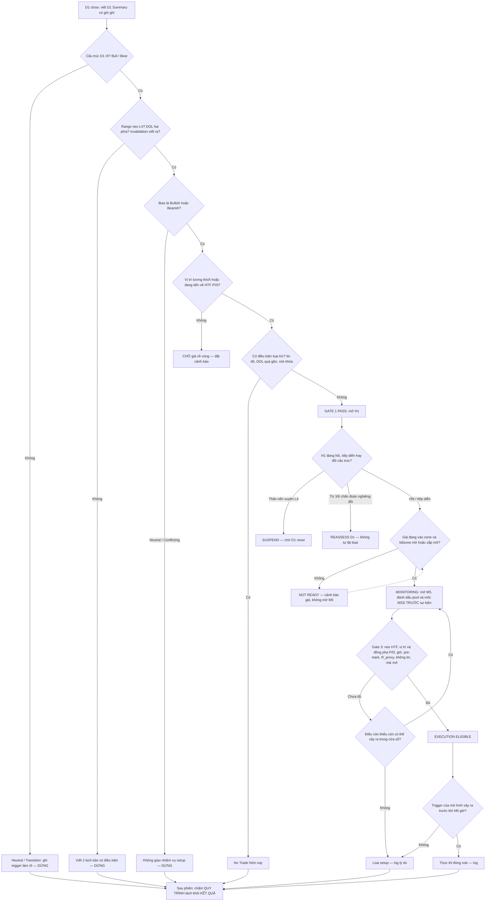

# Top-down Analysis (Multiple Timeframes)

> [!summary] Tóm tắt 1 câu
> **Top-down Analysis là một quy trình ra quyết định, không phải một tín hiệu: D1 trả lời "tôi đang ở đâu và hướng nào được phép xét", H1 trả lời "cơ hội có đang hình thành tại vùng đáng quan tâm không", M5 chỉ trả lời "điều đã được định nghĩa trước có xảy ra đúng chỗ, đúng giờ không" — và mỗi lần chuyển xuống khung thấp hơn phải đi qua một cổng có điều kiện viết ra được.**

> [!important] Năm nguyên tắc cốt lõi
> 1. **Hướng đến từ trên · thời điểm đến từ dưới · tầng nào cũng có quyền dừng (veto) · khi mâu thuẫn, vị trí giá làm trọng tài.** (Nguyên tắc vận hành của [[01c - ICT 2022 Model - He thong quyet dinh da khung (State Machine D1-H1-M5)|01c]] §18.1, dùng lại ở đây.)
> 2. **Ý nghĩa của một sự kiện cấu trúc thuộc về THANG của swing bị phá, không thuộc về khung bạn nhìn thấy nó** (TDA-R02 — gốc là R7 của Dealing Range v0.1). Một MSS trên M5 hầu như chỉ phá swing nhỏ; một nhịp H1 phá protected low của D1 *là* thông tin D1.
> 3. **Không có nghĩa vụ "mọi khung cùng hướng".** H1 ngược D1 là hình học bình thường của nhịp hồi — trên random walk, nó xảy ra ở ~48% số giờ ([[#2. Tại sao cần nhiều timeframe?|§2]]).
> 4. **Mở M5 để quan sát ≠ được phép thực thi.** Ba trạng thái: NOT READY · MONITORING · EXECUTION ELIGIBLE.
> 5. **Neutral, Conflicting và No Trade là output hợp lệ.** Một kế hoạch bị bỏ đúng lúc là quy trình hoạt động đúng, không phải thất bại.

> [!info] Đây là bản v2 (2026-10-15) — đọc trước khi dùng
> - **Rework toàn bộ** note v1 (2026-06-26 → 07-28). v1 lặp cùng một ý ở nhiều chỗ (ví dụ "HTF chọn hướng, LTF chọn thời điểm" xuất hiện ở 6 mục; "độ trễ giữa các tầng" ở 5 mục; "rút gọn 2 tầng" ở 5 mục; 4 nhóm flashcard và 3 bảng "tín hiệu cảnh báo"). v2 gộp mỗi ý về **một chỗ duy nhất**; bản đồ di chuyển nội dung ở [[#Changelog]]. Bản v1 nguyên vẹn: `02 - Trading Knowledge/_Archive/32-Top-down-Analysis-Multiple-Timeframes (ban cu truoc rework 2026-10-15).md.bak`.
> - **Hai chỗ v1 bị sửa về nội dung** (không chỉ gộp): (a) "HTF luôn thắng LTF" → thay bằng nguyên tắc 1–2 ở trên; (b) "các khung phải đồng thuận" → chỉ đòi đồng thuận *tại điểm thực thi*. Lý do và OLD/NEW ở [[#Changelog]]. Các "Case tổng hợp từ backtest" của v1 không có dữ liệu trade tương ứng → v2 gắn nhãn lại là **minh họa dựng**.
> - Ví dụ xuyên suốt dùng **tài sản giả định XYZ** (giá 1000–1200) — để không bị nhầm với phân tích thị trường thật. Hình `TDA-v2-Sim-*` là **mô phỏng**, không phải dữ liệu thị trường.

> [!info] Note này đứng ở đâu trong vault — để không lặp thông tin
> | Note | Vai trò | Quan hệ với note này |
> |---|---|---|
> | **Note này (32)** | **Lớp phương pháp**: vì sao nhiều khung, mỗi khung cho thông tin gì, bàn giao thông tin giữa các khung, cổng chuyển khung, xử lý xung đột, phân tích thời gian thực, kiểm chứng *quy trình* | Dùng được cho bất kỳ mô hình entry nào đặt trên D1 → H1 → M5 |
> | [[01 - ICT 2022 Model]] | Mô hình entry cụ thể: định nghĩa đo được của sweep / MSS / displacement / FVG, entry–stop–target, ngưỡng gate G1/G2, case backtest thật | Note này **không** lặp các định nghĩa và ngưỡng đó — chỉ dẫn link |
> | [[01c - ICT 2022 Model - He thong quyet dinh da khung (State Machine D1-H1-M5)]] | Đặc tả hình thức: state S0–S13, TTL, reset router, Context/Setup/Execution Card, bảng xung đột C1–C10 | Note này giải thích *logic* bằng ngôn ngữ đơn giản; spec nằm ở 01c |
> | [[59-Daily-Bias]] | Cách hình thành Daily Bias, bằng chứng, kịch bản, cập nhật | §12 ở đây chỉ giữ phần bias *bàn giao gì* cho H1 |
> | [[57-Dealing-Range-Nghien-cuu-chuyen-sau-Swing-Significance-Selection-Algorithm-Backtest]] · [[12-Dealing-Range]] | Thuật toán chọn neo range, thang swing L1–L5 | §7–8 ở đây chỉ giữ phần cần cho top-down |
> | [[56-Draw-on-Liquidity-DOL-Ontology-Microstructure-Failure-Model-va-Backtest]] · [[39-Draw-on-Liquidity-Tai-sao-gia-di-chuyen-ai-la-doi-ung]] | DOL như một mệnh đề có điều kiện | §11 chỉ giữ phần xếp hạng & giả thuyết cạnh tranh |
> | [[49-Confirmation-Timeframe-Timeframe-Layering-Khu-nhieu-MSS-trong-2022-Model]] | Luật "swing cần phá phải được đánh dấu TRƯỚC" | Dùng lại ở §23, §47 |

> [!note] Hệ nhãn bằng chứng (dùng xuyên suốt)
> | Nhãn | Nghĩa | Ví dụ |
> |---|---|---|
> | `[OBSERVABLE]` | *Observable market behavior* — quan sát trực tiếp từ giá/thời gian | "Giá đóng cửa D1 dưới swing low 1080" |
> | `[MARKET MECHANICS]` | Cơ chế khớp lệnh / đấu giá có nền tảng nghiên cứu | "Lệnh lớn thường được chia nhỏ theo thời gian" |
> | `[ICT FRAMEWORK]` | Cách ICT / cộng đồng ICT định nghĩa và dùng khái niệm | "Phân tích từ HTF xuống LTF" |
> | `[INTERPRETATION]` | Hợp lý nhưng không chứng minh được từ chart | "Nhịp giảm H1 là nhịp hồi trong xu hướng D1" |
> | `[HYPOTHESIS]` | Mệnh đề kiểm định được (mã HYP-TDA-xx) | "Setup sau khi H1 bắt kịp D1 có expectancy cao hơn" |
> | `[BACKTEST REQUIRED]` | Không được coi là lợi thế khi chưa có dữ liệu | Mọi nhận định về hiệu quả |
> | `[SIMULATION]` | Kết quả trên mô hình null (random walk), seed cố định | Hình `TDA-v2-Sim-02`, `Sim-03` |
> | `HEURISTIC` | Con số khởi điểm để test, không phải sự thật | "≥ 3 chẩn đoán nghiêng 'đổi cấu trúc'" |
>
> **Về nguồn ICT:** giáo trình gốc chủ yếu ở dạng video/mentorship; `[ICT FRAMEWORK]` ở đây là cách hiểu phổ biến trong tài liệu cộng đồng (Tier 3–4), không phải trích dẫn nguyên văn.

> [!abstract]- Mục lục (bấm để mở)
> - **Part I — Nền tảng** · 1 Top-down là gì · 2 Vì sao nhiều khung (+ null model) · 3 Mỗi khung cho thông tin gì · 4 Giới hạn · 5 Tổng quan D1 → H1 → M5 và các bộ khung khác
> - **Part II — D1: Bối cảnh** · 6 Cấu trúc lớn · 7 Swing significance · 8 Dealing Range · 9 Premium/Discount · 10 Internal/External liquidity · 11 DOL · 12 Daily Bias · 13 HTF POI · 14 D1 Summary (mẫu + ví dụ) · 15 Gate 1
> - **Part III — H1: Diễn biến trung gian** · 16 Nhiệm vụ H1 · 17 Cấu trúc trung gian · 18 Liquidity H1 · 19 Quan hệ D1–H1 · 20 Thu hẹp POI · 21 Hồi vs đổi cấu trúc · 22 Setup development · 23 Gate 2 + mẫu bàn giao H1 → M5 (3 ví dụ) · 24 H1 checklist
> - **Part IV — M5: Quan sát & thực thi** · 25 Nhiệm vụ M5 · 26 Quan sát phản ứng · 27 Liquidity event · 28 MSS / displacement / FVG (phạm vi cần thiết) · 29 Tín hiệu mâu thuẫn · 30 Gate 3 · 31 Invalidation · 32 M5 checklist
> - **Part V — Tích hợp đa khung** · 33–35 Scenario A–C · 36 Khung xử lý xung đột + Scenario G · 37 Scenario D · 38 Scenario E · 39 No Trade (+ Scenario F, H) · 40 18 failure modes
> - **Part VI — Vận hành** · 41 Decision tree · 42–43 Checklist D1/H1/M5/sau phân tích · 44 Quy tắc chuyển khung · 45 Invalidation (ai quyết, khi nào) · 46 Cập nhật nhận định · 47 Real-time & hindsight · 48 Rule register
> - **Part VII — Kiểm chứng** · 49 Định nghĩa đo được · 50 Hindsight/look-ahead · 51 Thiết kế backtest quy trình · 52 Tính nhất quán · 53 Hypothesis register · 54 Giới hạn
> - **Part VIII — Tổng hợp** · 55 Cho trẻ 5 tuổi · 56–60 Chỉ mục ví dụ · 61 Một trang · 62 Quy tắc · 63 Điểm chưa chắc chắn
> - Active recall · Lesson learned · Final QC · Liên kết · Nguồn · Changelog

> [!info]- Danh mục hình (34 sơ đồ SVG + 3 hình mô phỏng)
> | # | Hình | Mục |
> |---|---|---|
> | Sim-01 | Một đường giá — ba khung (mô phỏng) | §2 |
> | Sim-02 | Null model: H1 ngược D1 trên random walk | §2, §4 |
> | Sim-03 | Đổi định nghĩa swing → đổi nhãn D1 | §7, §52 |
> | 01 | Kiến trúc D1 → H1 → M5 | §5 |
> | 02 | ELI5: bản đồ thành phố / khu phố / con đường | §1 |
> | 03 | Scale ≠ timeframe | §3 |
> | 04 | Thang swing L1–L5 | §7 |
> | 05 | Đánh dấu quá nhiều swing vs đúng | §7 |
> | 06 | Hai cách chọn Dealing Range | §8 |
> | 07 | Bản đồ liquidity D1 & DOL | §10–11 |
> | 08 | Daily Bias 4 trạng thái & bàn giao | §12 |
> | 09 | POI → Development → Qualification → Trigger | §20 |
> | 10 | Gate 1 | §15 |
> | 11 | Quan hệ D1–H1: 4 trường hợp | §19 |
> | 12 | H1 hồi hay đổi cấu trúc | §21 |
> | 13 | Thu hẹp POI D1 → H1 | §20 |
> | 14 | NOT READY ↔ MONITORING ↔ ELIGIBLE | §23 |
> | 15 | M5 có thể / không thể | §25 |
> | 16 | Xung đột hướng vs khác biệt cấp độ | §36 |
> | 17 | Khung xử lý xung đột | §36 |
> | 18 | Độ trễ sau khi D1 đổi | §46 |
> | 19 | Invalidation đúng cấp độ | §31 |
> | 20 | Danh mục No Trade | §39 |
> | 21 | Real-time T1 → T8 | §47 |
> | 22 | Swing ứng viên vs xác nhận | §47, §50 |
> | 23 | Bản đồ 18 failure modes | §40 |
> | 24 | Kiểm chứng quy trình | §51 |
> | 25 | Một trang tổng hợp | §61 |
> | 26 | Các bộ khung thời gian | §5 |
> | S-A … S-H | Tám scenario | §33–39 |

---

# PART I — NỀN TẢNG

## 1. Top-down Analysis là gì?

### 1.1 Định nghĩa dùng trong note này

**Top-down Analysis (Multiple Timeframe Analysis — MTF)** là kỷ luật đọc thị trường theo thứ tự **từ khung mô tả cấu trúc lớn tới khung mô tả cấu trúc nhỏ**, trong đó:

1. **mỗi khung có một câu hỏi riêng** và chỉ được trả lời câu hỏi đó;
2. **output của khung trên trở thành tham số cho khung dưới** — không phải "lời xác nhận" mà khung dưới phải tìm cách chứng minh;
3. **việc chuyển xuống khung thấp hơn phải đi qua một cổng (gate)** có điều kiện viết ra được, và cổng có thể đóng — tức là "không xuống" là một kết quả hợp lệ;
4. **thông tin có thể đi ngược lên** (một nhịp H1 phá swing neo bối cảnh D1 là thông tin D1), nhưng **quyền quyết định hướng thì không** (một tín hiệu M5 không được đảo Daily Bias).

`[ICT FRAMEWORK]` Trong tài liệu ICT phổ biến, top-down được dạy như "HTF cho bias và draw on liquidity → khung trung gian cho POI → LTF cho entry". `[INTERPRETATION]` Note này giữ trình tự đó nhưng thay ngôn ngữ "HTF thắng LTF" bằng ngôn ngữ **thẩm quyền + thang**: ai được quyết định điều gì, và một sự kiện có ý nghĩa ở thang nào.

### 1.2 Giải thích theo năm tầng

**Level 1 — Cho trẻ 5 tuổi.**

![[TDA-v2-02-ELI5-Ban-do-va-gioi-han.svg]]
*Hình 02 — Bản đồ thành phố (D1) cho biết bạn đang ở khu nào và khu nào đáng tới; bản đồ khu phố (H1) cho biết đường tới đó có thông không, đã tới cổng chưa; con đường trước mặt (M5) cho biết đèn đã xanh chưa. Khung đỏ: chỗ ẩn dụ gãy.*

Muốn đi tới một cửa hàng, bạn không bắt đầu bằng việc nhìn chằm chằm vào vạch kẻ đường dưới chân. Bạn mở bản đồ thành phố để biết mình đang ở đâu, chọn khu muốn đến, rồi mới mở bản đồ khu phố để tìm đường, và chỉ khi đã đứng ở cổng mới nhìn đèn giao thông để quyết định bước qua. Nếu đèn chưa xanh, bạn đứng chờ — bạn không đổi điểm đến chỉ vì đèn đỏ.

**Giới hạn của ẩn dụ** (quan trọng ngang ẩn dụ):
- Bản đồ thành phố là thứ *đứng yên*; "bản đồ D1" thì được vẽ lại mỗi ngày. D1 không dự báo tương lai — nó chỉ mô tả bạn đang ở đâu.
- Một con đường lớn bị sập (một swing có ý nghĩa ở thang D1 bị phá) **là** thông tin để vẽ lại bản đồ thành phố — kể cả khi bạn nhìn thấy nó trên H1. Ẩn dụ "bản đồ nhỏ không ảnh hưởng bản đồ lớn" sai ở đúng chỗ này.
- Có những ngày không có đường nào an toàn. Đứng yên là quyết định đúng.

**Level 2 — Chuỗi giá.** D1 có cấu trúc tăng, đáy bảo vệ ở 1000, đỉnh 1200, một vùng FVG chưa được test ở 1045–1065. Giá đang ở 1133, tức nửa trên (đắt) của range. → H1 đang giảm thành chuỗi đỉnh thấp dần, đáy thấp dần. → Câu hỏi không phải "H1 giảm, có nên bán?" mà là "nhịp giảm H1 này đang đưa giá về vùng D1 đáng mua, hay đang phá thứ giữ cho xu hướng D1 còn sống?" → Giá xuống quét đáy 1080, đi vào vùng 1045–1065 trong khung giờ đã khai báo. → Chỉ lúc này mới mở M5, đánh dấu sẵn đáy nhỏ có thể bị quét và đỉnh nhỏ cần bị phá. → Nếu chuỗi đó xảy ra đúng như định nghĩa, mô hình được phép thực thi; nếu không, không có lệnh. (Đây chính là Scenario A, [[#33. D1 bullish, H1 bullish — Scenario A (ví dụ bullish hoàn chỉnh)|§33]].)

**Level 3 — Ngôn ngữ ICT.** Higher-Timeframe Context → Daily Bias → Dealing Range → Premium/Discount → Internal/External Liquidity → Draw on Liquidity → HTF POI → (Gate 1) → Intermediate Market Structure → Setup Development → POI refinement → (Gate 2) → Lower-Timeframe Monitoring → Liquidity Sweep → MSS → Displacement → FVG → Execution Trigger (Gate 3). Các thuật ngữ được phân biệt rõ ở đúng mục của chúng; đặc biệt POI / Setup Development / Setup Qualification / Entry Trigger ở [[#20. Thu hẹp POI và bốn khái niệm không được dùng thay nhau|§20]].

**Level 4 — Trên chart.** Mở D1 trước (và W1 nếu muốn bối cảnh nhiều tuần), viết D1 Summary ([[#14. D1 Summary — mẫu ghi chú và ví dụ điền hoàn chỉnh|§14]]) *có giờ ghi*; chỉ mở H1 khi Gate 1 pass; theo dõi H1 trong phiên và chỉ mở M5 khi trạng thái là MONITORING; chỉ được thực thi khi trạng thái là EXECUTION ELIGIBLE và trigger của mô hình xảy ra. Mọi lần dừng đều ghi lý do.

**Level 5 — Giới hạn.** Toàn bộ quy trình là một **bộ lọc có cấu trúc**, không phải một máy dự báo. Nó có thể giảm số quyết định sai bối cảnh — `[HYPOTHESIS]` — nhưng không có nghiên cứu bình duyệt nào kiểm định trực tiếp phiên bản ICT của nó; giá trị của nó với *bạn* chỉ đo được bằng dữ liệu của bạn ([[#PART VII — KIỂM CHỨNG|Part VII]]).

### 1.3 Top-down Analysis KHÔNG phải là gì

| Không phải | Vì sao | Thay bằng |
|---|---|---|
| Một tín hiệu vào lệnh | Nó là cái khung chứa tín hiệu; tự nó không cho điểm vào | Tín hiệu đến từ mô hình entry (vd [[01 - ICT 2022 Model]]) |
| Yêu cầu "mọi khung cùng hướng" | H1 ngược D1 là trạng thái bình thường của nhịp hồi (§2.4) | Đồng thuận **tại điểm thực thi**: hướng trigger M5 = hướng được phép của D1, tại vùng D1/H1 |
| "Khung lớn luôn đúng" | Khung lớn cập nhật chậm; một nhịp nhỏ có thể phá swing lớn | Thẩm quyền theo khung, ý nghĩa theo thang (§3.3) |
| Mở càng nhiều khung càng tốt | Mỗi khung thêm vào là thêm nhiễu và thêm cơ hội "chọn khung thuận tiện" | Một bộ khung cố định, mỗi khung một nhiệm vụ (§5.4) |
| Phân tích từ dưới lên rồi "kiểm tra" khung lớn | Thấy M5 đẹp rồi quay lên D1 tìm lý do = hợp lý hóa | D1 Summary viết trước, có giờ ghi (§14) |
| Một lời hứa về kết quả | Làm đúng quy trình vẫn có thể thua (tin tức, regime, phân phối) | Chấm quy trình tách khỏi kết quả (§47) |

---

## 2. Tại sao cần nhiều timeframe?

### 2.1 Vấn đề gốc: một màn hình không thể vừa rộng vừa nét

Một màn hình hiển thị thoải mái khoảng 150–300 nến. Với D1 đó là 7–14 tháng; với H1 là 6–12 ngày; với M5 là 12–25 giờ. `[OBSERVABLE]` Không có khung nào cùng lúc cho thấy *bối cảnh nhiều tháng* và *trình tự vài phút*. Đây là bài toán độ phân giải, không phải bài toán ICT — mọi phương pháp đa khung (Dow Theory, Elder Triple Screen, Market Profile composite) đều có thể xem là lời giải cho cùng bài toán đó.

Bốn lý do làm việc theo thứ tự trên xuống:

1. **Bối cảnh phải có trước chi tiết.** Một chi tiết (một cú quét đáy) chỉ có nghĩa khi biết nó xảy ra ở đâu (đáy của nhịp hồi trong xu hướng tăng? hay giữa range?).
2. **Swing nhỏ nhiều hơn swing lớn rất nhiều.** Trên M5, một phiên có hàng chục đỉnh/đáy; trên D1, một tháng có vài cái. Nếu bắt đầu từ M5, bạn luôn tìm được "một cái gì đó" — đó là vấn đề *tần suất nền*, không phải vấn đề kỹ năng. 01c §4.6 cho thấy trên random walk, chuỗi "sweep → reclaim" vẫn xuất hiện thường xuyên.
3. **Khớp horizon.** Một nhận định "hôm nay ưu tiên mua" cần dữ liệu có horizon ngày; dùng M5 để hình thành nó là dùng dữ liệu sai thang cho câu hỏi.
4. **Invalidation ổn định.** Nếu luận điểm neo vào swing D1, nó không bị đổi theo từng nến; nếu neo vào swing M5, nó đổi vài lần mỗi giờ.

### 2.2 Góc nhìn cơ chế thị trường — và giới hạn của nó

- `[MARKET MECHANICS]` Người cần giao dịch khối lượng lớn thường **chia nhỏ lệnh theo thời gian** để giảm tác động giá; trong mô hình kinh điển của Kyle (1985), người có thông tin giao dịch dần dần; Lillo, Mike & Farmer (2005) dùng việc chia nhỏ lệnh để giải thích "trí nhớ dài" của dấu dòng lệnh. Hệ quả hợp lý: một số áp lực mua/bán kéo dài nhiều phiên.
- `[INTERPRETATION]` Áp lực kéo dài như vậy *có thể* để lại cấu trúc nhìn rõ hơn ở khung lớn. Đây là lập luận mạnh nhất cho việc đọc khung lớn trước.
- `[ICT FRAMEWORK]` ICT diễn đạt điều này bằng "institutional order flow" và "smart money". **Chart không chứa danh tính hay ý định của người đặt lệnh**; vì vậy note này không dùng "tổ chức muốn…" làm bằng chứng.
- `[INTERPRETATION]` Fractal Market Hypothesis (Peters, 1994) mô tả thị trường gồm nhiều nhóm có horizon khác nhau; Dow Theory (cuối thế kỷ 19) đã tách xu hướng primary / secondary / minor. Cả hai ủng hộ *ý tưởng* lồng nhau, không ủng hộ bất kỳ quy tắc giao dịch cụ thể nào.

### 2.3 Cùng một chuyển động, ba ý nghĩa khác nhau

![[TDA-v2-Sim-01-Mot-duong-gia-ba-khung.png]]
*Hình Sim-01 `[SIMULATION]` — Một chuỗi giá 5 phút mô phỏng của XYZ, gộp thành nến D1, H1, M5. Cùng nhịp giảm từ 1137 về 1061: trên D1 là một cú hồi trong xu hướng tăng; trên H1 là một downtrend LH–LL; trên M5 là nơi một chuỗi sweep → MSS bullish vừa xuất hiện. Không khung nào "sai" — mỗi khung mô tả một thang khác nhau.*

Bài học của hình này là trung tâm của toàn bộ note: **"H1 đang giảm" và "D1 đang tăng" không mâu thuẫn** — chúng là hai câu đúng về hai thang khác nhau. Mâu thuẫn chỉ xuất hiện khi nhịp giảm H1 bắt đầu phá *swing neo bối cảnh D1* ([[#36. Xung đột timeframe — khung xử lý và Scenario G|§36]]).

### 2.4 Null model: H1 ngược D1 thường xuyên tới mức nào khi KHÔNG có gì để dự báo?

Để biết một quan sát có mang thông tin hay không, cần biết nó xảy ra thường xuyên thế nào khi giá đi ngẫu nhiên. Mô phỏng dưới đây dùng **cùng một định nghĩa cấu trúc cho cả D1 và H1** (BOS theo fractal n=2, phá bằng giá đóng cửa), và D1 chỉ dùng nến đã đóng.

![[TDA-v2-Sim-02-H1-nguoc-D1-tren-random-walk.png]]
*Hình Sim-02 `[SIMULATION]` — random walk bước 5 phút, 3.000 ngày × 24h, seed 20261015; 71.353 giờ có cả hai trạng thái.*

| Kết quả mô phỏng | Giá trị | Ý nghĩa cho top-down |
|---|---|---|
| Tỷ lệ giờ H1 ngược hướng D1 | **48,4%** | "H1 ngược D1" là trạng thái bình thường, không phải tín hiệu |
| Trung vị độ dài một đợt H1 ngược | **15 giờ** (trung bình 19,8) | Một ngày H1 đi ngược là chuyện thường — không cần "giải thích" |
| P(D1 đổi trạng thái trong 3 ngày \| H1 ngược) | **19,5%** | — |
| P(D1 đổi trạng thái trong 3 ngày \| H1 cùng hướng) | **8,5%** | H1 ngược "báo trước" D1 đổi **×2,3** — trên dữ liệu ngẫu nhiên |
| Tỷ lệ lần D1 đổi trạng thái mà ngày trước đó H1 đã ngược | **72%** (n = 138) | "Hầu hết các lần đảo chiều D1 đều có H1 báo trước" — đúng cả trên random walk |

**Vì sao ×2,3 xuất hiện trên dữ liệu ngẫu nhiên?** `[INTERPRETATION]` (kiểm tra được bằng xác suất first-passage): để D1 đổi trạng thái, giá phải đi tới swing D1 đối diện; trên đường đi đó, H1 gần như chắc chắn đã ngược hướng D1. Quan hệ này là **cơ học khoảng cách**, không phải thông tin dự báo.

> [!warning] Hệ quả trực tiếp
> - Bất kỳ ai khẳng định "khi H1 ngược D1 thì D1 thường đảo chiều" phải chứng minh tỷ lệ đó **cao hơn mức ×2,3 của null model**, trên dữ liệu thật, với cùng định nghĩa. Nếu không, quan sát đó không chứa thông tin.
> - Tương tự, "D1, H1, M5 cùng hướng" **không phải ba xác nhận độc lập** — chúng được tính từ cùng một chuỗi giá. Đếm chúng như ba bằng chứng là đếm trùng.
> - Đây là lý do note bỏ yêu cầu "mọi khung đồng thuận" của v1.

---

## 3. Mỗi timeframe cung cấp loại thông tin khác nhau

### 3.1 Bảng thẩm quyền và thông tin

| Khung | Thông tin nó cung cấp tốt | Thông tin nó KHÔNG thể cung cấp | Output (đối tượng bàn giao) | Được quyền quyết định |
|---|---|---|---|---|
| **W1** (tùy chọn) | Bối cảnh nhiều tuần; liquidity xa; vùng phản ứng lớn | Thời điểm trong ngày; trình tự trong phiên | Ghi chú bối cảnh tuần, cờ xung đột | Hạ confidence của D1; không trực tiếp tạo setup |
| **D1** | Cấu trúc chính; swing L4–L5; dealing range; vị trí giá; liquidity ngoài; DOL; vùng HTF | Đường đi trong ngày; giá có tới vùng hôm nay không; trigger | **D1 Summary** (§14) | Hướng được phép; vùng được phép; invalidation của luận điểm |
| **H1** | Đường đi trung gian; nhịp hồi vs đổi cấu trúc; liquidity nội bộ; cách giá tiếp cận vùng | Hướng dài hạn (trừ khi phá swing có ý nghĩa D1); trigger chính xác | **Handoff H1 → M5** (§23) | Zone cụ thể; trạng thái NR/MON/EE; kịch bản trong ngày |
| **M5** | Trình tự sự kiện tại zone; sweep, MSS, displacement, FVG; địa chỉ entry & stop | Daily Bias; xác suất tới DOL; ý nghĩa của tín hiệu ngoài zone | **Quyết định** thực thi / chờ / bỏ + log | Thời điểm, entry, stop — *không* hướng |

### 3.2 Gộp nến làm mất thông tin gì?

`[OBSERVABLE]` Một nến D1 (FX 24h) chứa 24 nến H1 và 288 nến M5. Hai ngày có OHLC giống hệt nhau có thể có đường đi hoàn toàn khác: một ngày tăng đều từ mở cửa, một ngày giảm mạnh buổi sáng rồi đảo chiều buổi chiều. D1 không phân biệt được; H1 phân biệt được. Ngược lại, H1 không cho biết nhịp giảm buổi sáng đó có quét một đáy cụ thể trong 3 phút hay không — M5 cho biết.

Hệ quả: **mỗi khung thấp hơn bổ sung trình tự (sequence) mà khung trên đã nén mất**; mỗi khung cao hơn bổ sung bối cảnh mà khung dưới không chứa được trên màn hình. Không khung nào thay được khung kia.

### 3.3 Thang (scale) không phải khung thời gian (timeframe)

![[TDA-v2-03-Scale-khong-phai-timeframe.svg]]
*Hình 03 — Cùng là "một MSS", nhưng (A) một MSS M5 phá micro swing L1 không ảnh hưởng Daily Bias, còn (B) một nhịp H1 phá protected low của D1 là thông tin D1.*

**Thang** của một swing = phạm vi mà nó bảo vệ: nếu bị phá, những kết luận nào phải thay đổi? Một swing low M5 bảo vệ một nhịp tăng vài chục phút; protected low D1 bảo vệ cả luận điểm tăng nhiều ngày. Quy tắc dùng xuyên suốt (TDA-R02 — gốc là R7 của Dealing Range v0.1 và [[59-Daily-Bias]] §4.1.3):

> **Ý nghĩa thuộc về swing bị phá, không thuộc về chart bạn nhìn thấy sự kiện.**

Thực tế, M5 hầu như chỉ phá được swing nhỏ, nên quy tắc "M5 không đổi bias" gần như luôn đúng. Nhưng *lý do* của nó là thang, không phải tên khung — và điều này quan trọng ở H1, nơi một nhịp đủ mạnh hoàn toàn có thể phá swing L4 của D1.

### 3.4 Thẩm quyền đi xuống, thông tin đi hai chiều

| Chiều | Cái gì được truyền | Ví dụ XYZ |
|---|---|---|
| D1 → H1 | Hướng được phép, vùng được phép, mục tiêu, invalidation | "Chỉ long; zone 1045–1065; mục tiêu 1200; sai khi D1 đóng dưới 1000" |
| H1 → M5 | Zone cụ thể, pool sẽ bị quét, mốc MSS, giờ, điều phải xảy ra | "Zone A 1055–1065; pool M5 & mốc MSS đánh dấu khi hình thành (vd 1063.5 / 1072.2); 07:00–10:00" |
| M5 → H1 | Setup fail / thành công tại zone | "Sweep thành run → zone A còn nhưng chuỗi này chết" |
| H1 → D1 | Sự kiện phá swing có thang D1 (L3/L4) | "H1 đóng dưới 1045 hai nến → POI D1 fail" |
| Bất kỳ → tất cả | Hard event: tin ngoài lịch, gap lớn, circuit breaker | SUSPEND mọi entry mới |

---

## 4. Giới hạn của phân tích đa timeframe

Những giới hạn này không phải lý do để bỏ top-down; chúng là lý do để **không tin nó quá mức** và để thiết kế phần kiểm chứng ở Part VII.

1. **Không dự báo.** `[INTERPRETATION]` "D1 bullish" là mô tả cấu trúc theo một định nghĩa; nó không nói giá hôm nay tăng. Cấu trúc mô tả quá khứ; tính bền của nó trên dữ liệu thật là `[BACKTEST REQUIRED]`.
2. **Không độc lập.** Các khung được tính từ cùng một chuỗi giá. Sự "đồng thuận" giữa chúng một phần là cơ học (§2.4). Ba khung cùng hướng ≠ ba bằng chứng. Tương tự, cùng một bias trên hai tài sản tương quan cao (NQ và ES) thường là *một* tín hiệu nhìn từ hai góc, không phải hai xác nhận.
3. **Khung lớn cập nhật chậm.** Một bias xác lập lúc D1 close có thể lỗi thời sau tin 08:30. Vì vậy cần cơ chế SUSPEND ([[#46. Quy tắc cập nhật nhận định|§46]]).
4. **Thiên lệch xác nhận.** Đã có bias, mắt sẽ tìm trên H1/M5 những gì phù hợp. Top-down cứng nhắc có thể *khuếch đại* thiên lệch này nếu không có điều kiện invalidation viết trước.
5. **Sai số triển khai.** Hai người cùng đồng ý "D1 bullish" vẫn có thể chọn hai zone, hai stop khác nhau. Nếu sai số này lớn, nó có thể nuốt mọi lợi thế của framework — đây là lý do đo inter-rater ở [[#52. Đánh giá tính nhất quán|§52]].
6. **Phụ thuộc regime.** Trong xu hướng mạnh, mọi bộ lọc theo hướng đều trông xuất sắc; trong range kéo dài, tầng D1 fail liên tục. Một chuỗi thắng trong một regime không chứng minh được gì về regime khác.
7. **Dữ liệu và định nghĩa "một ngày".** Nến D1 đóng lúc 17:00 NY, 00:00 UTC hay giờ broker cho ra cấu trúc D1 khác nhau; DST làm lệch thêm; broker có thể gộp nến khác TradingView. Với futures, nến H1/H4 chứa giờ nghỉ bảo trì có hình dạng bất thường và dễ bị đọc nhầm thành sweep/MSS. Cố định **một** nguồn dữ liệu và **một** định nghĩa ngày (vault: giờ New York) — chi tiết ở 01c §6.0.
8. **Không có bằng chứng bình duyệt cho phiên bản ICT.** Có nghiên cứu về các mảnh cơ học bên dưới (vd lệnh stop/take-profit co cụm quanh số tròn trên FX — Osler 2003, 2005); không có nghiên cứu kiểm định "D1 → H1 → M5 với gate" như một hệ thống.

---

## 5. Tổng quan D1 → H1 → M5

### 5.1 Kiến trúc

![[TDA-v2-01-Kien-truc-D1-H1-M5.svg]]
*Hình 01 — Ba tầng, ba câu hỏi, ba đối tượng bàn giao, ba cổng; cột phải: thông tin được phép đi ngược lên; dải dưới: trục thời gian chạy song song.*

| Tầng | Câu hỏi duy nhất | Đối tượng bàn giao | Cổng để xuống tầng dưới |
|---|---|---|---|
| **D1 — Context** | Tôi đang ở đâu, hướng nào được phép xét, khi nào tôi sai? | D1 Summary | **Gate 1**: summary đủ rõ để định hướng H1 ([[#15. Gate 1 — điều kiện chuyển từ D1 xuống H1\|§15]]) |
| **H1 — Setup** | Cơ hội có đang hình thành tại vùng D1 không? | Handoff H1 → M5 + trạng thái | **Gate 2**: có lý do cụ thể để mở M5 (MONITORING) ([[#23. Gate 2 — khi nào chuyển xuống M5?\|§23]]) |
| **M5 — Execution** | Điều đã định nghĩa trước có xảy ra, đúng chỗ, đúng giờ? | Quyết định + log | **Gate 3**: đủ điều kiện của mô hình (EXECUTION ELIGIBLE) ([[#30. Gate 3 — từ MONITORING sang EXECUTION ELIGIBLE\|§30]]) |

### 5.2 Bảy câu hỏi nền tảng — trả lời ngắn

1. **Vì sao không bắt đầu từ M5?** Vì M5 luôn có "tín hiệu" (tần suất nền cao); bắt đầu từ đó nghĩa là chọn tín hiệu trước rồi tìm lý do sau — tức hợp lý hóa. Bối cảnh phải được viết *trước* khi thấy tín hiệu thì mới có khả năng lọc.
2. **D1 cung cấp gì mà H1/M5 không thay được?** Swing neo luận điểm, dealing range, liquidity ngoài, và *mức invalidation ổn định*. H1/M5 không chứa đủ lịch sử trên màn hình để thấy chúng, và nếu dùng swing của chúng làm neo, luận điểm sẽ đổi theo giờ.
3. **H1 bổ sung gì?** Đường đi: giá đang tiến về vùng hay rời xa; nhịp hiện tại là hồi hay đổi cấu trúc; pool nội bộ nào nằm trên đường; vùng D1 rộng nên thu hẹp ở đâu.
4. **M5 bổ sung gì?** Trình tự tại zone: pool đã đánh dấu có bị quét không, mốc MSS có bị phá bằng displacement không, địa chỉ entry và vị trí stop theo cấu trúc.
5. **Vì sao M5 đẹp không đủ?** Vì vẻ đẹp là thuộc tính hình học, không phải thuộc tính thông tin. Cùng một chuỗi sweep → MSS → FVG ở giữa range H1, ngoài giờ, là nhiễu có hình dạng đẹp (Scenario E).
6. **Vì sao D1 đẹp không có nghĩa là phải có lệnh?** Vì D1 chỉ cho phép *tìm*. Giá có thể không tới vùng, tới ngoài giờ, tới mà không tạo trigger, hoặc chạy thẳng không hồi (Scenario D, F). Phần lớn ngày dừng trước M5.
7. **Vì sao đa khung không có nghĩa là mọi khung cùng hướng?** Vì các khung mô tả các thang khác nhau; nhịp hồi H1 ngược D1 là *cách* giá đi tới vùng D1 đáng mua. Đồng thuận chỉ được đòi ở **điểm thực thi**: trigger M5 phải cùng hướng được phép của D1, tại vùng D1/H1.

### 5.3 Trục thời gian — chiều thứ hai thường bị bỏ quên

Top-down thường được dạy chỉ theo trục **giá** (bias → POI → entry). Có một trục thứ hai chạy song song:

- **D1 close** là thời điểm đánh giá lại "mềm" của bối cảnh (cấu trúc, range, DOL, bias). Trong ngày, chỉ *hard event* mới được làm thay đổi bối cảnh — và chỉ bằng cách SUSPEND, kết luận vẫn chờ D1 close (01c §7.1).
- **Killzone đã khai báo** là cổng thời gian cho M5 ([[18-Kill-Zones]]). Đúng giá sai giờ là một lý do No Trade riêng (`out_of_window`).
- **Pha trong phiên** `[ICT FRAMEWORK]`: theo khung AMD / Power of Three ([[02-AMD]]), giá có thể tới đúng vùng trong pha tích lũy (biên độ hẹp, thanh khoản mỏng) — khi đó "MSS" xuất hiện dễ dàng nhưng ít ý nghĩa. `[HYPOTHESIS]` Trigger hình thành trong cửa sổ "manipulation" (thường trùng đầu killzone London/NY) có expectancy khác trigger trong pha tích lũy — `[BACKTEST REQUIRED]`.
- **Hạn dùng (TTL).** Mỗi kế hoạch có hạn: setup H1 hết hạn cuối killzone/D1 close; DOL có horizon vài ngày. **Hết hạn ≠ sai** (EXPIRED khác INVALIDATED — §31).

### 5.4 Các cách phối hợp timeframe khác

![[TDA-v2-26-Cac-bo-khung-thoi-gian.svg]]
*Hình 26 — Các bộ khung và tỷ lệ giữa các tầng (thang log). Vùng xanh: "hệ số 4–6" của Elder.*

| Bộ khung | Mục đích | Ưu điểm | Giới hạn |
|---|---|---|---|
| **D1 → H1 → M5** (mặc định) | Day trading, bias trong ngày | Khớp horizon "hôm nay"; ba tầng có ba nhiệm vụ rõ | H1 phải gánh cả setup lẫn liquidity trung gian; tỷ lệ 24 và 12 lớn |
| **W1 → D1 → H4** | Swing nhiều ngày | Ít nhiễu; ít quyết định | Ít setup; tin tức giữa tuần; cần vốn kiên nhẫn |
| **H4 → M15 → M1** | Intraday hạ khung | Phản ứng nhanh hơn | Nhiễu M1 và spread ăn R; cần spec riêng ([[01b - ICT 2022 Model - LTF Intraday (H1-M5-M1)]]) |
| **H1 → M5** (2 tầng) | Cửa sổ ngắn (vd Silver Bullet) | Nhanh, nhiều tín hiệu | Mất tầng lọc bối cảnh; dễ đọc nhiễu H1 thành "move thật" |
| **D1 → M1** (nhảy cóc) | — | — | Không tầng nào trả lời "cơ hội có đang hình thành?"; không khuyến nghị |

**Về "hệ số 4–6".** `HEURISTIC` Quy ước các khung cách nhau khoảng 5 lần (thực hành thường nới thành 4–6) đến từ Triple Screen của Alexander Elder (giới thiệu giữa thập niên 1980, trình bày lại trong *Trading for a Living*, 1993). Nó là quy ước thực hành, không phải định luật: chính bộ mặc định D1 → H1 → M5 có tỷ lệ 24 và 12 và vẫn hợp lý **vì mỗi tầng trả lời một câu hỏi khác nhau**. Tiêu chí chọn bộ khung tốt hơn tỷ lệ là: (1) mỗi tầng có nhiệm vụ không chồng lấn; (2) horizon của tầng trên khớp horizon giữ lệnh; (3) bộ khung được **cố định** đủ lâu để có dữ liệu so sánh.

**Khi nào rút gọn còn 2 tầng là chấp nhận được.** `HEURISTIC` Chỉ khi (a) đã backtest riêng đúng instrument và đúng cửa sổ giờ đó với cỡ mẫu đủ theo §51.4 (thường vài trăm lệnh mỗi nhóm nếu muốn phân biệt chênh lệch nhỏ), (b) kết quả cho thấy bộ rút gọn vẫn giữ expectancy dương sau chi phí, và (c) quy tắc rút gọn được viết thành một spec riêng (không phải "hôm nay vội nên bỏ H1"). Đánh đổi kỳ vọng: số tín hiệu tăng, tỷ lệ tín hiệu tốt trên mỗi tín hiệu có thể giảm, mục tiêu gần hơn → `[BACKTEST REQUIRED]` (HYP-TDA-09).

**Một cách nhìn hữu ích** (đã ghi trong [[59-Daily-Bias]] §4.1.2): ICT 2022 Model về bản chất là một mô hình thực thi đơn khung; D1 → H1 → M5 là cách **phân rã** các bước của nó qua các khung, không phải ba phân tích độc lập chồng lên nhau. Vì vậy câu hỏi đúng không phải "ba khung có đồng ý không" mà là "mỗi bước của mô hình đã được thỏa ở đúng khung của nó chưa".

---

# PART II — D1: BỐI CẢNH

> [!example] Bộ số liệu ví dụ XYZ — dùng nhất quán từ §6 tới §39
> Tài sản giả định, giờ New York, nến D1 đóng 17:00 NY. Các số trùng với đường giá mô phỏng ở hình Sim-01.
>
> | Đối tượng | Giá trị | Cấp swing / vai trò |
> |---|---|---|
> | Đỉnh tuần cũ | 1230 | L5 · BSL rất xa (ngoài hình) |
> | Range high (HH gần nhất, ngày 22) | 1200 | L4 · external BSL |
> | Đỉnh cũ bị phá (BOS, ngày 14) | 1150 | đã tiêu thụ — không còn là liquidity |
> | Equilibrium | 1100 | giữa range 1000–1200 |
> | Swing low nội bộ D1 (ngày 16) | 1080 | L3 · internal SSL |
> | D1 FVG chưa test (ngày 11–13) | 1045–1065, CE 1055 | HTF POI (discount) |
> | Protected low (L4, neo thesis) = origin của leg L4 đã BOS (ngày 10) | 1000 | L4 · external SSL · mốc invalidation thesis |
> | Ngưỡng swing L4 dùng cho XYZ `HEURISTIC` | nhịp hồi ≥ 50% leg trước **hoặc** ≥ 3 ATR(D1) | hồi 1158 → 1080 = 49% và ≈ 2,2 ATR → **L3**, không tái neo range |
> | Giá tại T1 (D1 close ngày 26) | 1133 | premium, z ≈ 0,67 |
> | ATR giả định | D1 ≈ 35 · H1 ≈ 6 · M5 ≈ 1,5 | dùng để nói "xa/gần" |

## 6. Major Market Structure — Bước 1: đọc bức tranh lớn

### 6.1 Quy trình

1. **Chọn cửa sổ nhìn** `HEURISTIC`: 6–12 tháng D1; mở W1 nếu cần biết D1 đang nằm ở đâu trong bức tranh nhiều tuần. Cửa sổ quá ngắn khiến một nhịp hồi trông như xu hướng; quá dài khiến cấu trúc đã hết hiệu lực vẫn chi phối suy nghĩ.
2. **Tìm các leg lớn trước, swing sau.** Một leg là chuyển động có hướng giữa hai swing quan trọng; leg đáng kể thường có displacement (nến thân dài liên tiếp, để lại FVG) và biên độ vài ATR(D1). Trong XYZ: leg 1000 → 1158 (phá đỉnh cũ 1150), hồi về 1080, rồi tiếp 1080 → 1200 — theo định nghĩa có lọc ý nghĩa (callout dưới), cả đoạn 1000 → 1200 là **một leg L4** với một nhịp hồi nội bộ L3.
3. **Gán trạng thái cấu trúc** cho leg hiện hành:
   - **Trend (Bull / Bear)** — chuỗi BOS cùng hướng, có một *protected level* rõ (đáy/đỉnh khởi phát leg đã phá cấu trúc).
   - **Correction** — nhịp ngược hướng bên trong trend, chưa phá protected level.
   - **Range** — hai biên được tôn trọng nhiều lần; các lần phá ra đều không có acceptance.
   - **Transition** — protected level vừa bị phá bằng thân nến; leg mới chưa hình thành.
4. **Xác định protected level**: swing mà nếu bị đóng cửa xuyên qua thì trạng thái phải đổi. XYZ: 1000 — *theo định nghĩa có lọc ý nghĩa swing* (xem callout dưới).
5. **Viết kết luận được phép**: "Cấu trúc D1 = Bull theo định nghĩa *[ghi định nghĩa]*; protected low 1000; leg L4 1000 → 1200 (1080 là nhịp hồi L3 bên trong); giá đang trong một correction." — Không viết "giá sẽ lên".

> [!warning] Hai "protected low" trong cùng một chart — và vì sao phải chọn TRƯỚC
> Leg 1080 → 1200 cũng phá đỉnh 1158. Vì vậy:
> - **Định nghĩa A (note này dùng cho XYZ):** swing chỉ là L4 khi qua ngưỡng ý nghĩa (hồi ≥ 50% leg trước hoặc ≥ 3 ATR D1). Hồi 1158 → 1080 không qua → 1080 là **L3**; leg L4 là 1000 → 1200; protected low = **1000**; range 1000–1200; giá 1133 = premium. Khớp cách neo theo cấp L4 của [[57-Dealing-Range-Nghien-cuu-chuyen-sau-Swing-Significance-Selection-Algorithm-Backtest]] và Context Card của 01c.
> - **Định nghĩa B (fractal n=2, không lọc ý nghĩa):** swing low đã xác nhận gần nhất trước BOS 1158 là 1080 → "strong low" = **1080**; range 1080–1200; EQ 1140; giá 1133 = discount sát EQ. Khi đó mọi giao dịch dưới 1080 là đe dọa trực tiếp luận điểm: cú xuống 1061 ở Scenario A vượt 1080 hơn 0,5 ATR(D1) → **SUSPEND → No Trade**.
>
> Cùng một chart, cùng một diễn biến: định nghĩa A cho ra một lệnh hợp lệ, định nghĩa B cho ra No Trade. Không định nghĩa nào "đúng" theo nghĩa tuyệt đối — đây chính là hiện tượng Sim-03 đo được (§7.4). Điều *sai* là chọn định nghĩa **sau khi** thấy giá. Quy tắc: định nghĩa swing/protected level được ghi trong D1 Summary và cố định cho cả giai đoạn (TDA-R03); giá trị của mỗi định nghĩa là câu hỏi backtest (HYP-TDA-03).

### 6.2 Vì sao không phải mọi swing đều quan trọng như nhau

`[OBSERVABLE]` Trên D1 của XYZ có hàng chục đỉnh/đáy nhỏ. Nhưng chỉ vài swing *bảo vệ* một kết luận: nếu 1000 bị phá, luận điểm tăng chết; nếu một đáy nhỏ ngày 17 bị phá, không có kết luận nào thay đổi (theo định nghĩa A ở callout trên). Mức độ quan trọng của swing đến từ **phạm vi những gì nó bảo vệ**, không đến từ việc nó "nhìn thấy được" (§7).

Một swing quan trọng trên M5 (đáy của nhịp tăng 40 phút) có thể là mốc MSS hoàn hảo cho trigger — nhưng nó không đủ thang để nói gì về bối cảnh D1. Dùng nó để kết luận về D1 là lỗi thang (§3.3).

### 6.3 Khi nào cấu trúc chưa rõ — và khi nào giữ Neutral

| Dấu hiệu | Vì sao làm cấu trúc mơ hồ |
|---|---|
| BOS hai chiều trong cùng một cửa sổ ngắn | Không có protected level đứng vững |
| Giá nằm giữa hai biên đã được tôn trọng nhiều lần | Range: hướng chỉ có nghĩa ở biên |
| Leg gần nhất không có displacement (nến chồng lấp) | Phá cấu trúc "trôi" — dễ là nhiễu ở thang D1 |
| Protected level vừa bị phá, chưa có leg mới | Transition: bối cảnh cũ chết, bối cảnh mới chưa sinh |
| External liquidity mục tiêu vừa bị lấy | DOL đã fulfilled — "nhiên liệu" của luận điểm cũ đã dùng hết |

Nếu có bất kỳ dấu hiệu nào ở trên rõ rệt → **giữ Neutral hoặc Conflicting** và ghi điều gì sẽ làm rõ (vd: "D1 đóng cửa ngoài range [L–H] đang dùng, với displacement").

### 6.4 "HH–HL" không có nghĩa là phải mua

Ba phản ví dụ:
- **Fulfilled:** D1 HH–HL nhưng giá vừa quét đúng external BSL mà luận điểm nhắm tới → mục tiêu đã đạt; tiếp tục mua là dùng luận điểm đã hết nhiên liệu.
- **Vị trí sai:** HH–HL nhưng giá đang ở sát đỉnh range (premium sâu) — mua lúc này là mua ở chỗ đắt nhất của chính leg đó.
- **Leg yếu dần:** mỗi leg tăng sau ngắn hơn và không còn displacement; các HL ngày càng sâu. Cấu trúc vẫn "bull" theo nhãn, nhưng chất lượng bằng chứng giảm.

`[INTERPRETATION]` HH–HL là *mô tả* quá khứ; giá trị dự báo của nó trên dữ liệu của bạn là `[BACKTEST REQUIRED]` (xem [[59-Daily-Bias]] §3.2).

---

## 7. Swing Significance — Bước 2: xác định cấu trúc quan trọng

### 7.1 Thang L1–L5

![[TDA-v2-04-Thang-swing-L1-L5.svg]]
*Hình 04 — Phân loại swing theo phạm vi ảnh hưởng. Ví dụ XYZ.*

| Cấp | Tên | Thường thấy rõ trên | Khi nào quan tâm | Không được dùng để |
|---|---|---|---|---|
| **L5** | Major HTF swing | W1 / MN | Bối cảnh nhiều tuần, DOL xa, hạ/tăng confidence của D1 | Định thời điểm trong ngày |
| **L4** | External / dealing-range swing | D1 | Neo dealing range; protected level; invalidation của Daily Bias | — (đây là cấp quan trọng nhất của top-down) |
| **L3** | Intermediate structural swing | D1 / H4 | Internal liquidity của range; phá nó → hạ confidence | Tự mình lật Daily Bias |
| **L2** | Internal swing | H1 | Cấu trúc nhịp hồi; pool H1; inducement | Kết luận về D1 |
| **L1** | Micro swing | M5 / M1 | Mốc MSS, pool sẽ bị quét, stop | Bất kỳ kết luận nào về bias |

Đây là **khung nghiên cứu**, không phải chuẩn ICT bắt buộc. `[INTERPRETATION]` Nó tương ứng gần đúng với cách ICT gọi Short-Term / Intermediate-Term / Long-Term High–Low ([[01-Advance-Market-Structure-Short-Term-Low-Intermediate-Term-Low-Long-Term-Low]]): L2 ≈ STH/STL, L3 ≈ ITH/ITL, L4–L5 ≈ LTH/LTL. Thuật toán chấm điểm và chọn neo đầy đủ: [[57-Dealing-Range-Nghien-cuu-chuyen-sau-Swing-Significance-Selection-Algorithm-Backtest]].

### 7.2 Năm câu hỏi chấm một swing (S · L · D · R · T)

| Biến | Câu hỏi | Quan sát đo được (ví dụ) |
|---|---|---|
| **S** — cấu trúc | Swing này có tạo/phá cấu trúc không? Có đang được "bảo vệ" không? | Nó là origin của leg đã BOS? |
| **L** — liquidity | Nó lấy liquidity nào khi hình thành? Nó tạo pool nào phía sau? | Có quét đáy/đỉnh cũ? Có equal lows? |
| **D** — displacement | Nó khởi phát một expansion không? | Biên độ leg sau nó / ATR; có FVG? |
| **R** — phản ứng | Giá đã phản ứng mạnh thế nào khi rời nó? | Biên độ trong N nến sau / ATR |
| **T** — thang thời gian | Nó tồn tại và có ý nghĩa ở khung nào? | Số nến D1 nó "đứng vững" |

**Quy trình đơn giản** `HEURISTIC`: (1) liệt kê swing nhìn thấy trên D1 trong cửa sổ; (2) giữ swing đạt ≥ 2/5 câu hỏi; (3) gán cấp theo phạm vi bảo vệ; (4) chỉ *gắn nhãn* L4–L5, và L3 nếu nó là pool liquidity đáng kể; (5) kiểm tra hiệu lực (đã bị phá chưa? đã bị accept xuyên chưa?).

### 7.3 Đánh dấu quá nhiều swing

![[TDA-v2-05-Danh-dau-swing-qua-nhieu-vs-dung.svg]]
*Hình 05 — Cùng một đường giá: 16 nhãn (trái) và 4 nhãn (phải).*

Đánh dấu quá nhiều swing có ba hậu quả: không biết swing nào là invalidation; bias lật theo swing nhỏ gần nhất; và — nguy hiểm nhất — dễ **chọn lại** swing sau khi biết giá đi đâu (§47.3). Quy tắc: swing nào không qua bộ lọc thì *để nguyên trên chart, không gắn nhãn*.

### 7.4 Định nghĩa swing quyết định kết luận — một con số

![[TDA-v2-Sim-03-Dinh-nghia-swing-doi-ket-luan.png]]
*Hình Sim-03 `[SIMULATION]` — 20.000 ngày random walk; cùng một chuỗi giá, năm định nghĩa swing/BOS khác nhau.*

| So sánh | Tỷ lệ ngày cùng nhãn D1 | Cohen's κ |
|---|---|---|
| fractal n=1 vs n=3 (cùng phá bằng close) | 77,5% | 0,55 |
| n=1 vs n=2 | 84,7% | 0,69 |
| n=2 vs n=3 | 90,4% | 0,81 |
| n=2: phá bằng close vs phá bằng wick | 90,9% | 0,82 |
| n=2 vs n=2 + lọc biên độ ≥ 1 ATR | 98,3% | 0,97 |

`[SIMULATION]` Chỉ đổi số nến xác nhận swing từ 1 lên 3, nhãn cấu trúc D1 khác nhau ở **~22% số ngày**; định nghĩa chặt hơn cho "trạng thái" dài hơn và trễ hơn (trung bình 15 → 29 ngày). Trên dữ liệu thật, con số cụ thể sẽ khác, nhưng *hiện tượng* không biến mất. Hệ quả: **"Daily Bias của tôi" không có nghĩa nếu không kèm định nghĩa swing đã dùng**, và định nghĩa phải được cố định trong cả giai đoạn backtest.

---

## 8. Dealing Range — Bước 3

### 8.1 Định nghĩa đơn giản

**Dealing Range** là khoảng giá được chọn làm *thước đo* để đọc vị trí và diễn biến của giá. Nó không phải một thứ thị trường "có"; nó là thứ người phân tích **chọn**. Vì vậy câu hỏi quan trọng nhất không phải "range là gì" mà "**vì sao chọn hai biên này**".

### 8.2 Quy trình

1. **Xác định hai biên.** Mặc định cho câu hỏi D1: biên dưới = protected low (origin của leg **cấp L4** đã BOS), biên trên = cực trị của leg đó (bull); đối xứng cho bear. XYZ (định nghĩa A, §6.1): 1000 → 1200.
2. **Giải thích lý do chọn** bằng thang swing: cả hai biên nên là L4.
3. **Phân biệt range chính với range nội bộ.** Theo định nghĩa A, 1080 → 1200 là range của nhịp tăng cuối (nội bộ) — dùng được cho câu hỏi H1; theo định nghĩa B nó lại là range chính (§6.1 callout, §8.3).
4. **Tính EQ, premium, discount** (§9).
5. **Kiểm tra range còn phù hợp không**: một BOS mới tạo neo mới (REPLACED); protected level bị phá (INVALIDATED); cả hai biên đều đã bị lấy (range hết vai trò).
6. **Đóng băng range tại thời điểm phân tích** (ghi giờ) — không "nắn" range trong phiên khi giá đã chạy.

### 8.3 Hai cách chọn — cùng một giá, hai kết luận ngược nhau

![[TDA-v2-06-Hai-cach-chon-Dealing-Range.svg]]
*Hình 06 — Giá 1133 là premium so với range 1000–1200 (z = 0,67) nhưng là discount so với range 1080–1200 (z = 0,44).*

- **Ví dụ 1 (XYZ) — hai range lồng nhau, hai định nghĩa.** Lựa chọn A (1000 → 1200) neo bằng hai swing L4 theo định nghĩa có lọc ý nghĩa; nó trả lời câu hỏi D1 "leg tăng cấp L4 đang ở đâu?" → 1133 là premium → **chờ** về discount/POI. Lựa chọn B (1080 → 1200) là kết quả của fractal n=2 không lọc ý nghĩa: 1080 trở thành strong low → 1133 là discount sát EQ, và mọi giao dịch dưới 1080 thành đe dọa luận điểm (callout §6.1). B không "sai"; nó là một định nghĩa khác với hệ quả khác. Cái bẫy là **đổi qua lại giữa A và B tùy theo lệnh mình muốn vào** — chọn B hôm nay vì muốn mua ngay, chọn A hôm sau vì muốn có POI sâu hơn. Quy tắc: định nghĩa được chọn trước và ghi vào D1 Summary.
- **Ví dụ 2 (re-anchor sau displacement).** Giả sử vài ngày sau Scenario A, giá phá 1200 bằng một leg có displacement từ đáy 1061. Range cũ bị **REPLACED**: biên dưới mới = 1061 (origin của leg phá 1200), biên trên mới = cực trị leg mới. Tiếp tục dùng 1000–1200 lúc đó sẽ khiến gần như mọi mức giá trông như "premium sâu". Chi tiết: [[37-Re-mapping-Dealing-Range-sau-Displacement]].

### 8.4 Khi nào cập nhật range

| Sự kiện | Kiểu | Hành động |
|---|---|---|
| BOS mới với displacement tạo leg mới | SUPERSEDED / REPLACED | Re-map range; tính lại vị trí; lọc lại POI |
| Protected level bị thân nến D1 xuyên | INVALIDATED | Trạng thái → Transition; range cũ hết vai trò |
| Cả hai biên đã bị lấy, giá quay về giữa | Range hết thông tin | Neutral cho tới khi có leg mới |
| Một wick xuyên biên rồi đóng lại bên trong | Sweep, không phải phá | Giữ range; ghi sự kiện liquidity |

---

## 9. Premium, Discount và Equilibrium

`[ICT FRAMEWORK]` Với range [L, H]: EQ = (L + H)/2; vị trí chuẩn hóa **z = (giá − L)/(H − L)**; z > 0,5 là premium, z < 0,5 là discount. XYZ tại T1: z = (1133 − 1000)/200 ≈ 0,67.

Bốn điều phải nói rõ:

1. **Premium không có nghĩa là bán; discount không có nghĩa là mua.** Vị trí chỉ là bộ lọc *nơi* thực hiện một hướng đã được cấu trúc cho phép. Trong D1 bull, premium nghĩa là "chưa phải chỗ mua", không phải "chỗ bán".
2. **Vị trí chỉ có nghĩa so với range đã chọn** (hình 06).
3. **Phản ví dụ — expansion:** trong một leg tăng mạnh, giá có thể ở premium suốt nhiều ngày và không bao giờ hồi về discount. Người chỉ mua discount sẽ không có lệnh — đó là đánh đổi có chủ đích, không phải lỗi; một mô hình "tiếp diễn" phải có spec và thống kê riêng.
4. **Phản ví dụ — discount trong cấu trúc giảm:** "rẻ" so với range nhưng cấu trúc đang phá xuống → mua discount lúc này là bắt dao rơi. P/D không bao giờ được tách khỏi cấu trúc.

Chi tiết và counterexample đầy đủ: [[27-Premium-Discount]], [[59-Daily-Bias]] §3.7.

---

## 10. Internal và External Liquidity — Bước 4a

### 10.1 Định nghĩa — và một chỗ hai nghĩa

- **Buy-side liquidity (BSL)**: vùng phía trên các đỉnh dễ thấy, nơi `[MARKET MECHANICS]` thường có lệnh dừng lỗ của vị thế bán và lệnh mua breakout chờ sẵn (Osler 2003, 2005 ghi nhận lệnh stop và take-profit co cụm quanh **số tròn** trên thị trường FX; mở rộng sang đỉnh/đáy swing dễ thấy là `[INTERPRETATION]`).
- **Sell-side liquidity (SSL)**: đối xứng, phía dưới các đáy dễ thấy.
- **External liquidity**: pool nằm **ngoài** dealing range đang dùng (ở hoặc vượt qua hai biên). XYZ: BSL 1200 (và 1230 xa hơn), SSL 1000.
- **Internal liquidity** — *có hai nghĩa, phải nói rõ đang dùng nghĩa nào*:
  - (a) pool lệnh chờ tại swing **bên trong** range — XYZ: SSL 1080 (L3);
  - (b) `[ICT FRAMEWORK]` "Internal Range Liquidity" (IRL) — các FVG/imbalance bên trong range, nơi giá được cho là có xu hướng quay lại cân bằng. XYZ: D1 FVG 1045–1065. Theo nghĩa cơ chế, một FVG **không phải** một cụm lệnh chờ; nó là một PD array. Xem [[16-Internal-External-Range-Liquidity-IRL-ERL]].

### 10.2 Lập bản đồ trên D1

![[TDA-v2-07-Ban-do-liquidity-D1-va-DOL.svg]]
*Hình 07 — Bản đồ liquidity D1 của XYZ tại T1 và ba giả thuyết cạnh tranh.*

Năm câu hỏi khi lập bản đồ:
1. Liquidity nào **dễ nhận diện** trên D1 (đỉnh/đáy rõ, equal highs/lows, PDH/PDL, PWH/PWL)?
2. Pool nào **bên trong**, pool nào **bên ngoài** range đã chọn?
3. Pool nào gắn với **swing cấp cao** (L4–L5)?
4. Pool nào **đã bị lấy** (1150 trong XYZ — đã tiêu thụ, không còn là mục tiêu)?
5. Giá hiện tại nằm **giữa** những pool nào, pool nào chắn đường đi tới pool nào?

`[OBSERVABLE]` Mức liquidity là *quan sát* (có một đáy rõ ở 1080). "Giá sẽ đi lấy 1080" là *giả thuyết*. Hai câu này phải được viết tách nhau.

---

## 11. Draw on Liquidity — Bước 4b

### 11.1 DOL là một mệnh đề có điều kiện, không phải một mức giá

[[56-Draw-on-Liquidity-DOL-Ontology-Microstructure-Failure-Model-va-Backtest]] định nghĩa DOL như một mệnh đề: *tại thời điểm cutoff, với các ứng viên hai phía, trong horizon H, ưu tiên ứng viên X, và sai khi Y*. Note này giữ đúng cách nhìn đó và chỉ thêm phần cần cho top-down.

### 11.2 Tám câu hỏi trước khi chọn DOL

1. Ứng viên mỗi phía là gì (ít nhất một BSL, một SSL)?
2. Thang của swing tạo pool (L5 > L4 > L3)?
3. External hay internal?
4. Pool đã bị lấy chưa? Đã bị wick một lần chưa (yếu hơn)?
5. Có phù hợp cấu trúc hiện hành và displacement gần nhất không?
6. Đường đi: có pool/POI đối diện nằm chắn giữa không?
7. Khoảng cách/horizon có hợp lý không (quá gần → gần fulfilled; quá xa → không thuộc horizon ngày)?
8. Điều gì làm giả thuyết sai?

### 11.3 Khi nhiều mục tiêu cạnh tranh — XYZ

| Giả thuyết | Nội dung | Ủng hộ | Làm yếu / sai |
|---|---|---|---|
| **H-UP** (chính) | Giá hồi vào discount/POI rồi tìm BSL 1200 | Cấu trúc bull; 1200 external, chưa bị lấy; leg gần nhất có displacement tăng | H1 accept dưới 1045; D1 close < 1000 |
| **H-FUEL** (đường đi) | Giá lấy SSL 1080 **trước**, rồi mới đi 1200 | 1080 là pool L3 nằm ngay trên POI; giá đang hồi xuống | — (không mâu thuẫn H-UP; là *cách* H-UP xảy ra) |
| **H-FAIL** (vô hiệu) | Giá accept dưới 1000 → luận điểm tăng sai | 1000 là secondary DOL và là protected low | — |

Điểm tinh tế: **1080 phía dưới không phải "DOL đối nghịch" với 1200 phía trên.** `[ICT FRAMEWORK]` Trong bối cảnh bull, pool nội bộ ngay trên POI được xem là thứ giá lấy *trên đường* tới mục tiêu chính — ICT gọi là "nhiên liệu"; 01c gọi tình huống này là C3 (D1 DOL phía trên, H1 DOL phía dưới). Vì vậy lấy 1080 là sự kiện cần **theo dõi**, không phải lý do để short.

### 11.4 Khi chưa đủ bằng chứng để chọn DOL

- Hai pool hai phía có thang tương đương, khoảng cách tương đương, cấu trúc không rõ → **không chọn**; viết hai kịch bản có điều kiện ("nếu giá lấy X rồi đóng lại trong range → …; nếu accept dưới Y → …").
- Equal highs/lows **không** tự động là DOL chắc chắn: chúng là pool dễ thấy, nhưng giá có thể bỏ qua chúng trong nhiều ngày, hoặc lấy chúng rồi tiếp tục cùng hướng (run, không phải sweep). Khi swing dày đặc, thứ tự ưu tiên DOL được bàn ở [[53-Swing-Density-va-DOL-Precedence-Chon-Draw-khi-cau-truc-day-swing]].

---

## 12. Daily Bias — Bước 5

### 12.1 Bốn khái niệm thường bị gộp làm một

| Khái niệm | Trả lời câu hỏi | XYZ tại T1 |
|---|---|---|
| **Directional bias** | Hướng nào được phép xét hôm nay? | Long only |
| **DOL** | Giá có cơ sở bị hút về đâu? | BSL 1200 (H-UP) |
| **Trade setup** | Có cơ hội cụ thể đang hình thành ở đâu? | Chưa — giá chưa ở vùng |
| **Entry direction** | Lệnh (nếu có) theo hướng nào? | Long — chỉ khi trigger xảy ra tại zone |

Bias Bull không có nghĩa có setup; DOL phía trên không có nghĩa phải mua ngay; và một entry short (countertrend) — nếu có — thuộc một mô hình khác.

### 12.2 Bốn trạng thái và nhiệm vụ giao cho H1

![[TDA-v2-08-Daily-Bias-4-trang-thai-va-ban-giao.svg]]
*Hình 08 — Mỗi trạng thái bias giao cho H1 một nhiệm vụ khác nhau; Neutral và Conflicting không giao nhiệm vụ setup.*

| Trạng thái | Bằng chứng ủng hộ | Bằng chứng mâu thuẫn thường gặp | Còn chưa biết | Làm yếu | Làm mất hiệu lực | H1 cần làm rõ |
|---|---|---|---|---|---|---|
| **Bullish** | Cấu trúc bull, protected low còn; external BSL chưa bị lấy; vùng discount/POI phía dưới | W1 ở premium; displacement giảm gần đây | Giá có hồi về vùng không; hồi xong có phản ứng không | Phá swing L3; POI bị xuyên tới CE | Thân nến D1 dưới protected low | Nhịp hồi có đưa giá vào POI không; có pool nội bộ để quét không |
| **Bearish** | Đối xứng | Đối xứng | Đối xứng | Đối xứng | Thân nến D1 trên protected high | Đối xứng |
| **Neutral** | — | — | Range sẽ phá về đâu | — | — (trạng thái chờ) | Không có nhiệm vụ setup; theo dõi trigger biến Neutral → Bull/Bear |
| **Conflicting** | Bằng chứng mạnh ở cả hai phía | — | Phía nào thắng | — | — | Quan sát **một câu hỏi phân xử** đã viết trước; không thực thi |

**Đối chiếu với [[59-Daily-Bias]]:** note đó dùng sáu trạng thái. Ánh xạ: Neutral (ở đây) = NEUTRAL + UNCLEAR; Conflicting = CONFLICTED; SUSPENDED là một *lớp phủ tạm thời* khi có hard event, áp lên bất kỳ trạng thái nào (§46).

> [!important] Daily Bias là một nhận định có điều kiện, không phải lời tiên tri
> Không ép phải chọn Bull hoặc Bear mỗi ngày. Một bias "bịa" để có lệnh tệ hơn nhiều so với một ngày Neutral có lý do. Cách hình thành bias chi tiết — bằng chứng, phân cấp bằng chứng, kịch bản, hysteresis — ở [[59-Daily-Bias]]; note này chỉ giữ phần bias **bàn giao gì** cho tầng dưới.

---

## 13. Higher-Timeframe POI — Bước 6

### 13.1 POI phục vụ top-down như thế nào

Một HTF POI (D1 FVG, D1 OB, breaker, mức liquidity quan trọng) có một vai trò duy nhất trong top-down: **nói cho H1 biết nên chờ ở đâu**. Nó không nói "vào lệnh ở đây".

Năm câu hỏi về một POI:
1. **Vì sao đáng theo dõi?** Nó sinh ra từ displacement của chính leg đang neo cấu trúc (XYZ: FVG 1045–1065 sinh ra từ leg 1000 → 1158).
2. **Nó liên quan thế nào đến cấu trúc D1?** Nằm phía trên protected low, trong discount của range đã chọn.
3. **Có liên quan đến range/liquidity không?** Có pool L3 (1080) ngay phía trên → kịch bản "quét rồi vào POI" (H-FUEL).
4. **Giá đã tiếp cận chưa?** Chưa (fresh) — POI đã bị chạm nhiều lần có giá trị khác POI mới.
5. **Điều gì làm nó mất giá trị?** Acceptance xuyên distal (vd 2 nến H1 đóng dưới 1045 không reclaim); bị lấp/mitigate hoàn toàn trước đó; cấu trúc mới thay thế (range REPLACED).

### 13.2 Khi có nhiều POI

Không chọn POI gần nhất theo phản xạ. Chuỗi lọc: phù hợp hướng D1 → nằm đúng phía premium/discount → nguồn gốc displacement → quan hệ với liquidity (có pool để quét phía trên/dưới không) → còn mới hay đã mitigate → khoảng cách tới DOL và R:R → phản ứng LTF. Nếu sau khi lọc vẫn còn hai ứng viên, **ghi cả hai làm cascade** (zone chính + zone dự phòng + điều kiện chuyển) — không giả vờ chắc chắn. Hệ thống xếp hạng OB/FVG chi tiết: [[55-Order-Block-OB-Nghien-cuu-chuyen-sau-Selection-Hierarchy-Backtest]], [[13-FVG-Fair-Value-Gap]].

### 13.3 Vì sao POI không phải tín hiệu entry

Giá *đến* một vùng là sự kiện có tần suất nền rất cao — hầu hết vùng nào cũng sẽ được chạm vào lúc nào đó. Nếu "đến vùng" đủ để vào lệnh, bạn đang trade tần suất nền. POI chỉ là bậc 1 trong chuỗi bốn khái niệm ở §20.

---

## 14. D1 Summary — mẫu ghi chú và ví dụ điền hoàn chỉnh

### 14.1 Mẫu

```text
D1 SUMMARY — [symbol] — viết lúc: [ngày giờ NY] — dữ liệu tới: [D1 close dùng]
D1 STRUCTURE:            [Bull / Bear / Range / Transition] — định nghĩa swing: [...]
DAILY BIAS:              [Bullish / Bearish / Neutral / Conflicting] — confidence: [Low/Med/High]
DEALING RANGE:           [L → H] — lý do chọn neo: [...]
CURRENT PRICE LOCATION:  [giá] — z = [...] → [premium / discount / quanh EQ]
RELEVANT LIQUIDITY:      BSL: [...]  ·  SSL: [...]  ·  đã tiêu thụ: [...]
POTENTIAL DOL:           chính: [...] · phụ: [...] · giả thuyết cạnh tranh: [...]
HTF POI:                 [vùng] — vì sao: [...] — chết khi: [...]
KEY INVALIDATION:        thesis: [...] · POI: [...] · bối cảnh: [tin, gap...]
WHAT I NEED TO OBSERVE ON H1: [câu hỏi cụ thể H1 phải trả lời]
```

### 14.2 Giải thích từng trường

| Trường | Viết gì | Vì sao cần |
|---|---|---|
| Viết lúc / dữ liệu tới | Giờ viết và nến D1 cuối cùng đã dùng | Chứng minh summary có *trước* các sự kiện H1/M5 — chống hindsight |
| D1 STRUCTURE | Trạng thái + định nghĩa swing đã dùng | Sim-03: không có định nghĩa thì nhãn vô nghĩa |
| DAILY BIAS | Một trong 4 trạng thái + confidence | Quyết định nhiệm vụ của H1 (§12.2) |
| DEALING RANGE | Hai neo + lý do | Chống "chọn range cho hợp" (§8.3) |
| CURRENT PRICE LOCATION | Giá, z, nhãn | Biết đang chờ hay đang ở vùng |
| RELEVANT LIQUIDITY | Hai phía + pool đã tiêu thụ | Không nhắm vào mục tiêu đã chết |
| POTENTIAL DOL | Chính, phụ, giả thuyết cạnh tranh | DOL là mệnh đề có điều kiện (§11) |
| HTF POI | Vùng + lý do + điều kiện chết | Định hướng H1 thu hẹp |
| KEY INVALIDATION | Theo **từng cấp**: thesis / POI / bối cảnh | Invalidation đúng cấp (§31) |
| WHAT I NEED TO OBSERVE ON H1 | 1–3 câu hỏi cụ thể | Biến H1 từ "nhìn xem có gì" thành "kiểm tra điều này" |

### 14.3 Ví dụ điền hoàn chỉnh — XYZ tại T1

```text
D1 SUMMARY — XYZ — viết lúc: ngày 26, 17:20 NY — dữ liệu tới: D1 close ngày 26
D1 STRUCTURE:            Bull — định nghĩa A: fractal n=2, BOS bằng thân nến, swing L4 khi hồi ≥ 50% leg hoặc ≥ 3 ATR(D1)
                         leg L4 1000 → 1200 (1080 = nhịp hồi L3); đang correction
DAILY BIAS:              Bullish — confidence: Medium (W1 chưa kiểm tra kỹ; giá đang premium)
DEALING RANGE:           1000 → 1200 — 1000 = origin leg BOS (L4, protected); 1200 = cực trị leg (L4)
CURRENT PRICE LOCATION:  1133 — z ≈ 0.67 → PREMIUM → chưa phải chỗ mua
RELEVANT LIQUIDITY:      BSL: 1200 (external, chưa lấy), 1230 (W1, xa) · SSL: 1080 (L3, internal), 1000 (external)
                         đã tiêu thụ: 1150 (bị phá ngày 14)
POTENTIAL DOL:           chính: BSL 1200 · phụ: SSL 1000 · cạnh tranh: H-FUEL (lấy 1080 trước) — không mâu thuẫn H-UP
HTF POI:                 D1 FVG 1045–1065 (CE 1055) — từ displacement của leg 1000→1158, fresh
                         chết khi: 2 nến H1 đóng dưới 1045 không reclaim, hoặc 1 nến displacement xuyên trọn vùng
KEY INVALIDATION:        thesis: thân nến D1 < 1000 · POI: như trên · bối cảnh: tin cấp cao ngoài lịch → SUSPEND
WHAT I NEED TO OBSERVE ON H1:
   1. Nhịp hồi H1 có chỉ phá swing L2 (hồi) hay bắt đầu phá L3/L4 bằng displacement (đổi cấu trúc)?
   2. Giá có quét SSL 1080 rồi đi vào 1045–1065 trong killzone 07:00–10:00 không?
   3. Nếu vào vùng: phản ứng hay acceptance xuyên 1045?
```

*Ánh xạ:* bản này tương đương Context Note của [[01 - ICT 2022 Model]] §14 và Context Card YAML của 01c §6.10 — dùng bản nào cũng được, miễn **một** bản cố định và có giờ ghi.

---

## 15. Gate 1 — điều kiện chuyển từ D1 xuống H1

![[TDA-v2-10-Gate-1-D1-H1.svg]]
*Hình 10 — Gate 1: thông tin cốt lõi mở cổng; thông tin bổ trợ chỉ gán mức tin cậy.*

### 15.1 Quy tắc

> Chuyển xuống H1 khi D1 Summary **đủ rõ để định hướng việc quan sát** — H1 biết mình đang tìm gì, ở đâu, theo hướng nào, và sai khi nào. Không đòi hỏi biết chắc giá sẽ đi đâu.

| Loại | Điều kiện (ngôn ngữ đơn giản) | Ánh xạ spec hình thức ([[01 - ICT 2022 Model]] §15) |
|---|---|---|
| **Cốt lõi** — thiếu một là chưa xuống | Cấu trúc chính đã đọc (Bull/Bear) | R1 |
| | Dealing range có lý do chọn neo (L4) | R2 |
| | Liquidity hai phía + DOL chính/phụ có điều kiện sai | R3 |
| | Bias ∈ {Bullish, Bearish} | R4 (Neutral/Conflicting không qua) |
| | Vị trí tương thích (discount cho long) **hoặc** giá đang tiến về HTF POI | R5 |
| | Invalidation đã viết ra | R6 |
| | *(01c §8.2 tách thêm: có vùng được phép cụ thể; không có hard event đang SUSPEND)* | 01c G1.R6–R7 |
| **Bổ trợ** — chỉ gán confidence/size | W1 cùng hướng; displacement D1 gần nhất cùng hướng; pool đối diện vừa bị lấy và reclaim; DOL chưa từng bị chạm; khoảng cách tới DOL đủ xa; SMT không phân kỳ ngược | 01c G1.S1–S6 |
| **Loại trừ** — có một là không xuống | DOL quá gần; tin cấp cao không chạy event-mode; W1 ngược *và* giá đang ở W1 POI ngược; circuit breaker khóa; summary viết sau khi đã nhìn H1/M5 | 01c G1.X1–X5 |

> [!note] Quy tắc "2-of-3" cũ đã được thay
> Quy tắc v0.1 "D1 → H1 cần 2 trong 3 điều kiện" đã được đề xuất thay ở [[59-Daily-Bias]] §4.7 và áp dụng làm mặc định nghiên cứu ở [[01 - ICT 2022 Model]] §15 (D-03): *tất cả Required, không Disqualifying*. Note này **dùng lại**, không đổi thêm. Lý do ngắn: phép đếm "2-of-3" cho phép thiếu đúng điều kiện quan trọng nhất (vd thiếu invalidation) nếu hai điều kiện kia thỏa. `[BACKTEST REQUIRED]` (HYP-17 ở 01).

### 15.2 Nếu Gate 1 fail — ở lại D1 làm gì

| Fail vì | Trạng thái | Việc làm được |
|---|---|---|
| Cấu trúc Transition / Range | chưa có bối cảnh | Theo dõi xem leg mới hình thành chưa; không tìm setup |
| DOL chưa đủ cơ sở | bối cảnh thiếu mục tiêu | Viết 2 kịch bản có điều kiện; không trade |
| Neutral / Conflicting | không có hướng | Ghi trigger nào biến trạng thái thành Bull/Bear; với Conflicting, ghi câu hỏi phân xử |
| Bias rõ nhưng giá ở sai vùng **và không đang tiến về POI** | **trạng thái chờ phổ biến nhất** | Chờ giá về discount/POI; đặt cảnh báo giá — đây cũng là nơi FOMO sinh ra ([[04-Mistake-FOMO-Entry]]) |
| DOL quá gần | luận điểm gần hoàn tất | Chờ fulfilled rồi viết lại summary |

### 15.3 Ngoại lệ và cảnh báo

- **Ngày có tin cấp cao:** Gate 1 có thể pass về cấu trúc nhưng vẫn khóa vì bối cảnh, trừ khi chạy một spec "event-mode" riêng.
- **XYZ tại T1:** giá 1133 đang ở premium nhưng *đang hồi về* POI 1045–1065 → Gate 1 **pass** theo nhánh "đang tiến về HTF POI"; nhiệm vụ của H1 là theo dõi nhịp hồi, không tìm entry ngay.
- **"Ngày nào cũng pass"** là dấu hiệu tiêu chí quá lỏng, không phải dấu hiệu thị trường luôn có cơ hội. Đếm tỷ lệ ngày pass Gate 1 hàng tháng.
- **D1 checklist** dạng bấm nhanh nằm ở [[#42. Checklist D1 và H1|§42]] (giữ một bản duy nhất).

---

# PART III — H1: CẤU TRÚC TRUNG GIAN & SỰ HÌNH THÀNH SETUP

## 16. Nhiệm vụ thực sự của H1

### 16.1 H1 không phải D1 phóng to

Phóng to D1 cho bạn *cùng những cây nến*, to hơn. Mở H1 cho bạn **đường đi bên trong** những cây nến đó: giá đi xuống từ đâu, nghỉ ở đâu, quét gì, phản ứng ở đâu. D1 trả lời "vùng nào đáng quan tâm"; H1 trả lời "**giá có đang đi tới vùng đó theo cách cho phép một cơ hội hình thành không**".

| H1 bổ sung | Ví dụ XYZ |
|---|---|
| Trình tự trong ngày mà nến D1 đã nén mất | Nến D1 ngày 27 chỉ là "một nến đỏ"; H1 cho thấy chuỗi LH–LL 1137 → 1124 → 1101 → 1086 |
| Phân biệt hồi / tiếp diễn / đổi cấu trúc | Chuỗi trên chỉ phá swing L2 → hồi |
| Liquidity nội bộ nằm trên đường đi | SSL 1080 ngay phía trên POI |
| Thu hẹp vùng D1 rộng thành zone có thể quản lý | 1045–1065 → zone A 1055–1065 + zone B 1045–1055 |
| Thời điểm giá tới vùng so với killzone | Tới zone lúc 08:00, trong cửa sổ 07:00–10:00 |

### 16.2 Vì sao không nhảy thẳng D1 → M5

- Không tầng nào trả lời câu hỏi "cơ hội có đang hình thành?" → M5 bị mở mỗi khi giá "gần" vùng → gặp vô số MSS M5 → tự thuyết phục.
- Vùng D1 rộng 20 điểm (≈ 13 ATR M5): trên M5, "trong vùng" chứa hàng chục swing; không có H1 thì không có mốc nào để đánh dấu trước.
- Không có H1, không phân biệt được "giá đang hồi về vùng" với "giá đang xuyên vùng" cho tới khi đã quá muộn.

### 16.3 Một bearish MSS trên H1 có làm Daily Bias thành bearish không?

**Câu trả lời phụ thuộc vào thang của swing bị phá**, không phụ thuộc vào chữ "MSS":

| H1 phá… | Diễn giải mặc định | Hành động với Daily Bias |
|---|---|---|
| Swing L2 (đáy nội bộ của nhịp hồi) | Một phần của nhịp hồi | Không đổi |
| Swing L3 (1080) bằng displacement | Bối cảnh bị đe dọa | DEGRADED — giảm confidence/size, đòi thêm điều kiện |
| Protected L4 (1000) bằng thân nến H1 (hoặc giao dịch xuyên > 0,5 ATR D1) | Luận điểm có thể đã sai | SUSPEND ngay; kết luận tại D1 close |

Và theo null model (§2.4), H1 ngược hướng D1 ở gần nửa số giờ ngay cả khi giá đi ngẫu nhiên — một bearish MSS H1 tự nó không phải là thông tin về đảo chiều D1.

---

## 17. Intermediate Market Structure — Bước 1

### 17.1 Quy trình bảy bước

1. **Bắt đầu từ D1 Summary** — đọc lại mục "What I need to observe on H1". H1 làm việc *cho* câu hỏi đó.
2. **Đánh dấu swing H1 liên quan đến bối cảnh**: swing khởi đầu nhịp H1 hiện tại (XYZ: 1137); các swing H1 nằm sát mức D1 (1080, vùng 1045–1065). Không đánh dấu mọi swing H1.
3. **Xác định internal / external ở thang H1**: range H1 hiện hành = từ đỉnh khởi đầu nhịp hồi (1137) tới đáy mới nhất; các pool H1 bên trong range đó là internal ở thang H1.
4. **Xác định hướng hiện tại của H1**: XYZ ngày 27 – sáng 28: LH–LL đi xuống.
5. **Quan sát các lần phá swing và gán thang**: mỗi lần phá là L2, L3 hay L4?
6. **Kết luận: tiếp diễn / điều chỉnh / thay đổi** — với nhịp ngược D1, dùng bảng chẩn đoán ở §21.
7. **Ghi mức giá cần theo dõi tiếp**: XYZ — 1080 (pool), 1065 (proximal zone A), 1055 (CE), 1045 (distal, mức fail).

### 17.2 Ví dụ XYZ: chuỗi H1 ngày 27 → sáng 28

`[OBSERVABLE]` 1137 → 1118 → 1124 (LH) → 1095 → 1101 (LH) → 1083 → 1086 (LH) → 07:00 giao dịch tới 1076 (dưới 1080) → 1084 → 08:00 chạm 1065 (proximal zone A).

`[INTERPRETATION]` Mỗi đáy bị phá đều là đáy nội bộ của nhịp hồi (L2); nhịp giảm có nến chồng lấp, không để lại FVG H1 bearish rõ; protected low 1000 cách xa → **nhịp hồi**, không phải đổi cấu trúc D1. Cách diễn giải này **sai** nếu: H1 phá 1080 bằng displacement *và* tiếp tục xuyên 1045 với acceptance (Scenario G, H).

Cùng một chuỗi H1 có thể được gọi là "downtrend H1". Không sai — chỉ là không đủ: câu hỏi top-down là *downtrend H1 này đang làm gì với bối cảnh D1*.

---

## 18. Liquidity trên H1 — Bước 2

### 18.1 Ba loại câu phải viết tách nhau

| Loại | Ví dụ XYZ | Được dùng để |
|---|---|---|
| **Mức đáng theo dõi** `[OBSERVABLE]` | "Có đáy rõ ở 1080; equal lows H1 quanh 1083–1084" | Đặt cảnh báo, chuẩn bị |
| **Sự kiện đã xảy ra** `[OBSERVABLE]` | "07:00: giá giao dịch tới 1076, dưới 1080" | Cập nhật bản đồ (pool 1080 đã bị lấy) |
| **Giả thuyết về diễn biến tiếp** `[HYPOTHESIS]` | "Cú xuống dưới 1080 là sweep, giá sẽ phản ứng ở zone" | Chỉ được kiểm chứng bằng diễn biến sau đó |

Lỗi thường gặp là viết câu thứ ba như câu thứ hai: "giá đã quét 1080 *để* đi lên" — chữ "để" là giả thuyết về ý định, không phải quan sát. Lúc 07:00, giá dưới 1080 có thể là **sweep** (lấy rồi quay lại) hoặc **run** (lấy rồi tiếp tục). Chart lúc 07:00 chưa phân biệt được.

### 18.2 Liquidity H1 nào liên quan đến D1?

- Pool H1 nằm **giữa giá hiện tại và POI D1** (XYZ: 1080) — thường bị lấy trên đường tới POI.
- Pool H1 nằm **ngay phía trên/dưới zone** (equal lows sát proximal) — ứng viên cho "quét rồi phản ứng".
- Pool H1 nằm **phía bên kia POI** (dưới 1045) — nếu bị lấy với acceptance, đó là bằng chứng chống lại POI.

### 18.3 Không có luật "phải quét liquidity trước"

`[ICT FRAMEWORK]` Câu chuyện "giá luôn lấy liquidity trước khi đảo chiều" là trung tâm của nhiều mô hình ICT. Nhưng đó là **điều kiện của mô hình**, không phải định luật thị trường. Giá có thể quay đầu từ 1084 (ngay trên 1080) mà không quét gì — trường hợp "front-run". Khi đó, *mô hình* 2022 nói "không có sweep → không có trade"; điều đó đúng với mô hình, nhưng không có nghĩa là thị trường "sai". Ghi những ngày này (`no_sweep_runaway`) để đo xem điều kiện "phải có sweep" có thực sự cải thiện kết quả không (ablation, §51).

---

## 19. Quan hệ giữa D1 và H1 — Bước 4

![[TDA-v2-11-Quan-he-D1-H1-4-truong-hop.svg]]
*Hình 11 — Bốn tổ hợp D1/H1, diễn giải mặc định, điều làm nó sai, và hành động.*

**Trường hợp A — D1 bullish, H1 bullish.** H1 đang trong nhịp đẩy về phía DOL. *Hỗ trợ* bối cảnh về hướng, nhưng thông tin còn thiếu là **vị trí**: giá thường đã ở premium của nhịp đó, và mua lúc này là đuổi giá. Bằng chứng cần xem: nhịp đẩy có displacement không; đã lấy pool nào; khoảng cách còn lại tới DOL. Hành động: chờ nhịp hồi H1 về discount H1/POI — "discount của discount" — hoặc dùng một mô hình tiếp diễn có spec riêng.

**Trường hợp B — D1 bullish, H1 bearish.** Diễn giải mặc định: **nhịp hồi** đưa giá về vùng mua của D1 — đây là hình dạng bình thường của một xu hướng. Bằng chứng ủng hộ: chỉ phá L2; động lượng giảm dần; giá đi từ premium về discount; protected low nguyên. Bằng chứng chống: phá L3 bằng displacement; xuyên POI có acceptance; không phản ứng tại vùng. Hành động: không short theo H1, không long sớm; NOT READY cho tới khi giá vào zone (Scenario B).

**Trường hợp C — D1 bearish, H1 bullish.** Đối xứng B: nhịp hồi lên về premium/POI của D1. Phân biệt với đổi cấu trúc: H1 có phá **protected high** của D1 bằng thân nến và giữ trên không? nhịp hồi có vượt EQ rồi tiếp tục với displacement không? (Scenario C).

**Trường hợp D — cả hai không rõ.** Range hoặc chuyển tiếp ở cả hai tầng. Không có giả thuyết hướng nào đủ cơ sở; mọi "setup" là đọc nhiễu. Hành động: Neutral; ghi điều gì sẽ làm rõ (vd: D1 đóng cửa ngoài range với displacement).

> [!important] H1 không có nghĩa vụ xác nhận D1 ngay
> Đòi H1 "cùng hướng" trước khi xem xét D1 là đòi giá **không hồi** — tức là đòi mua ở premium. Câu hỏi đúng: H1 đang ở **đâu** so với vùng D1, và nó đã phá swing **cấp nào**.

---

## 20. Thu hẹp POI và bốn khái niệm không được dùng thay nhau

### 20.1 Thu hẹp POI từ D1 xuống H1 — Bước 3

![[TDA-v2-13-Thu-hep-POI-D1-H1.svg]]
*Hình 13 — Zone A (nửa trên FVG), zone B (dự phòng), mức fail 1045.*

Sáu bước:
1. **Giữ vùng D1 làm khung ngoài** — mọi zone H1 phải nằm trong 1045–1065.
2. **Quan sát cách giá tiếp cận**: chậm dần, chồng lấp (hồi) hay một nến displacement lao thẳng (nguy cơ xuyên)?
3. **Tìm zone H1 có lý do cấu trúc riêng**: FVG/OB H1 sinh ra từ displacement bên trong vùng D1, chưa bị lấp; ưu tiên phía CE phù hợp (long: nửa trên — zone A 1055–1065).
4. **Không thu hẹp chỉ để có entry đẹp**: chọn một nến OB 2 điểm để stop nhỏ là tối ưu R:R trên giấy; nếu giá phản ứng ở vùng rộng hơn, stop bị quét trước khi giá đi. `[BACKTEST REQUIRED]`
5. **Đánh giá xem giá đã tới zone chưa**: tới = giao dịch vào zone (hoặc sát proximal trong ngưỡng của spec).
6. **Viết invalidation của zone trước khi giá tới**: XYZ — 2 nến H1 đóng dưới 1045 không reclaim, hoặc một nến H1 displacement đi xuyên cả zone. Ghi zone dự phòng và điều kiện chuyển (cascade).

Không có zone H1 hợp lệ bên trong vùng D1 → **dùng nguyên vùng D1**, đừng bịa zone.

### 20.2 POI → Setup Development → Setup Qualification → Entry Trigger

![[TDA-v2-09-POI-Setup-Qualification-Trigger.svg]]
*Hình 09 — Mỗi bậc là điều kiện cần của bậc sau, không phải điều kiện đủ.*

| Khái niệm | Định nghĩa | XYZ | Không phải |
|---|---|---|---|
| **POI** | Vùng giá cần quan sát | D1 FVG 1045–1065 | Lý do đặt lệnh chờ tại vùng |
| **Setup Development** | Diễn biến cho thấy cơ hội *có thể* đang hình thành | H1 hồi về POI; pool 1080 phía trên; tới gần killzone | "Setup đã có" |
| **Setup Qualification** | Điều kiện định nghĩa trước để *tiếp tục* theo dõi ở M5 | Giá vào zone A + trong killzone + pool & mốc MSS M5 đã đánh dấu | Tín hiệu vào lệnh |
| **Entry Trigger** | Sự kiện cụ thể của *mô hình* cho phép thực thi | (2022) sweep pool M5 → MSS có displacement → FVG | Bất kỳ MSS nào ở bất kỳ đâu |

Gọi cả bốn là "confirmation" là nguồn gốc của nhiều lỗi: bạn không biết mình đang ở bậc nào, nên không biết mình đang chờ điều gì.

---

## 21. Tiếp diễn, điều chỉnh, hay thay đổi cấu trúc?

![[TDA-v2-12-H1-hoi-hay-doi-cau-truc.svg]]
*Hình 12 — Hai nhịp giảm H1 giống nhau ở 70% đầu; khác nhau ở thang swing bị phá, displacement, acceptance và phản ứng tại POI.*

- **Tiếp diễn (continuation):** H1 đi cùng hướng D1 sau một nhịp hồi — vd XYZ sau T7, H1 tạo HH–HL lên từ zone.
- **Điều chỉnh (correction):** H1 đi ngược D1 nhưng chỉ phá swing nội bộ, đi từ premium về discount, có phản ứng tại vùng.
- **Thay đổi cấu trúc (structural change):** H1 đi ngược D1 và phá swing neo bối cảnh D1 (L3 → L4), bằng displacement, có acceptance, không phản ứng tại POI.

Sáu chẩn đoán (chi tiết trong hình): thang swing bị phá · displacement · vị trí so với POI · acceptance · phản ứng tại POI · liquidity bị lấy (nội bộ để làm nhiên liệu, hay nội bộ rồi tiếp tục về external).

**Quy tắc làm việc** `HEURISTIC — BACKTEST REQUIRED`: ≥ 3/6 chẩn đoán nghiêng "đổi cấu trúc" → **REASSESS** tầng D1 (đánh giá lại, *không* tự lật bias); thân nến H1 đóng xuyên L4 (hoặc giá xuyên > 0,5 ATR D1) → **SUSPEND** ngay, D1 close quyết định. Không chẩn đoán nào đủ một mình: displacement mạnh xuống *vào* POI có thể vẫn là nhịp hồi cuối (thậm chí là "quét" mạnh); nến chồng lấp *xuyên* POI vẫn có thể là acceptance.

---

## 22. Setup Development

Setup "đang hình thành" trên H1 thường trông như thế này (XYZ, sáng ngày 28):

1. Giá đi **đúng hướng về vùng** đã đánh dấu, không phải rời xa nó.
2. **Đúng phía premium/discount** của cả D1 và H1 — với long, D1 discount *và* H1 discount (đồng pha P/D, [[01 - ICT 2022 Model]] §23). Lệch pha (D1 discount nhưng giá đang ở premium của nhịp bật H1) → chờ.
3. Có **pool nội bộ để quét** trên đường hoặc sát zone `[INTERPRETATION]` — ICT gọi là "liquidity engineering"; về cơ chế, chỉ có thể nói *có một cụm mức dễ thấy*, không thể nói ai "tạo ra" nó.
4. **Đồng hồ đang tới**: killzone mở hoặc sắp mở.
5. **Không có dấu hiệu đổi cấu trúc** theo §21.

Phân biệt: "đang hình thành" = các điều trên *đang diễn ra*; "đủ điều kiện" (qualification) = các điều trên *đã xảy ra* và các mốc M5 đã được đánh dấu. Setup đang hình thành có thể tan rã bất cứ lúc nào — vì vậy chưa có lệnh.

---

## 23. Gate 2 — khi nào chuyển xuống M5?

### 23.1 Ba trạng thái

![[TDA-v2-14-Ba-trang-thai-NR-MON-EE.svg]]
*Hình 14 — NOT READY ↔ MONITORING ↔ EXECUTION ELIGIBLE, kèm điều kiện tiến và lùi. Ngưỡng số cụ thể theo [[01 - ICT 2022 Model]] §23.*

| Trạng thái | Định nghĩa | Hành động | Không được |
|---|---|---|---|
| **A — NOT READY** | Giá còn xa vùng; hoặc H1 chưa có diễn biến phù hợp; hoặc bối cảnh mâu thuẫn chưa rõ; hoặc chưa xác định được cần quan sát gì | Theo dõi H1, cập nhật D1 khi cần, đặt cảnh báo | Mở M5 "tìm thử" |
| **B — MONITORING** | Giá đã tới/đang tiến vào vùng; H1 đang phát triển một kịch bản; có mức M5 cụ thể cần quan sát; vẫn cần bằng chứng | Mở M5 để **chuẩn bị**: đánh dấu pool sẽ bị quét và mốc MSS *trước* sự kiện | Đặt lệnh; hạ chuẩn vì "sắp hết giờ" |
| **C — EXECUTION ELIGIBLE** | Bối cảnh + setup đã thỏa các điều kiện định nghĩa trước của mô hình (Gate 3, §30) | Chờ trigger của mô hình; thực thi đúng rule khi đủ | Vào khi trigger thiếu |

### 23.2 Trả lời các câu hỏi chuyển khung

- **Mở M5 để quan sát khác gì được phép thực thi?** Quan sát là *thu thập thông tin* (đánh dấu mốc, xem phản ứng); thực thi là *chấp nhận rủi ro*. Một người ở trạng thái MONITORING có M5 mở nhưng không có quyền đặt lệnh.
- **Có cần giá tới POI trước không?** Với EXECUTION ELIGIBLE trong mô hình 2022: có. Với MONITORING: giá phải đang tiến vào hoặc vừa chạm, trong ngưỡng gần của spec (01c G2.R3 dùng δ = 0,1 × ATR(H1)) và gần killzone.
- **Có thể xuống M5 sớm để theo dõi sự hình thành của một sự kiện không?** **Có — và nên.** Lý do: mốc dùng cho trigger (pool, mốc MSS) phải được đánh dấu **trước** khi sweep xảy ra ([[49-Confirmation-Timeframe-Timeframe-Layering-Khu-nhieu-MSS-trong-2022-Model]]; 01c G2.R5). Nếu chỉ mở M5 sau khi đã thấy sweep trên H1, bạn sẽ đánh dấu mốc *sau* sự kiện — đúng loại hindsight cần tránh. Đây là mục đích chính của trạng thái MONITORING.
- **Khi nào cần quan sát một liquidity event?** Khi kịch bản H1 có một pool cụ thể sát zone mà mô hình yêu cầu phải bị quét. Nếu không có pool nào được định nghĩa trước, không có sweep nào để "chờ".
- **Giá còn ở xa vùng thì làm gì?** NOT READY: cập nhật H1, đặt cảnh báo ở pool và proximal zone, đóng M5.
- **H1 chưa có setup, một MSS đẹp trên M5 có ý nghĩa gì?** Nó cho thông tin về cấu trúc *micro* tại chỗ đó — và gần như không gì hơn. Đó là Scenario E: No Trade.
- **MONITORING → NOT READY khi nào?** Giá rời zone không phản ứng; hết killzone; setup H1 bị thay thế (superseded); hết TTL.
- **MONITORING → EXECUTION ELIGIBLE khi nào?** Khi Gate 3 pass (§30).

> [!warning] Không phải quy tắc phổ quát
> Các điều kiện trên là của **phiên bản mô hình đang nghiên cứu** (ICT2022-Core v0.2). Một biến thể khác (vd vào lệnh trực tiếp tại POI H1 không cần trigger M5, hoặc Silver Bullet chỉ theo giờ) sẽ có Gate 2/3 khác — và cần thống kê riêng.

### 23.3 Mẫu bàn giao H1 → M5

```text
HANDOFF H1 → M5 — [symbol] — viết lúc: [giờ NY]
HTF CONTEXT:            [bias D1 + protected level + DOL — 1 dòng, chép từ D1 Summary]
H1 STRUCTURE:           [hồi / tiếp diễn / đổi cấu trúc + swing cấp nào vừa bị phá]
SETUP DIRECTION:        [Long only / Short only / none]
RELEVANT LIQUIDITY:     [pool sẽ bị quét · pool đã bị lấy · pool phía bên kia zone]
POI:                    [zone chính] — dự phòng: [zone B] — chuyển sang B khi: [...]
CURRENT PRICE LOCATION: [giá] — so với zone: [xa / đang tiến vào / trong zone]
WHAT I EXPECT TO OBSERVE: [chuỗi sự kiện kỳ vọng — viết như GIẢ THUYẾT]
WHAT MUST HAPPEN BEFORE ENTRY: [điều kiện của mô hình, có mốc cụ thể]
WHAT INVALIDATES THE SETUP: [setup M5 · zone · thesis — theo cấp]
STATUS:                 NOT READY / MONITORING / EXECUTION ELIGIBLE
```

**Ví dụ 1 — NOT READY (ngày 28, 02:00 NY; giá 1089).**
```text
HTF CONTEXT:            D1 Bull · protected 1000 · DOL 1200 · POI 1045–1065
H1 STRUCTURE:           Hồi LH–LL từ 1137; chỉ phá swing L2; nến chồng lấp
SETUP DIRECTION:        Long only
RELEVANT LIQUIDITY:     SSL 1080 (chưa lấy) · equal lows 1083–1084
POI:                    zone A 1055–1065 — dự phòng zone B 1045–1055 — chuyển khi A bị accept dưới 1055
CURRENT PRICE LOCATION: 1089 — cách proximal 1065 khoảng 24 điểm (≈ 4 ATR H1) → xa
WHAT I EXPECT TO OBSERVE: [HYP] giá quét 1080 rồi vào zone A trong killzone 07:00–10:00
WHAT MUST HAPPEN BEFORE ENTRY: chưa áp dụng — chưa ở vùng
WHAT INVALIDATES THE SETUP: H1 displacement xuyên 1045 + acceptance · D1 close < 1000
STATUS:                 NOT READY — đặt cảnh báo 1080 và 1065; không mở M5
```

**Ví dụ 2 — MONITORING (ngày 28, 08:00 NY; giá 1065).**
```text
H1 STRUCTURE:           07:00 giá giao dịch tới 1076 (dưới SSL 1080) → 08:00 chạm 1065; vẫn chỉ phá L2 và wick qua L3, chưa xuyên POI
RELEVANT LIQUIDITY:     SSL 1080 đã bị lấy (sweep hay run: chưa biết) · pool M5 sẽ đánh dấu khi hình thành
POI:                    zone A 1055–1065 — giá đang ở proximal
CURRENT PRICE LOCATION: 1065 — vừa chạm proximal zone A, trong killzone
WHAT I EXPECT TO OBSERVE: [HYP] một đáy M5 hình thành trong zone → bị quét → MSS lên có displacement → FVG
WHAT MUST HAPPEN BEFORE ENTRY: pool M5 & mốc MSS được đánh dấu TRƯỚC sweep; chuỗi đủ chuẩn của 01 §25–28; R_proxy đạt
WHAT INVALIDATES THE SETUP: 2 nến H1 đóng dưới 1045 · hết 10:00 · hard event
STATUS:                 MONITORING — mở M5 để chuẩn bị
```

**Ví dụ 3 — EXECUTION ELIGIBLE (ngày 28, 08:25 NY) → trigger hoàn tất (08:50).**
```text
H1 STRUCTURE:           Giá giữ trong zone A; không acceptance dưới 1055
RELEVANT LIQUIDITY:     pool M5 1063.5 (đánh dấu 08:15) · mốc MSS 1072.2 (đánh dấu 08:25) — cả hai có TRƯỚC sự kiện
POI:                    zone A — còn hiệu lực
CURRENT PRICE LOCATION: ≈1066 — trong zone A, trong killzone; R_proxy đạt
WHAT I EXPECT TO OBSERVE: [HYP] quét 1063.5 rồi reclaim → nến đóng trên 1072.2 bằng displacement → FVG
WHAT MUST HAPPEN BEFORE ENTRY: đúng chuỗi trên, trước 10:00 (spec: 01 §25–28)
WHAT INVALIDATES THE SETUP: sweep thành run · không MSS trong cửa sổ · 2 nến H1 đóng dưới 1045 · 10:00 · tin đỏ
STATUS:                 EXECUTION ELIGIBLE — Gate 3 pass; chờ trigger, chưa vào lệnh

CẬP NHẬT 08:50:          trigger hoàn tất — sweep tới 1061.0 (08:35) và reclaim; nến đóng trên 1072.2 với displacement;
                         FVG M5 1065.1–1069.5 → thực thi theo rule của mô hình (entry/stop/target: 01 §29–31);
                         stop 1059.5 (dưới 1061.0 + buffer) · invalidation mới: FVG bị đóng xuyên · +1R trước khi khớp → missed
```

---

## 24. H1 Checklist

Bản bấm nhanh duy nhất nằm ở [[#42. Checklist D1 và H1|§42]] — không lặp ở đây.

---

# PART IV — M5: QUAN SÁT & THỰC THI

> [!info] Phạm vi của Part IV
> Part này chỉ nghiên cứu **vai trò của M5 trong top-down**. Định nghĩa đo được của sweep, MSS, displacement, FVG, entry, stop, target nằm ở [[01 - ICT 2022 Model]] Part IV (§25–31) và các note concept ([[20-Liquidity-Sweep]], [[21-Market-Structure-Shift]], [[50-Displacement-In-Depth]], [[13-FVG-Fair-Value-Gap]]). Không chép lại ở đây.

## 25. Nhiệm vụ của M5

![[TDA-v2-15-M5-co-the-va-khong-the.svg]]
*Hình 15 — M5 là kính hiển vi: đặt đúng chỗ, đúng lúc thì cho bằng chứng tại chỗ; đặt sai chỗ thì cho hình ảnh rất nét của nhiễu.*

| Câu hỏi | Trả lời |
|---|---|
| M5 cung cấp thông tin chi tiết nào? | Trình tự sự kiện tại zone: pool đã đánh dấu có bị quét không, sâu bao nhiêu, reclaim nhanh không; mốc MSS có bị phá bằng thân nến + displacement không; địa chỉ entry (FVG) và vị trí stop theo cấu trúc |
| Chuyển động nào chỉ là dao động nhỏ? | Mọi phá vỡ swing L1 **ngoài** zone hoặc **ngoài** giờ; mọi "MSS" phá một swing không được đánh dấu trước |
| Khi nào một thay đổi cấu trúc M5 đáng chú ý? | Khi nó xảy ra **tại zone đã armed**, **trong giờ**, **phá đúng mốc đã đánh dấu**, **bằng displacement**, theo **hướng được phép** |
| Vì sao M5 có thể ngược D1 mà không phủ định D1? | Vì nó mô tả thang L1; nhịp hồi H1 (thang L2) tự nó chứa hàng chục nhịp M5 hai chiều |
| Vì sao một MSS M5 không tự động là cơ hội? | Vì MSS M5 có tần suất nền rất cao; giá trị của nó đến từ điều kiện đặt nó, không từ hình dạng |
| Vì sao không dùng M5 để đổi Daily Bias? | Vì M5 gần như chỉ phá được swing L1 — thang không đủ (TDA-R02). Đổi bias theo M5 = bias đổi vài lần mỗi giờ |

## 26. M5 trong bối cảnh D1/H1 — quan sát phản ứng tại vùng quan tâm

Bảy bước, chạy khi trạng thái là MONITORING:

1. **Xác nhận vị trí trong kế hoạch**: giá đang ở zone nào của handoff H1 → M5? (XYZ 08:00: proximal zone A, 1065.)
2. **Xác định các mức M5 liên quan** ngay khi chúng hình thành, **trước** sự kiện: pool có thể bị quét (đáy M5 1063.5 hình thành 08:15), mốc MSS (đỉnh khởi đầu nhịp giảm cuối 1072.2, xác định 08:25). Ghi giờ.
3. **Quan sát phản ứng**: giá chạm, đi xuyên, hay bật?
4. **Tách điều đã xảy ra khỏi điều đang chờ**: "pool 1063.5 đã bị lấy tới 1061.0" là sự kiện; "đó là sweep" chỉ được kết luận khi có reclaim.
5. **Hỏi: M5 có cung cấp thông tin mới không?** Một MSS phá mốc đã đánh dấu bằng displacement là thông tin mới; một chuỗi đỉnh–đáy chồng lấp quanh mốc thì không.
6. **Khi nào cần chờ thêm**: sweep chưa reclaim; MSS chưa đóng nến; FVG chưa hình thành; còn trong giờ.
7. **Khi nào setup vô hiệu**: sweep thành run; mốc MSS không bị phá trước khi hết cửa sổ; FVG bị đóng xuyên; hết killzone (§31).

## 27. Liquidity Event

`[OBSERVABLE]` Một liquidity event ở M5 là việc giá giao dịch vượt qua một mức được xem là có lệnh chờ. Hai kết cục:

| Kết cục | Mô tả quan sát được | Ý nghĩa cho kế hoạch |
|---|---|---|
| **Sweep** | Vượt mức rồi **đóng nến trở lại** bên trong (reclaim) trong vài nến | Sự kiện mà mô hình chờ — *nếu* tiếp theo có MSS |
| **Run** | Vượt mức và **tiếp tục**, đóng nến giữ bên ngoài | Setup M5 fail; nếu xảy ra ở mức sát distal zone → cảnh báo cho zone |

Một sweep không có phản ứng đáng kể sau đó **không phải** xác nhận. Đo được: độ sâu sweep (theo ATR M5), số nến tới reclaim, biên độ phản ứng trong N nến — ngưỡng cụ thể là `HEURISTIC` ở [[01 - ICT 2022 Model]] §25.

## 28. MSS, Displacement và FVG — trong phạm vi cần thiết

Bốn khái niệm này hay bị đọc như một từ ("sweep-MSS-FVG"). Chúng khác loại:

| Khái niệm | Thuộc loại | Định nghĩa ngắn (theo spec đang dùng) | Không phải |
|---|---|---|---|
| **Liquidity sweep** | Hiện tượng | Giá vượt một mức có liquidity rồi reclaim | Mọi wick qua mọi đỉnh/đáy |
| **MSS** | Sự kiện cấu trúc | Nến **đóng** qua một mốc swing **đã xác định trước**, thường sau sweep | Mọi lần phá một swing nào đó |
| **Displacement** | Đặc tính của chuyển động | Nến/chuỗi nến có thân lớn bất thường so với volatility, ít chồng lấp | Mọi nến to |
| **FVG** | Cấu trúc giá (3 nến) | Khoảng giữa high nến 1 và low nến 3 (bullish) không chồng lấp | Bất kỳ "khoảng trống" nào nhìn thấy |

Không phải mọi setup đều xuất hiện theo cùng một chuỗi — trừ khi đó là **điều kiện của mô hình đã chọn**. ICT 2022 Model đòi chuỗi sweep → MSS + displacement → FVG; một mô hình khác có thể không. Khi so sánh kết quả, phải so trong cùng một spec.

## 29. Tín hiệu phù hợp và tín hiệu mâu thuẫn trên M5

| Tình huống | Điều gì đã xảy ra | Cấu trúc nào đang thay đổi | Chưa xác nhận | Cập nhật khung lớn? | Chờ? | Loại bỏ setup khi |
|---|---|---|---|---|---|---|
| **D1 bull, H1 phù hợp, M5 bearish MSS** | Một nhịp tăng nhỏ M5 bị phá xuống | Cấu trúc L1 | Liệu đây chỉ là nhịp cuối của hồi về zone | Không (thang L1) | Có — nếu giá chưa tới zone: NOT READY; nếu trong zone: chờ chuỗi bullish | Giá xuyên distal zone với acceptance |
| **D1 bear, H1 phù hợp, M5 bullish MSS** | Đối xứng | L1 | Đối xứng | Không | Có | Đối xứng |
| **M5 có MSS nhưng giá chưa đến POI** | MSS đẹp ở giữa đường | L1 | Giá có tới zone không | Không | Có — trạng thái vẫn NOT READY | Không có setup để loại; không ghi là setup (Scenario E) |
| **M5 có tín hiệu nhưng H1 chưa đủ điều kiện** | Chuỗi M5 trong zone nhưng ngoài giờ, hoặc H1 đang có THREAT vượt ngân sách xung đột | L1 | Điều kiện H1/thời gian | Có thể — nếu H1 THREAT, đánh giá lại | Có — đợi điều kiện thiếu | Hết giờ; H1 xác nhận đổi cấu trúc |
| **Giá đã đi tới mục tiêu nhưng không có entry** | Chuỗi đã xảy ra, lệnh chưa khớp hoặc không có trigger | — | — | Có — DOL có thể đã FULFILLED → viết lại D1 | Không | Ngay khi giá chạm +1R trước khi lệnh khớp (Scenario F) |
| **D1 và H1 hợp lý, M5 chưa rõ ràng** | Giá trong zone, chồng lấp, không sweep pool | — | Chuỗi có hình thành muộn hơn không | Không | Có — trong giờ | Hết killzone → NOT READY (Scenario D) |

Nguyên tắc chung: **không tự động biến mọi tín hiệu M5 thành giao dịch**. M5 chỉ có quyền nói "điều tôi được hỏi đã xảy ra / chưa xảy ra"; nó không có quyền đặt câu hỏi mới.

## 30. Gate 3 — từ MONITORING sang EXECUTION ELIGIBLE

Gate 3 dùng đúng **"3 điều kiện lõi + 4 kiểm tra vận hành"** của [[01 - ICT 2022 Model]] §23 (quy tắc cũ "H1 → M5 cần đủ 3/3" của bạn nay áp vào **Gate 3 — quyền thực thi**; Gate 2 chỉ mở M5 để quan sát):

| Loại | Điều kiện | Vì sao |
|---|---|---|
| **Lõi 1 — Neo HTF** | Bias + DOL còn hiệu lực; không SUSPEND, không invalidated | M5 chỉ có ý nghĩa bên trong bối cảnh còn sống |
| **Lõi 2 — Vị trí** | Giá đã thực sự vào zone; đúng phía P/D; D1 và H1 đồng pha; zone chưa bị acceptance | Trigger ngoài vị trí = nhiễu có hình dạng đẹp |
| **Lõi 3 — Thời gian** | Trong killzone đã khai báo | Trục thời gian độc lập với trục giá (§5.3) |
| Vận hành | Pool + mốc MSS đánh dấu **trước** sweep · R_proxy ≥ 1,5 `HEURISTIC` · không tin đỏ ±15 phút · risk overlay chưa khóa | Chống hindsight; chống setup không có chỗ cho R; chống tin; tôn trọng circuit breaker |

**Nếu chưa đủ:** nói rõ thiếu điều kiện nào và chọn một trong ba hành động — (1) **tiếp tục chờ** (điều kiện thiếu có thể xảy ra trong cửa sổ còn lại), (2) **quay lên đánh giá bối cảnh** (điều kiện thiếu là do H1/D1 thay đổi), (3) **loại setup** (điều kiện thiếu không thể xảy ra nữa — hết giờ, zone bị accept).

**Ngoại lệ có chủ đích** (phải là spec riêng, không phải ngẫu hứng): event-mode cho ngày tin; mô hình countertrend; mô hình tiếp diễn không cần hồi về discount.

## 31. Invalidation — đúng cấp độ

![[TDA-v2-19-Invalidation-dung-cap-do.svg]]
*Hình 19 — Ba mức invalidation của XYZ (stop M5 1059.5 · distal POI 1045 · protected low 1000) và năm nhãn vòng đời của một kế hoạch.*

**Ba cấp, ba hành động:**

| Cấp | Trigger (XYZ, long) | Hành động | Cái gì KHÔNG đổi |
|---|---|---|---|
| ① Setup M5 | Sweep thành run; MSS thiếu displacement; FVG bị đóng xuyên; chạm stop 1059.5; hết giờ | Về MONITORING nếu zone còn và còn giờ; log `setup_fail` | Zone, bias |
| ② POI | 2 nến H1 đóng dưới 1045 không reclaim; hoặc 1 nến displacement xuyên trọn zone | Bỏ zone; tìm POI thấp hơn **nhưng vẫn trên 1000** (cascade) — hoặc chờ | Bias D1 |
| ③ Thesis D1 | Thân nến D1 đóng dưới 1000; trong phiên: thân nến H1 đóng dưới 1000 **hoặc** giá xuyên 1000 > 0,5 ATR(D1) → SUSPEND trước | FULL RESET: cấu trúc → Transition, bias → Neutral, viết lại D1 Summary | — |

**Reset về tầng thấp nhất còn hợp lệ** ("deepest valid ancestor", 01c §14.4): setup M5 fail không giết zone; zone fail không giết bias; chỉ thesis fail mới quay về đầu.

**Năm nhãn vòng đời** (01c §7.0) — bốn kiểu kết thúc + một trạng thái suy yếu: INVALIDATED (có bằng chứng ngược) · FULFILLED (đúng và xong — DOL đã chạm; không trade tiếp với mục tiêu cũ) · EXPIRED (hết hạn chưa có kết quả — *không* tính là sai) · SUPERSEDED (khung tham chiếu đổi, vd range REPLACED) · DEGRADED (*không phải kết thúc* — còn hiệu lực nhưng yếu: giảm size/đòi thêm điều kiện). Gộp chúng làm hai nhóm "đúng/sai" làm thống kê bias vô nghĩa.

## 32. M5 Checklist

Bản bấm nhanh duy nhất nằm ở [[#43. Checklist M5 và sau phân tích|§43]].

---

# PART V — TÍCH HỢP ĐA KHUNG

> [!warning] Về các scenario
> Tất cả scenario dùng tài sản giả định XYZ, giờ New York, killzone khai báo 07:00–10:00. Đây là **ví dụ minh họa** cách ra quyết định — không phải dữ liệu giao dịch thật, không phải bằng chứng về hiệu quả của phương pháp. Phiên bản "thực thi" (entry/stop/target theo rule) của các tình huống tương tự nằm ở [[01 - ICT 2022 Model]] §38; ở đây trọng tâm là **D1/H1 suy luận gì và khi nào được chuyển khung**.

## 33. D1 bullish, H1 bullish — Scenario A (ví dụ bullish hoàn chỉnh)

![[TDA-v2-S-A-D1-bull-H1-phat-trien-bull.svg]]
*Hình S-A — Đi trọn từ D1 Summary tới EXECUTION ELIGIBLE.*

| # | Bước | Nội dung |
|---|---|---|
| 1 | Bối cảnh ban đầu | D1 close ngày 26: XYZ 1133, cấu trúc bull, protected low 1000, DOL BSL 1200, POI 1045–1065 |
| 2 | D1 | Bias Bullish (Medium); giá ở premium (z 0,67) → không mua; Gate 1 pass theo nhánh "đang tiến về POI"; câu hỏi cho H1: hồi hay đổi cấu trúc? có quét 1080 rồi vào zone trong giờ không? |
| 3 | H1 | Ngày 27 – sáng 28: LH–LL từ 1137, chỉ phá L2, nến chồng lấp → hồi; 07:00 giao dịch tới 1076 (dưới SSL 1080); 08:00 vào zone A |
| 4 | Chuyển xuống M5 | 08:00: giá chạm proximal zone A, trong killzone → MONITORING; mở M5 để **đánh dấu trước** pool (08:15) và mốc MSS (08:25); 08:25 Gate 3 pass → **EXECUTION ELIGIBLE** — chờ trigger |
| 5 | Quan sát được | Pool 1063.5 (08:15) · mốc MSS 1072.2 (08:25) · sweep tới 1061.0 rồi reclaim (08:35) · nến đóng trên 1072.2 với displacement (~08:50) · FVG 1065.1–1069.5 |
| 6 | Chưa thể kết luận | Giá có hồi về FVG không; có tới 1100/1200 không; 07:00 dưới 1080 là sweep hay run — chỉ trả lời được *sau* |
| 7 | Quyết định | 08:35–~08:50: trigger hoàn tất → thực thi đúng rule của mô hình (lệnh tại FVG, stop 1059.5 dưới 1061 + buffer, mục tiêu 1 ≈ 1100, cuối 1200); 09:10 giá hồi về FVG |
| 8 | Điều làm thay đổi nhận định | FVG M5 bị đóng xuyên → setup fail; 2 nến H1 dưới 1045 → POI fail; D1 close < 1000 → thesis fail |
| 9 | Sai lầm phổ biến | Vào lúc 07:00 khi 1080 bị quét (chưa ở zone, chưa có MSS); đặt stop theo độ rộng zone; giữ lệnh "vì D1 tăng" khi setup đã fail |
| 10 | Bài học | Bối cảnh tốt chỉ cho phép **tìm**; bằng chứng tại zone, trong giờ, với mốc định trước mới cho phép **vào** |

## 34. D1 bullish, H1 bearish — Scenario B

![[TDA-v2-S-B-D1-bull-H1-bear-correction.svg]]
*Hình S-B — Cùng bối cảnh, quyết định lúc giá còn ở 1089.*

| # | Bước | Nội dung |
|---|---|---|
| 1 | Bối cảnh ban đầu | Như A; thời điểm: ngày 28, 02:00 NY, giá 1089 |
| 2 | D1 | Không đổi: Bullish, chờ về POI |
| 3 | H1 | LH–LL đi xuống; các swing bị phá đều là L2; nến chồng lấp; còn ~24 điểm (≈ 4 ATR H1) tới proximal 1065 |
| 4 | Chuyển xuống M5 | **Không** — NOT READY (giá xa vùng, ngoài giờ) |
| 5 | Quan sát được | H1 bearish theo nghĩa cấu trúc L2; SSL 1080 chưa bị lấy |
| 6 | Chưa thể kết luận | Giá có tới zone không; tới thì có phản ứng không; nhịp này là hồi hay mở đầu đổi cấu trúc |
| 7 | Quyết định | Không short theo H1; không long sớm; đặt cảnh báo 1080 và 1065; đóng M5 |
| 8 | Điều làm thay đổi nhận định | H1 phá 1080 bằng displacement *và* xuyên 1045 với acceptance → Scenario G/H; D1 close < 1000 → reset |
| 9 | Sai lầm phổ biến | "H1 giảm rồi, bias đổi"; long ở nến H1 xanh đầu tiên giữa đường; mở M5 "cho chắc" rồi bị cuốn vào MSS nhiễu |
| 10 | Bài học | **H1 ngược D1 trước POI là hình học bình thường của nhịp hồi.** Diễn giải này có thể sai — vì vậy điều kiện làm nó sai phải được viết ra trước |

## 35. D1 bearish, H1 bullish — Scenario C (ví dụ bearish hoàn chỉnh)

![[TDA-v2-S-C-D1-bear-H1-bull-correction.svg]]
*Hình S-C — Bối cảnh đối xứng: range 1000–1200, protected high 1200, POI bearish 1135–1155.*

| # | Bước | Nội dung |
|---|---|---|
| 1 | Bối cảnh ban đầu | XYZ ở giai đoạn khác: D1 bear (leg 1200 → 1042 phá đáy cũ 1050, rồi LL 1000); giá 1067 (discount, z 0,34) đang hồi lên |
| 2 | D1 | Bias Bearish; DOL SSL 1000 (rồi xa hơn); POI = D1 FVG bearish 1135–1155 trong premium; BSL nội bộ 1120 (L3); protected high 1200; giá ở discount → **không bán** lúc này |
| 3 | H1 | Hồi HH–HL từ 1062; chỉ phá L2; quét BSL 1120; tiến vào zone A 1135–1145 (nửa dưới FVG, phía CE phù hợp cho short) |
| 4 | Chuyển xuống M5 | Giá vào zone trong killzone → MONITORING; đánh dấu pool phía trên (đỉnh M5 1136.5) và mốc MSS (đáy khởi đầu nhịp tăng cuối 1127.8) → Gate 3 pass → **EXECUTION ELIGIBLE** (short), chờ trigger |
| 5 | Quan sát được | Quét 1136.5 tới 1139 rồi reclaim xuống; nến đóng dưới 1127.8 với displacement; FVG M5 bearish 1130.5–1134.9 |
| 6 | Chưa thể kết luận | Giá có hồi lên FVG không; có tới 1100/1000 không |
| 7 | Quyết định | Trigger hoàn tất → thực thi short đúng rule; stop trên 1139 + buffer; mục tiêu 1 ≈ 1100, cuối SSL 1000 |
| 8 | Điều làm thay đổi nhận định | 2 nến H1 đóng trên 1155 không reclaim, hoặc 1 nến displacement xuyên trọn vùng → POI fail; D1 close > 1200 → thesis fail |
| 9 | Sai lầm phổ biến | Long theo H1 "vì đã có HH–HL"; short sớm ở 1100 (giữa range); gọi nhịp hồi là đảo chiều vì nó kéo dài nhiều nến |
| 10 | Bài học | **Phân biệt hồi lên với đổi cấu trúc bằng thang swing bị phá và vị trí** — không bằng số nến xanh liên tiếp |

## 36. Xung đột timeframe — khung xử lý và Scenario G

### 36.1 Hai vấn đề khác nhau bị gọi chung là "mâu thuẫn"

![[TDA-v2-16-Xung-dot-huong-vs-cap-do.svg]]
*Hình 16 — Trái: xung đột hướng (cùng cấp, ngược chiều, đã phá swing neo bối cảnh — ở đây là L4). Phải: khác biệt cấp độ (nhịp nhỏ ngược chiều nằm bên trong nhịp lớn).*

- **Vấn đề 1 — Xung đột hướng.** Hai đánh giá *cùng cấp* chỉ hướng ngược nhau; nhịp ngược hướng có biên độ/thời gian tương đương nhịp chính và đã phá swing neo bối cảnh **cấp L3 trở lên**. Mức độ theo thang: H1 phá L3 (1080) bằng displacement → DEGRADE / REASSESS (Scenario G); H1 phá protected low L4 bằng thân nến → SUSPEND.
- **Vấn đề 2 — Khác biệt cấp độ.** Hai đánh giá ở *hai thang khác nhau*: D1 bull, M5 bear. Đây là bình thường — nhịp nhỏ nằm bên trong nhịp lớn. Dùng nó để định thời điểm, không để đổi hướng.

Phần lớn cái trader gọi là "timeframe mâu thuẫn" là vấn đề 2. Null model (§2.4) cho thấy nó xảy ra ở gần nửa thời gian kể cả khi giá đi ngẫu nhiên.

### 36.2 Bốn câu hỏi, sáu hành động

![[TDA-v2-17-Khung-xu-ly-xung-dot.svg]]
*Hình 17 — Không dùng "khung lớn luôn đúng" hay "khung nhỏ luôn sai".*

1. **Mỗi khung đang mô tả cấu trúc cấp nào?** Gắn L1–L5 cho swing mà mỗi khung đang dựa vào.
2. **Chuyển động ngược hướng đang ở đâu so với vùng được phép?** Trước zone (hồi) · trong zone (arrival) · xuyên zone có acceptance (thất bại).
3. **Nó đã phá swing cấp nào, bằng gì?** Wick hay thân nến; có displacement không; có giữ không.
4. **Mâu thuẫn đã kéo dài quá hạn dùng chưa?** Quá horizon DOL / TTL của setup → EXPIRED (khác với sai).

Hành động: **KEEP–WAIT** · **MONITOR** · **DEGRADE** · **REASSESS** · **SUSPEND–ABANDON** · **NEUTRAL** (định nghĩa trong hình 17).

### 36.3 Bảng tình huống — kèm logic, không phải luật cứng

| Tình huống | Cách diễn giải cần xem xét | Hành động tiếp theo | Logic |
|---|---|---|---|
| D1 rõ, H1 điều chỉnh | Diễn biến trung gian — nhịp hồi về vùng | Theo dõi H1 (NOT READY → MONITORING khi tới zone) | Hồi là *cách* giá tới vùng đáng giao dịch; ngược hướng ở thang L2 không có thẩm quyền với bias |
| D1 rõ, H1 mâu thuẫn kéo dài | Có thể là hồi sâu, có thể bối cảnh đang đổi | Áp 6 chẩn đoán (§21); ≥ 3 nghiêng "đổi" → REASSESS; quá TTL → EXPIRED | Thời gian kéo dài tự nó không phải bằng chứng; thang swing bị phá mới là bằng chứng |
| D1/H1 phù hợp, M5 ngược hướng | Biến động nhỏ, hoặc setup chưa hình thành | Không vội entry; nếu chưa ở zone: NOT READY; nếu ở zone: chờ chuỗi theo hướng được phép | M5 ngược hướng trong zone là *điều bình thường trước sweep* |
| D1/H1 chưa rõ | Chưa có cơ sở chọn hướng ưu tiên | Neutral / Wait; ghi trigger làm rõ | Bias bịa ra để có lệnh tệ hơn một ngày Neutral |
| Giá phá điều kiện invalidation | Kế hoạch ở cấp tương ứng không còn hợp lệ | Đánh giá lại **đúng cấp** (§31) | Setup chết ≠ POI chết ≠ bias chết |

### 36.4 Ba luật kèm theo

- **Ngân sách xung đột** (01c §18.1): tối đa **một** xung đột chưa giải quyết khi vào lệnh, và phải giảm size; hai xung đột → không trade.
- **Countertrend không phải "giải quyết xung đột".** Vào ngược bias D1 là một mô hình khác, cần spec riêng (vd: chỉ tại HTF POI ngược hướng, sau sweep liquidity cấp H1, mục tiêu giới hạn ở EQ), thống kê riêng, size nhỏ hơn. Không trộn vào thống kê của mô hình chính.
- **Ghi xung đột như một biến.** Loại xung đột, cấp, kết cục — để sau này đo xem loại nào thật sự mang thông tin.

### 36.5 Xung đột giữa hai khung cao: W1 vs D1

`[INTERPRETATION]` "Khung cao hơn thắng" cũng không tuyệt đối giữa W1 và D1. Một MSS D1 phá một đáy mới hình thành vài ngày, displacement khiêm tốn, có *thang* nhỏ hơn nhiều so với cấu trúc W1 đã giữ nhiều tháng — nhưng một MSS D1 phá protected low của leg W1 bằng displacement mạnh thì ngược lại. So sánh **thang của hai swing bị phá** (tuổi, biên độ, cái nó bảo vệ), không so tên khung. Khi chưa phân xử được: Conflicting — không short theo D1, không long mới; chờ D1 tự ổn định theo một phía (minh họa dựng từ v1, GBPUSD — không phải dữ liệu thật).

### 36.6 Scenario G — xung đột thật (ví dụ xung đột timeframe)

![[TDA-v2-S-G-Xung-dot-D1-H1-THREAT.svg]]
*Hình S-G — D1 bullish, nhưng nhịp giảm H1 có displacement, phá L3 1080 và xuyên quá CE của POI.*

| # | Bước | Nội dung |
|---|---|---|
| 1 | Bối cảnh ban đầu | Như A |
| 2 | D1 | Bullish, chờ về POI — protected 1000 vẫn còn |
| 3 | H1 | Khác B: nhịp giảm có **displacement**, để lại FVG H1 bearish, phá L3 1080 dứt khoát, xuyên CE 1055 tới 1052 |
| 4 | Chuyển xuống M5 | MONITORING về hình thức (giá trong zone, trong giờ), nhưng mang **một xung đột chưa giải quyết** (C5 THREAT) |
| 5 | Quan sát được | M5 có một MSS lên nhỏ — biên độ rất nhỏ so với nhịp giảm H1 |
| 6 | Chưa thể kết luận | H1 sẽ reclaim zone A (nhánh G-a) hay accept dưới 1045 (nhánh G-b) |
| 7 | Quyết định | **DEGRADED**: không phủ nhận D1, không giữ nguyên confidence. Chỉ xét long nếu H1 đóng lại trên 1065 (nhánh G-a) *và* M5 có chuỗi đầy đủ; size giảm; ngân sách xung đột đã dùng hết → không chấp nhận thêm bất kỳ điều kiện "gần đủ" nào |
| 8 | Điều làm thay đổi nhận định | G-a: H1 đóng trên 1065 → xung đột giải quyết theo hướng D1. G-b: 2 nến H1 đóng dưới 1045 → POI fail → không còn POI trên 1000 → chờ D1 close (Scenario H) |
| 9 | Sai lầm phổ biến | "D1 luôn thắng" → long full size khi H1 đang xuyên POI; lật short theo H1 trước D1 close (countertrend không spec); thêm bộ lọc mới giữa chừng để tự trấn an |
| 10 | Bài học | **Xung đột thật được nhận diện bằng thang + displacement + vị trí, và được xử lý bằng giảm quyền (degrade/suspend), không bằng chọn phe** |

## 37. D1/H1 rõ nhưng không có M5 entry — Scenario D

![[TDA-v2-S-D-D1-H1-ro-M5-khong-tin-hieu.svg]]
*Hình S-D — Bối cảnh như A tới 08:00; M5 không tạo chuỗi đủ điều kiện.*

| # | Bước | Nội dung |
|---|---|---|
| 1 | Bối cảnh ban đầu | Như A |
| 2–3 | D1 / H1 | Như A: Bullish; H1 hồi vào zone A lúc 08:00 trong killzone |
| 4 | Chuyển xuống M5 | MONITORING; đánh dấu pool 1063.5 và mốc 1072.2 → 08:25 Gate 3 pass → EXECUTION ELIGIBLE, chờ trigger |
| 5 | Quan sát được | Pool 1063.5 **không** bị quét (đáy thấp nhất 1063.8); mốc 1072.2 bị vượt bằng các nến chồng lấp, không displacement; không FVG |
| 6 | Chưa thể kết luận | Chuỗi có hình thành muộn hơn không — tới 10:00 thì không |
| 7 | Quyết định | **No Trade** — đủ điều kiện được thực thi nhưng trigger không xảy ra; 10:00 hết killzone → về NOT READY; log `no_trigger`; zone còn hiệu lực cho phiên sau nếu không bị acceptance |
| 8 | Điều làm thay đổi nhận định | Phiên sau: chuỗi mới với pool mới, mốc mới được đánh dấu trước |
| 9 | Sai lầm phổ biến | "Bối cảnh đẹp thế này chắc chắn lên" → vào không trigger; hạ chuẩn displacement "cho đủ" khi gần hết giờ; không log ngày No Trade |
| 10 | Bài học | **Không có giao dịch vẫn có thể là kết quả đúng.** Ngày như thế này là dữ liệu: nó cho biết bối cảnh tốt dẫn tới trigger bao nhiêu % thời gian |

## 38. M5 có tín hiệu nhưng bối cảnh không phù hợp — Scenario E

![[TDA-v2-S-E-M5-dep-H1-chua-du-dieu-kien.svg]]
*Hình S-E — Chuỗi M5 "sách giáo khoa" lúc 03:10, ở giữa nhịp hồi H1, ngoài killzone.*

| # | Bước | Nội dung |
|---|---|---|
| 1 | Bối cảnh ban đầu | Bối cảnh D1 như A, nhưng là một **nhánh giả định riêng** (không cùng dòng thời gian với Scenario B); 03:10 NY, giá 1097 |
| 2 | D1 | Bullish, chờ về POI 1045–1065 |
| 3 | H1 | Đang hồi, giá 1097, chưa tới SSL 1080, chưa tới zone |
| 4 | Chuyển xuống M5 | **Không có lý do** — NOT READY |
| 5 | Quan sát được | (Nếu tình cờ mở M5) quét một đáy nhỏ 1096.8, nến đóng trên đỉnh nhỏ 1100.5 với displacement, FVG 1098.6–1101.8 |
| 6 | Chưa thể kết luận | Giá sẽ tăng tiếp hay hồi sâu về zone trước — chuỗi M5 không trả lời được |
| 7 | Quyết định | **No Trade** (Gate 2 fail ở vị trí *và* thời gian); có thể ghi như shadow trade để đo giá trị của bộ lọc vị trí |
| 8 | Điều làm thay đổi nhận định | Chỉ khi giá tới zone trong killzone |
| 9 | Sai lầm phổ biến | "Setup đẹp thế không vào thì phí"; tìm một FVG H1 nhỏ quanh giá để hợp thức hóa *sau khi* đã thấy M5; coi một lần thắng ngẫu nhiên từ setup này là bằng chứng quy trình sai |
| 10 | Bài học | **Không biện minh cho tín hiệu M5 bằng giả thuyết không có trong kế hoạch.** Kế hoạch được viết trước; tín hiệu không được phép viết lại kế hoạch |

## 39. No Trade Scenarios

### 39.1 Danh mục

![[TDA-v2-20-No-Trade-catalogue.svg]]
*Hình 20 — Tám tình huống No Trade và mã lý do để log.*

| # | Tình huống | Gate fail | Mã log |
|---|---|---|---|
| 1 | Giá quanh EQ của range D1 và không đang tiến về POI | Gate 1 (vị trí) | `no_location` |
| 2 | D1 Neutral / Conflicting | Gate 1 (bias) | `no_bias` |
| 3 | Bias rõ, giá ở sai vùng (bull nhưng premium) **và không đang tiến về POI** | Gate 1 (vị trí) → chờ | `wrong_location` |
| 4 | Tới zone ngoài killzone | Gate 3 (thời gian) | `out_of_window` |
| 5 | Tới zone, không có trigger đúng chuẩn | Trigger | `no_trigger` |
| 6 | M5 đẹp nhưng sai chỗ (Scenario E) | Gate 2 | `not_in_poi` |
| 7 | Giá chạy thẳng, lệnh không khớp (Scenario F) | — (sau EE) | `missed` |
| 8 | Hard event / risk khóa | SUSPEND | `suspended` |

**Một ví dụ thật cho loại 8.** Ngày 7/10/2016, đồng bảng Anh giảm rất mạnh trong vài phút ở phiên châu Á thanh khoản mỏng rồi hồi phục phần lớn ngay sau đó (BIS Markets Committee đã có báo cáo riêng về "sterling flash event", 2017). Bài học top-down: trong những sự kiện như vậy, **mọi khung đột nhiên "đồng thuận"** vì một chuyển động đủ lớn để hiện trên mọi khung cùng lúc — đó không phải đồng thuận do một bối cảnh có cấu trúc, mà là dấu hiệu của sự kiện thanh khoản bất thường. Biến động nhiều lần ATR trong thời gian rất ngắn khi thanh khoản mỏng → **đứng ngoài**.

### 39.2 Scenario F — giá đi thẳng về mục tiêu mà không tạo cơ hội thực thi

![[TDA-v2-S-F-Gia-chay-thang-khong-entry.svg]]
*Hình S-F — Mọi điều kiện đủ, lệnh chờ tại CE của FVG; giá không bao giờ hồi về.*

| # | Bước | Nội dung |
|---|---|---|
| 1–4 | Bối cảnh → M5 | Như A: EXECUTION ELIGIBLE, trigger hoàn tất; lệnh chờ tại CE 1067.3 |
| 5 | Quan sát được | Giá không hồi về FVG; +1R ≈ 1075.1 (entry CE 1067.3, stop 1059.5) chạm trước khi khớp |
| 6 | Chưa thể kết luận | Giá có quay lại CE sau đó không — `[BACKTEST REQUIRED]`: đo tỷ lệ giá quay lại CE sau khi đã chạm +1R |
| 7 | Quyết định | Hủy lệnh theo rule; log `missed` + kết quả giả định nếu đã khớp |
| 8 | Điều làm thay đổi nhận định | Chuỗi này đã kết thúc; chỉ một chuỗi **mới** (pool mới, mốc mới) mới được xét |
| 9 | Sai lầm phổ biến | Đuổi bằng lệnh market (entry ngoài rule, stop xa, R thấp); đổi sang entry "aggressive" chưa backtest chỉ cho lần này; nới rule ngày hôm sau vì tiếc |
| 10 | Bài học | **Bỏ lỡ không phải lý do đuổi giá.** Missed làm giảm số lệnh và có thể làm expectancy của nhóm lệnh *đã khớp* thấp hơn kỳ vọng (adverse selection — lệnh bị bỏ lỡ thường là lệnh chạy mạnh nhất). Đo nó bằng shadow R, không bằng cách đuổi giá; entry ngoài rule làm bẩn dữ liệu. `[BACKTEST REQUIRED]` |

### 39.3 Scenario H — kế hoạch bị vô hiệu trước khi có entry (ví dụ invalidation)

![[TDA-v2-S-H-Setup-bi-invalidated.svg]]
*Hình S-H — Mỗi tầng chết theo thứ tự: setup M5 → POI → (có thể) thesis.*

| # | Bước | Nội dung |
|---|---|---|
| 1–4 | Bối cảnh → M5 | Như A tới 08:00: MONITORING tại zone A |
| 5 | Quan sát được | Pool 1063.5 bị lấy nhưng **không reclaim** (run); giá tiếp tục xuống; sau đó 2 nến H1 đóng dưới 1045 không reclaim |
| 6 | Chưa thể kết luận | D1 có đóng dưới 1000 không |
| 7 | Quyết định | Setup M5 fail → về MONITORING; POI fail → bỏ zone A và B (1045 là distal của cả vùng D1) → không còn POI nào trên 1000 → **chờ D1 close**. Không lật short |
| 8 | Điều làm thay đổi nhận định | D1 close < 1000 → FULL RESET (bias → Neutral/Transition; viết lại D1 Summary). D1 close ≥ 1000 → bias giữ nhưng DEGRADED; chờ POI mới |
| 9 | Sai lầm phổ biến | Long "giá tốt hơn" dưới zone vì "D1 vẫn tăng"; lật short ngay khi H1 xuyên 1045 (bias D1 chưa bị vô hiệu); xóa log setup fail vì "không có lệnh" |
| 10 | Bài học | **Invalidation đúng cấp**: setup chết ≠ POI chết ≠ bias chết. Mỗi cấp có mức của nó, viết ra trước |

---

## 40. Failure Modes — 18 lỗi của Top-down Analysis

![[TDA-v2-23-Ban-do-failure-modes.svg]]
*Hình 23 — 18 lỗi trong 4 nhóm nguyên nhân; phòng ngừa theo nhóm.*

| # | Lỗi | Vì sao xuất hiện | Dấu hiệu nhận biết | Cách sửa → quy tắc chặn |
|---|---|---|---|---|
| 1 | Bắt đầu từ M5 rồi tìm lý do trên D1 | Tín hiệu M5 nổi bật, gây cảm giác "cơ hội đang trôi" | D1 Summary viết *sau* khi đã thấy M5; lý do D1 "tìm ra" ngay sau khi muốn vào | D1 Summary có giờ ghi trước phiên → TDA-R01 |
| 2 | Xem D1 là dự báo chắc chắn | Ngôn ngữ "bias" nghe như dự báo | "Hôm nay chắc chắn lên"; không có invalidation | Viết bias như giả thuyết có điều kiện + mức sai → TDA-R05 |
| 3 | Daily Bias tùy tiện | Không có định nghĩa swing cố định | Bias đổi khi đổi cách nhìn chart; hai lần phân tích cùng chart ra hai bias | Định nghĩa viết ra, có version; đo test-retest (§52) → TDA-R03 |
| 4 | Chọn Dealing Range cho hợp nhận định | Muốn có lý do vào ngay | Neo range bằng swing L3 khi câu hỏi là D1 (hình 06) | Neo theo cấp swing đã định nghĩa trước → TDA-R03 |
| 5 | Đánh dấu quá nhiều swing | Sợ bỏ sót | Chart dày nhãn; không biết đâu là invalidation | Bộ lọc S·L·D·R·T; chỉ gắn nhãn L4+ (và L3 nếu là pool) |
| 6 | Nhầm internal với external | Không cố định range khi gọi tên | Gọi 1080 là "external" vì nó là đáy rõ | Gọi tên liquidity *so với range đã chọn* |
| 7 | Coi mọi EQH/EQL là DOL chắc chắn | Câu chuyện "equal lows = magnet" | Kỳ vọng giá phải tới mọi equal lows | DOL là mệnh đề có điều kiện, có giả thuyết cạnh tranh (§11) |
| 8 | Xuống M5 quá sớm | Muốn "không bỏ lỡ" | M5 mở khi trạng thái NOT READY | Mở M5 chỉ khi ≥ MONITORING → TDA-R06 |
| 9 | Tìm tín hiệu M5 khi giá chưa đến vùng | Tín hiệu M5 có ở khắp nơi | Ghi "setup" ở giữa range H1 (Scenario E) | Gate 2 vị trí bắt buộc |
| 10 | Đòi mọi timeframe cùng hướng | Hiểu sai "alignment" | Bỏ mọi ngày H1 hồi → chỉ còn mua ở premium | Đồng thuận chỉ đòi tại điểm thực thi → TDA-R04 |
| 11 | Nhầm điều chỉnh với đảo chiều lớn | Nhịp hồi kéo dài, nhiều nến đỏ | Lật bias theo swing L2 | 6 chẩn đoán §21; thang swing bị phá → TDA-R02 |
| 12 | Đổi Daily Bias vì một tín hiệu M5 | Tín hiệu gần nhất cảm giác "mới nhất" | Bias đổi trong phiên không có sự kiện thang D1 | Ý nghĩa thuộc thang swing → TDA-R02 (gốc: R7 của DR v0.1) |
| 13 | Bỏ qua thông tin mâu thuẫn | Thiên lệch xác nhận | Không ghi THREAT dù H1 đã phá L3 bằng displacement | Ghi xung đột như một biến; ngân sách xung đột → TDA-R09 |
| 14 | Chọn lại swing sau khi biết kết quả | Hindsight; review "cho đẹp" | Mốc trong log khác mốc lúc phân tích; stop "hoàn hảo" | Mốc có giờ ghi trước sự kiện; không sửa log cũ → TDA-R07 |
| 15 | Không xác định invalidation | Tập trung vào "vào ở đâu" | Không biết thoát khi nào ở mỗi cấp | Invalidation 3 cấp viết trước (§31) → TDA-R05 |
| 16 | Tiếp tục khi kế hoạch đã hết hiệu lực | Hy vọng; sunk cost | Giữ lệnh/ý tưởng sau khi POI bị accept | Reset đúng cấp; 5 nhãn vòng đời → TDA-R10 |
| 17 | Chỉ ghi lại ví dụ đẹp | Ghi nhớ chọn lọc | Log chỉ có ngày có lệnh; không có ngày No Trade, setup fail | Đơn vị log = ngày; shadow trade (§51) → TDA-R11 |
| 18 | Thêm quá nhiều bộ lọc | Mỗi lần thua thêm một điều kiện | Quy trình đổi mỗi tuần; số setup tiến về 0; không thể backtest | Rule đổi theo OLD/NEW/REASON/BACKTEST; bộ khung & bộ lọc cố định trong giai đoạn → TDA-R12 |

**Ba ví dụ minh họa (dựng, gắn nhãn lại từ v1 — không phải dữ liệu trade thật):**
- *Lỗi 8–9 (XAUUSD, mở máy muộn):* bias D1 đúng, nhưng bỏ qua H1, thấy MSS M5 ở giữa range H1 → checklist chặn; sau khi khoanh lại zone H1 đúng, giá không hồi về zone. Không thể biết "tránh được lỗi" hay "bỏ lỡ" — và đó chính là điểm: bỏ tầng H1 làm mất khả năng đánh giá R và vị trí stop ngay từ đầu.
- *Lỗi 2 (EURUSD, tin bất ngờ):* quy trình đủ ba tầng, TP1 đạt, phần còn lại bị một tin ngoài lịch quét. Thua đúng quy trình — lớp phòng vệ là quản trị vị thế và SUSPEND, không phải thêm điều kiện phân tích.
- *Lỗi 18 / §54 (XAUUSD, 8 lệnh thắng liên tiếp trong trend mạnh):* chuỗi thắng phản ánh regime thuận lợi cho mọi bộ lọc theo hướng; khi thị trường chuyển sang range, hiệu suất giảm. Cần mẫu trải qua nhiều regime.

---

# PART VI — KHUNG VẬN HÀNH

## 41. Decision Tree


*Decision tree tổng — mọi nhánh "DỪNG" đều đi về post-analysis: một ngày không có lệnh vẫn là một ngày có dữ liệu.*

## 42. Checklist D1 và H1

> [!todo] D1 — trước phiên (viết vào D1 Summary, ghi giờ)
> - [ ] Tôi đang nhìn vào cấu trúc nào (Bull / Bear / Range / Transition), theo định nghĩa swing nào?
> - [ ] Swing nào quan trọng nhất — protected level là gì?
> - [ ] Dealing Range nào đang dùng, neo bằng swing cấp nào, vì sao?
> - [ ] Giá đang ở đâu trong range (z, premium/discount)?
> - [ ] Liquidity nào đáng chú ý ở hai phía? Pool nào đã bị tiêu thụ?
> - [ ] DOL chính / phụ / giả thuyết cạnh tranh là gì, và sai khi nào?
> - [ ] Daily Bias: Bullish / Bearish / Neutral / Conflicting — confidence?
> - [ ] Vùng nào cần theo dõi (HTF POI), và khi nào vùng đó chết?
> - [ ] Điều gì làm nhận định mất hiệu lực — ở cấp thesis, POI, bối cảnh?
> - [ ] Tôi cần H1 làm rõ điều gì (1–3 câu hỏi cụ thể)?
> - [ ] Gate 1: đủ thông tin cốt lõi? Có điều kiện loại trừ nào không?

> [!todo] H1 — trong phiên
> - [ ] H1 đang làm gì trong bối cảnh D1: hồi, tiếp diễn, hay đổi cấu trúc?
> - [ ] Swing H1 vừa bị phá thuộc cấp nào (L2 / L3 / L4)? Có displacement không?
> - [ ] Những swing H1 nào quan trọng cho kịch bản hôm nay?
> - [ ] Giá đã đến vùng quan tâm chưa? Zone H1 cụ thể + dự phòng + mức fail?
> - [ ] Có diễn biến đủ đáng chú ý để theo dõi không (pool sát zone, đồng pha P/D, giờ)?
> - [ ] Điều gì còn thiếu?
> - [ ] Có lý do cụ thể để mở M5 không — M5 sẽ trả lời câu hỏi gì mà H1 không trả lời được?
> - [ ] Trạng thái hiện tại: **NOT READY / MONITORING / EXECUTION ELIGIBLE** — đã ghi handoff chưa?

## 43. Checklist M5 và sau phân tích

> [!todo] M5 — chỉ khi trạng thái ≥ MONITORING
> - [ ] Tôi đang theo dõi kịch bản nào từ handoff H1?
> - [ ] Giá đang ở vị trí nào so với zone?
> - [ ] Pool sẽ bị quét và mốc MSS đã được đánh dấu **trước** sự kiện (ghi giờ)?
> - [ ] Điều gì đã **thực sự** xảy ra? Điều gì chỉ là kỳ vọng?
> - [ ] Diễn biến có phù hợp điều kiện của mô hình không (sweep có reclaim? MSS có displacement? FVG?)
> - [ ] Setup còn hợp lệ không (zone chưa accept, còn giờ, chưa có tin)?
> - [ ] Có được phép thực thi theo kế hoạch không (Gate 3)?
> - [ ] Nếu không: tiếp tục chờ / quay lên đánh giá bối cảnh / loại setup — và ghi lý do?

> [!todo] Sau phân tích (mỗi ngày, kể cả ngày không có lệnh)
> - [ ] Tôi có tuân thủ đúng thứ tự D1 → H1 → M5 không? Giờ ghi của các bước có đúng thứ tự?
> - [ ] Tôi có thay đổi định nghĩa (swing, range, DOL, zone) giữa chừng không?
> - [ ] Tôi có dùng thông tin tương lai để biện minh cho nhận định trước đó không (mốc sửa sau, range nắn lại)?
> - [ ] Tầng nào đã loại setup hôm nay (nếu có)? Shadow trade đã ghi chưa?
> - [ ] Quy trình (process grade) và kết quả (R) đã được chấm **tách nhau** chưa?
> - [ ] Những điểm nào còn mơ hồ? Quy tắc nào cần được định nghĩa rõ hơn (ghi vào §63, không sửa rule ngay)?

## 44. Quy tắc chuyển timeframe

| Cổng | Từ → tới | Điều kiện cốt lõi | Điều kiện bổ trợ | Dấu hiệu chưa đủ | Ngoại lệ | Spec |
|---|---|---|---|---|---|---|
| **Gate 1** | D1 → H1 | Cấu trúc Bull/Bear · range neo L4 · DOL hai phía + invalidation · bias ≠ Neutral · vị trí tương thích hoặc đang tiến về POI · invalidation viết ra | W1 cùng hướng · displacement D1 cùng hướng · pool đối diện vừa bị lấy & reclaim · DOL chưa bị chạm · khoảng cách tới DOL · SMT | Range/Transition; DOL chưa rõ; Neutral; bias rõ nhưng sai vùng và không đang tiến về POI | Ngày tin cấp cao (khóa trừ event-mode) | §15; 01 §15 |
| **Gate 2** | H1 → M5 (quan sát) | Setup H1 hợp lệ · giá đang vào/vừa chạm zone · killzone mở hoặc sắp mở · kịch bản H1 cụ thể | Pool sát zone · đồng pha P/D · H1 nén lại khi tới zone · macro time | Giá còn xa; H1 có THREAT chưa giải quyết vượt ngân sách xung đột (§36.4); không biết M5 cần trả lời gì | Spec không cần trigger M5 (vd vào tại POI H1) | §23; 01 §23 |
| **Gate 3** | M5 quan sát → thực thi | Neo HTF còn hiệu lực · vị trí & đồng pha P/D · trong killzone (3/3) | 4 kiểm tra vận hành: pre-mark · R_proxy · không tin · risk mở | Trigger thiếu một thành phần; mốc đánh dấu sau sự kiện | Event-mode; countertrend (spec riêng) | §30; 01 §23 |

## 45. Quy tắc invalidation — bảng tra nhanh: ai quyết định, khi nào đánh giá

§31 mô tả *cái gì* làm mỗi cấp chết. Bảng này bổ sung *khi nào* được kết luận — chỗ hay bị làm sai nhất:

| Cấp | Đánh giá bằng | Thời điểm được kết luận | Trong lúc chờ kết luận |
|---|---|---|---|
| Setup M5 | Nến M5 / chạm stop | Ngay khi xảy ra | — |
| Zone H1 / POI | Giá **đóng** nến H1 (acceptance: 2 nến, không reclaim — `HEURISTIC`) | Tại close của nến H1 thứ hai | Không tạo entry mới trong zone đang bị xuyên |
| Thesis D1 | Giá **đóng** nến D1 | Tại D1 close | Hard event trong phiên → SUSPEND (không tạo entry mới); lệnh đang chạy do stop/target quản lý |
| Bối cảnh (tin, gap, regime) | Sự kiện | Ngay khi xảy ra → SUSPEND | Đánh giá lại tại D1 close |

Một wick xuyên mức rồi đóng lại bên trong là **sweep**, không phải invalidation. Invalidation đòi **acceptance**: đóng cửa bên ngoài và giữ.

## 46. Quy tắc cập nhật nhận định

### 46.1 Hai nhịp đồng hồ

- **Soft re-evaluation — chỉ tại D1 close:** cấu trúc, range, DOL, bias được xem lại; viết D1 Summary mới (kể cả khi không đổi gì: "re-issued, no change").
- **Hard event — bất kỳ lúc nào:** tin ngoài lịch, gap > 1 ATR, thân nến H1 đóng xuyên protected level (hoặc giá xuyên > 0,5 ATR D1) trong phiên → **SUSPEND** mọi entry mới; kết luận INVALIDATED hay phục hồi vẫn chờ D1 close (01c §7.1).

### 46.2 Chỉ những trigger định trước mới được đổi nhận định

Danh sách trigger được phép đổi D1 Summary nằm ở 01c §7.3 (bảy trigger, thang reset R1 UPDATE → R4 FULL RESET). **Một lệnh thua không phải trigger.** Nếu sau lệnh thua bạn muốn đổi bias, hỏi: trigger nào trong danh sách đã xảy ra? Không có → bias giữ nguyên; lệnh thua là một phần của phân phối.

### 46.3 Tần suất xem lại

`HEURISTIC` Không xem lại bias D1 nhiều hơn: (a) mỗi D1 close, (b) mỗi hard event, (c) mỗi lần một swing cấp L3+ bị phá bằng thân nến. Vẽ lại bias mỗi khi thấy một nến ngược hướng là dấu hiệu bias đang bị nhầm với dự đoán ngắn hạn.

Ngược lại, **bản đồ liquidity H1 phải được cập nhật đầu mỗi phiên** (Á / London / NY): một pool nội bộ đã bị lấy ở phiên trước không còn là mục tiêu hay "nhiên liệu" cho phiên sau. Bias thay đổi chậm; bản đồ mức thay đổi nhanh — hai nhịp cập nhật khác nhau.

### 46.4 Độ trễ giữa các tầng sau khi D1 đổi trạng thái

![[TDA-v2-18-Do-tre-sau-khi-D1-doi.svg]]
*Hình 18 — D1 đổi trước; H1 cần thời gian để có cấu trúc riêng theo hướng mới; M5 trong khoảng này cho MSS hai chiều liên tục.*

Một MSS D1 xác nhận cấu trúc **đã** bị phá; nó không xác nhận tầng dưới **đã sẵn sàng** giao theo hướng mới. Giữa ① (D1 close phá protected level) và ② (H1 có cấu trúc riêng theo hướng mới + POI mới đúng phía P/D), bias mới là **tentative**.

- **Quy tắc đề xuất** (TDA-R13, v0.1): trong cửa sổ ① → ②, không vào full-size theo hướng mới; nếu vào, coi là lệnh thăm dò với risk nhỏ hơn chuẩn.
- **Giả thuyết** (HYP-TDA-06): setup theo hướng mới vào *trước* ② có expectancy thấp hơn setup vào *sau* ② — `[BACKTEST REQUIRED]`.
- **Đo độ trễ của chính bạn:** với mỗi lần D1 đổi trạng thái, ghi số nến H1 từ ① tới ②. Sau vài chục lần quan sát mới có con số đáng tin; ghi cả những lần trễ dài (dễ bị quên) chứ không chỉ những lần "đúng nhanh".

## 47. Quy tắc Real-time Analysis

### 47.1 Phân tích hindsight vs phân tích real-time

| | Hindsight | Real-time |
|---|---|---|
| Dữ liệu dùng | Toàn bộ chart, kể cả sau quyết định | Chỉ tới nến đã đóng tại thời điểm quyết định |
| Swing | Thấy ngay "đáy thật" | Chỉ thấy swing đã xác nhận; swing mới nhất là ứng viên |
| Bias | Dễ "đúng" | Có thể sai và phải có điều kiện sai |
| Mục đích hợp lệ | Học hình dạng; tìm câu hỏi nghiên cứu | Ra quyết định; backtest |

### 47.2 Trình tự T1 → T8

![[TDA-v2-21-Real-time-T1-T8.svg]]
*Hình 21 — Mỗi bước chỉ dùng thông tin đã có tại thời điểm đó; cột phải là điều phải ghi lại ngay.*

| Bước | Việc | Ghi lại |
|---|---|---|
| T1 | Xác định bối cảnh D1 | D1 Summary + giờ ghi + nến D1 cuối đã dùng |
| T2 | Ghi các vùng và mức cần theo dõi | Bản đồ mức + cảnh báo giá |
| T3 | Theo dõi cấu trúc H1 | Trạng thái (thường NOT READY) |
| T4 | H1 tạo ra diễn biến đáng quan tâm | Sự kiện + giờ — **chưa kết luận** (sweep hay run?) |
| T5 | Chuyển sang theo dõi M5 | Giờ chuyển sang MONITORING; lý do |
| T6 | Sự kiện M5 thực sự xảy ra | Mỗi mốc + giờ đánh dấu; mỗi sự kiện + giờ xảy ra |
| T7 | Quyết định: chờ / thực thi / bỏ | Quyết định + điều kiện nào đủ/thiếu |
| T8 | Kết quả + đánh giá tuân thủ | R (nếu có) **và** điểm quy trình, chấm tách nhau |

### 47.3 Swing ứng viên, swing đã xác nhận, và cái bẫy chọn lại

![[TDA-v2-22-Swing-ung-vien-vs-xac-nhan.svg]]
*Hình 22 — Trái: độ trễ xác nhận của một swing fractal n=2. Phải: chọn lại swing "đẹp hơn" sau khi biết giá đi đâu.*

- **Một swing chỉ là ứng viên** cho tới khi định nghĩa xác nhận nó (fractal n=2: cần 2 nến bên phải đóng cao hơn với swing low). Kết luận cấu trúc chỉ dùng swing đã xác nhận.
- **Thông tin chỉ biết sau khi nến đóng**: nến đóng qua mốc (MSS), acceptance, FVG (cần nến thứ 3 đóng), trạng thái cấu trúc D1.
- **Tránh dùng dữ liệu tương lai**: ẩn nến bên phải khi backtest (replay); ghi mốc trước sự kiện; không sửa log cũ.
- **Tránh chọn lại swing**: sau khi giá tăng, "đáy thật" dễ được chọn lại thành một đáy thấp hơn để stop/zone trông hoàn hảo. Mốc trong log phải là mốc lúc đó.
- **Ghi một setup không hoàn thành**: vẫn ghi đủ T1–T7 tới bước nó dừng, kèm mã lý do (§39.1). Setup không hoàn thành là dữ liệu về giá trị của từng gate.

### 47.4 Chấm quy trình tách khỏi kết quả

| | Kết quả tốt | Kết quả xấu |
|---|---|---|
| **Quy trình đúng** | **Thắng đúng quy trình** — ghi nhận; một lần thắng chưa chứng minh edge | **Thua đúng quy trình** — chấp nhận, không sửa rule vì một lần |
| **Quy trình sai** | **Thắng sai quy trình** — nguy hiểm nhất: củng cố thói quen sai | Sai & thua — sửa thói quen |

Một lệnh thắng "vô tình đúng hướng" sau khi bỏ tầng H1 không chứng minh quy trình đúng; một lệnh thua do tin ngoài lịch sau khi làm đủ ba tầng không chứng minh quy trình sai.

## 48. Rule register — các quy tắc vận hành của note này

Theo version control của project: v0.1 = giả thuyết ban đầu; không quy tắc nào ở đây là edge đã kiểm chứng.

| Mã | Quy tắc | Nguồn | Trạng thái | Backtest? |
|---|---|---|---|---|
| TDA-R01 | D1 Summary viết **trước** khi mở H1, có giờ ghi và nến D1 cuối đã dùng | Note này (khớp 01c G1.X5) | v0.1 — đang dùng | Không cần (kỷ luật dữ liệu) |
| TDA-R02 | Ý nghĩa của sự kiện cấu trúc thuộc về **thang của swing bị phá** (R7) | DR v0.1 R7; [[59-Daily-Bias]] §4.1.3 | Dùng lại | Có — HYP-TDA-04 |
| TDA-R03 | Định nghĩa swing / range / DOL / bias **cố định, có version**; đổi theo OLD/NEW/REASON | Note này | v0.1 | Không (điều kiện để backtest có nghĩa) |
| TDA-R04 | Đồng thuận chỉ đòi **tại điểm thực thi**: trigger cùng hướng được phép của D1, tại vùng D1/H1 | Note này — thay "ba tầng phải đồng thuận" của v1 | v0.1 | Có — HYP-TDA-11 (trực tiếp), HYP-TDA-01 (phần hướng) |
| TDA-R05 | Bias là giả thuyết có điều kiện; invalidation 3 cấp viết trước | [[59-Daily-Bias]]; note này | Dùng lại | — |
| TDA-R06 | Mở M5 chỉ khi trạng thái ≥ MONITORING; MONITORING ≠ được thực thi | [[01 - ICT 2022 Model]] §23 | Dùng lại | Có — HYP-TDA-02 |
| TDA-R07 | Mốc dùng cho gate (pool, mốc MSS, protected level) được đánh dấu **trước** sự kiện | [[49-Confirmation-Timeframe-Timeframe-Layering-Khu-nhieu-MSS-trong-2022-Model]]; 01c G2.R5 | Dùng lại | Không (chống hindsight) |
| TDA-R08 | Gate 1 = tất cả Required + không Disqualifying (thay "2-of-3") | 01 D-03; [[59-Daily-Bias]] §4.7 | Dùng lại (đã đổi ở 01) | Có — HYP-17 (01) |
| TDA-R09 | Ngân sách xung đột = 1; countertrend là spec riêng | 01c §18.1, §18.3 | Dùng lại | Có — HYP-TDA-05 |
| TDA-R10 | Reset về tầng thấp nhất còn hợp lệ; phân biệt 5 nhãn vòng đời (4 kiểu kết thúc + DEGRADED) | 01c §7.0, §14.4 | Dùng lại | — |
| TDA-R11 | Đơn vị log = **ngày**; log No Trade, setup fail, shadow trade | 01c §22.3; note này | Dùng lại | Không (điều kiện đo) |
| TDA-R12 | Bộ khung thời gian và bộ lọc **cố định** trong một giai đoạn nghiên cứu | Note này (từ v1 A8) | v0.1 | Có — HYP-TDA-08 |
| TDA-R13 | Sau khi D1 đổi trạng thái: tentative cho tới khi H1 bắt kịp; không full-size | Note này (từ v1 "độ trễ") | v0.1 — **đề xuất** | Có — HYP-TDA-06 |
| TDA-R14 | Soft re-evaluation chỉ tại D1 close; hard event → SUSPEND | 01c §7.1 | Dùng lại | — |

---

# PART VII — KIỂM CHỨNG

> [!important] Mục tiêu của Part VII
> Không phải chứng minh trước rằng top-down có lợi thế. Mục tiêu là kiểm tra ba điều **khác nhau**: (1) quy trình có **nhất quán và tái lập** được không; (2) mỗi tầng có **thêm giá trị** so với tầng dưới không; (3) toàn bộ có **thắng một bộ lọc đơn giản** không. Một quy trình dễ dùng chưa chắc là một quy trình cải thiện kết quả.

## 49. Định nghĩa khách quan

Nếu hai người độc lập không thể áp cùng một quy tắc để phân loại một chart, phần định nghĩa đó còn mơ hồ. Bảng dưới chỉ ra mức độ khách quan hiện tại của từng biến top-down:

| Biến | Định nghĩa vận hành đề xuất | Mức khách quan | Chỗ còn mơ hồ |
|---|---|---|---|
| Swing | Fractal n nến mỗi bên (n cố định); xác nhận sau n nến | Khách quan | Chọn n (Sim-03: đổi n → đổi nhãn tới 22% số ngày) |
| Trạng thái cấu trúc | BOS = nến **đóng** qua swing đã xác nhận gần nhất chưa bị phá | Khách quan | Close vs wick; có lọc biên độ không |
| Protected level | Swing khởi phát leg **cấp L4** đã tạo BOS (swing nội bộ dưới ngưỡng ý nghĩa không tái neo) | Bán khách quan | Khi có nhiều leg lồng nhau (XYZ: 1080 vs 1000 — callout §6.1); phải ghi định nghĩa đã dùng |
| Cấp swing L1–L5 | Theo phạm vi bảo vệ + S·L·D·R·T ([[57-Dealing-Range-Nghien-cuu-chuyen-sau-Swing-Significance-Selection-Algorithm-Backtest]]) | Bán khách quan | Ranh giới L3/L4 |
| Dealing range | Neo L4: protected level → cực trị leg | Bán khách quan | Khi nào REPLACED |
| Vị trí z | (giá − L)/(H − L) | Khách quan (khi range cố định) | Phụ thuộc hoàn toàn vào range |
| Pool liquidity | Swing đã xác nhận; equal highs/lows trong dung sai (vd 0,1 ATR — `HEURISTIC`) | Khách quan | Dung sai |
| DOL | Pool external chưa bị lấy theo hướng bias + secondary phía đối diện + horizon | Bán khách quan | Khi hai ứng viên tương đương |
| Quan hệ H1–D1 | 6 chẩn đoán §21, ngưỡng ≥ 3 | Bán khách quan | "Phản ứng", "displacement" nếu không có ngưỡng |
| Zone H1 | FVG/OB H1 bên trong POI D1, từ displacement, chưa lấp | Bán khách quan | Chọn giữa nhiều ứng viên |
| Arrival | Giá giao dịch vào zone hoặc cách proximal ≤ δ | Khách quan | δ |
| Acceptance | 2 nến (H1 hoặc D1 — chọn một) đóng ngoài distal, không reclaim | Khách quan | Số nến (`HEURISTIC`) |
| Trạng thái NR/MON/EE | Theo §23 / §30 | Khách quan nếu các biến trên khách quan | Kế thừa mọi mơ hồ ở trên |
| Loại & cấp xung đột | Hướng vs cấp độ; cấp swing bị phá | Bán khách quan | Biên độ "tương đương" |

Mục tiêu không phải biến mọi thứ thành khách quan (một số phán đoán vẫn cần thiết), mà là **biết chính xác chỗ nào là phán đoán** để đo độ nhất quán ở đó (§52).

## 50. Hindsight bias và look-ahead bias — dạng riêng của top-down

| Dạng | Cơ chế | Chặn bằng |
|---|---|---|
| Gán bias sau khi biết kết quả | Nhìn ngày đã chạy xong, bias "rõ ràng" | D1 Summary có giờ ghi; replay ẩn nến phải |
| Nắn lại dealing range | Sau khi giá chạy, chọn neo khiến vị trí "hợp lý" | Range đóng băng tại thời điểm phân tích (§8.2) |
| Chọn lại swing | Đáy "thật" được chọn sau khi giá đã tăng | Mốc ghi trước; không sửa log (§47.3) |
| Dùng nến D1 chưa đóng | Nến D1 hôm nay đang chạy được đọc như nến đã đóng | Trạng thái D1 chỉ từ nến đã đóng (cách Sim-02 làm) |
| Dùng nến H1 chưa đóng cho acceptance/MSS | "Đã phá rồi" trong khi nến chưa đóng | Kết luận chỉ tại close (§45) |
| Swing chưa xác nhận | Dùng swing fractal trước khi đủ n nến bên phải | Mô phỏng đúng độ trễ xác nhận |
| Log chọn lọc | Chỉ ghi ngày có lệnh / ngày đẹp | Đơn vị log = ngày; log mọi ngày (TDA-R11) |
| Thử nhiều bộ khung, giữ bộ tốt nhất | Multiple testing — "bộ khung tốt nhất" trên mẫu nhỏ là ngẫu nhiên | Chọn bộ khung trước; nếu so sánh, dùng out-of-sample |

## 51. Thiết kế backtest cho quy trình

![[TDA-v2-24-Kiem-chung-quy-trinh.svg]]
*Hình 24 — Ba câu hỏi, ba thiết kế: nhất quán; ablation theo tầng; shadow trades.*

### 51.1 Đơn vị phân tích và dữ liệu

- **Đơn vị = ngày** (Daily State Log của 01c §22.3), không phải lệnh. Chỉ log lệnh thì không đo được giá trị của các gate.
- Trường bổ sung riêng cho top-down (ngoài schema của 01c): `d1_summary_time`, `swing_def_version`, `h1_relation` (correction / continuation / change), `h1_scale_broken` (L2/L3/L4), `conflict_type` + `conflict_level`, `state_path` (vd `NR→MON→EE` hoặc `NR→MON→NR`), `gate_fail` (G1/G2/G3 + mã lý do §39.1), `shadow_R`, `process_grade`.

### 51.2 Ablation theo tầng — mỗi tầng phải "trả tiền thuê"

| Mô hình | Định nghĩa | So sánh để trả lời |
|---|---|---|
| **M0** | Mọi trigger M5 hợp lệ trong killzone, không bộ lọc bối cảnh | Mức nền của chính trigger |
| **M1** | M0 + bộ lọc hướng Daily Bias | D1 có thêm giá trị so với không gì cả? |
| **M2** | M1 + yêu cầu giá đã vào POI D1/H1 | Vị trí có thêm giá trị so với chỉ hướng? |
| **M3** | M2 + Gate 2/3 đầy đủ (pre-mark, R_proxy, đồng pha P/D) | Các kiểm tra vận hành có thêm giá trị? |
| **MS** | M0 + bộ lọc hướng **đơn giản** (vd giá trên/dưới MA 20 ngày) | Daily Bias có hơn một bộ lọc xu hướng thô? |
| **MP** | M1 nhưng **hoán vị ngẫu nhiên** nhãn bias giữa các ngày | Nhãn bias thật có hơn nhãn ngẫu nhiên cùng tỷ lệ? |

Báo cáo cho mỗi mô hình: số setup (coverage), expectancy (R), win rate, profit factor, MAE/MFE, max drawdown, phân phối chuỗi thua, và **khoảng tin cậy** (bootstrap). Chỉ khi M1 thắng MS và MP một cách có ý nghĩa, "Daily Bias" mới chứng minh được giá trị vượt bộ lọc xu hướng thô.

### 51.3 Shadow trades

Mỗi tín hiệu bị một gate loại → vẫn ghi entry/stop/target giả định theo rule. So expectancy của nhóm **được nhận** với nhóm **bị loại** tại từng gate. Gate có giá trị khi nhóm bị loại xấu hơn nhóm được nhận. Không có shadow log, bạn không biết bộ lọc đang loại setup xấu hay loại setup tốt.

### 51.4 Cỡ mẫu — phép tính thẳng thắn

Đây là phép tính công suất thống kê chuẩn (không phụ thuộc ICT): để phát hiện chênh lệch expectancy Δ giữa hai nhóm, với độ lệch chuẩn của R là σ, mức ý nghĩa 5% hai phía và power 80%, mỗi nhóm cần khoảng

> n ≈ 2 · (1,96 + 0,84)² · σ² / Δ²

Ví dụ σ = 1,5R, Δ = 0,3R → **n ≈ 390 lệnh mỗi nhóm**. Với Δ = 0,5R → n ≈ 140. Vì vậy "≥ 30 mẫu mỗi nhóm" (con số hay được nhắc, kể cả ở v1) chỉ đủ để **quan sát**, không đủ để kết luận một gate có giá trị — trừ khi hiệu ứng rất lớn. Với tần suất vài setup mỗi tuần, đây là câu chuyện nhiều năm dữ liệu → backtest replay có kỷ luật là bắt buộc.

### 51.5 Kỷ luật dữ liệu

- Tách in-sample (xây/điều chỉnh rule) / out-of-sample (kiểm tra) / walk-forward.
- Tính spread, slippage, giờ rollover và DST; phân tầng kết quả theo **regime** (trend / range) và theo **tài sản**.
- Giữ định nghĩa cố định trong suốt một lần test; mọi thay đổi → version mới → test lại.
- Ghi cả cơ hội đạt và không đạt điều kiện; không chỉ chọn ví dụ đẹp.

## 52. Đánh giá tính nhất quán

### 52.1 Ba phép đo

| Phép đo | Thiết kế | Biến đo |
|---|---|---|
| **Inter-rater** | Hai người phân tích độc lập cùng 50 chart (ngẫu nhiên, ẩn nến tương lai, thứ tự xáo trộn) | κ cho: trạng thái cấu trúc, Daily Bias, lựa chọn range, quan hệ H1–D1, trạng thái NR/MON/EE |
| **Test-retest** | Một người, cùng 50 chart, cách 2–3 tuần, thứ tự khác | κ như trên |
| **Độ nhạy định nghĩa** | Đổi một tham số định nghĩa, giữ nguyên dữ liệu | % ngày đổi nhãn (như Sim-03) |

**Cohen's κ** (Cohen, 1960) = (p_o − p_e)/(1 − p_e), với p_o là tỷ lệ đồng ý quan sát được và p_e là tỷ lệ đồng ý kỳ vọng do ngẫu nhiên (tính từ tần suất mỗi nhãn của từng người). κ sửa được ảo giác "đồng ý 80%" khi một nhãn chiếm đa số. Thang tham chiếu thường dùng (Landis & Koch, 1977): 0,41–0,60 trung bình; 0,61–0,80 đáng kể; > 0,80 gần như hoàn toàn. Ngưỡng làm việc `HEURISTIC`: κ ≥ 0,6 mới đáng backtest kết quả; ≥ 0,8 cho các biến dùng trong gate.

### 52.2 Kết quả mô phỏng làm mốc

Sim-03 (§7.4): ngay cả khi *hai "người" là hai thuật toán hoàn toàn nhất quán*, chỉ khác một tham số, κ của nhãn D1 đã có thể xuống 0,55 (n=1 vs n=3). Người thật còn thêm phán đoán ở range, DOL, zone. **Dự đoán** `[HYPOTHESIS]`: κ inter-rater thật của Daily Bias trước khi viết định nghĩa sẽ thấp hơn 0,6 — đo trước khi tin bất kỳ kết quả backtest nào.

### 52.3 Khi κ thấp

Sửa **định nghĩa** trước (thêm ngưỡng, thêm ví dụ biên, quy tắc phân xử), đo lại κ, rồi mới backtest kết quả. Backtest kết quả của một quy trình không tái lập được là đo nhiễu của người phân tích.

## 53. Hypothesis register

| Mã | Giả thuyết | Biến / thiết kế | Kỳ vọng | Bác bỏ khi | Trạng thái |
|---|---|---|---|---|---|
| HYP-TDA-01 | Bộ lọc Daily Bias cải thiện expectancy của trigger M5 **hơn** bộ lọc MA 20 ngày và hơn nhãn hoán vị | M1 vs MS vs MP (§51.2) | M1 > MS ≥ MP | M1 ≈ MS hoặc M1 ≈ MP (CI chồng lấn) | UNTESTED |
| HYP-TDA-02 | Yêu cầu giá đã vào POI (M2) làm giảm số lệnh nhưng tăng expectancy/giảm MAE so với M1 | M2 vs M1 | Coverage ↓, expectancy ↑ | Expectancy không khác | UNTESTED |
| HYP-TDA-03 | Trên dữ liệu thật, đổi n fractal (1 ↔ 3) — hoặc bật/tắt lọc ý nghĩa swing (định nghĩa A vs B, §6.1) — đổi nhãn cấu trúc D1 ở ≥ 15% số ngày | Mô tả, như Sim-03; kèm kết quả giao dịch theo từng định nghĩa | Có (≈ mức random walk) | < 5% (5–15% → REQUIRES MORE DATA) | UNTESTED |
| HYP-TDA-04 | Sự kiện H1 phá swing L3/L4 bằng thân nến + displacement báo trước D1 đổi trạng thái **mạnh hơn** mức nền cơ học của null model cùng định nghĩa (×2,3 là mức nền cho "H1 ngược" nói chung) | So với null model **cùng định nghĩa sự kiện** (chạy lại Sim-02 với "H1 phá L3/L4 + displacement"), rồi đo trên dữ liệu thật | Tỷ lệ > null | ≤ null | UNTESTED |
| HYP-TDA-05 | Lệnh vào với 1 xung đột chưa giải quyết có expectancy thấp hơn lệnh 0 xung đột; ngày 2 xung đột (shadow) còn thấp hơn | Phân tầng theo `conflict_level` | Đơn điệu giảm | Không khác | UNTESTED |
| HYP-TDA-06 | Setup theo hướng mới vào trước khi H1 "bắt kịp" sau D1 flip có expectancy thấp hơn setup sau đó | Đo số nến ①→②; so hai nhóm | Thấp hơn | Không khác | UNTESTED |
| HYP-TDA-07 | Sau khi viết định nghĩa, κ inter-rater cho (cấu trúc, bias, NR/MON/EE) ≥ 0,6 | 50 chart, 2 người | ≥ 0,6 | < 0,6 → sửa định nghĩa | UNTESTED |
| HYP-TDA-08 | D1→H1→M5 và H4→M15→M1 cho kết quả không khác nhau có ý nghĩa trên cùng dữ liệu (lựa chọn bộ khung ít quan trọng hơn sự cố định) | So sánh OOS | Không khác | Khác có ý nghĩa | UNTESTED |
| HYP-TDA-09 | Bộ 2 tầng (H1→M5) cho nhiều lệnh hơn, expectancy/lệnh thấp hơn, expectancy/ngày tương đương bộ 3 tầng | So sánh trên cùng cửa sổ giờ | Như mô tả | Expectancy/ngày khác rõ | UNTESTED |
| HYP-TDA-10 | Trigger hình thành trong 60–90 phút đầu killzone có expectancy khác trigger muộn hơn (trục thời gian) | Phân tầng theo phút từ đầu killzone | Khác | Không khác | UNTESTED |
| HYP-TDA-11 | Quy tắc v1 "đòi H1 cùng hướng D1 trước khi xét setup" cho expectancy/ngày thấp hơn quy tắc "chỉ đồng thuận tại điểm thực thi" (TDA-R04) | Hai spec trên cùng dữ liệu; báo coverage, expectancy/lệnh, expectancy/ngày | v1 ít lệnh hơn, mua ở vị trí kém hơn | Không khác hoặc v1 tốt hơn | UNTESTED |

## 54. Giới hạn của framework

1. **Không có bằng chứng bình duyệt** cho top-down kiểu ICT như một hệ thống. Có bằng chứng cho các mảnh cơ học (lệnh co cụm quanh số tròn trên FX — Osler 2003, 2005; chia nhỏ lệnh — Lillo, Mike & Farmer 2005).
2. **Giải thích đơn giản hơn có thể đủ.** Bất kỳ bộ lọc nào ưu tiên giao dịch theo hướng xu hướng dài hơn đều có thể cho kết quả "đồng thuận tốt hơn ngược hướng". Time-series momentum được ghi nhận rộng ở horizon tháng trên nhiều loại tài sản (Moskowitz, Ooi & Pedersen, 2012); việc nó có tương đương ở horizon trong ngày hay không là câu hỏi khác, chưa được trả lời ở đây. Vì vậy M1 phải thắng MS (§51.2).
3. **Tần suất nền.** Nhiều thứ top-down "thấy" (H1 ngược D1, sweep trước đảo chiều, D1 flip có H1 báo trước) xuất hiện cả trên random walk (§2.4; 01c §4.6).
4. **Các khung không độc lập** → đếm đồng thuận là đếm trùng.
5. **Sai số triển khai** có thể nuốt lợi thế — đo bằng κ (§52).
6. **Phụ thuộc regime.** Chuỗi thắng trong trend mạnh không nói gì về range (minh họa dựng từ v1: 8 lệnh thắng liên tiếp XAUUSD trong trend, sau đó suy giảm khi thị trường chuyển range).
7. **Cỡ mẫu.** Để phân biệt chênh lệch 0,3R cần cỡ vài trăm lệnh mỗi nhóm (§51.4).
8. **Những gì không thể biết chỉ từ giá:** danh tính và ý định của người đặt lệnh; liệu một mức "được nhắm tới" hay chỉ tình cờ bị chạm; liệu một tin tức sắp tới sẽ thay đổi regime.

**Điều framework vẫn mang lại** (chưa cần backtest để có giá trị): một trình tự ra quyết định nhất quán, một ngôn ngữ chung để log, những điểm dừng rõ ràng, và những biến đo được để sau này *có thể* biết mình đúng hay sai. Lợi thế giao dịch, nếu có, là `[BACKTEST REQUIRED]`.

---

# PART VIII — TỔNG HỢP

## 55. Toàn bộ phương pháp — giải thích cho trẻ 5 tuổi

Mỗi sáng, trước khi đi đâu, con mở **bản đồ thành phố** và tự hỏi: mình đang ở khu nào, khu nào là chỗ tốt để tới, và nếu cây cầu lớn bị sập thì kế hoạch hỏng. Con **viết** những điều đó ra giấy, ghi cả giờ.

Rồi trong ngày, con nhìn **bản đồ khu phố**: đường tới chỗ tốt có thông không? Mình đang đi vòng một chút (bình thường) hay đường lớn đã bị chặn (không bình thường)? Đã tới cổng chưa?

Chỉ khi **đứng ở cổng, đúng giờ cổng mở**, con mới nhìn kỹ **đèn giao thông**. Con đã biết trước đèn nào phải bật. Nếu đúng đèn đó bật — con đi. Nếu không — con đứng chờ, hoặc về nhà. Con không đổi chỗ muốn tới chỉ vì một cái đèn đỏ, và con không chạy sang đường khác chỉ vì ở đó có một cái đèn xanh đẹp.

Tối về, con ghi lại: mình có làm đúng thứ tự không, có viết trước không, có sửa ghi chép sau khi biết chuyện gì xảy ra không. **Đi đúng cách mà vẫn bị mưa thì không sao; đi sai cách mà gặp may thì phải sửa.**

*Giới hạn:* thị trường không phải thành phố đứng yên; bản đồ lớn được vẽ lại mỗi ngày, và đôi khi chính thứ con thấy ở bản đồ nhỏ (một con đường lớn sập) là lý do vẽ lại bản đồ lớn.

## 56–60. Chỉ mục các ví dụ hoàn chỉnh (không lặp lại nội dung)

| Mục theo đề cương | Ví dụ | Ở đâu |
|---|---|---|
| 56. Ví dụ bullish hoàn chỉnh D1 → M5 | Scenario A — XYZ, từ D1 Summary tới EXECUTION ELIGIBLE | [[#33. D1 bullish, H1 bullish — Scenario A (ví dụ bullish hoàn chỉnh)\|§33]] + hình Sim-01 + §14.3 + §23.3 (3 handoff) |
| 57. Ví dụ bearish hoàn chỉnh D1 → M5 | Scenario C — bối cảnh đối xứng, short tại premium | [[#35. D1 bearish, H1 bullish — Scenario C (ví dụ bearish hoàn chỉnh)\|§35]] |
| 58. Ví dụ xung đột timeframe | Scenario G (D1 bull vs H1 THREAT) · §36.5 (W1 vs D1) | [[#36. Xung đột timeframe — khung xử lý và Scenario G\|§36]] |
| 59. Ví dụ setup bị invalidated | Scenario H — setup M5 → POI → (thesis) | [[#39.3 Scenario H — kế hoạch bị vô hiệu trước khi có entry (ví dụ invalidation)\|§39.3]] |
| 60. Ví dụ No Trade | Scenario D (không trigger), E (sai chỗ), F (missed) + danh mục 8 loại | §37, §38, §39 |

## 61. Toàn bộ quy trình trên một trang

![[TDA-v2-25-Mot-trang-tong-hop.svg]]
*Hình 25 — Bốn khối (trước phiên · trong phiên · tại zone · sau phiên), mỗi khối có điểm dừng hợp lệ; cột phải: 10 điều luôn nhớ.*

```text
TRƯỚC PHIÊN (D1)   cấu trúc → swing L4 → range → vị trí → liquidity → DOL → bias → POI → invalidation
                   → VIẾT D1 SUMMARY (có giờ) → GATE 1?     không → chờ / 2 kịch bản / Neutral — DỪNG
TRONG PHIÊN (H1)   hồi / tiếp diễn / đổi cấu trúc? (thang swing bị phá) → liquidity H1 → zone + dự phòng + mức fail
                   → NOT READY → (giá vào zone + giờ) → MONITORING → VIẾT HANDOFF → GATE 2
TẠI ZONE (M5)      đánh dấu pool + mốc MSS TRƯỚC → quan sát: đã xảy ra vs kỳ vọng
                   → GATE 3 (neo HTF · vị trí & đồng pha · giờ · pre-mark · R_proxy · tin · risk)
                   → trigger của mô hình? có → thực thi theo rule · không → chờ / quay lên / bỏ (log lý do)
SAU PHIÊN          chấm QUY TRÌNH tách KẾT QUẢ · tầng nào loại setup · shadow trade · rule chỉ đổi theo OLD/NEW
```

## 62. Danh sách quy tắc vận hành

Danh sách duy nhất, có mã, nguồn và trạng thái: [[#48. Rule register — các quy tắc vận hành của note này|§48 — TDA-R01 … R14]].

## 63. Những điểm chưa chắc chắn và cần nghiên cứu thêm

1. **Ngưỡng ranh giới L3/L4** trên dữ liệu thật của NQ1/EURUSD — bao nhiêu % ngày hai người gán khác nhau?
2. **κ inter-rater** của Daily Bias và của trạng thái NR/MON/EE trước và sau khi viết định nghĩa (HYP-TDA-07).
3. **Daily Bias có hơn bộ lọc MA 20 ngày không** (HYP-TDA-01) — câu hỏi quan trọng nhất của toàn bộ framework.
4. **Sự kiện H1 phá L3/L4 bằng thân nến + displacement** có báo trước D1 đổi trạng thái mạnh hơn null model cùng định nghĩa không (HYP-TDA-04); và "H1 ngược" nói chung có vượt mức nền ×2,3 trên dữ liệu thật không.
5. **Độ trễ ① → ②** sau D1 flip trên từng tài sản (HYP-TDA-06).
6. **Giá trị riêng của trục thời gian** (killzone, phút trong killzone) tách khỏi trục giá (HYP-TDA-10).
7. **Định nghĩa acceptance**: 2 nến H1 hay 1 nến D1? Kết quả có nhạy với lựa chọn này không?
8. **Cách xử lý ngày tin cấp cao**: đứng ngoài hoàn toàn hay một event-mode có spec riêng?
9. **Sai số triển khai ở bước chọn zone H1** khi có nhiều ứng viên — bao nhiêu phần trăm chênh lệch kết quả đến từ đây?
10. **Bộ khung**: D1→H1→M5 vs H4→M15→M1 trên cùng dữ liệu (HYP-TDA-08) — với cỡ mẫu đủ (§51.4).

---

## Active recall

> [!question]- Q1 — Top-down Analysis là gì, theo một câu?
> Một quy trình ra quyết định đi từ khung mô tả cấu trúc lớn xuống khung mô tả cấu trúc nhỏ; mỗi khung trả lời đúng một câu hỏi; output của khung trên là tham số cho khung dưới; mỗi lần chuyển khung phải qua một cổng có điều kiện.

> [!question]- Q2 — Ba tầng trả lời ba câu hỏi nào?
> D1: tôi đang ở đâu, hướng nào được phép, khi nào tôi sai? · H1: cơ hội có đang hình thành tại vùng D1 không? · M5: điều đã định nghĩa trước có xảy ra đúng chỗ, đúng giờ không?

> [!question]- Q3 — H1 ngược hướng D1: ưu tiên khung nào? (câu trả lời của v1 "HTF luôn thắng" đã bị sửa)
> Không ưu tiên theo tên khung. Hỏi: H1 đã phá swing **cấp nào**? Chỉ L2 → nhịp hồi, giữ bối cảnh, chờ giá tới vùng. L3 bằng displacement → DEGRADE. Thân nến xuyên L4 → SUSPEND, D1 close quyết định. Hướng đến từ trên, thời điểm từ dưới, veto từ bất kỳ đâu, vị trí làm trọng tài.

> [!question]- Q4 — Vì sao "D1, H1, M5 cùng hướng" không phải ba xác nhận?
> Vì cả ba được tính từ cùng một chuỗi giá; mức đồng thuận giữa chúng một phần là cơ học. Đếm chúng như ba bằng chứng độc lập là đếm trùng.

> [!question]- Q5 — Null model Sim-02 nói gì?
> Trên random walk, với cùng định nghĩa cấu trúc: H1 ngược D1 ở ~48% số giờ; H1 ngược "báo trước" D1 đổi trạng thái ×2,3; 72% lần D1 đổi có H1 ngược từ trước. Mọi claim "H1 ngược báo đảo chiều" phải vượt mức này trên dữ liệu thật.

> [!question]- Q6 — "Scale không phải timeframe" nghĩa là gì?
> Ý nghĩa của một sự kiện thuộc về thang của swing bị phá, không thuộc về chart bạn thấy nó. M5 hầu như chỉ phá swing L1, nên không đổi bias; nhưng một nhịp H1 phá protected low của D1 là thông tin D1.

> [!question]- Q7 — Vì sao nên mở M5 *trước* khi sweep xảy ra (ở trạng thái MONITORING)?
> Để đánh dấu pool và mốc MSS **trước** sự kiện. Đánh dấu sau khi đã thấy sweep là hindsight — trên M5 luôn có "một đỉnh nào đó" vừa bị phá. Nhưng mở M5 ở MONITORING không cho quyền đặt lệnh.

> [!question]- Q8 — Phân biệt POI, Setup Development, Setup Qualification, Entry Trigger.
> POI: vùng cần quan sát. Development: diễn biến cho thấy cơ hội *có thể* đang hình thành. Qualification: điều kiện định nghĩa trước để *tiếp tục* theo dõi ở M5. Trigger: sự kiện cụ thể của mô hình cho phép thực thi.

> [!question]- Q9 — Ba mức invalidation của XYZ (long) và hành động tương ứng?
> Stop M5 1059.5 → setup fail, về MONITORING. Distal 1045 (2 nến H1 đóng dưới, không reclaim) → POI fail, cascade hoặc chờ. Protected low 1000 (thân nến D1) → thesis fail, FULL RESET. Không lật short ở bất kỳ mức nào trước khi có bối cảnh mới.

> [!question]- Q10 — Năm nhãn vòng đời của một kế hoạch là gì, vì sao phải tách?
> Bốn kiểu kết thúc — INVALIDATED · FULFILLED · EXPIRED · SUPERSEDED — và một trạng thái suy yếu DEGRADED (vẫn còn hiệu lực). Gộp làm "đúng/sai" làm thống kê bias vô nghĩa (EXPIRED không phải sai; FULFILLED không có nghĩa được trade tiếp).

> [!question]- Q11 — Xung đột hướng khác với khác biệt cấp độ ở điểm nào?
> Xung đột hướng: hai đánh giá cùng cấp chỉ ngược nhau, nhịp ngược đã phá swing neo bối cảnh cấp L3+ → DEGRADE/REASSESS (L3) hoặc SUSPEND (L4 bằng thân nến). Khác biệt cấp độ: nhịp nhỏ ngược chiều nằm trong nhịp lớn → bình thường, dùng để định thời điểm.

> [!question]- Q12 — "Ngân sách xung đột" là gì?
> Tối đa một xung đột chưa giải quyết khi vào lệnh (và giảm size); hai xung đột → không trade. Countertrend không phải cách giải quyết xung đột — nó là một mô hình riêng.

> [!question]- Q13 — Vì sao "≥ 30 mẫu mỗi nhóm" không đủ để kết luận một gate có giá trị?
> Với σ(R) ≈ 1,5R, phát hiện chênh lệch 0,3R cần ~390 lệnh mỗi nhóm (5%, power 80%). 30 mẫu chỉ đủ để quan sát, trừ khi hiệu ứng rất lớn.

> [!question]- Q14 — Ablation M0 → M3, MS, MP dùng để làm gì?
> Để mỗi tầng phải "trả tiền thuê": D1 có thêm giá trị so với trigger trần (M1 vs M0)? vị trí có thêm giá trị (M2 vs M1)? Daily Bias có hơn bộ lọc MA thô (MS) và nhãn hoán vị ngẫu nhiên (MP) không?

> [!question]- Q15 — Giá 1133 là premium hay discount?
> Tùy range: premium so với 1000–1200 (z 0,67), discount so với 1080–1200 (z 0,44). Câu hỏi D1 dùng range neo L4 (1000–1200). Chọn range để có lý do vào ngay là tự thuyết phục mình.

> [!question]- Q16 — Ngay sau khi D1 đổi trạng thái, có nên vào full-size theo hướng mới?
> Đề xuất (TDA-R13, v0.1): không — bias mới là tentative cho tới khi H1 có cấu trúc riêng theo hướng mới và POI mới đúng P/D. Đây là giả thuyết (HYP-TDA-06), cần đo.

> [!tip] Câu hỏi chẩn đoán cho lần ôn tiếp
> Lấy một ngày bất kỳ trong log backtest gần nhất. Không nhìn kết quả, chỉ đọc D1 Summary và handoff đã ghi lúc đó: bạn có xác định được **trạng thái NR/MON/EE tại mỗi giờ** và **tầng nào đã dừng setup** không? Nếu không, phần thiếu chính là phần log cần bổ sung trước khi backtest tiếp.

---

## Lesson Learned

> [!example] Ghi nhận khi áp dụng thực tế (mỗi ngày, kể cả No Trade)
> - Bộ khung dùng: ____ → ____ → ____ (định nghĩa swing version: ____)
> - D1 Summary viết lúc: ____ · bias: ____ · DOL: ____ · invalidation 3 cấp: ____
> - Quan hệ H1–D1: hồi / tiếp diễn / đổi cấu trúc — swing cấp ____ bị phá
> - Đường trạng thái: NR → ____ → ____ (giờ chuyển: ____)
> - Xung đột: không / có — loại ____, cấp ____
> - Tầng dừng setup (nếu có) + mã lý do: ____ · shadow R: ____
> - Kết quả (R): ____ · Điểm quy trình (tách riêng): ____ / 10
> - Điều làm đúng: ____ · Điều cần sửa: ____
> - Liên kết lỗi: [[03-Mistake-Entry-When-MSS-not-in-POI-Zone]] · [[04-Mistake-FOMO-Entry]] · [[09-Mistake-Wrong-daily-bias]] · [[02-Mistake-Enter-before-liquidity-sweep]] · [[13-Mistake-Trading-Into-Unswept-Liquidity]]

### Câu nhắc nhở khi trade
> **"D1 cho phép tìm; H1 cho biết khi nào đáng nhìn kỹ; M5 chỉ được hỏi điều đã viết trước. Không có câu hỏi viết trước thì không có câu trả lời đáng tin."**

---

## Final Quality Control — tự kiểm theo mục Final QC (mục 17) của đề cương

| Tiêu chí | Đạt? | Ở đâu |
|---|---|---|
| Người mới hiểu nhiệm vụ của từng timeframe | ✓ | §1.2 (5 tầng), §3.1, hình 01–02, §55 |
| Thuật ngữ được giải thích trước khi dùng sâu | ✓ | §1.2 L1→L3; mỗi khái niệm ở mục riêng |
| Giải thích từng bước trên chart | ✓ | §6.1, §8.2, §17.1, §20.1, §26 |
| Hạn chế công thức khó hiểu | ✓ | Chỉ z, κ, công thức cỡ mẫu — đều có lời giải thích |
| Ví dụ cụ thể + sơ đồ | ✓ | XYZ xuyên suốt; 34 SVG + 3 mô phỏng |
| D1 định hướng H1 | ✓ | §14 "What I need to observe on H1"; Gate 1 |
| H1 quyết định khi nào theo dõi M5 | ✓ | §23 (3 trạng thái + 3 handoff) |
| Phân biệt theo dõi M5 với được entry | ✓ | §23.2, §30, TDA-R06 |
| Xử lý timeframe mâu thuẫn | ✓ | §36 (2 loại, 4 câu hỏi, 6 hành động, ngân sách) |
| Không xem một khung là luôn đúng | ✓ | Nguyên tắc 1–2; Changelog CH-01 |
| Phân biệt cấu trúc lớn/nhỏ | ✓ | §3.3, §7 (L1–L5) |
| Dùng chính xác DR, liquidity, DOL, POI | ✓ | §8–13 (kể cả hai nghĩa của "internal liquidity") |
| Phân biệt POI / Qualification / Trigger | ✓ | §20.2 |
| Phân biệt quan sát với diễn giải ICT | ✓ | Hệ nhãn; §18.1 |
| Biết bước tiếp theo, khi nào chờ / cập nhật / hủy | ✓ | §41, §44–46 |
| Áp dụng được không cần nhìn trước giá | ✓ | §47, §50 |
| Không ép Daily Bias; Neutral & No Trade hợp lệ | ✓ | §12, §39 |
| Trình bày giải thích thay thế | ✓ | §2.2, §2.4, §54 |
| Chỉ rõ giả thuyết cần backtest | ✓ | §53 (HYP-TDA-01…11), §48 |

---

## Liên kết

- **Mô hình & đặc tả:** [[01 - ICT 2022 Model]] · [[01c - ICT 2022 Model - He thong quyet dinh da khung (State Machine D1-H1-M5)]] · [[01b - ICT 2022 Model - LTF Intraday (H1-M5-M1)]]
- **D1:** [[59-Daily-Bias]] · [[12-Dealing-Range]] · [[57-Dealing-Range-Nghien-cuu-chuyen-sau-Swing-Significance-Selection-Algorithm-Backtest]] · [[37-Re-mapping-Dealing-Range-sau-Displacement]] · [[27-Premium-Discount]] · [[16-Internal-External-Range-Liquidity-IRL-ERL]] · [[56-Draw-on-Liquidity-DOL-Ontology-Microstructure-Failure-Model-va-Backtest]] · [[39-Draw-on-Liquidity-Tai-sao-gia-di-chuyen-ai-la-doi-ung]] · [[53-Swing-Density-va-DOL-Precedence-Chon-Draw-khi-cau-truc-day-swing]] · [[01-Advance-Market-Structure-Short-Term-Low-Intermediate-Term-Low-Long-Term-Low]] · [[54-Thuat-toan-phat-hien-swing-turning-point-Directional-Change-va-Nen-tang-dinh-luong]]
- **H1 / POI:** [[55-Order-Block-OB-Nghien-cuu-chuyen-sau-Selection-Hierarchy-Backtest]] · [[13-FVG-Fair-Value-Gap]] · [[10-Consequent-Encroachment-Mean-Threshold]] · [[15-Inducement]]
- **M5:** [[20-Liquidity-Sweep]] · [[21-Market-Structure-Shift]] · [[50-Displacement-In-Depth]] · [[49-Confirmation-Timeframe-Timeframe-Layering-Khu-nhieu-MSS-trong-2022-Model]]
- **Thời gian:** [[18-Kill-Zones]] · [[02-AMD]] · [[40-Macro-Times]]
- **Khác:** [[42-SMT-Divergence]] · [[60-IPDA-Tai-sao-gia-di-chuyen-Tu-Price-Discovery-den-Price-Delivery]] · [[43-Position-Sizing]] · [[02 - Skill Metrics]]

---

## Nguồn tham khảo

**Tier 1–2 — nghiên cứu / tài liệu chính thức** (dùng cho các nhãn `[MARKET MECHANICS]` và phương pháp đo):
- Kyle, A. S. (1985). Continuous Auctions and Insider Trading. *Econometrica*, 53(6).
- Lillo, F., Mike, S., & Farmer, J. D. (2005). Theory for long memory in supply and demand. *Physical Review E*, 71.
- Osler, C. L. (2003). Currency Orders and Exchange Rate Dynamics: An Explanation for the Predictive Success of Technical Analysis. *Journal of Finance*, 58(5).
- Osler, C. L. (2005). Stop-loss orders and price cascades in currency markets. *Journal of International Money and Finance*, 24(2).
- Moskowitz, T. J., Ooi, Y. H., & Pedersen, L. H. (2012). Time series momentum. *Journal of Financial Economics*, 104(2).
- Cohen, J. (1960). A coefficient of agreement for nominal scales. *Educational and Psychological Measurement*, 20(1).
- Landis, J. R., & Koch, G. G. (1977). The measurement of observer agreement for categorical data. *Biometrics*, 33(1).
- BIS Markets Committee (2017). *The sterling "flash event" of 7 October 2016*.

**Tier 3 — sách thực hành** (dùng cho bối cảnh lịch sử, không làm bằng chứng hiệu quả):
- Elder, A. (1993). *Trading for a Living*. Wiley — Triple Screen, "hệ số 5" giữa các khung.
- Peters, E. E. (1994). *Fractal Market Analysis*. Wiley — Fractal Market Hypothesis.
- Dow Theory — xu hướng primary / secondary / minor (qua các tổng hợp của Hamilton và Rhea).

**Tier 3–4 — tài liệu cộng đồng ICT:** dùng cho nhãn `[ICT FRAMEWORK]`; không trích nguyên văn, không gán cho ICT những câu chưa kiểm chứng.

**Mô phỏng trong note này:** Sim-01 (seed 170), Sim-02 (seed 20261015; 3.000 ngày × 288 bước 5 phút), Sim-03 (seed 7; 20.000 ngày). Định nghĩa cấu trúc: BOS theo fractal n, swing chỉ được dùng sau khi xác nhận, D1 chỉ dùng nến đã đóng. Đây là **null model**, không phải dữ liệu thị trường.

---

## Changelog

| Phiên bản | Ngày | Thay đổi |
|---|---|---|
| v1 | 2026-06-26 → 2026-07-28 | Note gốc theo template concept (§1–13) + Deep Dive A–D (bổ sung 2026-07-28) |
| **v2** | **2026-10-15** | Rework theo đề cương *ICT Deep Research Protocol — Top-down Analysis*: cấu trúc Part I–VIII; loại trùng lặp nội bộ; tách phần đã có ở 01/01c/59/57 thành link; thêm 34 sơ đồ `TDA-v2-*` và 3 hình mô phỏng `TDA-v2-Sim-*`; thêm ví dụ XYZ xuyên suốt, 8 scenario, mẫu D1 Summary và handoff H1→M5 (3 ví dụ), rule register TDA-R01…R14, hypothesis register HYP-TDA-01…11, thiết kế kiểm chứng quy trình; sửa link hỏng của v1 (`[[ICT 2022 Model]]`, `[[Fair Value Gap]]`, `[[Order Block]]`, `[[Break of Structure]]`). Bản v1: `_Archive/32-Top-down-Analysis-Multiple-Timeframes (ban cu truoc rework 2026-10-15).md.bak` |

### Thay đổi về nội dung (OLD / NEW / REASON / EXPECTED EFFECT / BACKTEST)

| Mã | OLD (v1) | NEW (v2) | REASON | EXPECTED EFFECT | BACKTEST? |
|---|---|---|---|---|---|
| CH-01 | "HTF luôn thắng LTF; khi mâu thuẫn, ưu tiên HTF, bỏ lệnh" | Hướng từ trên · thời điểm từ dưới · veto từ bất kỳ đâu · vị trí làm trọng tài; ý nghĩa theo **thang swing bị phá** (TDA-R02) | Quy tắc tuyệt đối bỏ qua thang: một nhịp H1 có thể phá swing L4 (là thông tin D1), và mọi nhịp H1 ngược bị coi là "mâu thuẫn" | Ít "xung đột giả" hơn ở nhịp hồi bình thường; SUSPEND nhanh hơn khi có đe dọa thật | Có — HYP-TDA-04, 05 |
| CH-02 | "Chỉ execute khi ba tầng đồng thuận / cùng hướng" | Đồng thuận chỉ đòi **tại điểm thực thi** (TDA-R04) | H1 ngược D1 ở ~48% số giờ ngay cả trên random walk (Sim-02); đòi H1 cùng hướng = đòi mua ở premium | Nhiều setup hợp lệ hơn tại POI sau nhịp hồi; ít mua đuổi | Có — HYP-TDA-11, 01, 02 |
| CH-03 | "Quy trình bị vô hiệu khi tiếp cận ngoài kill zone / có news" | Ngoài giờ = **chưa đủ điều kiện** (`out_of_window`), không phải invalidation; tin = **SUSPEND** | Năm nhãn vòng đời phải tách (01c §7.0) | Thống kê invalidation sạch hơn | Không |
| CH-04 | "Khóa bias HTF cho cả phiên, chỉ refine không lật" | Soft re-evaluation tại D1 close; hard event → SUSPEND (TDA-R14) | Khóa tuyệt đối không có lối thoát khi có tin → giữ bias lỗi thời | Ít lệnh theo bias đã chết sau tin | Không |
| CH-05 | "Tối thiểu 30 setup mỗi nhóm để so sánh có ý nghĩa" | 30 = đủ để quan sát; kết luận cần tính cỡ mẫu (§51.4) | Phép tính power chuẩn: Δ 0,3R cần ~390/nhóm | Tránh kết luận vội từ mẫu nhỏ | — |
| CH-06 | Case 1–3, 5–7 ghi "Case tổng hợp từ backtest" | Gắn nhãn **minh họa dựng** | Không có dữ liệu trade tương ứng; v1 tự ghi "số minh họa" | Không nhầm minh họa với bằng chứng | — |
| CH-07 | "Phải có DOL trước khi xuống LTF" | **Giữ nguyên** (Gate 1 R3) | — | — | — |

### Bản đồ di chuyển nội dung v1 → v2

| v1 | v2 |
|---|---|
| Tóm tắt 1 câu · Nguyên tắc cốt lõi (5 gạch) | Tóm tắt mới · 5 nguyên tắc (CH-01, CH-02) |
| §1 Khái niệm · Bản chất · Mục đích · Vì sao quan trọng · Câu hỏi trên chart | §1.1, §3.1, §5.2 |
| §1 Sơ đồ ASCII phân cấp khung | Hình 01 (§5.1) |
| §1 "Không phải là gì" | §1.3 (mở rộng) |
| §2 Bộ khung khuyến nghị + "4–6 lần" | §5.4 + hình 26 (gắn nguồn Elder, nhãn HEURISTIC) |
| §2 Khi nào giá trị cao / nên bỏ qua | §15 (Gate 1) + §39 (No Trade) |
| §3 Dấu hiệu khỏe mạnh · Ma trận đồng thuận · Bắt buộc / tăng xác suất / yếu đi | §44 (bảng gate) + §15, §23, §30 |
| §4 Quy trình 3 bước + 2 template LONG/SHORT | Part II–IV; template → §14.1, §23.3 (template entry/SL/TP thuộc 01 §45) |
| §5 Hợp lệ / vô hiệu + bảng | §31, §45 (CH-03) |
| §5 Nâng cao — độ trễ giữa các tầng | §46.4 + hình 18 (TDA-R13, HYP-TDA-06) |
| §5 Nâng cao — top-down theo thời gian / AMD | §5.3 (HYP-TDA-10) |
| §5 Nâng cao — rút gọn 2 tầng | §5.4 (HYP-TDA-09) |
| §6 Ví dụ đúng / sai · Giải phẫu · Sequence | §33 (Scenario A), §38 (Scenario E), hình 01, §61 |
| §8 Checklist A / B / C | §42–43 (một bản duy nhất) |
| §9 Lỗi thường gặp (8) | §40 (18 lỗi, 4 nhóm) |
| §10 Câu hỏi · §11 Flashcards Q1–Q7 | Active recall (Q3 sửa theo CH-01) |
| §13 Lesson learned · Best practices 1–8 | Lesson learned (mở rộng trường) · §48 (R01, R12, R13), §47.4 |
| A1 Cơ chế · A2 FMH / Dow / Market Profile | §2.1–2.2 (gắn nhãn bằng chứng) |
| A3 Định lượng · "A bổ sung" bảng thực nghiệm | §51, §53 |
| A4 Tương tác khái niệm | §11.3 (DOL nhiều quy mô), §18.3, Gate 1 bổ trợ (SMT) |
| A5 "HTF thắng theo degree" | §3.3, §36.5 |
| A6 Khung quan sát vs dữ liệu gốc | §4 mục 7 |
| A7 Multi-timeframe momentum | §51.2 (mô hình MS), §54 mục 2 |
| A8 Khung neo | §5.4, TDA-R12 |
| B Phản biện · B bổ sung 1 (confirmation bias) · B bổ sung 2 (ai định nghĩa POI) | §4, §54, §52, §40 lỗi 13 |
| C Case 1 · 2 · 3 · 4 · 5 · 6 · 7 | Scenario A · §40 ví dụ · §40 ví dụ · §39.1 · §36.5 · §5.4 · §54 (CH-06) |
| D Edge cases 1–15 · 3 bảng "tín hiệu cảnh báo" · flashcards DDQ1–11 | §4 mục 7 (dữ liệu, DST, break futures), §40, §46.3 (cập nhật bản đồ liquidity mỗi phiên), §50, Active recall |

