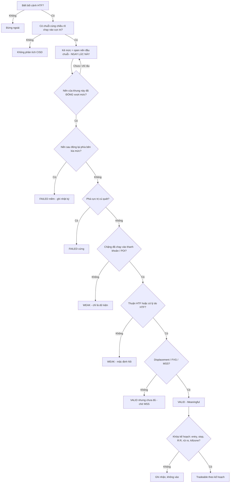

# Change in State of Delivery (CISD) · v2

> [!summary] Tóm tắt 1 câu
> **CISD là khoảnh khắc một cây nến ĐÓNG CỬA vượt qua giá MỞ CỬA của cây nến đầu tiên trong chuỗi nến ngược chiều vừa đưa giá tới cực trị — tức là toàn bộ “chặng” giá vừa rồi đã bị lấy lại, tính theo giá đóng cửa. Nó là bằng chứng SỚM rằng hướng giao giá ngắn hạn đã đổi; nó KHÔNG phải bằng chứng xu hướng đã đổi, cũng không phải lệnh vào.**

> [!important] Năm nguyên tắc cốt lõi của bản v2
> 1. **CISD đo DELIVERY, không đo STRUCTURE.** Nó trả lời “chặng gần nhất đã bị lấy lại chưa?”, không trả lời “cấu trúc/xu hướng đã đổi chưa?”.
> 2. **Chỉ giá đóng cửa được tính** — của đúng khung đang dùng. Râu vượt qua là “đã thử”, chưa phải “đã đổi”.
> 3. **Mức CISD phải được kẻ TRƯỚC khi biết kết quả**, theo một quy ước đếm chuỗi đã ghi sẵn. Dời mức sau khi thấy kết quả = hindsight.
> 4. **CISD rất phổ biến** — nó xuất hiện ở đầu mọi chặng giá, ở mọi khung. Cái hiếm là CISD **đúng chỗ** (sau sweep, tại POI, thuận bối cảnh HTF) **và có follow-through**.
> 5. **Chart không cho biết ai làm gì và vì sao.** Mọi câu “Smart Money đã đổi hướng” là diễn giải, không phải quan sát.

> [!abstract] Cách đọc note này — 5 nhãn dùng xuyên suốt
> | Nhãn trong note | Tương ứng protocol | Nghĩa |
> |---|---|---|
> | **[QUAN SÁT]** | Observable fact | Thấy trực tiếp trên chart OHLC, ai nhìn cũng thấy giống nhau |
> | **[ICT]** | ICT framework | Tên gọi và cách ICT (và người dạy ICT) dùng hiện tượng đó |
> | **[CƠ CHẾ]** | Market mechanics | Giải thích bằng cách lệnh được khớp: lệnh thị trường, lệnh chờ, lệnh dừng |
> | **[DIỄN GIẢI]** | Interpretation | Hợp lý, nhưng không thể xác nhận chỉ từ giá |
> | **[GIẢ THUYẾT]** / **[BACKTEST REQUIRED]** | Hypothesis | Phải kiểm chứng trên dữ liệu của chính bạn trước khi coi là lợi thế |
>
> Mỗi khái niệm khó đi theo 6 bước: **① Trực giác → ② Ví dụ đời thường → ③ Giá thực sự làm gì → ④ ICT gọi là gì → ⑤ Vì sao có thể xảy ra → ⑥ Dùng thế nào.**
> Toàn bộ hình `CISD-v2-*` là **sơ đồ dựng (synthetic)**: giá trong hình là ví dụ, không phải dữ liệu thị trường. Note này **hạn chế số học**: không công thức, không thống kê, không mô hình chấm điểm.

![[CISD-v2-01-ELI5-Chiec-Xe-Va-Vach-Phan.svg|960]]
*Hình CISD-v2-01 — Toàn bộ CISD trong một câu chuyện: chiếc xe (giá) lăn xuống dốc từ vạch phấn (open nến đầu chặng); bị đẩy ngược vượt vạch nhưng trôi lại trước tiếng chuông thì chưa tính; chuông reo khi xe đứng TRÊN vạch → trạng thái đã đổi.*

### Bản đồ trả lời: WHAT → WHY → HOW → MECHANISM → IDENTIFICATION → VALIDATION → APPLICATION → WHEN NOT

| Câu hỏi | Trả lời ở đâu |
|---|---|
| **WHAT** — Delivery là gì? CISD là gì? | §2, §3, §5 |
| **WHY** — vì sao lại đo bằng OPEN? CISD có ích gì? | §6, §7.2, §7.4 |
| **HOW** — hình thành từng bước ra sao? | §4, §7, §8, §9 |
| **MECHANISM** — khớp lệnh nói gì? | §3.5, §4.3, §7.5, §16 |
| **IDENTIFICATION** — chọn đúng nến tham chiếu, nhận ra trong real-time? | §10 (quan trọng nhất), §23 |
| **VALIDATION** — khi nào có ý nghĩa, khi nào thất bại? | §19, §24, §25 |
| **APPLICATION** — dùng trong D1 → H1 → M5? | §21, §26 |
| **WHEN NOT** — khi nào bỏ qua? | §18, §19, §22 |

> [!info] v1 → v2: thay đổi gì (theo quy ước versioning)
> | OLD (v1, 2026-07-28) | NEW (v2) | Lý do | Backtest? |
> |---|---|---|---|
> | “CISD chỉ hợp lệ sau sweep; CISD không sweep = pullback giả” | Sweep **không** nằm trong định nghĩa. CISD tồn tại cả khi không có sweep (vd. CISD tiếp diễn trong xu hướng). Sweep là **bối cảnh** làm CISD có ý nghĩa hơn | Trộn lẫn *định nghĩa* với *bộ lọc chất lượng*; mâu thuẫn với chính các nguồn mô tả CISD | Có — HYP-CISD-01 |
> | “CISD **luôn** in trước MSS” | **Thường** trước hoặc cùng nến, do hình học (open đầu chặng thường nằm dưới đỉnh swing). Có trường hợp MSS nội bộ đến trước, tùy cách đếm chuỗi và chọn swing (§11) | Đây là hệ quả của cách vẽ, không phải quy luật | Có |
> | “Open nến đầu chuỗi = dấu vân tay ý định thuật toán” | Hạ xuống **[DIỄN GIẢI]**. Điều quan sát được: open đầu chặng là **điểm xuất phát của chặng trong lưới thời gian của chart**; đóng vượt = cả chặng bị lấy lại (§7.2) | Không thể suy ra ý định từ OHLC; open còn phụ thuộc khung/múi giờ (Hình 24) | Không kiểm được bằng chart |
> | “1–2 nến doji/ngược màu nhỏ giữa chuỗi được bỏ qua” | Quy ước v2 mặc định: **chuỗi liền mạch** — nến đóng ngược chiều hoặc doji kết thúc chuỗi. Cách “gộp” vẫn được ghi nhận như một biến thể, nhưng phải khai báo trước (§10) | Quy tắc mơ hồ dễ dẫn tới chọn mức theo kết quả | Có — HYP-CISD-02 |
> | Các câu kiểu “kinh nghiệm live: average R cao hơn hẳn”, “macro window xác suất cao hơn hẳn”, “chuỗi > 7–8 nến là xấu” | Bỏ, hoặc chuyển thành **giả thuyết** | Không có dữ liệu kiểm chứng; vi phạm quy tắc không bịa thống kê | Có |
> | Phần chiếu Standard Deviation, scaling, quantification (A3, L) | Bỏ khỏi note này (bản v1 còn nguyên trong backup) | Yêu cầu: hạn chế số học, không công thức | — |
> | Nguồn gốc: “ICT nhấn mạnh trong mentorship 2024” | Ghi trung thực: CISD là thuật ngữ ICT dùng trong giai đoạn giảng dạy gần đây (cộng đồng tóm tắt từ khoảng 2024); **chưa xác minh được văn bản gốc nguyên văn**; quy tắc “open nến đầu chuỗi” là cách formal hóa phổ biến của người dạy (vd. TTrades) | Nguồn sơ cấp không truy cập được; không gán cho ICT điều chưa kiểm chứng | — |
>
> Bản v1 đầy đủ: `41-Change-in-State-of-Delivery.v1-2026-11-07.md.bak` (cùng thư mục). Các hình v1 vẫn còn trong `attachments/` (xem cuối note).

---

## 1. Executive Summary

- **Delivery là gì.** [ICT] “Price delivery” là cách ICT gọi *đường đi* của giá từ vùng này sang vùng khác (xem [[60-IPDA-Tai-sao-gia-di-chuyen-Tu-Price-Discovery-den-Price-Delivery]] §12). [QUAN SÁT] Trên chart nến, “trạng thái delivery” ngắn hạn hiện ra rõ nhất qua **chuỗi nến đóng cùng chiều**: nhiều nến liền nhau cùng đóng giảm = giá đang được “chở” xuống.
- **CISD là gì.** [ICT] Bullish CISD: một nến **đóng cửa trên giá mở cửa** của (chuỗi) nến đóng giảm đã đưa giá vào đáy. Bearish CISD: một nến **đóng cửa dưới giá mở cửa** của (chuỗi) nến đóng tăng đã đưa giá lên đỉnh. Quy ước v2: lấy open của **nến đầu tiên** trong chuỗi liền mạch chạy vào cực trị.
- **Vì sao là open.** [QUAN SÁT] Open của nến đầu chuỗi là **vạch xuất phát** của cả chặng. Đóng cửa vượt qua nó nghĩa là **mọi bước** của chặng đã bị đi ngược lại, tính theo giá chốt sổ. Mốc này **gần hơn** đỉnh/đáy swing (nên sớm hơn MSS) nhưng **có ý nghĩa hơn** đáy/close của nến cuối (nên ít nhiễu hơn).
- **CISD cho biết gì.** Chặng gần nhất đã bị lấy lại; có một mức giá cụ thể để biết khi nào mình sai. **Không cho biết:** ai làm, giá sẽ đi bao xa, cấu trúc hay xu hướng đã đổi chưa, lệnh có lợi thế hay không.
- **CISD khác MSS.** CISD đo bằng **open của chuỗi nến**; MSS đo bằng **swing có ý nghĩa cấu trúc**. CISD thường đến trước hoặc cùng lúc, nhưng không phải luôn luôn (§11).
- **Khi nào CISD có ý nghĩa.** Khi chặng bị lấy lại là chặng **quan trọng**: chạy vào thanh khoản / POI, trên khung phù hợp, thuận hoặc có lý do so với bối cảnh HTF, và sau đó có **follow-through** (giữ được mức, displacement, MSS). CISD giữa range, ngược bias không lý do, hoặc chỉ có râu = gần như không có thông tin.
- **Thất bại.** **Mềm**: một nến sau đó đóng lại phía bên kia mức CISD. **Cứng**: giá phá cực trị của chặng cũ (đáy/đỉnh cú quét) — chặng cũ đã tiếp diễn.
- **Trong khung D1 → H1 → M5 của bạn.** CISD M5 là **cảnh báo sớm / công cụ đọc phản ứng** sau sweep tại vùng H1 — **không thay thế MSS** trong trình tự sweep → MSS → FVG → entry. “Vào lệnh ngay tại CISD” là một biến thể cần backtest riêng (HYP-CISD-03).

---

## 2. Mental Model of Price Delivery — chuyện chiếc xe, vạch phấn và tiếng chuông

> [!tip] Đọc phần này trước mọi thứ khác
> Nếu chỉ nhớ được một hình ảnh, hãy nhớ hình ảnh này. Mọi phần sau chỉ là cách nói chính xác hơn của cùng câu chuyện.

### 2.1 Câu chuyện (cho trẻ 5 tuổi)

Có một **chiếc xe đồ chơi** đặt trên một con dốc. **Độ cao của chiếc xe** chính là giá: xe càng ở cao, giá càng cao.

- Một bạn bắt đầu **đẩy xe xuống dốc**. Ngay chỗ xe bắt đầu lăn, ta lấy phấn **vạch một đường**. Đó là **vạch phấn**.
- Xe lăn xuống đều đều: hết đoạn này tới đoạn khác. Đó là một **chặng đi xuống**.
- Cứ mỗi phút, **chuông reo** một lần. Ta chỉ được ghi vào sổ **vị trí của xe đúng lúc chuông reo**.
- Xe lăn tới **hàng rào cuối dốc**, lố qua một chút rồi dừng.
- Một bạn khác bắt đầu **đẩy xe ngược lên**. Có lúc xe vượt qua vạch phấn — nhưng trôi xuống lại **trước khi chuông reo**. Trong sổ, xe vẫn ở dưới vạch. **Chưa tính.**
- Rồi chuông reo đúng lúc xe đang **đứng trên vạch phấn**. Ghi vào sổ: xe đã lên lại **cao hơn chỗ nó bắt đầu lăn xuống**. Cả đoạn lăn xuống vừa rồi đã bị **đẩy ngược hết**.

Đó là CISD. **Trạng thái** của chiếc xe đã đổi: từ “đang bị đẩy xuống” sang “đang bị đẩy lên”.

### 2.2 Ghép câu chuyện với ngôn ngữ chart

| Trong câu chuyện | Trên chart | Ghi chú |
|---|---|---|
| Chiếc xe | Giá | |
| Một đoạn xe lăn đều về một phía | Một **chặng delivery** = chuỗi nến đóng cùng chiều liền nhau | §3–§4 |
| Vạch phấn | **Giá mở cửa (open)** của nến **đầu tiên** trong chặng | §7.2, §10 |
| Tiếng chuông | **Giá đóng cửa (close)** của mỗi cây nến | §4.1 |
| Lố qua hàng rào | **Quét thanh khoản (liquidity sweep)** | §14, §16 |
| Vượt vạch rồi trôi lại trước chuông | **Râu nến** vượt mức — không phải CISD | §7.3 |
| Chuông reo khi xe trên vạch | **CISD** | §5 |
| Xe sau đó lại tụt xuống dưới vạch | **CISD thất bại** | §8.4 |

### 2.3 Câu chuyện giúp trả lời gì — và giới hạn của nó

- **Vì sao chỉ tính lúc chuông reo?** Vì cái ta ghi vào sổ (chart nến) chỉ giữ giá đóng cửa làm “con số chốt”. Xe từng vượt vạch rồi trôi lại là có thật — nhưng nó không ở đó khi sổ được ghi.
- **Vì sao vạch phấn ở chỗ xe BẮT ĐẦU lăn?** Vì ta muốn biết **cả đoạn** lăn xuống đã bị đẩy ngược hết chưa — không chỉ đoạn cuối.
- **Giới hạn của ẩn dụ** — rất quan trọng:
  1. Trên thị trường **không có “một bạn đẩy xe”**. Mỗi giao dịch luôn có **một người mua và một người bán**. Giá đi lên khi phía mua **vội hơn** (chấp nhận trả giá cao hơn), không phải vì “có nhiều người mua hơn người bán”.
  2. Ta **không biết ai** đang đẩy, cũng **không biết vì sao**. Chart chỉ cho thấy vị trí của xe.
  3. Chiếc xe thật **không có quán tính bắt buộc**: đẩy ngược qua vạch không đảm bảo xe sẽ tiếp tục đi lên.
  4. Vạch phấn là **do ta vẽ** theo lịch chuông (khung thời gian). Đổi lịch chuông thì vạch đổi (§10.6).

![[CISD-v2-02-Moi-Tieng-Chuong-La-Mot-Cay-Nen.svg|960]]
*Hình CISD-v2-02 — Giá thật đi một đường ngoằn ngoèo. Giữa hai tiếng chuông, cây nến chỉ giữ 4 điểm: open, high, low, close. CISD được xét bằng close.*

---

## 3. What Is Price Delivery?

### 3.1 ① Trực giác

Price delivery là **giá đang được “chở” đi đâu, và chở như thế nào**. Có lúc giá đi lên đều, có lúc đi xuống đều, có lúc lắc qua lắc lại. “Trạng thái delivery” là câu trả lời ngắn cho câu hỏi: **“ngay lúc này, chặng giá gần nhất đang đi về phía nào?”**

### 3.2 ② Ví dụ đời thường

Một chiếc xe buýt chạy từ trạm A tới trạm D. Hành trình (đi qua trạm nào, nhanh hay chậm ở đoạn nào) là **delivery**. Trong hành trình có những đoạn xe chạy thẳng một hướng — mỗi đoạn như thế là một **chặng**. Khi xe quay đầu chạy ngược lại qua chỗ nó bắt đầu chặng trước, “trạng thái” của hành trình đã đổi. (Ẩn dụ này khớp với hình “chiếc xe đi qua các trạm” trong note IPDA §12.)

### 3.3 ③ Giá thực sự làm gì trên chart

[QUAN SÁT] Nhìn một chuỗi nến:
- Nhiều nến **đóng giảm liền nhau** (close thấp hơn open), mỗi nến mở cửa gần chỗ nến trước đóng cửa → các thân nến **nối vào nhau như bậc thang đi xuống**.
- Đến một lúc, xuất hiện nến **đóng tăng** → bậc thang đi xuống bị cắt.

![[CISD-v2-03-Chuoi-Nen-Cung-Chieu-La-Mot-Chang.svg|960]]
*Hình CISD-v2-03 — Chặng lên (#3–#5) rồi chặng xuống (#6–#9). Mỗi chặng có một “vạch xuất phát” = open của nến đầu tiên.*

### 3.4 ④ ICT gọi là gì

[ICT] ICT dùng ngôn ngữ “delivery” cho đường đi của giá: giá được *delivered* lên hoặc xuống, *delivered to* một vùng thanh khoản, “buy-side delivery / sell-side delivery”. Trong ICT, giá được cho là đi để làm một trong hai việc: **(I) tìm tới thanh khoản** (đỉnh/đáy nơi có lệnh chờ), **(II) cân bằng lại vùng đi quá nhanh** (FVG, imbalance). “State of delivery” = **trạng thái** hiện tại của đường đi đó: đang giao lên hay giao xuống. Xem [[60-IPDA-Tai-sao-gia-di-chuyen-Tu-Price-Discovery-den-Price-Delivery]].

### 3.5 ⑤ Vì sao có thể xảy ra — cơ chế

[CƠ CHẾ] Giá chỉ thay đổi khi **giao dịch tiếp theo xảy ra ở một mức khác**. Một chặng giảm kéo dài nghĩa là: trong nhiều khoảng thời gian liên tiếp, phía **bán vội hơn** — họ chấp nhận bán vào các lệnh mua đang chờ, hết mức này tới mức thấp hơn; hoặc người chờ mua **rút lệnh** khiến giá rơi dễ hơn. Chuỗi nến đỏ là **dấu vết** của sự mất cân bằng đó, không phải bản thân sự mất cân bằng.

[DIỄN GIẢI] ICT gắn đường đi này với một “thuật toán giao giá” (IPDA). Đây là **mô hình khái niệm** của framework; chart không chứng minh có hay không có một thuật toán như vậy (note IPDA §15–§16 phân tích kỹ).

### 3.6 ⑥ Dùng thế nào — Delivery khác Structure khác Trend

| | Delivery | Market Structure | Trend |
|---|---|---|---|
| **Nhìn vào** | Chuỗi nến đóng cùng chiều; open/close | Swing high/low có ý nghĩa: HH, HL, LH, LL | Bức tranh lớn qua nhiều swing |
| **Đổi khi** | Một chuỗi bị lấy lại bằng giá đóng cửa (CISD) | Một swing quan trọng bị đóng vượt ngược chiều (MSS/CHoCH) | Nhiều thay đổi cấu trúc tích lũy |
| **Tần suất đổi** | **Rất thường xuyên** | Ít hơn | Hiếm |
| **Câu hỏi** | “Chặng gần nhất đi về đâu? Đã bị lấy lại chưa?” | “Cấu trúc đang tăng hay giảm?” | “Bức tranh lớn đang đi về đâu?” |

![[CISD-v2-04-Ba-Lang-Kinh-Delivery-Structure-Trend.svg|960]]
*Hình CISD-v2-04 — Cùng một đoạn giá: delivery đổi trạng thái nhiều lần; cấu trúc vẫn HH–HL suốt đoạn; trend vẫn tăng. Ba thứ khác nhau.*

**Price delivery có phải là hướng di chuyển của giá không?** Gần như vậy, nhưng chính xác hơn: delivery là **hướng của chặng gần nhất** cộng với **cách** giá đi (đều, nhanh, có để lại FVG hay không). Delivery là khái niệm **ngắn hạn và cục bộ**; trend là khái niệm **dài hạn và tổng thể**.

**Vì sao chỉ nhìn HH/HL có thể chưa đủ?** Vì HH/HL chỉ cập nhật khi một **swing** bị phá — thường muộn. Delivery cho thấy **sớm hơn** rằng nhịp gần nhất đã bị đảo, trước khi có swing nào bị phá. Đổi lại, nó nhiễu hơn nhiều.

**Delivery đổi có đồng nghĩa với trend reversal?** **Không.** Hình dưới là ví dụ điển hình: delivery đổi hai lần trong một nhịp hồi, cấu trúc không đổi.

![[CISD-v2-05-Delivery-Doi-Nhung-Cau-Truc-Chua-Doi.svg|960]]
*Hình CISD-v2-05 — Bearish CISD ở #11 (delivery ngắn hạn đổi sang xuống) nhưng HL không bị phá; bullish CISD ở #14 đưa giá đi tiếp. Cấu trúc tăng còn nguyên.*

---

## 4. How Price Delivery Works

### 4.1 Bốn con số của một cây nến — và vai trò của từng con số

| Con số | Là gì (đơn giản) | Vai trò với delivery / CISD |
|---|---|---|
| **Open** | Giá lúc chuông trước vừa reo — chỗ cây nến bắt đầu | Open của nến **đầu chặng** = vạch xuất phát của chặng = **mức CISD** |
| **Close** | Giá lúc chuông này reo — con số “chốt sổ” | Là thứ **được kiểm tra** khi hỏi “đã có CISD chưa?” |
| **High / Low** | Chỗ xa nhất giá đã chạm trong khoảng đó | Cho biết giá **đã thử** tới đâu (sweep, râu từ chối). **Không** dùng để xác nhận CISD |
| **Body (thân)** | Khoảng từ open tới close | Cho biết **giá đã dịch đi bao xa** trong khoảng thời gian đó, tính từ đầu tới lúc chốt |

### 4.2 Một chặng delivery hình thành thế nào

1. **Nến đầu tiên đóng theo một hướng** (vd. đóng giảm). Open của nó là vạch xuất phát.
2. **Nến tiếp theo mở gần chỗ nến trước đóng** và lại đóng cùng hướng → bậc thang nối dài.
3. Chặng **tiếp tục** chừng nào các nến còn đóng cùng hướng.
4. Chặng **kết thúc** khi có một nến đóng ngược hướng (hoặc doji — theo quy ước v2).

> [!note] Bullish delivery vs Bearish delivery
> - **Bearish delivery**: chuỗi nến **đóng giảm** liền nhau; vạch xuất phát là open của nến đỏ đầu tiên (nằm ở **trên** cùng của chặng).
> - **Bullish delivery**: chuỗi nến **đóng tăng** liền nhau; vạch xuất phát là open của nến xanh đầu tiên (nằm ở **dưới** cùng của chặng).

### 4.3 Vì sao giá có thể tiếp tục delivery cùng hướng — và vì sao dừng

[CƠ CHẾ] Một chặng giảm đi tiếp khi phía bán **vẫn vội** và phía dưới **ít lệnh mua chờ** — một lượng bán vừa phải cũng “ăn” hết mức này sang mức khác. Chặng dừng khi:
- phía bán **hết vội** (người cần bán đã bán xong), hoặc
- giá gặp vùng có **nhiều lệnh mua chờ** — lệnh bán bị “hấp thụ”, hoặc
- người đã bán khống **chốt lời** — mà chốt lời bán khống nghĩa là **mua vào**.

Nghiên cứu về lệnh trên thị trường ngoại hối của Osler (Federal Reserve Bank of New York) mô tả hai hiệu ứng đối nghịch: lệnh **chốt lời** hay tụ ở các mức tròn và gắn với chỗ giá **dừng/đảo**; lệnh **dừng lỗ** hay tụ ngay **bên ngoài** các mức đó và có xu hướng làm giá **chạy tiếp mạnh hơn** khi bị kích hoạt (“price cascade”). Ý nghĩa cho CISD: **một cú quét đáy có thể dẫn tới đảo chiều hoặc dẫn tới rơi tiếp** — cơ chế cho phép cả hai. CISD là cách ta **chờ xem** cái nào đang xảy ra.

![[CISD-v2-06-Vi-Sao-Chang-Giam-Di-Tiep-Hay-Dung.svg|960]]
*Hình CISD-v2-06 — Cùng một lượng bán vội: phía dưới ít lệnh chờ → giá rơi xa; gặp vùng nhiều lệnh chờ → giá dừng. Lưu ý: chart OHLC không cho thấy sổ lệnh; đây là cách giải thích, không phải quan sát.*

### 4.4 Điều gì khiến delivery thay đổi

[QUAN SÁT] Delivery “đổi” khi chặng cũ **bị lấy lại**. Có nhiều mức độ:
- Một nến xanh xuất hiện → chặng đỏ **kết thúc** (chưa chắc bị lấy lại).
- Nến xanh đóng trên **close nến đỏ cuối** → mới lấy lại **một nến**.
- Nến xanh đóng trên **open nến đỏ đầu** → lấy lại **cả chặng** → **CISD**.
- Giá đóng vượt **đỉnh swing** trước chặng → cấu trúc đổi → **MSS**.

CISD chọn mức thứ ba — đủ ý nghĩa, vẫn còn sớm. §7.2 giải thích kỹ vì sao.

---

## 5. What Is CISD?

![[CISD-v2-07-CISD-Qua-5-Cap-Do.svg|960]]
*Hình CISD-v2-07 — Cùng một hiện tượng, đọc ở 5 tầng. Tầng 1–2 ai cũng thấy giống nhau; tầng 3 là định nghĩa ICT; tầng 4–5 là diễn giải và cách dùng — có thể sai.*

### Level 1 — Beginner (trẻ 5 tuổi)

> Giá vừa đi xuống một đoạn. Rồi giá quay lên và **“chốt sổ” ở trên chỗ đoạn đi xuống bắt đầu**. Cả đoạn đi xuống đã bị xóa.

### Level 2 — Price Action

[QUAN SÁT] Có một **chuỗi nến đóng giảm liên tiếp**. Sau đó một cây nến **đóng cửa cao hơn giá mở cửa của nến đầu tiên** trong chuỗi đó. (Bearish: chuỗi nến đóng tăng, rồi một nến đóng cửa thấp hơn open của nến đầu tiên.)

### Level 3 — ICT Framework

[ICT] Theo cách ICT và những người dạy ICT mô tả:
- **Bullish CISD**: giá **đóng cửa trên opening price** của (chuỗi) nến **đóng giảm** đã đưa giá vào đáy — thường là đáy vừa quét sell-side liquidity.
- **Bearish CISD**: giá **đóng cửa dưới opening price** của (chuỗi) nến **đóng tăng** đã đưa giá lên đỉnh — thường là đỉnh vừa quét buy-side liquidity.
- Tóm tắt phổ biến trong cộng đồng (2024) về cách ICT giải thích: *bullish CISD = close above the opening price of a down-closed candle; bearish CISD = close below the opening price of an up-closed candle; CISD xuất hiện ở điểm khởi đầu của mọi đợt chạy giá.*
- Cách formal hóa phổ biến nhất (TTrades, LuxAlgo, nhiều tài liệu khác): **mức tham chiếu = open của nến ĐẦU TIÊN trong chuỗi** đã chạy vào cực trị. Một số tài liệu dùng open của nến **gần nhất** — đó là biến thể (§10.3).
- ICT dùng CISD như một dấu hiệu rằng **“trạng thái giao giá” đã chuyển** — từ sell-side sang buy-side hoặc ngược lại — và hay đặt nó **sau một cú quét thanh khoản, tại một PD array khung lớn**.

> [!warning] Về nguồn gốc
> Note này **chưa xác minh được một văn bản ICT gốc nguyên văn** định nghĩa CISD bằng “open của nến đầu chuỗi”. Thông tin trên đến từ người dạy và tài liệu cộng đồng mô tả lại ICT. Vì vậy định nghĩa dùng trong note là **định nghĩa vận hành v0.2 của vault** — rõ ràng, nhất quán, có thể kiểm chứng — chứ không phải “lời ICT”.

### Level 4 — Market Interpretation

[DIỄN GIẢI] Một cách đọc hợp lý: phía đang vội (người bán trong chặng xuống) **không còn kiểm soát** ít nhất trong khoảng thời gian đó — phía bên kia đủ mạnh để đưa giá **về lại điểm xuất phát của cả chặng** và giữ được tới lúc nến đóng. Điều ta **không** biết: ai đã làm điều đó, họ có định tiếp tục không, đó là người mua mới hay chỉ là người bán khống chốt lời.

### Level 5 — Practical Meaning

CISD là **bằng chứng sớm** rằng chặng cũ đã bị lấy lại, kèm **một mức giá cụ thể** để theo dõi. Trong thực hành: nó giúp **(a)** biết phản ứng sau sweep có “thật” không, **(b)** chuẩn bị kế hoạch trước khi MSS xác nhận, **(c)** có chỗ để biết mình sai (giá đóng lại phía bên kia mức).

### 5.6 Trả lời các câu hỏi then chốt

| Câu hỏi | Trả lời ngắn | Giải thích |
|---|---|---|
| CISD có nghĩa là delivery cũ đã **kết thúc**? | **Có — ở khung đó, tại thời điểm đó.** | Chặng cũ đã bị lấy lại hết theo giá đóng cửa. Nhưng “kết thúc” không có nghĩa “không quay lại”: giá có thể lại đóng phía bên kia mức (thất bại mềm). |
| CISD có nghĩa là delivery **mới** đã bắt đầu? | **Đã có dấu hiệu bắt đầu, chưa được chứng minh.** | Nến CISD chính là nến đầu của chặng mới. Chặng mới có “thật” không phụ thuộc follow-through (§7.3). |
| CISD **xác nhận** sự thay đổi hay chỉ là **dấu hiệu ban đầu**? | **Xác nhận ở tầng delivery; chỉ là dấu hiệu ban đầu ở tầng structure/trend.** | Đây là điểm hay bị nhầm nhất. |
| CISD có cần **displacement**? | **Không** (theo định nghĩa). | CISD có displacement mạnh hơn nhiều về bằng chứng (§13). |
| CISD có thể xuất hiện **không có MSS**? | **Có.** | Delivery đổi mà swing chưa bị phá (Case D, §26). |
| CISD có thể nằm **trong một xu hướng lớn** mà không đổi xu hướng đó? | **Có — rất thường xuyên.** | Mọi nhịp hồi trong xu hướng đều kết thúc bằng một CISD thuận xu hướng; mọi nhịp hồi cũng bắt đầu bằng một CISD ngược xu hướng nhỏ. |

> [!important] Change in State of Delivery ≠ Change in Trend
> CISD nói về **chặng gần nhất trên một khung cụ thể**. Trend nói về **bức tranh lớn**. Ngoại lệ duy nhất mà hai thứ trùng nhau: khi chặng bị lấy lại **chính là chặng cuối cùng của cả xu hướng lớn** — điều mà chỉ biết được khi nhìn lại, hoặc khi CISD xảy ra **ở khung lớn**, tại **vùng thanh khoản/POI lớn**, và sau đó được cấu trúc khung lớn xác nhận.

![[CISD-v2-08-CISD-Khong-Phai-Doi-Xu-Huong.svg|960]]
*Hình CISD-v2-08 — Bearish CISD M5 nằm trong một nhịp giảm H1, nhịp giảm H1 nằm trong xu hướng tăng D1. CISD M5 chỉ nói về chặng M5.*

---

## 6. Why Does CISD Matter?

### 6.1 Ba bài toán CISD giải quyết

1. **Bài toán “phản ứng có thật không?”** Sau một cú quét, giá luôn nảy một chút. Nảy bao nhiêu thì đáng chú ý? CISD đưa ra một câu hỏi có/không rõ ràng: *“phản ứng đã lấy lại cả chặng vừa đưa giá vào đây chưa?”*
2. **Bài toán “sớm nhưng có cơ sở”.** MSS chắc hơn nhưng thường muộn — điểm vào kém và stop xa. CISD là mốc **sớm nhất mà vẫn có một ý nghĩa rõ ràng**.
3. **Bài toán “biết khi nào mình sai”.** CISD tạo ra một mức giá cụ thể. Giá đóng lại phía bên kia mức → điều CISD nói không còn đúng.

### 6.2 CISD cho biết gì — và không cho biết gì

![[CISD-v2-09-CISD-Cho-Biet-Gi-Khong-Cho-Biet-Gi.svg|960]]
*Hình CISD-v2-09 — Bên trái là những gì quan sát được; bên phải là những gì thường bị suy diễn quá mức.*

### 6.3 CISD **không** quý hiếm

Hãy để ý: mọi đợt chạy giá, dù nhỏ đến đâu, đều **bắt đầu** bằng việc lấy lại chặng ngược chiều trước nó. Nghĩa là CISD xuất hiện **ở đầu mọi chặng**, trên **mọi khung**. Một CISD M1 có thể xuất hiện hàng chục lần trong một phiên.

Hệ quả: **giá trị của CISD không nằm ở việc nó xuất hiện**, mà ở chỗ nó xuất hiện **ở đâu** (sau sweep? tại POI? ở mép range hay giữa range?), **trên khung nào**, **thuận hay ngược bối cảnh**, và **có follow-through hay không**. Phần lớn note này (§16–§21) là về những câu hỏi đó.

---

## 7. The Core Mechanism of CISD

Chuỗi đầy đủ: **Delivery cũ → Dấu hiệu thay đổi → CISD → Delivery mới (nếu được chứng minh).**

![[CISD-v2-10-Ba-Giai-Doan-Truoc-Trong-Sau.svg|960]]
*Hình CISD-v2-10 — Ba giai đoạn trên cùng một chart: TRƯỚC (chặng cũ, sweep), TRONG (lần thử, nến CISD), SAU (follow-through: giữ mức, FVG, MSS).*

### 7.1 Before CISD — trước khi CISD xuất hiện

- **Giá đang delivery theo hướng nào?** Trong ví dụ: xuống. Chuỗi #6–#9 đóng giảm liền nhau.
- **Những nến nào thể hiện trạng thái hiện tại?** Chính chuỗi #6–#9 — chặng đã đưa giá vào đáy.
- **Những open nào có ý nghĩa?** Chỉ open của **nến đầu chuỗi** (#6) là vạch xuất phát của chặng. Open của #7, #8, #9 nằm *giữa* chặng.
- **Vì sao một số open trở thành mốc tham chiếu?** Vì chúng là **ranh giới** giữa hai trạng thái: trước open #6 giá đang ở chặng lên (#3–#5), từ open #6 giá bắt đầu chặng xuống. Open #6 là chỗ “trạng thái xuống” bắt đầu.
- **Điều gì đang xảy ra với price action?** Nến #9 thọc xuống dưới đáy cũ #2 (nơi có SSL) rồi đóng lại phía trên — một cú **sweep**. Đây là lúc **kẻ mức CISD**, khi chưa biết gì về tương lai.

### 7.2 During CISD — vì sao lại là OPEN?

Đây là câu hỏi quan trọng nhất của toàn bộ note. Trả lời theo 6 bước.

**① Trực giác.** Muốn biết “cả đoạn đi xuống đã bị xóa chưa”, ta phải so với **chỗ đoạn đó bắt đầu**, không phải chỗ nó kết thúc.

**② Ví dụ đời thường.** Bạn đi xuống 4 bậc cầu thang. Hỏi “bạn đã leo lại hết chưa?” thì phải so với **bậc đầu tiên bạn bước xuống**, không phải bậc cuối cùng. Leo qua bậc cuối thì ai cũng làm được ngay.

**③ Giá thực sự làm gì.** [QUAN SÁT] Trong một chuỗi nến đóng giảm liền nhau, nến đầu tiên mở cửa ở **trên cùng** của chặng (mỗi nến sau mở thấp hơn). Vậy open nến đầu = **điểm cao nhất của phần thân** cả chặng. Nến đóng cửa trên mức đó nghĩa là **mọi phần thân** của chặng đã nằm dưới giá chốt sổ hiện tại.

![[CISD-v2-11-Vi-Sao-La-Open-Bon-Moc-Ung-Vien.svg|960]]
*Hình CISD-v2-11 — Bốn mốc có thể chọn: A đáy chặng (quá dễ vượt), B close nến cuối (quá gần), C open nến đầu chặng (CISD: vừa đủ ý nghĩa, vẫn sớm), D đỉnh swing (MSS: chắc hơn, muộn hơn).*

| Mốc | Vượt mốc nghĩa là gì | Ưu | Nhược |
|---|---|---|---|
| A · Low của chặng | Giá nảy khỏi đáy | Sớm nhất | Mọi cú nảy đều làm được → không có thông tin |
| B · Close nến cuối | Lấy lại một nến | Rất sớm | Rất nhiễu |
| **C · Open nến đầu (CISD)** | **Lấy lại cả chặng** | **Sớm, có ý nghĩa rõ** | **Vẫn có thể thất bại** |
| D · High swing (MSS) | Cấu trúc đổi | Nhiều bằng chứng hơn | Thường muộn, điểm vào kém |

**④ ICT gọi là gì.** [ICT] Change in State of Delivery. Nhiều người dạy ICT nói thêm: chuỗi nến bị lấy lại đó chính là **Order Block**; CISD là lúc OB “được xác nhận” (§10.7).

**⑤ Vì sao có thể có ý nghĩa.** [CƠ CHẾ + DIỄN GIẢI] Trong khoảng thời gian của nến CISD, phía mua đã đủ vội để đưa giá vượt **toàn bộ** vùng giá mà phía bán đã đẩy xuống trong chặng — và **giữ được** tới lúc chốt. Những người đã bán trong chặng đó (ở các mức thấp hơn open đầu) hiện đều **đang lỗ trên giấy** tại giá đóng cửa. Họ có thể mua lại để thoát — thêm lực mua. Đây là một **câu chuyện hợp lý**, không phải điều chart chứng minh.

**⑥ Dùng thế nào.** Kẻ đường ngang tại open nến đầu chặng ngay khi cực trị xuất hiện; đặt cảnh báo; chỉ hỏi một câu có/không khi nến đóng.

> [!warning] Giới hạn trung thực của “open”
> Open là **sản phẩm của lưới thời gian**: nó phụ thuộc khung (M5 hay H1), múi giờ hiển thị, giờ server của broker, giờ mở phiên. Đổi lưới → đổi nến → đổi open → đổi mức CISD (Hình 24). Vì vậy open **không phải** “dấu vân tay” của một người tham gia nào. Giá trị của nó là một cách **tóm tắt gọn và nhất quán** cho câu hỏi “chặng đã bị lấy lại hết chưa”.

![[CISD-v2-12-Dong-Tren-Vach-Xuat-Phat-Xoa-Sach-Chang.svg|960]]
*Hình CISD-v2-12 — So độ dài bằng mắt: thanh đỏ là cả chặng xuống; nến #10 chỉ lấy lại một phần; nến #11 lấy lại hết (đóng trên vạch xuất phát).*

### 7.3 Body, Open, Close — mỗi thứ đóng vai gì

- **Vai trò của open:** định nghĩa **vạch xuất phát** (mức CISD).
- **Vai trò của close:** là con số **duy nhất** được dùng để xác nhận. Không đóng vượt = chưa có CISD, dù giá đã chạm tới đâu.
- **Vai trò của body:** thân nến CISD cho biết **lực** của lần lấy lại. Thân lớn, đóng gần đỉnh, ít râu trên → mạnh (thường kèm displacement/FVG). Thân nhỏ, đóng sát mức → hợp lệ nhưng yếu.
- **Vai trò của wick:** râu vượt mức rồi đóng lại dưới = giá **đã thử và bị từ chối**. Đó là thông tin — nhưng là thông tin **ngược** với CISD.

![[CISD-v2-13-Rau-Vuot-Hay-Than-Dong-Vuot.svg|960]]
*Hình CISD-v2-13 — A: râu vượt, đóng dưới → chưa. B: đóng đúng bằng mức → quy ước v2: chưa. C: đóng vượt hẳn → CISD.*

### 7.4 After CISD — điều gì cần xảy ra tiếp theo

CISD mở ra **giai đoạn chứng minh**. Không có điều kiện nào dưới đây là *định nghĩa* của CISD, nhưng chúng quyết định CISD có **follow-through** hay không:

| Câu hỏi sau CISD | Có → | Không → |
|---|---|---|
| Có nến nào **đóng lại** phía bên kia mức CISD không? | **Thất bại mềm** — điều CISD nói không còn đúng | Tốt: chặng mới đang giữ được |
| Giá có **phá cực trị** của chặng cũ (đáy cú quét) không? | **Thất bại cứng** — chặng cũ tiếp diễn | Tốt |
| Nến CISD hoặc nến kế có **displacement** / để lại **FVG** không? | Bằng chứng lực mạnh | CISD yếu, dễ bị lấy lại |
| Giá có **đóng vượt swing** quan trọng (MSS) không? | Cấu trúc theo sau delivery | Delivery đổi, cấu trúc chưa (Case D) |
| Giá có **đi về phía thanh khoản đối diện** không? | Chặng mới đang làm “việc của nó” | Chưa có hướng rõ |

**Khi nào CISD được xem là có follow-through?** Khi giá **không đóng lại** phía bên kia mức, **tạo thêm bước** theo hướng mới (lý tưởng: MSS), và **di chuyển về phía thanh khoản** đối diện. Không có con số cố định nào cho “bao lâu” hay “bao xa” — đó là thứ phải quan sát trong nhật ký của bạn [BACKTEST REQUIRED].

**Điều gì phân biệt một CISD có ý nghĩa với “giá chỉ đơn giản vượt qua một open”?** Ba thứ: **(1) chặng bị lấy lại có quan trọng không** (chạy vào thanh khoản/POI hay chỉ là dao động giữa range), **(2) cách lấy lại** (displacement hay bò lên), **(3) điều xảy ra sau đó** (giữ mức hay đóng lại ngay).

### 7.5 The actual meaning — điều CISD thực sự cho ta biết

> [!summary] CISD cho ta biết điều gì mà trước đó ta chưa biết?
> **Trước CISD**, ta chỉ biết: có một chặng đi xuống, giá đã chạm (có thể quét) một đáy, và có một phản ứng nào đó.
> **Sau CISD**, ta biết thêm: phản ứng đó **đủ để lấy lại toàn bộ chặng** — tính theo giá chốt sổ của khung đang dùng. Ta có thêm **một mức giá** mà nếu giá đóng lại phía bên kia, ta biết điều này không còn đúng.

> [!danger] CISD KHÔNG thể cung cấp
> - Danh tính hay ý định của người mua/bán (“Smart Money”, “tổ chức”, “thuật toán”).
> - Giá sẽ đi tiếp hay không, đi bao xa, đi tới đâu.
> - Rằng cấu trúc hoặc xu hướng đã đổi.
> - Rằng lệnh vào tại đây có kỳ vọng dương.
> - Điều gì về **khung lớn hơn** khi nến của khung lớn hơn còn chưa đóng.

![[CISD-v2-14-CISD-Chi-Co-Khi-Nen-Cua-Khung-Do-Dong.svg|960]]
*Hình CISD-v2-14 — M5 đã CISD trong khi nến H1 vẫn đang chạy. Trên H1 chưa có gì được xác nhận. “Đã có CISD chưa?” luôn phải kèm “trên khung nào?”.*

---

## 8. Bullish CISD

### 8.1 Formation — bối cảnh hình thành

- **Bối cảnh thường gặp:** giá đang có **bearish delivery** (chuỗi nến đóng giảm) chạy vào một vùng **dưới**: đáy cũ (SSL), equal lows, một PD array khung lớn (FVG/OB khung lớn), vùng discount của dealing range.
- **Reference:** open của nến đỏ **đầu tiên** trong chuỗi đỏ liền mạch cuối cùng chạy vào đáy.
- **Giá cần làm gì:** một nến (thường là xanh) **đóng cửa trên** mức đó.
- **Điều gì thay đổi:** toàn bộ chặng bearish vừa rồi đã bị lấy lại; delivery ngắn hạn chuyển sang bullish.

### 8.2 Price sequence — ví dụ OHLC từng bước

Dữ liệu minh họa (dùng xuyên suốt note; giá là ví dụ):

| Nến | Open | High | Low | Close | Chuyện gì xảy ra |
|---|---|---|---|---|---|
| #2 | 102.6 | 103.0 | **100.0** | 100.6 | Đáy cũ → **SSL** ở dưới |
| #5 | 104.7 | **107.4** | 104.3 | 106.6 | Đỉnh swing (mức MSS sau này) |
| #6 | **106.6** | 106.9 | 104.8 | 105.1 | **Nến đỏ đầu chặng → mức CISD = 106.6** |
| #7 | 105.1 | 105.4 | 102.9 | 103.2 | Đỏ, nối bậc thang |
| #8 | 103.2 | 103.5 | 101.0 | 101.3 | Đỏ |
| #9 | 101.3 | 101.5 | **98.8** | 100.4 | Đỏ, thọc dưới 100 rồi đóng lại trên → **sweep** |
| #10 | 100.4 | 103.6 | 100.1 | 103.4 | Xanh mạnh nhưng **đóng dưới 106.6** → chưa |
| #11 | 103.4 | 107.3 | 103.1 | **107.0** | **Đóng trên 106.6 → Bullish CISD** |
| #12 | 107.0 | 107.2 | 105.6 | 106.8 | Hồi bằng râu vào FVG, **đóng vẫn trên 106.6** |
| #13 | 106.8 | 108.9 | 106.6 | **108.6** | Đóng trên đỉnh swing 107.4 → **MSS** |

Đọc từng bước, **không cần tính toán**: chỉ hỏi “close có nằm trên vạch không?”. #10: không. #11: có. #12: vẫn có (râu xuống nhưng đóng trên). FVG là khoảng trống giữa **râu trên #10** và **râu dưới #12**.

![[CISD-v2-15-Bullish-CISD-Tung-Buoc-Real-Time.svg|960]]
*Hình CISD-v2-15 — Bốn ảnh chụp như đang giao dịch thật: T0 sau sweep (kẻ mức), T1 lần thử (chưa), T2 CISD (đã xác nhận), T3 follow-through. Phần “?” là tương lai chưa biết.*

### 8.3 Deep Analysis — các câu hỏi về Bullish CISD

| Câu hỏi | Trả lời | Vì sao |
|---|---|---|
| Vì sao vượt open lại có ý nghĩa? | Vì đó là vạch xuất phát của **cả chặng** | §7.2 |
| Vì sao không phải mọi open đều có giá trị như nhau? | Open giữa chặng chỉ đo **một phần**; open của chặng cũ hơn đo **sai chặng**; open nến xanh thuộc **chặng ngược** | §10, Hình 19 |
| Có cần vượt open bằng **thân**? | Cần **close** vượt. Thân nến CISD có thể bắt đầu dưới mức — điều kiện là giá **đóng** ở trên | “Body close” trong tài liệu nghĩa là giá đóng cửa |
| Wick vượt nhưng close quay xuống có phải CISD? | **Không.** Đó là lần thử bị từ chối | Hình 13 |
| Có cần một nến mạnh? | Không bắt buộc; nhưng nến mạnh (displacement) là bằng chứng tốt hơn | §13 |
| Có cần displacement? | Không bắt buộc | §13 |
| Có cần FVG? | Không bắt buộc | §15 |
| Có cần liquidity sweep trước đó? | Không bắt buộc. Sweep làm CISD **có ý nghĩa hơn** vì nó giải thích *vì sao ở đây* và cho một **điểm sai rõ ràng** | §14, §16 |
| Bullish CISD có thể xuất hiện trong **premium**? | Có. Nhưng nếu ý định là mua, mua trong premium đi ngược logic “mua rẻ” của khung lớn — thường là bullish CISD của một **nhịp hồi**, không phải đảo chiều | [[27-Premium-Discount]] |
| Bullish CISD có thể xuất hiện trong **xu hướng giảm HTF**? | Có — rất thường xuyên (mỗi nhịp hồi). Mặc định đọc là **hồi**, trừ khi khung lớn có lý do đổi (chạm POI lớn, quét thanh khoản lớn) | §17, §20 |

### 8.4 Failure Cases — khi Bullish CISD thất bại

![[CISD-v2-16-Bullish-CISD-That-Bai-Hai-Muc.svg|960]]
*Hình CISD-v2-16 — ① CISD xác nhận. ② Nến #12 đóng lại dưới mức (thất bại mềm). ③ Giá phá đáy cú quét (thất bại cứng).*

| Nến | Open | High | Low | Close | Đọc |
|---|---|---|---|---|---|
| #11 | 103.4 | 107.3 | 103.1 | 107.0 | CISD |
| #12 | 107.0 | 107.2 | 104.9 | **105.3** | Đóng dưới 106.6 → **thất bại mềm** |
| #13 | 105.3 | 105.6 | 101.8 | 102.1 | Rơi tiếp |
| #15 | 99.4 | 99.7 | **97.0** | 97.4 | Dưới đáy cú quét 98.8 → **thất bại cứng** |

**Vì sao có thể thất bại?** [CƠ CHẾ + DIỄN GIẢI] Lực mua của #10–#11 có thể chủ yếu là **người bán khống chốt lời** (mua lại để đóng vị thế) chứ không phải người mua mới muốn giữ hàng. Khi lực đó dùng hết, người bán quay lại. Hoặc cú quét #9 chỉ kích hoạt một phần lệnh dừng; phía dưới còn nhiều lệnh dừng khác chờ bị kích hoạt (hiệu ứng “price cascade”). Chart không cho biết trước điều nào đúng — đó là lý do cần mức thất bại rõ ràng.

---

## 9. Bearish CISD

Bearish CISD **đối xứng hoàn toàn** với bullish CISD. Mọi điều ở §8 đều đúng khi lật ngược.

### 9.1 Formation

- **Bối cảnh thường gặp:** giá đang có **bullish delivery** (chuỗi nến đóng tăng) chạy vào một vùng **trên**: đỉnh cũ (BSL), equal highs, PD array khung lớn, vùng premium.
- **Reference:** open của nến xanh **đầu tiên** trong chuỗi xanh liền mạch cuối cùng chạy lên đỉnh.
- **Giá cần làm gì:** một nến **đóng cửa dưới** mức đó.
- **Điều gì thay đổi:** toàn bộ chặng tăng vừa rồi đã bị lấy lại; delivery ngắn hạn chuyển sang bearish.

### 9.2 Price sequence — ví dụ OHLC

| Nến | Open | High | Low | Close | Chuyện gì xảy ra |
|---|---|---|---|---|---|
| #2 | 107.4 | **110.0** | 107.0 | 109.4 | Đỉnh cũ → **BSL** ở trên |
| #5 | 105.3 | 105.7 | **102.6** | 103.4 | Đáy swing (mức MSS sau này) |
| #6 | **103.4** | 105.2 | 103.1 | 104.9 | **Nến xanh đầu chặng → mức CISD = 103.4** |
| #7–#8 | | | | | Xanh nối tiếp |
| #9 | 108.7 | **111.2** | 108.5 | 109.6 | Thọc trên 110 rồi đóng lại dưới → **sweep BSL** |
| #10 | 109.6 | 109.9 | 106.4 | 106.6 | Đỏ mạnh nhưng **đóng trên 103.4** → chưa |
| #11 | 106.6 | 106.9 | 102.7 | **103.0** | **Đóng dưới 103.4 → Bearish CISD** |
| #13 | 103.2 | 103.4 | 101.1 | **101.4** | Đóng dưới đáy swing 102.6 → **MSS** |

![[CISD-v2-17-Bearish-CISD-Tung-Buoc-Real-Time.svg|960]]
*Hình CISD-v2-17 — Bearish CISD từng bước, không biết tương lai. Mức CISD là open của nến xanh đầu chặng, được kẻ ngay sau cú quét đỉnh.*

### 9.3 Deep Analysis

- **Vai trò của open:** open nến xanh đầu chặng là **đáy của phần thân** cả chặng tăng. Đóng dưới nó = mọi phần thân của chặng tăng đã nằm trên giá chốt sổ hiện tại.
- **Body/close:** chỉ close được tính; râu đâm xuống dưới mức rồi đóng lại trên = lần thử bị từ chối.
- **Displacement, FVG:** làm bearish CISD đáng tin hơn; không bắt buộc.
- **Liquidity:** bearish CISD sau khi quét **buy-side liquidity** (đỉnh cũ, equal highs) là bối cảnh ICT hay tìm nhất; nhưng sweep không phải định nghĩa.
- **Vị trí:** bearish CISD trong **discount** hoặc ngược **xu hướng tăng HTF** mặc định đọc là **nhịp hồi xuống**, không phải đảo chiều.

### 9.4 Failure Cases

![[CISD-v2-18-Bearish-CISD-That-Bai.svg|960]]
*Hình CISD-v2-18 — Đối xứng với hình 16: thất bại mềm = đóng lại trên mức CISD; thất bại cứng = giá vượt đỉnh cú quét, chặng tăng cũ tiếp diễn.*

**Vì sao?** Lực bán của nến CISD có thể chủ yếu là **người mua chốt lời**; hoặc phía trên còn nhiều lệnh dừng của người bán khống chưa bị kích hoạt — khi bị kích hoạt, chúng thành **lệnh mua thị trường** và đẩy giá lên tiếp.

---

## 10. Reference Candle and Candle Open Selection

> [!important] Đây là chỗ phần lớn lỗi CISD xảy ra
> Một chart có rất nhiều open. Chọn sai open = vẽ sai mức = mọi phân tích sau đó đều sai. Tệ hơn: nếu cách chọn **thay đổi theo từng chart**, ta sẽ vô thức chọn open nào làm chart “trông đúng” (hindsight).

### 10.1 ① Trực giác

Ta cần vạch xuất phát của **đúng chặng** đã đưa giá tới chỗ đang xét — chặng **gần nhất** và **liền mạch**, không phải chặng cũ hơn, không phải một bậc ở giữa.

### 10.2 ② Ví dụ đời thường

Bạn vừa đi xuống một cầu thang 4 bậc, trước đó bạn đã leo lên 3 bậc, trước đó nữa lại đi xuống 2 bậc. Hỏi “bạn đã leo lại hết cầu thang **vừa đi xuống** chưa?” thì chỉ so với **bậc đầu tiên của 4 bậc cuối** — không phải với cầu thang 2 bậc cũ, không phải với bậc thứ 3 trong 4 bậc.

### 10.3 ③ Các ứng viên trên chart và vì sao chọn / không chọn

![[CISD-v2-19-Nhieu-Open-Open-Nao-La-Muc-CISD.svg|960]]
*Hình CISD-v2-19 — Tám open ứng viên. Chỉ open #6 (★) là mức CISD theo quy ước v2.*

| Ứng viên được đề xuất | Đánh giá | Vì sao |
|---|---|---|
| Open của nến tạo **swing high** | Chỉ đúng **nếu** nến đó cũng là nến đầu của chuỗi đóng giảm chạy vào đáy | Nếu nến tạo đỉnh là nến xanh (như #5), open của nó thuộc chặng **lên** → sai chặng |
| Open của nến tạo **swing low** | **Không** | Nến tạo đáy là nến **cuối** chặng (hoặc nến đầu chặng mới). Open của nó chỉ đo một nến |
| Open của nến tạo **displacement** | **Không** (cho CISD) | Displacement thuộc chặng **mới**; open của nó là chỗ chặng mới bắt đầu |
| Open của nến **bắt đầu chuỗi bearish delivery** | **Có — với bullish CISD** | Đây chính là vạch xuất phát của chặng cần bị lấy lại |
| Open của nến **bắt đầu chuỗi bullish delivery** | **Có — với bearish CISD** | Đối xứng |
| Open của **nến cuối cùng** trước khi giá đổi hướng | **Biến thể “gần nhất” (aggressive)** | Sớm hơn nhưng chỉ đòi lấy lại một nến → rất nhiễu |
| Open của một nến **ở giữa** chuỗi | **Không** | Đo một phần chặng; không có lý do nhất quán để chọn nến này thay vì nến khác |

### 10.4 ④ Ba cách đếm chuỗi đang tồn tại trong cộng đồng

Các nguồn **không thống nhất** hoàn toàn. Ba cách phổ biến:

![[CISD-v2-20-Ba-Cach-Dem-Chuoi-Ba-Muc-CISD.svg|960]]
*Hình CISD-v2-20 — Cùng dữ liệu, ba cách đếm: “gần nhất” xác nhận ở #8, “liền mạch” (v2) ở #9, “gộp cả chân” ở #11.*

| Cách đếm | Mức CISD là | Xác nhận | Đánh đổi | Dùng khi |
|---|---|---|---|---|
| **Gần nhất** | Open của nến ngược chiều cuối cùng | Sớm nhất | Rất nhiễu; gần như mọi nhịp nảy đều thành “CISD” | Khung rất nhỏ, đã có xác nhận khác — hoặc không dùng |
| **Chuỗi liền mạch (v2 mặc định)** | Open của nến đầu tiên trong chuỗi nến **đóng cùng chiều liền nhau** chạy vào cực trị | Trung bình | Một nến ngược chiều nhỏ sẽ “cắt” chuỗi → mức thấp hơn | Mặc định cho mọi phân tích trong vault |
| **Gộp cả chân** | Bỏ qua nến ngược chiều nhỏ, lấy open đầu của cả chân giá | Muộn nhất | Chắc hơn nhưng điểm vào kém; “nhỏ” là phán đoán chủ quan | Khi muốn bộ lọc bảo thủ — phải ghi rõ tiêu chí “nhỏ” |

> [!tip] Quy ước v2 của vault (v0.2 — đang thử nghiệm)
> 1. **Chuỗi** = các nến có **close khác open theo cùng một chiều**, **liền nhau**.
> 2. Một nến **đóng ngược chiều** hoặc **doji** (close bằng open) **kết thúc** chuỗi.
> 3. Chuỗi được dùng là chuỗi **đã đưa giá tới cực trị hiện tại** (đáy mới nhất cho bullish, đỉnh mới nhất cho bearish).
> 4. **Mức CISD = open của nến đầu tiên** trong chuỗi đó.
> 5. Nếu giá tạo **cực trị mới** bằng một chuỗi mới → mức CISD **được thay** bằng open đầu của chuỗi mới. Đây không phải “dời mức”: quy tắc không đổi, chỉ có dữ liệu mới.
> 6. Ghi rõ cách đếm trong nhật ký. Muốn so sánh với cách khác → đó là **HYP-CISD-02**.

### 10.5 ⑤ Ba tình huống khó

![[CISD-v2-21-Ba-Tinh-Huong-Kho-Single-Doji-Gap.svg|960]]
*Hình CISD-v2-21 — A: chặng chỉ một nến (single-candle CISD). B: doji chen giữa chuỗi. C: gap giữa các nến.*

- **Chặng chỉ một nến (single-candle CISD).** Mức = open của chính nến đó. Hợp lệ theo định nghĩa. Lưu ý: một nến dài rơi mạnh rồi bị lấy lại ngay thường là vùng biến động rất lớn (tin tức?) — đọc thêm bối cảnh.
- **Doji chen giữa.** Theo quy ước v2, doji kết thúc chuỗi. Cách “gộp” sẽ bỏ qua doji → mức cao hơn. Không có cách nào “đúng” tuyệt đối; điều quan trọng là **nhất quán**.
- **Gap.** Khi giữa hai nến có khoảng trống giá (mở phiên, cuối tuần, tin), “bậc thang” bị đứt. Hai phần trước và sau gap có thể là hai trạng thái khác nhau. Quy ước an toàn: **ghi nhận cả hai mức**, ưu tiên phần **sau gap** (liền mạch), và cẩn trọng hơn với tín hiệu.

### 10.6 ⑥ Quy trình xác định mức — không dùng hindsight

```text
Identify Existing Delivery
          ↓
Identify Relevant Candle Sequence
          ↓
Identify Reference Candle Open
          ↓
Observe Price Interaction
          ↓
Determine Whether CISD Occurred
          ↓
Evaluate Follow-through
```

![[CISD-v2-22-Quy-Trinh-6-Buoc-Xac-Dinh-Muc.svg|960]]
*Hình CISD-v2-22 — Sáu bước: khai báo khung & cách đếm → xác định delivery → tìm chuỗi chạy vào cực trị → kẻ mức (ngay lúc đó) → chờ nến đóng → đánh giá follow-through.*

| Bước | What? | Why? | How? | When? | When not? |
|---|---|---|---|---|---|
| **0 · Khai báo** | Khung, múi giờ, cách đếm | Để không đổi luật giữa chừng | Ghi vào nhật ký/template | Trước phiên | — |
| **1 · Delivery hiện tại** | Chặng gần nhất đi lên hay xuống | CISD chỉ có nghĩa so với một delivery cụ thể | Nhìn chuỗi nến đóng cùng chiều | Liên tục | Giá đi ngang rối, không có chuỗi rõ → dừng |
| **2 · Chuỗi liên quan** | Chuỗi đã chạy vào cực trị hiện tại | Chỉ chặng **này** mới có ý nghĩa đảo | Từ cực trị đếm ngược các nến cùng chiều liền nhau | Ngay khi cực trị xuất hiện | Cực trị nằm giữa range nhiễu → giảm mức quan tâm |
| **3 · Reference open** | Open nến đầu chuỗi | Vạch xuất phát của chặng | Kẻ đường ngang, đặt cảnh báo | **Ngay lúc đó**, trước khi biết kết quả | Có gap lớn trong chuỗi → ghi cả hai mức |
| **4 · Tương tác giá** | Giá chạm/vượt mức | Theo dõi lần thử | Quan sát, chưa hành động | Trong khi nến chạy | Nến chưa đóng → không gán nhãn |
| **5 · CISD?** | Close vượt mức? | Định nghĩa | Một câu có/không | Lúc nến đóng | Close bằng mức → chưa |
| **6 · Follow-through** | Giữ mức? MSS? FVG? Về thanh khoản? | Phân biệt CISD có ý nghĩa và CISD nhiễu | §7.4 | Các nến sau | — |

![[CISD-v2-23-Bay-Hindsight-Doi-Muc-Tham-Chieu.svg|960]]
*Hình CISD-v2-23 — Đúng: kẻ mức theo quy tắc ở T0, CISD thất bại thì ghi nhận. Sai: sau khi biết kết quả, chọn lại một mốc khác để chart “trông đúng”.*

### 10.7 Mức CISD phụ thuộc lưới thời gian — và mối liên hệ với Order Block

![[CISD-v2-24-Open-Phu-Thuoc-Luoi-Thoi-Gian.svg|960]]
*Hình CISD-v2-24 — Cùng một đường giá, hai lịch chuông khác nhau → hai bộ nến khác nhau → hai mức CISD khác nhau. Lưới B đã có CISD; lưới A thì chưa.*

**Hệ quả thực tế:**
- CISD trên **D1/H4** có thể khác nhau giữa các broker (giờ server khác nhau, có/không có nến Chủ nhật).
- Hãy cố định **một** cách hiển thị (vd. TradingView theo giờ New York) và dùng nhất quán cho mọi phân tích, mọi backtest.
- CISD trên khung **nhỏ** ít bị ảnh hưởng hơn, nhưng vẫn bị ảnh hưởng bởi giờ mở phiên (rollover, mở cửa cash).

![[CISD-v2-25-CISD-Va-Order-Block-Hai-Ten-Mot-Hinh.svg|960]]
*Hình CISD-v2-25 — Chuỗi nến đỏ trước cú tăng là ứng viên bullish Order Block. CISD là khoảnh khắc giá đóng cửa vượt open của chuỗi đó. OB là VÙNG; CISD là KHOẢNH KHẮC.*

[ICT] Một cách hiểu được nhiều người dạy ICT dùng (vd. TTrades): **Order Block là “chữ ký” của một Change in State of Delivery** — bullish OB là (chuỗi) nến đóng giảm mà sau đó giá **đóng cửa vượt opening price** của nó. Vì vậy CISD và OB là **hai cách nhìn cùng một hình**: OB hỏi *“vùng nào?”*, CISD hỏi *“đã xảy ra chưa?”*. Xem [[25-OB-Order-Block]] và [[04-Breaker-Block]].

---

## 11. CISD vs MSS

![[CISD-v2-26-CISD-vs-MSS-Hai-Thuoc-Do.svg|960]]
*Hình CISD-v2-26 — Mốc CISD (open #6) nằm dưới mốc MSS (swing high #5). CISD xác nhận ở #11; MSS ở #13.*

### 11.1 Bản chất

| | CISD | MSS |
|---|---|---|
| **Quan sát** | Close so với **open của chuỗi nến** | Close so với **swing có ý nghĩa cấu trúc** |
| **Tầng** | Delivery | Structure |
| **Câu hỏi** | “Chặng gần nhất đã bị lấy lại chưa?” | “Cấu trúc đã đổi chiều chưa?” |
| **Cần phá swing?** | **Không** | **Có** — swing được chọn theo một lớp cấu trúc đã khai báo |
| **Thường đến** | Sớm hơn hoặc cùng nến | Muộn hơn hoặc cùng nến |
| **Nhiễu** | Nhiều hơn | Ít hơn |

Note [[21-Market-Structure-Shift]] mô tả MSS là một **nhãn** gắn khi giá đóng vượt một mức tham chiếu đã xác nhận, ngược trạng thái cấu trúc của một lớp (internal hoặc swing). CISD không cần lớp swing nào — chỉ cần chuỗi nến.

### 11.2 Ba quan hệ có thể có

![[CISD-v2-27-Ba-Quan-He-CISD-va-MSS.svg|960]]
*Hình CISD-v2-27 — A: CISD trước, MSS sau. B: cùng một nến displacement. C: khi đếm gộp cả chân dài, MSS nội bộ có thể đến trước CISD.*

- **CISD có thể xuất hiện trước MSS không?** Có — đây là hình dạng phổ biến nhất (A), vì open đầu chặng thường nằm **dưới** đỉnh swing trước chặng (nến tạo đỉnh có râu trên; hoặc là nến xanh, và chặng đỏ bắt đầu từ close của nó).
- **Cùng lúc?** Có — khi một nến displacement mạnh đóng vượt cả hai mốc (B).
- **MSS có thể xuất hiện mà không có CISD không?** Có thể, tùy định nghĩa: nếu bạn **đếm gộp** một chân dài (mức CISD ở rất cao) và dùng một **swing nội bộ** thấp hơn cho MSS, MSS nội bộ sẽ đến trước (C). Với cách đếm **liền mạch**, trường hợp này hiếm hơn, vì nến xanh tạo swing nội bộ cũng đã cắt chuỗi.
- **CISD có thể xuất hiện mà không có MSS không?** Có — rất thường xuyên. Delivery đổi nhưng giá không bao giờ đóng vượt swing (Case D).

> [!info] Hai khái niệm bổ trợ nhau như thế nào
> **CISD = cảnh báo sớm ở tầng delivery. MSS = xác nhận ở tầng cấu trúc.** Một cách phối hợp hợp lý trong khung của bạn: CISD báo “phản ứng sau sweep đã đủ để lấy lại chặng — chuẩn bị”, MSS báo “cấu trúc đã theo sau — đủ điều kiện theo kế hoạch”. Biến thể dùng CISD **thay** MSS làm điều kiện vào lệnh là một **giả thuyết** riêng (HYP-CISD-03): sớm hơn, điểm vào tốt hơn, nhưng sẽ gặp nhiều CISD thất bại hơn.

---

## 12. CISD vs BOS / CHoCH

![[CISD-v2-28-CISD-CHoCH-BOS-Trong-Mot-Lan-Dao-Chieu.svg|960]]
*Hình CISD-v2-28 — Trong một lần đảo chiều xuống: ① bearish CISD (#13) khi HL còn nguyên → ② CHoCH (#14) khi đáy HL bị đóng thủng → ③ BOS↓ (#18) khi giá phá tiếp đáy mới. Thứ tự này phổ biến, không bắt buộc.*

| | CISD | CHoCH | BOS |
|---|---|---|---|
| **Phản ánh** | Delivery ngắn hạn đổi | **Lần đầu** cấu trúc bị phá **ngược** xu hướng đang chạy | Cấu trúc bị phá **cùng chiều** xu hướng đang theo dõi |
| **Mốc đo** | Open của chuỗi nến | Swing được bảo vệ của xu hướng cũ (vd. HL cuối) | Swing theo chiều xu hướng (vd. HH trước) |
| **Ý nghĩa** | Chặng gần nhất đã bị lấy lại | “Tính cách” xu hướng có thể đang đổi | Xu hướng hiện tại vừa làm được điều nó chưa từng làm |
| **Không nói** | Cấu trúc/xu hướng đã đổi | Xu hướng mới đã thành hình | Giá sẽ đi tiếp |

**Điểm tương đồng:** CISD và CHoCH đều là “dấu hiệu đầu tiên” của một thay đổi — nên người mới hay coi là một. **Khác biệt:** CHoCH cần một **swing được bảo vệ** bị đóng thủng; CISD chỉ cần **open của chuỗi** bị đóng vượt. Một CISD ngược xu hướng có thể xuất hiện **nhiều lần** mà CHoCH chưa bao giờ xảy ra (mỗi nhịp hồi).

> [!warning] Không đồng nhất thuật ngữ khi định nghĩa khác nhau
> Trong cộng đồng SMC, “CHoCH” và “MSS” đôi khi được dùng như nhau, đôi khi không. Vault này dùng định nghĩa ở [[09-Change-of-Character]], [[21-Market-Structure-Shift]] và [[05-BOS-Break-of-Structure]]. Khi đọc tài liệu khác, **hỏi lại định nghĩa** trước khi so sánh.

---

## 13. CISD vs Displacement

![[CISD-v2-29-CISD-va-Displacement-Bang-2x2.svg|960]]
*Hình CISD-v2-29 — Bảng 2×2: có cả hai (mạnh nhất); CISD không displacement (bò lên, yếu); displacement không CISD (phản ứng mạnh nhưng chưa lấy lại chặng dài); không có cả hai.*

- **CISD có phải displacement không?** **Không.** CISD là một **điều kiện về vị trí đóng cửa** (đóng vượt open đầu chặng). Displacement là một **mô tả về cách giá di chuyển** (mạnh, thân lớn, ít râu ngược, thường để lại FVG — xem [[50-Displacement-In-Depth]]).
- **Displacement có phải CISD không?** **Không nhất thiết.** Một nến rất mạnh từ đáy vẫn có thể đóng **dưới** mức CISD nếu chặng trước đó dài (ô “Displacement, KHÔNG CISD”). Phản ứng mạnh ≠ chặng đã bị lấy lại.
- **Một sự thay đổi delivery có nhất thiết tạo displacement?** **Không.** Giá có thể “bò” lên từng chút rồi đóng vượt sát mức. Hợp lệ — nhưng là loại CISD **yếu** nhất: ít bằng chứng về lực, dễ bị lấy lại.

> [!tip] Cách đọc thực dụng
> **CISD trả lời “đã đủ chưa”. Displacement trả lời “mạnh tới mức nào”.** Khi cả hai cùng xuất hiện trên một nến — và nến đó để lại FVG — bạn có bằng chứng tốt nhất mà delivery có thể cho ([[08-Mistake-Weak-Displacement]] là lỗi khi bỏ qua câu hỏi thứ hai).

---

## 14. CISD vs Liquidity Sweep

![[CISD-v2-30-Sweep-CISD-MSS-Ba-Su-Kien-Khac-Nhau.svg|960]]
*Hình CISD-v2-30 — Ba sự kiện riêng biệt: ① sweep (nến #9) trả lời “thanh khoản đã bị chạm chưa?”; ② CISD (#11) trả lời “phản ứng có đủ xóa chặng cũ không?”; ③ MSS (#13) trả lời “cấu trúc đã đổi chưa?”.*

- **Liquidity sweep có phải điều kiện bắt buộc?** **Không** (với định nghĩa CISD). Có (với nhiều *mô hình vào lệnh* dùng CISD, kể cả khung của bạn).
- **Tại sao CISD thường được quan sát sau sweep?** Vì sweep giải thích **vì sao ở đây** — giá vừa chạm một vùng có thể có nhiều lệnh chờ — và cho một **điểm sai tự nhiên** (cực trị của cú quét). CISD sau đó trả lời câu hỏi còn lại: *phản ứng ở đây có đủ mạnh không?*
- **CISD có thể xuất hiện mà không có sweep?** **Có.** Ví dụ phổ biến nhất: CISD **tiếp diễn** khi nhịp hồi trong xu hướng kết thúc **trên** đáy cũ (Case C).

> [!danger] Ba sự kiện — đừng gộp làm một
> | Sự kiện | Loại | Hỏi gì |
> |---|---|---|
> | **Liquidity event** (sweep) | Sự kiện thanh khoản | Giá có đi qua vùng có thể có nhiều lệnh chờ không? |
> | **Change in State of Delivery** | Sự kiện delivery | Chặng đưa giá vào đó đã bị lấy lại hết theo giá đóng cửa chưa? |
> | **Market Structure Shift** | Sự kiện cấu trúc | Một swing có ý nghĩa đã bị đóng vượt ngược chiều chưa? |

---

## 15. CISD vs FVG

![[CISD-v2-31-CISD-Co-FVG-va-Khong-FVG.svg|960]]
*Hình CISD-v2-31 — A: nến CISD đủ mạnh để râu trên #10 và râu dưới #12 không chạm nhau → FVG. B: râu chồng nhau → không có FVG; CISD vẫn hợp lệ.*

- **Quan hệ:** FVG là **dấu vết của tốc độ** — giá đi nhanh tới mức để lại một khoảng chưa được giao dịch hai chiều (xem [[13-FVG-Fair-Value-Gap]]). Khi nến CISD là một nến displacement, nó thường để lại FVG ngay trên/dưới mức CISD.
- **FVG có phải điều kiện xác nhận CISD?** **Không.** FVG là bằng chứng **bổ trợ** và là một **vùng** để theo dõi nếu giá quay lại.
- **CISD có thể hình thành mà không tạo FVG?** **Có** (Hình 31-B).

### Bảng tổng hợp — mỗi khái niệm quan sát gì

| Concept | What it observes | What it tells us | What it does not tell us |
|---|---|---|---|
| **CISD** | Close so với open của nến đầu chuỗi chạy vào cực trị | Chặng gần nhất đã bị lấy lại (ở khung đó) | Cấu trúc/xu hướng đã đổi; giá đi tiếp; ai làm |
| **MSS** | Close so với một swing có ý nghĩa, ngược trạng thái cấu trúc | Cấu trúc của lớp đó đã đổi chiều | Giá sẽ đi tới đâu; xu hướng khung lớn |
| **BOS** | Close vượt swing **cùng chiều** cấu trúc | Cấu trúc hiện tại vừa được nối dài | Giá sẽ tiếp tục |
| **CHoCH** | **Lần đầu** đóng thủng swing được bảo vệ ngược xu hướng | Tính cách xu hướng có thể đổi | Xu hướng mới đã thành hình |
| **Displacement** | Cách giá di chuyển: thân lớn, ít râu ngược, thường có FVG | Mất cân bằng một chiều mạnh trong khoảng đó | Mất cân bằng sẽ tiếp diễn; vị trí có ý nghĩa không |
| **Liquidity Sweep** | Giá đi qua đỉnh/đáy cũ rồi (thường) quay lại | Vùng có thể có nhiều lệnh chờ đã bị chạm | Hướng tiếp theo (đảo hay đi tiếp) |
| **FVG** | Khoảng trống giữa râu nến 1 và nến 3 quanh một nến mạnh | Giá đã đi qua vùng đó rất nhanh, một chiều | Giá sẽ quay lại, hay sẽ phản ứng ở đó |

---

## 16. CISD and Liquidity

![[CISD-v2-32-CISD-va-Thanh-Khoan-Ba-Thu-Tu.svg|960]]
*Hình CISD-v2-32 — A: sweep → CISD (bối cảnh ICT hay tìm nhất). B: sweep nhưng không có CISD, giá rơi tiếp. C: CISD xảy ra khi đáy lớn chưa bị quét, sau đó giá quay lại quét rồi mới có CISD “đúng chỗ”.*

### 16.1 Các câu hỏi then chốt

| Câu hỏi | Trả lời | Giải thích |
|---|---|---|
| Tại sao CISD thường được tìm **sau** sweep? | Vì sweep cho **địa điểm** và **điểm sai**; CISD cho **bằng chứng phản ứng** | Hai câu hỏi khác nhau, bổ sung nhau |
| Sweep có **tạo ra** CISD không? | **Không trực tiếp.** Sweep có thể *dẫn tới* điều kiện cho CISD (lệnh dừng bị kích hoạt được hấp thụ, người bán chốt lời) — hoặc không | [CƠ CHẾ] Osler: lệnh dừng bị kích hoạt có xu hướng **đẩy giá đi tiếp** |
| Tại sao sweep mà không có CISD? | Phía bên kia **không đủ vội** để lấy lại cả chặng; lệnh dừng kích hoạt thêm lực bán | Hình 32-B |
| CISD trước hay sau sweep? | **Cả hai đều có thể.** CISD trước sweep (32-C) thường chỉ là nhịp hồi, vì vùng thanh khoản lớn chưa được chạm | |
| Dùng CISD để **đánh giá phản ứng** sau khi liquidity bị lấy? | **Có — đây là cách dùng tốt nhất của CISD.** “Phản ứng có đủ để xóa chặng đã đưa giá vào thanh khoản không?” | |
| CISD ở **internal liquidity**? | Có. Ý nghĩa nhỏ hơn: chặng bị lấy lại thường là chặng nội bộ | [[16-Internal-External-Range-Liquidity-IRL-ERL]] |
| CISD sau **external liquidity** sweep? | Có. Đây là bối cảnh “có trọng lượng” hơn: thanh khoản ở **mép** dealing range | [[12-Dealing-Range]] |

### 16.2 Ba sự kiện — phân biệt bằng ví dụ chiếc xe

- **Liquidity event** = xe chạm và lố qua **hàng rào** cuối dốc.
- **Change in State of Delivery** = chuông reo khi xe đã được đẩy lên **trên vạch phấn**.
- **Market Structure Shift** = xe được đẩy lên **cao hơn cả đỉnh dốc trước đó**.

Ba thứ có thể xảy ra **theo thứ tự đó**, nhưng cũng có thể chỉ xảy ra thứ nhất (xe lố hàng rào rồi lăn tiếp xuống dốc khác), hoặc thứ nhất và thứ hai mà không có thứ ba.

[CƠ CHẾ] Vì sao phải tách ba sự kiện? Vì **mỗi sự kiện có thể được giải thích bằng một cơ chế khác nhau** và có thể thất bại độc lập. Gộp chúng thành “setup đảo chiều” khiến ta không biết **mắt xích nào** đã thiếu khi lệnh thua.

---

## 17. CISD and Market Structure

![[CISD-v2-33-CISD-Trong-Xu-Huong-Tiep-Dien-Hay-Dao-Chieu.svg|960]]
*Hình CISD-v2-33 — A: bullish CISD THUẬN xu hướng tăng ở cuối nhịp hồi (tiếp diễn). B: bearish CISD NGƯỢC xu hướng tăng sau cú quét đỉnh — HL vẫn chưa bị phá, đây mới là dấu hiệu đầu tiên.*

### 17.1 Trong cấu trúc tăng (HH → HL → HH → HL)

- **CISD thuận chiều (bullish):** xuất hiện ở **cuối mỗi nhịp hồi** — khi chặng giảm của nhịp hồi bị lấy lại. Đây là cách xu hướng **tiếp tục**: delivery quay lại cùng chiều cấu trúc.
- **CISD ngược chiều (bearish):** xuất hiện ở **đầu mỗi nhịp hồi** — khi chặng tăng gần nhất bị lấy lại. Phần lớn chỉ phản ánh **một pullback**. Nó chỉ “nâng cấp” thành ứng viên đảo chiều khi có thêm: quét thanh khoản lớn phía trên, chạm PD array khung lớn, rồi **CHoCH/MSS** (HL bị đóng thủng).

### 17.2 Trong cấu trúc giảm (LL → LH → LL → LH)

Đối xứng: **bearish CISD** = tiếp diễn ở cuối nhịp hồi lên; **bullish CISD** ngược chiều = mặc định là nhịp hồi, cho tới khi có quét thanh khoản dưới + POI + MSS.

### 17.3 Trong vùng đi ngang (consolidation)

![[CISD-v2-34-CISD-Trong-Range-Nhap-Nhay.svg|960]]
*Hình CISD-v2-34 — Trong range hẹp, CISD xuất hiện theo cả hai chiều hết lần này tới lần khác. Mỗi cái đều “đúng định nghĩa” nhưng gần như không mang thông tin.*

- **Vì sao ít ý nghĩa?** Chặng càng ngắn thì “lấy lại cả chặng” càng dễ. Trong range, CISD chỉ mô tả lại chính sự dao động.
- **Làm sao tránh nhầm?** Hỏi: *chặng bị lấy lại có chạy vào **mép** range không?* Nếu chặng nằm gọn giữa range → bỏ qua. Nếu chặng chạy ra **ngoài** mép (quét thanh khoản mép) rồi bị lấy lại → đáng chú ý (đây là hình dạng của Manipulation trong [[02-AMD]]).

### 17.4 Trong đảo chiều xu hướng

- **CISD xuất hiện ở giai đoạn nào?** Thường là **dấu hiệu đầu tiên quan sát được** sau cú quét cực trị — trước CHoCH/MSS (Hình 28).
- **CISD có phải dấu hiệu đầu tiên của reversal?** Thường là một trong những dấu hiệu **sớm nhất**, nhưng không phải dấu hiệu **đủ**. Đa số CISD ngược xu hướng **không** dẫn tới reversal — chúng chỉ là nhịp hồi.
- **Cần thêm gì để xác nhận reversal?** (1) Cú quét thanh khoản **có ý nghĩa** (external, khung lớn); (2) vị trí tại **PD array khung lớn** / premium-discount phù hợp; (3) **CHoCH/MSS** của lớp cấu trúc đang theo dõi; (4) cấu trúc mới được **nối dài** (BOS theo hướng mới); (5) bối cảnh **HTF** ủng hộ.

> [!important] Ba mức thay đổi — đừng trộn lẫn
> | Thay đổi | Bằng chứng | Ví dụ trong Hình 28 |
> |---|---|---|
> | **Change in Delivery** | CISD | ① nến #13 |
> | **Change in Market Structure** | CHoCH / MSS | ② nến #14 |
> | **Change in Trend** | Cấu trúc mới được xác nhận nhiều lần, khung lớn đồng thuận | ③ và các bước sau — chưa chắc chắn ngay cả ở cuối hình |

---

## 18. CISD in Different Market Conditions

| Điều kiện | CISD trông thế nào | Mức thông tin | Cách đọc |
|---|---|---|---|
| **Xu hướng mạnh** | CISD thuận chiều ở cuối mỗi nhịp hồi; CISD ngược chiều ngắn, nhanh bị lấy lại | CISD thuận: **có ích** (tiếp diễn). CISD ngược: **thấp** | Ưu tiên CISD thuận chiều tại vùng hồi (FVG/OB) |
| **Range / consolidation** | Nhấp nháy hai chiều liên tục | **Rất thấp** giữa range; **cao hơn** ở mép sau quét | Chờ mép range + sweep |
| **Đảo chiều sau quét thanh khoản lớn** | CISD là dấu hiệu sớm; MSS/CHoCH theo sau (nếu có) | **Cao** nếu đúng chỗ + có follow-through | Coi CISD là “ứng viên”, chờ cấu trúc |
| **Tin tức / biến động cực mạnh** | Nến rất dài, chuỗi 1 nến, gap; CISD xuất hiện rồi mất trong vài nến | **Không ổn định** | Hạ mức tin tưởng; nhiều người đứng ngoài |
| **Phiên thanh khoản mỏng** | Chuỗi nến nhỏ, dễ bị vài lệnh lớn đẩy | **Thấp hơn** | Ưu tiên killzone ([[18-Kill-Zones]]) — giả thuyết, cần kiểm chứng |
| **Quanh gap (mở phiên, cuối tuần)** | Bậc thang bị đứt, mức CISD mơ hồ | **Mơ hồ** | Ghi cả hai mức; cân nhắc mốc mở cửa ([[23-New-Day-Opening-Gap]], [[24-New-Week-Opening-Gap]]) |

---

## 19. Valid vs Weak vs Failed CISD

### 19.1 Bốn tầng: Valid → Meaningful → High-quality → Tradeable

![[CISD-v2-35-Bon-Tang-Valid-Meaningful-HighQuality-Tradeable.svg|960]]
*Hình CISD-v2-35 — Mỗi tầng là một bộ lọc. Một CISD “hợp lệ” mới chỉ qua tầng đầu.*

| Tầng | Câu hỏi | Vì sao yếu tố này quan trọng |
|---|---|---|
| **Valid** | Có đúng định nghĩa không? (chuỗi rõ, close vượt open đầu chuỗi, đúng khung) | Không đúng định nghĩa thì không có gì để đánh giá |
| **Meaningful** | Chặng bị lấy lại có **quan trọng** không? (chạy vào thanh khoản/POI, không phải nhiễu giữa range) | Lấy lại một chặng vô nghĩa thì cũng vô nghĩa |
| **High-quality** | Có thêm bằng chứng không? (displacement, FVG, giữ mức, thuận HTF, phiên có thanh khoản) | Mỗi bằng chứng giảm khả năng đây chỉ là dao động ngẫu nhiên — [GIẢ THUYẾT] cần kiểm chứng trên dữ liệu của bạn |
| **Tradeable** | Có khớp **kế hoạch** không? (điểm vào, stop logic, mục tiêu thanh khoản, R:R, rủi ro ≤ quy tắc tài khoản — [[43-Position-Sizing]]) | Một CISD đẹp vẫn có thể là lệnh tồi nếu R:R không đạt hoặc đã chạm giới hạn lỗ ngày |

> [!warning] Một CISD hợp lệ ≠ một setup giao dịch tốt
> Đa số CISD bạn thấy trong một ngày là **Valid** nhưng không **Meaningful**. Phần lớn phần còn lại dừng ở **Meaningful**. Chỉ một phần nhỏ đi tới **Tradeable**. (Câu này là mô tả định tính của logic lọc, không phải một con số thống kê.)

### 19.2 Mười lăm bối cảnh — phân tích có cấu trúc

Mỗi dòng theo trình tự: **Price Context → CISD Formation → Interpretation → Confirmation → Failure Condition → Trading Implication**.

| # | Bối cảnh | Hình thành | Diễn giải | Xác nhận cần thêm | Thất bại khi | Hàm ý giao dịch |
|---|---|---|---|---|---|---|
| 1 | **Sau liquidity sweep** | Chặng chạy vào thanh khoản, quét, rồi bị lấy lại | Phản ứng tại vùng có thể có nhiều lệnh chờ đủ để xóa chặng | Giữ mức; MSS; FVG | Đóng lại phía bên kia; phá cực trị cú quét | Bối cảnh tốt nhất; stop tự nhiên ở cực trị cú quét |
| 2 | **Không có sweep** | Chặng dừng trước đỉnh/đáy cũ rồi bị lấy lại | Thường là CISD tiếp diễn (trong xu hướng) hoặc nhiễu (trong range) | Thuận cấu trúc; tại vùng hồi (FVG/OB) | Như trên | Chỉ có ý nghĩa nếu thuận cấu trúc; điểm sai kém rõ hơn |
| 3 | **Displacement mạnh** | Một/hai nến thân lớn đóng vượt mức | Lực một chiều mạnh trong khoảng đó | Không đóng lại; MSS | Bị lấy lại ngay nến sau | Bằng chứng tốt; giá có thể không hồi về FVG |
| 4 | **Không displacement** | Giá bò lên, nến cuối đóng sát mức | Phía bên kia thắng nhưng không áp đảo | Cần thêm nhiều hơn: MSS, giữ mức | Rất dễ bị lấy lại | Yếu; với người mới — bỏ qua |
| 5 | **Có FVG** | Nến CISD để lại khoảng trống | Giá đi rất nhanh qua vùng đó | Giá phản ứng khi quay lại FVG | Giá đóng xuyên FVG và mức CISD | Có vùng để chờ vào lệnh |
| 6 | **Không FVG** | Râu chồng nhau | CISD vẫn hợp lệ, ít dấu vết tốc độ | Giữ mức; MSS | Như trên | Cần vùng khác (OB, mức CISD) để lên kế hoạch |
| 7 | **Có MSS** | CISD rồi (hoặc cùng lúc) đóng vượt swing | Delivery và cấu trúc cùng đổi | Nối dài cấu trúc (BOS) | Đóng lại dưới swing vừa phá | Đủ điều kiện theo khung yêu cầu MSS |
| 8 | **Không MSS** | Delivery đổi, swing không bị phá | Delivery ngắn hạn đổi, cấu trúc chưa | MSS sau đó | Đóng lại phía bên kia mức CISD | Với khung của bạn: **chưa có lệnh** |
| 9 | **Trong HTF POI** | Chặng chạy vào PD array khung lớn rồi bị lấy lại | Phản ứng xảy ra **đúng chỗ đã chuẩn bị** | Như #1 | Giá đóng xuyên POI | Ứng viên tốt nếu thêm sweep + MSS |
| 10 | **Ngoài HTF POI** | CISD giữa đường | Có thể chỉ là nhịp hồi trước khi giá tới POI thật | Giá tới POI rồi CISD lần nữa | Giá tiếp tục về POI | Thường bỏ qua; chờ POI |
| 11 | **Thuận HTF bias** | CISD cùng chiều bias D1 | Delivery ngắn hạn quay lại chiều bức tranh lớn | Như #1, #7 | Như trên | Ưu tiên |
| 12 | **Ngược HTF bias** | CISD ngược chiều bias | Mặc định là nhịp hồi của khung lớn | Lý do HTF rõ ràng (POI lớn, quét lớn, MSS HTF) | Giá quay lại chiều bias | Mặc định đứng ngoài ([[09-Mistake-Wrong-daily-bias]]) |
| 13 | **Trong consolidation** | Chặng ngắn giữa range | Dao động, không phải đổi trạng thái có ý nghĩa | Ra mép range + sweep | — | Bỏ qua |
| 14 | **Trong strong trend** | CISD thuận ở cuối nhịp hồi; CISD ngược ngắn | Thuận = tiếp diễn; ngược = hồi | Thuận: giữ mức | Thuận: đóng lại phía bên kia | Ưu tiên CISD thuận chiều |
| 15 | **CISD liên tiếp nhiều lần** | Lặp hai chiều trong thời gian ngắn | Thị trường không có delivery rõ | — | — | Dấu hiệu nên đứng ngoài khung này; lên khung lớn hơn |

### 19.3 Bốn nhãn cuối cùng dùng trong nhật ký

| Nhãn | Khi nào |
|---|---|
| **VALID** | Đúng định nghĩa, có follow-through ban đầu (giữ mức), bối cảnh rõ |
| **WEAK** | Đúng định nghĩa nhưng thiếu displacement / ngoài POI / ngược HTF không lý do / giữa range |
| **FAILED** | Đã đóng lại phía bên kia mức (**mềm**) hoặc phá cực trị cú quét (**cứng**) |
| **UNCLEAR** | Không xác định được chuỗi, có gap, khung lẫn lộn → không dùng |

---

## 20. CISD Across Multiple Timeframes

![[CISD-v2-36-Nhieu-Khung-Cung-Chieu-Hay-Mau-Thuan.svg|960]]
*Hình CISD-v2-36 — D1 tăng; H1 đang có chặng xuống (mức CISD H1 còn ở xa phía trên); M5 vừa bullish CISD. M5 thuận D1 nhưng ngược trạng thái H1.*

### 20.1 Ý nghĩa theo khung

| Khung | CISD ở khung này nói gì | Cẩn thận |
|---|---|---|
| **D1** | Chặng ngày gần nhất đã bị lấy lại — một **dữ kiện quan trọng cho bias** | Chặng ngày có thể rất dài → mức xa; nến ngày phụ thuộc giờ server |
| **H4** | Chặng nhiều phiên đã bị lấy lại | Giờ bắt đầu nến H4 khác nhau giữa broker |
| **H1** | Delivery trong phiên/nhiều phiên đổi; hữu ích để theo dõi **setup** tại POI | Một H1 CISD tại POI là “setup đang phát triển”, chưa phải lệnh |
| **M15** | Cầu nối giữa H1 và M5 | — |
| **M5** | Delivery ngắn hạn đổi; công cụ **thực thi** | Rất nhiều CISD mỗi phiên |
| **M1** | Rất sớm, rất nhiễu | Gần như luôn cần xác nhận khác |

### 20.2 Các câu hỏi then chốt

- **CISD trên nhiều khung có thể cùng tồn tại?** **Có.** Một CISD H1 thường được tạo thành bởi một loạt hành vi M5 (trong đó có CISD M5). Ngược lại, rất nhiều CISD M5 không bao giờ trở thành CISD H1.
- **CISD H1 và M5 có thể mâu thuẫn?** **Có — thường xuyên.** M5 có thể vừa bullish CISD trong khi H1 vẫn đang ở chặng xuống (Hình 36).
- **CISD LTF có thể thay đổi HTF delivery không?** Chỉ khi hành vi LTF **tích lũy đủ** để nến HTF **đóng** vượt mức CISD của HTF. Một CISD LTF **tự nó** không đổi trạng thái HTF.
- **Khi nào CISD chỉ là internal price movement?** Khi chặng bị lấy lại nằm **bên trong** một chặng lớn hơn của khung lớn mà chặng lớn đó còn nguyên (mức CISD khung lớn chưa bị đóng vượt).
- **Khi nào CISD phản ánh một structural transition lớn hơn?** Khi nó xảy ra **đúng chỗ** mà khung lớn quan tâm (POI/thanh khoản khung lớn) và sau đó **khung lớn tự xác nhận** (nến HTF đóng vượt mức CISD HTF, rồi MSS HTF).

> [!note] Không mặc định “khung lớn luôn tốt hơn”
> CISD khung lớn có ý nghĩa **rộng hơn**, nhưng thường đến **muộn**, mức **xa**, stop **rộng**. CISD khung nhỏ có điểm vào tốt nhưng **nhiễu**. Câu hỏi đúng không phải “khung nào tốt hơn” mà là **“khung nhỏ có đang đi ngược trạng thái của khung lớn mà nó nằm trong không?”** — xem [[49-Confirmation-Timeframe-Timeframe-Layering-Khu-nhieu-MSS-trong-2022-Model]].

---

## 21. D1 → H1 → M5 Application

**D1 = CONTEXT · H1 = SETUP · M5 = EXECUTION.** CISD ở mỗi tầng đóng một vai khác nhau.

![[CISD-v2-37-D1-H1-M5-Vai-Tro-Cua-CISD.svg|960]]
*Hình CISD-v2-37 — Vai trò của CISD ở từng tầng. Màu xanh lá: điều kiện; tím: xác nhận cấu trúc; cam: cảnh báo sớm / bổ trợ; xanh dương: dữ kiện, không phải lệnh; đỏ: không làm.*

### 21.1 D1 — CONTEXT

D1 dùng để xác định [[59-Daily-Bias]], cấu trúc lớn, trạng thái delivery HTF, thanh khoản lớn, DOL ([[58-Draw-on-Liquidity-DOL-Tong-hop-Deep-Dive-v0.2-Beginner-Friendly]]), HTF POI.

- **D1 CISD có giúp nhận diện thay đổi trong HTF delivery?** **Có** — nó là dấu hiệu rõ nhất rằng chặng ngày gần nhất đã bị lấy lại.
- **Khi nào D1 CISD có ý nghĩa?** Khi chặng ngày bị lấy lại đã chạy vào **thanh khoản/POI lớn** (vd. quét đỉnh/đáy tuần, chạm PD array tháng/tuần), và nằm ở **mép** dealing range (không phải giữa).
- **Có nên dùng D1 CISD để đổi Daily Bias ngay lập tức?** **Không nên tự động.** D1 CISD là **một dữ kiện** đưa vào quy trình bias, cùng với DOL, dealing range, premium/discount, cấu trúc D1. Một D1 CISD ngược bias nhưng giữa range thường chỉ là nhịp hồi của ngày.

### 21.2 H1 — SETUP

H1 dùng để theo dõi cấu trúc trung gian, internal/external liquidity, H1 POI, sự phát triển của setup.

- **H1 CISD có xác nhận thay đổi delivery bên trong D1 context?** **Có** — nếu xảy ra **tại H1 POI nằm trong vùng D1** sau khi thanh khoản H1 bị chạm, đó là dấu hiệu setup **đang phát triển**.
- **Khi nào H1 CISD hỗ trợ D1 bias?** Khi nó **cùng chiều** bias và xảy ra **ở vùng hồi** (discount cho mua / premium cho bán).
- **Khi nào H1 CISD chỉ là countertrend movement?** Khi nó **ngược** D1 bias và **không** có lý do khung lớn (chưa chạm POI lớn, chưa quét thanh khoản lớn).
- **H1 CISD có thể xuất hiện trước MSS H1?** **Có** — thường như vậy (§11).

### 21.3 M5 — EXECUTION

Chuỗi ứng viên được đề xuất:

```text
D1 Context
     ↓
H1 Setup
     ↓
H1 POI
     ↓
M5 Liquidity Sweep
     ↓
M5 CISD
     ↓
MSS (if required)
     ↓
Displacement
     ↓
FVG
     ↓
Entry
```

**Đánh giá trình tự này** — bước nào là gì:

| Bước | Vai trò | Lý do |
|---|---|---|
| D1 Context | **ĐIỀU KIỆN** | Không có bối cảnh thì không biết CISD nào “đúng chỗ” |
| H1 Setup / H1 POI | **ĐIỀU KIỆN** | Xác định *nơi* chờ phản ứng; tránh CISD giữa đường |
| M5 Liquidity Sweep | **ĐIỀU KIỆN** (trong khung của bạn) | Cho địa điểm + điểm sai; không phải định nghĩa CISD |
| **M5 CISD** | **CẢNH BÁO SỚM / BỔ TRỢ** | Cho biết phản ứng đã đủ xóa chặng vào sweep. Chưa đủ để vào lệnh trong khung yêu cầu MSS |
| MSS | **XÁC NHẬN** (bắt buộc trong khung của bạn) | Cấu trúc theo sau delivery |
| Displacement | **XÁC NHẬN / CHẤT LƯỢNG** | Thường trùng với nến CISD hoặc nến MSS |
| FVG | **VÙNG VÀO LỆNH** | Nơi đặt lệnh khi giá hồi |
| Entry | **HÀNH ĐỘNG** | Chỉ khi mọi điều kiện + quản lý rủi ro đạt |

> [!warning] Hai điều chỉnh với trình tự ứng viên
> 1. **CISD, MSS và displacement thường không phải ba bước tách rời theo thời gian.** Rất thường gặp: **một nến displacement** vừa là nến CISD vừa là nến MSS (Hình 27-B). Đừng chờ “ba sự kiện riêng” khi chúng đã xảy ra cùng lúc.
> 2. **Không biến CISD thành entry trigger độc lập.** Trong khung hiện tại của bạn (sweep → MSS → FVG → entry), CISD M5 **không thay thế** MSS. Nó giúp: biết sớm phản ứng sau sweep có thật không, chuẩn bị kế hoạch, và phát hiện cú quét thất bại. Biến thể “vào ngay tại CISD” = **HYP-CISD-03**, cần backtest riêng trước khi dùng.

Liên kết: [[01 - ICT 2022 Model]], [[01c - ICT 2022 Model - He thong quyet dinh da khung (State Machine D1-H1-M5)]], [[32-Top-down-Analysis-Multiple-Timeframes]], [[06-Mistake-Not-Have-Market-Structure-Shift]], [[03-Mistake-Entry-When-MSS-not-in-POI-Zone]].

---

## 22. Common Misinterpretations

Mỗi lỗi theo trình tự: **Mistake → Why It Happens → Why It Is Wrong → Correct Understanding → Practical Solution**.

| # | Lỗi | Vì sao hay mắc | Vì sao sai | Hiểu đúng | Cách sửa thực tế |
|---|---|---|---|---|---|
| 1 | Coi **mọi lần giá vượt một open** là CISD | Chart có rất nhiều open; mắt bắt vào open gần nhất | Open giữa chặng chỉ đo một phần chặng | Chỉ open **nến đầu chuỗi** chạy vào cực trị | Áp quy ước §10.4 cho mọi chart |
| 2 | **Chọn sai reference candle** | Không phân biệt chặng gần nhất với chặng cũ, nến xanh với nến đỏ | Đo sai chặng → mức vô nghĩa | Chuỗi **liền mạch**, cùng chiều, **chạy vào cực trị hiện tại** | Đếm ngược từ cực trị; Hình 19 |
| 3 | **Không xác định delivery** trước khi tìm CISD | Vội tìm tín hiệu | CISD chỉ có nghĩa so với một delivery cụ thể | Bước 1 luôn là “chặng hiện tại đi đâu?” | Viết ra hướng chặng trước khi kẻ mức |
| 4 | **Nhầm CISD với MSS** | Cả hai đều là “phá một mức rồi đổi hướng” | CISD đo open của chuỗi; MSS đo swing cấu trúc | Hai tầng khác nhau: delivery vs structure | Kẻ **hai đường khác màu** trên chart |
| 5 | **Nhầm CISD với BOS** | Đều là “đóng vượt một mức” | BOS là phá **cùng chiều** cấu trúc | CISD không cần swing | §12 |
| 6 | Coi CISD là **tín hiệu đảo chiều chắc chắn** | Ví dụ minh họa thường là CISD thắng | CISD chỉ nói chặng gần nhất bị lấy lại | CISD là bằng chứng **sớm**, có thể rút lại | Luôn ghi sẵn mức thất bại mềm/cứng |
| 7 | Coi **mọi CISD đều cần sweep** | Ví dụ ICT hay đặt sau sweep | Sweep là bối cảnh, không phải định nghĩa | CISD tiếp diễn không cần sweep | Tách “định nghĩa” khỏi “bộ lọc” |
| 8 | Coi **mọi CISD đều phải có FVG** | FVG hay đi kèm nến CISD mạnh | FVG chỉ là dấu vết tốc độ | FVG là bổ trợ | §15 |
| 9 | Dùng CISD **không có HTF context** | Khung nhỏ cho nhiều tín hiệu | CISD LTF ngược HTF thường chỉ là hồi | Đọc D1 → H1 trước | Checklist §30, bước bối cảnh |
| 10 | **Tìm CISD sau khi giá đã chạy xong** | Nhìn chart quá khứ | Lúc đó mọi CISD “đúng” đều hiện rõ | Chỉ có CISD khi kẻ mức **trước** | Chụp ảnh T0 lúc kẻ mức |
| 11 | **Thay đổi reference candle để khớp kết quả** | Muốn “giải thích” lệnh thua | Biến quy tắc thành tùy ý → không học được gì | Quy ước cố định; thua thì ghi FAILED | Hình 23 |
| 12 | **Thấy CISD ở mọi chuyển động nhỏ** | Đúng là CISD xuất hiện ở đầu mọi chặng | CISD giữa range không mang thông tin | Hỏi “chặng này có quan trọng không?” | Tầng Meaningful (§19) |
| 13 | **Nhầm pullback với reversal** | Pullback bắt đầu bằng CISD ngược chiều | Cấu trúc chưa đổi | Reversal cần CHoCH/MSS + bối cảnh | §17 |
| 14 | **Nhầm internal delivery change với external trend reversal** | Zoom quá sâu | CISD M5 nằm trong chặng H1 còn nguyên | Hỏi trạng thái khung lớn | §20, Hình 36 |

---

## 23. Real-Time Identification and Hindsight Bias

![[CISD-v2-38-Ex-Post-vs-Real-Time.svg|960]]
*Hình CISD-v2-38 — Trái: biết kết quả rồi mới nhìn, CISD “hiển nhiên”. Phải: tại đúng lúc nến #11 vừa đóng, có ít nhất ba tương lai — kế hoạch phải viết cho cả ba.*

### 23.1 Ex-post CISD vs Real-time CISD

| | **Ex-post CISD** | **Real-time CISD** |
|---|---|---|
| Nhận diện khi | Đã biết diễn biến sau đó | Điều kiện định nghĩa vừa thỏa, chưa biết sau đó |
| Chọn reference | Dễ “chọn” open làm câu chuyện đẹp | Theo quy ước, kẻ **trước** khi có kết quả |
| Nhìn thấy | Sweep, CISD, FVG, MSS, mục tiêu — tất cả cùng lúc | Chỉ thấy tới nến vừa đóng |
| Nguy cơ | Tưởng CISD dễ và chắc | Thấy CISD thất bại thường xuyên — **đó là bình thường** |

### 23.2 Các trạng thái real-time

![[CISD-v2-39-Cac-Trang-Thai-Real-Time.svg|960]]
*Hình CISD-v2-39 — S0 chưa có ứng viên → S1 có chuỗi + cực trị (kẻ mức) → S2 nến đang vượt (chưa đóng) → S3 CISD xác nhận → S4 follow-through / S5 thất bại mềm / S6 thất bại cứng.*

### 23.3 Câu hỏi thực hành

- **Khi nào CISD được xác nhận?** Đúng lúc **nến của khung đang dùng đóng cửa** vượt mức. Trước đó là S2 — “đang hình thành”.
- **Có cần chờ candle close không?** **Có** — theo định nghĩa. Nếu bạn hành động khi nến chưa đóng, bạn đang giao dịch một **phỏng đoán** về CISD, không phải CISD.
- **Wick vượt reference có đủ không?** **Không.**
- **Nếu dùng candle close thì chấp nhận sự chậm trễ nào?** Bạn sẽ luôn vào **muộn hơn** cú di chuyển một chút — có khi muộn hơn nhiều nếu nến CISD là nến displacement dài. Đó là **cái giá** của việc không bị đánh lừa bởi râu. Có thể giảm chậm trễ bằng cách **xem CISD ở khung nhỏ hơn** — nhưng khi đó bạn đang dùng **CISD của khung nhỏ hơn**, với độ nhiễu của khung đó (phải ghi rõ).
- **Làm sao tránh repainting?** Mức CISD **không được dời** về quá khứ. Mức chỉ được **thay** khi có cực trị mới tạo bởi một chuỗi mới (quy ước §10.4, điểm 5) — và lần thay đó phải ghi lại tại thời điểm xảy ra. Ví dụ: nếu sau lần thử #10, giá tạo thêm một nến đỏ phá đáy mới, chuỗi chạy vào **đáy mới** là chuỗi mới → mức CISD mới. Quy tắc không đổi; dữ liệu đổi.
- **Làm sao tránh hindsight?** Ba thói quen:
  1. **Chụp ảnh T0** (lúc kẻ mức), trước khi biết kết quả.
  2. **Ghi trạng thái** (S1–S6) vào nhật ký theo thời gian thực, không viết lại sau.
  3. **Ghi cả CISD thất bại.** Một nhật ký chỉ có CISD thắng là nhật ký của hindsight.
- **Có thể xây dựng quy trình nhất quán?** Có — chính là §10.6 + §25. Nó **nhất quán** (mọi người áp cùng quy ước sẽ ra cùng mức), nhưng **không đảm bảo lợi thế**. Lợi thế (nếu có) đến từ **bộ lọc bối cảnh** và phải được kiểm chứng.

> [!note] Không tự tạo quy tắc đếm nến hay xác nhận không có cơ sở
> Note này **không** đặt ra những quy tắc kiểu “phải giữ trên mức N nến” hay “nến CISD phải dài hơn X”. Nếu bạn muốn những quy tắc như vậy, hãy coi chúng là **giả thuyết** và kiểm chứng trên dữ liệu của bạn.

---

## 24. Edge Cases and Counterexamples

Mỗi ví dụ: **Context → Price Sequence → CISD Classification → Why → What Happens Next → What Can We Conclude?** Chuỗi giá đầy đủ nằm trong hình; bảng dưới tóm tắt.

![[CISD-v2-40-Edge-Cases-1-5.svg|960]]
*Hình CISD-v2-40 — Edge cases 1–5: phản ứng tại mức CISD.*

![[CISD-v2-41-Edge-Cases-6-10.svg|960]]
*Hình CISD-v2-41 — Edge cases 6–10: bối cảnh quyết định ý nghĩa.*

![[CISD-v2-42-Edge-Cases-11-15.svg|960]]
*Hình CISD-v2-42 — Edge cases 11–15: CISD, thanh khoản và cấu trúc.*

| # | Context | Price sequence (rút gọn) | Phân loại | Why | Có thể xảy ra tiếp | Kết luận được gì |
|---|---|---|---|---|---|---|
| 1 | Sau chặng giảm vào đáy | Đóng trên mức → nến sau đóng lại dưới | **FAILED (mềm)** | Lấy lại không giữ được tới nến sau | Rơi tiếp, hoặc lắc quanh mức | Phản ứng có, nhưng không đáng tin |
| 2 | Như trên | Râu vượt mức, thân đóng dưới | **Không phải CISD** | Close là thứ duy nhất được tính | Có thể thử lại, hoặc rơi | Một lần thử bị từ chối — thông tin ngược |
| 3 | Như trên | Đóng vượt, rồi 3 nến đi ngang sát mức | **VALID, chưa follow-through** | Định nghĩa thỏa; không có lực theo sau | Bứt lên hoặc bị lấy lại | Delivery đổi “trên giấy”; chờ |
| 4 | Như trên | Nhiều nến xanh nhỏ, nến cuối đóng sát trên mức | **WEAK** | Không có displacement | Dễ bị lấy lại | Hợp lệ nhưng ít bằng chứng |
| 5 | Như trên | CISD, nhưng không đóng vượt swing high | **VALID, không MSS** | Delivery đổi, cấu trúc chưa | MSS sau, hoặc đi ngang | Khung yêu cầu MSS → chưa có lệnh |
| 6 | Như trên | CISD → đóng lại dưới → phá đáy cú quét | **FAILED (cứng)** | Chặng cũ tiếp diễn | Rơi tiếp về thanh khoản thấp hơn | Cú quét là phá vỡ thật |
| 7 | Range hẹp | CISD hai chiều liên tục | **WEAK / nhiễu** | Chặng quá ngắn | Tiếp tục nhấp nháy tới khi ra mép | Không thông tin; chờ mép range |
| 8 | HTF giảm | Bullish CISD sau một chặng giảm | **WEAK (ngược bias)** | Mặc định là hồi | Hồi lên rồi giảm tiếp | Cần lý do HTF mới đáng xem |
| 9 | Chặng giảm chạy vào HTF POI | Quét đáy trong POI → CISD | **VALID / Meaningful** | Phản ứng đúng chỗ đã chuẩn bị | Có thể đảo; cần MSS | Ứng viên tốt |
| 10 | POI còn ở dưới | CISD giữa đường | **WEAK (ngoài POI)** | Chặng bị lấy lại không quan trọng | Giá tiếp tục xuống POI | Chờ POI |
| 11 | Có SSL rõ | Quét SSL → CISD | **VALID** | Trình tự quen thuộc của ICT | MSS, về BSL — hoặc thất bại | Có điểm sai rõ ràng |
| 12 | Có SSL rõ | Quét SSL → nảy yếu → rơi tiếp | **Không có CISD** | Không lấy lại được chặng | Rơi tiếp (lệnh dừng đẩy giá) | Sweep một mình không phải tín hiệu |
| 13 | Đáy lớn chưa bị quét | CISD → giá quay xuống quét đáy lớn → CISD mới | **CISD sớm** | Vùng thanh khoản chính chưa được chạm | CISD thứ hai “đúng chỗ” | CISD trước sweep thường là hồi |
| 14 | Uptrend | Bearish CISD nhưng HL giữ | **VALID, structure không đổi** | Delivery đổi, cấu trúc tăng còn | Tiếp tục tăng hoặc CHoCH sau | Chưa đủ gọi đảo chiều |
| 15 | Sau quét đáy | Một nến mạnh đóng vượt cả mức CISD và swing high, có FVG | **VALID / High-quality** | Delivery + cấu trúc + lực cùng lúc | Thường hồi ít hoặc không hồi | Bằng chứng mạnh nhất — vẫn cần HTF |

---

## 25. Practical Decision Framework

```text
START
  ↓
Identify Current Market Context
  ↓
Identify Existing Price Delivery
  ↓
Determine Bullish or Bearish Delivery
  ↓
Identify Relevant Candle Sequence
  ↓
Identify Reference Candle Open
  ↓
Observe Price Interaction
  ↓
Did Price Meet CISD Definition?
  ↓
Evaluate Confirmation and Follow-through
  ↓
Check Liquidity Context
  ↓
Check Market Structure
  ↓
Check HTF Alignment
  ↓
Evaluate POI and Location
  ↓
Classify CISD
  ↓
Valid / Weak / Failed / Unclear
  ↓
Determine Whether It Has Trading Relevance
```

![[CISD-v2-43-Khung-Quyet-Dinh-CISD.svg|960]]
*Hình CISD-v2-43 — Bốn chặng A → B → C → D. Gặp ô đỏ → dừng. Cuối cùng chỉ có 4 nhãn và một câu hỏi riêng về liên quan giao dịch.*

| Bước | Cần quan sát | Tại sao | Thỏa khi | Thất bại khi | Dừng phân tích khi |
|---|---|---|---|---|---|
| 1 · Market context | Bias D1, DOL, dealing range, premium/discount | CISD chỉ có nghĩa trong bối cảnh | Có câu trả lời rõ cho “đang ở đâu, đích ở đâu” | Bias mơ hồ | Không biết mình ở đâu → đứng ngoài |
| 2 · Existing delivery | Chặng gần nhất | Biết cái gì cần bị lấy lại | Có chuỗi cùng chiều rõ | Chop, không có chuỗi | Giá rối giữa range |
| 3 · Bullish/Bearish | Hướng chặng | Xác định loại CISD đang chờ | Rõ ràng | — | — |
| 4 · Candle sequence | Chuỗi liền mạch vào cực trị | Đúng chặng | Đếm được theo quy ước | Gap lớn, quá nhiều doji | Không đếm được nhất quán → UNCLEAR |
| 5 · Reference open | Open nến đầu chuỗi | Vạch xuất phát | Kẻ **trước** khi có kết quả | Kẻ sau khi biết kết quả | Đang hindsight → dừng |
| 6 · Price interaction | Giá chạm/vượt | Theo dõi lần thử | — | — | Nến chưa đóng → chưa gán nhãn |
| 7 · Định nghĩa | Close vượt mức | Định nghĩa | Có | Không | Không có CISD |
| 8 · Follow-through | Giữ mức, không phá cực trị | Phân biệt thật/giả | Giữ | Đóng lại (mềm) / phá cực trị (cứng) | FAILED → dừng, ghi nhật ký |
| 9 · Liquidity | Chặng có chạy vào thanh khoản không | Vị trí có ý nghĩa | Có sweep / chạm thanh khoản | Giữa range | Giữa range → bỏ qua |
| 10 · Structure | MSS / CHoCH / BOS | Cấu trúc có theo sau không | Có (nếu khung yêu cầu) | Không | Khung yêu cầu MSS mà chưa có → chờ |
| 11 · HTF alignment | Thuận/ngược bias | Tránh bắt dao rơi | Thuận, hoặc ngược có lý do HTF | Ngược, không lý do | Mặc định bỏ |
| 12 · POI / location | Có ở HTF POI không | Đúng chỗ đã chuẩn bị | Có | Ngoài POI | Chờ POI |
| 13 · Classify | Valid / Weak / Failed / Unclear | Nhãn cho nhật ký | — | — | — |
| 14 · Trading relevance | Kế hoạch, R:R, rủi ro, killzone | CISD tốt ≠ lệnh tốt | Đạt mọi điều kiện kế hoạch | Thiếu một điều kiện | Chỉ ghi nhận như dữ kiện |



---

## 26. Case Studies

> [!info] Cách đọc case study
> Mỗi case được dựng lại theo **T0 → T5**: thông tin có tại từng thời điểm. Ở mỗi Tn, chỉ dùng những gì **đã thấy**. Giá là minh họa (synthetic), không phải dữ liệu thật. Không case nào là bằng chứng thống kê.

### Case A — Bullish CISD after Sell-Side Liquidity Sweep

![[CISD-v2-44-Case-A-Bullish-CISD-Sau-Sweep-SSL.svg|960]]
*Hình CISD-v2-44 — D1 bias tăng, giá ở discount, H1 POI phía dưới. T0 bối cảnh → T1 sweep → T2 thử → T3 CISD → T4 MSS → T5 kết quả.*

1. **Market context.** D1 bias tăng; giá ở discount của dealing range; đích (DOL) là BSL phía trên. H1 POI phía dưới, trùng vùng đáy cũ (SSL).
2. **Existing delivery.** Chuỗi #6–#9 đóng giảm liền nhau: bearish delivery ngắn hạn, chạy thẳng vào H1 POI.
3. **Reference candle.** Nến #6 (đỏ đầu chuỗi) → mức CISD = open #6. Kẻ **ngay ở T1** (khi #9 vừa đóng).
4. **CISD formation.** #10 đóng dưới mức (chưa). #11 đóng trên mức → bullish CISD; nến #11 là displacement, để lại FVG.
5. **Price behavior afterward.** #12 hồi bằng râu vào FVG, **đóng vẫn trên** mức CISD. #13 đóng vượt swing high → MSS. Giá đi về BSL.
6. **Structural implication.** Delivery đổi (#11) → cấu trúc theo sau (#13). Ba sự kiện (sweep, CISD, MSS) tách bạch.
7. **Trading implication.** Trong khung của bạn: CISD ở #11 = **chuẩn bị**; MSS ở #13 = **đủ điều kiện**; vùng vào = FVG (đã được chạm ở #12 — trước MSS; nếu chờ MSS, cần một lần hồi khác hoặc dùng vùng khác). Stop logic: dưới đáy cú quét.
8. **What we can and cannot conclude.** *Có thể:* trình tự quen thuộc của ICT đã diễn ra đầy đủ trong ví dụ này. *Không thể:* rằng trình tự này “thường thắng” — cần nhật ký/backtest.

> [!note] Một chi tiết thực dụng từ Case A
> Lần hồi vào FVG xảy ra **giữa** CISD và MSS. Người chờ MSS mới vào sẽ **không** có lần hồi đó. Đây chính là đánh đổi CISD-vs-MSS ở dạng cụ thể — và là lý do HYP-CISD-03 đáng kiểm chứng.

### Case B — Bearish CISD after Buy-Side Liquidity Sweep

![[CISD-v2-45-Case-B-Bearish-CISD-Sau-Sweep-BSL.svg|960]]
*Hình CISD-v2-45 — Đối xứng với Case A: D1 bias giảm, giá ở premium, H1 POI phía trên; quét BSL → bearish CISD → MSS → về SSL.*

1. **Market context.** D1 bias giảm; premium; DOL là SSL phía dưới.
2. **Existing delivery.** Chuỗi #6–#9 đóng tăng chạy vào H1 POI phía trên.
3. **Reference candle.** Nến #6 (xanh đầu chuỗi) → mức CISD = open #6.
4. **CISD formation.** #9 quét BSL. #10 đóng trên mức (chưa). #11 đóng dưới mức → bearish CISD, để lại FVG phía trên.
5. **Afterward.** Giá hồi vào FVG, không đóng lại trên mức; #13 đóng dưới swing low → MSS; giá về SSL.
6. **Structural implication.** Delivery rồi cấu trúc cùng chuyển sang giảm, thuận D1.
7. **Trading implication.** Như Case A, lật ngược.
8. **Conclude.** Tính đối xứng của khái niệm; không phải bằng chứng hiệu quả.

### Case C — CISD without Liquidity Sweep

![[CISD-v2-46-Case-C-CISD-Khong-Co-Sweep.svg|960]]
*Hình CISD-v2-46 — Nhịp hồi trong xu hướng tăng dừng TRÊN đáy cũ (không quét gì). Bullish CISD ở #14 là CISD tiếp diễn.*

1. **Market context.** Cấu trúc tăng rõ (HH–HL).
2. **Existing delivery.** Nhịp hồi #10–#12: chặng giảm ngắn.
3. **Reference candle.** Nến #10 → mức = open #10.
4. **CISD formation.** #13 đóng dưới mức (chưa); #14 đóng trên → bullish CISD.
5. **Afterward.** #15 tạo đỉnh mới.
6. **Structural implication.** Delivery quay lại cùng chiều cấu trúc. Không có sweep, không có MSS (vì cấu trúc vẫn tăng — không có gì để “shift”).
7. **Trading implication.** Đây là kiểu CISD của **mô hình tiếp diễn**, khác với mô hình đảo chiều sau sweep. Điểm sai không có “cực trị cú quét” → phải dùng đáy nhịp hồi.
8. **Why CISD can exist without a sweep.** Vì CISD chỉ đòi chặng gần nhất bị lấy lại. Ý nghĩa ở đây đến từ **cấu trúc tăng**, không đến từ thanh khoản.

### Case D — CISD without MSS

![[CISD-v2-47-Case-D-CISD-Khong-Co-MSS.svg|960]]
*Hình CISD-v2-47 — Bullish CISD ở #11, thất bại mềm ở #12, lấy lại ở #13–#14 nhưng không bao giờ đóng vượt swing high; giá trôi xuống, lấp FVG.*

1. **Market context.** Như Case A, nhưng không biết trước kết quả.
2. **Existing delivery.** Chuỗi #6–#9 vào đáy, quét SSL.
3. **Reference candle.** Open #6.
4. **CISD formation.** #11 đóng trên mức → CISD.
5. **Afterward.** #12 đóng lại dưới mức (thất bại mềm). #13–#14 đóng lại trên mức, chạm sát swing high nhưng **không đóng vượt**. #15–#16 trôi xuống, lấp FVG.
6. **Structural implication.** Delivery **đổi qua lại** quanh mức CISD; cấu trúc **không** đổi.
7. **Trading implication.** Khung yêu cầu MSS → **không có lệnh**. Đây là quyết định **đúng** dù sau đó giá có đi đâu.
8. **Why delivery can change while structure doesn’t.** Mức CISD (open đầu chặng) nằm thấp hơn swing high. Giá có thể đủ mạnh để vượt mức thứ nhất mà không đủ để vượt mức thứ hai.

### Case E — Failed CISD

![[CISD-v2-48-Case-E-Failed-CISD.svg|960]]
*Hình CISD-v2-48 — CISD hợp lệ ở #11; thất bại mềm ở #12; rơi tiếp; thất bại cứng ở #15 khi phá đáy cú quét.*

1. **Market context.** Giả định giống Case A — điều này quan trọng: **cùng một bối cảnh** có thể cho kết quả khác.
2. **Existing delivery.** Chuỗi #6–#9 vào đáy, quét SSL.
3. **Reference candle.** Open #6.
4. **CISD formation.** #11 đóng trên mức → CISD hợp lệ.
5. **Afterward.** #12 đóng lại dưới mức; #13–#14 rơi tiếp; #15 phá đáy cú quét.
6. **Structural implication.** Không có MSS. Cú quét #9 hóa ra là **phá vỡ thật**; chặng giảm tiếp diễn.
7. **Trading implication.** Nếu ai đó đã vào lệnh tại CISD (biến thể HYP-CISD-03), stop dưới đáy cú quét bị chạm. Nếu chờ MSS (khung của bạn), không có lệnh.
8. **What we can and cannot conclude.** Điều xảy ra ở #11 là thật, nhưng chỉ là **một nến**. CISD là bằng chứng **có thể bị rút lại**. Không thể kết luận “bối cảnh A tốt” hay “bối cảnh A xấu” từ Case A và Case E — hai case chỉ cho thấy **cả hai tương lai đều có thể**.

---

## 27. Fact vs ICT Interpretation

![[CISD-v2-49-Nam-Loai-Cau-Ve-Mot-CISD.svg|960]]
*Hình CISD-v2-49 — Cùng một sự kiện (nến #11 đóng trên open nến #6 sau khi #9 quét đáy), năm câu thuộc năm loại sự thật khác nhau.*

### 27.1 Phân loại các claim quan trọng trong note

| Claim | Nhãn | Ghi chú |
|---|---|---|
| Nến đóng cửa trên open nến đầu chuỗi đóng giảm | **[QUAN SÁT]** | Kiểm được 100% trên OHLC |
| Open nến đầu chuỗi liền mạch là điểm cao nhất của phần thân cả chặng giảm | **[QUAN SÁT]** | Đúng khi không có gap trong chuỗi |
| CISD là khi “trạng thái giao giá” đổi từ sell-side sang buy-side | **[ICT]** | Ngôn ngữ của framework |
| Mức tham chiếu là open của nến **đầu tiên** trong chuỗi | **[ICT]** — cách formal hóa phổ biến của người dạy | Có biến thể “nến gần nhất”; chưa xác minh văn bản ICT gốc |
| Chuỗi nến bị lấy lại chính là Order Block; CISD “xác nhận” OB | **[ICT]** (người dạy ICT, vd. TTrades) | Hai cách nhìn một hình |
| Lệnh dừng dưới đáy cũ bị kích hoạt thành lệnh bán thị trường | **[CƠ CHẾ]** | Cơ chế khớp lệnh chuẩn |
| Lệnh dừng bị kích hoạt có xu hướng làm giá chạy tiếp; lệnh chốt lời tụ ở mức tròn gắn với chỗ dừng/đảo | **[CƠ CHẾ]** — nghiên cứu FX (Osler, NY Fed) | Áp cho thị trường ngoại hối trong mẫu nghiên cứu; không chứng minh cho mọi thị trường/mọi lần |
| Lực mua của nến CISD chủ yếu là người bán khống chốt lời | **[DIỄN GIẢI]** | Không thấy được từ OHLC |
| “Smart Money đã đảo chiều”, “thuật toán đã chuyển chương trình” | **[DIỄN GIẢI]** | Không thể xác nhận từ chart |
| CISD sau sweep tại POI có follow-through tốt hơn CISD giữa range | **[GIẢ THUYẾT]** | HYP-CISD-01 |
| Dùng cách đếm liền mạch ít CISD giả hơn cách gần nhất | **[GIẢ THUYẾT]** | HYP-CISD-02 |

### 27.2 Những điều KHÔNG được mặc định

| Mặc định sai | Thực tế |
|---|---|
| CISD chứng minh Smart Money đã đổi hướng | Chart không cho biết ai, không cho biết ý định |
| CISD chứng minh institutional order flow đã đảo chiều | Ta chỉ thấy **kết quả** giá, không thấy dòng lệnh |
| CISD đảm bảo reversal | Đa số CISD ngược xu hướng chỉ là nhịp hồi |
| CISD luôn xuất hiện trước MSS | Thường, không phải luôn (§11.2) |
| CISD luôn cần liquidity sweep | Không (Case C) |
| CISD luôn tạo displacement | Không (§13) |

---

## 28. What We Actually Know

| Mức chắc chắn | Điều ta biết |
|---|---|
| **Cao** — định nghĩa | CISD là một phép thử có/không trên **giá đóng cửa** so với **open của nến đầu chuỗi** chạy vào cực trị; xác nhận khi nến của khung đó đóng. |
| **Cao** — hình học | Với chuỗi liền mạch, open nến đầu là đỉnh (bullish CISD) / đáy (bearish CISD) của **phần thân** cả chặng. Mốc này thường nằm giữa “quá dễ” (đáy/close nến cuối) và “muộn” (swing). |
| **Cao** — phụ thuộc | Mức CISD phụ thuộc **khung**, **múi giờ/giờ server**, **cách đếm chuỗi**. |
| **Trung bình** — diễn giải | CISD phản ánh việc phía bên kia đủ mạnh để xóa cả chặng, **trong khoảng thời gian đó**. |
| **Trung bình** — vai trò | CISD hữu ích nhất như **bằng chứng phản ứng** sau một sự kiện thanh khoản, tại một vùng đã chuẩn bị. |
| **Thấp** — dự báo | Liệu CISD có giúp dự báo giá tốt hơn ngẫu nhiên trong khung của bạn hay không — **chưa biết**. Ít nhất một nhóm bán công cụ tự công bố đã thử nhiều biến thể mô hình dựa trên CISD trên nhiều thị trường và **không** thấy biến thể nào còn lời sau chi phí (chưa kiểm chứng độc lập). Điều này không bác bỏ CISD — nó nhắc rằng **định nghĩa rõ ràng không đồng nghĩa với lợi thế**. |
| **Không biết** | Ai, vì sao, ý định, “thuật toán” có tồn tại hay không. |

### 28.1 Hypothesis register — giả thuyết cần kiểm chứng (không thống kê ở đây)

| ID | Giả thuyết | Biến cần ghi trong nhật ký | Có thể bị bác bỏ khi | Status |
|---|---|---|---|---|
| **HYP-CISD-01** | CISD **sau sweep tại H1 POI** có follow-through tốt hơn CISD không có sweep / ngoài POI | có sweep? tại POI? giữ mức? MSS? | Hai nhóm không khác nhau trên mẫu đủ lớn | UNTESTED |
| **HYP-CISD-02** | Cách đếm **liền mạch** cho ít CISD thất bại hơn cách **gần nhất**, mà không trễ hơn quá nhiều | cách đếm; thất bại mềm/cứng; thời điểm xác nhận | Không khác biệt, hoặc trễ làm mất phần lớn cú chạy | UNTESTED |
| **HYP-CISD-03** | Vào lệnh tại **CISD M5** (không chờ MSS) trong khung D1→H1→M5 cho kết quả **khác** việc chờ MSS | entry tại CISD vs MSS; thất bại; R đạt được | Không khác biệt sau chi phí | UNTESTED |
| **HYP-CISD-04** | CISD **có displacement + FVG** ít bị lấy lại hơn CISD bò lên | displacement có/không; FVG có/không; thất bại mềm | Không khác biệt | UNTESTED |
| **HYP-CISD-05** | **D1 CISD** tại mép dealing range là dữ kiện có ích cho Daily Bias ngày kế tiếp | vị trí D1 CISD; bias kế tiếp đúng/sai | Không cải thiện độ chính xác bias | UNTESTED |
| **HYP-CISD-06** | CISD trong **killzone** đáng tin hơn CISD ngoài killzone | phiên; thất bại | Không khác biệt | UNTESTED |

> [!note] Cách ghi trong vault
> Khi log trade/backtest, thêm vào `entry_model` hoặc `tags` một nhãn như `cisd-valid`, `cisd-weak`, `cisd-failed-soft`, `cisd-failed-hard`, và ghi cách đếm (`cisd-count-continuous` / `cisd-count-nearest` / `cisd-count-merged`). Không cần tính toán gì ngay — chỉ cần **ghi trung thực**, kể cả lệnh không vào.

---

## 29. Final Mental Model

![[CISD-v2-50-Mental-Model-Cuoi.svg|960]]
*Hình CISD-v2-50 — Chặng → vạch xuất phát → tiếng chuông → CISD → bối cảnh → chứng minh. Và một câu để nhớ.*

### 29.1 Trả lời 13 câu hỏi kết luận

1. **Price Delivery thực sự là gì?** Đường đi của giá. Trên chart nến, trạng thái delivery ngắn hạn = hướng của **chuỗi nến đóng cùng chiều gần nhất**. “Delivery” là từ vựng của ICT để mô tả đường đi, không phải một vật thể hay bằng chứng về “người giao hàng”.
2. **CISD thực sự là gì?** Một nến **đóng cửa vượt open của nến đầu chuỗi** đã chạy vào cực trị — tức là cả chặng gần nhất đã bị lấy lại, tính theo giá chốt sổ của khung đó.
3. **Điều gì thay đổi khi CISD xuất hiện?** Trạng thái delivery **của khung đó**: chặng cũ không còn “đứng tên” bất kỳ phần nào của đoạn đường nó đã đi, tại giá đóng cửa. Không có gì tự động thay đổi ở cấu trúc hay xu hướng.
4. **Tại sao candle open lại quan trọng?** Vì open nến đầu chuỗi là **vạch xuất phát của cả chặng**. So với chỗ bắt đầu mới biết chặng đã bị lấy lại **hết** hay chưa.
5. **Làm sao xác định đúng reference candle?** Đếm ngược từ cực trị hiện tại các nến **đóng cùng chiều liền nhau** (quy ước liền mạch); lấy **nến đầu tiên**; kẻ mức **ngay lúc đó**; không dời về sau.
6. **CISD cho biết gì?** Phản ứng hiện tại đủ để xóa chặng gần nhất; và một mức giá để biết khi nào điều đó không còn đúng.
7. **CISD không cho biết gì?** Ai, vì sao, giá đi bao xa, cấu trúc/xu hướng đã đổi chưa, lệnh có lợi thế không.
8. **CISD khác MSS thế nào?** CISD đo **open của chuỗi** (delivery); MSS đo **swing cấu trúc** (structure). CISD thường sớm hơn; MSS có nhiều bằng chứng hơn.
9. **CISD khác Displacement thế nào?** CISD là điều kiện **vị trí đóng cửa**; displacement là mô tả **cách giá di chuyển**. Có cái này không có cái kia được.
10. **Khi nào CISD có ý nghĩa?** Khi chặng bị lấy lại **quan trọng** (chạy vào thanh khoản/POI), ở **khung phù hợp**, **thuận** hoặc có lý do so với HTF, và sau đó có **follow-through**.
11. **Khi nào CISD chỉ là chuyển động giá bình thường?** Giữa range; chặng ngắn và vô nghĩa; ngược HTF không lý do; ngoài POI; khung quá nhỏ so với câu hỏi đang hỏi.
12. **Làm sao nhận diện CISD trong real-time?** Kẻ mức ở S1; không làm gì ở S2 (nến chưa đóng); gán nhãn ở S3 khi nến đóng; theo dõi S4/S5/S6; ghi cả thất bại.
13. **Làm sao dùng CISD trong D1 → H1 → M5?** D1: dữ kiện cho bias. H1: dấu hiệu setup phát triển tại POI. M5: **cảnh báo sớm** sau sweep tại vùng H1 — MSS vẫn là xác nhận bắt buộc trong khung hiện tại.

### 29.2 Nếu phải giải thích CISD cho trẻ 5 tuổi trong 2 phút

> Con nhìn này: mỗi cây nến là **một bậc thang**. Bậc đỏ là **bước xuống**, bậc xanh là **bước lên**.
>
> Giá vừa đi xuống **bốn bậc đỏ liền nhau**. Mình lấy phấn **vạch một đường** ở chỗ bậc đỏ đầu tiên bắt đầu.
>
> Rồi giá bước lên một bậc xanh — nhưng khi **chuông reo**, giá vẫn còn ở **dưới** vạch phấn. Chưa được.
>
> Thêm một bậc xanh nữa — lần này, khi chuông reo, giá đứng **trên** vạch phấn! Vậy là cả bốn bước xuống vừa rồi đã bị **đi ngược hết**. Người lớn gọi cái đó là **CISD**: “trạng thái” đã đổi từ **đi xuống** sang **đi lên**.
>
> Nhưng nhớ nhé: đổi trạng thái **không có nghĩa là sẽ lên mãi**. Có khi giá lại tụt xuống dưới vạch. Nên mình phải **xem tiếp**, và luôn biết trước: nếu giá tụt xuống dưới vạch thì mình đã đoán sai.

![[CISD-v2-51-CISD-Trong-2-Phut.svg|960]]
*Hình CISD-v2-51 — Ví dụ price sequence đơn giản nhất: bốn bậc đỏ → đáy → một bậc xanh chưa tới vạch → một bậc xanh đứng trên vạch khi chuông reo = CISD.*

| Nến | Open | Close | Đọc như trẻ 5 tuổi |
|---|---|---|---|
| #1 | **104.4** | 103.6 | Bậc đỏ đầu tiên → **vạch phấn = 104.4** |
| #2 | 103.6 | 102.6 | Bậc đỏ |
| #3 | 102.6 | 101.4 | Bậc đỏ |
| #4 | 101.4 | 100.6 | Bậc đỏ, xuống thấp nhất |
| #5 | 100.6 | 102.6 | Bậc xanh, chuông reo khi còn **dưới** vạch → chưa |
| #6 | 102.6 | **104.8** | Bậc xanh, chuông reo khi đã **trên** vạch → **CISD!** |

---

## 30. Practical CISD Checklist

> [!warning] Không trade chỉ vì “thấy một nến đóng qua open”
> CISD là bằng chứng ở tầng delivery. Lệnh cần bối cảnh, vị trí, cấu trúc và quản lý rủi ro.

**A · Trước khi tìm CISD**
- [ ] Đã khai báo **khung**, **múi giờ chart** (vd. New York) và **cách đếm chuỗi** (mặc định: liền mạch)
- [ ] Biết **Daily Bias**, **DOL**, vị trí trong **dealing range** (premium/discount)
- [ ] Đã xác định **HTF POI** và vùng **H1** đang chờ
- [ ] Đang trong **killzone** / phiên có thanh khoản (theo kế hoạch)

**B · Xác định mức**
- [ ] Biết **delivery hiện tại** (chặng gần nhất đi lên hay xuống)
- [ ] Chặng đó **chạy vào thanh khoản / POI** (không phải giữa range)
- [ ] Đã đếm **chuỗi liền mạch** chạy vào cực trị; không có gap/doji gây mơ hồ (nếu có → ghi chú)
- [ ] Đã kẻ **mức CISD = open nến đầu chuỗi** và **chụp ảnh T0** trước khi biết kết quả

**C · Xác nhận**
- [ ] Nến **của đúng khung** đã **ĐÓNG CỬA** vượt mức (không phải râu, không phải đóng bằng)
- [ ] Chưa có nến nào **đóng lại** phía bên kia mức (không thất bại mềm)
- [ ] Chưa **phá cực trị** của cú quét (không thất bại cứng)

**D · Chất lượng**
- [ ] Có **displacement** và/hoặc **FVG**
- [ ] **Thuận** HTF bias — hoặc có lý do HTF rõ ràng nếu ngược
- [ ] Trong khung của bạn: đã có **MSS** (hoặc ghi rõ đang thử biến thể HYP-CISD-03)

**E · Giao dịch**
- [ ] Có **điểm vào** (FVG / OB / mức CISD), **stop logic** (ngoài cực trị cú quét), **mục tiêu thanh khoản**
- [ ] **R:R** đạt kế hoạch; rủi ro **≤ 0.5%** tài khoản; chưa chạm giới hạn lỗ ngày/tuần ([[07-Mistake-Risk-more-than-0.5-total-account]])
- [ ] Không vào vì FOMO / revenge ([[04-Mistake-FOMO-Entry]], [[01-Mistake-Emotional-revenge-trade]])
- [ ] Gán nhãn **VALID / WEAK / FAILED / UNCLEAR** và ghi vào nhật ký — kể cả khi không vào lệnh

---

## Câu hỏi tự kiểm tra (active recall)

1. Giải thích CISD trong 30 giây cho một người chưa biết trading, không dùng thuật ngữ.
2. Vì sao mức CISD là open của nến **đầu** chuỗi chứ không phải low của chặng hay close của nến cuối?
3. Một nến có râu vượt mức CISD nhưng đóng dưới. Đó là gì? Nó cho bạn thông tin gì?
4. Vẽ một ví dụ có CISD mà không có MSS. Vẽ một ví dụ MSS nội bộ đến trước CISD. Cách đếm nào gây ra trường hợp thứ hai?
5. Phân biệt thất bại mềm và thất bại cứng. Mỗi cái thay đổi kế hoạch thế nào?
6. Vì sao CISD M5 thuận D1 nhưng ngược trạng thái H1 không tự động là setup?
7. Trong khung D1 → H1 → M5 của bạn, CISD M5 thay thế bước nào? (Đáp: không bước nào — nó là cảnh báo sớm trước MSS.)
8. Ba sự kiện sweep, CISD, MSS — mỗi sự kiện trả lời câu hỏi gì?

### Flashcards

**Q1.** CISD được đo bằng gì và xác nhận khi nào?
**A1.** Bằng **open của nến đầu tiên** trong chuỗi nến ngược chiều chạy vào cực trị; xác nhận khi **nến của khung đang dùng đóng cửa** vượt mức đó.

**Q2.** CISD có cần liquidity sweep không?
**A2.** Không theo định nghĩa. Sweep là **bối cảnh** cho biết “vì sao ở đây” và cho một điểm sai rõ ràng.

**Q3.** CISD khác MSS ở điểm cốt lõi nào?
**A3.** CISD đo **delivery** (open của chuỗi); MSS đo **structure** (swing có ý nghĩa). CISD thường sớm hơn, không phải luôn luôn.

**Q4.** Thất bại mềm vs thất bại cứng?
**A4.** Mềm: nến sau đóng lại phía bên kia mức CISD. Cứng: giá phá cực trị của cú quét — chặng cũ tiếp diễn.

**Q5.** Vì sao CISD không hiếm?
**A5.** Vì mọi chặng giá, ở mọi khung, đều bắt đầu bằng việc lấy lại chặng ngược chiều trước nó. Giá trị nằm ở **vị trí + khung + follow-through**.

**Q6.** Open của nến phụ thuộc vào gì?
**A6.** Khung thời gian, múi giờ/giờ server, giờ mở phiên. Đổi lưới thời gian → đổi mức CISD.

---

## Entry model & note liên quan

- [[60-IPDA-Tai-sao-gia-di-chuyen-Tu-Price-Discovery-den-Price-Delivery]] — price delivery là gì, IPDA là mô hình gì
- [[21-Market-Structure-Shift]] · [[09-Change-of-Character]] · [[05-BOS-Break-of-Structure]] — tầng cấu trúc
- [[50-Displacement-In-Depth]] · [[35-Aggressive-Displacement-Entry]] — lực của cú lấy lại; khi giá không hồi
- [[13-FVG-Fair-Value-Gap]] · [[17-Inverse-Fair-Value-Gap-iFVG]] — vùng sau CISD
- [[25-OB-Order-Block]] · [[04-Breaker-Block]] — chuỗi nến bị lấy lại = ứng viên OB
- [[19-Liquidity]] · [[20-Liquidity-Sweep]] · [[16-Internal-External-Range-Liquidity-IRL-ERL]] — sự kiện thanh khoản
- [[12-Dealing-Range]] · [[27-Premium-Discount]] · [[59-Daily-Bias]] · [[58-Draw-on-Liquidity-DOL-Tong-hop-Deep-Dive-v0.2-Beginner-Friendly]] — bối cảnh
- [[02-AMD]] — CISD như ranh giới Manipulation → Distribution
- [[32-Top-down-Analysis-Multiple-Timeframes]] · [[49-Confirmation-Timeframe-Timeframe-Layering-Khu-nhieu-MSS-trong-2022-Model]] — nhiều khung
- [[18-Kill-Zones]] · [[23-New-Day-Opening-Gap]] · [[24-New-Week-Opening-Gap]] — thời gian, gap, mốc mở cửa
- [[42-SMT-Divergence]] · [[45-ICT-Reversal-Patterns]] — bằng chứng bổ sung ở cực trị
- [[01 - ICT 2022 Model]] · [[01c - ICT 2022 Model - He thong quyet dinh da khung (State Machine D1-H1-M5)]] — mô hình áp dụng

### Các hình v1 còn trong thư mục attachments

Có thể mở để đối chiếu: [[CISD-Advanced-Anatomy.svg]] · [[CISD-Advanced-Algorithm.svg]] · [[CISD-Advanced-HowToDraw.svg]] · [[MSS-Advanced-CISD-vs-MSS.svg]] · [[CISD-Advanced-vs-OrderBlock.svg]] · [[CISD-Advanced-Timeframe.svg]] · [[CISD-Advanced-Nested.svg]] · [[CISD-Advanced-PO3.svg]] · [[CISD-Advanced-Reclaim.svg]] · [[CISD-Advanced-StdDev.svg]] · [[CISD-Advanced-Entry-Sequence.svg]] · [[CISD-Example-Correct.svg]] · [[CISD-Example-EURUSD-London.svg]] · [[CISD-Example-Wrong.svg]] · [[CISD-Advanced-DoubleTapStop.svg]] · [[CISD-Advanced-NoRetrace.svg]] · [[CISD-Advanced-FailedFlip.svg]] · [[CISD-Advanced-HTFConflict.svg]] · [[CISD-DeepDive-OpenVsWickMechanism.svg]] · [[CISD-DeepDive-GapVsRealReclaim.svg]] · [[CISD-DeepDive-MultiTimeframeConflict.svg]]

> [!note] Lưu ý khi đọc hình v1
> Một số hình v1 (vd. `CISD-Advanced-Algorithm.svg`, `CISD-DeepDive-OpenVsWickMechanism.svg`) trình bày “open = dấu vân tay ý định thuật toán” và “sweep là điều kiện bắt buộc” như quan sát. Theo v2, điểm thứ nhất là **[DIỄN GIẢI]**, điểm thứ hai là **bộ lọc chất lượng**, không phải định nghĩa. Nội dung đầy đủ của v1 (gồm SD projection, scaling, các case study cũ) nằm trong file backup.

---

## Nguồn

**Cơ chế thị trường (Tier 1–2):**

- [Osler, C. L. (2002) — *Stop-Loss Orders and Price Cascades in Currency Markets*, Federal Reserve Bank of New York Staff Report 150](https://www.newyorkfed.org/medialibrary/media/research/staff_reports/sr150.pdf) — lệnh dừng lỗ tụ ngay ngoài các mức tròn; khi bị kích hoạt có xu hướng làm giá chạy tiếp (“price cascades”).
- [Osler, C. L. (2001) — *Currency Orders and Exchange-Rate Dynamics: Explaining the Success of Technical Analysis*, NY Fed Staff Report 125](https://www.newyorkfed.org/medialibrary/media/research/staff_reports/sr125.pdf) — lệnh chốt lời tụ ở mức tròn (gắn với chỗ giá dừng/đảo); lệnh dừng lỗ gắn với chỗ giá tăng tốc.

**ICT framework — người dạy và tài liệu cộng đồng (Tier 3–4, mô tả quan điểm ICT, không phải bằng chứng hiệu quả):**

- TTrades — *Change In State Of Delivery [CISD] – Orderblock Formation – ICT Concepts* và *Market Structure Shift vs Change In State Of Delivery – ICT* (đọc qua bản chép lời tự động trên [SozAI](https://sozai.app/transcript/change-in-state-of-delivery-orderblock-formation-ict-concepts/index.md) và [SozAI](https://sozai.app/transcript/market-structure-shift-vs-change-in-state-of-delivery-ict/index.md)) — open của nến đầu tiên trong chuỗi; CISD “xác nhận” OB; CISD thường đến trước MSS nhưng “sớm hơn không phải lúc nào cũng tốt”; cần PD array HTF và manipulation trước đó. Bản chép lời máy có lỗi — cần đối chiếu video.
- [LuxAlgo Library — Change in State of Delivery](https://www.luxalgo.com/library/concept/change-in-state-of-delivery/) — “body-close test”; open nến đầu của chuỗi liền mạch cuối cùng; wick không tính; ghi nhận có biến thể dùng nến gần nhất; sweep là bối cảnh điển hình, không bắt buộc.
- [Precision Trading Range — ICT Order Blocks (định nghĩa OB do TTrades đơn giản hóa)](https://precisiontradingrange.com/all-trading-concepts/ict-order-blocks/) — OB là “chữ ký” của CISD; bullish: nến sau phải đóng trên opening price của (chuỗi) nến đóng giảm.
- Bài đăng X của DanDowdTrading (02/2024), “ICT explains Change in the State of Delivery” — chỉ đọc được đoạn trích trong kết quả tìm kiếm (trang X từ chối truy cập tự động): bullish CISD = close above the opening price of a down-closed candle; bearish = close below the opening price of an up-closed candle; xuất hiện ở điểm khởi đầu của mọi đợt chạy giá.
- [innercircletrader.net — ICT Change in the State of Delivery](https://innercircletrader.net/tutorials/ict-change-in-the-state-of-delivery/) · [ICT CISD vs ICT MSS](https://innercircletrader.net/tutorials/ict-cisd-and-ict-mss/) — trang cộng đồng (không thuộc ICT); “CISD fires earlier; MSS fires later”; thừa nhận CISD có thể thất bại; mô tả chọn nến tham chiếu không nhất quán.
- [ICT Killzone — ICT CISD](https://www.ictkillzone.com/ict-cisd) — trang độc lập; open nến đầu chuỗi; một nến ngược chiều đặt lại chuỗi; thất bại khi đóng lại dưới mức.
- [TradingFinder — CISD in ICT Trading Style](https://tradingfinder.com/education/forex/ict-cisd-trading-style) · [MSS vs CISD](https://tradingfinder.com/education/forex/mss-vs-cisd) — cho thấy cộng đồng **không thống nhất** (đảo chiều hay điều chỉnh; thứ tự với MSS).
- [ProEA — CISD vs MSS](https://proea.app/en/blog/change-in-state-of-delivery) — trích bài viết của TTrades (“the key level to watch is the opening price of the first candle in the sequence”); tự công bố thử nghiệm của họ không tìm thấy biến thể mô hình dựa trên CISD còn lời sau chi phí (chưa kiểm chứng; có lợi ích thương mại).

**Vault:** [[60-IPDA-Tai-sao-gia-di-chuyen-Tu-Price-Discovery-den-Price-Delivery]] · [[21-Market-Structure-Shift]] · [[25-OB-Order-Block]] · [[02-AMD]] · bản v1 của chính note này (`41-Change-in-State-of-Delivery.v1-2026-11-07.md.bak`).

---

## Quality control (tự kiểm theo protocol)

- [x] Giải thích Price Delivery **trước** CISD (§2–§4)
- [x] Cơ chế thay đổi delivery: trước – trong – sau (§7)
- [x] WHY, không chỉ WHAT/HOW (§6, §7.2, §16)
- [x] Vai trò candle open (§7.2) và cách chọn reference candle (§10)
- [x] Phân biệt CISD với MSS, BOS, CHoCH (§11, §12), Displacement (§13), Sweep (§14), FVG (§15)
- [x] CISD trong bullish, bearish, consolidation, reversal (§17, §18)
- [x] Các trường hợp CISD thất bại (§8.4, §9.4, §24, Case E)
- [x] Nhận diện real-time và hindsight (§23)
- [x] Phân biệt ICT interpretation với observable behavior (§27)
- [x] Counterexamples (§24, Case C, D, E)
- [x] Ứng dụng D1 → H1 → M5 (§21)
- [x] Giải thích bằng ngôn ngữ cực kỳ đơn giản (§2, Level 1, §29.2)
- [x] Không công thức, không thống kê, không mô hình chấm điểm; mọi “ngưỡng” đều là giả thuyết
