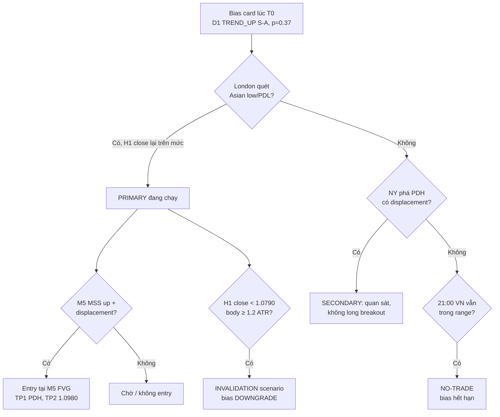

# Daily Bias

> [!summary] Tóm tắt 1 câu
> **Daily Bias là một giả thuyết có điều kiện, có thời hạn và có thể sai về việc phía nào của liquidity có ưu thế hôm nay — vượt quá những gì khoảng cách và thời gian đã cho sẵn — kèm theo policy hành động (được tìm setup gì, ở đâu, khi nào đứng ngoài) và điều kiện vô hiệu hóa. Nó lọc hướng trade, không phải tín hiệu vào lệnh.**

> [!important] Nguyên tắc cốt lõi
> **Bias trả lời "ưu tiên tìm Long, Short hay đứng ngoài?"; entry model trả lời "vào ở đâu và khi nào?".**
> Một M5 MSS đẹp không được phép đảo ngược Daily Bias trừ khi nó phá một swing có ý nghĩa ở thang D1 (*ý nghĩa thuộc về swing bị phá, không thuộc về chart bạn nhìn thấy sự kiện* — R7); và không trade theo M5 MSS nếu nó không xuất hiện sau liquidity sweep tại HTF POI hợp lệ.
> **"Không có bias" (NEUTRAL / UNCLEAR / CONFLICTED / SUSPENDED) là một output hợp lệ** — tốt hơn nhiều so với một bias được "bịa" để có lệnh.

> [!info] Đây là bản v2 (2026-10-06) — đọc trước khi dùng
> - Note hợp nhất **note v1** (2026-06 → 07) với **Daily Bias — Deep Research v0.1** (Claude Project, `ICT/04_Daily_Bias/`). Mọi nội dung trùng lặp của v1 (định nghĩa, "không phải là gì", trạng thái, cơ chế, edge cases, phản biện) đã được gộp về **một chỗ duy nhất**; phần riêng của v1 được giữ và đánh dấu *(v1)*. Bản đồ di chuyển nội dung nằm ở [[#Changelog]]. Bản v1 nguyên vẹn được sao lưu ở `Claude outputs/backups/`.
> - **DR-v0.1** = *Dealing Range — Deep Research v0.1* (Claude Project, `ICT/03_Dealing_Range/`). "DR-v0.1 §x" trỏ tới section của tài liệu đó. Note liên quan trong vault: [[57-Dealing-Range-Nghien-cuu-chuyen-sau-Swing-Significance-Selection-Algorithm-Backtest]], [[12-Dealing-Range]].
> - Hình `DB-Sim-*` là **mô phỏng random walk (null model)** — baseline mà mọi claim phải vượt, **không phải dữ liệu thị trường**. Hình `DB-Deep-*` là sơ đồ khái niệm. Hình `Daily-Bias-*` là sơ đồ của v1.
> - Mọi threshold là **HEURISTIC**; mọi RULE-DB là **v0.1 — BACKTEST REQUIRED**. Không thành phần nào trong note là edge đã được kiểm chứng.
> - Ký hiệu `p_null^T` = xác suất first-passage dưới null cùng volatility **trong cửa sổ thời gian T** (mục 8.2).

> [!abstract]- Mục lục (bấm để mở)
> - **Cách đọc note** — hệ thống nhãn, nguồn ICT, mô phỏng, thang 5 tầng
> - **0. Executive Summary** — 16 kết luận cốt lõi
> - **1. Định nghĩa** — ELI5, thang 5 tầng, định nghĩa 7 thành phần, ba đối tượng "bias", không phải là gì
> - **2. Bối cảnh sử dụng** — vấn đề cốt lõi, vì sao tồn tại, sáu trạng thái, khi nào có giá trị, khi nào không có bias
> - **3. Nhận diện: từ cấu trúc tới bias** — cơ chế, structure, dealing range, liquidity, DOL, P/D, PD/PW, ma trận, phân cấp bằng chứng
> - **4. Đa khung D1 → H1 → M5** — vai trò timeframe, xung đột C1–C6, gate system, đề xuất step-down rule, ví dụ xuyên ba tầng
> - **5. Kịch bản · cập nhật · vô hiệu hóa · lật bias** — cây kịch bản, bảng sự kiện A–K, bốn cấp invalidation, hysteresis
> - **6. Ví dụ & case studies** — ví dụ chart, Case A–L, case v1, War Stories W1–W5
> - **7. Nâng cao** — PO3/midnight open + baseline, tin tức, confidence tier, Bayes, regime, hindsight, information set, best practices
> - **8. Định lượng & backtest** — "bias đúng" là gì, BEHR, bias đúng ≠ thắng, expectancy, mô hình, decision tree, backtest, thống kê, falsification
> - **9. Checklist** — pre-session, Bias Card, execution, no-trade, post-session
> - **10. Lỗi thường gặp** · **11. Counterexamples & edge cases** · **12. Phản biện & giới hạn** · **13. Mô hình tư duy cuối cùng**
> - **14–17.** Câu hỏi tự kiểm tra · Flashcards · Lesson learned · Mức độ thành thạo
> - **18. Registers** — HYP-DB-001…017, RULE-DB-001…009, câu hỏi nghiên cứu, liên kết · Tài liệu tham khảo · Phụ lục · Changelog

---

## Cách đọc note này — hệ thống nhãn

| Nhãn | Ý nghĩa | Mức tin cậy mặc định |
|---|---|---|
| **[OBSERVABLE FACT]** | Điều quan sát trực tiếp được từ price/time (ví dụ: "giá tạo higher high") | Cao — nhưng chỉ mô tả, không giải thích |
| **[MATHEMATICAL]** | Đúng theo định nghĩa hoặc chứng minh toán học | Cao — về logic, không về hành vi thị trường thật |
| **[SIMULATION]** | Kết quả mô phỏng trên mô hình null (random walk), seed cố định | Cao về *mô hình null*; không phải dữ liệu thị trường |
| **[MARKET MECHANICS]** | Giải thích bằng order matching, liquidity, price discovery, auction, hoặc có bằng chứng thực nghiệm đã công bố | Cao → trung bình tùy bằng chứng |
| **[ICT FRAMEWORK]** | Cách ICT / cộng đồng ICT định nghĩa hoặc dùng khái niệm | Cao về *định nghĩa*; không nói gì về *hiệu quả* |
| **[INTERPRETATION]** | Diễn giải hợp lý nhưng không chứng minh trực tiếp được từ OHLC | Trung bình → thấp |
| **[HYPOTHESIS]** | Claim có thể kiểm chứng | Chưa biết |
| **[BACKTEST REQUIRED]** | Không được coi là edge cho đến khi test đúng phương pháp | — |

**Về nguồn ICT:** giáo trình gốc của ICT (Michael J. Huddleston) chủ yếu ở dạng video/mentorship, không có văn bản định nghĩa chính thức. "[ICT FRAMEWORK]" trong note này = *cách hiểu phổ biến trong tài liệu cộng đồng* (Tier 3–4 theo source hierarchy của project). Tôi **không** trích nguyên văn ICT và không gán cho ICT những câu chưa kiểm chứng.

**Về mô phỏng:** Note có 7 figure (`DB-Sim-01` … `DB-Sim-07`) và một số bảng từ mô phỏng random walk (null model): tới 200,000 "ngày" giả lập với 96 bước/ngày (một số phần dùng 288 hoặc 480 bước/ngày; bảng first-passage ở mục 8.2 dùng bước 1 phút). Ở những chỗ có công thức đóng (ví dụ mục 8.3), note dùng công thức đóng thay cho mô phỏng. Mục đích **không** phải chứng minh ICT sai, mà để xác định **baseline mà mọi claim về Daily Bias phải vượt qua**. Một hiện tượng xuất hiện với tần suất cao trong random walk thì *sự xuất hiện* của nó trên chart thật không phải bằng chứng của edge.

**Thang 5 tầng giải thích** (yêu cầu "5-year-old test"): mỗi khái niệm cốt lõi được giải thích qua:

| Tầng | Tên | Mục tiêu |
|---|---|---|
| L1 | 5 tuổi | Trực giác, không dùng thuật ngữ |
| L2 | Người mới | Ngôn ngữ trading thông thường |
| L3 | ICT | Thuật ngữ và cách dùng trong ICT |
| L4 | Cơ chế | Order flow, auction, liquidity, volatility |
| L5 | Định lượng | Biến đo được, giả thuyết kiểm chứng được |

---

## 0. Executive Summary

Mười sáu kết luận cốt lõi. Mỗi kết luận được phát triển ở các mục sau.

**1. Daily Bias không phải một nhãn "Bullish/Bearish". Nó là một *đối tượng có cấu trúc* gồm bảy thành phần:** trạng thái (state), kịch bản chính, kịch bản phụ, mục tiêu (DOL), mức vô hiệu hóa (invalidation), mức độ tin cậy theo chất lượng bằng chứng, và — quan trọng nhất — **policy hành động** (hôm nay được phép tìm setup nào, ở đâu, khi nào thì đứng ngoài). Một bias không thay đổi hành động của bạn là một bias không có giá trị, dù nó đúng hay sai.

**2. Công việc thật sự của Daily Bias trong quá trình ra quyết định** là bốn việc, xếp theo mức độ chắc chắn giảm dần:
- (a) **Giảm độ phức tạp của quyết định** — thu hẹp không gian hành động (chỉ tìm long, chỉ ở discount, chỉ sau sweep…). Việc này *luôn* xảy ra khi có bias.
- (b) **Cam kết trước điều kiện sai** — viết ra trước "điều gì sẽ chứng minh tôi sai". Việc này chống lại cả cứng đầu lẫn đổi ý liên tục.
- (c) **Định nghĩa mục tiêu và hình học rủi ro** — DOL ở đâu, invalidation ở đâu, còn bao nhiêu room.
- (d) **Cung cấp thông tin dự báo (predictive edge)** — làm cho một phía có xác suất cao hơn baseline. Đây là việc *duy nhất cần chứng minh bằng dữ liệu*, và là việc chưa được chứng minh.

(a)–(c) là **process value** (giá trị kỷ luật). (d) là **predictive value**. Hai loại giá trị này hoàn toàn khác nhau và phải được kiểm chứng bằng hai loại test khác nhau (mục 8.9–8.11).

**3. "Bias đúng" là một cụm từ vô nghĩa cho đến khi chọn biến mục tiêu.** Có ít nhất sáu định nghĩa (close > open; close > close hôm qua; DOL bị chạm; DOL bị chạm *trước* invalidation; MFE theo hướng bias > MAE; setup theo hướng bias có expectancy dương). Chúng cho ra những con số "accuracy" khác nhau rất xa. **[MATHEMATICAL]** Dưới random walk, xác suất giá chạm một mức cách open 0.5σ ngày (≈ 0.31 ADR) *ở bất kỳ thời điểm nào* trong ngày là ≈ 62%; mức cách 0.25σ là ≈ 80%. Một "bias" được chấm là đúng khi "giá có lúc đi theo hướng bias" sẽ đạt 60–80% accuracy mà **không cần bất kỳ thông tin nào**.

**4. Trần accuracy (accuracy ceiling).** **[MATHEMATICAL]** Trong mô hình Gaussian, nếu bias chỉ dịch chuyển trung bình lợi nhuận ngày, thì accuracy 55% (close vs open) tương đương Sharpe năm ≈ 2.0 trước chi phí; 60% ≈ 4.0; 70% ≈ 8.3; 80% ≈ 13.4 (Figure 1). Hàm ý: một bias "đúng 55%" theo định nghĩa nghiêm ngặt, ổn định mỗi ngày, đã là một edge đặc biệt mạnh. **[INTERPRETATION]** Các claim "bias đúng 70–80%" phổ biến trong cộng đồng nhiều khả năng đang dùng định nghĩa lỏng, đang chọn lọc ngày, hoặc đang chấm sau khi biết kết quả. Đây không phải chứng minh chúng sai — mà là lý do đòi hỏi bằng chứng tương xứng.

**5. Daily Bias research bị thiếu dữ liệu một cách cấu trúc.** **[MATHEMATICAL]** Để phát hiện accuracy thật 55% so với 50% (α = 0.05, power 80%) cần ~783 ngày độc lập ≈ 3.1 năm dữ liệu một instrument khi bias được đưa ra *mỗi ngày*. Với 53%: ~8.6 năm. Nếu bạn cho phép "Unclear" ở 40% số ngày, nhân thêm 1.67. Một backtest thủ công 50–100 ngày **không thể** xác nhận hay bác bỏ Daily Bias; nó chỉ có thể phát hiện lỗi thô và sinh giả thuyết.

**6. Heuristic PDH/PDL "đúng" 64–74% trên random walk.** **[SIMULATION]** Quy tắc cộng đồng: "close trên PDH → hôm sau lấy PDH tiếp; quét PDL rồi close lại bên trong → hôm sau lên lấy PDH" cho tỷ lệ "thành công" 74% (continuation) và 64–65% (reversal) trên một chuỗi **hoàn toàn ngẫu nhiên** (Figure 2). Nguyên nhân: **proximity confound** — close mạnh nghĩa là open hôm sau đã nằm gần high hôm nay. Khoảng ~90% số ngày lấy ít nhất một trong hai mức PDH/PDL. Muốn chứng minh heuristic có giá trị, phải đo **phần vượt baseline khoảng cách**, không phải hit rate thô.

**7. Ảo giác hội tụ (confluence illusion).** **[SIMULATION]** Sáu yếu tố "bullish" phổ biến (nến tăng, tăng so với 5 ngày trước, trên SMA20, D1 structure bullish, close trên PDH, close nửa trên range) trên random walk có tương quan trung bình 0.38. Những ngày ≥5/6 yếu tố đồng thuận (theo một phía) chiếm **56%** số ngày — so với 22% nếu chúng độc lập — và **không dự báo gì** cho ngày hôm sau (Figure 3). Đếm số confluence = đếm cùng một thông tin nhiều lần. **Số lượng bằng chứng ≠ sức mạnh bằng chứng.**

**8. Hồ sơ "Power of Three" của nến ngày xuất hiện 88% số ngày tăng trên random walk.** **[SIMULATION + MATHEMATICAL]** Trong một chuỗi ngẫu nhiên, nếu biết ngày đó đóng cửa tăng, thì xác suất đáy được tạo trước đỉnh (Open → Low → High → Close) là ~88%. Khi thêm hồ sơ volatility theo phiên (London/NY biến động mạnh hơn), đáy của ngày tăng rơi vào cửa sổ London open (02–05 NY) hoặc 08–11 NY trong ~52% trường hợp dù hai cửa sổ này chỉ chiếm 25% thời gian (Figure 4). Cơ chế: **luật arcsine** + **tập trung volatility**. Hàm ý: các quan sát "ngày tăng thường tạo đáy ở London" là *baseline toán học*, không phải bằng chứng của manipulation. Claim ICT chỉ có giá trị dự báo khi nó vượt baseline này **với điều kiện là bias được xác định ex-ante**, không phải sau khi biết ngày tăng hay giảm.

**9. Bias đúng ≠ lệnh thắng.** **[MATHEMATICAL + SIMULATION]** Với một bias có accuracy 55% (đã là rất mạnh), ~60% số ngày bias *đúng* vẫn đi ngược ≥ 0.25σ trước khi đóng cửa; đường cong adverse excursion gần như **trùng khít** với trường hợp không có edge (Figure 5). Một lệnh long ngây thơ tại open với stop 0.25σ có win rate chỉ ~22% nhưng expectancy ≈ +0.18R (trước chi phí, giám sát stop liên tục). Bias cho biết **nên kiên nhẫn theo hướng nào**, không cho biết **khi nào vào lệnh**. Đây là lý do toán học cho sự tồn tại của H1/M5.

**10. Location không phải direction.** **[MATHEMATICAL — kế thừa từ DR-v0.1]** Dưới martingale, premium/discount không tạo expectancy. **[SIMULATION]** Trên random walk, vị trí close trong range 20 ngày có phân phối hình chữ U (27% số ngày ở 10% ngoài cùng hai phía); với drift +0.1σ/ngày, giá nằm ở premium 66% số ngày (Figure 7). Trong trend, "ở premium" là *trạng thái bình thường*, không phải tín hiệu đảo chiều.

**11. Market structure là bằng chứng về *drift trong quá khứ*.** Việc drift quá khứ có dự báo drift ngày mai hay không là một câu hỏi thực nghiệm. **[MARKET MECHANICS]** Time-series momentum được ghi nhận ở horizon 1–12 tháng trên futures (Moskowitz, Ooi & Pedersen, 2012); ở horizon *một ngày*, tự tương quan tuyến tính của lợi nhuận gần bằng 0 là một stylized fact (Cont, 2001). Vì vậy "D1 HH/HL → bias bullish hôm nay" là **[HYPOTHESIS]** với effect size kỳ vọng nhỏ.

**12. Phải tách ba đối tượng thường bị gọi chung là "bias":** **Structural Bias** (D1, đa ngày: câu chuyện cấu trúc chi phối), **Daily Delivery Bias** (hôm nay giá có khả năng mở rộng về phía nào), **Session/Intraday Bias** (phiên này). Bullish structural bias + giá vừa lấy BSL ở premium cực đại → daily delivery hôm nay có thể là *giảm* (retracement) mà structural bias vẫn đúng. Nhầm hai đối tượng này là nguồn gốc của phần lớn câu hỏi "bias bullish mà sao giá giảm?".

**13. "Unclear" là một output hợp lệ — và thường xuyên.** Hệ trạng thái đề xuất: **BULLISH / BEARISH / NEUTRAL** (bằng chứng cân bằng, thị trường đang balance) / **UNCLEAR** (thiếu bằng chứng hoặc định nghĩa mơ hồ) / **CONFLICTED** (bằng chứng mạnh ở cả hai phía) / **SUSPENDED** (cửa sổ tin tức). Ép thị trường vào Bullish/Bearish mỗi ngày là tạo ra nhiễu có tên gọi.

**14. Cập nhật bias phải theo sự kiện, theo thang đo, và có độ trễ có chủ đích (hysteresis).** Bốn cấp invalidation: **thesis** (D1) → **scenario** (đường đi) → **setup** (H1) → **entry** (M5). Một M5 MSS ngược hướng **không** invalidate Daily Bias trừ khi nó phá một swing có ý nghĩa ở cấp D1 (nguyên tắc R7 từ DR-v0.1: *ý nghĩa thuộc về swing bị phá, không thuộc về chart bạn nhìn thấy sự kiện*). Lật bias đòi hỏi nhiều bằng chứng hơn hạ cấp bias.

**15. Nhìn qua lăng kính Bayes, bias là một posterior đang chạy.** Với accuracy ceiling ở trên, tổng likelihood ratio thực tế của toàn bộ bằng chứng một ngày nhiều khả năng chỉ khoảng 1.2–1.5. Hàm ý: **một posterior > ~0.60 cho một ngày đơn lẻ nên được coi là dấu hiệu quá tự tin (calibration ceiling)**, trừ khi đã được hiệu chỉnh bằng dữ liệu. "Strong bullish" phần lớn là cảm giác, không phải xác suất.

**16. Trả lời câu hỏi quan trọng nhất — "Daily Bias giúp tôi ra quyết định tốt hơn ở điểm nào?"**
- **Chắc chắn:** giảm số quyết định, giảm lệnh hai chiều mâu thuẫn, buộc viết invalidation trước, tạo dữ liệu journal có cấu trúc để đo. Đây là *useful process*.
- **Có thể (cần test):** cải thiện xác suất first-passage về phía DOL vượt baseline khoảng cách; cải thiện expectancy của setup H1/M5 khi lọc theo bias so với không lọc. Đây là *useful information → predictive edge*.
- **Chưa có bằng chứng:** rằng bias "đọc được ý định của Smart Money". Đây là *useful story*.

Toàn bộ note được xây để bạn có thể tách ba lớp đó trên mọi chart.

---

## 1. Định nghĩa

![[Daily-Bias-Sec-01-Dinh-Nghia.svg|1380]]
*Sơ đồ: Daily Bias là giả thuyết có điều kiện về hướng phân phối giá trong ngày — bộ lọc hướng, không phải tín hiệu vào lệnh.*

### 1.1 Daily Bias giải thích như cho trẻ 5 tuổi

#### 1.1.1 Câu chuyện con thuyền

Hãy tưởng tượng em đang thả một chiếc thuyền giấy trên một con sông.

- **Dòng nước** chảy chậm về một phía. Em không nhìn thấy dòng nước trực tiếp, nhưng em thấy những chiếc lá trôi *mấy hôm nay* đều đi về phía biển.
- **Sóng** đánh chiếc thuyền qua lại liên tục. Có lúc thuyền bị đẩy ngược về phía núi, có lúc bị đẩy về phía biển.
- Em muốn đoán: **"Hôm nay, chiếc thuyền sẽ đến cây cầu phía biển, hay đến tảng đá phía núi trước?"**

Daily Bias giống như câu em tự nói vào buổi sáng: *"Mấy hôm nay lá đều trôi về phía biển, cây cầu cũng không xa lắm, nên mình đoán thuyền sẽ đến cây cầu trước. Nhưng nếu thuyền trôi ngược qua tảng đá kia, thì mình đoán sai rồi, và mình sẽ không cố cãi nữa."*

Câu đó có ba phần — và cả ba đều quan trọng như nhau:

1. **Mình đoán gì** — đến cây cầu (bias).
2. **Tại sao** — lá trôi về phía biển mấy hôm nay, cây cầu không xa (bằng chứng).
3. **Khi nào mình nhận là sai** — nếu thuyền qua tảng đá (invalidation).

Một đứa trẻ chỉ nói "thuyền sẽ đi về phía biển!" mà không có phần 3 thì không phải đang đoán — mà đang *mong*.

#### 1.1.2 Những điều đứa trẻ cũng hiểu được

- **Sóng có thể đẩy thuyền ngược lại một lúc dù dòng nước vẫn chảy về biển.** (Bias đúng nhưng giá đi ngược trước — mục 8.3, Figure 5.)
- **Có những hôm nước gần như đứng yên.** Hôm đó, đoán là vô ích; tốt nhất là nói "hôm nay mình không biết". (Trạng thái NEUTRAL/UNCLEAR — mục 2.5.)
- **Nếu cây cầu ở rất gần, thuyền đến cầu là chuyện dễ — dù không có dòng nước.** (Proximity confound — mục 3.8, Figure 2.)
- **Em đếm 6 chiếc lá trôi về biển, nhưng 6 chiếc lá đó trôi cùng nhau trong một cụm.** Đó không phải 6 bằng chứng — đó là một bằng chứng nhìn 6 lần. (Confluence illusion — mục 3.10, Figure 3.)
- **Nếu em chỉ kể lại chuyện sau khi thuyền đã đến cầu, ai cũng "đoán đúng".** (Hindsight — mục 7.6.)

#### 1.1.3 Giới hạn của ẩn dụ

Ẩn dụ con thuyền gợi ý rằng có một "dòng nước" thật luôn tồn tại. Trên thị trường, **điều đó không chắc chắn**: có thể không có dòng nước nào cả — chỉ có sóng (random walk). Và khác với sông, thị trường có những người *nhìn thấy cùng cây cầu với em* và đặt lệnh quanh đó — nên chính việc nhiều người cùng nhìn vào một mức giá có thể làm thay đổi cách giá cư xử tại mức đó (reflexivity). Ẩn dụ không nắm được điều này.

### 1.2 Thang 5 tầng — Daily Bias

| Tầng | Giải thích |
|---|---|
| **L1 — 5 tuổi** | "Hôm nay mình đoán thuyền đến cây cầu trước tảng đá. Nếu thuyền qua tảng đá, mình nhận sai." |
| **L2 — Người mới** | "Hôm nay tôi chỉ tìm cơ hội mua, vì xu hướng gần đây là tăng và mục tiêu phía trên còn chưa bị chạm. Nếu giá phá đáy quan trọng X, tôi bỏ ý tưởng này." |
| **L3 — ICT** | "D1 order flow bullish; giá đang retrace vào discount của D1 dealing range; DOL là BSL trên swing high D1; tìm bullish PD array trên H1, chờ M5 sweep → MSS → displacement → FVG. Bias invalid nếu D1 close dưới protected low." |
| **L4 — Cơ chế** | "Giả thuyết: dòng lệnh ròng gần đây nghiêng về phía mua (thể hiện qua cấu trúc), các lệnh chờ (stops/breakout orders) tập trung phía trên các đỉnh dễ thấy, và chưa có bằng chứng phía bán chiếm ưu thế ở cấp D1. Nếu dòng lệnh này còn tiếp diễn, đường đi ít kháng cự nhất là lên phía các lệnh chờ đó." |
| **L5 — Định lượng** | "P(giá chạm DOL_up trước Inv_down trong ngày \| I(T)) − d_dn/(d_up + d_dn) > 0, với I(T) là thông tin đến thời điểm T, và khoảng cách d được đo bằng ATR. Bias có giá trị kinh tế nếu policy lọc theo bias tạo expectancy sau chi phí cao hơn policy không lọc." |

### 1.3 Định nghĩa v0.1 — bảy thành phần

> **Daily Bias** là một **giả thuyết có điều kiện**, được xác lập tại thời điểm quyết định T chỉ bằng thông tin I(T), về việc **phía nào của liquidity có khả năng được giá delivery tới trước (hoặc nhiều hơn) trong horizon của phiên giao dịch**, đi kèm **kịch bản chính, kịch bản phụ, mức vô hiệu hóa, mục tiêu, mức tin cậy theo chất lượng bằng chứng, và một policy hành động** cho phép hoặc cấm các loại setup cụ thể.

Bảy thành phần nội dung (cộng dấu thời gian `known_at`) — thiếu thành phần nào, bias không đầy đủ:

```text
DAILY_BIAS(T) = {
  state            : BULLISH | BEARISH | NEUTRAL | UNCLEAR | CONFLICTED | SUSPENDED
  primary          : kịch bản chính (đường đi + mục tiêu)
  secondary        : kịch bản phụ (đường đi khác nhưng cùng thesis, hoặc thesis ngược có điều kiện)
  dol              : {DOL_primary, DOL_secondary, opposing_liquidity}
  invalidation     : {thesis_level, scenario_condition, time_expiry}
  confidence_tier  : A | B | C  (theo chất lượng bằng chứng, không phải %)
  policy           : setup được phép, location được phép, session được phép, size modifier
  known_at         : T   (và I(T) đã dùng)
}
```

#### Mục đích, lý do và câu hỏi trên chart *(v1)*

**Mục đích trong ICT:**  
- Lọc hướng giao dịch để tránh lấy mọi MSS/FVG trên M5.
- Xác định phía liquidity nên kỳ vọng làm target trong ngày.
- Biết nên chờ giá retrace vào **discount** để Long hay vào **premium** để Short.
- Liên kết cấu trúc D1/H4 với POI H1/M15 và entry model M5/M1.

**Vì sao khái niệm này quan trọng:**  
ICT 2022 model chỉ mạnh khi entry LTF đi cùng **HTF narrative**. Không có bias rõ ràng, trader thường biến mọi displacement trên M5 thành một “setup”, dẫn tới overtrading, trade giữa range hoặc trade ngược draw on liquidity chính.

**Nó giúp trả lời câu hỏi nào trên chart?**
- Giá đang ở đâu trong narrative?
- Giá vừa lấy thanh khoản hay chưa?
- Giá có đang phản ứng ở POI hợp lệ không?
- Có đủ điều kiện để xuống LTF tìm entry không?
- Hôm nay ưu tiên tìm Long, Short, hay **No Trade / Neutral**?

### 1.4 Ba đối tượng thường bị gọi chung là "bias"

![[DB-Deep-01-Ba-Doi-Tuong-Bias.svg|1380]]
*Sơ đồ: cùng một chart, structural bias BULLISH nhưng daily delivery hôm nay UNCLEAR/retracement — policy là đứng ngoài chờ discount.*

| Đối tượng | Horizon | Câu hỏi | Nguồn chính | Ví dụ |
|---|---|---|---|---|
| **Structural Bias** | Nhiều ngày–tuần | Câu chuyện cấu trúc nào đang chi phối? | D1/W1 structure, D1 dealing range, protected swing | "D1 bullish từ khi phá 1.0905; protected low 1.0750" |
| **Daily Delivery Bias** | Hôm nay | Hôm nay giá có khả năng mở rộng về phía nào, tới đâu? | Structural bias + location + liquidity còn lại + PDH/PDL + DOL hôm nay | "Hôm nay kỳ vọng retracement xuống discount trước, chưa kỳ vọng tiếp diễn" |
| **Session / Intraday Bias** | Phiên | Phiên này đang làm gì so với kế hoạch ngày? | H1/M15 structure, session H/L, opening price | "London đã quét Asian low; NY có thể là phiên expansion" |

**Lỗi phổ biến nhất:** dùng Structural Bias như Daily Delivery Bias. Ví dụ:

```text
D1: bullish leg 1.0750 → 1.0980, vừa lấy BSL 1.0980 hôm qua, đóng cửa gần đỉnh.
Structural bias: BULLISH (protected low 1.0750 còn nguyên)
Daily delivery bias hôm nay: KHÔNG phải "tiếp diễn lên" một cách mặc định —
  DOL gần nhất phía trên đã bị lấy; giá ở premium cực đại (p ≈ 0.98);
  kịch bản chính hợp lý hơn có thể là retracement vào discount (bearish delivery),
  trong khi structural bias vẫn bullish.
Policy: không long ở premium; không short nếu model cấm counter-HTF; chờ.
```

Cả hai câu "bias bullish" và "hôm nay giá giảm" đều đúng — vì chúng nói về hai đối tượng khác nhau.

### 1.5 Bias trong họ hàng các khái niệm dự báo

| Khái niệm | Nghĩa | Thông tin chứa | Vai trò trong quyết định | Có thể sai? | Ví dụ |
|---|---|---|---|---|---|
| **Bias** | Hướng ưu tiên có điều kiện + policy | Tổng hợp bằng chứng → nghiêng một phía | Lọc hành động | Có — và phải có điều kiện sai rõ ràng | "Chỉ tìm long; sai nếu D1 close < 1.0750" |
| **Prediction** | Phát biểu về kết cục cụ thể | Điểm (point) | Thường không dùng trực tiếp | Có, nhị phân | "Hôm nay đóng cửa tăng" |
| **Forecast** | Ước lượng có định lượng, thường kèm sai số | Phân phối hoặc điểm + khoảng | Lập kế hoạch | Có, theo mức độ | "Range kỳ vọng 60–90 pips" |
| **Hypothesis** | Claim kiểm chứng được | Điều kiện + kỳ vọng | Nghiên cứu | Có — phải falsifiable | "Sau sweep PDL + reclaim, P(PDH trước PDL) > baseline" |
| **Scenario** | Một đường đi khả dĩ có trình tự | Chuỗi sự kiện | Chuẩn bị phản ứng | Không đúng/sai — chỉ xảy ra/không | "Sweep Asian low → MSS → lên PDH" |
| **Expectation** | Trung bình có trọng số các kết cục | Một con số | Sizing | Lệch, không "sai" | "E[R] = +0.15R" |
| **Probability** | Mức tin định lượng vào một sự kiện | Số trong [0,1] | Ra quyết định có hiệu chỉnh | Được đánh giá bằng *calibration* qua nhiều lần | "P(bullish scenario) = 0.56" |
| **Conviction** | Trạng thái cảm xúc tin tưởng | **Không chứa thông tin thị trường** | Thường *làm hại* nếu điều khiển size | Không áp dụng | "Tôi rất chắc hôm nay lên" |
| **Trading Plan** | Tập quy tắc hành động cho các kịch bản | Policy đầy đủ | Thực thi | Được đánh giá bằng tuân thủ + expectancy | "Nếu A thì…, nếu B thì…" |
| **Entry Signal** | Điều kiện kích hoạt lệnh cụ thể | Thời điểm + giá | Thực thi | Có, mỗi lệnh | "M5 FVG sau MSS trong POI H1" |

**Điểm then chốt:** *conviction* là hàng duy nhất **không chứa thông tin về thị trường** — nó chứa thông tin về *người trader*. Một bias tốt có thể có conviction thấp; một conviction cao có thể đi kèm bias không có cơ sở.

### 1.6 Daily Bias không phải là gì

```text
DAILY BIAS ≠ ENTRY          Bias nói "hướng nào được phép"; entry nói "giá nào, lúc nào".
DAILY BIAS ≠ MSS            MSS là một sự kiện cấu trúc tại một thời điểm, ở một thang đo.
                            Bias là tổng hợp nhiều bằng chứng; một MSS có thể là bằng chứng cho bias.
DAILY BIAS ≠ POI            POI là một vùng giá có đặc điểm (FVG, OB…). Bias không có tọa độ giá.
DAILY BIAS ≠ LIQUIDITY SWEEP Sweep là một sự kiện; nó có thể cùng chiều hoặc ngược chiều bias.
DAILY BIAS ≠ DISPLACEMENT   Displacement là chất lượng của một chuyển động; là bằng chứng, không là kết luận.
DAILY BIAS ≠ DOL            DOL là mục tiêu; bias là giả thuyết về phía nào đến trước.
DAILY BIAS ≠ SETUP          Setup là cấu hình điều kiện tại POI (H1); bias là bộ lọc cho setup.
DAILY BIAS ≠ CONVICTION     Conviction là cảm xúc; bias là kết luận từ bằng chứng có điều kiện sai.
DAILY BIAS ≠ CLOSE FORECAST Bias không nhất thiết dự báo màu nến ngày (mục 8.1).
DAILY BIAS ≠ PERMANENT      Bias có thời hạn (validity window) và được cập nhật theo sự kiện.
```

| | Bias | DOL | Setup | Entry direction |
|---|---|---|---|---|
| Câu hỏi | Phía nào có ưu thế? | Đích ở đâu? | Ở đâu có điều kiện hành động? | Lệnh hướng nào? |
| Timeframe chính | D1 (+W1) | D1/H1 | H1 | M5 |
| Có tọa độ giá? | Không (chỉ có invalidation) | Có | Có (vùng) | Có |
| Có thể ngược nhau? | — | DOL ngắn hạn có thể ngược bias (ví dụ DOL_down = SSL nội bộ trước khi lên) | Setup có thể ngược bias trong model countertrend | Entry có thể ngược bias nếu model cho phép |

> [!note] Bổ sung từ v1
> Bias **không** phải lý do bỏ qua vị trí Premium/Discount: P/D không tạo hướng (RULE-DB-003, mục 3.7) nhưng vẫn quyết định *chỗ* được phép hành động. Bias cũng **không** phải lý do cố giữ quan điểm khi invalidation đã xảy ra (mục 5.5).

### 1.7 Đánh giá phê phán khung D1 = Context, H1 = Setup, M5 = Execution

**Điểm mạnh:**

1. **Phân chia trách nhiệm rõ ràng** — mỗi timeframe trả lời một câu hỏi, giảm việc dùng M5 để "chứng minh" D1.
2. **Khớp horizon** — bias (ngày) dựa trên dữ liệu có horizon tương ứng (D1).
3. **Giảm số quyết định** — gate tuần tự loại phần lớn ngày/setup trước khi xuống M5.

**Điểm yếu cần thừa nhận:**

1. **"Daily" bias nhưng D1 chỉ cập nhật một lần mỗi ngày.** Trong ngày, thông tin mới (London sweep, NY displacement) đến từ H1/M5. Nếu khung cấm H1/M5 *cập nhật* bias, bạn sẽ cố giữ một bias đã cũ. Giải pháp: **tách quyền hạn (authority) khỏi thông tin (information)** — mục 4.1.
2. **Một số thành phần ICT của daily bias là intraday** (Power of Three, midnight open, Judas swing). Chúng không thuộc "D1 context" mà là *intraday bias evidence*. Khung cần chỗ cho chúng mà không để chúng override D1 tùy tiện.
3. **Hierarchy cứng có thể bỏ qua thông tin thật ở LTF.** Một displacement trên H1 phá một swing có ý nghĩa D1 *là* thông tin D1, dù nó nhìn thấy trên H1 (R7).
4. **"Context" dễ trở thành không thể falsify** nếu không có invalidation rõ: "D1 vẫn bullish, chỉ là đang retrace" có thể kéo dài vô hạn.

**Kết luận:** khung đúng về *phân quyền*, cần bổ sung *kênh thông tin ngược* (bottom-up evidence) có điều kiện thang đo, và *thời hạn* cho bias.

---

## 2. Bối cảnh sử dụng — vấn đề, lý do tồn tại, trạng thái

![[Daily-Bias-Sec-02-Boi-Canh.svg|1380]]
*Sơ đồ (v1): ba trạng thái Bullish / Bearish / Neutral và hành động ưu tiên. v2 tách "Neutral" thành bốn trạng thái có ý nghĩa khác nhau — xem 2.3.*

### 2.1 Vấn đề cốt lõi mà Daily Bias giải quyết

#### 2.1.1 Bắt đầu từ vấn đề, không từ thuật ngữ

Trader thức dậy. Không biết thị trường sẽ đi đâu. Không gian kết cục của một ngày là vô hạn, nhưng có thể gom thành các họ:

```text
O1  Giá tăng thẳng (trend day up)
O2  Giá giảm thẳng (trend day down)
O3  Giá đi ngang (range / inside day)
O4  Giá lấy đáy trước rồi tăng mạnh (sweep low → expansion up)
O5  Giá lấy đỉnh trước rồi giảm mạnh (sweep high → expansion down)
O6  Giá lấy cả hai phía, đóng cửa ở giữa (outside day, two-sided)
O7  Giá tiếp diễn xu hướng nhiều ngày
O8  Giá đổi trạng thái (trend → range, range → expansion, đảo chiều)
O9  Biến động bị chi phối bởi tin tức (jump)
```

Và không gian hành động:

```text
A1  Chỉ tìm long         A4  Đứng ngoài cả ngày
A2  Chỉ tìm short        A5  Giảm size, chỉ trade setup A+
A3  Tìm cả hai           A6  Chờ sự kiện X rồi mới quyết định
```

**Không có bias**, trader mặc định ở A3 — và A3 có ba chi phí ẩn:

1. **Chi phí nhận thức:** phải đánh giá mọi setup ở cả hai chiều → quyết định chất lượng thấp, mệt mỏi.
2. **Chi phí giao dịch:** nhiều lệnh hơn → nhiều spread/slippage/commission hơn.
3. **Chi phí tự mâu thuẫn:** long buổi sáng, short buổi chiều trên cùng một thông tin — thường là phản ứng với nhiễu.

#### 2.1.2 Daily Bias có giảm uncertainty không?

Phải tách hai thứ hay bị gộp:

| | **Giảm uncertainty (information)** | **Giảm decision complexity (policy)** |
|---|---|---|
| Bản chất | Làm cho phân phối kết cục *thực sự* lệch về một phía | Thu hẹp tập hành động được phép |
| Có xảy ra khi có bias không? | Chỉ khi bằng chứng có giá trị thông tin | **Luôn luôn** |
| Kiểm chứng bằng | Bias Study (accuracy vượt baseline, BEHR — mục 8.9) | Journal metrics (số lệnh, số lệnh ngược bias, drawdown) |
| Rủi ro | Ảo tưởng thông tin: cảm thấy chắc mà không có dữ liệu | Bỏ lỡ cơ hội tốt ở chiều bị cấm |

**[INTERPRETATION]** Phần lớn "cảm giác rõ ràng" mà Daily Bias mang lại đến từ cột phải (policy), không phải cột trái (information). Điều này *không xấu* — một policy tốt có giá trị thật — nhưng nguy hiểm khi trader nhầm sự rõ ràng của policy với sự chắc chắn của dự báo. Kahneman gọi hiện tượng tự tin cao vào một câu chuyện mạch lạc dù dữ liệu yếu là *illusion of validity*.

#### 2.1.3 Bias loại bỏ hay giữ lại scenario nào?

Một bias bullish **tốt** không loại bỏ kịch bản nào khỏi *thế giới* — nó chỉ thay đổi *trọng số* và *hành động*:

| Kết cục | Bullish bias làm gì với nó | Hành động tương ứng |
|---|---|---|
| O1 trend up | Kịch bản chính | Tìm long ở pullback nông (nếu model cho phép) |
| O4 sweep low → up | Kịch bản chính (thường là kịch bản *đẹp nhất*) | Chờ sweep + reclaim + LTF MSS |
| O3 range | Kịch bản phụ | Không trade hoặc chỉ trade ở extremes |
| O6 two-sided | Kịch bản phụ | Giảm kỳ vọng target |
| O5 sweep high → down | Kịch bản ngược — **nếu xảy ra sau khi DOL_up đã bị lấy, đó là completion, không phải sai** | Không short (nếu policy cấm counter-bias) |
| O2 trend down | Kịch bản invalidation | Dừng long; đánh giá invalidation |
| O9 news jump | Kịch bản ngoài model | Suspend |

Bias **xấu** là bias loại bỏ O2 khỏi tâm trí — tức không có invalidation.

#### 2.1.4 Giá trị của thông tin (Value of Information)

**[MATHEMATICAL]** Theo lý thuyết quyết định, giá trị của một nguồn thông tin E là:

$$VOI(E) = \mathbb{E}_E\left[\max_a \mathbb{E}[U(a) \mid E]\right] - \max_a \mathbb{E}[U(a)]$$

Diễn đạt bằng lời: *thông tin chỉ có giá trị nếu nó có thể làm bạn chọn hành động khác, và hành động khác đó tốt hơn*. Ba hệ quả trực tiếp cho Daily Bias:

1. **Một bias không bao giờ làm bạn đổi hành động có VOI = 0** — kể cả khi nó "đúng". Ví dụ: bạn luôn chỉ trade long trên một index; "bias bullish" mỗi ngày không thêm gì.
2. **Một bias làm bạn đổi hành động nhưng không cải thiện kết quả có VOI ≈ 0 hoặc âm** (nếu nó loại bỏ trade tốt).
3. **VOI có thể dương ngay cả khi accuracy < 50%** nếu bias giúp tránh các ngày có payoff cực xấu (ví dụ: suspend trước tin) — đây là giá trị *phi đối xứng*.

Câu hỏi đúng không phải "bias của tôi đúng bao nhiêu %?" mà là **"policy có bias tạo ra kết quả gì so với policy không có bias, sau chi phí?"** (mục 8.9).

#### 2.1.5 Giới hạn của việc "nén uncertainty"

**[MARKET MECHANICS — stylized facts]** Ở horizon một ngày, lợi nhuận của phần lớn tài sản thanh khoản gần như không có tự tương quan tuyến tính, trong khi *volatility* có tính bền vững (volatility clustering) (Cont, 2001). Hàm ý chiến lược:

- **Dự báo *hướng* của ngày mai là việc khó nhất** — đó là nơi tín hiệu yếu nhất.
- **Dự báo *độ lớn biến động* (ngày mai mở rộng hay co lại) dễ hơn đáng kể.**

> **[HYPOTHESIS] HYP-DB-014:** Phần có giá trị dự báo bền vững nhất của "Daily Bias framework" (nếu có) có thể nằm ở dự báo **trạng thái** (expansion vs consolidation, có/không có delivery mạnh) hơn là dự báo **hướng**. **[BACKTEST REQUIRED]** — so sánh độ chính xác dự báo range-expansion với độ chính xác dự báo direction của cùng framework.

### 2.2 Vì sao Daily Bias tồn tại

#### 2.2.1 Những hành vi quan sát được đã tạo ra nhu cầu về khái niệm này

**[OBSERVABLE FACT]** Bốn hiện tượng mà bất kỳ ai nhìn chart đủ lâu đều thấy:

1. **Range ngày là hữu hạn** và thường có một "leg" chính — giá thường đi phần lớn quãng đường của ngày về một phía.
2. **Giá thường vượt high/low ngày hôm trước** (ngay cả trên random walk — **[SIMULATION]** ~90% số ngày vượt ít nhất một trong hai, mục 3.8).
3. **Có những giai đoạn nhiều ngày liên tiếp đi cùng hướng** (trend), xen kẽ giai đoạn đi ngang.
4. **Đỉnh/đáy của ngày thường hình thành vào một số khung giờ nhất định** — chủ yếu quanh các phiên có volatility cao.

**[ICT FRAMEWORK]** ICT gom các quan sát này vào một narrative: giá được "delivery" bởi một thuật toán (IPDA) từ liquidity này sang liquidity khác; mỗi ngày có một "draw"; nến ngày có cấu trúc Power of Three (accumulation → manipulation → distribution); mục tiêu của trader là xác định trước draw đó. Daily Bias là tên của việc xác định trước đó.

**[INTERPRETATION]** Bỏ đi narrative về thuật toán, nhu cầu thực sự là: *trader cần một quy tắc để quyết định hôm nay đứng về phía nào trước khi nhiễu trong ngày kéo họ đi*. Nhu cầu đó tồn tại **dù thị trường có dự báo được hay không** — vì nó là nhu cầu về kỷ luật, không phải về dự báo.

#### 2.2.2 Bảng "WHY DOES THIS EXIST?" cho các khái niệm cốt lõi

| Khái niệm | What? | Why cần? | Giải quyết vấn đề gì? | Hành vi quan sát tạo ra khái niệm | Cơ chế | Vì sao có thể hữu ích | Khi nào thất bại | Test thế nào |
|---|---|---|---|---|---|---|---|---|
| **Daily Bias** | Giả thuyết hướng + policy cho ngày | Tránh trade hai chiều theo nhiễu | Quá nhiều lựa chọn | Ngày thường có một leg chính | Tổng hợp bằng chứng → lọc hành động | Giảm quyết định; nếu có drift có điều kiện → tăng xác suất | Khi không có drift; khi tin tức áp đảo; khi định nghĩa lỏng | BEHR, so với baselines (mục 8.9) |
| **Market Structure** | Chuỗi HH/HL/LH/LL ở một thang đo | Tóm tắt đường đi quá khứ | Biết "đang trend hay range" | Giá đi theo nhịp | Dòng lệnh ròng tạo nhịp | Nếu drift bền → structure báo drift | Random walk cũng tạo structure | Structure → BEHR vs random walk baseline |
| **Dealing Range / P-D** | Hệ tọa độ giữa hai anchor | Biết "rẻ/đắt" tương đối | Chọn vị trí vào | Giá dao động trong khung | Hình học R:R | Khuếch đại edge hướng | Không có drift → E = 0 | MEHR theo p-bin (DR-v0.1) |
| **Liquidity** | Lệnh chờ giả định quanh mức dễ thấy | Biết giá có thể tăng tốc/đảo chiều ở đâu | Tìm target và nơi stop dễ bị quét | Giá hay "chạm rồi quay" ở đỉnh/đáy cũ | Stops/limit tập trung (Osler) | Mục tiêu tự nhiên; vùng volatility | Không quan sát trực tiếp; proximity | Hành vi sau chạm vs null |
| **DOL** | Mục tiêu liquidity được chọn | Biết đích | Đặt target, đo room | Giá thường đến các mức dễ thấy | Lệnh chờ + breakout flows | Định hướng R:R | Chọn DOL sau khi thấy kết quả; DOL gần → dễ "đúng" | BEHR với DOL đăng ký trước |
| **Previous Day H/L/C** | Mức của ngày hôm trước | Tham chiếu ngắn hạn phổ biến | Bản đồ liquidity hằng ngày | ~90% ngày vượt PDH hoặc PDL | Proximity + lệnh chờ quanh mức phổ biến | Mục tiêu ngắn | Proximity confound (Figure 2) | Excess vs baseline khoảng cách |
| **Session / Time** | Khung giờ phiên | Timing | Biết khi nào giá hay chạy | Volatility theo phiên | Tập trung thanh khoản/tin tức | Lọc thời gian có biến động | Arcsine + vol tạo pattern giả (Figure 4) | So với null có vol profile |
| **Daily/Midnight Open** | Giá mở cửa tham chiếu | Đo "hôm nay đang tăng hay giảm" | Location trong ngày | Ngày tăng thường có đáy dưới open | Hình học (arcsine) | Nếu có intraday momentum → thông tin | Martingale: location không edge | Intraday momentum test |

#### 2.2.3 Bối cảnh lịch sử (ngắn)

Ý tưởng "xác định hướng trước rồi chỉ trade theo hướng đó" lâu đời hơn ICT nhiều: Dow Theory (primary trend vs secondary reaction), triple-screen của Elder (dùng timeframe lớn để chọn hướng, timeframe nhỏ để vào lệnh), các hệ trend-following với bộ lọc hướng. Đóng góp đặc thù của ICT là: (1) gắn hướng với **liquidity targets** (DOL), (2) gắn với **thời gian trong ngày** (killzones, midnight open, Power of Three), (3) gắn với **PD arrays** (FVG, OB…) như các vùng giá mà hướng được "xác nhận". Ba đóng góp này là những gì cần được kiểm chứng riêng — vì phần "chọn hướng theo HTF" thì đã có lịch sử nghiên cứu lâu đời và kết quả khiêm tốn ở horizon ngắn.

### 2.3 Sáu trạng thái của Daily Bias

| State | Định nghĩa vận hành (v0.1) | Policy mặc định |
|---|---|---|
| **BULLISH** | Directional evidence nghiêng lên, không veto, có DOL_up meaningful, có invalidation trong ≤ k_inv ADR | Chỉ setup long theo model |
| **BEARISH** | Đối xứng | Chỉ setup short theo model |
| **NEUTRAL** | Bằng chứng *cân bằng có hệ thống*: D1 RANGE, giá gần giữa container, DOL hai phía tương đương | Không trade continuation; range model (nếu có, test riêng) |
| **UNCLEAR** | *Thiếu* bằng chứng hoặc định nghĩa mơ hồ: D1 TRANSITION, range FORMING, LRI thấp, C2/C4 ambiguous | Không trade |
| **CONFLICTED** | Bằng chứng *mạnh ở cả hai phía* ở cùng hoặc khác thang (K3, K4) | Không trade hoặc chỉ setup A+ ở mức invalidation của một phía |
| **SUSPENDED** | Cửa sổ tin lớn | Không mở lệnh; quản lý lệnh đang có theo rule tin |

NEUTRAL và UNCLEAR khác nhau quan trọng: **NEUTRAL là một kết luận** ("thị trường đang cân bằng"), **UNCLEAR là sự thừa nhận** ("tôi không biết"). Một trader có thể học được rằng ngày NEUTRAL thường có range nhỏ — đó là thông tin. Ngày UNCLEAR thì chỉ có nghĩa: không hành động.

#### 2.3.1 Policy chi tiết cho BULLISH / BEARISH *(v1)*

| Trạng thái | Ý nghĩa thực chiến | Hành động ưu tiên |
|---|---|---|
| **Bullish** | Kỳ vọng leg kế tiếp phân phối lên; draw on liquidity quan trọng nằm phía trên | Chờ retrace xuống **discount / bullish PD Array**, sweep sell-side liquidity, rồi tìm bullish MSS + displacement trên LTF |
| **Bearish** | Kỳ vọng leg kế tiếp phân phối xuống; draw on liquidity quan trọng nằm phía dưới | Chờ retrace lên **premium / bearish PD Array**, sweep buy-side liquidity, rồi tìm bearish MSS + displacement trên LTF |

### 2.4 Khi nào Daily Bias có giá trị cao? *(v1)*

- [ ] Có HTF dealing range rõ ràng được tạo bởi swing có displacement/BOS đáng kể.
- [ ] Có Daily Bias rõ ràng: hướng delivery, draw on liquidity và điểm invalidation đều được viết ra.
- [ ] Giá đang ở Premium/Discount phù hợp với hướng trade.
- [ ] Giá nằm trong hoặc phản ứng tại POI HTF/H1 hợp lệ.
- [ ] Có liquidity pool rõ ràng: PDH/PDL, PWH/PWL, Asia high/low, equal highs/lows, swing high/low đáng kể.
- [ ] Có thời điểm giao dịch phù hợp: London / New York Kill Zone theo plan của thị trường đang trade.
- [ ] Có displacement / MSS / FVG xác nhận trên LTF **sau khi** giá chạm POI và quét liquidity.

### 2.5 Khi nào KHÔNG nên có Daily Bias

#### 2.5.1 Khi nào trader KHÔNG NÊN có Daily Bias

| Tình huống | State | Lý do |
|---|---|---|
| D1 TRANSITION (vừa MSS, chưa có protected swing mới) | UNCLEAR | Không có thesis có invalidation |
| D1 leg DR FORMING (đang expansion, chưa hồi) | UNCLEAR (cho location model) | Không có location; range chưa tồn tại |
| D1 RANGE, giá giữa container | NEUTRAL | Bằng chứng cân bằng có hệ thống |
| LRI thấp (các DR hợp lệ cho nhãn location ngược nhau) | UNCLEAR | Location phụ thuộc lựa chọn anchor |
| DOL meaningful vừa bị lấy, không còn đích trong 2.5 ADR | UNCLEAR | Không có delivery target |
| W1 và D1 xung đột ở thang lớn (K3, K4) | CONFLICTED | Hai thesis mạnh |
| Tin lớn trong ngày (NFP, CPI, FOMC, ECB…) | SUSPENDED quanh cửa sổ | Hướng của jump phụ thuộc surprise |
| Ngày lễ / thanh khoản mỏng | UNCLEAR | Cấu trúc kém tin cậy |
| Sau chuỗi thua phá giới hạn cá nhân | NO-TRADE (operational) | Không phải thị trường — là người trader |

#### 2.5.2 Uncertainty là output hợp lệ

```text
Một hệ thống bắt buộc chọn Bullish/Bearish mỗi ngày
= một hệ thống bắt buộc đặt cược vào cả những ngày nó không có thông tin
= thêm nhiễu (và chi phí) vào kết quả.
```

#### 2.5.3 Cái bẫy của "selective accuracy" (coverage vs accuracy)

Cho phép UNCLEAR làm tăng accuracy trên các ngày còn lại — **nhưng phải đo đúng**:

1. **Coverage** = tỷ lệ ngày có bias định hướng. **Selective accuracy** = accuracy trên các ngày đó.
2. Một hệ thống có thể đạt accuracy cao bằng cách **chỉ đưa bias vào những ngày dễ** — và "dễ" thường có nghĩa là *DOL gần* (proximity) hoặc *đã có chuyển động lớn trước thời điểm đánh giá*.
3. **Baseline phải được tính trên cùng tập ngày:** nếu bạn đưa bias vào 60% số ngày, so accuracy của bạn với baseline (ví dụ "previous day direction") **trên đúng 60% ngày đó**, và báo cáo BEHR (đã loại khoảng cách).
4. **Lỗi hindsight kinh điển:** quyết định "hôm nay unclear" *sau khi* thấy thị trường đi ngang hoặc đi ngược. Quyết định coverage phải được timestamp trước session như mọi phần khác của bias card.

**Đường cong coverage–accuracy** (risk–coverage curve trong học máy về selective prediction): vẽ accuracy (hoặc BEHR) theo coverage khi lần lượt bỏ các ngày có tier thấp nhất. Nếu tier có giá trị, đường cong dốc lên khi coverage giảm. Nếu phẳng, tier không có thông tin.

#### 2.5.4 Bao nhiêu ngày nên là "không có bias"?

Không có con số chuẩn. Đây là **đại lượng cần đo** trong journal của bạn. Một điều có thể dự đoán: nếu tỷ lệ UNCLEAR/NEUTRAL/CONFLICTED của bạn **gần 0%**, gần như chắc chắn bạn đang ép thị trường vào nhãn.

> **[HYPOTHESIS] HYP-DB-010:** Các ngày được gắn NEUTRAL ex-ante có range thực tế (H − L)/ADR thấp hơn các ngày gắn BULLISH/BEARISH. Nếu đúng, NEUTRAL có thông tin về *volatility* ngay cả khi bias định hướng không có thông tin về *hướng*. **[BACKTEST REQUIRED]**

#### 2.5.5 Bỏ qua *setup* — khác với "không có bias" *(v1)*

Các điều kiện ở cấp bias (giữa range, không có target, HTF mâu thuẫn, tin lớn) đã nằm trong bảng 2.5.1. Những điều kiện dưới đây khiến bạn **bỏ qua setup ngay cả khi bias hợp lệ**:

- [ ] Tín hiệu LTF xuất hiện ngoài kill zone hoặc ngoài kế hoạch session.
- [ ] Chỉ thấy mô hình nhỏ lẻ nhưng không nằm trong POI.
- [ ] R:R thực tế kém vì target liquidity quá gần hoặc stop loss phải quá rộng.
- [ ] Có tin tức high-impact gần thời điểm entry mà plan của mình không cho phép giao dịch.

---

## 3. Nhận diện trên chart — từ cấu trúc tới bias

![[Daily-Bias-Sec-03-Nhan-Dien.svg|1513]]
*Sơ đồ (v1): sáu thành phần xây bias. **Lưu ý v2:** sáu thành phần này không được cộng dồn thành một điểm — chúng có ba vai trò khác nhau (directional / modifier / veto), xem 3.9 và 3.10.*

**Năm câu hỏi nhận diện** *(v1)* — và nơi mỗi câu được phân tích sâu:

1. **HTF price delivery / market structure:** D1/H4 đang mở rộng theo hướng nào, hoặc vừa có dấu hiệu chuyển delivery sau một liquidity event quan trọng? → mục 3.2–3.3
2. **Draw on liquidity:** liquidity pool chưa được lấy nào có ý nghĩa lớn nhất và nằm ở phía nào của dealing range? → mục 3.5–3.6
3. **Location:** giá hiện ở premium, discount hay equilibrium của dealing range phù hợp; có đang chạm HTF PD Array hỗ trợ cho leg kế tiếp không? → mục 3.4, 3.7
4. **Reaction quality:** sau khi chạm POI hoặc sweep liquidity, có displacement có chủ đích và FVG rõ không? → mục 3.10, 5.4
5. **Timing:** hành vi giá có xuất hiện trong cửa sổ thời gian hệ thống của mình có edge không? → mục 7.1

### 3.1 Cơ chế thị trường đằng sau chuyển động có hướng

Trước khi nói về ICT, cần hiểu điều gì *thật sự* làm giá di chuyển trong một ngày.

#### 3.1.1 Phương trình cơ bản của giá

**[MARKET MECHANICS]** Giá thay đổi khi **lệnh chủ động (market orders / marketable limit orders)** ở một phía tiêu thụ **lệnh thụ động (limit orders)** ở phía kia. Trong một khoảng thời gian:

```text
ΔPrice ≈ f( Order Imbalance , Depth , Information )

Order Imbalance = Khối lượng mua chủ động − Khối lượng bán chủ động
Depth           = Lượng limit orders sẵn sàng hấp thụ ở mỗi mức giá
Information      = Tin mới làm thay đổi định giá của nhiều người cùng lúc
```

- Imbalance lớn + depth mỏng → giá chạy nhanh (displacement).
- Imbalance lớn + depth dày → giá bị hấp thụ (absorption) — đứng yên dù có lực.
- Tin mới → các market maker *dời quote* ngay cả khi chưa có giao dịch (giá nhảy).

**[MARKET MECHANICS — bằng chứng]** Trên thị trường FX, Evans & Lyons (2002) cho thấy order flow (chênh lệch mua/bán chủ động giữa các dealer) giải thích một phần lớn biến động tỷ giá hằng ngày — tức "dòng lệnh" là biến gần nhất với "hướng" của ngày. Vấn đề: trader retail **không quan sát được** order flow tổng hợp của FX spot (thị trường OTC phi tập trung). Mọi "đọc order flow" trên chart OHLC là **suy luận từ hệ quả**.

#### 3.1.2 Những nguồn tạo ra hướng trong ngày

| Nguồn | Cơ chế | Có thể dự đoán trước? | Bằng chứng |
|---|---|---|---|
| **Tin vĩ mô theo lịch** | Bất ngờ so với kỳ vọng → nhảy giá nhanh | Thời điểm: có. Hướng: chỉ khi dự báo được surprise | Andersen, Bollerslev, Diebold & Vega (2003): bất ngờ trong tin vĩ mô Mỹ gây nhảy điều kiện trung bình của tỷ giá rất nhanh sau công bố |
| **Dòng tái cân bằng / hedging** | Quỹ, doanh nghiệp, ngân hàng thực hiện lệnh lớn theo lịch | Một phần (cuối tháng, fix) | Gao, Han, Li & Zhou (2018): lợi nhuận nửa giờ đầu của SPY dự báo nửa giờ cuối — giải thích bằng rebalancing và informed trading cuối ngày |
| **Rủi ro tồn kho của liquidity provider** | Nhà tạo lập không muốn giữ vị thế qua đêm → đẩy giá theo hướng đã đi | Một phần | Elaut, Frömmel & Lampaert (2018): intraday momentum trên RUB/USD (MICEX) được giải thích bởi né rủi ro giữ vị thế qua đêm của liquidity providers |
| **Stop cascade** | Stops kích hoạt → market orders → kích hoạt stops tiếp | Vị trí: có thể ước lượng. Thời điểm: không | Osler (2005): stop-loss orders có thể tạo price cascade trên FX |
| **Tập trung lệnh tại số tròn** | Take-profit tại số tròn (cản), stop ngay sau số tròn (gia tốc) | Có (vị trí) | Osler (2003): lệnh tập trung tại số tròn, mẫu khác nhau giữa stop và take-profit |
| **Trend-following flows** | CTA/momentum mua khi giá phá mức | Một phần | Moskowitz, Ooi & Pedersen (2012): time-series momentum ở horizon 1–12 tháng |
| **Volatility theo phiên** | Thanh khoản và tin tập trung ở London/NY | Có (độ lớn, không phải hướng) | Ito & Hashimoto (2006): mô hình hoạt động/volatility trong ngày trên EBS cho USD/JPY, EUR/USD |

**Quan sát quan trọng:** gần như mọi nguồn có thể dự đoán trước đều dự đoán **thời điểm** và **độ lớn** tốt hơn **hướng**. Hướng có thể dự đoán chỉ xuất hiện trong các hiệu ứng hẹp, có điều kiện (intraday momentum trong cửa sổ cụ thể, dòng lệnh theo lịch) — và các hiệu ứng này có xu hướng **suy giảm hoặc biến mất** sau khi được công bố (ví dụ pre-FOMC drift — mục 7.2).

#### 3.1.3 "Smart Money" — không được dùng như hộp đen

Câu "Smart Money muốn giá đi xuống" **không phải là một lời giải thích**. Kiểm tra theo năm câu hỏi:

| Câu hỏi | Trả lời |
|---|---|
| Ai được gọi là Smart Money? | Không xác định. Có thể là: dealer banks, quỹ macro, CTA, market makers HFT, doanh nghiệp hedging, ngân hàng trung ương. Những nhóm này có **mục tiêu khác nhau, thường ngược nhau**. |
| Có xác định được danh tính từ OHLC không? | **Không.** OHLC chỉ cho kết quả gộp của mọi giao dịch. |
| Observable evidence là gì? | Chỉ có: giá vượt mức X rồi quay lại; tốc độ; độ lớn; thời điểm. |
| Cơ chế nào có thể tạo ra hành vi đó **mà không cần ý định**? | Stop cascade tự nhiên + hấp thụ bởi limit orders sẵn có; giá chạm mức nhiều người nhìn thấy → nhiều lệnh khớp → volatility tăng → dễ đảo chiều sau khi cạn lệnh. |
| Có hypothesis nào test được không? | Có — nhưng chỉ về **hành vi**, không về **ý định**: "Sau khi vượt PDL và close lại trên PDL, P(chạm PDH trước PDL mới) vượt baseline khoảng cách." |

**Quy tắc diễn đạt trong note này:**

```text
OBSERVATION:    London đẩy giá xuống dưới Asian low 1.0812 tới 1.0798, H1 close 1.0825.
ICT READING:    Sell-side liquidity dưới Asian low bị sweep (Judas swing).
MECHANISM:      Nếu có sell stops dưới 1.0812, chúng đã được khớp; người mua đối ứng
                có thể là limit buyers sẵn có hoặc người chủ động mua.
UNKNOWN:        Bao nhiêu stops; ai mua; có chủ đích hay không.
HYPOTHESIS:     P(chạm PDH trước khi phá 1.0798 | sweep Asian low + reclaim, D1 bullish)
                − p_null > 0.   [BACKTEST REQUIRED]
```

#### 3.1.4 Hai mô hình về "hướng của ngày" — và vì sao phân biệt quan trọng

| | **Mô hình A — Drift có điều kiện** | **Mô hình B — Bản đồ liquidity + volatility** |
|---|---|---|
| Giả định | Có một thành phần trung bình (drift) nhỏ có thể ước lượng từ bằng chứng | Không cần drift; giá đi ngẫu nhiên nhưng hành vi tại các mức (tăng tốc/đảo chiều) khác ngẫu nhiên |
| Bias nghĩa là | Drift dương/âm hôm nay | Phía nào có cấu hình liquidity khiến first-passage lệch khỏi null |
| Bằng chứng mạnh nhất | Structure HTF, momentum | Sweep + reclaim, phản ứng tại mức |
| Kiểm chứng | Accuracy, BEHR | BEHR có điều kiện trên sự kiện tại mức |
| Hàm ý cho trading | Trade theo hướng, kiên nhẫn qua noise | Trade *phản ứng tại mức*, bias chỉ chọn mức nào |

**[INTERPRETATION]** ICT ngầm trộn cả hai: "order flow bullish" là mô hình A; "sweep SSL rồi lên BSL" là mô hình B. Khi backtest, **phải tách** — vì có thể mô hình B có giá trị mà mô hình A không có (hoặc ngược lại), và trộn chúng sẽ che giấu nguồn edge thật.

#### 3.1.5 Ba cơ chế WHY của v1 — gắn nhãn lại *(v1: W0, §14.1, §14.3)*

> [!abstract] Câu hỏi trung tâm
> Vì sao một "ngày giao dịch" — một đơn vị thời gian hoàn toàn nhân tạo do con người đặt ra — lại có xu hướng nhất quán? Bias không phải là bói toán; nó phản ánh một cơ chế orderflow thật đang vận hành xuyên suốt nhiều phiên.

![[Daily-Bias-Advanced-Deep-Mechanism.svg|1380]]
*Sơ đồ: một hành trình HTF từ PD Array gốc tới PD Array đích thường trải dài 3-5 ngày; mỗi "ngày" chỉ là một chặng relay trong hành trình đó, không phải một đơn vị độc lập.*

Daily Bias chỉ hợp lý nếu ngày giao dịch thật sự có cấu trúc lặp lại. Ba cơ chế tạo ra cấu trúc đó:

1. **Vì sao ngày có hướng? Vì ngày là MỘT CHẶNG của hành trình giữa hai kho lệnh HTF.** Giá không đi lung tung rồi tình cờ tạo trend — nó được giao từ PD array HTF này tới array đối diện (mục 3.6.7), và hành trình đó dài hơn một ngày. Mỗi ngày là một "chặng tiếp sức": hoặc tiếp tục chặng (continuation), hoặc bắt đầu chặng mới sau khi đích cũ đã tới (reversal). Bias hoạt động vì nó không đoán ngày — nó **định vị ngày bên trong một hành trình đã có địa chỉ**. Đây là lý do bias chỉ đổi "tại các trạm" (draw bị hit, acceptance qua invalidation) chứ không đổi theo nến LTF: chặng chưa xong thì hướng chưa đổi.
2. **Vì sao có manipulation trước distribution (PO3)? Vì leg thật cần được TÀI TRỢ trước.** Muốn phân phối giá lên cả ngày, thuật toán cần mua đủ tồn kho ở giá thấp — và người bán cho họ chính là đám đông bị Judas swing thuyết phục rằng ngày sẽ giảm (stop của người Long non + lệnh của breakout seller). Manipulation không phải "trò đùa trước bữa chính"; nó **là** khâu gom vốn của bữa chính. Hệ quả logic: ngày không có cú quét ngược nào trước leg chính là ngày hiếm — và "mua dưới midnight open khi bias bullish" chẳng qua là xếp hàng đúng chỗ khâu gom vốn diễn ra.
3. **Vì sao thời gian (Kill Zone, midnight open, 8:30, 9:30) lặp lại? Vì thanh khoản là tài nguyên CÓ LỊCH.** Lệnh của ngân hàng, quỹ, doanh nghiệp đổ vào thị trường theo múi giờ làm việc và theo lịch tin — không rải đều 24h. Thuật toán khớp lệnh lớn buộc phải hoạt động ở nơi/lúc có đối tác dày nhất → các cửa sổ London/NY. Bias vì thế luôn là mệnh đề **hai chiều "hướng + giờ"**: đúng hướng sai giờ vẫn thua, vì ngoài cửa sổ không có dòng tiền nào đủ lớn để bảo vệ cấu trúc mình đang trade theo.

Ba cơ chế này là khung đọc các War Stories ở mục 6.6: Judas trễ = khâu gom vốn bị dời sang cửa sổ thanh khoản kế tiếp (W1); mid-week flip = chặng hành trình TUẦN đã tới đích giữa tuần (W2); gap qua draw = chặng bị hoàn thành ngoài giờ, khi mình vắng mặt (W5).

> [!quote]- Nguyên văn v1 §14.1 và §14.3 (bấm để mở — đã được tóm vào cơ chế 1 và 3 ở trên)
> **§14.1 — Vì sao "ngày" là đơn vị có ý nghĩa orderflow, không chỉ là quy ước lịch**
>
> Một lệnh tổ chức lớn (ngân hàng, quỹ, hoặc bàn giao dịch tự doanh) không thể khớp toàn bộ khối lượng cần thiết trong một vài phút mà không đẩy giá đi ngược ý muốn của chính mình (market impact). Vì vậy, các lệnh lớn được chia nhỏ và thực hiện theo lịch trình nhiều ngày, thường bám theo chu kỳ thanh khoản tự nhiên: **giờ London/NY mở cửa** là lúc thanh khoản sâu nhất, phù hợp để khớp khối lượng lớn mà ít trượt giá. Đây chính là lý do bias hoạt động — nó không phải một quy luật huyền bí, mà là hệ quả của việc **hành trình gom/xả tổ chức có xu hướng lặp lại hướng đi trong nhiều phiên liên tiếp** cho tới khi mục tiêu (PD Array đích) đạt được hoặc điều kiện thị trường thay đổi.
>
> Daily Bias, do đó, về bản chất là **dự đoán chặng tiếp theo của một hành trình đa phiên đang diễn ra**, dựa trên: (1) hành trình đã đi được bao xa, (2) đích đến khả dĩ nhất (draw on liquidity), và (3) liệu điều kiện hôm nay có còn phù hợp để hành trình tiếp tục hay không.
>
> **§14.3 — Vai trò của thanh khoản có lịch trình trong việc xác nhận/vô hiệu bias**
>
> Bias không chỉ là một mệnh đề về HƯỚNG — nó ngầm định luôn cả mệnh đề về THỜI GIAN. Một bias bullish "đúng" về hướng nhưng không có dòng tiền tổ chức thật đứng sau trong khung giờ đó (ví dụ giữa 20:00-00:00 NY, thanh khoản mỏng) thường chỉ là nhiễu ngẫu nhiên đi đúng hướng tình cờ — không phải bias được "xác nhận" theo nghĩa ICT. Đây là lý do vì sao checklist bias trong mục 9 luôn gắn liền với Kill Zone: bias chỉ thật sự có "hộ tống" của dòng tiền tổ chức khi trùng với giờ thanh khoản sâu.

> [!warning] Đánh giá v2 cho ba cơ chế trên
> 1. **"Ngày là một chặng của hành trình đa phiên"** — **[INTERPRETATION]**. Phần có cơ sở: lệnh lớn bị chia nhỏ và thực hiện dần để giảm market impact **[MARKET MECHANICS]**; Lillo & Farmer (2004) ghi nhận dấu lệnh (order sign) có *long memory*, và chia nhỏ lệnh lớn là một giải thích được đề xuất cho hiện tượng này. v1 §14.1 diễn giải điều đó thành "hành trình gom/xả tổ chức có hướng qua nhiều phiên". Phần **chưa** có cơ sở: "đích đến là PD array đối diện" — **[ICT FRAMEWORK / HYPOTHESIS]**. Lưu ý effect size: tự tương quan lợi nhuận ngày gần bằng 0 (Cont, 2001), nên nếu có "hành trình", nó không hiện ra như momentum ngày tuyến tính (mục 3.3).
> 2. **"Manipulation để tài trợ leg thật"** — **[ICT FRAMEWORK — narrative về ý định tổ chức]**. Cơ chế không cần ý định cũng tạo ra cùng hình dạng: stop cascade (Osler, 2005) + baseline O-L-H-C ~88% của ngày tăng trên random walk (mục 7.1.3). OHLC không chứa danh tính hay ý định (mục 3.1.3, DA-10).
> 3. **"Thanh khoản là tài nguyên có lịch"** — **[MARKET MECHANICS]** cho *độ lớn* biến động (Ito & Hashimoto, 2006; mục 7.1.1). Phần v1 §14.3 — *bias chỉ có "hộ tống" của dòng tiền tổ chức khi trùng kill zone; ngoài giờ là "nhiễu đi đúng hướng tình cờ"* — là **[INTERPRETATION]**: giá trị **hướng** của kill zone phải được đo (HYP-DB-009); giá trị **thực thi** (đủ volatility để đạt target, tránh rollover) thì có cơ sở (mục 7.1.4).

### 3.2 Nền tảng Market Structure

Mục này chỉ tóm tắt những gì cần cho Daily Bias. Định nghĩa đầy đủ về swing detection, persistence θ\*, role(t), known_at, BOS/MSS, protected swing ở DR-v0.1 §7–9.

#### 3.2.1 Thang 5 tầng — Market Structure

| Tầng | Giải thích |
|---|---|
| **L1** | "Giá leo cầu thang: mỗi bậc cao hơn bậc trước, mỗi lần nghỉ cũng cao hơn lần nghỉ trước. Nhưng em không biết bậc tiếp theo có lên không." |
| **L2** | Uptrend = đỉnh sau cao hơn đỉnh trước (HH), đáy sau cao hơn đáy trước (HL). Downtrend ngược lại. Không rõ = đi ngang. |
| **L3** | BOS = phá swing theo hướng structure (continuation); MSS = phá swing *bảo vệ* structure theo hướng ngược lại, thường kèm displacement sau một liquidity event. Protected low = origin của leg đã tạo BOS gần nhất. |
| **L4** | Structure là **bản tóm tắt của dòng lệnh ròng trong quá khứ**: một chuỗi HH/HL nghĩa là, ở thang đo đó, áp lực mua chủ động đã liên tục vượt khả năng hấp thụ của phía bán đủ để tạo đỉnh mới, và phía bán chưa đủ mạnh để phá đáy gần nhất. Nó *không* nói dòng lệnh đó sẽ tiếp diễn. |
| **L5** | Structure là một hàm xác định S(OHLC≤t; θ, break_rule) → {TREND_UP, TREND_DOWN, RANGE, TRANSITION_UP, TRANSITION_DOWN}. Giá trị dự báo của nó = P(outcome \| S) − P(outcome \| baseline), đo bằng BEHR. |

#### 3.2.2 Structure mô tả quá khứ — điều đó có nghĩa gì cho bias

**[OBSERVABLE FACT]** "D1 có chuỗi HH–HL–HH–HL" là một sự thật về quá khứ.

**[MATHEMATICAL]** Random walk tạo ra cấu trúc liên tục: với fractal 5-bar, ~35 swing highs trên 250 bar (DR-v0.1 §7.1). Một chuỗi HH–HL–HH–HL xuất hiện thường xuyên trong chuỗi ngẫu nhiên. **[SIMULATION]** Trong mô phỏng của note này, biến "D1 structure bullish" (theo fractal 3-bar + close-break) đúng ở 50.7% số ngày và tương quan 0.52–0.65 với các biến trend khác — nhưng không dự báo gì cho ngày tiếp theo (Figure 3), đúng như kỳ vọng trên random walk.

⇒ **Sự tồn tại của bullish structure không phải bằng chứng của bullish drift.** Nó chỉ trở thành bằng chứng nếu, *trên dữ liệu thật*, P(outcome bullish | structure bullish) vượt baseline.

#### 3.2.3 Khi nào structure thực sự cung cấp thông tin hướng?

Năm điều kiện — tất cả là **[HYPOTHESIS]** về thời điểm structure có giá trị, cần test riêng:

1. **Thị trường/horizon có tính bền (persistence).** Nếu lợi nhuận ở horizon đó không có tự tương quan, structure chỉ là mô tả. Bằng chứng về momentum mạnh nhất ở horizon tuần–tháng, yếu ở horizon ngày (mục 3.3).
2. **Thang đo khớp** — structure D1 ở scale θ\* ≥ θ_min(D1). Structure của các micro swing là nhiễu.
3. **Trạng thái là TREND, không phải TRANSITION hay RANGE.** Ngay sau MSS, structure mới chưa có protected swing được xác nhận (location blackout — DR-v0.1 EC-21).
4. **Leg hiện tại chưa "hoàn thành"** — DOL của leg chưa bị lấy. Một structure bullish vừa lấy DOL ở premium cực đại cung cấp ít thông tin về *hôm nay* hơn một structure bullish đang retrace vào discount với DOL còn nguyên.
5. **Break gần nhất có chất lượng** — có displacement, có acceptance, không bị reclaim.

#### 3.2.4 Ví dụ: D1 HH–HL–HH–HL có tạo bullish bias không?

```text
D1:  HL 1.0750 → HH 1.0905 → HL 1.0840 → HH 1.0980 (hôm qua)
```

**Có bullish *structure*** — [OBSERVABLE FACT] theo định nghĩa.

**Bullish *bias* cho hôm nay?** Chưa đủ. Cần trả lời thêm:

| Câu hỏi | Vì sao cần | Hai câu trả lời khác nhau → hai bias khác nhau |
|---|---|---|
| HH 1.0980 vừa tạo hôm qua đã lấy BSL nào? | Nếu lấy DOL chính → leg có thể hoàn thành | Lấy equal highs D1 lâu năm → delivery bias hôm nay có thể là retracement |
| Giá hiện tại ở đâu trong leg 1.0840–1.0980? | Location quyết định kịch bản chính hôm nay | p = 0.95 → chờ; p = 0.30 → tìm setup |
| Displacement của leg cuối? | Chất lượng break | Leg grind chậm, nhiều overlap → bằng chứng yếu |
| HTF (W1) đang ở đâu? | Structure D1 có thể là nhịp hồi của W1 bearish | D1 bullish trong W1 premium dưới W1 protected high → CONFLICTED |
| Còn DOL nào phía trên với đủ room? | Không có đích → không có delivery | Old D1 high 1.1040 còn nguyên vs đang ở ATH |
| Có tin lớn hôm nay? | Có thể override | NFP → SUSPENDED trong cửa sổ |

**Kết luận:** HH/HL trả lời *"cấu trúc đã đi thế nào"*. Daily Bias trả lời *"hôm nay nên hành động thế nào"*. Từ cái thứ nhất đến cái thứ hai cần location, liquidity, DOL, regime và lịch tin tức.

#### 3.2.5 Taxonomy trạng thái cấu trúc (cho bias)

| State | Định nghĩa vận hành (D1, scale θ_min) | Đóng góp cho bias |
|---|---|---|
| **TREND_UP** | BOS bullish gần nhất có acceptance; protected low còn sống; leg DR ACTIVE | Bằng chứng bullish (mức tùy chất lượng — mục 3.10) |
| **TREND_DOWN** | Đối xứng | Bằng chứng bearish |
| **TRANSITION_UP** | MSS bullish vừa xảy ra; leg mới FORMING; chưa có HL được xác nhận | Yếu → UNCLEAR cho continuation; có thể là bằng chứng cho reversal model |
| **TRANSITION_DOWN** | Đối xứng | Đối xứng |
| **RANGE** | ≥ n lần thất bại hai phía, θ\* swing mới giảm dần, container DR | Không có hướng → NEUTRAL; policy mean-reversion (khác model) |
| **EXPANSION** | Leg đang FORMING với displacement liên tiếp, chưa hồi θ | Hướng rõ nhưng không có location → policy riêng (không phải location model) |

### 3.3 Structure → Bias

#### 3.3.1 Chuỗi nhân quả được đề xuất — và kiểm tra từng mắt xích

```text
Price Structure  →  Structural State  →  Market Regime  →  Directional Asymmetry  →  Scenario Probability  →  Daily Bias
      (1)                 (2)                 (3)                  (4)                       (5)
```

| Mắt xích | Loại quan hệ | Đánh giá |
|---|---|---|
| (1) Structure → State | **Định nghĩa** (analytical) | Xác định hoàn toàn bởi rule. Không có gì để test ngoài tính nhất quán. |
| (2) State → Regime | **Suy luận có nhiễu** | State là *ước lượng* của regime. Random walk cũng tạo "TREND_UP" → state ≠ regime. Có thể đo: tỷ lệ "TREND" state trên random walk vs dữ liệu thật. |
| (3) Regime → Directional asymmetry | **Claim thực nghiệm** — mắt xích nhân quả duy nhất | Đây là nơi duy nhất thị trường thật phải khác random walk. Cần cơ chế + bằng chứng. |
| (4) Asymmetry → Scenario probability | **Mô hình hóa** | Bước chuyển định lượng; dễ quá tự tin. |
| (5) Probability → Bias | **Quyết định** | Threshold + policy. Là lựa chọn thiết kế, không phải sự thật. |

**Kết luận:** chuỗi này **chủ yếu là analytical framework**, với **một** mắt xích nhân quả cần chứng minh — (3). Toàn bộ giá trị dự báo của "structure → bias" nằm ở câu hỏi: *khi thị trường đang ở trạng thái trend theo định nghĩa của tôi, xác suất delivery theo hướng trend hôm nay có cao hơn baseline không?*

#### 3.3.2 Những cơ chế có thể tạo ra mắt xích (3)

**[MARKET MECHANICS / INTERPRETATION]** Lý do *hợp lý* để dòng lệnh quá khứ dự báo dòng lệnh tương lai:

1. **Lệnh lớn được chia nhỏ và thực hiện qua nhiều ngày.** Một quỹ cần mua khối lượng lớn sẽ không mua một lần; dấu (mua/bán) của order flow có tính bền. Lillo & Farmer (2004) ghi nhận "long memory" trong dấu của order flow trên thị trường cổ phiếu — đồng thời lưu ý rằng giá vẫn gần hiệu quả vì liquidity phía đối diện điều chỉnh. Hàm ý: dòng lệnh bền *không tự động* chuyển thành giá dự báo được.
2. **Phản ứng chậm với thông tin (underreaction).** Hong & Stein (1999) mô hình hóa việc thông tin lan tỏa dần giữa các nhà đầu tư, tạo momentum ngắn–trung hạn.
3. **Dòng trend-following.** Khi giá phá mức, các hệ thống breakout/momentum mua thêm — có thể tự củng cố trong ngắn hạn.
4. **Vị thế bị kẹt (trapped positioning).** Người short trong uptrend đặt stop trên các đỉnh → khi đỉnh bị phá, stop kích hoạt thành lệnh mua. Cơ chế này tạo *gia tốc tại mức*, không nhất thiết tạo *drift* giữa các mức.

**[MARKET MECHANICS — bằng chứng thực nghiệm]** Moskowitz, Ooi & Pedersen (2012) ghi nhận time-series momentum trên 58 hợp đồng futures (equity index, tiền tệ, hàng hóa, trái phiếu): lợi nhuận 12 tháng qua dự báo lợi nhuận tháng tới, đảo chiều một phần ở horizon dài hơn. **Đây là horizon tháng, không phải ngày.** Ở horizon ngày, Cont (2001) tổng hợp stylized fact: tự tương quan tuyến tính của lợi nhuận gần bằng 0 (trừ các thang thời gian rất ngắn intraday). 

⇒ **[INTERPRETATION]** Một D1 structure kéo dài vài tuần nằm ở *vùng giáp ranh*: có thể mang một phần tín hiệu momentum, nhưng tín hiệu trên **một ngày** cực kỳ nhỏ so với nhiễu của ngày đó (mục 0, kết luận 4).

> **[HYPOTHESIS] HYP-DB-001:** Trong các ngày D1 state = TREND_UP (định nghĩa RULE-DB-001), BEHR của "DOL_up trước Inv_dn" > 0 trên OOS, và vượt baseline "previous day direction" và "SMA20 slope". **[BACKTEST REQUIRED]**

#### 3.3.3 Khi nào structure KHÔNG nên tạo bias (dù đúng là bullish)

| Tình huống                                                            | Vì sao                                                                                           | Bias hợp lý                                           |
| --------------------------------------------------------------------- | ------------------------------------------------------------------------------------------------ | ----------------------------------------------------- |
| Bullish structure, ** DOL chính vừa bị lấy**, giá ở premium cực đại   | Leg hoàn thành; delivery tiếp theo có thể là **retracement**                                     | Structural: BULL; Daily delivery: UNCLEAR/retracement |
| Bullish D1 nằm trong W1 premium, ngay dưới W1 bearish POI             | Thang lớn hơn có thesis ngược                                                                    | CONFLICTED                                            |
| Bullish structure tạo bởi các leg không displacement, efficiency thấp | State có thể chỉ là nhiễu                                                                        | Hạ tier (C) hoặc UNCLEAR                              |
| MSS bullish vừa xảy ra hôm qua, chưa có HL                            | TRANSITION — protected low chưa xác lập                                                          | UNCLEAR cho continuation                              |
| Bullish structure, tin cực lớn trong ngày                             | Jump có thể áp đảo drift                                                                         | SUSPENDED quanh tin                                   |
| Bullish structure nhưng protected low cách giá > 3 ADR                | Invalidation quá xa → thesis gần như không thể sai trong ngày → không có thông tin cho *hôm nay* | Structural BULL; daily: cần evidence gần hơn          |

Hàng cuối đáng chú ý: **một thesis không thể sai trong horizon của nó thì không có giá trị thông tin cho horizon đó.** Nếu invalidation của bias "hôm nay" cách 4 ADR, bias đó thực chất là bias tuần/tháng.

#### 3.3.4 RULE-DB-001 (v0.1) — Structural evidence

```text
RULE-DB-001 v0.1 — Structural evidence counts toward Daily Bias only if ALL:
  S1  D1 state ∈ {TREND_UP, TREND_DOWN} at scale θ_min(D1)           (HEURISTIC θ_min = 2×ATR_D1)
  S2  Protected swing alive (no HARD invalidation — DR-v0.1 §16)
  S3  Last BOS: close-break + acceptance; no reclaim within m bars
  S4  Distance to protected swing ≤ k_inv × ADR                      (HEURISTIC k_inv = 2.5)
  S5  Leg's primary DOL not yet reached  (else → "COMPLETED", structural evidence downgraded)
Structural tier (ký hiệu S- để không nhầm với confidence tier A/B/C của RULE-DB-005):
  S-A  if S1–S5 and last BOS leg has displacement (body/ATR ≥ 1.2 on ≥1 candle, FVG created)
  S-B  if S1–S5 without displacement criterion
  S-C  if S1–S3 only
Status: HYPOTHESIS — thresholds HEURISTIC — BACKTEST REQUIRED
```

### 3.4 Dealing Range → Bias

#### 3.4.1 Tóm tắt một dòng từ DR-v0.1

> Dealing Range là hệ tọa độ; premium/discount là vị trí; dưới martingale, **không vị trí nào tạo expectancy** — location chỉ *khuếch đại* một directional edge nếu edge đó tồn tại.

#### 3.4.2 DR đóng góp gì cho Daily Bias — bốn thứ, không có "hướng"

| Đóng góp | Từ thành phần nào của DR | Vai trò trong bias |
|---|---|---|
| **Thesis invalidation** | Protected anchor (origin của leg) | Thành phần `invalidation.thesis_level` |
| **DOL ứng viên** | Termination / external swing / container boundary | Thành phần `dol` |
| **Room** | M = distance_to_DOL / W | Lọc ngày không đủ room |
| **Scenario selector** | p (vị trí trong range) + state của range | Chọn kịch bản *chính* của hôm nay |

DR **không** đóng góp bằng chứng về hướng. Nhưng nó **thay đổi kịch bản nào là chính hôm nay** — và đó là đóng góp quan trọng.

#### 3.4.3 Ma trận Structural Bias × Location × DOL status → Daily Delivery Scenario

Tất cả là **[HYPOTHESIS]** về cách chọn kịch bản, không phải sự thật về thị trường.

| Structural (D1) | Location p (D1 leg DR) | DOL_up status | Kịch bản chính hôm nay (delivery) | Policy (model continuation) |
|---|---|---|---|---|
| BULL | p ≤ 0.38 (OTE/discount sâu) | Còn nguyên | Expansion lên sau LTF confirmation | Tìm long tại H1 POI; chờ M5 trigger |
| BULL | 0.38 < p < 0.62 | Còn nguyên | Hai kịch bản ngang nhau: tiếp tục retrace hoặc bắt đầu expansion | Chỉ long sau sweep + MSS rõ; size giảm |
| BULL | p ≥ 0.62 | Còn nguyên, gần (M nhỏ) | Có thể chạm DOL nhưng R:R kém | Không long mới ở premium; quản lý lệnh cũ |
| BULL | p ≥ 0.9 | **Vừa bị lấy** | Retracement / phân phối — *delivery bearish trong structure bullish* | Không long; không short nếu cấm counter-HTF → **đứng ngoài** |
| BULL | Bất kỳ | DOL_up đã bị lấy, không còn DOL meaningful phía trên trong 2.5 ADR | Không có đích → UNCLEAR | Đứng ngoài continuation |
| RANGE | Gần boundary trên | Hai phía còn nguyên | Mean-reversion về giữa/biên dưới *hoặc* breakout | Model khác (range); không dùng thống kê continuation |
| Bất kỳ | LRI thấp (vị trí mơ hồ giữa các DR hợp lệ) | — | Location không đóng góp | Location bị loại khỏi bằng chứng |

#### 3.4.4 Ví dụ chi tiết: cùng structure, hai location, hai bias hôm nay

```text
D1 leg DR bullish: protected low 1.0750, termination 1.0980 (ACTIVE), EQ 1.0865.
DOL_up: old D1 high 1.1040 (còn nguyên). Opposing: SSL dưới 1.0750.

Ngày X: giá mở 1.0820 (p = 0.30). 
  Structural: BULL (S-A). Location: discount/OTE. DOL_up còn nguyên, M = (1.1040−1.0820)/0.0230 = 0.96.
  → Daily delivery primary: "retrace thêm vào H1 POI 1.0800–1.0810, sweep Asian low, expansion lên 1.0900+".
  → Policy: tìm long tại H1 POI sau M5 MSS.

Ngày Y: giá mở 1.0975 (p = 0.98), hôm qua vừa chạm 1.0980 nhưng chưa lấy 1.1040.
  Structural: BULL. Location: premium cực đại. DOL_up 1.1040 cách 65 pips (≈ 0.9 ADR).
  → Daily delivery primary: hai nhánh — (a) lấy 1.1040 trực tiếp, (b) retrace về EQ.
  → Policy: không có location cho long mới; nếu muốn tham gia nhánh (a) cần model khác
    (continuation không có location), không phải model D1→H1→M5 hiện tại → đứng ngoài.
```

Cùng một "bias bullish", hai policy hoàn toàn khác. Đây là lý do bias phải có thành phần `policy`.

### 3.5 Liquidity → Bias

#### 3.5.1 Thang 5 tầng — Liquidity

| Tầng | Giải thích |
|---|---|
| **L1** | "Có những chỗ trên chart mà rất nhiều người để sẵn 'nút bấm'. Khi giá chạm vào, rất nhiều nút bị bấm cùng lúc, giá có thể nhảy mạnh hoặc quay đầu." |
| **L2** | Trên các đỉnh dễ thấy có nhiều lệnh dừng lỗ của người bán khống và lệnh mua breakout; dưới các đáy dễ thấy có nhiều lệnh dừng lỗ của người mua. |
| **L3** | Buy-side liquidity (BSL) trên highs; sell-side liquidity (SSL) dưới lows. External liquidity = ngoài dealing range; internal = trong range. Sweep = giá vượt mức rồi quay lại; run = vượt và tiếp diễn. |
| **L4** | Hai nghĩa: (a) microstructure — khả năng giao dịch khối lượng lớn với tác động giá thấp (spread, depth, resiliency); (b) ICT — lệnh chờ có thể dự đoán vị trí, khi kích hoạt trở thành market orders. Bằng chứng: Osler (2003, 2005) về tập trung stop/take-profit tại số tròn và stop cascade trên FX. Lệnh chờ là **biến ẩn** — không quan sát trực tiếp trên OHLC. |
| **L5** | Liquidity map = tập mức {ℓ_i} với thuộc tính (side, scale θ\*, tuổi, số lần test, cluster, HTF confluence, distance_ATR, state ∈ {untaken, swept, run}). Bằng chứng cho bias chỉ đến từ *bất đối xứng của map sau khi chuẩn hóa khoảng cách*. |

#### 3.5.2 Bốn khái niệm không được đồng nhất

| Khái niệm | Phát biểu | Loại | Quan sát được? | Bằng chứng cần |
|---|---|---|---|---|
| **Liquidity exists** | "Có lệnh chờ quanh 1.0980" | [INTERPRETATION] | Không — suy từ vị trí mức dễ thấy | Proxy: θ\*, cluster, HTF confluence |
| **Liquidity likely to be targeted** | "Giá có khả năng chạm 1.0980" | [HYPOTHESIS] | Chỉ sau khi xảy ra | P(touch) vượt baseline khoảng cách |
| **Liquidity already taken** | "1.0980 đã bị vượt hôm qua" | [OBSERVABLE FACT] (vượt) + [INTERPRETATION] (stops đã khớp) | Có (phần vượt) | — |
| **Liquidity is the DOL** | "1.0980 là đích của delivery hôm nay" | [HYPOTHESIS] mạnh nhất | Không | BEHR với DOL đăng ký trước |

Chuỗi suy luận phổ biến *"có equal highs → giá sẽ lấy → đó là DOL → bias bullish"* nhảy qua **ba** bước hypothesis mà không có bằng chứng ở bước nào.

#### 3.5.3 Vì sao "liquidity đã bị lấy" có thể là thông tin quan trọng hơn "liquidity tồn tại"

**[INTERPRETATION + MARKET MECHANICS]** Khi một mức đã bị vượt:

1. **Nhiên liệu tại mức đó đã dùng.** Nếu thật sự có stops trên PDH, chúng đã khớp; mức đó không còn khả năng tạo gia tốc.
2. **Tạo ra vị thế bị kẹt mới.** Người mua breakout trên PDH đang lỗ nếu giá quay xuống dưới PDH; stops của họ (dưới các swing nhỏ gần đó) là liquidity mới phía dưới — cơ chế hợp lý cho "failed breakout → reversal" (ICT: turtle soup).
3. **Hoàn thành mục tiêu.** Nếu PDH là DOL, delivery đã xong → bias continuation phải được đánh giá lại.

Đây là lý do bảng cập nhật bias (mục 5.4) coi **"BSL bị sweep trong bias bullish" là completion/downgrade**, và **"SSL bị sweep rồi reclaim trong bias bullish" là KEEP/có thể tăng tier** — hai sự kiện "sweep" đối xứng về hình thức nhưng ngược nhau về ý nghĩa.

#### 3.5.4 Cảnh báo baseline

**[SIMULATION]** Trên random walk, ~90% số ngày vượt PDH hoặc PDL; ~10% vượt cả hai. Xác suất chạm một mức chỉ phụ thuộc mạnh vào khoảng cách (Figure 2A). Vì vậy:

- "Liquidity ở gần → giá đã lấy" **không phải** bằng chứng của targeting.
- "Giá vượt mức rồi quay lại" (sweep) xảy ra thường xuyên trên chuỗi ngẫu nhiên — DR-v0.1 đo ~43% lần vượt đầu tiên một fractal high có close quay lại dưới mức đó.

**Biến bất đối xứng liquidity (đề xuất, [HYPOTHESIS]):**

$$LA_k = \frac{\sum_{\ell \in up,\ d_\ell \le k\cdot ATR} w_\ell}{\sum_{\ell \in dn,\ d_\ell \le k\cdot ATR} w_\ell}, \qquad w_\ell = f(\theta^*_\ell, \text{cluster}_\ell, \text{HTF confluence}_\ell, \text{untaken}_\ell)$$

> **[HYPOTHESIS] HYP-DB-005:** Sau khi kiểm soát p_null (khoảng cách đến mức gần nhất hai phía), LA_k có quan hệ dương với BEHR. Nếu không, "liquidity map" chỉ là bản đồ mục tiêu (hữu ích cho target), không phải bằng chứng hướng. **[BACKTEST REQUIRED]**

### 3.6 DOL → Bias

#### 3.6.1 Thang 5 tầng — Draw on Liquidity

| Tầng | Giải thích |
|---|---|
| **L1** | "Cái đích mà mình nghĩ thuyền sẽ đến." |
| **L2** | Mức giá mục tiêu — thường là đỉnh/đáy cũ quan trọng — mà ta kỳ vọng giá sẽ đến trong horizon. |
| **L3** | DOL = liquidity pool (BSL/SSL, hoặc imbalance như FVG) mà giá được kỳ vọng "delivery" tới. Hierarchy: external > internal theo scale; HTF > LTF. |
| **L4** | Không có lực vật lý nào "hút" giá về một mức. Nếu giá có xu hướng đến một mức, cơ chế phải đi qua lệnh: lệnh chờ tại đó tạo gia tốc khi tới gần; người tham gia nhìn thấy mức đó và dùng nó làm target/entry. |
| **L5** | DOL là một **mục tiêu được đăng ký trước** trong hypothesis first-passage: y = 1[DOL chạm trước Inv, trong validity window]; giá trị thông tin = E[y] − p_null^T(d_DOL, d_Inv, σ_window). |

#### 3.6.2 DOL là nguyên nhân của bias hay bằng chứng cho bias?

**Không phải cả hai** — theo nghĩa chặt:

- **Không phải nguyên nhân:** một mức giá không tạo ra chuyển động.
- **Không phải bằng chứng độc lập:** trong thực hành, DOL thường được *chọn vì* bias ("bias bullish → DOL là BSL phía trên"). Dùng nó ngược lại làm bằng chứng cho bias ("có BSL phía trên → bullish") là **vòng tròn**.

**DOL là thành phần *mục tiêu* của giả thuyết.** Nó trở thành bằng chứng chỉ khi được chọn bằng một quy tắc **không phụ thuộc hướng** và cho thấy bất đối xứng.

**Cách phá vòng tròn — Two-sided DOL map (RULE-DB-002 v0.1):**

```text
Bước 1: Áp dụng CÙNG một quy tắc chọn DOL cho cả hai phía (không biết bias):
        DOL_up = mức meaningful gần nhất phía trên (θ* ≥ θ_min, untaken, scale-matched)
        DOL_dn = mức meaningful gần nhất phía dưới
Bước 2: Ghi d_up, d_dn (đơn vị ATR), thuộc tính mỗi mức (scale, cluster, HTF confluence)
Bước 3: p_null^T(up first) = xác suất null chạm DOL_up trước DOL_dn trong validity window, cùng volatility
        (mục 8.2); chỉ khi không giới hạn thời gian mới bằng d_dn / (d_up + d_dn)
Bước 4: Bias claim = "P(up first) > p_null^T" — chỉ khi có bằng chứng KHÁC ngoài sự tồn tại của DOL
```

#### 3.6.3 Ví dụ: "Current price → Sell-side liquidity" — có kết luận bearish được không?

```text
Giá: 1.0830. SSL rõ ràng: Asian low 1.0812 (18 pips), PDL 1.0795 (35 pips).
BSL: PDH 1.0905 (75 pips). D1: BULL, giá ở discount.
```

**Không thể kết luận bearish.** Ba phân tích:

1. **[MATHEMATICAL]** SSL gần hơn → (không giới hạn thời gian) p(chạm SSL trước) = 75/(75+18) ≈ 0.81 cho Asian low; trong cửa sổ một phiên, ưu thế của mức gần còn lớn hơn (mục 8.2). Giá chạm SSL trước là *kỳ vọng hình học*, không phải bằng chứng bearish.
2. **[ICT FRAMEWORK]** Trong framework ICT, một ngày bullish *thường được mô tả* là lấy SSL gần (manipulation / Judas swing) trước khi expansion lên. Vậy SSL gần **có thể được dùng như một phần của kịch bản bullish**.
3. **Phải phân biệt hai biến mục tiêu:** *first-touch side* (phía nào bị chạm trước) và *day-expansion side* (phía nào có leg lớn nhất / DOL lớn bị lấy). Bias bullish có thể dự báo "first-touch = down, expansion = up". Nếu bias chỉ ghi "bullish" mà không ghi đường đi, nó không thể được chấm điểm đúng.

#### 3.6.4 Phân loại liquidity trong DOL selection

| Loại | Định nghĩa | Vai trò trong bias | Lỗi thường gặp |
|---|---|---|---|
| **Nearest** | Mức gần nhất, bất kể scale | Thường bị lấy "trên đường đi" | Chọn làm DOL → "đúng" dễ, không thông tin |
| **Meaningful** | Scale ≥ θ_min, untaken, có HTF confluence | Ứng viên DOL thật | Định nghĩa sau khi thấy kết quả |
| **External** | Ngoài dealing range đang dùng | DOL của continuation | Nhầm với internal khi range sai |
| **Internal** | Trong range (internal swing, FVG) | DOL ngắn hạn của retracement | Coi là đích của ngày |
| **Opposing** | Phía ngược bias, sau invalidation hoặc gần stop | Rủi ro bị quét; có thể là đích manipulation | Đặt stop ngay trong pool |
| **Already taken** | Đã bị vượt | Completion; nguồn của trapped positions | Vẫn dùng làm DOL |
| **Remaining** | Chưa bị chạm trong horizon | Ứng viên | — |

#### 3.6.5 Vòng đời của một DOL

```text
CANDIDATE ─(chọn theo rule, đăng ký trước)─► ACTIVE
ACTIVE ─(giá chạm)──────────────────────────► REACHED  → bias continuation: đánh giá lại
ACTIVE ─(thesis invalidation xảy ra trước)──► FAILED   → BEHR y = 0
ACTIVE ─(hết validity window, chưa chạm)────► EXPIRED  → y = 0 cho horizon ngày (p_null^T đã tính xác suất này dưới null);
                                                           có thể chuyển sang horizon dài hơn
ACTIVE ─(một mức gần hơn cùng phía trở thành meaningful)─► REFINED (ghi event, không xóa bản ghi cũ)
```

**Quy tắc chống hindsight:** DOL chỉ có thể REFINED bằng một sự kiện có timestamp; không được "đổi DOL" sau khi giá đã đến một mức khác rồi tuyên bố "đó mới là DOL".

#### 3.6.6 Daily Bias khác DOL ở đâu, và ai thắng khi mâu thuẫn *(v1 §18)*

Daily bias thường bị dùng lẫn với Draw on Liquidity vì cả hai đều "dự đoán hướng tiếp theo của giá". Chúng không cùng loại đại lượng:

- **DOL trả lời Ở ĐÂU** — một pool cụ thể gắn giá, tồn tại đồng thời ở mọi timeframe (một DOL mỗi timeframe; weekly draw có thể ngược intraday draw).
- **Daily Bias trả lời PHÍA NÀO hôm nay** — một giả thuyết có thể kiểm chứng cho phiên, chỉ revise khi có structural event.

Quan hệ đúng là **DOL nuôi bias, không đồng nhất**: `Bias = DOL + structure + location + time`. Thiếu một trong bốn, conviction hạ một bậc.

> [!important] Khi bias và DOL mâu thuẫn (ví dụ bias bullish nhưng DOL gần nhất là pool SSL phía dưới)
> Daily move đó là **correction**, không phải trend mới. Xử lý: vẫn lấy lệnh theo DOL nhưng **size −50%, T1 only, không runner** — không market-buy ở premium. Move ngược bias trong pha manipulation **không phải** invalidation; đổi bias lúc đó là vào sai phía ở đúng điểm tệ nhất. Hard invalidation chỉ khi D1 đóng **thân** vượt biên dealing range ngược bias.

Bảng phân biệt đầy đủ, thứ bậc veto Rule 0–4, và ma trận xử lý xung đột nằm ở [[53-Swing-Density-va-DOL-Precedence-Chon-Draw-khi-cau-truc-day-swing]] và [[52-Draw-on-Liquidity-DOL-Nghien-cuu-chuyen-sau-SOP-dau-ngay-Confluence]]. Xem thêm [[41-Change-in-State-of-Delivery]] cho phần đổi trạng thái delivery.

> [!note] Ánh xạ sang v2
> - "DOL trả lời Ở ĐÂU, bias trả lời PHÍA NÀO" ≡ bảng phân biệt ở mục 1.6 và mục 3.6.2 (DOL là mục tiêu, không phải bằng chứng hướng tự thân).
> - "Hard invalidation chỉ khi D1 đóng **thân** vượt biên dealing range ngược bias" ≡ **thesis invalidation** (cấp 1) ở mục 5.5.
> - Rule "size −50%, T1 only, không runner" là **rule hiện hành từ note 52/53 — giữ nguyên**; nó là một rule *scale size theo điều kiện* nên chịu cùng lưu ý ở mục 7.3.4–7.3.5: **[HEURISTIC — BACKTEST REQUIRED]**.

#### 3.6.7 Nguồn gốc bias: giá đang được "giao" giữa hai PD Array HTF nào? *(v1 §7.3)*

> **[ICT FRAMEWORK]** — cách đọc của cộng đồng ICT. Hai lợi ích v1 nêu (bias không đổi theo màu nến; quy tranh cãi pullback/reversal về "đã tới đích chưa") là lợi ích **quy trình**; claim "giá được delivery từ array A đến array B" là **[HYPOTHESIS]** — đối chiếu với vòng đời DOL (mục 3.6.5) và BEHR (mục 8.2).

Phương pháp bias sâu nhất của ICT không phải đọc HH/HL, mà là câu hỏi: **nến D1 hiện tại đang được delivery TỪ PD Array HTF nào ĐẾN PD Array HTF nào?**

```text
Quy trình 3 bước:
1. Monthly/Weekly: giá vừa phản ứng tại array nào? (W FVG? Monthly OB? Old high/low?)
2. Từ array đó, array ĐỐI DIỆN còn mở gần nhất là gì? → đó là draw
3. Daily Bias = hướng delivery giữa hai array này, chừng nào chưa tới đích / chưa bị acceptance phủ định
```

Cách nghĩ này giải quyết hai vấn đề kinh niên: (1) bias không đổi mỗi ngày theo màu nến — nó chỉ đổi khi **giá tới đích hoặc phá gốc**; (2) mọi tranh cãi “pullback hay reversal” quy về một câu: *giá đã hoàn thành hành trình giữa hai array chưa?* Chưa tới → pullback; tới rồi + displacement ngược → hợp lệ để xây bias mới.

### 3.7 Premium / Discount → Bias

#### 3.7.1 Thang 5 tầng — Premium/Discount

| Tầng | Giải thích |
|---|---|
| **L1** | "Nửa trên của cái hộp là chỗ đắt, nửa dưới là chỗ rẻ. Nhưng cái hộp không nói em nên mua hay bán." |
| **L2** | Trên trung điểm của một range = premium; dưới = discount. Mua ở discount cho rủi ro thấp hơn so với mục tiêu ở đỉnh range. |
| **L3** | Trong bối cảnh bullish, tìm bullish PD arrays ở discount; bearish ở premium. OTE = 62–79% retracement của leg. |
| **L4** | Location là hình học: nó thay đổi tỷ lệ reward/risk khi target và stop là hai biên. Không có cơ chế nào khiến "rẻ" tự nó làm giá tăng. |
| **L5** | p = (P − L\*)/W. Dưới martingale: q(p) = p ⇒ E[R] = 0 ∀p. Với drift μ > 0: q(p) − p > 0, E[R] = (q − p)/p lớn nhất ở p nhỏ (DR-v0.1 §17.8). |

#### 3.7.2 Location ≠ Direction ≠ Confirmation ≠ Trigger

| Thành phần | Trả lời | Ví dụ | Có thể quyết định hướng? |
|---|---|---|---|
| **Location** | Ở đâu là hợp lý *nếu* có hướng? | p = 0.30 của D1 leg DR | **Không** |
| **Direction** | Phía nào có ưu thế? | D1 TREND_UP + DOL_up untaken | Có (là chính nó) |
| **Confirmation** | Bằng chứng mới hôm nay có ủng hộ hướng không? | SSL sweep + reclaim; H1 MSS up | Cập nhật hướng |
| **Trigger** | Khi nào vào lệnh? | M5 FVG sau MSS | Không — chỉ thời điểm |

#### 3.7.3 Bốn counterexample bắt buộc

**Case A — Bullish bias + giá ở premium.**
Uptrend mạnh, retracement nông (25–35%) không bao giờ vào discount của leg DR. **Why:** trong trend có drift lớn, pullback nông là *đặc trưng*, không phải bất thường. Bias bullish vẫn hợp lý; location model "chỉ mua discount" sẽ bỏ lỡ toàn bộ leg. *Lesson:* đây là **selection bias của location filter** — nó loại có hệ thống các trend mạnh nhất (DR-v0.1 §18.5).

**Case B — Bearish bias + giá ở discount.**
Downtrend; giá vừa phá protected low và ở p = 0.15 của range cũ. **Why:** range cũ đã INVALIDATED; "discount" của một range chết không có nghĩa. Range mới (bearish leg) chưa ACTIVE (location blackout). Bearish bias có thể đúng; location không cung cấp gì. *Lesson:* kiểm tra state của range trước khi đọc p.

**Case C — Bullish trend ở premium rất lâu.**
**[SIMULATION]** Với drift +0.1σ/ngày, giá đóng cửa ở nửa trên range 20 ngày 66% số ngày và ở 10% trên cùng 21.5% số ngày (Figure 7). **Why:** theo định nghĩa, khi giá liên tục tạo đỉnh mới, nó luôn ở gần đỉnh của range lookback. "Đã ở premium quá lâu → sắp giảm" không có cơ sở.

**Case D — Bearish trend ở discount rất lâu.** Đối xứng với C.

![[DB-Sim-07-Location-Distribution.png|1380]]
*Figure 7 — Vị trí trong range 20 ngày: hình chữ U ngay cả khi không có edge; trend sống ở premium*

**[SIMULATION]** Ngay cả random walk không drift: 27% số ngày close nằm ở 10% ngoài cùng (hai phía) của range 20 ngày. "Giá ở cực trị của range" là trạng thái **phổ biến**, không phải tín hiệu.

#### 3.7.4 Quy tắc dùng P/D trong Daily Bias

```text
RULE-DB-003 v0.1:
  P/D KHÔNG được đóng góp vào direction score.
  P/D được dùng để:
    (a) chọn kịch bản chính hôm nay (mục 3.4.3),
    (b) lọc POI (H1) theo location đồng thuận với direction,
    (c) tính room đến DOL và R:R geometry.
  Ngoại lệ đang nghiên cứu: HYP-DB-007 "exhaustion" — sau khi DOL chính bị lấy ở p ≥ 0.9,
    xác suất retracement ≥ 0.5W trước khi đi thêm 0.5W vượt baseline martingale.
```

### 3.8 Previous Day / Previous Week → Bias

#### 3.8.1 Thang 5 tầng — Previous Day levels

| Tầng | Giải thích |
|---|---|
| **L1** | "Hôm qua thuyền đi xa nhất đến cây cầu và lùi nhất đến tảng đá. Hôm nay, rất dễ thuyền lại chạm một trong hai chỗ đó — đơn giản vì chúng ở gần." |
| **L2** | PDH/PDL là đỉnh/đáy hôm qua; PDC là giá đóng cửa. Trader nhìn chúng để đặt target và stop. |
| **L3** | PDH = BSL ngắn hạn; PDL = SSL. Close vượt PDH = continuation; sweep PDH và close lại bên trong = reversal hướng PDL. |
| **L4** | Mức dễ thấy với mọi người → có thể tập trung lệnh chờ (tương tự cơ chế Osler mô tả cho số tròn). Nhưng xác suất chạm chủ yếu do khoảng cách. |
| **L5** | P(take PDH next day) ≈ hàm của close location trong range hôm nay; giá trị thông tin = phần vượt hàm này. |

#### 3.8.2 Heuristic PDH/PDL phổ biến trong cộng đồng

**[ICT FRAMEWORK — Tier 4]** Một cách hệ thống hóa phổ biến (ví dụ trong một indicator TradingView công khai) dùng năm trạng thái dựa trên nến ngày so với ngày trước:

| Trạng thái | Định nghĩa | Bias cho ngày tiếp theo |
|---|---|---|
| Bullish continuation | Close > PDH | Bullish → kỳ vọng lấy high hôm nay |
| Bearish continuation | Close < PDL | Bearish → kỳ vọng lấy low hôm nay |
| Bullish reversal | Quét PDL, close lại trong range | Bullish |
| Bearish reversal | Quét PDH, close lại trong range | Bearish |
| Consolidation | Inside day, không quét | Neutral |

Lưu ý: đây là một *cách hệ thống hóa của cộng đồng*, không phải văn bản của ICT.

#### 3.8.3 Heuristic này trên random walk

**[SIMULATION]** 200,000 ngày random walk (open = close hôm trước, 96 bước/ngày, không drift):

| Trạng thái (cuối ngày t) | Tần suất | P(ngày t+1 lấy high của ngày t) | P(lấy low của ngày t) | P(chạm high trước low) | P(close t+1 > close t) |
|---|---|---|---|---|---|
| Close > PDH | 26.8% | **74.3%** | 20.8% | 73.0% | 50.2% |
| Close < PDL | 26.6% | 21.3% | **74.3%** | 15.1% | 50.2% |
| Quét PDL, close lại trong | 16.2% | **64.5%** | 39.8% | 60.6% | 49.7% |
| Quét PDH, close lại trong | 16.3% | 39.1% | **64.8%** | 30.7% | 50.1% |
| Inside day | 10.2% | 57.3% | 55.5% | 48.4% | 50.7% |
| Quét cả hai, close trong | 3.9% | 43.9% | 42.8% | 41.4% | 50.4% |
| **Tất cả ngày** | 100% | 50.0% | 49.7% | 45.0% | 50.2% |

Thêm: **89.8%** số ngày vượt ít nhất một trong hai mức của ngày trước; **9.9%** vượt cả hai.

![[DB-Sim-02-PDH-PDL-Proximity.png|1380]]
*Figure 2 — Proximity confound: "close mạnh → lấy PDH" chủ yếu là khoảng cách; heuristic PDH/PDL "thành công" 64–74% trên random walk*

**Đọc kết quả:**

1. **Mọi trạng thái có "hit rate" 64–74%** cho mục tiêu được dự đoán — với **zero information**. Nếu bạn backtest heuristic này trên dữ liệu thật và thấy 70%, con số đó **chưa nói gì**.
2. **Cơ chế:** close location (Figure 2A). Close ở 10% trên cùng range → 90.7% hôm sau vượt high; close ở 10% dưới cùng → 14%. "Close mạnh" chính là "open hôm sau ở gần high".
3. **Cột P(close t+1 > close t) ≈ 50% ở mọi trạng thái** — heuristic không có thông tin về hướng đóng cửa trên random walk. Nếu nó có thông tin trên dữ liệu thật, cột này là nơi đầu tiên để nhìn.
4. **"Quét PDL rồi close lại" → 64.5% lấy PDH:** vì đã quét PDL rồi close lại trong range thường có nghĩa close ở phần trên của range hôm nay — lại là khoảng cách.

**Test đúng cho heuristic PDH/PDL:**

$$BEHR_{PD} = \mathbf{1}[\text{target level chạm trước mức đối diện trong ngày } t+1] - p^{T}_{null}$$

với p_null^T = xác suất (dưới null cùng volatility, cùng cửa sổ ngày t+1) mức target bị chạm trước mức đối diện — **không** phải d/(d + d), vì ngày có giới hạn thời gian và ~10% số ngày không chạm mức nào (mục 8.2),

hoặc so sánh hit rate với **hit rate trên random walk có cùng close location** (stratified null). [BACKTEST REQUIRED]

#### 3.8.4 Previous Day có thông tin dự báo hay chỉ ngữ cảnh?

| Thành phần | Thông tin ngữ cảnh (chắc chắn) | Thông tin dự báo (cần test) |
|---|---|---|
| PDH/PDL | Vị trí mức, khoảng cách → target, stop, p_null | Phần vượt p_null |
| PDC / close location | Open hôm sau gần high hay low | Có intraday momentum qua đêm không |
| Range hôm qua (so với ADR) | Volatility regime (bền — stylized fact) | Range nhỏ → hôm nay expansion? (volatility mean-reversion: có cơ sở) |
| Expansion/displacement hôm qua | Ai đã thắng hôm qua | Có tiếp diễn không (momentum 1 ngày: yếu theo stylized facts) |
| Sweep + reclaim | Liquidity đã bị lấy; trapped positions | Reversal vượt baseline? (HYP-DB-008) |

#### 3.8.5 Định nghĩa "ngày" thay đổi PDH/PDL — một nguồn lỗi bị bỏ qua

| Định nghĩa ngày | Ranh giới | Ai dùng |
|---|---|---|
| FX "trading day" | 17:00 New York → 17:00 New York | Nhiều nhà cung cấp dữ liệu FX, broker |
| ICT "true day" | 00:00 New York (midnight open) | Cộng đồng ICT |
| Broker server time | Thường GMT+2/GMT+3 (khớp 17:00 NY) | MT4/MT5 |
| Futures session | Theo sàn (ví dụ CME Globex 18:00 ET → 17:00 ET) | NQ/ES |

Cùng một thị trường, **PDH/PDL khác nhau** theo định nghĩa. Một heuristic PDH/PDL phải ghi rõ định nghĩa ngày; backtest với định nghĩa A rồi trade với định nghĩa B là một biến thể khác. (Với bạn ở Việt Nam: 00:00 NY = 11:00 giờ VN khi Mỹ đang DST [EDT], 12:00 khi không DST [EST]. Năm 2026, Mỹ kết thúc DST ngày 1/11; Anh kết thúc ngày 25/10 — tuần 25/10–1/11 chênh lệch London–NY chỉ còn 4 giờ.)

#### 3.8.6 Previous Week

**Thành phần:** PWH, PWL, weekly range, weekly expansion, weekly liquidity, weekly structure, weekly DOL.

**[ICT FRAMEWORK — Tier 3–4]** Cộng đồng ICT mô tả các "weekly profiles" — ví dụ tuần bullish thường tạo đáy tuần sớm (thứ Hai/thứ Ba) rồi mở rộng lên.

**[MATHEMATICAL]** Luật arcsine cũng áp dụng cho tuần: trong random walk, thời điểm của đỉnh/đáy tuần có xu hướng **dồn về đầu hoặc cuối tuần**, và *khi biết tuần đóng cửa tăng*, đáy tuần có xác suất cao xảy ra trước đỉnh tuần (tương tự kết quả 88% cho ngày, mục 7.1). Vì vậy "tuần tăng tạo đáy đầu tuần" là **baseline toán học**, không phải bằng chứng. Claim chỉ có giá trị nếu được dùng **ex-ante** (trước khi biết tuần tăng) và vượt baseline.

#### 3.8.7 Khi D1 và W1 cho tín hiệu khác nhau

**Không trả lời "theo W1" hay "theo D1".** Trả lời theo *câu hỏi đang hỏi*:

| Câu hỏi | Thẩm quyền | Lý do |
|---|---|---|
| Thesis đa ngày sẽ bị vô hiệu ở đâu? | W1 (nếu W1 có protected swing rõ) | Scale lớn hơn quyết định câu chuyện lớn hơn |
| DOL nào là meaningful nhất trong tuần? | W1 | Liquidity cấp tuần có scale lớn hơn |
| Hôm nay giá delivery về đâu? | D1 (kèm location trong W1) | Horizon khớp |
| D1 move hiện tại là retracement hay đảo chiều của W1? | So swing D1 bị phá với scale W1 (R7) | Ý nghĩa thuộc về swing bị phá |

**Phân loại xung đột D1–W1:**

| Cấu hình | Diễn giải | Bias hôm nay |
|---|---|---|
| W1 BULL, D1 BEAR, D1 đang hướng về W1 discount / W1 POI | D1 bearish = retracement của W1 | Daily delivery: bearish *có thể* (nếu model cho phép), structural: chờ D1 MSS up tại W1 POI |
| W1 BULL, D1 BEAR, D1 đã phá W1 protected low có acceptance | W1 thesis vô hiệu | Chuyển W1 sang TRANSITION; D1 bearish có thẩm quyền |
| W1 BEAR, D1 BULL, D1 đang ở W1 premium dưới W1 bearish POI | D1 bullish = retracement của W1 | **CONFLICTED** cho long; không có thẩm quyền cho short cho đến D1 MSS down |
| W1 không rõ (range), D1 BULL | W1 chỉ cung cấp container | D1 có thẩm quyền; W1 boundaries là DOL/stop map |

#### 3.8.8 Weekly profile — bias ngày nằm trong bias tuần *(v1 §7.2)*

> **[ICT FRAMEWORK]** — các vai của từng ngày trong tuần dưới đây là mô tả của cộng đồng ICT, **chưa được đo** trên dữ liệu của bạn. Lưu ý baseline (mục 3.8.6): khi đã biết tuần đóng cửa tăng, hồ sơ O-L-H-C của tuần cũng có xác suất cao tương tự (~88% trong mô hình Brown — kết quả bất biến theo thang thời gian) — "low của tuần bullish hình thành đầu tuần" một phần là toán học, không phải hành vi. Muốn dùng làm rule: cần weekly bias **ex-ante** (câu hỏi nghiên cứu #14, mục 18.3).

Nến tuần cũng có PO3 riêng, và ngày trong tuần có “vai” khác nhau:

| Thành phần | Nội dung | Ứng dụng |
|---|---|---|
| **Weekly Open (Chủ nhật/Thứ 2)** | Mức tham chiếu manipulation của cả tuần | Tuần bullish: tìm mua **dưới weekly open**; tuần bearish: bán trên weekly open |
| **Low/High of Week** | Trong tuần bullish, low của tuần thường hình thành **Thứ 2–Thứ 4** (kinh điển: Thứ 3/Thứ 4 tại một HTF discount array) | Đầu tuần đi ngược bias tuần = ứng viên low-of-week đang hình thành, không phải lý do đổi bias |
| **Thứ 2** | Thường là ngày định hình range, dễ nhiễu | Giảm kỳ vọng, quan sát nhiều hơn trade |
| **Thứ 3–Thứ 4** | Xác suất cao nhất cho manipulation-rồi-expansion của tuần | Các ngày “ăn dày” nhất của ICT 2022 model |
| **Thứ 5–Thứ 6** | Thường đã tiêu thụ phần lớn weekly range; Thứ 6 hay consolidate/reverse | Cẩn trọng continuation muộn; chốt mục tiêu tuần |

Trước khi viết Daily Bias, trả lời câu hỏi tuần: **”Draw của TUẦN là gì, và hôm nay là ngày thứ mấy trong câu chuyện đó?”** Một daily bias bullish vào Thứ 3 khi tuần đang tìm low-of-week tại HTF discount có xác suất khác hẳn cùng bias đó vào chiều Thứ 5 khi weekly target đã gần hoàn thành.

### 3.9 Ma trận xây Daily Bias — đã gắn vai trò bằng chứng *(v1, sửa ở v2)*

Ma trận v1 giữ nguyên nội dung; v2 thêm cột **Vai trò**. Quy tắc đọc: chỉ các dòng **Directional** được cập nhật hướng; **Target/Modifier** chọn kịch bản, vị trí, room; **Execution** chỉ cho phép thực thi. **Vetoes** (tin tier-1, xung đột thang lớn, D1 TRANSITION, DOL vừa bị lấy) không nằm trong ma trận vì chúng đổi *trạng thái*, không đổi hướng — xem 3.10 và sơ đồ DB-Deep-02.

| Thành phần | Vai trò (v2) | Bằng chứng Bullish | Bằng chứng Bearish | Cảnh báo / Neutral |
|---|---|---|---|---|
| **HTF structure** | **Directional** (RULE-DB-001) | D1/H4 giữ bullish delivery; HL được bảo vệ; bullish displacement phá swing quan trọng | D1/H4 giữ bearish delivery; LH được bảo vệ; bearish displacement phá swing quan trọng | Choppy, nhiều break nhỏ, chưa xác định swing quan trọng |
| **Draw on liquidity** | **Target** — mục tiêu, không phải bằng chứng hướng tự thân (RULE-DB-002) | BSL / swing high / PDH / PWH còn mở phía trên và phù hợp narrative | SSL / swing low / PDL / PWL còn mở phía dưới và phù hợp narrative | Liquidity hai phía đều gần; mục tiêu chính vừa bị lấy |
| **Premium/Discount** | **Modifier** — location (RULE-DB-003) | Giá vào discount của HTF range, nhất là khi chạm bullish PD Array | Giá vào premium của HTF range, nhất là khi chạm bearish PD Array | Giá quanh 50%; range chưa rõ hoặc bị chọn sai |
| **POI / PD Array** | **Modifier** — chỗ hành động (setup) | Bullish FVG, bullish OB, mitigation block hoặc discount array còn hiệu lực | Bearish FVG, bearish OB, mitigation block hoặc premium array còn hiệu lực | POI đã bị xuyên/mitigate nhiều lần hoặc không tạo displacement |
| **Liquidity event** | **Directional** — sự kiện xảy ra sau T0 | Sweep SSL rồi reject/reclaim range; sau đó bullish displacement | Sweep BSL rồi reject/reclaim range; sau đó bearish displacement | Chưa sweep, sweep nhưng đóng nến tiếp diễn, hoặc chưa có phản ứng |
| **LTF confirmation** | **Execution** — không cập nhật bias trừ khi phá swing scale D1 (R7) | Bullish MSS + displacement + FVG trong POI | Bearish MSS + displacement + FVG trong POI | MSS giữa range, không có displacement, hoặc xảy ra trước POI |

### 3.10 Phân cấp bằng chứng (Evidence Hierarchy)

![[DB-Deep-02-Vai-Tro-Bang-Chung.svg|1380]]
*Sơ đồ: ba vai trò của bằng chứng — chỉ directional evidence cập nhật hướng; modifier đổi cách hành động; veto đổi trạng thái.*

#### 3.10.1 Tiêu chí của "bằng chứng mạnh"

Một bằng chứng có **giá trị thông tin cao** khi thỏa nhiều tiêu chí sau:

| Tiêu chí | Câu hỏi | Ví dụ mạnh | Ví dụ yếu |
|---|---|---|---|
| **Scale** | Sự kiện ảnh hưởng swing ở thang nào? | Phá D1 protected swing | Phá M5 micro swing |
| **Independence** | Có phải cùng thông tin với bằng chứng đã đếm? | Phản ứng tại mức (sự kiện mới hôm nay) | "Close > PDH" khi đã đếm "D1 structure bullish" |
| **Known_at** | Có sẵn tại T không? | Nến D1 đã đóng | "Đáy của ngày" (chỉ biết sau) |
| **Mechanism** | Có cơ chế hợp lý? | Stops cascade sau phá mức có acceptance | "Thuật toán muốn giá lên" |
| **Measured LR** | Đã đo P(E \| bull)/P(E \| bear)? | Có, OOS | Chưa đo |
| **Stability** | Kết luận có đổi khi định nghĩa đổi nhẹ? | Không đổi khi θ ± 20% | Đổi nhãn khi chọn anchor khác (LRI thấp) |
| **Proximity-neutral** | Có phải chỉ là hệ quả khoảng cách? | Vượt p_null | Hit rate thô của mức gần |

#### 3.10.2 Bảng phân cấp bằng chứng (a priori — CHƯA được đo)

Cột "mức" dưới đây là **đánh giá tiên nghiệm** dựa trên các tiêu chí trên, không phải kết quả thực nghiệm. Mỗi ô là [HYPOTHESIS] về độ mạnh.

| Loại bằng chứng | Yếu khi… | Trung bình khi… | Mạnh khi… | Vai trò |
|---|---|---|---|---|
| **Structure** | Micro/internal; state TRANSITION; không displacement | D1 TREND, protected còn, không displacement | D1 TREND S-A (RULE-DB-001) + W1 không xung đột | Direction |
| **Liquidity** | "Có equal highs phía trên" (chỉ tồn tại) | Liquidity meaningful chưa lấy, hai phía bất đối xứng sau chuẩn hóa | Sweep meaningful + **reclaim** + phản ứng có displacement | Direction (sự kiện) / Target (bản đồ) |
| **Displacement** | Một nến lớn đơn lẻ trong tin | Displacement phá internal structure | Displacement phá swing scale ≥ θ_min(D1) + acceptance | Direction |
| **DOL** | DOL gần nhất, chọn sau | DOL meaningful đăng ký trước | DOL meaningful + đủ room + không có opposing structure chắn | Target / room |
| **Location (P/D)** | Bất kỳ | — | — (không phải direction evidence) | Scenario selector |
| **Previous Day** | Hit rate thô của PDH/PDL | Sweep + reclaim PDH/PDL | — (chưa có cơ sở xếp mạnh) | Target + sự kiện |
| **Previous Week** | PWH/PWL tồn tại | PWH/PWL bị sweep + reclaim | Phá W1 structure có acceptance | Context / veto |
| **Session behavior** | "London thường tạo đáy" (baseline arcsine) | Sweep session range + reclaim trong killzone | — | Timing / sự kiện |
| **Volatility** | — | Range co hẹp nhiều ngày (dự báo expansion, không hướng) | — | Regime, sizing |
| **Correlation / SMT** | Lệch nhỏ giữa EURUSD/GBPUSD | SMT tại mức meaningful | SMT + DXY phá structure cùng lúc | Confirmation |
| **News** | — | — | Tin lớn trong cửa sổ | **Veto** (SUSPENDED), không phải direction |

#### 3.10.3 Bằng chứng thay đổi bias vs bằng chứng làm câu chuyện nghe hay hơn

**[MATHEMATICAL]** Một bằng chứng E thay đổi niềm tin chỉ khi:

$$LR(E) = \frac{P(E \mid \text{bull wins})}{P(E \mid \text{bear wins})} \neq 1$$

Nhiều "bằng chứng" phổ biến có LR ≈ 1 vì chúng **xảy ra thường xuyên ở cả hai kết cục**:

| "Bằng chứng" | Vì sao LR có thể ≈ 1 |
|---|---|
| "Có FVG bullish bên dưới" | FVG xuất hiện ở hầu hết các leg; có cả FVG bearish bên trên |
| "Có equal lows bên dưới" | Equal lows/highs xuất hiện thường xuyên hai phía |
| "Giá đang ở discount" | Location không mang hướng (mục 3.7) |
| "London đã tạo đáy" (nhận xét lúc 16:00 VN) | Chỉ là đáy *đến thời điểm đó*; arcsine + vol tập trung → hay xảy ra (mục 7.1) |
| "Bullish candle hôm qua" | Gần như không có tự tương quan 1 ngày (stylized fact) |

**[INTERPRETATION] — Ngụy biện kết hợp (conjunction fallacy).** Tversky & Kahneman (1983) cho thấy người ta thường đánh giá một câu chuyện *chi tiết hơn* là *có khả năng hơn*, dù về xác suất, A∧B∧C không thể khả dĩ hơn A. Một bias được kể bằng 7 yếu tố "khớp nhau" *nghe* thuyết phục hơn bias 2 yếu tố — nhưng mỗi yếu tố thêm vào là một điều kiện phải đúng, và nếu các yếu tố tương quan, chúng không thêm thông tin.

**[SIMULATION] — Ảo giác hội tụ (Figure 3).** Sáu yếu tố "bullish" thông dụng trên random walk:

| Đo lường | Giá trị |
|---|---|
| Tương quan trung bình giữa các cặp | 0.38 (từ 0.13 đến 0.70) |
| Cặp tương quan mạnh nhất | "Nến tăng" ↔ "close nửa trên range" (0.70); "trên SMA20" ↔ "structure bullish" (0.65) |
| Tỷ lệ ngày ≥ 5/6 yếu tố cùng phía | **56%** (nếu độc lập: 22%) |
| Tỷ lệ ngày 6/6 bullish | 14.7% (nếu độc lập, với tần suất thực của từng yếu tố: ≈ 0.9%) |
| Lợi nhuận ngày sau theo số yếu tố bullish | ≈ 0 ở mọi mức; 1/7 nhóm có CI 95% không chứa 0 — **false positive do multiple testing** |

![[DB-Sim-03-Confluence-Illusion.png|1380]]
*Figure 3 — Ảo giác hội tụ: các yếu tố "bullish" tương quan với nhau, đồng thuận rất thường xuyên, và không dự báo gì*

Panel C có một chi tiết đáng giá: trong một thế giới **chắc chắn không có edge**, một trong bảy nhóm vẫn cho kết quả "có ý nghĩa thống kê". Đây là minh họa trực tiếp của vấn đề multiple testing (mục 8.10) — và là lý do không được chọn "nhóm 4 yếu tố" làm quy tắc sau khi nhìn bảng.

#### 3.10.4 Đánh giá hierarchy STRUCTURE → LOCATION → LIQUIDITY → DOL → PRICE DELIVERY → EXECUTION

**Vấn đề:** đây là **thứ tự phân tích** (analysis order), không phải **thứ tự sức mạnh bằng chứng** (evidence strength). Trộn hai thứ này dẫn tới việc coi "structure" là bằng chứng mạnh nhất chỉ vì nó được xem đầu tiên.

**Đề xuất thay thế — phân vai thay vì xếp hạng:**

```text
DIRECTIONAL EVIDENCE (cập nhật posterior về hướng):
  - D1 structural state (RULE-DB-001)
  - Displacement + acceptance phá swing có scale ≥ θ_min(D1)
  - Sweep meaningful + reclaim (sự kiện hôm nay)
  - SMT/correlation tại mức meaningful (confirmation)

MODIFIERS (không đổi hướng; đổi kịch bản, location, room, timing):
  - Location p, LRI
  - DOL distance, M ratio, p_null
  - Session timing
  - Volatility regime

VETOES (chuyển state sang SUSPENDED / CONFLICTED / UNCLEAR bất kể evidence khác):
  - Tin lớn trong cửa sổ
  - Xung đột ở thang lớn hơn (W1 thesis ngược tại W1 POI)
  - Range D1 FORMING / LRI thấp / D1 TRANSITION
```

Ưu điểm: loại bỏ việc "đếm" location và DOL như bằng chứng hướng — hai nguồn double-counting phổ biến nhất.

---

## 4. Quy trình phân tích đa khung thời gian (D1 → H1 → M5)

![[Daily-Bias-Sec-04-Da-Khung.svg|1380]]
*Sơ đồ: Top-down D1/H4 → H1/M15 → M5/M1 với 4 câu hỏi bắt buộc trước phiên.*

> [!example] Quy trình 4 câu bắt buộc trước phiên
> 1. **Hôm nay ưu tiên Long, Short hay Neutral?**  
> 2. **Giá đang bị hút về liquidity nào?**  
> 3. **Tôi chỉ muốn vào từ POI nào và ở vùng giá nào?**  
> 4. **Điều gì chứng minh tôi sai?**

### 4.1 Vai trò của từng timeframe — top-down có điều kiện

#### 4.1.1 Vai trò của từng timeframe

| TF | Vai trò | Câu hỏi | Output cho bias |
|---|---|---|---|
| **W1** | Macro context | Câu chuyện nhiều tuần? DOL tuần? Đang ở premium/discount của tuần? | Bối cảnh xa, CONFLICTED flags |
| **D1** | Daily Bias | Structural state? Leg DR? DOL ngày? Invalidation thesis? | state, primary, invalidation, DOL |
| **H1** | Setup direction / POI | Hành vi trong ngày có phù hợp thesis? POI nào? | Cập nhật scenario; setup location |
| **M5** | Execution | Trigger? Stop? | Không cập nhật bias (trừ R7) |

#### 4.1.2 Có nhất thiết phải dùng top-down không?

**Lý do ủng hộ top-down:**
1. **Giảm nhiễu:** thang lớn ít bị ảnh hưởng bởi micro swings.
2. **Invalidation nhất quán:** thesis được neo vào swing lớn → không bị đổi theo từng nến.
3. **Ít quyết định hơn:** gate loại phần lớn ngày.
4. **Khớp horizon:** bias ngày dựa trên dữ liệu có horizon ngày.

**Lý do phản biện:**
1. **Thông tin chảy hai chiều.** Một displacement H1 phá swing có ý nghĩa D1 *là* thông tin D1.
2. **HTF cập nhật chậm → stale.** Một bias D1 được xác lập lúc 00:00 NY có thể đã lỗi thời lúc 10:00 NY sau tin 08:30.
3. **Top-down dễ biến thành "confirmation hunting":** đã có bias D1, trader *đi tìm* trên H1/M5 những gì phù hợp, bỏ qua những gì không phù hợp.
4. **Có mô hình thay thế hợp lệ:** mô hình đơn khung (bạn đã ghi nhận rằng ICT 2022 Model về bản chất là single-timeframe execution framework; D1→H1→M5 là phân rã các bước qua timeframe), mô hình bottom-up (tích lũy bằng chứng từ LTF), mô hình hybrid.

#### 4.1.3 Nguyên tắc đề xuất: "Authority top-down, information scale-weighted"

```text
AUTHORITY (ai được quyết định gì) — TOP-DOWN:
  W1/D1 quyết định: thesis invalidation level, DOL meaningful, policy hướng.
  H1 quyết định: setup location, scenario path trong ngày.
  M5 quyết định: trigger, stop, management.

INFORMATION (bằng chứng nào được cập nhật posterior) — BẤT KỲ TF NÀO, CÓ TRỌNG SỐ THEO SCALE:
  Một sự kiện được đánh giá theo SCALE CỦA SWING BỊ ẢNH HƯỞNG (θ*), không theo TF hiển thị.
  M5 MSS phá micro swing        → không cập nhật D1 bias.
  H1 displacement phá swing có θ* ≥ θ_min(D1) → cập nhật D1 bias (DOWNGRADE/INVALIDATE theo rule).
```

Đây là phiên bản Daily Bias của R7 trong DR-v0.1.

### 4.2 D1 / H4 — Bias & Narrative

#### 4.2.1 Nhiệm vụ D1 tại T0

| # | Nhiệm vụ | Output | Nguồn rule |
|---|---|---|---|
| 1 | Major market structure | d1_state, tier | RULE-DB-001 |
| 2 | D1 dealing range | leg DR (state ACTIVE?), container | DR-v0.1 §10–11 |
| 3 | Price location | p, LRI | DR-v0.1 §25 |
| 4 | Liquidity | two-sided map, taken/remaining | mục 3.5 |
| 5 | DOL | DOL_primary, DOL_secondary, opposing, p_null | mục 3.6 |
| 6 | HTF POI | D1/W1 PD arrays ở location phù hợp | DR-v0.1 §22 |
| 7 | Primary Daily Bias | state + tier | mục 7.3, 8.8 |
| 8 | Secondary scenario | cây kịch bản | mục 5.1 |
| 9 | Invalidation | thesis, scenario kill, expiry | mục 5.5 |

#### 4.2.2 Ghi chú thực hành & mẫu ghi nhanh *(v1)*

Trạng thái bias dùng sáu state ở mục 2.3 (thay cho Bullish/Bearish/Neutral của v1). Các ghi chú còn lại của v1:

- **HTF dealing range:** đánh dấu swing high và swing low tạo ra displacement/BOS đáng kể; không dùng swing quá nhỏ chỉ vì nó gần giá.
- **Giá đang ở Premium hay Discount?** ghi vị trí theo range đang dùng, không dùng Fibonacci từ range khác.
- **Liquidity target gần nhất:** ghi rõ tên level, ví dụ `PDH`, `PDL`, `PWH`, `PWL`, `BSL above D1 swing high`, `SSL below equal lows`.
- **POI HTF quan trọng:** D1/H4 FVG, OB, breaker, mitigation block, opening gap hoặc vùng imbalance còn hiệu lực.
- **Narrative:** price is likely to deliver from ___ toward ___ because ___; invalid if ___.

Mẫu ghi nhanh — dùng khi không đủ thời gian điền Bias Card đầy đủ (mục 9.2):

```text
Mẫu ghi nhanh — Bullish Bias
HTF dealing range: [D1 low] → [D1 high]
Location: Discount / đang chạm bullish D1-H4 PD Array
Draw on liquidity: BSL tại [level]
Expected path: sweep SSL gần POI → bullish repricing → target BSL
Invalidation: D1/H4 chấp nhận giá phá xuống [level] + không reclaim / bearish displacement thay đổi narrative
```

```text
Mẫu ghi nhanh — Bearish Bias
HTF dealing range: [D1 low] → [D1 high]
Location: Premium / đang chạm bearish D1-H4 PD Array
Draw on liquidity: SSL tại [level]
Expected path: sweep BSL gần POI → bearish repricing → target SSL
Invalidation: D1/H4 chấp nhận giá phá lên [level] + không reclaim / bullish displacement thay đổi narrative
```

### 4.3 Xung đột D1 vs H1

![[DB-Deep-03-Xung-Dot-D1-H1-C1-C6.svg|1380]]
*Sơ đồ: sáu loại xung đột D1 BULL / H1 BEAR (C1–C6) và cách xử lý mỗi loại.*

#### 4.3.1 Câu hỏi phải trả lời trước khi kết luận

Cho tình huống **D1 = Bullish, H1 = Bearish**:

1. D1 bullish vì lý do gì? (state, tier, invalidation, DOL)
2. H1 bearish vì lý do gì? (swing nào bị phá, θ\* của swing đó, displacement?)
3. H1 bearish có phải retracement trong D1 leg không? (D1 protected còn nguyên? giá đang đi từ premium xuống discount của D1 DR?)
4. H1 bearish đang hướng tới liquidity nào? (H1 SSL nội bộ? D1 POI? D1 protected low?)
5. H1 đang ở premium hay discount của D1 range?
6. H1 bearish đã phá external D1 structure chưa? (có acceptance?)
7. H1 bearish có displacement không?
8. D1 DOL đã bị lấy chưa?

#### 4.3.2 Sáu loại xung đột D1 BULL / H1 BEAR

| Mã | Tên | Dấu hiệu nhận biết | Diễn giải | Hành động với bias | Policy |
|---|---|---|---|---|---|
| **C1** | Retracement-in-leg | H1 phá internal swings; D1 protected nguyên; giá đi từ D1 premium → discount; không phá swing θ\* ≥ θ_min(D1) | H1 bearish *là* nhịp hồi mà bullish setup cần | **KEEP** | Chờ H1 bullish MSS trong D1 discount |
| **C2** | Liquidity engineering | H1 bearish hướng về H1 SSL/equal lows nằm ngay trên D1 POI | Kịch bản "sweep rồi lên" đang hình thành | **KEEP** (có thể nâng tier sau sweep + reclaim) | Chờ sweep + reclaim + MSS |
| **C3** | Post-DOL distribution | D1 DOL_up vừa bị lấy; H1 chuyển bearish | Delivery bullish đã hoàn thành | **COMPLETE** → daily delivery UNCLEAR/retracement | Không long mới |
| **C4** | Deep-retracement threat | H1 bearish có displacement, giá dưới D1 EQ, đang hướng về D1 protected low | Có thể là sweep sâu hoặc khởi đầu đảo chiều | **DOWNGRADE** (tier giảm; state có thể → CONFLICTED) | Không long cho đến H1 MSS up; theo dõi sweep vs invalidation của protected low |
| **C5** | D1-significant break | H1 displacement phá swing có θ\* ≥ θ_min(D1) hoặc D1 protected low có acceptance | Thesis D1 vô hiệu | **INVALIDATE** → TRANSITION (không lật ngay) | Đứng ngoài continuation; chờ D1 bearish leg ACTIVE |
| **C6** | Noise / chop | H1 "bearish" từ micro swings, không displacement, overlap nhiều | Không có thông tin | **KEEP** (bỏ qua cho bias); setup UNCLEAR | Chờ cấu trúc rõ |

#### 4.3.3 Ma trận quyết định

```text
                                    H1 phá swing có θ* ≥ θ_min(D1)?
                                    ┌────────── YES ──────────► C5: INVALIDATE (nếu có acceptance)
                                    │                            hoặc C4 (nếu chưa acceptance)
D1 BULL + H1 BEAR ──► D1 DOL_up đã bị lấy? 
     │                  ├── YES ──► C3: COMPLETE
     │                  └── NO ──►  H1 có displacement?
     │                               ├── NO ──► C6 (nếu micro) hoặc C1 (nếu internal swings scale H1)
     │                               └── YES ─► Giá dưới D1 EQ và hướng về protected low?
     │                                           ├── YES ─► C4: DOWNGRADE
     │                                           └── NO ──► H1 hướng về SSL ngay trên D1 POI?
     │                                                       ├── YES ─► C2: KEEP (engineering)
     │                                                       └── NO ──► C1: KEEP (retracement)
```

#### 4.3.4 Directional Assessment — công thức khái niệm

```text
Directional Assessment = f(
    HTF Direction      : state + tier (RULE-DB-001)
  , HTF Location       : p trong D1 leg DR + LRI           → chọn kịch bản, không đổi hướng
  , Intermediate       : loại xung đột C1–C6                → KEEP / DOWNGRADE / INVALIDATE
  , Liquidity          : đã lấy / còn lại, hai phía        → completion, trapped flows
  , DOL                : two-sided map, p_null             → room, baseline
  , Current behavior   : sweep+reclaim, displacement, acceptance quanh mức then chốt
)
```

Không có trọng số cố định — vì trọng số chưa được đo. Đây là một **khung logic**, không phải một score (mục 8.6 bàn về score).

#### 4.3.5 Ví dụ tính toán

```text
D1: TREND_UP S-A (bias BULLISH tier B — chưa có event hôm nay). Leg DR 1.0750 → 1.0980. EQ 1.0865.
DOL_up 1.1040. Protected 1.0750. θ_min(D1) = 2×ATR_D1 = 140 pips. ATR_H1 ≈ 12 pips.

11:00 → 18:00 VN: H1 tạo LH 1.0905, LL 1.0858, phá H1 HL 1.0872 (θ* ≈ 1.5 ATR_H1 ≈ 18 pips
  ≪ θ_min(D1)). Không displacement (body max 0.7 ATR_H1). Giá 1.0860 (p_D1 = 0.48).
  → Swing bị phá có θ* rất nhỏ so với D1 → không phải sự kiện D1.
  → D1 DOL_up chưa bị lấy. Không displacement. → C1 (retracement-in-leg).
  → Bias: KEEP BULLISH (tier B). Setup: chờ H1 POI trong D1 discount (1.0800–1.0840).

21:00 VN (H1 close, NY AM, sau cửa sổ tin): nến H1 mở 1.0858, đóng 1.0822 (body 36 pips ≈ 3.0 ATR_H1),
  phá 1.0840.
  → Displacement có. Giá dưới EQ D1, hướng về... SSL H1 1.0812 (equal lows) nằm trên D1 POI 1.0800.
  → Swing bị phá 1.0840 vẫn có θ* ≪ θ_min(D1). D1 protected 1.0750 còn cách 72 pips.
  → C2 hoặc C4? Có displacement + dưới EQ → C4 nếu mục tiêu là protected low; C2 nếu
    mục tiêu là SSL ngay trên POI. Không phân biệt được tại thời điểm này
    → DOWNGRADE (tier B → C), giữ BULLISH, ghi "C2/C4 ambiguous".
  → Policy: không long cho đến khi (a) sweep 1.0812 + reclaim và (b) H1/M15 MSS up.
```

Điểm mấu chốt: **cùng một sự kiện "H1 bearish" có thể là C1, C2 hoặc C4** — và bias nên được *hạ cấp có điều kiện*, không phải lật.

#### 4.3.6 Bẫy "chọn khung thuận tiện" *(v1 §16.6)*

Bias D1 bullish nhưng bias H4 bearish (hoặc ngược lại) là tình huống phổ biến, nhưng cách xử lý sai thường gặp là **chọn khung nào "thuận tiện" cho ý tưởng trade đã có sẵn trong đầu** thay vì áp dụng quy tắc phân cấp nhất quán. Ví dụ: trader muốn short nên "quyết định" ưu tiên bias H4 bearish, bỏ qua bias D1 bullish mạnh hơn nhiều — đây là confirmation bias núp dưới danh nghĩa "đa khung thời gian". **Cách nhận diện sớm:** viết bias của TỪNG khung riêng biệt trước khi nghĩ tới ý tưởng trade, theo đúng trình tự phân cấp ở mục 4.1 (authority top-down, information scale-weighted) (HTF quyết định hướng chủ đạo, LTF chỉ tinh chỉnh entry) — không đảo ngược trình tự này. **Cách xử lý:** khi bias D1 và H4 xung đột rõ ràng và không có cách điều hòa hợp lý (ví dụ H4 đang trong giai đoạn retracement bình thường của xu hướng D1 lớn hơn), mặc định hạ bias xuống "trung lập/thận trọng" thay vì tự chọn khung có lợi cho ý tưởng đã có.

> [!note] v2: "hạ xuống trung lập/thận trọng" ở trên tương ứng với **CONFLICTED** (bằng chứng mạnh hai phía) hoặc **DOWNGRADE** theo C4 — không phải NEUTRAL. Phân loại C1–C6 ở 4.3.2 thay cho phán đoán "có điều hòa hợp lý được không".

### 4.4 H1 / M15 — POI & Setup

| # | Nhiệm vụ | Output |
|---|---|---|
| 1 | Intermediate structure | h1_state, swings scale H1 |
| 2 | H1 range | H1 leg DR (nested trong D1?) |
| 3 | H1 liquidity | equal highs/lows, session H/L, inducement |
| 4 | H1 POI | PD arrays trong location phù hợp của **cả** H1 và D1 |
| 5 | H1 DOL | mục tiêu nội bộ (TP1) |
| 6 | Quan hệ với D1 bias | phân loại C1–C6 |
| 7 | Setup direction | cùng bias, hoặc "none" |

**Ghi chú thực hành** *(v1)*:

- **POI đang quan sát:** ghi vùng giá cụ thể và timeframe, ví dụ `H1 bearish FVG 1.0xxx–1.0xxx`.
- **Lý do POI hợp lệ:** POI có tạo displacement không? Có ở premium/discount của HTF range không? Có còn unmitigated không? Có cùng hướng draw on liquidity không?
- **Giá đã sweep liquidity chưa?** xác định pool bị lấy, vị trí sweep, chất lượng reclaim/rejection.
- **Giá có phản ứng rõ không?** ưu tiên displacement có nến body rõ, phá swing nội bộ quan trọng và để lại imbalance.
- **Pullback hay reversal?** Không đổi bias vì vài nến H1 ngược hướng — phân loại theo C1–C6 (mục 4.3).

### 4.5 M5 / M1 — Confirmation & Entry

Liquidity sweep → MSS → displacement → FVG → entry → stop → target. **M5 không cập nhật D1 bias** (trừ khi sự kiện phá swing scale D1 — R7).

- **Có MSS không?** MSS phải phá swing bảo vệ gần nhất có ý nghĩa, không chỉ là một micro swing.
- **MSS có nằm trong POI không?** nếu ngoài POI hoặc giữa range, xem là signal yếu / bỏ qua theo rule.
- **Có displacement không?** cần có urgency, body đóng quyết đoán, và lý tưởng là để lại FVG.
- **Có FVG/OB entry model không?** chỉ chọn entry khi retrace hợp lý vào FVG/OB hình thành từ displacement.
- **Entry có hợp lệ theo checklist không?** stop nằm sau swing logic / điểm sweep, target có liquidity rõ, không vượt risk limit.

> [!warning]
> **M5/M1 không “tạo” Daily Bias.** LTF chỉ cho phép execution sau khi HTF narrative + POI + liquidity event đã đúng bối cảnh.

### 4.6 Gate system — điều kiện bắt buộc, hỗ trợ, loại trừ

**D1 GATE** (đánh giá tại T0; cập nhật theo event)

| Loại | Điều kiện |
|---|---|
| **Required (tất cả)** | d1_state ∈ {TREND_UP, TREND_DOWN}; leg DR ACTIVE; DOL meaningful theo hướng với d ≤ 2.5 ADR; thesis invalidation xác định, ≤ k_inv·ADR; primary scenario + invalidation viết ra |
| **Supporting** | Tier A; LRI ≥ 0.67; W1 cùng hướng hoặc trung tính; p ở vùng phù hợp ma trận 3.4.3 |
| **Disqualifying** | CONFLICTED; SUSPENDED (trong cửa sổ); DOL vừa bị lấy (completion) mà không có DOL mới |
| **Output** | PASS / AMBIGUOUS (supporting yếu) / FAIL |

**H1 GATE**

| Loại | Điều kiện |
|---|---|
| **Required** | D1 GATE = PASS; H1 POI tồn tại trong location phù hợp của H1 DR **và** không vi phạm parent constraint (R3); xung đột D1/H1 thuộc C1 hoặc C2; trong killzone hoặc trước killzone đủ gần |
| **Supporting** | Liquidity H1 rõ quanh POI (inducement/equal lows); sweep meaningful đã xảy ra hoặc đang tới |
| **Disqualifying** | C3, C4 (chưa có MSS ngược lại), C5; setup ngược bias (trừ model countertrend được test riêng) |

**M5 GATE**

| Loại | Điều kiện |
|---|---|
| **Required** | Giá chạm H1 POI; liquidity event (nếu model yêu cầu); MSS phá swing M5 có ý nghĩa với nhịp hồi H1; displacement; FVG; R:R đến TP1 ≥ ngưỡng sau chi phí |
| **Disqualifying** | Trong SUSPEND window; spread > ngưỡng; quá validity window |

#### 4.6.1 Checklist chất lượng setup *(v1)* — ánh xạ vào gate

Danh sách "Điều kiện bắt buộc" của v1 (dealing range, DOL chính, location, POI, invalidation) đã nằm trong **D1 GATE Required** (POI → **H1 GATE Required**) và checklist pre-session mục 9.1 nên không lặp lại. Hai danh sách dưới đây ≈ **Supporting** và **Disqualifying** của H1/M5 GATE:

**Điều kiện tăng xác suất** *(v1)*
- [ ] Có liquidity sweep trước đó, sau đó giá đóng/reclaim trở lại theo hướng kỳ vọng.
- [ ] Có displacement mạnh, phá cấu trúc có ý nghĩa và để lại FVG/imbalance rõ ràng.
- [ ] Có FVG/Imbalance rõ ràng để tạo entry model với stop loss logic.
- [ ] Có MSS/BOS đúng ngữ cảnh, tức là nằm **trong / ngay sau phản ứng tại POI**.
- [ ] Entry nằm trong vùng Premium/Discount hợp lý của dealing range LTF.
- [ ] Target là external/internal liquidity rõ ràng, còn mở và đủ khoảng trống cho R:R.
- [ ] H1 chỉ đang pullback ngược D1 và pullback đó đi vào đúng D1/H4 POI, thay vì H1 hình thành reversal HTF hoàn chỉnh.

**Điều kiện làm setup yếu đi** *(v1)*
- Bias chỉ dựa vào HH/HL hoặc một cây nến D1 gần nhất, không có liquidity target.
- Giá đã chạy xa khỏi POI theo hướng bias; entry trở thành chase ở premium cho Long hoặc discount cho Short.
- M5 MSS hình thành trước liquidity sweep, hoặc ngoài HTF POI.
- H1 đã lấy target chính của D1, sau đó xuất hiện displacement mạnh ngược hướng và cấu trúc HTF thay đổi.
- Setup xuất hiện muộn sau expansion lớn; phần lớn daily range đã được tiêu thụ.

### 4.7 Đề xuất sửa quy tắc step-down hiện có (v0.1 → v0.2 candidate)

Bạn đã có quy tắc: *D1→H1 cần 2-of-3 điều kiện; H1→M5 cần đủ 3.* Nghiên cứu này gợi ý một thay đổi — **chưa áp dụng**, cần test:

```text
OLD RULE (v0.1):     D1 → H1: thỏa 2 trong 3 điều kiện.
NEW RULE (v0.2 cand.): D1 → H1: thỏa TẤT CẢ "Required" + không "Disqualifying";
                       "Supporting" chỉ dùng để gán tier, không để mở gate.
REASON FOR CHANGE:   "2-of-3" là additive counting — nó cho phép thiếu chính điều kiện quan trọng nhất
                     (ví dụ thiếu invalidation hoặc thiếu DOL) nếu hai điều kiện còn lại thỏa.
                     Nếu các điều kiện tương quan (như Figure 3), "2-of-3" còn dễ thỏa hơn vẻ ngoài.
EXPECTED EFFECT:     Ít ngày PASS hơn (coverage giảm); BEHR/expectancy trên ngày PASS tăng NẾU các
                     điều kiện có thông tin. Nếu không tăng → điều kiện không có thông tin.
BACKTEST REQUIRED?   Có — so sánh hai rule trên cùng dữ liệu, báo cáo coverage, BEHR, R/tháng.
```

### 4.8 Ví dụ đi xuyên ba tầng (giả định, EURUSD, ngày EDT)

```text
11:00 VN (T0): D1 TREND_UP S-B (bias tier B); leg DR 1.0750–1.0980 ACTIVE; giá 1.0835 (p = 0.37); LRI 1.0.
  DOL_up 1.0905 (PDH, meaningful) → 1.0980; opposing Asian low (chưa hình thành) / PDL 1.0805.
  Inv thesis: 1.0750 (85 pips ≈ 1.2 ADR).
  Cửa sổ đến 23:00 VN (12:00 NY), ADR 70, hồ sơ phiên (mục 8.2):
  p_null^T(DOL 1.0905 trước Inv 1.0750) ≈ 0.07   (p∞ = 85/155 = 0.55 sẽ SAI vì có cửa sổ)
  p_null^T(PDH 1.0905 trước PDL 1.0805) ≈ 0.07; p_null^T(PDL trước PDH) ≈ 0.43; không mức nào ≈ 0.51
  Tin: không tier-1. → D1 GATE: PASS. Bias BULLISH tier B. Primary: Sweep & Expand.

12:30 VN: Asian range 1.0822–1.0848.
14:10 VN (London): quét 1.0822 và PDL 1.0805 tới 1.0801; H1 close 15:00 VN tại 1.0826 → event C → tier A.
  H1: bearish internal structure (LH 1.0848) → C2 (liquidity engineering vừa hoàn thành).
  H1 POI: bullish FVG H1 1.0812–1.0820 (p_H1 discount; p_D1 = 0.27–0.30). → H1 GATE: PASS.
15:05 VN: M5 sweep 1.0809, MSS phá 1.0824, displacement, M5 FVG 1.0815–1.0819.
  Entry 1.0818, stop 1.0805 (13 pips), TP1 1.0848 (2.3R), TP2 1.0905 (6.7R). → M5 GATE: PASS.
Chấm điểm sau expiry (23:00 VN): Y4 = 1 nếu 1.0905 chạm trước 1.0750 và trước 23:00; BEHR = Y4 − 0.07.
  (Nếu Y4 = 1, BEHR = +0.93; nếu Y4 = 0, BEHR = −0.07. Chỉ trung bình qua hàng trăm ngày mới có nghĩa.)
```

---

## 5. Kịch bản, cập nhật, vô hiệu hóa và lật bias

![[Daily-Bias-Sec-05-Xac-Nhan.svg|1380]]
*Sơ đồ: Điều kiện setup hợp lệ vs vô hiệu; phân biệt wick qua level (sweep) và đóng thân giữ giá ngoài (acceptance/invalidation).*

### 5.1 Bias theo kịch bản (Scenario-Based Bias)

#### 5.1.1 Vì sao một nhãn "Bullish" là không đủ

Nhãn nhị phân làm mất bốn loại thông tin:

| Thông tin bị mất | Hệ quả |
|---|---|
| **Đường đi** (sweep trước hay đi thẳng?) | Không biết chờ ở đâu; không biết khi nào giá đi ngược là "bình thường" |
| **Mục tiêu** | Không chấm điểm được; target trôi theo cảm xúc |
| **Điều kiện sai** | Không biết khi nào dừng — dẫn tới cứng đầu |
| **Ánh xạ sang hành động** | Hai trader cùng "bullish" có thể làm hai việc trái ngược |

#### 5.1.2 Cấu trúc của một scenario

Mỗi scenario trong cây phải có đủ bảy trường:

```text
SCENARIO = {
  name            : tên ngắn
  ex_ante_trigger : điều kiện quan sát được cho biết scenario này đang diễn ra (không dùng tương lai)
  path            : trình tự sự kiện kỳ vọng
  target          : mức giá (DOL)
  confirmation    : sự kiện làm tăng niềm tin vào scenario
  kill            : sự kiện làm scenario chết
  policy          : hành động nếu scenario được kích hoạt
}
```

#### 5.1.3 Cây kịch bản ví dụ (EURUSD, giả định)

```text
CONTEXT: D1 TREND_UP S-A (bias tier B tại T0); leg DR 1.0750–1.0980 (ACTIVE); giá mở 1.0835 (p = 0.37, OTE).
         DOL_up 1.0980 (D1 termination) → 1.1040 (old D1 high). Opposing: Asian low 1.0818, PDL 1.0805.
         Thesis invalidation: D1 close < 1.0750 (HARD rule DR-v0.1 §16).
         Tin: không có tin đỏ trước 21:30 VN.

PRIMARY — "Sweep & Expand"
  trigger     : London (13:00–16:00 VN) quét Asian low 1.0818 hoặc PDL 1.0805, H1 close lại trên mức bị quét
  path        : sweep → reclaim → M5/M15 MSS up → displacement → expansion NY
  target      : 1.0905 (PDH) → 1.0980
  confirmation: H1 close trên 1.0850 (internal LH) với displacement
  kill        : H1 close < 1.0790 với body ≥ 1.2 ATR_H1 (phá H1 swing có ý nghĩa dưới POI)
  policy      : long tại M5 FVG sau MSS, stop dưới sweep low, TP1 PDH, TP2 1.0980

SECONDARY — "Direct Expansion"
  trigger     : giá không quét SSL; NY phá PDH 1.0905 có displacement + acceptance
  path        : expansion trực tiếp
  target      : 1.0980
  confirmation: H1 retest PDH giữ
  kill        : close lại dưới 1.0905 trong 2 H1 bars (failed breakout)
  policy      : KHÔNG long breakout (không có location trong model hiện tại) → quan sát; ghi nhận

INVALIDATION — "Deep Break"
  trigger     : H1 displacement phá 1.0790 và tiếp tục xuống dưới 1.0770 có acceptance
  path        : retracement sâu về protected low; có thể MSS D1
  target      : 1.0750 (SSL dưới protected)
  policy      : dừng mọi long; bias → DOWNGRADE → (nếu D1 close < 1.0750) INVALIDATE

NO-TRADE — "Balance"
  trigger     : đến 21:00 VN, giá vẫn trong 1.0818–1.0870, không quét, không displacement
  policy      : đứng ngoài; bias hết hạn cho ngày (time expiry)
```

#### 5.1.4 Sơ đồ (Mermaid — tương thích Obsidian)



#### 5.1.5 Vấn đề "phủ mọi kết cục" (scenario coverage problem)

Nếu cây kịch bản phủ mọi kết cục có thể, kế hoạch **luôn đúng** — và vì vậy **không có thông tin**. Ví dụ tệ:

```text
PRIMARY: lên. SECONDARY: xuống rồi lên. TERTIARY: xuống. QUATERNARY: đi ngang.
→ Mọi ngày đều "theo kế hoạch". Không thể sai. Không thể học.
```

**Quy tắc chống "phủ mọi thứ" (RULE-DB-004 v0.1):**

1. Tối đa **3 scenario + NO-TRADE**.
2. Các scenario phải **loại trừ lẫn nhau bằng trigger quan sát được** (không chồng lấn).
3. Mỗi scenario phải ánh xạ tới **một hành động khác nhau**. Hai scenario có cùng hành động → gộp.
4. **Primary phải có một claim first-passage có thể sai**: "DOL_up trước Inv_dn" — và được chấm bằng BEHR.
5. Ghi lại **scenario nào thực sự xảy ra** mỗi ngày → phân phối tần suất thực tế của các scenario là dữ liệu quý nhất cho việc hiệu chỉnh.

#### 5.1.6 Kết luận: Bias nên là cây kịch bản, nhãn chỉ là tóm tắt

```text
Daily Bias label = argmax(cây kịch bản theo trọng số bằng chứng) + policy
```

Nhãn "BULLISH" là *chỉ mục* để lọc nhanh. Đối tượng thật là cây. Khi review, chấm điểm **cây** (scenario nào xảy ra, primary có đạt BEHR > 0 không), không chỉ nhãn.

### 5.2 Setup hợp lệ / setup bị vô hiệu *(v1)*

> Hai danh sách dưới đây ở **cấp setup/entry** (cấp 3–4 trong mục 5.5.1) — một setup bị vô hiệu **không** có nghĩa Daily Bias bị vô hiệu.

#### Setup được xem là hợp lệ khi
- [ ] Daily Bias được viết thành một narrative đầy đủ: `range → location → draw on liquidity → POI → invalidation`.
- [ ] Giá tiếp cận đúng POI phù hợp với bias và vị trí premium/discount.
- [ ] Liquidity phía đối diện entry bị sweep hoặc có sự kiện thanh khoản hợp lý trước reaction.
- [ ] LTF tạo MSS có ý nghĩa **trong / ngay sau POI**.
- [ ] Displacement xác nhận repricing và tạo FVG/OB để vào lệnh có cấu trúc.
- [ ] Target là liquidity còn mở, không phải một mức TP tùy ý.
- [ ] R:R sau spread/slippage vẫn đạt mức tối thiểu trong trading plan.

#### Setup bị vô hiệu khi
- [ ] Giá phá hẳn POI mà không phản ứng; đóng nến và duy trì acceptance ngoài vùng POI.
- [ ] MSS xảy ra nhưng không nằm trong POI.
- [ ] Không có displacement rõ ràng sau sweep/POI.
- [ ] Liquidity sweep chưa xảy ra nhưng đã cố vào lệnh.
- [ ] Entry ngược Daily Bias mà không có lý do mạnh và không thuộc một counter-trend playbook được backtest riêng.
- [ ] HTF target của bias đã được delivered, sau đó thị trường cho thấy displacement/structure shift theo hướng ngược.
- [ ] Điều kiện invalidation đã được xác nhận: ví dụ D1/H4 chấp nhận giá xuyên level làm hỏng narrative ban đầu, thay vì chỉ wick ngắn hạn.

### 5.3 Bằng chứng mâu thuẫn

#### 5.3.1 Nguyên tắc

1. **Không cherry-pick.** Mọi bằng chứng đã thu thập phải được ghi lại, kể cả bằng chứng ngược.
2. **Steelman phía đối diện trước khi chốt.** Trước khi ghi bias BULLISH, viết 3–5 dòng *lập luận bearish tốt nhất có thể*. Nếu không viết được, bạn chưa nhìn đủ. Nếu viết được và nó thuyết phục ngang, state = CONFLICTED.
3. **Pre-mortem.** "Giả sử 22:00 VN hôm nay bias của tôi sai. Lý do có khả năng nhất là gì?" — lý do đó trở thành `kill` condition.

#### 5.3.2 Contradiction Resolution Framework (CRF)

```text
CRF — cho mỗi cặp bằng chứng mâu thuẫn A vs B:
  1. Ghi A, B (quan sát được, có known_at)
  2. Scale: A ảnh hưởng swing θ* bao nhiêu? B?
  3. Independence: A hoặc B có phải hệ quả của bằng chứng đã đếm?
  4. Recency & horizon: cái nào mới hơn, cái nào khớp horizon ngày?
  5. Mechanism: cơ chế nào làm A có ý nghĩa? B?
  6. Invalidation riêng: điều gì làm A mất ý nghĩa? B?
  7. Resolution:
       - Một bên có scale lớn hơn rõ rệt VÀ khớp horizon → giữ hướng của bên đó, ghi B như rủi ro
       - Hai bên cùng scale → CONFLICTED
       - Một bên là hệ quả của bên kia → loại bên phụ thuộc khỏi việc đếm
  8. Action: KEEP / DOWNGRADE / CONFLICTED / UNCLEAR, policy tương ứng
```

#### 5.3.3 Năm xung đột được phân tích đầy đủ

**K1 — D1 bullish + discount + DOL up, NHƯNG H1 bearish.**
Đã phân tích chi tiết ở mục 4.3 (C1–C6). Tóm tắt: H1 bearish có scale nhỏ hơn D1 → không override, trừ khi phá swing scale D1. Resolution mặc định: **KEEP** nếu C1/C2, **DOWNGRADE** nếu C4.

**K2 — D1 bearish + DOL down, NHƯNG sell-side liquidity đã bị sweep.**

| | Evidence A: D1 bearish, DOL down | Evidence B: SSL (DOL) đã bị sweep |
|---|---|---|
| Scale | D1 | Tùy mức bị sweep: nếu chính là DOL D1 → D1 |
| Information value | Thesis đa ngày | **Completion** của thesis — B không mâu thuẫn A, B *hoàn thành* A |
| Invalidation | D1 close > protected high | Nếu giá tiếp tục phá sâu và acceptance dưới mức → B chỉ là "run", không phải sweep |

- **Resolution:** Bearish structural bias **vẫn đúng**; bearish *delivery* hôm nay **mất đích** → UNCLEAR cho continuation; nếu sweep + reclaim + displacement lên → có thể là bằng chứng của TRANSITION_UP (cần thêm)
- **Action:** Không short mới (không có DOL); không long (structure vẫn bearish) → **đứng ngoài** hoặc chuyển sang reversal model nếu đã được định nghĩa và test riêng

**K3 — D1 bullish, NHƯNG PWH vừa bị sweep và bị từ chối mạnh.**

| | A: D1 TREND_UP | B: Sweep PWH + W1 close lại dưới PWH, displacement giảm |
|---|---|---|
| Scale | D1 | W1 (lớn hơn) |
| Information value | Thesis D1 | Liquidity W1 đã lấy + từ chối → completion cấp W1 + có thể khởi đầu bearish W1 |

- **Resolution:** **CONFLICTED** cho continuation long; D1 bullish có thể vẫn đúng ngắn hạn nhưng DOL meaningful phía trên đã bị lấy
- **Action:** Không long continuation; theo dõi D1 MSS down

**K4 — D1 bearish, NHƯNG giá đang ở trong một HTF bullish FVG/OB (W1 discount POI).**

| | A: D1 TREND_DOWN | B: Giá trong W1 bullish PD array ở W1 discount |
|---|---|---|
| Scale | D1 | W1 |
| Information value | Thesis D1 đang hoạt động | B là **location + POI**, không phải bằng chứng hướng (mục 3.7); nó chỉ nói "nếu W1 bullish thì đây là nơi có thể đảo chiều" |

- **Resolution:** Bearish D1 **giữ** nhưng **DOWNGRADE** (tier giảm vì đang ở vùng mà thang lớn hơn có thể phản ứng); **không** chuyển bullish chỉ vì có POI
- **Action:** Không short mới tại W1 POI (rủi ro phản ứng); chờ D1 MSS up để có thesis bullish, hoặc D1 tiếp tục phá qua POI có acceptance để xác nhận bearish

**K5 — EURUSD bullish structure, NHƯNG DXY tạo high mới (SMT ngược).**

| | A: EURUSD TREND_UP | B: DXY phá đỉnh (EURUSD không tạo low mới tương ứng) |
|---|---|---|
| Scale | D1 | D1 (công cụ khác) |
| Information value | Thesis của instrument | **[ICT FRAMEWORK]** SMT divergence: hai tài sản tương quan không xác nhận nhau tại mức then chốt → một bên có thể là "giả". **[MARKET MECHANICS]** EURUSD chiếm tỷ trọng lớn nhất trong DXY → hai chuỗi tương quan âm mạnh; lệch nhau phản ánh sức mạnh/yếu riêng của các đồng tiền khác trong rổ |

- **Resolution:** Nếu EURUSD giữ HL trong khi DXY tạo HH → bằng chứng EUR mạnh tương đối → có thể **ủng hộ** A. Nếu EURUSD tạo LL mà DXY không tạo HH → mâu thuẫn ngược. Cần xác định *ai* lệch
- **Action:** Ghi nhận; không đổi state chỉ dựa vào SMT; dùng như confirmation tại mức meaningful

#### 5.3.4 Khi nào giữ directional, khi nào hạ về neutral

```text
Giữ directional (có thể giảm tier) khi:
  - Bằng chứng ngược có scale nhỏ hơn thesis VÀ không phá invalidation
  - Bằng chứng ngược là "completion" (DOL đã lấy) — thesis đúng, chỉ hết đích

Hạ về CONFLICTED khi:
  - Bằng chứng ngược có scale ≥ thesis
  - Thesis và anti-thesis cùng có invalidation chưa bị chạm

Hạ về UNCLEAR khi:
  - Không xác định được scale của sự kiện ngược (C2/C4 ambiguous kéo dài)
  - Range D1 FORMING hoặc LRI thấp
```

### 5.4 Cập nhật bias

#### 5.4.1 Bốn nguyên tắc

1. **Event-driven:** chỉ cập nhật khi có sự kiện thuộc danh sách định nghĩa trước (bảng 5.4.2), không theo "cảm giác".
2. **Scale-weighted:** trọng lượng của sự kiện = scale của swing bị ảnh hưởng (mục 4.1.3).
3. **Logged:** mỗi cập nhật có timestamp, event id, state cũ → state mới, lý do.
4. **Hysteresis:** ngưỡng để lật > ngưỡng để hạ cấp > ngưỡng để giữ (mục 5.6.3).

#### 5.4.2 Bảng cập nhật — bias ban đầu BULLISH (D1)

| Mã | Sự kiện | Hành động | Điều kiện / Lý do |
|---|---|---|---|
| **A** | New HH (D1 hoặc H1 phá đỉnh) | **KEEP** / **REFINE** target | Cùng hướng thesis. Nếu HH lấy DOL_up → chuyển sang I (DOL reached). Nếu HH chỉ là micro → không có gì |
| **B** | New HL (H1 tạo đáy cao hơn) | **KEEP**; HL = candidate (chưa protected) | HL chỉ có ý nghĩa khi giá từ nó phá đỉnh (DR-v0.1 §15 Scenario B) |
| **C** | Sell-side liquidity sweep (meaningful) + reclaim | **KEEP**, có thể nâng tier (B→A) | Phù hợp kịch bản Sweep & Expand; liquidity phía dưới đã lấy, trapped shorts tạo nhiên liệu |
| **C'** | SSL sweep **không** reclaim (run) | **DOWNGRADE** | Có thể là khởi đầu break; theo dõi scale |
| **D** | Buy-side liquidity sweep (DOL_up) | **COMPLETE** → đánh giá lại; continuation bias hết đích | Thesis thành công; daily delivery tiếp theo không mặc định tiếp diễn |
| **D'** | BSL sweep của mức *không phải* DOL + bị từ chối mạnh | **DOWNGRADE** nhẹ | Failed breakout cục bộ |
| **E** | Strong displacement **cùng hướng** | **KEEP** / nâng tier | Bằng chứng order flow cùng chiều |
| **E'** | Strong displacement **ngược hướng** | **DOWNGRADE**; nếu phá swing scale D1 → F | Một phía bán áp đảo tạm thời |
| **F** | D1 external structure break ngược hướng (protected low, có acceptance) | **INVALIDATE** → TRANSITION_DOWN (chưa REVERSE) | Thesis chết; thesis mới chưa có protected swing |
| **G** | H1 reversal (H1 MSS ngược) | Phân loại C1–C6 (mục 4.3) → KEEP / DOWNGRADE / INVALIDATE | Ý nghĩa phụ thuộc scale và context |
| **H** | Unexpected news / jump | **SUSPEND** → sau cửa sổ: đánh giá lại từ đầu với dữ liệu mới | Jump có thể thay đổi định giá; cấu trúc trong tin dễ là artifact |
| **I** | DOL reached | **COMPLETE**; tạo bias mới cho phần còn lại của ngày (thường UNCLEAR) | Thesis đạt mục tiêu |
| **J** | DOL invalidated (ví dụ một mức kháng cự HTF mới xuất hiện, hoặc DOL bị lấy bởi spike tin rồi giá quay lại) | **REFINE** DOL, hoặc **UNCLEAR** nếu không còn DOL meaningful | Không có đích → không có delivery bias |
| **K** | Hết validity window (ví dụ 23:00 VN chưa có delivery) | **EXPIRE** | Bias ngày không kéo dài sang ngày mai mặc định |

#### 5.4.3 Consistency vs Stubbornness; Adaptation vs Flip-flopping

| | Định nghĩa | Dấu hiệu | Metric |
|---|---|---|---|
| **Consistency** | Giữ bias khi sự kiện mới không thuộc danh sách invalidation | Không đổi bias vì M5 noise | — |
| **Stubbornness** | Giữ bias **sau khi** invalidation đã xảy ra theo rule | "D1 vẫn bullish, chỉ là sweep sâu" sau HARD invalidation | Số lần trade theo bias sau invalidation |
| **Adaptation** | Đổi bias theo sự kiện đã định nghĩa trước | Log có event id | — |
| **Flip-flopping** | Đổi bias không có sự kiện định nghĩa, hoặc nhiều lần/ngày | Long sáng, short chiều trên cùng thesis | **Flip rate** = số lần đổi hướng / số ngày |

**Hai metric đề xuất cho journal:**
- **Flip rate:** mục tiêu thấp (ví dụ ≤ 0.1 lần/ngày) — HEURISTIC.
- **Post-invalidation trades:** số lệnh theo bias cũ sau khi invalidation đã xảy ra — mục tiêu = 0.

#### 5.4.4 Mẫu log cập nhật

```text
| time (VN) | event_id | event                                | scale θ* | old_state | new_state | tier | reason                       |
|-----------|----------|--------------------------------------|----------|-----------|-----------|------|------------------------------|
| 11:00     | E0       | Bias card created                    | —        | —         | BULLISH   | B    | S-A, chưa có event hôm nay    |
| 15:00     | C        | Swept Asian low 1.0818 (14:20), H1 close reclaim | H1 1.8 | BULLISH | BULLISH | A | Sweep & Expand trigger |
| 21:00     | E'       | NY bearish displacement (H1 close, sau cửa sổ tin) | H1 1.4 | BULLISH | BULLISH | B | Below D1 EQ; scale < θ_min(D1) |
```

### 5.5 Vô hiệu hóa bias (Bias Invalidation)

![[DB-Deep-04-Bon-Cap-Invalidation.svg|1380]]
*Sơ đồ: bốn cấp invalidation lồng nhau — thesis (D1) → scenario → setup (H1) → entry (M5); sự kiện ở cấp thấp không tự động phá cấp cao.*

#### 5.5.0 Thang 5 tầng — Bias Invalidation

| Tầng | Giải thích |
|---|---|
| **L1** | "Mình đã nói trước: nếu thuyền qua tảng đá thì mình đoán sai. Thuyền qua tảng đá rồi — mình nhận sai, không cãi." |
| **L2** | Mức giá hoặc sự kiện được viết ra *trước* mà nếu xảy ra thì ý tưởng giao dịch hôm nay không còn đúng. |
| **L3** | Thesis D1 vô hiệu khi protected swing bị phá có acceptance (MSS cấp D1); khác với stop M5 bị chạm hay H1 POI thất bại. |
| **L4** | Protected swing là mức mà nếu giá được chấp nhận phía bên kia, phía đã bảo vệ nó (người mua tại đó) đã thua trong cuộc đấu giá ở thang đo đó — câu chuyện "phía mua đang kiểm soát" không còn mô tả đúng dữ liệu. |
| **L5** | Invalidation là một hàm xác định trên I(T) với tham số cố định (k closes, m bars, d·ATR); bốn cấp tương ứng bốn thang đo; mỗi cấp chỉ bị kích hoạt bởi sự kiện cùng cấp hoặc cao hơn. |

#### 5.5.1 Bốn cấp invalidation + một trạng thái tạm

| Cấp | Đối tượng bị vô hiệu | Định nghĩa khách quan (v0.1) | Hệ quả |
|---|---|---|---|
| **Thesis invalidation** | Structural bias D1 | HARD rule trên D1 protected swing: close vượt + (body/ATR ≥ d hoặc k closes) + không reclaim trong m bars (DR-v0.1 §16.2) | Bias → TRANSITION; không trade continuation; chờ thesis mới |
| **Scenario invalidation** | Đường đi đã dự kiến (primary) | Kill condition của scenario bị kích hoạt (ví dụ H1 close dưới mức X với displacement) | Chuyển sang scenario khác trong cây; thesis có thể vẫn sống |
| **Setup invalidation** | H1 POI / setup | H1 close xuyên POI ngược hướng có acceptance; hoặc POI bị "mitigate" không phản ứng | Bỏ POI; tìm POI khác nếu thesis còn |
| **Entry invalidation** | Lệnh M5 | Stop bị chạm | Lệnh thua; **không** có nghĩa bias sai |
| *Temporary contradiction* | — | Sự kiện ngược hướng có scale nhỏ, không chạm kill condition nào | Ghi nhận; không đổi state |

**Nguyên tắc then chốt:** *Mỗi cấp chỉ được vô hiệu hóa bởi sự kiện cùng cấp hoặc cao hơn.* Stop M5 bị chạm không vô hiệu hóa setup H1; setup H1 thất bại không vô hiệu hóa thesis D1.

#### 5.5.2 Một M5 MSS ngược hướng có invalidate Daily Bias không?

**Không — trừ một trường hợp.**

Lập luận:
1. M5 MSS phá một swing M5. Swing đó có θ\* tính theo ATR_D1 thường < 0.3 — tức là micro đối với D1.
2. **[INTERPRETATION]** Trong random walk, với các định nghĩa fractal thông dụng, M5 MSS xảy ra nhiều lần mỗi ngày ở cả hai chiều. Nếu mỗi lần đều invalidate bias, bias sẽ đổi liên tục — flip rate cực cao.
3. **[MATHEMATICAL]** mục 8.3: ngay cả với bias đúng 55%, xác suất đi ngược ≥ 0.25σ trong ngày (khi bias đúng) là ~60%. Một đợt giảm như vậy *thường* tạo M5 MSS bearish.

**Trường hợp ngoại lệ:** khi M5 MSS đồng thời phá một swing có ý nghĩa ở cấp D1 (ví dụ M5 displacement xuyên D1 protected low và các bar sau đó đạt acceptance trên D1). Khi đó, sự kiện được đánh giá theo **scale của swing bị phá**, không phải TF hiển thị (R7).

#### 5.5.3 Invalidation theo thời gian và theo volatility

- **Time invalidation (validity window — RULE-DB-009 v0.1):** Daily delivery bias có hạn — ví dụ đến 23:00 VN (≈ 12:00 NY khi EDT). Nếu primary scenario chưa kích hoạt, bias **EXPIRE**. Lý do: ICT framework mô tả delivery chủ yếu trong London/NY AM; sau đó volatility giảm (cũng nhất quán với mô hình volatility theo phiên). Bias "kéo dài sang chiều" thường là cách giữ một thesis đã không xảy ra. HEURISTIC.
- **Volatility invalidation:** nếu range đã chạy > 1.5 × ADR trước khi setup kích hoạt, room còn lại đến DOL thường đã bị tiêu thụ hoặc regime đã khác. HEURISTIC.

#### 5.5.4 Ví dụ phân cấp

```text
Bias: BULLISH (D1), thesis inv: D1 close < 1.0750.
Primary scenario kill: H1 close < 1.0790 với body ≥ 1.2 ATR_H1.
Setup: H1 POI 1.0800–1.0812, setup inv: H1 close < 1.0795.
Entry: long 1.0815, stop 1.0803.

14:40 VN: giá chạm 1.0802 → STOP (entry invalidation). Bias: không đổi.
15:00 VN: H1 close 1.0806 → setup vẫn sống (chưa close < 1.0795).
16:00 VN: H1 close 1.0792 (body 0.8 ATR) → close < 1.0795 → setup invalidation. Primary scenario
          chưa chết (kill cần close < 1.0790 VÀ body ≥ 1.2 ATR — cả hai chưa thỏa). Bias: KEEP, tier giảm.
20:00 VN: H1 close 1.0778 (body 1.9 ATR) → primary kill → scenario INVALIDATION đang chạy.
          Bias: DOWNGRADE (tier C). Thesis D1 còn sống (1.0750).
Ngày tiếp theo: D1 close 1.0742, nến thân lớn → MEDIUM → theo dõi acceptance (k, m).
```

#### 5.5.5 Phân biệt "wick qua level" và invalidation *(v1)*

| Quan sát | Cách đọc hợp lý |
|---|---|
| Giá wick qua POI/liquidity rồi đóng trở lại range, kèm displacement ngược | Có thể là sweep / rejection; chờ LTF confirmation, không vội đổi bias |
| Giá đóng thân nến mạnh qua POI, tiếp tục giữ giá ngoài vùng và các pullback không reclaim được | Acceptance; bias/POI có thể invalid, ưu tiên đánh giá lại narrative |
| Một M1/M5 break ngược hướng khi D1/H4 vẫn nguyên | Có thể chỉ là internal pullback; không tự động đảo Daily Bias |
| H1/H4 displacement phá swing HTF, target cũ đã hoàn thành, tạo POI ngược hướng | Đây là bằng chứng mạnh hơn để xem xét đổi bias |

### 5.6 Lật bias (Bias Flip) và hysteresis

![[DB-Deep-05-State-Machine-Hysteresis.svg|1380]]
*Sơ đồ: máy trạng thái của Daily Bias — hạ cấp dễ, lật khó; mọi lần lật đi qua TRANSITION/UNCLEAR (RULE-DB-006).*

#### 5.6.1 Pipeline lật bias

```text
OLD THESIS (BULLISH, protected low L*)
   │
   ▼
CONTRADICTORY EVIDENCE  — các sự kiện E', C', G(C4) → DOWNGRADE (tier giảm)
   │
   ▼
STRUCTURAL CHANGE       — D1 HARD invalidation của L* (thesis chết) → TRANSITION_DOWN
   │                       (lúc này KHÔNG có bias bearish — chỉ có "bullish đã chết")
   ▼
CONFIRMATION            — (a) bearish leg mới có termination đóng (range ACTIVE)
   │                      (b) có DOL_down meaningful với room
   │                      (c) không reclaim L* trong m bars
   ▼
NEW THESIS (BEARISH, protected high = origin của leg phá)
```

#### 5.6.2 Bias flip vs temporary retracement

| Đặc điểm | Retracement (giữ bias) | Flip (đổi bias) |
|---|---|---|
| Swing bị phá | Internal (θ\* < θ_min(D1)) | Protected / external D1 |
| Displacement | Có thể có, nhưng dừng trong DR | Xuyên protected swing |
| Acceptance | Không — reclaim nhanh | Có — k closes / không reclaim m bars |
| Location sau sự kiện | Trong discount của bullish DR | Dưới DR (p < 0) |
| Liquidity trước sự kiện | Thường quét SSL nội bộ | Thường đã quét BSL/DOL_up trước (completion → distribution) |
| Thời gian | Ngắn so với leg | Đủ để hình thành leg mới |
| DOL mới | Không có (vẫn DOL_up) | DOL_down meaningful xuất hiện |

#### 5.6.3 Hysteresis — thiết kế chống flip-flopping

Lấy ý tưởng từ **Schmitt trigger** trong điện tử: ngưỡng bật và ngưỡng tắt khác nhau để tránh dao động quanh một ngưỡng duy nhất.

```text
                     ┌──── ngưỡng LẬT (cao nhất): thesis invalidation + confirmation ────┐
BULLISH (tier A/B) ──┤                                                                   ├──► BEARISH
                     └──── ngưỡng HẠ CẤP (thấp hơn): displacement ngược, C4 ─► tier C ──┘
                                     │
                                     └──► TRANSITION / UNCLEAR (vùng đệm bắt buộc)
```

**Quy tắc (RULE-DB-006 v0.1):** Không được chuyển trực tiếp BULLISH → BEARISH trong cùng một bước. Luôn qua TRANSITION/UNCLEAR. Trong cùng một ngày giao dịch, tối đa **một** lần lật (HEURISTIC). Lý do: mọi lần lật thứ hai trong ngày nhiều khả năng là phản ứng với nhiễu — và với daily loss limit của prop firm, chi phí của flip-flopping rất cao.

#### 5.6.4 Ví dụ dòng thời gian

```text
Ngày 1: BULLISH tier A. BSL D1 1.0980 bị lấy lúc 20:15 VN → D (COMPLETE). Daily delivery: UNCLEAR.
Ngày 2: D1 bearish displacement từ 1.0985 xuống 1.0890 (phá internal 1.0905). → E' DOWNGRADE (tier C).
         Structural: BULLISH (protected 1.0750 còn xa).
Ngày 3–4: Giá trôi xuống 1.0800 (discount D1). Không phá 1.0750. → KEEP tier C.
         Đây là C1/C4 ambiguous — có thể vẫn là retracement.
Ngày 5: D1 close 1.0738 (body 1.4 ATR) → MEDIUM → PENDING.
Ngày 6: D1 close 1.0725, không reclaim → HARD → INVALIDATE → TRANSITION_DOWN.
         Bias: UNCLEAR (không có bias bearish — chưa có protected high, range FORMING).
Ngày 8: Giá hồi lên 1.0790 rồi giảm, termination 1.0690 đóng → bearish leg DR 1.0985–1.0690 ACTIVE
         (origin = 1.0985 sweep high). DOL_down: SSL D1 1.0620.
         → NEW THESIS: BEARISH tier B.
```

Từ "bullish chết" (ngày 6) đến "bearish sống" (ngày 8) là **hai ngày không có bias** — đó là thiết kế, không phải lỗi.

---

## 6. Ví dụ chart & case studies

### 6.1 Ví dụ đúng — Bullish Daily Bias, Long theo ICT 2022 Model *(v1)*

![[Daily-Bias-Example-Bullish.png|1380]]

**Mô tả:**  
D1/H4 đang có draw on liquidity lên phía trên tại BSL/PDH. Giá retrace vào discount của dealing range và chạm bullish H1 PD Array. Trong London hoặc New York Kill Zone, giá quét sell-side liquidity dưới đáy ngắn hạn, reclaim range, rồi M5 tạo bullish MSS + displacement để lại FVG. Entry tại FVG retracement; TP hướng về BSL đã xác định từ đầu.

**Vì sao đây là ví dụ tốt:**
- Daily Bias có đủ: HTF range, discount location, bullish POI và liquidity target phía trên.
- Liquidity sweep xảy ra **trước** LTF reversal signal.
- MSS + displacement nằm trong context POI, không nằm giữa range.
- Entry model và target cùng phục vụ một narrative, thay vì ghép các concept rời rạc.

### 6.2 Ví dụ sai / dễ nhầm — Short vì M5 MSS giữa range *(v1)*

![[Daily-Bias-Example-Wrong-MSS.png|1380]]

**Mô tả lỗi:**  
D1 vẫn bullish và target BSL phía trên còn mở. Giá đang ở discount hoặc gần equilibrium, chưa vào bearish HTF POI. Trader nhìn thấy một bearish M5 MSS/FVG nhỏ giữa range và Short. Giá chỉ pullback ngắn rồi tiếp tục mở rộng lên lấy BSL, khiến lệnh Short bị stop loss.

**Bài học:**
- MSS là **confirmation**, không phải bias độc lập.
- Không Short chỉ vì thấy displacement nếu giá chưa ở premium + bearish POI + có BSL sweep hợp lệ.
- Hãy hỏi: “Lệnh này đang đi **đến liquidity nào** và có thuận HTF narrative không?”

### 6.3 Sequence mẫu *(v1)*

#### Long thuận Daily Bias
```text
HTF Bullish Bias
→ HTF Dealing Range
→ Giá về Discount + Bullish PD Array
→ Sweep Sell-Side Liquidity
→ Bullish MSS trong POI
→ Displacement tạo FVG/OB
→ Retrace vào FVG/OB (M5/M1)
→ Stop sau swing / sweep low logic
→ Target: Internal liquidity trước, External BSL chính sau
```

#### Short thuận Daily Bias
```text
HTF Bearish Bias
→ HTF Dealing Range
→ Giá về Premium + Bearish PD Array
→ Sweep Buy-Side Liquidity
→ Bearish MSS trong POI
→ Displacement tạo FVG/OB
→ Retrace vào FVG/OB (M5/M1)
→ Stop sau swing / sweep high logic
→ Target: Internal liquidity trước, External SSL chính sau
```

> [!note]
> Với ICT 2022 model, sequence thường không phải là “thấy MSS rồi vào”. Sequence có chất lượng là: **HTF draw on liquidity → retracement vào PD Array → liquidity sweep → LTF MSS/displacement → FVG entry**.

### 6.4 Case studies A–L (giả định, có tái dựng T0 → T5)

> **Tất cả case study là giả định (hypothetical)**, được thiết kế để minh họa quy trình. Không phải dữ liệu lịch sử; kết cục được chọn để minh họa, không phải bằng chứng. Giờ theo Việt Nam khi Mỹ đang EDT (NY = VN − 11 giờ). ADR giả định: EURUSD 70 pips, GBPUSD 90 pips, XAUUSD 35 USD, NQ 300 điểm.

#### Case A — Clean Bullish Day (EURUSD)

- **Pre-market (11:00 VN):** D1 TREND_UP (BOS phá 1.0905 bằng displacement 1.4 ATR; protected 1.0750). Leg DR 1.0750–1.0980 ACTIVE, giá 1.0824 (p = 0.32). PDH 1.0880, PDL 1.0812. W1 bullish, không POI ngược. Không tin tier-1.
- **Evidence:** For — structure S-A; DOL_up PDH (56 pips) → 1.0980. Against — PDL rất gần (12 pips) → p_null^T(PDH trước PDL, trong cửa sổ) ≈ 0.11, p_null^T(PDL trước PDH) ≈ 0.74 (p∞ = 12/68 = 0.18). Steelman bearish: "giá đã hồi 4 ngày, có thể tiếp tục về 1.0790".
- **Bias:** BULLISH tier B. **Primary:** sweep PDL/Asian low → reclaim → expansion về PDH. **Secondary:** retrace sâu về H1 POI 1.0790–1.0800. **Invalidation:** thesis 1.0750; scenario kill: H1 close < 1.0785 body ≥ 1.2 ATR_H1; expiry 23:00.
- **Intraday:** 14:15 London quét PDL tới 1.0806; H1 close 15:00 VN tại 1.0818 (event C → tier A). H1 POI: FVG 1.0810–1.0816. 15:20 M5 MSS + displacement; entry 1.0815, stop 1.0803. 20:40 NY expansion; PDH 1.0880 chạm 21:05.
- **Updates:** C (15:00) BULLISH B → A. D chưa áp dụng (PDH là DOL ngày, 1.0980 là DOL leg).
- **Outcome:** Y4 (PDH trước Inv 1.0750, trước 23:00) = 1; p_null^T ≈ 0.14 (mục 8.2) → BEHR ngày này = +0.86. Trade +5.4R (TP 1.0880).
- **Post-analysis:** Ngày trông "hoàn hảo" — đúng hồ sơ PO3. Nhưng hồ sơ O-L-H-C xuất hiện ở ~88% ngày tăng trên random walk (mục 7.1). Điều duy nhất có giá trị kiểm chứng: **bias được ghi lúc 11:00 VN và sự kiện C xảy ra sau đó**. Một ngày như thế này là một điểm dữ liệu, không phải bằng chứng.

#### Case B — Clean Bearish Day (NQ)

- **Pre-market:** D1 TREND_DOWN; protected high 18,400; leg DR 18,400–17,650 ACTIVE; giá 18,120 (p = 0.63, premium); bearish D1 FVG 18,140–18,190 chưa mitigate. PDL 17,980. W1 không xung đột. Tin: dữ liệu 19:30 VN (tier-2).
- **Bias:** BEARISH tier B (structure S-A, chưa có directional event hôm nay; bearish FVG là *location/POI*, không phải bằng chứng hướng — RULE-DB-003). **Primary:** NY open đẩy lên chạm FVG 18,140–18,190 (Judas) → MSS xuống → expansion về PDL 17,980. **Invalidation:** thesis 18,400; kill: H1 close > 18,230 body ≥ 1.2 ATR_H1.
- **Intraday:** 20:35 NY open tăng tới 18,176 (vào FVG), quét H1 equal highs 18,170. 20:55 M5 MSS xuống, displacement. → event (Judas vào FVG + MSS) → tier A. Entry 18,150, stop 18,182. 22:40 chạm 17,980 (trước expiry 23:00).
- **Outcome:** Y4 = 1. Trade +5.3R.
- **Post-analysis:** Tin 19:30 VN là tier-2 nên không có SUSPEND theo RULE-DB-007 — chỉ nới buffer stop. Hãy kiểm tra trong journal: bao nhiêu ngày bearish có cùng cấu hình có cùng cấu hình nhưng *không* có Judas lên FVG? Nếu bạn chỉ nhớ ngày có, đó là survivorship trong trí nhớ.

#### Case C — Bullish Bias → Deep Retracement → Bullish Expansion (EURUSD)

- **Pre-market:** Như Case A nhưng giá 1.0840 (p = 0.39). PDL 1.0812; H1 swing low 1.0795 (θ\* ≈ 1.6 ATR_H1).
- **Bias:** BULLISH tier B. **Primary:** sweep PDL → expansion. **Secondary (ghi rõ):** "sweep sâu hơn tới H1 swing 1.0795 / D1 OTE 1.0798 rồi expansion". **Kill:** H1 close < 1.0785 body ≥ 1.2 ATR_H1.
- **Intraday:** 14:10 quét PDL tới 1.0808; entry #1 1.0814, stop 1.0804 → **stop hit** 15:30 (giá tới 1.0796). Entry invalidation, không phải bias invalidation. H1 close 16:00 VN tại 1.0799 (body 0.9 ATR) — chưa chạm kill. 16:40 quét 1.0795 tới 1.0791; H1 close 17:00 VN tại 1.0803 (reclaim). Secondary scenario kích hoạt. 19:50 M5 MSS; entry #2 1.0806, stop 1.0789. 22:10 chạm PDH 1.0880.
- **Outcome:** Y4 = 1. Trade #1 −1R; trade #2 +4.4R. Ngày +3.4R.
- **Post-analysis:** Bias **đúng theo đúng nghĩa đã đăng ký** vì secondary scenario đã được viết trước. Nếu secondary *không* được viết trước, câu "bias vẫn đúng, chỉ là sweep sâu" là dời khung thành. Bài học thứ hai: hai entry trong cùng thesis là hợp lệ khi có rule cho re-entry (giới hạn số lần) — nếu không, đây là cửa ngõ của revenge trading.

#### Case D — Bearish Bias → Sell-side Sweep → Reversal (GBPUSD)

- **Pre-market:** D1 TREND_DOWN; DOL = D1 equal lows 1.2600/1.2604 (cluster); giá 1.2655. Protected high 1.2840.
- **Bias:** BEARISH tier B. **Primary:** London/NY chạy xuống lấy 1.2600. **Policy sau DOL:** không short mới.
- **Intraday:** 14:05 London đẩy xuống 1.2593 (quét cluster) → **Event D (COMPLETE)**; H1 close 15:00 VN tại 1.2612. 16:00 H1 displacement lên phá H1 LH 1.2640. 21:00 giá 1.2690.
- **Updates:** 14:05 D → daily delivery UNCLEAR; structural vẫn BEARISH. 16:00: không flip (thesis D1 1.2840 xa) → UNCLEAR.
- **Outcome:** Y4 = 1 (DOL trước Inv). Nến ngày: tăng. Trader nào short tiếp sau 14:10 đã thua.
- **Post-analysis:** Đây là case kinh điển cho thấy vì sao "bias đúng" phải chấm theo Y4. Nến ngày tăng không làm bias sai; **policy sau completion** mới là chỗ dễ sai. Đồng thời: liệu sự đảo chiều sau quét cluster có vượt baseline? → HYP-DB-008.

#### Case E — False Bullish Bias (XAUUSD)

- **Pre-market:** D1 TREND_UP S-B; giá 2,348 (p = 0.45 của leg 2,300–2,405); protected 2,300; W1 ở premium (cờ, chưa xung đột rõ). Asian low 2,342.
- **Bias:** BULLISH tier B. **Primary:** sweep Asian low → expansion về 2,405. **Kill:** H1 close < 2,325 body ≥ 1.2 ATR_H1.
- **Intraday:** 14:20 quét 2,342 tới 2,336 nhưng **không reclaim** (H1 close 15:00 VN tại 2,338) → event C' → DOWNGRADE tier C. H1 close 16:00 VN dưới 2,325 (body 1.7 ATR_H1) → kill → INVALIDATION scenario. 20:00 giá 2,312.
- **Outcome:** Y4 = 0. Không trade (H1 gate FAIL sau 14:20).
- **Post-analysis:** Real-time có tín hiệu: (1) tier B với W1 premium; (2) sweep không reclaim là C', không phải C. Framework hoạt động như kỳ vọng: bias sai nhưng **không mất tiền**. Câu hỏi research: tier B + W1 premium có BEHR thấp hơn tier B thường không?

#### Case F — False Bearish Bias (EURUSD)

- **Pre-market:** D1 TREND_DOWN S-B (bias tier B); giá 1.0710 trong W1 bullish OB (W1 discount) → K4 → tier C. DXY: không tạo HH mới hôm qua dù EURUSD tạo LL (SMT bullish).
- **Bias:** BEARISH tier C (hai cờ ngược).
- **Intraday:** London quét PDL 1.0695 tới 1.0688, reclaim; NY tăng +85 pips.
- **Outcome:** Y4 = 0.
- **Post-analysis:** Với hai cờ ngược có scale lớn (W1 POI) và một SMT, trạng thái hợp lý hơn có thể là CONFLICTED. Đây là dữ liệu cho câu hỏi: *tier C có thông tin không?* Nếu nhiều ngày tier C cho BEHR ≈ 0, rule nên đổi: tier C → UNCLEAR (HYP-DB-016; OLD/NEW RULE, BACKTEST REQUIRED).

#### Case G — Conflicting D1/H1 (NQ)

- **Pre-market:** D1 TREND_UP S-A; leg DR 17,800–18,600; giá 18,300 (p = 0.63). H1: TREND_DOWN từ 18,520.
- **Phân loại lúc 11:00:** H1 bearish trong D1 leg, chưa phá swing scale D1 → C1. Bias BULLISH tier B (chưa có event hôm nay); policy: chờ H1 POI ở D1 discount (< 18,200).
- **Intraday:** 20:40 NY displacement xuống 18,160 (dưới D1 EQ 18,200), hướng về H1 equal lows 18,140 nằm trên D1 POI 18,080–18,120. → C2/C4 ambiguous → DOWNGRADE tier C, không long. 21:15 quét 18,140 tới 18,128; H1 close 22:00 VN tại 18,195 (reclaim + phá 18,190 với displacement — H1 MSS up) → C2 xác nhận, tier B → H1 GATE PASS. Entry M5 18,175, stop 18,125.
- **Outcome (giả định):** chạm 18,320 (+2.9R) trước khi giá đi ngang.
- **Post-analysis:** Cùng một chuỗi sự kiện có thể kết thúc thành C4 (giá phá 18,080 và tiếp tục). Không có cách phân biệt **trước** sweep + reclaim. Framework đúng ở chỗ: không entry khi ambiguous; entry chỉ sau khi ambiguity được giải quyết bằng sự kiện quan sát được.

#### Case H — Range Day (EURUSD)

- **Pre-market:** D1 RANGE 12 ngày (container 1.0820–1.0930, ba lần thất bại mỗi phía; θ\* swing giảm dần). Giá 1.0872 (p_container = 0.47). d_up ≈ d_dn.
- **Bias:** NEUTRAL. Policy: không continuation; range model không thuộc phạm vi v0.1 → đứng ngoài.
- **Intraday:** Inside day; range 38 pips (0.54 ADR); hai sweep nhỏ ở hai phía.
- **Outcome:** Không trade.
- **Post-analysis:** Ghi range thực tế để test HYP-DB-010 (NEUTRAL ex-ante → range nhỏ). Nếu đúng, NEUTRAL có giá trị thông tin về *volatility* — ví dụ để tránh setup có target xa trong những ngày này.

#### Case I — Trend Day (NQ)

- **Pre-market:** D1 TREND_UP S-A; giá 18,450 (p = 0.81, premium) sau BOS hôm qua; DOL_up 18,700 (W1 high).
- **Bias:** BULLISH; primary theo ma trận 3.4.3: "premium — không long mới; chờ retrace". 
- **Intraday:** NY mở tăng, pullback sâu nhất 0.18 của leg trong ngày; không bao giờ vào H1 discount; đóng cửa 18,710 (DOL chạm; range 1.9 ADR).
- **Outcome:** Không trade. Y4 = 1.
- **Post-analysis:** **Bias đúng, không có trade, không có lỗi theo rule** — nhưng có chi phí cơ hội. Nếu những ngày như thế chiếm phần lớn lợi nhuận tiềm năng của trend, location filter đang loại có hệ thống phần tốt nhất (DR-v0.1 §18.5). Đo: tỷ lệ ngày Y4 = 1 mà không có setup, theo p tại T0. Có thể cần một *model continuation riêng* (test riêng), không phải nới location rule.

#### Case J — News Day (EURUSD, NFP)

- **Pre-market:** D1 TREND_UP S-B; NFP 19:30 VN.
- **Bias:** BULLISH tier B; SUSPENDED 19:00–20:00 VN.
- **Intraday:** London đi ngang. 19:30 NFP mạnh → spike xuống 55 pips xuyên PDL tới 1.0772, spread giãn. 20:00 hết cửa sổ: giá 1.0785, H1 close dưới H1 HL 1.0800 với acceptance (2 bars) — swing này θ\* < θ_min(D1). → E' DOWNGRADE tier C. Không H1 MSS up đến expiry.
- **Outcome:** Không trade. Y4 = 0 trong ngày (DOL không chạm; Inv 1.0750 không bị chạm).
- **Post-analysis:** Đánh giá *sau tin* là thông tin thật: thị trường định giá lại; acceptance dưới mức H1 là bằng chứng mới. Swing do spike (1.0772) nên được đánh dấu `news_anchor` (DR-v0.1 EC-10). Ngày tin tier-1 phải được tách khỏi thống kê chung.

#### Case K — Reversal Day (GBPUSD)

- **Pre-market:** D1 TREND_UP S-A (bias tier B); DOL_up = D1 equal highs 1.2950/1.2953; giá 1.2915.
- **Bias:** BULLISH; primary: lên lấy 1.2950.
- **Intraday:** 14:00 London lấy 1.2958 → D (COMPLETE). H1 close 16:00 VN dưới H1 HL 1.2905 bằng displacement (C3 — post-DOL distribution). NY tiếp tục giảm, phá PDL 1.2860; nến ngày outside bearish, close 1.2848.
- **Updates:** 14:05 COMPLETE → daily delivery UNCLEAR. 16:00 C3. Không flip (thesis D1 protected 1.2700 còn xa).
- **Outcome:** Y4 = 1. Nến ngày giảm mạnh.
- **Post-analysis:** Reversal day là nơi tách **structural vs delivery** quan trọng nhất. Trader "bullish" short không được (cấm counter-HTF), long thì sai — **đứng ngoài là đúng**. Hôm sau: structural vẫn BULL nhưng có outside bearish day sau khi lấy DOL → ứng viên CONFLICTED/UNCLEAR, không phải "mua discount".

#### Case L — No-Trade Day (XAUUSD)

- **Pre-market:** D1 MSS bullish hôm qua (phá 2,360 bằng displacement từ đáy 2,290) → TRANSITION_UP. Chưa có HL; leg DR FORMING.
- **Bias:** UNCLEAR. Policy: không trade.
- **Intraday:** Giá tăng thêm 1.5 ADR, không pullback.
- **Outcome:** Không trade. Nếu có bias bullish, ngày này có thể lời lớn.
- **Post-analysis:** Đây là ngày khó chịu nhất về tâm lý — và là kiểm tra kỷ luật quan trọng nhất. Câu hỏi đúng không phải "tôi có bỏ lỡ không?" mà là **"trên toàn bộ các ngày TRANSITION, BEHR của một bias continuation là bao nhiêu?"** Nếu dương và ổn định, hãy thêm một rule cho TRANSITION (HYP-DB-017; test riêng, OLD/NEW RULE). Nếu không, ngày hôm nay chỉ là một điểm trong phân phối.

### 6.5 Case studies của v1 — số liệu chưa xác minh *(v1 §17)*

> [!warning] Đọc phần này như minh họa, không phải bằng chứng
> Bốn case dưới đây không link tới trade note / journal / chart nào, nên số liệu (pip, R, NFP, thời gian) **chưa được đối chiếu**. Nếu đây là trade thật, hãy link trade note để chúng trở thành dữ liệu; nếu là minh họa, đừng dùng chúng để ước lượng win rate hay R. Mỗi case có một dòng "Đọc lại theo v2".

#### 6.5.1 Case thắng đúng sách — AUDUSD, bias Tier A xuyên suốt 3 ngày

**Bối cảnh HTF:** AUDUSD, đầu tuần thứ Ba, D1 đang trong discount của một range tăng rõ (bắt đầu từ đáy swing 2 tuần trước), draw on liquidity là BSL tại vùng equal highs H4 cách entry dự kiến khoảng 110 pip. H4 đồng thuận hướng D1 (không xung đột — loại trừ ngay edge case 4.3.6). Không có tin lớn AUD/USD trong 48 giờ tới ngoài một báo cáo việc làm Úc ở mức tác động trung bình.

**Viết bias:** "Bullish Tier A — D1 discount + H4 đồng thuận + draw on liquidity rõ ràng (BSL H4), không có tin lớn xung đột trong 48h. Vào lệnh London hoặc NY AM Kill Zone, chờ sweep SSL + MSS bullish."

**Diễn biến & execution ngày 1 (Thứ Ba):** phiên Á quét nhẹ một vùng SSL nhỏ (equal lows H1), London MSS bullish rõ, entry Long tại FVG, TP1 tại kháng cự H1 gần nhất — đạt +1.8R, đóng lệnh cuối ngày New York.

**Diễn biến & execution ngày 2 (Thứ Tư):** bias giữ nguyên (chưa đạt draw on liquidity chính), lặp lại cấu trúc tương tự — sweep nhỏ phiên Á, MSS London, entry Long thứ hai — đạt +1.5R.

**Diễn biến & execution ngày 3 (Thứ Năm):** giá tiếp cận gần vùng BSL H4 mục tiêu ban đầu; bias chuyển từ "bullish mở" sang "bullish nhưng thận trọng, gần draw on liquidity chính — ưu tiên chốt lời hơn tìm entry mới". Không mở lệnh mới, chỉ quản lý các lệnh cũ còn lại (nếu có) tới target.

**Kết quả bằng số:** tổng 2 lệnh trong 3 ngày theo cùng một bias xuyên suốt, tổng +3.3R, không có lệnh thua nào trong chuỗi vì bias được tái xác nhận mỗi sáng thay vì viết một lần rồi bỏ qua.

**Bài học chỉ rút ra được nhờ case này:** bias tốt không phải một bản ghi tĩnh viết một lần — nó là một **quy trình tái xác nhận hàng ngày** dựa trên khoảng cách còn lại tới draw on liquidity chính. Case này minh họa đúng cách bias nên "tiến hóa" qua nhiều ngày: từ mở (search entry) tới thận trọng (gần đích, ưu tiên bảo toàn lời) — không phải một phán quyết cố định.

> *Đọc lại theo v2:* kết luận "không có lệnh thua vì bias được tái xác nhận mỗi sáng" là suy luận nhân quả từ **n = 2 lệnh**. Giá trị thật của case là **quy trình**: bias "tiến hóa" theo khoảng cách còn lại tới DOL ≈ vòng đời DOL (mục 3.6.5) và validity window (RULE-DB-009).

#### 6.5.2 Case bias đúng hướng cả tuần nhưng THUA đúng ngày tin lớn — USDJPY

![[Daily-Bias-Advanced-Case-Study.svg|1380]]
*Sơ đồ: USDJPY — bias bullish Tier A đúng liên tục 4 ngày (Thứ Hai–Năm, +145 pip), nhưng lệnh Thứ Sáu theo cùng bias bị quét stop dữ dội ngay sau NFP mạnh hơn dự báo nhiều.*

**Bối cảnh HTF:** USDJPY, bias bullish Tier A được xác nhận từ đầu tuần: D1 discount rõ, H4 đồng thuận, draw on liquidity BSL H4 cách entry ~180 pip, không xung đột khung thời gian.

**Diễn biến Thứ Hai-Năm:** 4 lệnh liên tiếp theo đúng bias, mỗi ngày sweep nhỏ phiên Á + MSS London/NY, tổng cộng +145 pip tích lũy (~3.8R) — bias hoạt động chính xác như thiết kế trong suốt 4 ngày.

**Thứ Sáu — ngày NFP:** bias vẫn giữ nguyên bullish (chưa tới draw on liquidity chính, còn cách khoảng 35 pip). Trước giờ công bố NFP (08:30 NY), cấu trúc kỹ thuật vẫn ủng hộ bullish — entry Long được mở lúc 08:15 NY theo đúng quy trình đã dùng cả tuần.

**Diễn biến sau tin:** NFP công bố +310K việc làm mới so với dự báo +180K — chênh lệch rất lớn, USD mạnh lên toàn diện kèm theo carry-trade unwind ảnh hưởng JPY. Giá cắm ngược hoàn toàn hướng bias, quét qua toàn bộ vùng tích lũy 4 ngày trong vòng 90 phút, chạm stop tại -38 pip.

**Kết quả bằng số:** net cả tuần vẫn dương (+107 pip, ~2.4R) nhưng riêng lệnh Thứ Sáu xóa gần 40% lợi nhuận tích lũy trong một buổi sáng.

**Bài học chỉ rút ra được nhờ case này (trùng khớp và củng cố edge case 11.9.1):** bias đúng 4/5 ngày liên tiếp KHÔNG phải bằng chứng nó sẽ đúng ngày thứ 5 — mỗi ngày có tin lớn riêng cần được đánh giá độc lập về rủi ro, bất kể chuỗi thắng trước đó dài bao nhiêu. Quy tắc thực dụng rút ra: **luôn giảm size hoặc đứng ngoài hoàn toàn trong 30-60 phút quanh NFP/CPI/quyết định lãi suất**, kể cả khi bias đang có chuỗi đúng ấn tượng.

> *Đọc lại theo v2:* nhất quán với RULE-DB-007 — trước tin tier-1, bias **không có thông tin về hướng của jump** (mục 7.2.1); lệnh mở 08:15 NY nằm trong cửa sổ SUSPENDED (−30 phút). Bài học đúng không phải "bias sai" mà là **policy sai**: không được mở lệnh mới trong cửa sổ tin.

#### 6.5.3 Case đứng ngoài đúng — DAX, bias trung lập được viết trung thực

**Bối cảnh HTF:** DAX (chỉ số Đức), giữa tuần, D1 đang trong một vùng consolidation kéo dài 8 phiên, không có PD Array rõ ràng gần giá, H4 dao động qua lại không tạo được cấu trúc higher-high/higher-low hay lower-high/lower-low nhất quán.

**Quá trình viết bias:** ban đầu có xu hướng muốn gán bias bullish vì "giá đã sideway lâu, chắc sắp breakout lên" — đây chính là cái bẫy edge case 11.9.5 (bias giả tạo dưới áp lực phải có ý kiến). Sau khi tự hỏi "PD Array nào đang ủng hộ điều này?" và nhận ra câu trả lời là "không có gì rõ ràng, chỉ là cảm giác", quyết định viết đúng: **"Trung lập — consolidation D1/H4, không có draw on liquidity ưu tiên rõ ràng, không trade theo bias hôm nay, chỉ theo dõi breakout có volume xác nhận."**

**Diễn biến trong ngày:** DAX tiếp tục dao động trong range đã xác định suốt cả phiên London và nửa đầu NY, không có breakout thật nào xảy ra — hai lần giá chạm biên trên/dưới range đều bị từ chối ngay, đúng với đặc điểm ngày cân bằng (balance day) trong Auction Market Theory.

**Kết quả:** không mở lệnh nào trong ngày. Nếu đã cố gán bias bullish giả tạo và vào lệnh theo hướng đó, sẽ bị stop ít nhất một lần khi giá chạm biên trên rồi quay đầu.

**Bài học chỉ rút ra được nhờ case này:** "không trade" dựa trên bias trung lập được viết trung thực là một **kết quả thành công của quy trình**, không phải một cơ hội bị bỏ lỡ. Giá trị của việc phân biệt đúng ngày cân bằng và ngày mở rộng nằm ở việc tiết kiệm được số lệnh thua nhỏ nhưng lặp lại nhiều lần nếu cố trade mọi ngày bất kể cấu trúc.

> *Đọc lại theo v2:* ví dụ đúng của NEUTRAL/UNCLEAR (mục 2.5). Câu "nếu đã long sẽ bị stop" là **counterfactual** — không kiểm chứng được; giá trị của case nằm ở quyết định ex-ante, không ở kết quả.

#### 6.5.4 Case trên tài sản khác — BTCUSD, DOL kỹ thuật + liquidation cluster

**Bối cảnh:** BTCUSD, một tuần thị trường crypto tương đối yên tĩnh về tin vĩ mô nhưng có một vùng thanh lý (liquidation cluster) lớn được ghi nhận trên các nền tảng theo dõi dữ liệu on-chain/derivatives, nằm ngay trên vùng kháng cự kỹ thuật H4.

**Setup:** D1 BTC đang trong xu hướng tăng trung hạn, hiện tại retracement về vùng discount gần một Order Block H4. Draw on liquidity kỹ thuật thuần túy (equal highs H4) trùng gần như chính xác với vùng liquidation cluster của các vị thế short đòn bẩy cao — hai nguồn thông tin độc lập (kỹ thuật ICT + dữ liệu derivatives on-chain) cùng chỉ về một điểm.

**Viết bias:** "Bullish Tier A — D1 discount + confluence hiếm giữa draw on liquidity kỹ thuật và liquidation cluster on-chain; kỳ vọng một đợt quét thanh lý mạnh hơn bình thường nếu giá chạm vùng này."

**Diễn biến:** giá tiếp cận vùng confluence trong phiên Á, MSS bullish xác nhận trên H1, entry Long theo FVG. Khi giá chạm vùng equal highs/liquidation cluster, xảy ra một đợt tăng tốc mạnh hơn hẳn so với các lần test kháng cự thông thường trước đó — phù hợp với giả thuyết "short squeeze" cộng hưởng với sweep thanh khoản kỹ thuật.

**Kết quả bằng số:** lệnh đạt TP tại vùng mở rộng phía trên với +2.9R, tốc độ di chuyển nhanh hơn đáng kể (đạt target trong ~40 phút) so với các lệnh bias thông thường không có confluence on-chain (thường mất 2-4 giờ để đạt target tương đương).

**Bài học chỉ rút ra được nhờ case này:** trên crypto — nơi dữ liệu derivatives/liquidation công khai và dễ tiếp cận hơn nhiều so với FX — kết hợp draw on liquidity kỹ thuật ICT với dữ liệu liquidation cluster on-chain có thể tạo ra bias có độ tin cậy cao hơn bias thuần kỹ thuật, dù đây vẫn là quan sát từ một case đơn lẻ, cần backtest nhiều mẫu hơn trước khi coi là quy tắc đáng tin cậy.

> *Đọc lại theo v2:* kết hợp hai nguồn **độc lập** (cấu trúc giá + dữ liệu derivatives) đúng tinh thần "đếm họ bằng chứng" (mục 3.10). Nhưng n = 1; so sánh "40 phút vs 2–4 giờ" chưa có mẫu đối chứng — **[HYPOTHESIS]**.

### 6.6 Tình huống thực chiến (War Stories) *(v1)*

> [!info] Vì sao có mục này
> Bias sai thì mất tiền — điều đó ai cũng biết. Các tình huống dưới đây nguy hiểm hơn: **bias ĐÚNG mà vẫn mất tiền**, hoặc bias "hết hạn" mà không báo trước. Đây là những pattern chỉ nhìn thấy khi đã có đủ ngày ngồi trước chart với một bias viết sẵn trong tay.

> Tầng WHY nền tảng (W0 của v1) đã chuyển lên **mục 3.1.5** và được gắn nhãn lại. Các quan sát "thường/hay" trong W1–W5 là kinh nghiệm v1 — **[INTERPRETATION], chưa đo**; các journal field đi kèm chính là cách đo chúng.

#### W1. Delayed Judas — bias đúng, nhưng low-of-day hình thành lúc 9:30, không phải London

![[Daily-Bias-War-Delayed-Judas.svg|1380]]
*Sơ đồ: London chỉ tích luỹ quanh midnight open, hai cú dip nông bẫy người "bắt Judas" sớm; manipulation thật chạy sau NYSE open.*

**Sách giáo khoa nói (mục 7.1.2):** bias bullish → kỳ vọng Judas swing xuống trong London KZ tạo low của ngày.

**Thực tế phát hiện:** có một lớp ngày mà kịch bản này bị **dịch trục thời gian**: London không tạo được displacement nào, chỉ dao động hai phía quanh midnight open với range hẹp; dip London nông và **không lấy pool nào đáng kể** (PDL còn nguyên). Người thuộc bài PO3 sẽ "bắt Judas" ở dip London — đúng hướng, sai giờ, stop 1–2 lần. Manipulation thật chỉ chạy **sau 9:30 NYSE open** (thường quét PDL + London low trong một nhịp), rồi mới distribution cả ngày. Ngày có tin 8:30 và ngày index thuần (NQ) đặc biệt hay theo profile này *([HYPOTHESIS] — chưa đo)*.

**Rule đo được:**
- **Ngân sách thử theo cửa sổ:** tối đa 1 entry cho kịch bản Judas trong London. Fail → không đổi bias, không gỡ — chờ pool sâu hơn (PDL) bị lấy trong NY AM rồi thử lần cuối với sequence đầy đủ.
- Checklist nhận sớm delayed-Judas ngay trong London: (1) không có displacement giữ hướng, (2) PDL/pool chính còn nguyên, (3) có tin 8:30 chắn phía trước → hạ kỳ vọng London, dồn sự chú ý về NY AM.
- Journal: `manipulation_window_actual` (london / ny_open / none) — thống kê này theo từng symbol; giả thuyết v1: NQ và EURUSD phân bố rất khác nhau *(chưa đo)*.

#### W2. Mid-week flip — daily bias "hết hạn" khi weekly draw hoàn thành giữa tuần

![[Daily-Bias-War-Midweek-Flip.svg|1380]]
*Sơ đồ: Thứ 2–3 bearish chỉ là manipulation leg của nến tuần đi tìm weekly discount array; low-of-week in Thứ 4, ai còn short Thứ 5 là short vào distribution.*

**Sách giáo khoa nói (mục 3.8.8):** low của tuần bullish thường hình thành Thứ 2–Thứ 4.

**Thực tế phát hiện:** cái bẫy không nằm ở lý thuyết mà ở **quán tính tâm lý**: sau hai ngày bearish bias *thắng liên tiếp* (Thứ 2, Thứ 3), niềm tin vào bias bearish mạnh nhất đúng vào lúc nó **vừa hết nhiên liệu** — weekly discount array đã bị chạm, sweep đã xảy ra, low-of-week candidate đã in. Thứ 5 short tiếp là short vào distribution leg của tuần. *[INTERPRETATION — chưa đo]* Chuỗi thua nặng nhất thường không phải tuần đọc sai — mà là **nửa sau của tuần đọc đúng**.

**Rule đo được:**
- Mỗi sáng, trước khi viết daily bias, trả lời một câu bắt buộc: **"Weekly draw đã bị chạm chưa?"** (`weekly_draw_status`: open / hit / reversed). Trạng thái `hit` = daily bias cũ mất hiệu lực mặc định, phải xây lại từ đầu.
- Sau khi weekly draw bị hit: bias mới cần **bằng chứng dương** (H4/D1 displacement ngược + draw mới), không tự động flip. Chưa đủ bằng chứng → Neutral một ngày là kết luận chuyên nghiệp, không phải thiếu quyết đoán.
- Cấm câu "trend tuần này là bearish" sau khi low-of-week candidate đã in kèm sweep + đảo chiều đóng nến.

#### W3. Bias đúng, tài khoản vẫn âm — lỗ hổng nằm giữa bias và execution

**Tình huống:** cuối tháng review journal: `bias_correct: true` chiếm 70% số ngày — nhưng P&L tháng âm. Ba kênh rò phổ biến *([INTERPRETATION] — kinh nghiệm phổ biến, chưa đo trên journal của bạn)*:
1. **Đúng hướng, sai vị trí:** bias bullish, nhưng entry ở premium vì sợ lỡ (chase) → stop trong nhiễu dù giá sau đó lên đúng target.
2. **Đúng ngày, sai trận:** thắng 1R buổi sáng theo bias, rồi trade thêm 2–3 lệnh "bonus" buổi chiều trả lại hết — bias tồn tại để tìm MỘT lệnh, không phải một ngày giao dịch.
3. **Đúng bias, sai kích cỡ:** những ngày bias tier C (đoán) lại vào full size vì "cảm thấy chắc", ngày tier A lại rén sau chuỗi thua.

**Rule đo được:**
- Journal bắt buộc tách 2 cột: `bias_correct` (hướng ngày đúng/sai) và `execution_grade` (A/B/C theo checklist entry). Cặp thống kê này trả lời câu hỏi quan trọng nhất của giai đoạn Foundation: *vấn đề của mình nằm ở phân tích hay ở hành vi?* — hai bệnh, hai thuốc hoàn toàn khác nhau.
- Rule "one good trade": sau lệnh đạt target thuận bias → đóng máy hoặc chỉ quản lý lệnh cũ. Số lệnh sau-lệnh-thắng là thống kê đáng theo dõi riêng.

> *v2:* đây chính là mục 8.3 (bias đúng ≠ lệnh thắng) nhìn từ phía hành vi. Hai cột `bias_correct` / `execution_grade` nên được bổ sung bằng **BEHR** (mục 8.2) để "bias đúng" không bị thổi phồng bởi DOL gần.

#### W4. Ngày trước FOMC — xu hướng "đẹp nhất tuần" không đáng được giữ qua tin

**Tình huống:** chiều Thứ 3 trước FOMC Thứ 4, giá trend đều một hướng, sạch sẽ, dễ đọc lạ thường. Bias theo hướng drift, vào lệnh giữ qua đêm hoặc sáng hôm sau — rồi FOMC đảo toàn bộ. **[INTERPRETATION]** Chuyển động "đẹp" trước tin lớn có thể chỉ là định vị (positioning) trước một sự kiện mà hướng phản ứng phụ thuộc vào *surprise* (mục 7.2.1) — không phải leg xu hướng, nên không đáng được giữ qua tin.

**Rule đo được:**
- Bias viết cho ngày trước-FOMC (và trước-CPI ở mức nhẹ hơn) tự động **hạ một tier** và cấm giữ lệnh qua 14:00 hôm sau.
- Range của phiên trước-FOMC không được dùng làm dealing range tham chiếu cho ngày FOMC — vẽ lại sau 14:30.

> [!warning] Hiệu đính v2 — claim về "pre-FOMC drift" của v1
> v1 viết: *"pre-FOMC drift là leg định vị … hướng drift và hướng move thật hay ngược nhau"*. Câu này **không có bằng chứng** và dùng sai thuật ngữ. Trong tài liệu học thuật, *pre-FOMC announcement drift* (Lucca & Moench, 2015) là hiện tượng **cổ phiếu Mỹ tăng** bất thường trong ~24 giờ trước quyết định FOMC (mẫu 1994–2011) — không phải một leg FX "ngược hướng move thật" — và hiệu ứng này về cơ bản **biến mất sau 2015** (Kurov, Wolfe & Gilbert, 2021); xem mục 7.2.4. Quan hệ giữa hướng chuyển động trước FOMC và hướng sau FOMC trên instrument bạn trade là **[HYPOTHESIS] — BACKTEST REQUIRED**.
> Hai rule ở trên **vẫn giữ nguyên** vì chúng là *risk management* quanh tin (cùng tinh thần RULE-DB-007) — không cần claim nào về hướng.

#### W5. Gap qua draw lúc mở phiên — bias "hoàn thành trước khi kịp trade" (index)

**Tình huống (NQ/NAS100):** bias bullish với draw là BSL tại PDH. Sáng dậy: futures **gap thẳng qua PDH** trong phiên overnight/premarket. Draw đã bị tiêu thụ khi mình chưa có mặt. Phản xạ sai: coi gap là "momentum xác nhận bias" và mua tiếp — thực tế giá đã ở nơi bias *kết thúc*, không phải nơi nó bắt đầu; xác suất cao NY AM sẽ là ngày rebalance ngược (lấp gap / tìm lại IRL bên dưới) *([HYPOTHESIS] — chưa đo)*.

**Rule đo được:**
- Mỗi sáng với index: câu hỏi đầu tiên là **"overnight đã lấy mất draw của mình chưa?"** Nếu rồi → bias cũ đã hoàn thành; viết lại từ đầu với dealing range mới (thường bias đảo hoặc Neutral chờ NDOG/gap logic — xem [[23-New-Day-Opening-Gap]]).
- Không bao giờ "kế thừa" bias hôm qua sang hôm nay mà chưa kiểm tra những gì overnight session đã tiêu thụ.

> [!success] Tổng kết mục War Stories
> Bias là một **hợp đồng có điều khoản hết hạn**: hết hạn theo cửa sổ thời gian (W1), theo weekly draw (W2), theo hành vi của chính mình (W3), theo lịch tin (W4), và theo những gì overnight đã tiêu thụ (W5). Journal fields: `manipulation_window_actual`, `weekly_draw_status`, `execution_grade`, `bias_tier`, và câu hỏi mở phiên "draw còn không?".

---

## 7. Kiến thức nâng cao (Advanced)

### 7.1 Session, Power of Three & Midnight Open — trục thời gian của bias

#### 7.1.0 Thang 5 tầng — Session / Time

| Tầng | Giải thích |
|---|---|
| **L1** | "Có những giờ sông chảy mạnh, có những giờ sông gần như đứng yên. Thuyền hay đổi hướng nhất vào giờ nước mạnh." |
| **L2** | Thị trường sôi động nhất khi London và New York mở cửa; đỉnh/đáy của ngày hay hình thành vào những giờ đó. |
| **L3** | Killzones (London, NY AM), midnight open, Judas swing, Power of Three. |
| **L4** | Thanh khoản, tin tức và volatility tập trung theo giờ (Ito & Hashimoto 2006); cộng với luật arcsine, cực trị của ngày tự nhiên dồn vào các khung biến động mạnh và đầu/cuối ngày — không cần giả định ý định. |
| **L5** | Session là biến dự báo tốt cho *độ lớn* biến động; giá trị dự báo *hướng* = LR của sự kiện trong killzone khi bias được xác định ex-ante, so với null có cùng hồ sơ volatility. |

#### 7.1.1 Quan sát (không tranh cãi)

**[MARKET MECHANICS — bằng chứng]** Hoạt động giao dịch và volatility trên FX có mẫu hình trong ngày rõ rệt: Ito & Hashimoto (2006) dùng dữ liệu EBS cho USD/JPY và EUR/USD ghi nhận mẫu hình chữ U trong hoạt động và volatility quanh giờ mở/đóng của Tokyo và London, và tương quan dương giữa mức độ hoạt động và volatility. Andersen & Bollerslev (1998) mô hình hóa mẫu hình volatility trong ngày của DEM/USD cùng ảnh hưởng của công bố tin vĩ mô. Tóm lại: **thời gian trong ngày dự báo tốt *độ lớn* biến động.**

#### 7.1.2 Diễn giải ICT

**[ICT FRAMEWORK — Tier 3–4]** Cộng đồng ICT dùng:
- **Killzones** — London (khoảng 02:00–05:00 NY) và New York AM (khoảng 07:00–10:00 NY; các nguồn khác nhau ít nhiều).
- **Midnight Open (00:00 NY)** như "true day open"; **08:30 NY** như mốc thứ hai. Theo mô tả của LuxAlgo Library, trong một ngày được kỳ vọng bullish, trader kỳ vọng low của phiên hình thành *dưới* midnight/08:30 open (một chuyển động "discount") trước khi giá giữ được phía trên; đợt chạy xuống sớm dưới open trong London/NY sáng được coi là ứng viên "manipulation leg".
- **Power of Three (AMD)** áp vào nến ngày: accumulation → manipulation (Judas swing ngược bias) → distribution (expansion theo bias).

**Chi tiết diễn giải ICT** *(v1 §7.1)*:

Daily Bias không chỉ là “hướng” — nó là kỳ vọng về **hình dạng của nến ngày** theo chu kỳ [[02-AMD]] (Accumulation–Manipulation–Distribution):

![[Daily-Bias-Advanced-PO3.svg|1380]]

- **[ICT FRAMEWORK]** **Midnight Open (00:00 NY time)** là mức open chính thức của “ngày giao dịch” theo thuật toán. Với **bias bullish**, kỳ vọng chuẩn là: giá tích lũy quanh midnight open → **Judas swing** đẩy XUỐNG dưới open (quét SSL, thường trong London KZ 02:00–05:00) tạo **low của ngày** → rồi distribution lên suốt phần còn lại. Bias bearish đối xứng.
- Hệ quả thực chiến quan trọng nhất: **bias bullish = tìm mua Ở DƯỚI midnight open, không mua đuổi phía trên open.** Giá đang ở trên open mà bias bullish → mình đã trễ; chờ retrace về/dưới open hoặc bỏ ngày đó. Discipline này loại bỏ phần lớn lệnh chase — đây là lợi ích **location/execution**, không phải bằng chứng hướng (mục 7.1.6).
- Judas swing chính là chỗ **Daily Bias + Liquidity Sweep gặp nhau**: cú giả phá đầu London ngược bias là manipulation lấy nhiên liệu — không phải tín hiệu đổi bias. Ai không có khung PO3 sẽ bị chính cú Judas đá văng khỏi bias đúng.
- Tham chiếu thứ hai: **08:30 NY** (giờ tin) và **09:30 NYSE open** — hai thời điểm thuật toán hay chạy manipulation leg cuối trước expansion thật của NY.

> [!warning] Đọc 7.1.2 cùng với 7.1.3
> Hình dạng PO3/Judas ở trên xuất hiện ~88% ngày tăng **trên random walk** khi đã biết ngày tăng. Nó chỉ trở thành thông tin khi bias được xác định **ex-ante** (trước London) và chuỗi "sweep ngược bias trong killzone → reclaim" làm tăng BEHR vượt baseline (HYP-DB-009).

#### 7.1.3 Baseline toán học: luật arcsine + tập trung volatility

**[MATHEMATICAL]** Với chuyển động Brown trên [0, 1], thời điểm đạt cực đại có phân phối arcsine với mật độ $\frac{1}{\pi\sqrt{t(1-t)}}$ — **dồn về hai đầu khoảng thời gian**. Hệ quả: đỉnh/đáy của một ngày ngẫu nhiên có xu hướng gần giờ mở hoặc giờ đóng của *ngày đó* (theo định nghĩa ngày bạn chọn).

**[SIMULATION]** 120,000 ngày, ngày = 00:00 → 24:00 NY, 288 bước 5 phút. Hai biến thể: volatility hằng số và hồ sơ volatility theo phiên *giả định* (London open ×1.4, NY 08:00–11:00 ×1.6, chiều NY ×0.65, rollover ×0.35; chuẩn hóa variance ngày = 1):

| Đo lường | Vol hằng số | Vol theo phiên |
|---|---|---|
| P(Open → Low → High → Close \| ngày tăng) | **88.4%** | **88.8%** |
| P(Open → High → Low → Close \| ngày giảm) | 88.5% | 89.0% |
| P(low của ngày tăng hình thành trước 10:00 NY) | 75.8% | **89.1%** |
| P(low của ngày tăng nằm trong 02–05 hoặc 08–11 NY) — hai cửa sổ chiếm 25% thời gian | 29.6% | **51.6%** |

![[DB-Sim-04-Time-Of-High-Low.png|1380]]
*Figure 4 — Luật arcsine và tập trung volatility tạo ra "đáy của ngày tăng ở London/NY open" mà không cần edge*

**Đọc kết quả:**

1. **Hồ sơ nến "Power of Three" (O-L-H-C cho ngày tăng) xảy ra ~88% số ngày tăng trên random walk.** Đây là một tính chất toán học của đường đi ngẫu nhiên *có điều kiện trên việc biết ngày tăng*.
2. **Với volatility tập trung ở London/NY, đáy của ngày tăng rơi vào hai cửa sổ biến động cao (02–05 và 08–11 NY) > 50% số lần** dù chúng chỉ chiếm 25% thời gian — đơn giản vì giá di chuyển nhiều nhất trong các khung đó.
3. **Cả hai quan sát đều cần biết ngày tăng hay giảm — tức là hindsight.** Khi nhìn lại một ngày tăng và thấy "Judas swing ở London rồi expansion ở NY", bạn đang nhìn thấy baseline.

**Điều này KHÔNG chứng minh ICT sai.** Nó xác định *ngưỡng phải vượt*: một claim về PO3/Judas có giá trị dự báo chỉ khi, **với bias xác định ex-ante (trước London)**, chuỗi sự kiện "sweep ngược bias trong killzone → reclaim" làm tăng P(bias scenario thắng) vượt baseline.

> **[HYPOTHESIS] HYP-DB-009:** Với bias BULLISH ex-ante (tại 00:00 NY), sự kiện "London quét Asian low/PDL rồi H1 close lại trên mức đó" làm tăng BEHR của DOL_up so với các ngày BULLISH không có sự kiện này. Đối chứng: cùng sự kiện trong ngày BEARISH ex-ante (đo LR). **[BACKTEST REQUIRED]**

#### 7.1.4 Session như bộ lọc *thời gian* — phần có cơ sở mạnh nhất

Vì volatility dự báo được theo giờ, các quy tắc thời gian có giá trị **thực thi** ngay cả khi không có giá trị **hướng**:
- Chỉ vào lệnh khi có đủ volatility để đạt target trong horizon.
- Tránh rollover (spread giãn).
- Chuẩn hóa stop theo ATR của *phiên*, không phải ATR trung bình cả ngày.

Đây là lý do việc bạn coi killzone là bộ lọc "không thể bỏ" có cơ sở cơ học — nhưng cơ sở đó là **volatility/thanh khoản**, không phải **hướng**.

#### 7.1.5 Bảng giờ (Việt Nam, UTC+7)

| Mốc (NY) | Ý nghĩa | Giờ VN khi Mỹ DST (EDT, đến 1/11/2026) | Giờ VN khi Mỹ không DST (EST) |
|---|---|---|---|
| 00:00 | Midnight open (ICT true day) | 11:00 | 12:00 |
| 02:00–05:00 | London killzone (theo cộng đồng) | 13:00–16:00 | 14:00–17:00 |
| 07:00–10:00 | NY AM killzone (theo cộng đồng) | 18:00–21:00 | 19:00–22:00 |
| 08:30 | Tin Mỹ thường công bố | 19:30 | 20:30 |
| 09:30 | Mở cửa cổ phiếu Mỹ (NQ/ES) | 20:30 | 21:30 |
| 17:00 | FX day rollover | 04:00 (hôm sau) | 05:00 (hôm sau) |

**Lưu ý 2026:** Anh kết thúc DST 25/10, Mỹ kết thúc 1/11. Trong tuần 25/10–1/11, London 08:00 (GMT) = 04:00 NY (bình thường 03:00) = 15:00 VN (bình thường 14:00) — tức London mở cửa **muộn hơn 1 giờ theo giờ NY**. Killzone định nghĩa theo giờ NY (02:00–05:00) không dịch, nhưng phiên London thật dịch so với nó. Sau 1/11 (EST), London open trở lại 03:00 NY nhưng = 15:00 VN. Một rule backtest dùng giờ NY cố định cho London sẽ lệch trong tuần này.

#### 7.1.6 Daily Open / Midnight Open

**Price above Daily Open có tạo bullish bias không?**

**[MATHEMATICAL]** "Giá trên open" ≡ "lợi nhuận từ đầu ngày đến giờ dương". Nó mang thông tin về phần còn lại của ngày **chỉ khi lợi nhuận trong ngày có tự tương quan dương** (intraday momentum).

**[MARKET MECHANICS — bằng chứng có điều kiện]:**
- Gao, Han, Li & Zhou (2018): với SPY, lợi nhuận nửa giờ đầu (tính từ close hôm trước) dự báo lợi nhuận nửa giờ cuối — mạnh hơn vào ngày biến động cao, khối lượng cao, và sau tin vĩ mô lớn.
- Elaut, Frömmel & Lampaert (2018): intraday momentum trên RUB/USD (MICEX, 2005–2014), giải thích bằng việc liquidity providers né rủi ro giữ vị thế qua đêm.

Cả hai là hiệu ứng **giữa các cửa sổ cụ thể** với **cơ chế cụ thể**, không phải "trên open → ngày bullish". Chúng gợi ý *có thể* tồn tại thông tin trong vị trí so với open ở một số thị trường — đủ để thành hypothesis, chưa đủ để thành rule.

**ICT dùng midnight open chủ yếu như *location*:** "trong ngày bullish, mua dưới open" = mua ở discount so với open. Martingale null áp dụng nguyên vẹn: location không tạo edge; nó chỉ khuếch đại edge hướng nếu có.

**Khi nào Daily Open có information value (giả thuyết):**

| Điều kiện | Cơ chế khả dĩ | Hypothesis |
|---|---|---|
| Thị trường có intraday momentum đã được ghi nhận | Rebalancing, inventory | HYP-DB-012: lợi nhuận từ 10:00 NY đến close có kỳ vọng cùng dấu với vị trí so với midnight open, vượt random walk cùng volatility |
| Open trùng mức liquidity HTF | Lệnh tập trung | Phản ứng tại open vượt mức ngẫu nhiên |
| Opening gap (futures, đầu tuần FX) | Mất cân bằng tích lũy qua đêm/cuối tuần | Gap fill rate vượt baseline khoảng cách |

**Cảnh báo baseline:** trên random walk, P(close > open | giá đang trên open tại thời điểm giữa ngày) **không** phải 50% — nó > 50% đơn giản vì giá đã ở phía trên (khoảng cách). Test đúng là: lợi nhuận *từ thời điểm đó đến close* có kỳ vọng dương không — không phải "close > open".

### 7.2 Tin tức và biến động

#### 7.2.1 Tin tức làm gì với giá

**[MARKET MECHANICS — bằng chứng]** Andersen, Bollerslev, Diebold & Vega (2003) dùng dữ liệu tần suất cao: bất ngờ (surprise) trong tin vĩ mô Mỹ gây ra nhảy điều kiện trung bình của tỷ giá **rất nhanh** sau công bố; tin xấu có tác động lớn hơn tin tốt. Hàm ý:

1. **Hướng của jump phụ thuộc dấu của surprise** = actual − consensus. Nếu bạn không có lợi thế dự báo surprise, bias trước tin **không có thông tin về hướng của jump**.
2. **Độ lớn của jump có thể so sánh với cả một ngày** — nó có thể vượt mọi cấu trúc intraday đã có.

#### 7.2.2 Các tác động vi cấu trúc quanh tin

| Tác động | Cơ chế | Hệ quả cho bias/setup |
|---|---|---|
| Spread giãn | Liquidity providers rút quote | Stop bị quét bởi spread; entry tệ |
| Liquidity vacuum | Order book mỏng | Giá "nhảy" qua nhiều mức → swing/FVG nhân tạo |
| Slippage | Stop thành market order trong book mỏng | R thực tế < R kế hoạch |
| Swing giả | Spike tạo high/low có θ\* lớn giả tạo | Anchor DR sai (DR-v0.1 EC-10) |
| False structure | MSS trong vài giây | Không phải acceptance |

#### 7.2.3 Suspend bias trước tin: risk management hay evidence?

**Đó là risk management.** Phân biệt:

| | Trước tin | Sau tin |
|---|---|---|
| Thông tin về hướng | Không có (trừ khi dự báo được surprise) | **Có** — thị trường đã hấp thụ tin mới |
| Hành động | SUSPENDED: không mở lệnh mới | Đánh giá lại: acceptance sau tin là bằng chứng mới |
| Loại quyết định | Quản trị rủi ro | Cập nhật bằng chứng |

Một ngày có tin lớn **không phải** ngày "không có bias" — mà là ngày bias bị **tạm treo**, rồi **đánh giá lại** sau cửa sổ với dữ liệu mới. Displacement *sau khi tin đã ra và spread đã bình thường* có thể là bằng chứng mạnh (nó phản ánh định giá lại), nhưng displacement *trong giây đầu tiên* thường là artifact.

#### 7.2.4 Bài học từ pre-FOMC drift

**[MARKET MECHANICS — bằng chứng]** Lucca & Moench (2015) ghi nhận cổ phiếu Mỹ có lợi nhuận vượt trội lớn trong 24 giờ trước các quyết định FOMC (mẫu 9/1994–3/2011) — một mẫu hình hướng có thể dự đoán theo lịch, hiếm có. Kurov, Wolfe & Gilbert (2021) cho thấy hiệu ứng này **về cơ bản biến mất sau 2015**, và đề xuất giải thích bằng việc giảm uncertainty.

**Bài học cho Daily Bias:**
1. Ngay cả các hiệu ứng hướng **có trong tài liệu học thuật** cũng có thể **biến mất** — regime dependence và/hoặc bị khai thác sau khi công bố.
2. Một rule "ngày FOMC thì bullish trước tin" từng có bằng chứng tốt — và sẽ thất bại nếu áp dụng sau 2015.
3. ⇒ Mọi bias rule cần **theo dõi hiệu suất liên tục** (out-of-sample theo thời gian), không phải backtest một lần.

#### 7.2.5 Giao thức ngày tin (RULE-DB-007 v0.1, HEURISTIC)

```text
Tier-1 (NFP, CPI, FOMC, ECB/BOE rate decisions, tin chính sách lớn):
  - SUSPENDED từ −30 phút đến +30 phút (HEURISTIC); không mở lệnh mới.
  - Lệnh đang mở: theo rule đã viết trước (đóng trước tin / giữ với stop cố định) — không quyết định tại chỗ.
  - Sau cửa sổ: đánh giá lại D1 thesis (tin có phá swing scale D1 không?), H1 setup mới.
Tier-2: ghi nhận; không suspend; nới stop buffer.
Kiểm tra quy định của chương trình prop firm bạn tham gia về giao dịch quanh tin — quy định
khác nhau giữa các loại tài khoản và có thể thay đổi; không giả định.
```

#### 7.2.6 Diễn giải ICT về ngày tin & Seek and Destroy *(v1 §7.4)*

> **Nhãn:** toàn bộ mục này là **[ICT FRAMEWORK]**; các câu "thường…" (spike thường ngược hướng thật, phiên sáng trước FOMC thường là fake range) là **[HYPOTHESIS] — chưa đo**. Phần cơ chế có bằng chứng nằm ở 7.2.1–7.2.3; giao thức hành động là RULE-DB-007 (7.2.5). Edge case bias lật sau tin bất ngờ: mục 11.9.1.

- **Tin tức là động cơ của manipulation.** CPI / FOMC / NFP không phá ICT model — chúng **là** nhiên liệu cho leg manipulation/expansion. Hành vi chuẩn: consolidation trước tin → spike quét liquidity một phía (thường ngược hướng thật) → displacement về draw thật. Vì vậy: có tin lớn trong ngày → kỳ vọng range co lại TRƯỚC tin và bias chỉ được “kích hoạt” SAU cú quét của tin.
- **FOMC (14:00 NY):** phiên sáng trước FOMC thường là fake range; nhiều ngày FOMC đầu phiên NY chỉ là setup mồi. Rule an toàn: ngày FOMC chỉ trade NY AM nếu setup hoàn hảo, hoặc đứng ngoài chờ 14:30+.
- **Seek & Destroy profile:** ngày giá quét CẢ HAI phía (lấy cả BSL lẫn SSL) rồi đóng giữa range — thường quanh holiday, ngày chờ tin, mùa hè thanh khoản mỏng. Dấu hiệu nhận sớm: London không tạo được displacement giữ hướng; NY quét ngược lại London ngay đầu phiên. Gặp profile này → bias vô nghĩa, dừng trade, bảo toàn vốn là “lệnh thắng” của ngày.

### 7.3 Confidence tier và mức độ bất định

#### 7.3.1 Confidence tier theo chất lượng bằng chứng

```text
RULE-DB-005 v0.1 — Confidence tier:
  Tier A: Structural tier S-A (RULE-DB-001) + ≥1 directional event hôm nay
          (sweep meaningful + reclaim, hoặc displacement phá scale H1+) cùng hướng
          + không veto + W1 không xung đột
  Tier B: Structural tier S-A/S-B, không có directional event hôm nay hoặc event cùng hướng nhưng nhỏ
  Tier C: Chỉ có structural tier S-C, hoặc có một xung đột đã được hạ cấp (C4, K4)
  Nếu thấp hơn C → UNCLEAR
Status: HYPOTHESIS — tier phải được chứng minh có BEHR/expectancy khác nhau mới có ý nghĩa.
```

#### 7.3.2 Vì sao chưa dùng con số xác suất

Bạn có thể viết "Bullish 65% / Bearish 25% / Neutral 10%". Vấn đề:

1. **Con số không có nghĩa nếu không được hiệu chỉnh (calibrated).** "65%" chỉ có nghĩa nếu, trong tất cả các ngày bạn viết 65%, bullish scenario thắng ~65%.
2. **Đo hiệu chỉnh cần dữ liệu.** **Brier score** (Brier, 1950):

$$BS = \frac{1}{N}\sum_{i=1}^{N}(f_i - o_i)^2$$

với f_i là xác suất bạn đưa ra, o_i ∈ {0,1} là kết cục. BS = 0.25 là điểm của người luôn nói 50%. Chỉ khi BS của bạn **thấp hơn 0.25 một cách có ý nghĩa** qua hàng trăm ngày, các con số mới có giá trị. Đường cong hiệu chỉnh (calibration curve): chia các dự báo theo bin (50–55%, 55–60%…), so tỷ lệ thắng thực tế trong mỗi bin.

3. **Con số tạo ảo giác chính xác.** "65%" nghe khoa học hơn "tier B" nhưng chứa *ít* thông tin trung thực hơn nếu chưa hiệu chỉnh.

**Khuyến nghị:** dùng tier (A/B/C) cho đến khi có ≥ 300 ngày bias có ghi chép; sau đó *thử* gắn xác suất và đo Brier score.

#### 7.3.3 Calibration ceiling — giới hạn trên hợp lý của niềm tin

**[MATHEMATICAL]** Từ mục 0 (kết luận 4): accuracy 60% tương đương Sharpe năm ≈ 4 nếu duy trì mỗi ngày. Hàm ý cho xác suất:

| Xác suất bạn gán cho một ngày | Nếu hiệu chỉnh tốt và áp dụng mọi ngày ⇒ | Đánh giá |
|---|---|---|
| 52–55% | Sharpe ≈ 0.8–2 | Hợp lý cho một framework tốt |
| 55–60% | Sharpe ≈ 2–4 | Ngoại lệ — cần bằng chứng mạnh |
| 65% | Sharpe ≈ 6 | Gần như chắc chắn quá tự tin, trừ khi chỉ áp dụng cho một tập ngày *rất* chọn lọc và đã kiểm chứng |
| 80% | Sharpe ≈ 13 | Không tương thích với bất kỳ track record công khai nào tôi biết ở horizon ngày |

Lưu ý quan trọng: nếu bạn chỉ đưa ra bias ở *một phần* số ngày (selective), accuracy trên phần đó có thể cao hơn — nhưng phải so với baseline **trên cùng tập ngày** (mục 2.5.3).

#### 7.3.4 Confidence ≠ Conviction ≠ Size

| | Nguồn | Nên ảnh hưởng size? |
|---|---|---|
| Confidence tier | Chất lượng bằng chứng | **Chỉ sau khi** chứng minh tier có expectancy khác nhau. Trước đó: size cố định |
| Conviction | Cảm xúc | **Không bao giờ** |
| Kết quả gần đây | Chuỗi thắng/thua | Không (trừ quy tắc giảm rủi ro theo drawdown của prop firm) |

Với mục tiêu FTMO/The5ers, size thay đổi theo conviction là một trong những con đường nhanh nhất vi phạm daily loss limit.

#### 7.3.5 Tier của v1 và đề xuất về size — OLD / NEW *(v1 §7.5)*

Thay vì Bullish/Bearish/Neutral nhị phân, chấm bias theo **tier**:

| Tier | Điều kiện | Risk cho phép |
|---|---|---|
| **A — Full conviction** | HTF array rõ hai đầu + đúng vị trí quadrant + weekly profile thuận + không có tin lớn chắn đường | Risk chuẩn (0.5%) |
| **B — Partial** | Narrative rõ nhưng thiếu 1 yếu tố (vd đúng draw nhưng giá đang giữa range; hoặc có tin 8:30 phía trước) | 1/2 risk, hoặc chỉ trade sau khi yếu tố thiếu được giải quyết |
| **C — Guessing** | Bias viết ra chủ yếu vì “muốn có bias”; bằng chứng mâu thuẫn | = Neutral. Không trade model reversal. Chỉ quan sát |

Ghi `bias_tier` vào pre-market note và journal. *Giả thuyết v1 **[HYPOTHESIS]**:* phần lớn drawdown đến từ những ngày trade tier B/C với size của tier A. *(v2: 30 ngày đủ để phát hiện lỗi thô, không đủ để "thấy rõ" khác biệt giữa các tier — mục 8.10.1.)*

Tier của v1 (theo *mức đầy đủ của narrative*) và RULE-DB-005 (theo *chất lượng bằng chứng*, mục 7.3.1) gần nhau nhưng không trùng: v1 Tier A đòi weekly profile thuận + không tin lớn; RULE-DB-005 Tier A đòi structural tier S-A + một directional event **hôm nay**. Khi ghi journal, ghi cả hai cho tới khi chọn được một định nghĩa.

```text
OLD RULE (v1 — đang hiệu lực):
  Risk theo tier — A: risk chuẩn (0.5%); B: 1/2 risk hoặc chờ yếu tố thiếu được giải quyết; C: = Neutral, không trade.
NEW RULE (v2 candidate — CHƯA áp dụng, bạn quyết định):
  Size cố định cho mọi ngày được phép trade (Tier A và B) cho tới khi có bằng chứng tier sắp xếp được
  BEHR/expectancy (HYP-DB-004). Tier C → không trade (giữ nguyên như v1).
REASON FOR CHANGE:
  Tier hiện là phân loại chưa được hiệu chỉnh (mục 7.3.2). Scale size theo một biến chưa chứng minh có
  thông tin = thêm phương sai mà không chắc thêm kỳ vọng; và tier rất dễ bị nhiễm conviction (mục 7.3.4).
EXPECTED EFFECT:
  Nếu tier KHÔNG có thông tin: phương sai P&L giảm nhẹ, expectancy không đổi.
  Nếu tier CÓ thông tin: rule cũ tốt hơn — và journal sẽ cho thấy E[R](A) > E[R](B) với CI tách nhau.
BACKTEST REQUIRED? Có — ghi tier ex-ante, so sánh E[R] và BEHR theo tier; cần hàng trăm ngày, không phải 30.
```

> [!note] Lưu ý: giảm risk ở ngày Tier B (rule v1) là hướng **thận trọng** — nó không vi phạm daily loss limit. Rủi ro thật của việc scale size nằm ở chiều ngược lại: **tăng** size theo cảm giác "chắc" (failure mode #24, mục 10.1).

### 7.4 Diễn giải Bayes — bias là một posterior đang chạy

#### 7.4.1 Bias là một posterior đang chạy

Dạng odds của định lý Bayes:

$$\underbrace{\frac{P(B \mid E_1,\dots,E_k)}{P(\bar B \mid E_1,\dots,E_k)}}_{\text{posterior odds}} = \underbrace{\frac{P(B)}{P(\bar B)}}_{\text{prior odds}} \times \prod_{i=1}^{k} LR_i \quad \text{(chỉ khi } E_i \text{ độc lập có điều kiện)}$$

với B = "bullish scenario thắng" (theo biến mục tiêu đã chọn, ví dụ Y4) và LR_i = P(E_i | B) / P(E_i | B̄).

Trong log-odds, mỗi bằng chứng **cộng** log(LR_i). Đây là lý do một hệ thống "điểm cộng" trông giống Bayes — nhưng chỉ đúng khi (a) điểm = log(LR) đã đo, và (b) các bằng chứng độc lập có điều kiện.

#### 7.4.2 Minh họa (LR giả định — KHÔNG phải ước lượng)

![[DB-Sim-06-Bayesian-Update.png|1380]]
*Figure 6 — Bias như một posterior đang chạy; đường đỏ đếm mọi bằng chứng như độc lập, đường xanh chiết khấu bằng chứng trùng lặp (LR minh họa)*

| Sự kiện | LR minh họa | Phụ thuộc với bằng chứng trước | Naive | Đã điều chỉnh |
|---|---|---|---|---|
| Prior | — | — | 0.500 | 0.500 |
| D1 structure bullish | 1.25 | — | 0.556 | 0.556 |
| D1 close > PDH | 1.20 | **Trung bình–cao** (cùng được tạo từ đường đi giá quá khứ; Figure 3A: 0.21–0.60 với các biến khác) | 0.600 | 0.565 |
| Giá ở discount của leg | 1.05 | — (theo RULE-DB-003 nên là 1.00; giữ 1.05 để minh họa mức trader hay gán) | 0.612 | 0.576 |
| London quét Asian low, reclaim | 1.20 | — | 0.654 | 0.620 |
| H1 MSS up có displacement | 1.35 | Một phần | 0.718 | 0.668 |
| 08:30 NY bearish displacement phá H1 HL | 0.55 | — | 0.584 | 0.526 |
| Reclaim midnight open | 1.15 | Một phần | 0.617 | 0.543 |

**Ba bài học:**

1. **Bằng chứng trùng lặp thổi phồng niềm tin.** Đếm "D1 close > PDH" sau khi đã đếm "D1 structure bullish" là đếm lại phần lớn cùng một nguồn dữ liệu (đường đi giá quá khứ) (tương quan 0.21–0.60 giữa các biến này trên random walk — Figure 3A).
2. **Một bằng chứng ngược mạnh có thể xóa nhiều bằng chứng thuận yếu.** LR = 0.55 kéo posterior xuống gần vùng UNCLEAR.
3. **Ngay cả đường naive cũng chỉ đạt ~0.72 sau năm bằng chứng thuận** — với những LR minh họa *đã khá hào phóng*.

#### 7.4.3 Calibration ceiling dưới góc Bayes

Accuracy 55% tương ứng odds 0.55/0.45 = **1.22**. Nghĩa là: nếu framework tốt nhất có thể của bạn đạt 55% trên toàn bộ ngày, **tổng LR trung bình** của mọi bằng chứng một ngày chỉ là ~1.22.

Nếu chuỗi suy luận của bạn đi từ prior 0.5 lên posterior 0.75 (tổng LR = 3.0) mà không có dữ liệu chứng minh, bạn đang tuyên bố một lượng thông tin **gấp nhiều lần** so với một edge thuộc hàng đặc biệt. Đó là dấu hiệu quá tự tin.

#### 7.4.4 Base-rate neglect — ví dụ

> "Trong các ngày bullish, London quét Asian low 60% số lần." Nghe mạnh.

Nhưng nếu trong các ngày bearish, London cũng quét Asian low 55% số lần (vì Asian range thường hẹp và London biến động mạnh — mục 7.1), thì:

$$LR = \frac{0.60}{0.55} \approx 1.09$$

Gần như không có thông tin. **Mọi thống kê dạng "trong các ngày X, Y xảy ra Z%" phải đi kèm "trong các ngày không-X, Y xảy ra bao nhiêu %".**

#### 7.4.5 Ước lượng LR từ dữ liệu

```text
LR(E) = [ (n_{E,B} + 1) / (n_B + 2) ] / [ (n_{E,B̄} + 1) / (n_{B̄} + 2) ]     (Laplace smoothing)

n_{E,B}  = số ngày bullish-scenario-thắng có bằng chứng E (tại T, ex-ante)
n_B      = số ngày bullish-scenario-thắng
Yêu cầu: tối thiểu ~50 ngày mỗi ô trước khi tin vào LR (HEURISTIC); báo cáo CI bằng bootstrap.
Ước lượng trên IS; đánh giá posterior trên OOS bằng Brier score.
```

Để xử lý phụ thuộc: gom bằng chứng thành **họ (families)** — mỗi họ chỉ đóng góp một LR (ví dụ họ "trend quá khứ" gồm structure, SMA, close > PDH, 5-day return → chọn một đại diện hoặc ước lượng LR chung). Hoặc dùng logistic regression (mục 8.6) — hồi quy tự động chiết khấu biến tương quan.

#### 7.4.6 Bayes là kỷ luật, không phải nghi lễ

Không cần biến trading thành bài toán tính xác suất mỗi phút. Giá trị của lăng kính Bayes là ba câu hỏi:
1. **Bằng chứng này có xảy ra ở cả hai kết cục không?** (LR ≈ 1?)
2. **Nó có phải là thông tin tôi đã đếm rồi không?** (độc lập?)
3. **Tổng niềm tin của tôi có vượt quá mức mà một edge hợp lý cho phép không?** (calibration ceiling)

#### 7.4.7 Vì sao bias "Tier A" đôi khi vẫn sai *(v1 §14.5)*

Bias tốt nhất trong khung ICT vẫn chỉ là một **xác suất có điều kiện** dựa trên thông tin đã biết tại thời điểm phân tích (tối hôm trước hoặc đầu phiên Á). Xác suất có điều kiện này thay đổi ngay khi có thông tin mới xuất hiện (tin kinh tế, phát biểu bất ngờ, sự kiện địa chính trị) — về bản chất toán học, đây là cập nhật Bayesian: bias ban đầu là "prior", tin mới là "evidence", và bias sau tin là "posterior" có thể khác hoàn toàn prior nếu evidence đủ mạnh. Đây là cơ sở lý thuyết cho hiện tượng "bias lật giữa ngày" ở mục 11.9.1 — nó không phải là bias "sai" theo nghĩa phân tích kém, mà là một cập nhật hợp lý trước thông tin mới.

> *v2:* đúng về nguyên tắc; bổ sung hai điểm định lượng — (1) với accuracy ceiling, tổng LR thực tế của một ngày nhiều khả năng chỉ ~1.2–1.5, nên Tier A vẫn sai thường xuyên **ngay cả khi không có tin** (mục 7.4.3); (2) tin tier-1 không phải "evidence cập nhật prior" trước khi ra — trước tin là SUSPENDED (mục 7.2.3).

### 7.5 Market regimes

#### 7.5.1 Có tồn tại một Daily Bias framework universal không?

**Không có lý do để tin là có.** Cùng một bằng chứng có ý nghĩa ngược nhau trong các regime khác nhau:

| Bằng chứng | Trong trend regime | Trong range regime |
|---|---|---|
| Giá phá PDH | Continuation (breakout có acceptance) | Thường là sweep → quay lại |
| Giá ở premium của container | Bình thường | Gần biên trên → mean-reversion xuống |
| Sweep SSL + reclaim | Pullback kết thúc → tiếp diễn | Phản ứng tại biên dưới → về giữa range |
| Displacement | Xác nhận | Có thể là bắt đầu breakout (regime đổi) |

⇒ Cần **REGIME → BIAS MODEL**, không phải một bias model cho mọi regime.

#### 7.5.2 Taxonomy regime và bias model tương ứng

| Regime | Nhận diện ex-ante (biến đề xuất) | Bias model phù hợp | Failure mode điển hình |
|---|---|---|---|
| **Trending** | D1 TREND state; efficiency ratio ER₁₀ cao; DR ACTIVE với BOS gần | Continuation: bias theo trend, entry ở pullback | Trend kết thúc đúng lúc bias "chắc nhất" (sau DOL lớn) |
| **Ranging** | Container DR; ≥ 2 lần thất bại mỗi phía; ER thấp | Mean-reversion ở biên; NEUTRAL ở giữa | Breakout thật bị coi là sweep |
| **Compression** | ADR₅/ADR₂₀ thấp; θ\* swing giảm dần | NEUTRAL; chờ expansion; bias về *biến động*, không về hướng | Đoán hướng breakout |
| **Expansion** | Range ngày > 1.5 ADR, displacement liên tiếp | Có hướng nhưng không location; model riêng | Dùng location model khi range FORMING |
| **High volatility** | ATR percentile cao | Giảm size; nới threshold | Threshold ATR cũ → quá nhiều tín hiệu |
| **Low volatility** | ATR percentile thấp | Chi phí chiếm tỷ trọng lớn hơn trong R | Target không đạt; spread ăn edge |
| **News-driven** | Lịch tin tier-1 | SUSPENDED trong cửa sổ | Cấu trúc trong tin là artifact |
| **Transition** | D1 TRANSITION state | UNCLEAR | Lật bias quá sớm |
| **Reversal** | MSS D1 + acceptance + leg mới ACTIVE | Thesis mới (sau TRANSITION) | Nhầm retracement sâu thành reversal |

**Biến đo regime (đề xuất, công thức khách quan):**

$$ER_n = \frac{|C_t - C_{t-n}|}{\sum_{i=t-n+1}^{t}|C_i - C_{i-1}|} \in [0,1]$$

(ER = 1: đi thẳng; ER ≈ 0: đi qua lại.) Kết hợp với: ATR percentile (252 ngày), ADR₅/ADR₂₀, D1 DR state, số lần thất bại hai phía. Mọi ngưỡng phân loại là HEURISTIC.

#### 7.5.3 Hai cảnh báo về regime

1. **Regime được nhận diện có độ trễ.** Lúc bạn chắc chắn "đang range", range có thể sắp kết thúc. Gán nhãn regime cho dữ liệu lịch sử bằng mắt là một nguồn hindsight lớn — regime phải được tính bằng hàm của I(T).
2. **Thêm regime = thêm tham số = thêm khả năng overfit.** Mỗi regime nhân số mô hình cần test. Bắt đầu với 2–3 regime (TREND / RANGE / OTHER→UNCLEAR).

> **[HYPOTHESIS] HYP-DB-011:** BEHR của Daily Bias continuation > 0 trong TREND regime và ≤ 0 trong RANGE regime (ex-ante classification). Nếu đúng, regime filter là thành phần có giá trị nhất của framework. **[BACKTEST REQUIRED]**

#### 7.5.4 Bảng đối chiếu cơ chế theo loại tài sản *(v1 §14.4)*

> **[INTERPRETATION]** — bảng tổng hợp kiến thức thị trường chung của v1; các ô "ổn định/rủi ro" là đánh giá định tính, **chưa đo**. Dùng như danh sách biến cần kiểm soát theo instrument, không như kết luận.

| Đặc điểm | FX majors (EURUSD/GBPUSD) | Index futures (ES/NQ) | XAUUSD |
|---|---|---|---|
| **Động lực chính đằng sau bias** | Chênh lệch lãi suất kỳ vọng + dòng vốn carry trade | Kỳ vọng lợi nhuận doanh nghiệp + thanh khoản Fed | Vai trò trú ẩn + real yield + USD index |
| **Độ ổn định bias trong ngày** | Tương đối ổn định nếu không có tin | Dễ bị chi phối bởi phiên cash mở cửa (09:30 NY) tạo bias riêng | Nhạy với DXY và lợi suất trái phiếu thực (TIPS) hơn là cấu trúc kỹ thuật thuần |
| **Rủi ro bias bị vô hiệu giữa ngày** | Trung bình — chủ yếu do tin lịch (CPI, NFP, phát biểu NHTW) | Cao — gap cash open thường xuyên định hình lại bias | Cao — biến động thường xuyên do vàng phản ứng với nhiều lớp thông tin cùng lúc |
| **Công cụ bổ trợ đáng tin nhất** | DXY correlation, chênh lệch lợi suất 2Y | VIX, breadth (advance/decline) | Lợi suất thực 10Y TIPS, DXY |

### 7.6 Real-time vs hindsight

#### 7.6.1 Hai loại bias

| | **Ex-post bias** | **Real-time bias** |
|---|---|---|
| Xác định khi | Sau khi biết kết quả | Tại T, chỉ với I(T) |
| Dùng cho | **Chỉ** làm nhãn (label) trong nghiên cứu: "những ngày thực sự bullish có đặc điểm gì tại T?" | Ra quyết định; làm feature trong backtest |
| Dễ "đúng" không? | Luôn đúng | Khó |

Trộn hai loại — dùng ex-post bias như feature — là lỗi phổ biến nhất trong backtest ICT thủ công.

#### 7.6.2 Sáu cơ chế hindsight đặc thù của Daily Bias

| # | Cơ chế | Ví dụ | Chặn bằng |
|---|---|---|---|
| 1 | **Gán nhãn ngày sau khi đóng cửa** | "Hôm qua là ngày bullish rõ ràng" | Bias card timestamp trước session |
| 2 | **Nhận diện PO3/Judas sau khi biết hướng** | "London quét đáy rồi NY lên — đúng PO3" | Nhớ baseline 88% (mục 7.1.3) |
| 3 | **Chọn DOL sau khi giá đến** | "DOL là PDH" (vì giá đã chạm PDH) | DOL đăng ký trước, two-sided |
| 4 | **Sửa bias không ghi log** | "Thực ra tôi đã nghĩ bearish từ trưa" | Log immutable, chỉ append |
| 5 | **Dời khung thành** | "Bias đúng, chỉ là có sweep sâu trước" (khi sweep không có trong kế hoạch) | Chấm theo scenario đã viết |
| 6 | **Trí nhớ chọn lọc** | Nhớ các ngày "đọc đúng", quên ngày sai | Thống kê toàn bộ ngày, kể cả UNCLEAR |

**[INTERPRETATION — tâm lý học]** Fischhoff (1975) cho thấy khi biết kết cục, con người đánh giá kết cục đó là có khả năng hơn và tin rằng mình "đã biết từ trước" — và không nhận ra rằng hiểu biết về kết cục đã thay đổi nhận định của họ. Đây chính xác là trạng thái của trader khi xem lại chart.

#### 7.6.3 Giao thức chống hindsight (thủ công — RULE-DB-008 v0.1)

1. **Bias card** được tạo **trước** London (ví dụ 12:30 VN khi EDT) và **không bao giờ sửa** — chỉ append update có event id.
2. **Replay mode:** khi backtest thủ công, che toàn bộ dữ liệu sau T; tạo bias card; tua đến cuối validity window; chấm điểm.
3. **Không xem lại ngày trước khi bias card của ngày đó được tạo.**
4. **Đo "redraw rate":** số lần bạn muốn sửa bias/DOL/scenario sau khi thấy kết quả. Metric trực tiếp của hindsight cá nhân.
5. **Inter-rater check:** cùng một ngày, làm lại bias card sau 2 tuần (không nhìn bản cũ) — mức trùng khớp là độ tin cậy của quy trình.

### 7.7 Information set

#### 7.7.1 Hình thức hóa

$$I(T) = \{\text{mọi dữ liệu có timestamp} \le T\}, \qquad \text{Bias}(T) = f(I(T))$$

Cấm tuyệt đối:

$$\text{Bias}(T) = f(I(T + \Delta)), \quad \Delta > 0$$

Đây là yêu cầu bắt buộc trong backtest. Nó nghe hiển nhiên — nhưng bị vi phạm theo nhiều cách tinh vi.

#### 7.7.2 Thời điểm quyết định chuẩn (đề xuất)

| Mốc | Giờ NY | Giờ VN (EDT) | Dữ liệu được phép | Output |
|---|---|---|---|---|
| **T0** | 00:00 | 11:00 | D1 bars đã đóng (theo định nghĩa ngày đã chọn), W1 bars đã đóng, Asia session đến 00:00 | Bias card đầy đủ |
| **T1** | 01:30 | 12:30 | + Asia range hoàn chỉnh | Update (nếu có event) |
| **T2** | 07:00 | 18:00 | + London session | Update; NY plan |
| **T3** | Sau tin 08:30 + 30 phút | ~20:00 | + phản ứng tin | Re-evaluate nếu SUSPENDED |
| **Expiry** | 12:00 | 23:00 | — | Bias EXPIRE; chấm điểm sau đó |

#### 7.7.3 Những cách vi phạm I(T) tinh vi

| Vi phạm | Ví dụ | Kiểm tra |
|---|---|---|
| **Nến D1 đang chạy** | Dùng "high hôm nay" lúc 10:00 NY như một swing high | Feature D1 chỉ từ bars đã đóng |
| **Nến W1 đang chạy** | "Tuần này bullish" vào thứ Tư | W1 features chỉ từ tuần đã đóng |
| **Pivot chưa xác nhận** | Fractal low tại bar t chỉ biết tại t + n | known_at = t + n |
| **Indicator repaint** | ZigZag vẽ lại leg cuối | Chỉ dùng swing đã khóa |
| **ATR gồm bar hiện tại** | Threshold thay đổi trong bar | ATR đến bar t − 1 |
| **DOL chọn sau** | DOL = mức mà giá đã chạm | DOL trong bias card T0 |
| **Day boundary lệch** | Backtest 17:00 NY, trade 00:00 NY | Một định nghĩa duy nhất |
| **Múi giờ / DST** | Killzone dịch 1 giờ ở tuần DST lệch | Lưu timestamp UTC, chuyển đổi bằng thư viện múi giờ |
| **Futures back-adjusted** | Mức giá lịch sử bị dịch | Unadjusted cho level-based rules |
| **Lịch tin "actual"** | Dùng giá trị actual trước giờ công bố | Chỉ consensus trước công bố |

#### 7.7.4 Schema dữ liệu tối thiểu

```text
bias_cards : id, date, T0_utc, day_definition, state, tier, primary{...}, secondary{...},
             dol{up, dn, opposing}, invalidation{thesis, scenario_kill, expiry_utc}, policy{...},
             evidence_ids[], created_utc
evidence   : id, card_id, type, family, direction(+1/−1/0), scale_theta, known_at_utc, note
updates    : id, card_id, event_code(A..K), time_utc, old_state, new_state, old_tier, new_tier, reason
outcomes   : card_id, Y1..Y7, BEHR, first_touch_side, scenario_realized, MFE, MAE, computed_utc (> expiry)
```

**Unit test no-lookahead:** chạy `f(I(T))` trên dữ liệu bị cắt tại T và trên dữ liệu đầy đủ — output phải giống hệt. Bất kỳ khác biệt nào là leakage.

### 7.8 Best Practices — Daily Bias *(v1, có chú thích v2)*

> [!success] Best Practices
> 1. **Viết bias TRƯỚC khi mở LTF.** Thứ tự cố định: Monthly/Weekly array → D1 range + draw → weekly profile/ngày thứ mấy → midnight open → rồi mới được mở M15/M5. Mở M5 trước là để chart “gợi ý” bias — ngược quy trình.
> 2. **Bias phải là một câu văn hoàn chỉnh có địa chỉ:** “Giá được giao từ [array A] tới [array B]; hôm nay kỳ vọng low hình thành dưới midnight open trong London KZ; invalid nếu D1 đóng dưới [level].” Không viết được câu này = tier C.
> 3. **Một bias = một kịch bản thời gian.** Kèm theo hướng, luôn ghi: cửa sổ nào kỳ vọng manipulation (London KZ? 8:30?), cửa sổ nào kỳ vọng expansion (NY AM?). Bias đúng hướng nhưng sai giờ vẫn thua.
> 4. **Không đổi bias trong phiên vì nến LTF.** Bias chỉ được cập nhật tại các “trạm”: sau khi draw bị hit, sau acceptance qua invalidation level, hoặc sang phiên mới (v2: bảng sự kiện A–K, mục 5.4.2; hysteresis, mục 5.6). Mọi cảm giác muốn đổi bias giữa phiên → ghi ra giấy, không hành động.
> 5. **Check calendar trước, bias sau.** Ngày CPI/FOMC/NFP: đánh dấu cửa sổ cấm trade và kỳ vọng fake move trước tin ngay trong pre-market card.
> 6. **Chấm `bias_tier` (A/B/C) và scale risk theo tier** — không phải mọi ngày đều xứng đáng full risk. *(v2: có đề xuất thay đổi đang chờ bạn quyết định — OLD/NEW ở mục 7.3.5; rule v1 vẫn hiệu lực.)*
> 7. **Đếm “one good trade”.** Bias tồn tại để tìm MỘT lệnh đúng vị trí đúng giờ mỗi ngày, không phải để trade cả ngày theo một hướng. Sau lệnh đạt target: dừng hoặc chỉ quản lý lệnh cũ.
> 8. **Nghiệm thu cuối ngày bằng 3 câu:** Bias đúng hay sai? Nếu đúng — mình có kiếm được tiền từ nó không, vì sao? Nếu sai — sai ở narrative hay ở kỷ luật? Ghi vào daily note; đây là dữ liệu quý nhất cho weekly review. (v2: thêm Y4 và BEHR — mục 9.5.)

---

## 8. Định lượng & Backtest

> [!abstract] Vì sao mục này quan trọng nhất cho giai đoạn foundation
> Mục 8 trả lời câu hỏi mà v1 chỉ nêu ở dạng phản biện (§15 cũ): *làm sao biết bias có thông tin hay chỉ là câu chuyện hợp lý?* Thứ tự đọc gợi ý: 8.1 → 8.2 → 8.3 → 8.10.1 → 8.9.

### 8.1 Một Daily Bias tốt có cần đúng hướng tuyệt đối không?

Phân tích ví dụ của bạn:

```text
Bias: BULLISH
Diễn biến: Sell-side liquidity sweep → retracement sâu hơn → bullish expansion
```

Câu trả lời **phụ thuộc hoàn toàn vào biến mục tiêu đã chọn trước**:

| Biến mục tiêu (định nghĩa "đúng") | Kết luận cho ví dụ | Nhận xét |
|---|---|---|
| Y1: Nến ngày close > open | Tùy expansion có vượt open không | Định nghĩa phổ biến nhưng bỏ qua đường đi |
| Y2: Close > close hôm qua | Tương tự | Nhạy với gap |
| Y3: DOL_up bị chạm trong ngày | **Đúng** nếu expansion chạm DOL | Lỏng — dễ đúng nếu DOL gần (mục 0, kết luận 3) |
| Y4: DOL_up bị chạm **trước** mức invalidation thesis | **Đúng** nếu sweep không phá invalidation | **Đề xuất làm biến chính** |
| Y5: MFE theo hướng bias > MAE ngược hướng | Có thể sai (MAE lớn do sweep sâu) | Nhạy với đường đi |
| Y6: Setup theo hướng bias có expectancy > 0 | Phụ thuộc entry model | Đo giá trị kinh tế, không đo hướng |

**Kết luận:** Một bias tốt **không cần đúng hướng của nến ngày**. Nó cần **đúng về sự bất đối xứng mà nó đã cam kết**: *"phía DOL_up sẽ được delivery trước khi mức invalidation bị phá, với xác suất cao hơn baseline khoảng cách"*. Nếu bạn đã viết trước rằng "kịch bản chính là sweep SSL rồi expansion lên" và invalidation là protected low D1, thì ví dụ trên là bias **đúng hoàn toàn** — dù nến ngày có thể đỏ ở thời điểm sweep.

Nhưng có một cái bẫy: nếu bạn **không** viết trước kịch bản sweep, và sau khi giá quét xuống rồi lên bạn nói "bias vẫn đúng, chỉ là có sweep trước" — đó là **dời khung thành (moving the goalposts)**. Bias chỉ được tính là đúng theo định nghĩa được đăng ký trước.

### 8.2 Bias Excess Hit Rate (BEHR) — thước đo "đúng" không bị lừa bởi khoảng cách *và thời gian*

![[DB-Deep-06-BEHR-Cua-So-Thoi-Gian.svg|1380]]
*Sơ đồ: BEHR = y − p_null^T — chấm bias sau khi trừ phần "đúng" mà khoảng cách và cửa sổ thời gian đã cho sẵn.*

Kế thừa MEHR từ DR-v0.1, với một điều chỉnh quan trọng: **Daily Bias luôn có validity window**, nên kết cục có *ba* khả năng — DOL chạm trước (UP), invalidation chạm trước (DN), hoặc không mức nào bị chạm trước khi hết hạn (NONE/EXPIRED).

**(a) Không giới hạn thời gian — [MATHEMATICAL].** Dưới martingale, xác suất chạm mức phía trên (khoảng cách d_up) trước mức phía dưới (d_dn) là

$$p^{\infty}_{null} = \frac{d_{dn}}{d_{up} + d_{dn}}$$

**(b) Có validity window — trường hợp thực tế.** Baseline đúng là xác suất first-passage *trong cửa sổ*, dưới một null có **cùng volatility** (ATR hiện tại × hồ sơ volatility theo phiên):

$$p^{T}_{null} = P_{null}\left(\text{chạm DOL}_{up} \text{ trước Inv}_{dn} \text{ và trước } T_{expiry} \;\middle|\; d_{up}, d_{dn}, \sigma_{window}\right)$$

$$BEHR = y - p^{T}_{null}, \qquad y = \mathbf{1}[\text{DOL}_{up} \text{ chạm trước Inv}_{dn} \text{ trong validity window}]$$

**Vì sao không dùng công thức (a) khi có cửa sổ** — **[SIMULATION]** (ADR 70 pips, cửa sổ 00:00–12:00 NY, hồ sơ volatility phiên như mục 7.1; 60,000 đường đi mỗi dòng):

| d_up / d_dn (pips) | p∞_null | P(UP trước)^T | P(DN trước)^T | P(NONE)^T |
|---|---|---|---|---|
| 20 / 60 | 0.75 | **0.59** | 0.11 | 0.30 |
| 60 / 20 | 0.25 | **0.11** | 0.59 | 0.30 |
| 35 / 35 | 0.50 | **0.35** | 0.35 | 0.30 |
| 56 / 74 (Case A) | 0.57 | **0.14** | 0.05 | 0.80 |
| 70 / 85 (mục 4.8) | 0.55 | **0.07** | 0.03 | 0.91 |

- Dùng p∞ khi có cửa sổ làm BEHR **âm có hệ thống**, và âm *nhiều hơn* với mức xa → **tái tạo đúng proximity confound** mà BEHR được thiết kế để loại bỏ.
- Chỉ xét các ngày "có kết cục" (bỏ NONE) cũng không sửa được: với 20/60, P(UP | có kết cục) = 0.59/0.70 ≈ 0.85, không phải 0.75.
- Với p_null^T đúng: **E[BEHR] = 0 dưới null bất kể DOL gần hay xa**; E[BEHR] > 0 nghĩa là bias có thông tin vượt hình học và thời gian.

**Cách tính p_null^T trong thực hành (từ tốt đến chấp nhận được):**
1. **Empirical null:** lấy mẫu lại các đường đi intraday *của chính instrument đó* ở các ngày khác (cùng cửa sổ giờ), chuẩn hóa theo ATR tại thời điểm đó; đếm tần suất UP-first. Giữ được heavy tails và mẫu hình phiên.
2. **Monte Carlo** chuyển động Brown với σ_window = ATR(20) × hồ sơ phiên.
3. Báo cáo độ nhạy khi σ ± 20% — p_null^T phụ thuộc mô hình null.

**Lựa chọn thay thế:** chấm điểm ba kết cục (UP/DN/NONE) bằng Brier score đa lớp so với xác suất null tương ứng.

**Ví dụ:** DOL cách 20, Inv cách 60 → một bias "đúng 59%" theo Y4 có BEHR ≈ 0 — **không có thông tin gì**. DOL cách 60, Inv cách 20 → đúng 15% đã là BEHR ≈ +0.04.

**BEHR (với p_null^T) là biến outcome trung tâm cho Bias Study** (mục 8.9). Nó giải quyết proximity confound của mục 3.8 — *với điều kiện null được khớp đúng cửa sổ thời gian và volatility*. Trong note này, ký hiệu `p_null` không kèm chỉ số luôn được hiểu là p_null^T khi bias có validity window.

### 8.3 Bias đúng nhưng trade vẫn thua — vì sao đây là điều *bình thường*

**[MATHEMATICAL + SIMULATION]** Giả sử bias của bạn tốt đến mức accuracy (close vs open) là 55% — tương đương Sharpe ≈ 2 nếu trade mỗi ngày. Bảng dưới dùng công thức đóng (chuyển động Brown có drift, giám sát stop liên tục, thoát ở close); Figure 5 là mô phỏng 60,000 ngày × 480 bước (giám sát rời rạc cho excursion thấp hơn một chút):

| Accuracy của bias | P(đi ngược ≥ 0.25σ \| bias đúng) | P(đi ngược ≥ 0.5σ \| bias đúng) | Long tại open, stop 0.25σ: win rate | E[R] | Stop 0.5σ: win rate | E[R] |
|---|---|---|---|---|---|---|
| 50% (không edge) | 61.7% | 31.7% | 19.1% | 0 | 34.1% | 0 |
| 55% | 60.5% | 30.6% | 21.7% | **+0.18R** | 38.2% | +0.15R |
| 60% | 59.1% | 29.4% | 24.5% | +0.39R | 42.3% | +0.32R |

(σ = độ lệch chuẩn lợi nhuận ngày; trong mô hình liên tục ADR ≈ 1.6σ nên 0.25σ ≈ 0.16 ADR, 0.5σ ≈ 0.31 ADR. Không tính chi phí. Lưu ý: nếu mô phỏng chỉ kiểm tra stop 96 lần/ngày, lệnh lỗ "trượt" qua stop và E[R] bị phóng đại — một artifact của rời rạc hóa, không phải slippage thật.)

![[DB-Sim-05-Bias-Correct-Adverse-Excursion.png|1380]]
*Figure 5 — Bias đúng vẫn thường đi ngược trước; đường cong adverse excursion gần như không đổi theo accuracy*

Ba bài học:

1. **Thông tin của một bias thực tế gần như vô hình trong đường đi trong ngày.** Panel A: ba đường cong (không edge, 55%, 60%) gần như trùng nhau. Bạn **không thể** đánh giá bias của mình qua cảm giác "giá đi ngược nhiều quá, chắc bias sai".
2. **Accuracy ≠ win rate.** Một bias 55% với stop chặt cho win rate ~22% nhưng expectancy dương. Ngược lại một hệ thống win rate 60% có thể có expectancy âm (mục 8.5).
3. **Đây là lý do toán học cho D1 → H1 → M5.** Bias (D1) chỉ nói *nên kiên nhẫn theo hướng nào*. Việc *khi nào* vào lệnh để không bị quét bởi adverse excursion bình thường phải đến từ cấu trúc thấp hơn (H1 POI, M5 trigger) — và chính M5 trigger cũng phải chứng minh nó đóng góp thông tin vượt baseline (MEHR trong DR-v0.1).

> Liên hệ v1: War Story **W3** (mục 6.6) là cùng hiện tượng nhìn từ phía hành vi.

### 8.4 Bias Quality — bốn phẩm chất khác nhau

| Phẩm chất | Định nghĩa | Đo bằng | Có thể tồn tại khi thiếu các phẩm chất khác? |
|---|---|---|---|
| **Correct Bias** | Đúng theo biến mục tiêu đã chọn (Y1…Y4) | Accuracy | Có — ví dụ "luôn bullish" trên một index trong thị trường tăng dài: accuracy cao, không đổi quyết định nào |
| **Useful Bias** | Cải thiện chất lượng quyết định (VOI > 0) | Trade Study (lọc vs không lọc) + process metrics | Có — bias card giảm revenge trading dù BEHR = 0 (*process value*) |
| **Tradeable Bias** | Tạo ra cơ hội bất đối xứng với tần suất đủ, sau chi phí | Opportunity frequency × E[R] sau chi phí | Có — một bias 45% accurate nhưng dẫn tới setup R:R lớn |
| **Predictive Bias** | Có giá trị thông tin thống kê | BEHR > 0 (CI không chứa 0), vượt baselines OOS | Có — BEHR = +0.02 thật nhưng chi phí lớn hơn → không tradeable |

Bốn ví dụ "lệch pha":

```text
CORRECT nhưng KHÔNG USEFUL:     "NQ bullish" mỗi ngày trong năm tăng mạnh — 56% ngày tăng,
                                nhưng bạn vốn chỉ trade long NQ → bias không đổi hành động nào.
PREDICTIVE nhưng KHÔNG TRADEABLE: BEHR = +0.02, ổn định, nhưng setup tương ứng có R:R 1:1
                                và chi phí 0.1R → expectancy âm.
USEFUL nhưng KHÔNG PREDICTIVE:  Bias card buộc bạn đứng ngoài ngày tin và cấm flip →
                                drawdown giảm dù hướng của bias không tốt hơn ngẫu nhiên.
TRADEABLE nhưng THƯỜNG "SAI":   Bias đúng 45% (Y1) nhưng policy chỉ vào lệnh sau sweep + MSS
                                với target 3R → expectancy dương.
```

### 8.5 Expectancy — accuracy không phải là mục tiêu

**[MATHEMATICAL]** Cho mỗi lệnh (đơn vị R, lỗ trung bình = 1R):

$$E[R] = w \cdot \bar{R}_{win} - (1-w)\cdot 1 - c, \qquad w^{*}_{break-even} = \frac{1 + c}{1 + \bar{R}_{win}}$$

với w = win rate, c = chi phí trung bình tính theo R.

| Win rate | R thắng trung bình | Chi phí | E[R] | Nhận xét |
|---|---|---|---|---|
| 60% | 0.5R | 0.05R | **−0.15R** | "Đúng nhiều" nhưng thua tiền |
| 45% | 2.0R | 0.05R | **+0.30R** | "Sai nhiều" nhưng có lãi |
| 35% | 3.0R | 0.10R | **+0.30R** | Win rate thấp, cần chịu chuỗi thua dài |
| 21.7% | — (thoát ở close) | 0 | **+0.18R** | Bias 55% + stop 0.25σ, thoát ở close (công thức đóng, mục 8.3) |

**Ba khác biệt phải giữ trong đầu:**

1. **Directional accuracy (cấp ngày) ≠ trade win rate (cấp lệnh).** Win rate phụ thuộc hình học stop/target. Cùng một bias 55%: stop 0.25σ → win 21.7%, +0.18R; stop 0.5σ → win 38.2%, +0.15R (công thức đóng, trước chi phí). Win rate phải được so với p_bracket = r/(r + g) của chính nó (MEHR — DR-v0.1 §29.6).
2. **Expectancy theo lệnh ≠ lợi nhuận theo thời gian.** E[R/tháng] = E[R] × số lệnh/tháng. Một bộ lọc bias làm E[R] tăng nhưng số lệnh giảm mạnh có thể làm R/tháng *giảm*.
3. **Drawdown và chuỗi thua là ràng buộc thật với prop firm.** **[MATHEMATICAL]** Xác suất có ít nhất một chuỗi thua ≥ 8 lệnh liên tiếp trong 200 lệnh: win rate 35% → **91%**; 45% → **53%**; 55% → **17%**. Một hệ thống expectancy dương với win rate thấp *chắc chắn* sẽ có chuỗi thua dài — quy tắc daily loss / max drawdown của FTMO và The5ers phải được kiểm tra với phân phối chuỗi thua này, không phải với expectancy trung bình.

**Kết luận:** Daily Bias **không cần accuracy > 50%** để có giá trị kinh tế — và accuracy > 50% **không bảo đảm** giá trị kinh tế. Điều cần là: *policy dựa trên bias tạo expectancy sau chi phí, ở tần suất đủ, với phân phối drawdown chịu được.*

### 8.6 Khung định lượng

#### 8.6.1 Biến đầu vào (features) — tất cả có known_at ≤ T

**Structure**

| Biến | Định nghĩa | Ghi chú |
|---|---|---|
| `d1_state` | {TREND_UP, TREND_DOWN, RANGE, TRANSITION_UP, TRANSITION_DOWN} | RULE-DB-001 |
| `hh_hl_freq_n` | Tỷ lệ swing (scale θ_min) là HH/HL trong n swing gần nhất | Persistence của structure |
| `break_mag_atr` | (close phá − level)/ATR của BOS gần nhất | Chất lượng break |
| `swing_amp_atr` | Biên độ leg gần nhất / ATR | |
| `retr_depth` | Độ sâu nhịp hồi hiện tại / leg trước | = 1 − p trong leg DR (bull) |
| `trend_persist` | Số BOS liên tiếp cùng chiều | |

**Liquidity**

| Biến | Định nghĩa |
|---|---|
| `d_up_atr`, `d_dn_atr` | Khoảng cách đến DOL_up/DOL_dn meaningful |
| `liq_density_up/dn(k)` | Số mức meaningful untaken trong k·ATR |
| `taken_today_up/dn` | Mức meaningful đã bị lấy từ đầu ngày |
| `sweep_reclaim_flag` | Sweep meaningful + close lại (H1) |
| `remaining_liq_up/dn` | Mức còn lại trong horizon |

**Location**

| Biến | Định nghĩa |
|---|---|
| `p_d1` | Vị trí trong D1 leg DR |
| `dist_eq_atr` | (P − EQ)/ATR |
| `dist_boundary_atr` | Khoảng cách đến biên gần nhất |
| `lri` | Location Robustness Index |
| `p_open` | (P − midnight open)/ATR_intraday |

**DOL**

| Biến | Định nghĩa |
|---|---|
| `dol_dir` | +1/−1 |
| `dol_dist_atr` | Khoảng cách |
| `dol_inside_range` | INSIDE / BOUNDARY / OUTSIDE |
| `p_null` | p_null^T: P_null(DOL trước Inv trong validity window), null cùng volatility (mục 8.2); giới hạn không thời hạn: d_dn/(d_up + d_dn) |

**Volatility & time**

| Biến | Định nghĩa |
|---|---|
| `atr_pct_252` | Percentile ATR trong 252 ngày |
| `adr5_adr20` | Tỷ lệ co/giãn |
| `range_exp_yday` | (H − L)/ADR của hôm qua |
| `er_10` | Efficiency ratio 10 ngày |
| `news_tier` | 0/1/2 |
| `dst_mismatch` | 0/1 |

**Outcome (chỉ tính sau expiry)**

| Biến | Định nghĩa |
|---|---|
| `Y1` | close > open (theo hướng bias) |
| `Y2` | close > close hôm trước |
| `Y3` | DOL chạm trong ngày |
| `Y4` | DOL chạm trước Inv (**biến chính**) |
| `BEHR` | Y4 − p_null^T |
| `Y5` | MFE theo bias > MAE |
| `Y6` | R của setup theo bias (nếu có) |
| `Y7` | (H − L)/ADR ≥ 1.2 (expansion day — cho HYP-DB-014) |
| `MFE`, `MAE` | Theo ATR, từ T |
| `t_to_dol` | Thời gian đến DOL |

#### 8.6.2 Sáu họ mô hình "Bias Score"

Công thức additive trong brief:

```text
Bias Score = Structure + Location + Liquidity + DOL + Displacement + HTF Alignment + Regime − Contradiction
```

**Không được mặc định đúng.** Ba vấn đề: (1) trọng số tùy ý; (2) các thành phần tương quan → đếm trùng (Figure 3); (3) Location và DOL không phải bằng chứng hướng (mục 3.7, 3.10.4) — cộng chúng vào là sai về khái niệm.

| Mô hình | Mô tả | Ưu | Nhược | Diễn giải được | Rủi ro overfit | Dữ liệu cần | Backtest |
|---|---|---|---|---|---|---|---|
| **1. Rule-based** | States + gates (RULE-DB-001..006) | Minh bạch; ít tham số; dễ tuân thủ | Ranh giới cứng; bỏ sắc thái | Rất cao | Thấp | Ít (vài trăm ngày) | So BEHR theo state vs baselines |
| **2. Weighted additive** | Σ wᵢ·xᵢ | Linh hoạt | Trọng số tùy ý; đếm trùng; trộn direction với modifier | Trung bình | **Cao** | Trung bình | Phải fit w trên IS, test OOS; so với rule-based |
| **3. Bayesian (naive Bayes / log-odds)** | Σ log LRᵢ theo họ bằng chứng | Có ý nghĩa xác suất; cập nhật tuần tự tự nhiên | Giả định độc lập có điều kiện | Cao | Trung bình | ~50+ mỗi ô | Brier score, calibration curve OOS |
| **4. Decision tree** | Cây quyết định (thủ công hoặc học) | Giống tư duy trader; xử lý tương tác | Cây học được rất dễ overfit; không ổn định | Cao (cây nhỏ) | Cao (cây học) | Trung bình–lớn | Độ sâu tối đa 3–4; cross-validation theo thời gian |
| **5. Probabilistic (logistic regression)** | P(Y4=1) = σ(β·x) | Tự chiết khấu biến tương quan; xác suất hiệu chỉnh được | Tuyến tính trong log-odds | Cao | Trung bình (regularization giúp) | Vài trăm–nghìn | Walk-forward; Brier; so với p_null |
| **6. ML classification (GBM, RF…)** | Phi tuyến | Bắt tương tác phức tạp | Hộp đen; dễ leakage; cần nhiều dữ liệu | Thấp | **Rất cao** | Hàng chục nghìn mẫu độc lập | Purged/embargoed CV; holdout khóa |

**Thực tế về dữ liệu:** 10 năm × 6 instrument ≈ 15,000 ngày — nhưng EURUSD, GBPUSD, DXY tương quan mạnh; NQ và ES gần như cùng một tài sản. **Số mẫu độc lập hiệu dụng** nhỏ hơn nhiều. ML ở tần suất ngày gần như chắc chắn overfit.

#### 8.6.3 Lộ trình đề xuất

```text
v0.1  Rule-based states + tier (note này). Thu thập ≥ 300 bias cards có log.
v0.2  Log-odds với ≤ 5 HỌ bằng chứng; LR ước lượng trên IS (Laplace); đo Brier OOS.
v0.3  Logistic regression với cùng họ biến + regime interaction; so sánh Brier với v0.2.
v1.0  Chỉ "đóng băng" mô hình nào vượt baselines OOS (mục 8.9) sau multiple-testing correction.
ML    Chỉ xét ở tầng *sự kiện intraday* (nhiều mẫu hơn), không ở tầng *ngày*.
```

#### 8.6.4 Mô hình log-odds mẫu (v0.2 — hình thức, chưa có tham số)

$$\text{logit } P(Y4 = 1 \mid I(T)) = \text{logit}(p^{T}_{null}) + \sum_{f \in \text{families}} \lambda_f(I(T))$$

- Bắt đầu từ **logit(p_null^T)** — baseline khoảng cách *và thời gian* — chứ không từ 0.5. Mọi họ bằng chứng chỉ đóng góp *phần vượt* hình học.
- λ_f = log LR của họ f, ước lượng trên IS.
- Các họ: (1) structural state, (2) liquidity event hôm nay (sweep+reclaim), (3) displacement/acceptance scale ≥ H1, (4) HTF conflict (veto hoặc λ âm), (5) regime.

Lợi ích lớn nhất của công thức này: **nó buộc proximity confound ra ngoài ngay từ đầu.**

### 8.7 Biến objective vs subjective

#### 8.7.1 Phân loại

| Biến | Loại hiện tại | Có thể đẩy về |
|---|---|---|
| p, EQ, W, PDH/PDL, midnight open, ATR | Objective | — |
| θ\*, displacement (body/ATR), acceptance (k, m) | Semi-objective | Giữ, cố định threshold trước |
| Bullish/bearish structure | Semi-objective (sau khi chọn rule) | Objective nếu rule cố định |
| Meaningful swing, major liquidity, meaningful DOL | Subjective → Semi | Semi |
| Bias state, tier, invalidation, flip | Subjective → Semi | Semi (RULE-DB-xxx) |
| "Ý định của Smart Money" | Subjective / không đo được | Loại khỏi mô hình |

#### 8.7.2 Hình thức hóa mười hai khái niệm

Mỗi khái niệm: **Discretionary → Problem → Candidate objective → Ưu → Hạn chế → Backtest**.

**(1) Bullish structure**
- *Discretionary:* "Đỉnh cao dần, đáy cao dần."
- *Problem:* swing nào được tính? scale nào? wick hay close?
- *Objective:* `d1_state == TREND_UP` theo DC swing θ_min(D1) + close-break + acceptance (RULE-DB-001).
- *Ưu:* tái lập; known_at rõ. *Hạn chế:* trễ; nhạy θ_min.
- *Backtest:* BEHR theo state; độ nhạy θ_min ± 20%.

**(2) Bearish structure** — đối xứng (1). Kiểm tra riêng vì bất đối xứng volatility (downtrend nhanh hơn trên index).

**(3) Meaningful swing**
- *Discretionary:* "Swing quan trọng."
- *Problem:* hindsight; 35 swing/250 bar trên random walk.
- *Objective:* θ\* ≥ θ_min AND bos_origin AND alive (DR-v0.1 §30.2).
- *Ưu:* 1 threshold + 2 binary. *Hạn chế:* bỏ swing quan trọng vì HTF confluence.
- *Backtest:* P(bị phá trong k bar), kiểm soát khoảng cách.

**(4) Major liquidity**
- *Discretionary:* "Liquidity lớn, hiển nhiên."
- *Problem:* biến ẩn.
- *Objective:* untaken AND (θ\* ≥ θ_min(parent) OR cluster ≥ 2 trong ε·ATR OR trùng PDH/PWH/số tròn).
- *Ưu:* proxy tái lập. *Hạn chế:* chỉ là proxy.
- *Backtest:* hành vi sau chạm (tăng tốc/đảo chiều) vs mức "thường" cùng khoảng cách.

**(5) Meaningful DOL**
- *Discretionary:* "Đích rõ ràng."
- *Problem:* chọn sau; chọn vì bias (vòng tròn).
- *Objective:* mức major liquidity gần nhất **mỗi phía** (two-sided), d ≤ 2.5 ADR, không có opposing HTF PD array chắn giữa (định nghĩa chắn: FVG/OB D1 chưa mitigate nằm giữa giá và DOL).
- *Ưu:* chọn không phụ thuộc hướng. *Hạn chế:* "chắn" vẫn có phần chủ quan.
- *Backtest:* BEHR; tỷ lệ DOL REACHED/FAILED/EXPIRED.

**(6) Strong displacement**
- *Discretionary:* "Nến mạnh."
- *Objective:* ≥ 1 nến body/ATR(14) ≥ 1.2 (HEURISTIC), close trong 25% cực, tạo ≥ 1 FVG; hoặc 3 nến cùng chiều tổng body ≥ 2 ATR.
- *Ưu:* chuẩn hóa volatility. *Hạn chế:* nến tin tức. 
- *Backtest:* tìm plateau theo threshold, không tìm đỉnh.

**(7) Bullish bias**
- *Discretionary:* "Tôi thấy bullish."
- *Problem:* không tái lập; không có invalidation.
- *Objective:* state BULLISH ⟺ RULE-DB-001 (structural) cho TREND_UP structural tier ≥ S-C AND không veto AND DOL_up meaningful tồn tại AND thesis inv ≤ k_inv·ADR.
- *Ưu:* có điều kiện sai. *Hạn chế:* chưa tích hợp evidence intraday ở T0.
- *Backtest:* BEHR, accuracy theo Y1–Y4 so với baselines.

**(8) Bearish bias** — đối xứng (7).

**(9) Neutral bias**
- *Discretionary:* "Thị trường không rõ."
- *Problem:* nhầm với unclear.
- *Objective:* `d1_state == RANGE` AND 0.35 ≤ p_container ≤ 0.65 AND |log(d_up/d_dn)| < 0.4 (HEURISTIC).
- *Backtest:* HYP-DB-010 — range thực tế thấp hơn?

**(10) Bias invalidation**
- *Objective:* bốn cấp (mục 5.5) với rule cụ thể; HARD rule cho thesis.
- *Backtest:* tần suất mỗi cấp; tỷ lệ "invalidation rồi reclaim".

**(11) Bias flip**
- *Objective:* RULE-DB-006: thesis HARD invalidation → TRANSITION → leg ngược ACTIVE + DOL ngược meaningful → state mới. Tối đa 1 lần/ngày.
- *Backtest:* BEHR của bias ngay sau flip vs bias ổn định.

**(12) High-confidence bias**
- *Discretionary:* "Strong bullish."
- *Problem:* cảm xúc; không hiệu chỉnh.
- *Objective:* Tier A (RULE-DB-005).
- *Backtest:* **Tier A phải có BEHR cao hơn Tier B, C một cách có ý nghĩa** — nếu không, tier không có thông tin và phải bị bỏ (size cố định).

### 8.8 Decision tree & pseudocode

#### 8.8.1 Cây quyết định (v0.1)

```text
START (T0 = 00:00 NY)
 │
 ├─[0] Veto check: tin tier-1 trong ngày? ngày lễ? ── có → đánh dấu SUSPEND windows (không dừng cây)
 │
 ├─[1] HTF structure (D1 ở θ_min(D1); W1 context)
 │      d1_state?
 │      ├─ TRANSITION_* ─────────────────────────────────► UNCLEAR  (END: không trade continuation)
 │      ├─ RANGE ────────────────────────────────────────► go to [R] (range model, nếu có) / NEUTRAL
 │      └─ TREND_UP / TREND_DOWN ↓
 │
 ├─[2] Regime (ER, ATR pct, DR state)
 │      ├─ DR FORMING / expansion ───────────────────────► UNCLEAR cho location model
 │      └─ ↓
 ├─[3] Location: p trong D1 leg DR, LRI
 │      ├─ LRI < ngưỡng ──────────────────────────────────► location bị loại (tiếp tục, ghi cờ)
 │      └─ ↓ chọn kịch bản chính theo ma trận mục 3.4.3
 ├─[4] Liquidity map hai phía (meaningful, untaken), d_up, d_dn, p_null
 ├─[5] Liquidity đã bị lấy gần đây? DOL theo hướng structure còn không?
 │      ├─ DOL vừa bị lấy, không còn DOL trong 2.5 ADR ─► UNCLEAR (completion)
 │      └─ ↓
 ├─[6] DOL meaningful theo hướng structure (two-sided rule)
 ├─[7] Evidence FOR (directional families)
 ├─[8] Evidence AGAINST (directional families) + steelman
 ├─[9] HTF conflict (W1)? ───── mạnh → CONFLICTED
 │
 ├─[10] Asymmetry đủ? (tier ≥ C theo RULE-DB-005, không veto, thesis inv ≤ k_inv·ADR)
 │       ├─ NO ──► NEUTRAL / UNCLEAR
 │       └─ YES
 │             ↓
 ├─[11] PRIMARY scenario (trigger, path, target, kill)
 ├─[12] SECONDARY scenario
 ├─[13] INVALIDATION (thesis level, scenario kill, expiry)
 ├─[14] POLICY (setup được phép, location, session, size)
 └─[15] EXECUTION CONDITIONS → H1 GATE → M5 GATE (mục 4)
```

#### 8.8.2 Phê phán từng bước

| Bước | Điểm yếu | Mức độ | Hướng cải thiện |
|---|---|---|---|
| [0] | Danh sách tin tier-1 là lựa chọn; tin bất ngờ không có lịch | Trung bình | Cố định danh sách; event H cho tin bất ngờ |
| [1] | d1_state phụ thuộc θ_min, break rule; TRANSITION có thể kéo dài | Cao | Test độ nhạy; đo thời gian trong TRANSITION |
| [2] | Regime nhận diện có trễ | Trung bình | Chỉ 2–3 regime |
| [3] | Ma trận kịch bản theo p là hypothesis | Trung bình | HYP-DB-007, test riêng |
| [4]–[6] | DOL selection vẫn có phần chủ quan ("chắn") | **Cao** | Research riêng 05_DOL; two-sided rule |
| [7]–[8] | Đếm trùng; steelman phụ thuộc kỷ luật cá nhân | **Cao** | Họ bằng chứng; logistic regression |
| [9] | "Mạnh" chưa định nghĩa định lượng | Trung bình | Dùng scale W1 swing + W1 POI flag |
| [10] | Ngưỡng tier là heuristic | Trung bình | Coverage–accuracy curve |
| [11]–[13] | Có thể phủ mọi kết cục | Trung bình | RULE-DB-004 |
| [14] | Policy có thể quá chặt → bỏ lỡ trend mạnh (selection bias) | Trung bình | So R/tháng, không chỉ R/trade |

#### 8.8.3 Pseudocode (implementable)

```python
# ---------- Daily Bias engine v0.1 (pseudocode, mọi hàm chỉ đọc data[:T]) ----------
def daily_bias(T, data, cfg):
    I = data.upto(T)                                   # information set
    card = BiasCard(T=T, day_def=cfg.day_def)

    # [0] vetoes
    card.suspend_windows = news_windows(I.calendar, T, cfg.news_tiers)

    # [1] structure
    st = d1_state(I.d1_closed, theta=cfg.theta_min_d1, rule=cfg.break_rule)
    if st.state.startswith("TRANSITION"):
        return card.finalize("UNCLEAR", reason="D1 transition")
    if st.state == "RANGE":
        c = container_dr(I.d1_closed); pc = c.position(I.price_at(T))
        if 0.35 <= pc <= 0.65 and abs(log(c.d_up / c.d_dn)) < 0.4:      # mục 8.7.2(9), HEURISTIC
            return card.finalize("NEUTRAL", reason="D1 range, balanced")
        return card.finalize("UNCLEAR", reason="D1 range near boundary")  # range model ngoài phạm vi v0.1

    direction = +1 if st.state == "TREND_UP" else -1

    # [2] regime / DR state
    dr = leg_dr(I.d1_closed, st)                        # từ DR-v0.1
    if dr is None or dr.state == "FORMING":
        return card.finalize("UNCLEAR", reason="DR forming")

    # [3] location
    p = dr.position(I.price_at(T)); lri = location_robustness(I, T)
    scenario_primary = scenario_matrix(direction, p, dr)  # mục 3.4.3

    # [4]-[6] two-sided DOL map
    up, dn = meaningful_levels(I, T, side=+1), meaningful_levels(I, T, side=-1)
    dol = up.nearest() if direction > 0 else dn.nearest()
    inv = dr.protected_level()
    if dol is None or dol.dist_adr > cfg.max_dol_adr:
        return card.finalize("UNCLEAR", reason="no meaningful DOL")
    p_null = null_first_passage(dol, inv, sigma_window(I, T), until=T + cfg.validity_hours)  # mục 8.2

    # [7]-[9] evidence families (direction in {+1,-1,0}); one vote per family
    fam = evidence_families(I, T)                       # structure, liquidity_event, displacement, htf
    against = [f for f in fam if f.direction == -direction and f.scale >= cfg.theta_min_d1]
    if htf_conflict(I, T, direction):
        return card.finalize("CONFLICTED", reason="W1 conflict", dol=dol, inv=inv)

    # [10] asymmetry
    tier = confidence_tier(st, fam, against)            # RULE-DB-005
    if tier is None or inv_distance_adr(inv) > cfg.k_inv:
        return card.finalize("UNCLEAR", reason="insufficient asymmetry")

    # [11]-[14]
    card.state = "BULLISH" if direction > 0 else "BEARISH"
    card.tier = tier
    card.primary = scenario_primary
    card.secondary = secondary_scenario(direction, p, dr, up, dn)
    card.invalidation = Invalidation(thesis=inv, scenario_kill=kill_condition(I, T, direction),
                                     expiry=T + cfg.validity_hours)
    card.dol = DOLMap(primary=dol, opposing=(dn if direction > 0 else up).nearest(), p_null=p_null)
    card.policy = policy_for(card, cfg)
    return card.freeze()                                # immutable; updates are appended events

def on_event(card, event):                              # mục 5.4 table A..K
    action = UPDATE_TABLE[(card.state, event.code)](card, event)
    card.append_update(event, action)                   # never mutate original fields
```

**Kiểm thử bắt buộc:** `daily_bias(T, data_full) == daily_bias(T, data_truncated_at_T)` cho mọi T trong backtest.

### 8.9 Phương pháp backtest

#### 8.9.1 Câu hỏi trung tâm và ba nghiên cứu

> **Does Daily Bias provide information value beyond simple baselines?**

| Nghiên cứu | Câu hỏi | Đơn vị | Outcome chính |
|---|---|---|---|
| **Bias Study** (information) | Bias có dự báo first-passage vượt hình học và baselines? | Ngày | BEHR, Y4, Brier |
| **Trade Study** (economic) | Lọc setup theo bias có cải thiện expectancy so với không lọc? | Lệnh | E[R] sau chi phí, R/tháng |
| **Process Study** (discipline) | Bias card có giảm hành vi lỗi? | Ngày/lệnh | Flip rate, post-invalidation trades, daily-limit breaches |

#### 8.9.2 Bias Study — thiết kế

| Thành phần | Đặc tả |
|---|---|
| **Hypothesis** | HYP-DB-002: BEHR(bias engine v0.1) > 0 và > BEHR(baselines) OOS |
| **Population** | Mọi ngày giao dịch trong giai đoạn (không chọn ngày "đẹp") |
| **Instruments** | EURUSD, GBPUSD, XAUUSD, NQ, ES (+ USDJPY nếu có) |
| **Timeframe** | D1 (theo **một** định nghĩa ngày), H1, M5; M1/tick để xác định first passage trong bar |
| **Period** | Càng dài càng tốt (≥ 8–10 năm); chia IS/OOS theo thời gian; holdout cuối khóa |
| **Decision time** | T0 = 00:00 NY (cố định); bias engine đóng băng (v0.1) trước khi chạy |
| **Inclusion** | Mọi ngày có dữ liệu đầy đủ |
| **Exclusion** | Ngày có lỗi dữ liệu; (phân tích riêng, không loại bỏ) ngày tin tier-1 |
| **Targets** | Y1–Y7, BEHR (mục 8.6.1); biến chính: BEHR theo Y4 |
| **Abstention** | Ngày UNCLEAR/NEUTRAL/CONFLICTED được ghi lại; báo cáo coverage; baselines tính trên cùng tập ngày |
| **Lookahead prevention** | Unit test no-lookahead; known_at cho mọi feature |
| **Survivorship** | Chọn instrument trước khi xem kết quả; bao gồm mọi giai đoạn thị trường |

#### 8.9.3 Baselines (định nghĩa chính xác)

| # | Baseline | Định nghĩa | Kiểm soát điều gì |
|---|---|---|---|
| B0 | **Distance-and-time null** | p_null^T — first passage dưới null cùng volatility, cùng cửa sổ (mục 8.2) | Hình học / proximity / thời gian |
| B1 | **Random direction** | ±1 với xác suất 0.5 (lặp 1,000 lần) | May mắn |
| B2 | **Previous day direction** | sign(C_{t−1} − O_{t−1}) | Momentum 1 ngày |
| B3 | **Previous week direction** | sign(C_w − O_w) tuần đã đóng | Momentum tuần |
| B4 | **SMA trend** | sign(C − SMA20) | Trend đơn giản |
| B5 | **Simple HH/HL rule** | Fractal 3-bar + close-break, không filter | Structure không có ICT filter |
| B6 | **Simple LH/LL rule** | Đối xứng B5 | — |
| B7 | **Momentum** | sign(lợi nhuận 20 ngày) | TSMOM ngắn |
| B8 | **ATR baseline** | Cho Y7: dự báo expansion bằng ADR₅/ADR₂₀ | Volatility mean-reversion |
| B9 | **Naive DOL** | Hướng về mức gần nhất (PDH hoặc PDL) | Proximity thô |
| B10 | **PDH/PDL heuristic** | 5 trạng thái mục 3.8.2 | Heuristic cộng đồng |

**Quy tắc:** engine ICT phải vượt **B0 (bắt buộc)** và **B4, B5 (bắt buộc)** — vì nếu không vượt SMA20 và HH/HL đơn giản, toàn bộ phần ICT-specific không đóng góp gì.

#### 8.9.4 Metrics

| Metric | Đo gì | Ghi chú |
|---|---|---|
| Directional accuracy (Y1, Y2) | Hướng nến | Báo cáo kèm baselines |
| Y4 hit rate | DOL trước Inv | Không dùng một mình (proximity) |
| **BEHR** | Vượt hình học | **Chính** |
| Brier score, log loss | Chất lượng xác suất (khi có) | So với Brier của p_null |
| Calibration curve | Hiệu chỉnh | Theo bin |
| Coverage, coverage–BEHR curve | Abstention có giá trị? | mục 2.5.3 |
| Expectancy, average R, median R | Kinh tế | Sau chi phí |
| MFE, MAE (từ T0, theo ATR) | Đường đi | So bias đúng/sai |
| Max drawdown (R), streaks | Rủi ro | Quan trọng cho prop firm |
| Trade frequency | Lệnh/tháng | |
| Opportunity frequency | Ngày có setup hợp lệ / ngày PASS | Chi phí cơ hội |
| False signal rate | Ngày bias định hướng có Inv chạm trước | |
| Flip rate | Đổi hướng/ngày | Process |

#### 8.9.5 Trade Study — treatment arms

Giữ nguyên H1 POI rule, M5 trigger, stop, target, session, chi phí. **Chỉ thay bộ lọc hướng:**

| Arm | Bộ lọc hướng | Vai trò |
|---|---|---|
| **A** | Daily Bias engine v0.1 | Treatment |
| **B** | Không lọc (setup cả hai chiều) | Bias có đóng góp gì ngoài trigger? |
| **C** | Bias = SMA20 (B4) | Bias ICT có hơn trend đơn giản? |
| **D** | Bias ngẫu nhiên | Placebo |
| **E** | Bias = PDH/PDL heuristic (B10) | Heuristic cộng đồng |

**Diễn giải:** Nếu A ≈ B, bias không thêm gì vào trigger. Nếu A ≈ C, phần ICT-specific không thêm gì vào trend đơn giản. Nếu A ≈ D, bias là placebo. So sánh bằng **R/tháng** (không chỉ R/trade) vì bộ lọc thay đổi số lệnh.

#### 8.9.6 Thành phần discretionary

Nếu một phần bias vẫn do bạn quyết định thủ công:
1. **Pre-registration:** viết rule và danh sách field của bias card trước.
2. **Blind replay:** che dữ liệu sau T0 (TradingView replay), tạo bias card, rồi mới tua.
3. **Ngẫu nhiên hóa thứ tự ngày** để tránh "học" từ ngày trước.
4. **Inter-rater reliability:** làm lại 10% số ngày sau 2 tuần; đo tỷ lệ trùng state (Cohen's kappa nếu muốn).
5. **Ghi mọi ngày** — kể cả ngày "chán" và ngày UNCLEAR.

#### 8.9.7 Chi phí và thực thi

Spread theo giờ (giãn quanh rollover và tin), slippage cho stop orders, commission theo cấu trúc tài khoản dự kiến, giả định "stop trước" khi stop và target cùng nằm trong một bar không có dữ liệu thấp hơn.

### 8.10 Kiểm định thống kê

#### 8.10.1 Sample size — con số thực tế

**[MATHEMATICAL]** One-sample test, accuracy p₁ vs 0.5, α = 0.05 hai phía, power 80%:

| Accuracy thật | Số ngày cần | Năm (252 ngày, coverage 100%) | Năm (coverage 60%) |
|---|---|---|---|
| 52% | 4,904 | 19.5 | 32.4 |
| 53% | 2,178 | 8.6 | 14.4 |
| 55% | 783 | 3.1 | 5.2 |
| 57% | 399 | 1.6 | 2.6 |
| 60% | 194 | 0.8 | 1.3 |

![[DB-Sim-01-Accuracy-Ceiling.png|1380]]
*Figure 1 — Accuracy ceiling và lượng dữ liệu cần để phát hiện nó*

**Đọc hai panel cùng nhau:** những mức accuracy *dễ phát hiện* (≥ 60%) là những mức *khó tin* (Sharpe ≥ 4); những mức *hợp lý* (52–55%) cần *nhiều năm* dữ liệu. Đây là thế lưỡng nan cơ bản của nghiên cứu Daily Bias.

#### 8.10.2 Nhiều instrument không nhân sample size lên tuyến tính

Nếu outcome của k instrument tương quan trung bình ρ̄ mỗi ngày, **design effect** xấp xỉ:

$$N_{eff} \approx \frac{N}{1 + (k-1)\bar\rho}$$

Ví dụ: 4 cặp USD (EURUSD, GBPUSD, AUDUSD, USDCHF đảo dấu) với ρ̄ ≈ 0.6 → N_eff ≈ N/2.8. NQ và ES gần như một tài sản. Chọn instrument **đa dạng** có giá trị hơn chọn nhiều instrument tương quan.

#### 8.10.3 Multiple testing — bùng nổ tổ hợp

```text
5 định nghĩa swing × 5 định nghĩa liquidity × 5 định nghĩa DOL × 4 bias rule × 4 entry rule × 3 invalidation rule
= 6,000 cấu hình
```

Dưới null (không cấu hình nào có edge), α = 0.05 → **kỳ vọng ~300 cấu hình "có ý nghĩa"** chỉ do ngẫu nhiên. Các cấu hình tương quan nên số test hiệu dụng nhỏ hơn — nhưng "cấu hình tốt nhất" gần như chắc chắn trông ấn tượng.

**Minh họa trực tiếp trong note này:** Figure 3C — trong một thế giới chắc chắn không có edge, 1/7 nhóm có CI 95% không chứa 0.

**Bài học lịch sử:** Sullivan, Timmermann & White (1999) kiểm tra hàng nghìn quy tắc kỹ thuật trên chỉ số Dow Jones với bootstrap Reality Check: kết quả của quy tắc tốt nhất trong giai đoạn mẫu ban đầu vẫn có ý nghĩa sau khi điều chỉnh data snooping, nhưng **không lặp lại trong giai đoạn out-of-sample sau đó**. Một backtest đẹp trên giai đoạn đã biết không bảo đảm gì cho giai đoạn chưa biết.

**Công cụ kiểm soát** (chi tiết ở DR-v0.1 §36.3): Holm–Bonferroni, Benjamini–Hochberg, White's Reality Check, Hansen SPA, Deflated Sharpe Ratio, PBO/CSCV, ngưỡng t > ~3 (Harvey, Liu & Zhu, 2016). **Quy tắc quan trọng nhất: ghi lại MỌI cấu hình đã thử.**

#### 8.10.4 Vì sao Daily Bias đặc biệt dễ overfit

1. **Mẫu nhỏ** (đơn vị = ngày) + **nhiều bậc tự do** (định nghĩa).
2. **Thuật ngữ hấp thụ mọi kết cục:** quét đáy rồi lên = "Judas"; quét đáy rồi xuống = "run"; lên thẳng = "no manipulation day". Khi mọi kết cục có tên, framework luôn "giải thích được".
3. **Discretion = multiple testing ngầm** ("garden of forking paths" — Gelman & Loken).
4. **Hiệu ứng có thể biến mất** (pre-FOMC drift — mục 7.2.4).

#### 8.10.5 Synthetic null tests

Chạy **toàn bộ** bias engine trên:
1. Random walk với volatility khớp dữ liệu thật **và hồ sơ volatility theo phiên** (để arcsine + session không bị nhầm là edge).
2. Block bootstrap returns thật (giữ volatility clustering).

Kỳ vọng: BEHR ≈ 0. Nếu BEHR > 0 trên dữ liệu tổng hợp → **có leakage hoặc lỗi mô phỏng thực thi**. Nếu BEHR thật ≈ BEHR tổng hợp (2) → cấu trúc thứ tự không đóng góp.

#### 8.10.6 Khoảng tin cậy

- Accuracy: Wilson interval. Ví dụ 30/50 = 60% → 95% CI ≈ [46%, 72%].
- BEHR, E[R]: bootstrap theo **tuần** (không theo ngày) để tôn trọng phụ thuộc.
- Báo cáo median R cùng mean R.

#### 8.10.7 Ổn định theo thời gian và regime

Rolling OOS theo năm; tách theo regime ex-ante (mục 7.5); tách long/short; tách ngày tin. Một edge chỉ tồn tại trong 1–2 năm hoặc một regime là **WEAK EVIDENCE**.

### 8.11 Falsification

#### 8.11.1 Phê phán hypothesis mẫu

> "A correctly determined bullish Daily Bias increases probability of upside expansion."

| Cụm từ | Vấn đề | Sửa |
|---|---|---|
| "correctly determined" | Nếu "đúng" = "đã thành công", hypothesis không thể sai (tautology) | "được xác định bởi engine v0.1 tại T0" |
| "bullish Daily Bias" | Structural hay delivery? | "state = BULLISH theo RULE-DB-001/005" |
| "increases probability" | So với cái gì? | "so với p_null^T và baselines B4, B5" |
| "upside expansion" | Định nghĩa? | "Y4: DOL_up (two-sided rule) chạm trước Inv_dn trong validity window" |

#### 8.11.2 HYP-DB-002 — phiên bản falsifiable

> **HYP-DB-002:** Với các ngày mà bias engine v0.1 (đóng băng) xuất state ∈ {BULLISH, BEARISH} tại T0 = 00:00 NY, trung bình BEHR (theo Y4) trên OOS > 0, và lớn hơn BEHR của B4 (SMA20) và B5 (HH/HL) trên **cùng tập ngày**.

- **H₀:** E[BEHR] = 0.
- **H₀′:** E[BEHR_engine] = E[BEHR_B4] = E[BEHR_B5].
- **H₁:** E[BEHR_engine] > 0 và > baselines.
- **Sample:** mục tiêu ≥ 800 ngày định hướng OOS (pooled, có tính design effect).
- **Failure criteria (viết trước):**
  - CI 95% của BEHR chứa 0 → **REJECTED** ở độ phân giải hiện có.
  - BEHR > 0 nhưng không vượt B4/B5 → **REJECTED** cho phần ICT-specific.
  - Chỉ đạt ở 1 instrument hoặc 1 giai đoạn → **WEAK EVIDENCE**.
  - Biến mất khi θ_min ± 20% → **WEAK EVIDENCE** (không robust).
  - BEHR trên synthetic null > 0 → **INVALID TEST** (sửa leakage trước).

#### 8.11.3 Điều gì sẽ chứng minh Daily Bias framework không có predictive value?

Bất kỳ điều nào sau đây, với sample đủ lớn:
1. BEHR ≈ 0 OOS.
2. Không vượt các baseline đơn giản.
3. "Accuracy" cao nhưng BEHR ≈ 0 (accuracy đến từ hình học).
4. Tier không sắp xếp được outcome (BEHR(A) ≈ BEHR(C)).
5. Trade Study: arm A ≈ arm B (lọc theo bias không thay đổi expectancy).

#### 8.11.4 Falsification riêng cho process value

> **HYP-DB-013:** Sau khi áp dụng bias card bắt buộc (timestamp, immutable, event log), trong 8 tuần: flip rate, số lệnh post-invalidation, và số ngày vi phạm giới hạn rủi ro cá nhân giảm so với 8 tuần trước.

Nếu không giảm, *process value* không được hiện thực hóa — và vấn đề là ở việc thực thi kỷ luật, không phải ở dự báo.

---

## 9. Checklist trước khi áp dụng vào trade

> [!warning] Không trade chỉ vì thấy khái niệm xuất hiện
> Khái niệm ICT chỉ có giá trị khi nằm đúng **context + timeframe + liquidity narrative**.

### 9.1 Pre-session — thay cho checklist A của v1 (trước 11:00 VN khi EDT / 12:00 khi EST)

```text
[ ] 0. Định nghĩa ngày đang dùng: ______ (giữ cố định). DST check (tuần 25/10–1/11/2026 lệch London–NY).
[ ] 1. Lịch tin: tier-1 hôm nay? → SUSPEND windows: ______
[ ] 2. W1: state ______; có POI/DOL W1 gần giá không? ______
[ ] 3. D1 state (RULE-DB-001): ______  structural tier (S-A/S-B/S-C) ______
       → TRANSITION / RANGE / FORMING? → UNCLEAR/NEUTRAL, dừng ở đây.
[ ] 4. D1 leg DR: L* ______ H* ______ state ______; p = ______; LRI = ______
[ ] 5. Two-sided liquidity map: DOL_up ______ (d = ___ ADR); DOL_dn ______ (d = ___ ADR)
       Đã bị lấy gần đây: ______
[ ] 6. Thesis invalidation: ______ (≤ 2.5 ADR?)   p_null^T(DOL trước Inv, trong cửa sổ) = ______
[ ] 7. Evidence FOR (theo họ, không đếm trùng): ______
[ ] 8. Evidence AGAINST + steelman 3 dòng: ______
[ ] 9. HTF conflict? → CONFLICTED?
[ ] 10. State: BULLISH / BEARISH / NEUTRAL / UNCLEAR / CONFLICTED / SUSPENDED   Tier: A/B/C
[ ] 11. Cây kịch bản: PRIMARY / SECONDARY / INVALIDATION / NO-TRADE (trigger, path, target, kill)
[ ] 12. Policy: setup được phép ______; location ______; session ______; size cố định
[ ] 13. Expiry: ______ (ví dụ 23:00 VN)
[ ] 14. Lưu bias card — KHÔNG sửa sau thời điểm này.
```

### 9.2 Mẫu Bias Card (Obsidian)

```markdown
---
type: bias-card
date: 2026-10-06
instrument: EURUSD
day_definition: NY-midnight
created_vn: "2026-10-06 10:55"
T0_ny: "00:00"
state: BULLISH
tier: B
d1_state: TREND_UP
leg_dr: {L: 1.0750, H: 1.0980, state: ACTIVE}
p_d1: 0.37
lri: 1.0
dol_up: 1.0905
dol_dn: 1.0805
inv_thesis: 1.0750
p_null_T: 0.07   # first passage dưới null cùng volatility, trong cửa sổ đến expiry
news_tier1: false
expiry_vn: "23:00"
rule_versions: [RULE-DB-001 v0.1, RULE-DB-005 v0.1, RULE-DB-006 v0.1]
---

## Evidence FOR (families)
- Structure: TREND_UP, BOS phá 1.0905 displacement 1.4 ATR (S-A criterion; bias tier B vì chưa có event hôm nay)
- ...

## Evidence AGAINST + steelman
- ...

## Scenarios
- PRIMARY: trigger / path / target / kill / policy
- SECONDARY: ...
- INVALIDATION: ...
- NO-TRADE: ...

## Update log (append only)
| time VN | event | scale | old → new | tier | reason |
|---|---|---|---|---|---|

## Scoring (after expiry — do not fill before)
- Y1: / Y4: / BEHR: / scenario_realized: / MFE: / MAE:
- Rule adherence: / Redraw urge (y/n):
```

#### 9.2.1 Trường journal bổ sung *(từ War Stories v1)*

Thêm vào frontmatter của Bias Card để đo các quan sát W1–W5:

```yaml
manipulation_window_actual: london   # london / ny_open / none  (W1)
weekly_draw_status: open             # open / hit / reversed     (W2)
execution_grade: B                   # A / B / C theo checklist entry (W3)
bias_tier_v1: B                      # tier theo định nghĩa v1 (mục 7.3.5), song song với tier RULE-DB-005
overnight_took_draw: false           # index: overnight đã lấy draw chưa? (W5)
pre_fomc_day: false                  # W4
```

### 9.3 Execution — chỉ khi giá tới POI *(v1)*

- [ ] Giá đã vào POI và đúng vùng Premium/Discount cho hướng trade.
- [ ] Có liquidity sweep hợp lý trước khi tìm reversal LTF.
- [ ] Có MSS trên LTF.
- [ ] MSS xảy ra trong POI, không phải giữa range.
- [ ] Có displacement tạo FVG/Imbalance.
- [ ] Entry tại FVG/OB có stop loss logic.
- [ ] Target là liquidity rõ ràng; đường tới target không bị cản bởi liquidity gần hơn chưa xử lý.
- [ ] Risk/reward tối thiểu đạt kế hoạch.
- [ ] Không trade vì revenge / FOMO / muốn gỡ lệnh thua.
- [ ] Không vượt số lệnh / mức rủi ro tối đa trong ngày.

### 9.4 Quy tắc "không có lệnh" *(v1)*

- [ ] Không có draw on liquidity rõ → không trade.
- [ ] Không có POI phù hợp → không trade.
- [ ] Không có sweep + MSS + displacement đúng thứ tự → không trade.
- [ ] Bias NEUTRAL / UNCLEAR / CONFLICTED / SUSPENDED → không cố tìm setup ICT 2022 reversal.

### 9.5 Post-session (sau expiry)

```text
[ ] Điền Y1–Y7, BEHR, scenario đã xảy ra
[ ] Có muốn sửa gì trong bias card không? (ghi "redraw urge", KHÔNG sửa)
[ ] Có lệnh nào ngược policy? post-invalidation? flip?
[ ] Một dòng: điều gì có thể biết real-time mà tôi đã bỏ qua? (chỉ thông tin có known_at ≤ T)
[ ] KHÔNG tạo rule mới từ một ngày. Ghi vào /16_Hypotheses nếu có ý tưởng.
```

> Kết hợp với **3 câu nghiệm thu cuối ngày** của v1 (mục 7.8, best practice #8).

---

## 10. Lỗi thường gặp

### 10.1 Lỗi ở tầng bias (failure modes)

| # | Lỗi | Vì sao xảy ra | Triệu chứng | Cách sửa | Metric theo dõi |
|---|---|---|---|---|---|
| 1 | **Bias từ một nến** | Nến gần nhất nổi bật nhất (availability) | "Hôm qua nến xanh to → hôm nay bullish" | RULE-DB-001: bias từ state, không từ nến | % bias card có ≥ 2 họ bằng chứng |
| 2 | **Bias từ cảm xúc** | Sợ bỏ lỡ, muốn gỡ | Bias đổi theo tâm trạng | Bias card tạo trước session, không sửa | Flip rate |
| 3 | **Bias từ kết quả hôm qua** (P&L) | Thắng → tự tin; thua → né hướng đó | "Hôm qua long thua nên hôm nay short" | Bias không có trường "P&L hôm qua" | Tương quan giữa bias và P&L hôm trước (phải ≈ 0) |
| 4 | **Bias từ trade mong muốn** | Đã thấy "setup đẹp" trước khi có bias | Bias được viết sau khi chọn setup | Thứ tự bắt buộc D1 → H1 → M5 | % ngày bias card timestamp trước setup đầu tiên |
| 5 | **Confirmation bias** | Tìm bằng chứng ủng hộ (Nickerson, 1998) | Không có dòng "evidence against" | Steelman bắt buộc (mục 5.3.1) | Số dòng "against" mỗi card |
| 6 | **Hindsight bias** | Biết kết quả thay đổi nhận định (Fischhoff, 1975) | "Rõ ràng là PO3" | Replay; log immutable | Redraw rate |
| 7 | **Narrative bias** | Câu chuyện mạch lạc = cảm giác chắc chắn | 7 lý do cho một hướng | Họ bằng chứng; conjunction check | Số họ độc lập vs số "lý do" |
| 8 | **Anchoring** | Bám mức/hướng đầu tiên (Tversky & Kahneman, 1974) | Không cập nhật sau event F | Event table bắt buộc | Post-invalidation trades |
| 9 | **Cherry-picking** | Chọn DR/swing/DOL ủng hộ hướng mong muốn | DOL đổi sau khi giá đi | Two-sided DOL, LRI | % DOL bị REFINED không có event id |
| 10 | **Ép Bullish/Bearish khi không rõ** | Khó chịu với "không biết" | UNCLEAR ≈ 0% | mục 2.5 | Tỷ lệ UNCLEAR/NEUTRAL |
| 11 | **Nhầm location với direction** | "Rẻ → lên" | Long mọi discount | RULE-DB-003 | Trades ở discount trong bias không phải bullish |
| 12 | **Nhầm DOL với chắc chắn** | DOL nghe như "đích đến" | Không có kill condition | Vòng đời DOL (mục 3.6.5) | Tỷ lệ DOL FAILED/EXPIRED |
| 13 | **Giả định liquidity phải bị lấy** | Narrative "algorithm sẽ lấy" | Giữ lệnh chờ DOL dù thesis chết | DOL ≠ cause | Thời gian giữ sau invalidation |
| 14 | **Premium = đảo chiều** | Mean-reversion trực giác | Short trong trend mạnh | Figure 7 | Shorts ở premium trong TREND_UP |
| 15 | **Discount = đảo chiều** | Đối xứng | Long trong downtrend | Như trên | Đối xứng |
| 16 | **Đổi bias liên tục** | Phản ứng với M5 noise | Long sáng, short chiều | RULE-DB-006 (hysteresis) | Flip rate |
| 17 | **Không chịu đổi bias** | Sunk cost, ego | "Chỉ là sweep sâu" sau HARD invalidation | HARD rule là tuyệt đối | Post-invalidation trades |
| 18 | **Dùng LTF để biện minh HTF** | Confirmation hunting | "M5 MSS up → D1 bullish đúng rồi" | Authority/information split (mục 4.1.3) | — |
| 19 | **Định nghĩa bias sau khi thấy move** | Hindsight + ego | Bias card tạo sau 14:00 VN | Bias card trước London | Timestamp audit |
| 20 | **Đếm confluence tương quan** | Mỗi yếu tố "trông" độc lập | "6/6 bullish" | Họ bằng chứng (Figure 3) | Số họ thật sự độc lập |
| 21 | **Bỏ qua proximity** | DOL gần → "đúng" dễ | Hit rate cao, R thấp | BEHR thay hit rate | BEHR trung bình |
| 22 | **Nhầm structural bias với daily delivery bias** | Cùng tên "bias" | "Bias bullish mà giá giảm cả ngày" sau completion | Tách 3 đối tượng (mục 1.4) | — |
| 23 | **Sai định nghĩa ngày / múi giờ** | Broker vs ICT day; DST | PDH khác giữa backtest và live | Một định nghĩa; UTC | Kiểm toán dữ liệu |
| 24 | **Size theo conviction** | Cảm giác "chắc" | Size lớn nhất ở ngày thua lớn nhất | Size cố định đến khi tier được chứng minh | Tương quan size–conviction |

> Bốn dòng của bảng lỗi v1 đã được gộp vào đây: *Xác định bias chỉ bằng HH/HL* → #1; *Nhầm pullback với đảo chiều* → #16, #18; *Chỉ bám một bias cả ngày* → #17; *Không chấp nhận Neutral* → #10.

### 10.2 Lỗi ở tầng execution *(v1)*

| Lỗi | Dấu hiệu | Vì sao nguy hiểm | Cách sửa |
|---|---|---|---|
| Vào lệnh trước liquidity sweep | Giá chưa lấy đỉnh/đáy rõ ràng đã vào | Stop thường nằm đúng nơi market còn muốn quét | Chờ sweep + reclaim/reaction + displacement |
| MSS không nằm trong POI | Thấy displacement ở giữa range | Đó có thể chỉ là internal repricing/pullback | Chỉ xét MSS khi giá đã chạm HTF/H1 POI |
| Xác định sai dealing range | Chọn swing quá nhỏ hoặc quá cũ | Premium/Discount bị sai, dẫn tới mua premium / bán discount | Ưu tiên swing tạo displacement/BOS và phù hợp narrative đang chạy |
| Trade ngược bias | LTF đẹp nhưng HTF không ủng hộ | Target ngược hướng thường không đủ room, xác suất thấp | Chỉ trade counter-trend khi có playbook/backtest riêng; nếu không, bỏ qua |
| Chase sau displacement | Long ở premium sau bullish expansion / Short ở discount sau bearish expansion | R:R xấu và dễ vào lúc market retrace | Chờ retrace về FVG/OB phù hợp hoặc bỏ qua |
| Target tùy ý | TP theo số pip cố định, không theo liquidity | Không đồng bộ với price delivery | Đặt TP quanh liquidity rõ: internal trước, external sau |

---

## 11. Counterexamples & Edge cases

Mỗi case theo chuỗi: **Context → Evidence → Initial bias → What happened → Bias sai không? → Why → Biết được real-time không? → Lesson**. Tất cả là ví dụ **giả định**, số liệu minh họa.

### 11.1 Daily Bias bullish nhưng thị trường giảm

**CE-1.1 — DOL đã bị lấy hôm qua**
- *Context:* EURUSD D1 TREND_UP; hôm qua chạm 1.0980 (D1 termination, DOL chính).
- *Evidence:* HH/HL; close gần đỉnh.
- *Initial bias:* BULLISH (structural).
- *What happened:* Giảm 70 pips về EQ.
- *Sai không?* Structural bias: không. Daily delivery bias "tiếp diễn": **có**.
- *Why:* Completion — DOL đã đạt; không còn đích meaningful trong 2.5 ADR.
- *Real-time:* **Có** — DOL đã bị lấy là sự thật quan sát được.
- *Lesson:* Event D/I phải chuyển daily delivery sang UNCLEAR.

**CE-1.2 — Tin bất ngờ**
- *Context:* Bullish tier A; CPI Mỹ 19:30 VN.
- *Evidence:* Structure, London sweep + reclaim.
- *Initial bias:* BULLISH.
- *What happened:* CPI cao hơn dự báo → USD tăng mạnh → EURUSD −80 pips.
- *Sai không?* Theo Y4: có (nếu xuyên Inv). Về quy trình: bias không có thông tin về dấu surprise.
- *Why:* Jump theo surprise (ABDV 2003).
- *Real-time:* Thời điểm tin: có. Hướng: không.
- *Lesson:* SUSPENDED là quản trị rủi ro; không chấm ngày tin tier-1 chung với ngày thường.

**CE-1.3 — Bỏ qua W1 POI phía trên**
- *Context:* D1 bullish, giá tiến vào W1 bearish FVG ở W1 premium.
- *Evidence:* D1 S-A.
- *Initial bias:* BULLISH (đáng lẽ CONFLICTED).
- *What happened:* Từ chối mạnh tại W1 FVG.
- *Sai không?* Có — và trạng thái đúng là CONFLICTED.
- *Why:* Thang lớn hơn có thesis ngược tại vị trí đó.
- *Real-time:* **Có** — W1 POI đã hiển thị.
- *Lesson:* Bước [9] (HTF conflict) không được bỏ qua.

**CE-1.4 — Structure là nhiễu**
- *Context:* D1 "HH/HL" tạo bởi các leg chậm, ER₁₀ = 0.18, không displacement.
- *Evidence:* State TREND_UP theo rule, structural S-C.
- *Initial bias:* BULLISH tier C.
- *What happened:* Giá trôi ngang rồi giảm.
- *Sai không?* Có.
- *Why:* Random walk tạo structure (mục 3.2.2); chất lượng thấp không phân biệt được với nhiễu.
- *Real-time:* Một phần — tier C đã báo hiệu.
- *Lesson:* Đo BEHR riêng theo tier; nếu tier C ≈ 0, chuyển tier C → UNCLEAR (HYP-DB-016).

**CE-1.5 — Không có lỗi nào cả**
- *Context:* Mọi điều kiện tier A, không tin, W1 đồng thuận.
- *Initial bias:* BULLISH tier A.
- *What happened:* Giảm, chạm Inv.
- *Sai không?* Có, theo Y4.
- *Why:* **Phương sai.** Một bias 55% sai 45% số ngày. Không phải ngày sai nào cũng có nguyên nhân tìm được.
- *Real-time:* Không.
- *Lesson:* Tránh "resulting" — đánh giá quyết định bằng kết quả đơn lẻ. Post-mortem không được tạo rule mới từ một ngày (overfit).

### 11.2 Daily Bias bearish nhưng thị trường tăng

**CE-2.1 — SSL DOL đã bị quét ở London**
- *Context:* GBPUSD D1 TREND_DOWN; DOL = D1 SSL 1.2600.
- *What happened:* London quét 1.2595 rồi short covering +90 pips.
- *Sai không?* Theo Y4: **đúng** (DOL chạm trước Inv). Theo "ngày giảm": sai.
- *Why:* Completion sớm; phần còn lại của ngày không còn đích bearish.
- *Real-time:* Có — sự kiện D quan sát được lúc 14:00 VN.
- *Lesson:* Chấm điểm theo Y4 cho thấy bias đúng; lỗi (nếu có short sau đó) là lỗi policy sau completion.

**CE-2.2 — Giá trong W1 bullish discount POI**
- *Context:* D1 bearish, giá chạm W1 bullish OB ở W1 discount.
- *Initial bias:* BEARISH (đáng lẽ DOWNGRADE — K4).
- *What happened:* Phản ứng tăng 1.2 ADR.
- *Sai không?* Có.
- *Real-time:* Có (W1 POI hiển thị).
- *Lesson:* POI của thang lớn hơn là vùng "giảm tier" cho thesis ngược.

**CE-2.3 — SMT ngược**
- *Context:* EURUSD bearish; DXY không tạo HH mới trong khi EURUSD tạo LL (SMT bullish cho EURUSD).
- *What happened:* EURUSD đảo chiều tăng.
- *Sai không?* Có.
- *Real-time:* Có thể thấy, nhưng LR của SMT chưa được đo.
- *Lesson:* Ghi SMT như một họ bằng chứng; đo LR trước khi cho nó quyền thay đổi state.

**CE-2.4 — Dòng tiền theo lịch**
- *Context:* NQ bearish tier B, ngày cuối quý.
- *What happened:* Tăng mạnh cuối phiên.
- *Sai không?* Có.
- *Why:* [INTERPRETATION] Dòng tái cân bằng danh mục theo lịch có thể áp đảo thesis kỹ thuật một ngày — giả thuyết hợp lý, chưa kiểm chứng trong framework này.
- *Real-time:* Ngày: có. Hướng dòng: không chắc.
- *Lesson:* Thêm cờ `calendar_flow` (cuối tháng/quý) vào bias card; phân tích riêng.

**CE-2.5 — Bias đặt từ M5 MSS**
- *Context:* Lúc 11:00 VN, trader thấy M5 MSS bearish → bias BEARISH cho ngày.
- *What happened:* Ngày tăng theo D1 trend.
- *Sai không?* Có — và là lỗi thang đo.
- *Real-time:* **Có** — M5 swing có θ\* ≪ θ_min(D1).
- *Lesson:* R7: M5 không có authority với Daily Bias.

### 11.3 Structure bullish nhưng bias không nên bullish

**CE-3.1 — TRANSITION_UP** — MSS bullish hôm qua, chưa có HL xác nhận. Giá quay lại test đáy. *Bias đúng:* UNCLEAR. *Real-time:* có (state). *Lesson:* không có protected swing → không có thesis có invalidation.

**CE-3.2 — p ≈ 1 sau khi lấy BSL** — Bullish, giá đóng cửa tại đỉnh sau khi lấy equal highs D1. Hôm sau giảm về EQ. *Bias đúng:* structural BULL / delivery UNCLEAR. *Lesson:* ma trận 3.4.3.

**CE-3.3 — D1 bullish trong W1 bearish retracement** — D1 HH/HL nhưng toàn bộ nằm trong nhịp hồi của W1 downtrend, dưới W1 protected high. *Bias đúng:* CONFLICTED. *Real-time:* có. *Lesson:* structure đúng ở một thang có thể là retracement ở thang trên.

**CE-3.4 — Invalidation quá xa** — Protected low cách 4 ADR. Bias "bullish" không thể sai trong ngày → không có thông tin cho hôm nay. *Bias đúng:* structural BULL; daily: cần bằng chứng gần hơn hoặc UNCLEAR. *Lesson:* RULE-DB-001 S4.

**CE-3.5 — Thanh khoản mỏng** — Bullish trong tuần lễ cuối năm; range nhỏ, sweep vô nghĩa. *Bias đúng:* UNCLEAR. *Lesson:* cấu trúc trong thanh khoản mỏng kém tin cậy.

### 11.4 Giá ở discount nhưng không nên long

**CE-4.1 — Discount của range đã chết** — Giá ở p = 0.15 của range mà protected low đã bị phá có acceptance. *Why:* range INVALIDATED, p vô nghĩa. *Lesson:* kiểm tra state trước p.

**CE-4.2 — Discount của leg, premium của parent, DOL quá gần** — p_leg = 0.30, p_parent = 0.80, DOL cách 0.6R. *Why:* không đủ room. *Lesson:* M ratio và R:R sau chi phí là điều kiện required.

**CE-4.3 — Discount đạt được bằng displacement phá swing scale D1** — Giá rơi vào discount bằng nến 2.1 ATR xuyên swing có θ\* ≥ θ_min(D1). *Why:* C5 — thesis đang bị đe dọa. *Lesson:* "rẻ" sau khi cấu trúc gãy là "rơi", không phải "giảm giá".

**CE-4.4 — LRI thấp** — p = 0.40 theo leg DR, 0.62 theo container, 0.55 theo IPDA-20. *Why:* location phụ thuộc anchor. *Lesson:* location bị loại khỏi lập luận.

**CE-4.5 — Discount trong cửa sổ tin** — Spike NFP đưa giá vào discount. *Why:* SUSPENDED; spread giãn. *Lesson:* chờ sau cửa sổ.

### 11.5 Giá ở premium nhưng không nên short

**CE-5.1 — Trend mạnh** — NQ TREND_UP, giá ở premium 8 ngày liên tiếp. *Why:* trend sống ở premium (Figure 7). *Lesson:* premium không phải thesis short.

**CE-5.2 — Breakout có acceptance khỏi container** — Range regime vừa kết thúc bằng 2 close trên biên trên có displacement. *Why:* regime đổi; "premium của container" không còn ý nghĩa. *Lesson:* Scenario H trong DR-v0.1.

**CE-5.3 — Không có bearish thesis** — Structural BULL; giá ở premium của leg. *Why:* premium là nơi *không mua*, không phải nơi *bán*. *Lesson:* thiếu thesis bearish thì không có short.

**CE-5.4 — Range FORMING** — Expansion đang chạy, p ≈ 1 liên tục. *Why:* termination chưa đóng. *Lesson:* không ra quyết định location khi FORMING.

**CE-5.5 — Premium D1, discount W1** — Giá ở premium leg D1 nhưng nằm trong W1 discount POI. *Why:* thang lớn hơn ủng hộ phía mua tại đó. *Lesson:* CONFLICTED.

### 11.6 DOL rõ nhưng giá không tới DOL

**CE-6.1 — Opposing HTF PD array chắn đường** — D1 bearish FVG chưa mitigate nằm giữa giá và DOL_up. Giá phản ứng tại FVG. *Lesson:* định nghĩa "meaningful DOL" phải xét vật cản.

**CE-6.2 — DOL quá xa cho một ngày** — DOL cách 2.2 ADR. Giá đi đúng hướng 1.3 ADR rồi dừng. *Y4 = 0 trong ngày.* *Lesson:* DOL ngày vs DOL tuần; validity window.

**CE-6.3 — Tin đảo chiều ngày** — Đang đi về DOL thì tin tier-1 đảo hướng. *Lesson:* SUSPEND; chấm điểm riêng ngày tin.

**CE-6.4 — Level đã spent nằm giữa đường** — Old low (đã bị phá trước đó) phía dưới trở thành mức phản ứng (DR-v0.1 Case B). *Lesson:* path of least resistance phải xét cả reference levels.

**CE-6.5 — Instrument tương quan lấy liquidity trước** — GBPUSD lấy PDH của nó; EURUSD chưa lấy PDH và đảo chiều (SMT). *Lesson:* SMT có thể là cảnh báo completion ở cấp "rổ" — giả thuyết.

### 11.7 Bias đúng hướng nhưng không có trade

**CE-7.1 — Không có pullback vào location** — Trend day; pullback nông chưa bao giờ vào H1 discount. *Đánh giá:* không phải lỗi nếu đúng rule; là **chi phí cơ hội có hệ thống** của location model. *Metric:* R/tháng, không chỉ R/trade.

**CE-7.2 — Setup ngoài killzone** — POI chạm lúc 01:00 VN. *Lesson:* time filter hợp lệ (volatility).

**CE-7.3 — Không có M5 trigger** — Giá trôi lên không có MSS/displacement rõ. *Lesson:* trigger là bộ lọc; đo tỷ lệ "bias đúng nhưng không trigger".

**CE-7.4 — R:R không đủ sau chi phí** — Ngày volatility thấp, spread chiếm 25% R. *Lesson:* R:R tính sau chi phí.

**CE-7.5 — Giới hạn vận hành** — Đã chạm daily loss limit cá nhân trước setup. *Lesson:* quy tắc rủi ro thắng bias; với prop firm, đây là thiết kế đúng.

### 11.8 Bias sai nhưng framework vẫn kiểm soát rủi ro tốt

**CE-8.1 — Invalidation đã định trước** — Bias BULLISH sai; setup invalidation H1 kích hoạt; lệnh thua 1R; đứng ngoài phần còn lại. *Giá trị:* thua có giới hạn, không trả thù.

**CE-8.2 — H1 gate chặn** — Bias sai, H1 rơi vào C4 → gate FAIL → không vào lệnh. *Giá trị:* gate bắt được thông tin ngược trước khi trả giá.

**CE-8.3 — Hysteresis ngăn flip-flop** — Bias sai, lệnh thua; trader muốn short ngay; RULE-DB-006 (TRANSITION bắt buộc) ngăn. Giá sau đó đi ngang. *Giá trị:* tránh lệnh thua thứ hai.

**CE-8.4 — SUSPENDED trước tin** — Bias sai hướng của jump; nhờ suspend, không có vị thế. *Giá trị:* tránh tail loss.

**CE-8.5 — MFE theo hướng bias ngay cả khi bias sai** — **[MATHEMATICAL]** Với bias 55%, trong các ngày bias *sai*, ~33% vẫn có lúc đi theo hướng bias ≥ 0.5σ (công thức đóng, mô hình mục 8.3). Một lệnh với chốt lời một phần tại TP1 thành hòa vốn. *Giá trị:* quản lý lệnh chuyển một phần ngày sai thành không lỗ — phải đo riêng, không được tính là "bias đúng".

### 11.9 Edge cases thực chiến *(v1 §16)*

![[Daily-Bias-Advanced-Edge-Cases.svg|1380]]
*Sơ đồ: (A) bias lật hoàn toàn giữa ngày sau CPI nóng hơn dự báo; (B) hai ngày khó đọc nhất tuần — Thứ Sáu (position squaring cuối tuần) và Thứ Hai (weekend gap chưa kiểm định).*

> Gắn nhãn v2: 11.9.1 = RULE-DB-007 + bảng sự kiện (mục 5.4.2); 11.9.2–11.9.3 và 11.9.6 là **[INTERPRETATION]** về thanh khoản theo lịch — các ngưỡng ("sau 12:00 NY Thứ Sáu", "gap > 40–50% ATR") là **HEURISTIC — BACKTEST REQUIRED**; 11.9.4 ≡ mục 8.3; 11.9.5 ≡ failure mode #10.

#### 11.9.1 Bias lật giữa ngày sau tin bất ngờ

Đây là edge case quan trọng nhất và hay bị bỏ qua nhất: bias được viết tối hôm trước dựa trên cấu trúc HTF hiện có, nhưng một tin kinh tế mạnh hơn/yếu hơn dự báo nhiều (CPI, NFP, quyết định lãi suất bất ngờ) có thể **tái định giá toàn bộ kỳ vọng thị trường trong vài phút**, khiến draw on liquidity mới hình thành ngược hoàn toàn với draw cũ. Bias buổi sáng "bullish" hoàn toàn hợp lý có thể trở thành "bearish" ngay sau 08:30 NY mà không phải vì phân tích ban đầu sai, mà vì **điều kiện đầu vào đã thay đổi**. **Cách nhận diện sớm:** luôn kiểm tra lịch kinh tế trước khi viết bias, đánh dấu rõ "bias có điều kiện — sẽ đánh giá lại sau [tên tin] lúc [giờ]" thay vì viết bias như một kết luận cố định cho cả ngày. **Cách xử lý:** coi mọi vị thế theo bias cũ là cần đóng/giảm size ngay khi MSS ngược hướng xuất hiện sau tin, không "hy vọng giá quay lại đúng bias ban đầu".

#### 11.9.2 Thứ Sáu: bias đúng cả tuần nhưng gãy vào buổi chiều

Sau 12:00-14:00 NY ngày Thứ Sáu, nhiều bàn giao dịch tổ chức bắt đầu **vuông vị thế (position squaring)** trước khi nghỉ cuối tuần để giảm rủi ro qua đêm hai ngày không giao dịch — hành vi này có thể tạo ra một nhịp di chuyển ngược hẳn với bias/xu hướng đã đúng suốt cả tuần, hoàn toàn không liên quan tới thay đổi quan điểm cơ bản về hướng thị trường. **Cách nhận diện sớm:** biết trước đó là Thứ Sáu chiều — tự động cảnh giác với các nhịp di chuyển ngược bias sau 12:00 NY, không vội coi đó là "MSS thật báo hiệu đảo chiều xu hướng". **Cách xử lý:** với các vị thế theo bias đã có lời tốt từ đầu tuần, cân nhắc chốt lời một phần trước 12:00 NY Thứ Sáu thay vì để nguyên chờ hết tuần; hạn chế mở lệnh MỚI theo bias sau khung giờ này.

#### 11.9.3 Thứ Hai: weekend gap tạo bias giả chưa được kiểm định

Giá mở cửa Thứ Hai (hoặc Chủ Nhật tối với FX) thường có một gap nhỏ tới trung bình so với giá đóng cửa Thứ Sáu, phản ánh tin tức cuối tuần (địa chính trị, dữ liệu công bố ngoài giờ). Bias hình thành chỉ dựa trên vị trí gap này — mà chưa có orderflow thật của phiên London/NY để kiểm định — thường không đáng tin bằng bias được hình thành sau khi ít nhất một phiên thanh khoản đầy đủ đã diễn ra. **Cách nhận diện sớm:** so sánh khoảng cách gap Thứ Hai với ATR trung bình ngày; nếu gap chiếm > 40-50% ATR trung bình, coi bias sáng Thứ Hai là "chưa kiểm định" cho tới hết phiên London. **Cách xử lý:** với Thứ Hai, ưu tiên quan sát cấu trúc phiên Á + London trước khi cam kết bias mạnh; tránh vào lệnh size đầy đủ chỉ dựa trên gap mở cửa.

#### 11.9.4 Bias đúng hướng D1/H4 nhưng sai hoàn toàn về thời điểm (timing)

Có những trường hợp bias về HƯỚNG hoàn toàn chính xác (giá thực sự đi đúng hướng dự đoán trong vòng 3-5 ngày tới), nhưng THỜI ĐIỂM bắt đầu di chuyển lại trễ hơn nhiều so với kỳ vọng — trader vào lệnh sớm theo bias đúng hướng nhưng bị stop trước khi move thật sự diễn ra, do giá đi ngang/pullback sâu trước khi tiếp tục. Đây là lỗi phân biệt "bias đúng" và "entry đúng lúc" — hai khái niệm độc lập nhau trong khung ICT. **Cách nhận diện sớm:** khi bias rõ nhưng chưa có xác nhận MSS/sweep gần entry, đó là dấu hiệu "đúng hướng nhưng chưa đúng lúc" — cần kiên nhẫn chờ thêm cấu trúc xác nhận thay vì vào ngay vì "tin bias". **Cách xử lý:** tách rời quyết định bias (hướng) khỏi quyết định entry (thời điểm) — luôn chờ đủ điều kiện entry model ([[01 - ICT 2022 Model]]) dù bias có chắc chắn tới đâu.

#### 11.9.5 Bias trung lập bị ép thành có hướng do áp lực tâm lý "phải có ý kiến"

Nhiều trader, đặc biệt mới, cảm thấy khó chịu khi phải viết "trung lập, không rõ hướng" cho một ngày giao dịch — cảm giác như vậy là "không làm gì", nên vô thức tìm một lý do mong manh để gán bias có hướng (bullish/bearish) ngay cả khi cấu trúc HTF thực sự đang ở trạng thái cân bằng/consolidation không rõ draw on liquidity ưu tiên. Bias giả tạo này thường dẫn tới các lệnh chất lượng thấp trong ngày range-bound. **Cách nhận diện sớm:** nếu phải "cố tìm" lý do cho bias, hoặc lý do dựa trên một PD Array yếu/xa thay vì PD Array gần và rõ, đó là dấu hiệu bias thực chất là trung lập. **Cách xử lý:** chấp nhận viết "trung lập" là một kết luận HỢP LỆ và có giá trị — nó báo hiệu nên trade phạm vi hẹp hơn, size nhỏ hơn, hoặc đứng ngoài, không phải một thất bại phân tích.

#### 11.9.6 Ngày lễ/thanh khoản mỏng bất thường làm bias vô nghĩa dù cấu trúc "đẹp"

Vào các ngày gần lễ lớn (Lễ Tạ ơn Mỹ, Giáng Sinh, năm mới, Good Friday) hoặc ngày một phần lớn thị trường tham chiếu nghỉ (ví dụ ngày lễ ngân hàng Anh ảnh hưởng thanh khoản GBP), cấu trúc kỹ thuật D1/H4 có thể vẫn "trông đẹp" (rõ PD Array, rõ draw on liquidity) nhưng khối lượng giao dịch thật đằng sau nó quá mỏng để phản ánh quyết định thật của dòng tiền tổ chức lớn — chuyển động giá dễ bị chi phối bởi vài lệnh nhỏ tạo biến động không đại diện cho hành vi thị trường bình thường. **Cách nhận diện sớm:** kiểm tra lịch nghỉ lễ của các trung tâm tài chính lớn (London, New York, Tokyo) trước khi viết bias; nếu rơi vào tuần lễ/ngày lễ, hạ mức tin cậy bias xuống mặc định, bất kể cấu trúc kỹ thuật trông thế nào. **Cách xử lý:** giảm size đáng kể hoặc đứng ngoài hoàn toàn trong các phiên thanh khoản mỏng bất thường, chờ tới khi thị trường trở lại nhịp giao dịch bình thường (thường là 1-2 ngày sau khi các trung tâm tài chính chính mở cửa lại đầy đủ).

---

## 12. Phản biện & giới hạn (Critique)

### 12.1 Diễn giải thay thế

Cùng một hành vi quan sát được:

```text
[OBSERVABLE] Asia đi ngang trong biên hẹp. London đẩy giá xuống dưới Asian low và PDL,
             H1 đóng cửa lại trên PDL. NY tăng mạnh, vượt PDH, đóng cửa gần high của ngày.
```

| Lăng kính | Diễn giải | Khái niệm | Bổ sung gì | Thách thức gì |
|---|---|---|---|---|
| **ICT** | Accumulation (Asia) → manipulation/Judas (London quét SSL) → distribution (NY lên BSL). Daily bias bullish được "xác nhận" bởi Judas swing | PO3, Judas swing, killzone, DOL | Một kịch bản hành động cụ thể, có thể đăng ký trước | Gán ý định ("manipulation") mà OHLC không chứng minh được |
| **Classical price action** | False breakdown của support (PDL) → bear trap → breakout lên | Support/resistance, failed break | Cùng hành vi, ít giả định | Không có khung thời gian; khó lượng hóa "trap" |
| **Market structure (Dow / swing)** | Nhịp hồi thứ cấp kết thúc tại vùng hỗ trợ; xu hướng chính tiếp diễn | Primary/secondary trend | Đặt sự kiện trong xu hướng nhiều ngày | Không nói gì về giờ trong ngày |
| **Wyckoff** | "Spring" trong trading range: phá đáy giả rồi quay lại, sau đó sign of strength | Spring, test, SOS | Nhấn mạnh volume / effort vs result | Cần volume — OHLC-only bỏ qua |
| **Auction theory** | Thị trường thử giá thấp hơn, không tìm được giao dịch tiếp nối (excess ở đáy), quay lại value, rồi imbalance lên | Balance/imbalance, excess, value area | Giải thích vì sao biên quan trọng mà không cần ý định | "Value" không trùng EQ hình học |
| **Price discovery / information** | Tin hoặc dòng tiền mới đến trong phiên NY khiến định giá dịch lên; quét đáy London là nhiễu trước khi thông tin đến | Information arrival, order flow (Evans & Lyons) | Hướng của ngày gắn với thông tin, không gắn với cấu trúc | Ngụ ý London sweep *không có* thông tin dự báo |
| **Order flow / microstructure** | Sell stops dưới PDL kích hoạt → market sells; limit buyers hấp thụ; khi stops cạn, áp lực bán biến mất; người short muộn bị kẹt, stops của họ trên các đỉnh nhỏ là nhiên liệu cho đợt tăng | Stop cascade (Osler 2005), absorption, trapped traders | Cơ chế cụ thể, không cần ý định | Không quan sát được trên FX spot retail |
| **Quantitative / statistical** | Một đường đi ngẫu nhiên có điều kiện "ngày tăng" có hồ sơ O-L-H-C ~88% (mục 7.1); với vol tập trung London/NY, đáy rơi vào London | Arcsine law, volatility seasonality, first passage | Baseline bắt buộc | Thách thức mọi claim dự báo chưa vượt baseline |

**Kết luận:** Hành vi này *nhất quán* với cả tám mô hình. Mô hình ICT có **nhiều giả định nhất** (ý định). Theo nguyên tắc parsimony, ưu tiên mô hình ít giả định cho đến khi mô hình nhiều giả định đưa ra **một dự báo khác biệt, kiểm chứng được** — ví dụ: "sweep + reclaim *trong killzone* có LR cao hơn sweep + reclaim *ngoài killzone*" (một dự báo mà mô hình thống kê thuần túy không đưa ra, trừ qua volatility). Giá trị của ICT không nằm ở việc "đúng về ý định", mà ở việc nó tạo ra **quy tắc hành động cụ thể có thể test**.

#### 12.1.1 Ghi chú Auction Market Theory *(v1 §14.2)*

Auction Market Theory coi mỗi phiên là một "cuộc đấu giá" đi tìm value area — vùng giá mà tại đó khối lượng giao dịch nhiều nhất, phản ánh sự đồng thuận giá trị. Khi giá nằm ngoài value area của phiên trước (excess), nó có xu hướng tiếp tục di chuyển (trend) cho tới khi tìm được value area mới, hoặc bị từ chối (rejection) quay về value area cũ.

**Bias ICT tương đương với dự đoán "excess sẽ tiếp tục" (trend day) hay "excess sẽ bị từ chối" (balance/range day).** Khác biệt: ICT dùng PD Array (Order Block, FVG, breaker) và draw on liquidity (BSL/SSL) làm điểm neo, trong khi Market Profile dùng phân phối khối lượng theo giá (TPO/volume profile) — công cụ đo lường của Market Profile chặt chẽ hơn về mặt thống kê mô tả, nhưng cả hai đều xoay quanh cùng một câu hỏi cốt lõi: **hôm nay là ngày mở rộng hay ngày cân bằng?**

### 12.2 Devil's Advocate

Format: **ASSUMPTION → WHY PLAUSIBLE → PROBLEM → COUNTEREXAMPLE → ALTERNATIVE → IMPLICATION → HOW TO TEST**.

**DA-1 — "Daily Bias giảm uncertainty."**
- *Plausible:* có bias thì thấy rõ hơn.
- *Problem:* phần lớn sự rõ ràng đến từ việc giảm *lựa chọn* (policy), không từ giảm *bất định* (information) (mục 2.1.2).
- *Counterexample:* bias 6/6 confluence trên random walk — rất rõ, không thông tin (Figure 3).
- *Alternative:* bias là công cụ kỷ luật; giá trị thông tin là câu hỏi riêng.
- *Implication:* đánh giá hai loại giá trị bằng hai loại test.
- *Test:* Bias Study (BEHR) + Process Study (journal metrics).

**DA-2 — "D1 phải chi phối H1/M5."**
- *Plausible:* thang lớn ít nhiễu.
- *Problem:* thông tin có thể đến từ LTF sớm hơn (H1 phá swing scale D1).
- *Counterexample:* C5 — H1 displacement xuyên D1 protected low trước khi D1 đóng cửa.
- *Alternative:* authority top-down, information scale-weighted (mục 4.1.3).
- *Implication:* cho phép H1 cập nhật D1 khi swing bị phá có scale D1.
- *Test:* so BEHR của bias "chỉ D1 tại T0" vs "D1 + update theo event có scale".

**DA-3 — "DOL cho biết hướng."**
- *Plausible:* giá hay đến các mức dễ thấy.
- *Problem:* proximity; vòng tròn (chọn DOL theo bias).
- *Counterexample:* heuristic PDH/PDL "đúng" 64–74% trên random walk.
- *Alternative:* DOL là mục tiêu; hướng phải đến từ bằng chứng khác; BEHR.
- *Test:* BEHR với two-sided DOL.

**DA-4 — "Nhiều confluence hơn = bias mạnh hơn."**
- *Plausible:* nhiều lý do cùng chiều.
- *Problem:* các lý do tương quan; conjunction fallacy.
- *Counterexample:* Figure 3B–C.
- *Alternative:* đếm họ bằng chứng độc lập; logistic regression.
- *Test:* BEHR theo số họ độc lập vs theo số "lý do".

**DA-5 — "PO3/Judas swing tiết lộ hướng của ngày."**
- *Plausible:* nhiều ngày tăng có hồ sơ O-L-H-C.
- *Problem:* 88% ngày tăng trên random walk có hồ sơ này; chỉ nhận ra sau khi biết hướng.
- *Counterexample:* ngày "Judas" mà sweep tiếp tục thành run (Case E).
- *Alternative:* sweep + reclaim là *sự kiện* có thể có LR > 1 — cần đo.
- *Test:* HYP-DB-009 với bias ex-ante; LR của sự kiện trong ngày bullish vs bearish.

**DA-6 — "Bias phải đúng hướng mới hữu ích."**
- *Plausible:* trade theo bias sai thì thua.
- *Problem:* giá trị kinh tế phụ thuộc payoff và policy; bias sai vẫn có thể được kiểm soát (mục 11.8); bias đúng vẫn có thể không có trade (mục 11.7).
- *Alternative:* đánh giá policy, không đánh giá nhãn.
- *Test:* Trade Study arm A vs B.

**DA-7 — "Trader giỏi luôn có bias."**
- *Plausible:* chuyên gia thường có quan điểm.
- *Problem:* ép quan điểm vào ngày không có thông tin = thêm nhiễu.
- *Counterexample:* Case H, L.
- *Alternative:* trader giỏi biết *khi nào không có* bias.
- *Test:* coverage–accuracy curve: BEHR có tăng khi bỏ ngày UNCLEAR không?

**DA-8 — "Structure → liquidity → DOL → bias là chuỗi nhân quả."**
- *Plausible:* mỗi bước dẫn sang bước tiếp.
- *Problem:* chỉ một mắt xích là claim thực nghiệm (mục 3.3.1).
- *Alternative:* chuỗi là khung phân tích; một mắt xích cần chứng minh.
- *Test:* HYP-DB-001.

**DA-9 — "Backtest thủ công 50 ngày sẽ cho tôi biết bias có hoạt động không."**
- *Plausible:* 50 ngày là nhiều công sức.
- *Problem:* cần ~783 ngày để phát hiện 55% vs 50%.
- *Counterexample:* 50 ngày với 30 đúng (60%): Wilson 95% CI ≈ [0.46, 0.72] — chứa 50%.
- *Alternative:* backtest thủ công để phát hiện lỗi và sinh hypothesis; hệ thống hóa phần formalize được để test quy mô lớn.
- *Test:* —

**DA-10 — "Có thể đọc được ý định của tổ chức."**
- *Plausible:* hành vi "săn stop" trông có chủ đích.
- *Problem:* OHLC không chứa danh tính; cơ chế không cần ý định vẫn tạo ra cùng hành vi.
- *Alternative:* mô tả bằng hành vi và cơ chế; test hành vi.
- *Test:* không thể test ý định bằng OHLC — loại khỏi mô hình.

### 12.3 Phản biện từ góc nhìn khoa học/quant *(v1 §15.1)* — và nơi v2 xử lý

| Phản biện v1 | v2 xử lý ở đâu |
|---|---|
| Bias không có định nghĩa vận hành (operational definition) | Định nghĩa bảy thành phần (1.3); biến objective/subjective (8.7); RULE-DB-001…009 (18.2) |
| Hindsight khi review | 7.6; Bias Card immutable, append-only (RULE-DB-008, 9.2) |
| Không tách được kỹ năng khỏi may mắn với mẫu nhỏ | 8.10.1: ~783 ngày để phát hiện 55% vs 50%; DA-9 (12.2) |
| Self-fulfilling / reflexivity | [[38-Liquidity-Reflexivity-Bay-dam-dong-ICT]]; lập luận v1 "khối lượng retail nhỏ so với tổng thanh khoản" là **[INTERPRETATION]** |
| Không tách được khỏi trend-following đơn giản | Baselines B4 (SMA20), B5 (HH/HL) **bắt buộc** phải vượt (8.9.3) |

> [!quote]- Nguyên văn phản biện v1 (bấm để mở)
> **Vấn đề định nghĩa mơ hồ nhất trong toàn bộ khung ICT:** "Bias" không có một định nghĩa vận hành (operational definition) rõ ràng — không có ngưỡng khách quan nào để nói "bias hôm nay là bullish" thay vì "trung lập nghiêng nhẹ bullish". Hai trader nhìn cùng một chart D1/H4 hoàn toàn có thể đưa ra hai bias khác nhau, và không có cách nào phân xử ai đúng ai sai TRƯỚC khi ngày kết thúc — đây là đặc điểm của một khái niệm khó kiểm định khách quan.
>
> **Hindsight bias khi review:** sau khi ngày kết thúc, luôn dễ dàng "thấy" bias đã đúng nếu nhìn vào biểu đồ đã đóng nến — nhưng điều này không chứng minh gì về chất lượng quy trình ra quyết định tại thời điểm bias được viết ra (trước khi biết kết quả). Việc review "bias hôm qua đúng hay sai" gần như luôn bị nhiễm hindsight vì người review đã biết toàn bộ diễn biến trong ngày.
>
> **Không thể phân biệt bias tốt và may mắn với mẫu nhỏ:** một trader ghi bias đúng 12/15 ngày liên tiếp trông rất ấn tượng, nhưng với một quá trình có xác suất nền 50% (tương đương tung đồng xu, vì thị trường về cơ bản có xu hướng đi lên hoặc xuống mỗi ngày với xác suất gần bằng nhau ở khung ngắn), xác suất đạt 12/15 đúng thuần túy do may mắn không phải là con số nhỏ có thể bỏ qua — cần mẫu vài trăm ngày và kiểm định thống kê đúng cách (binomial test) mới tách được "kỹ năng" khỏi "may mắn".
>
> **Self-fulfilling một phần và reflexivity:** vì rất nhiều trader retail cùng dùng chung phương pháp ICT để xác định bias theo cùng PD Array và draw on liquidity, có khả năng một phần chuyển động giá "đúng bias" là do chính đám đông trader retail đặt lệnh theo cùng logic — không phải bằng chứng cho thấy khung lý thuyết phản ánh đúng hành vi của dòng tiền tổ chức thật. Tuy nhiên khối lượng retail thường nhỏ so với tổng thanh khoản thị trường FX/futures, nên hiệu ứng này nhiều khả năng không đủ lớn để giải thích toàn bộ hiện tượng.
>
> **Không tách biệt được bias với trend-following đơn giản:** phần lớn quy tắc xác định bias (D1 nằm trong discount của range tăng → bullish) có thể quy giản gần như tương đương với một chỉ báo trend-following cổ điển (ví dụ vị trí giá so với đường trung bình động dài hạn, hay Donchian channel position). Chưa có bằng chứng thuyết phục nào cho thấy bias theo PD Array/draw on liquidity vượt trội hơn các chỉ báo trend-following đơn giản, dễ định lượng và dễ backtest hơn nhiều.

### 12.4 Phản biện của phản biện *(v1 §15.2)*

Không thể phủ nhận: **thiếu định nghĩa vận hành khách quan là giới hạn thật và nghiêm trọng nhất** của khái niệm bias — đây là lỗ hổng chính đáng, không phải điểm yếu nhỏ.

Phần có thể trả lời được:

- **Có thể quy tắc hóa để giảm mơ hồ:** hoàn toàn có thể ép buộc một quy trình cứng (ví dụ: bias = hướng của draw on liquidity gần nhất trên H4 KHI VÀ CHỈ KHI D1 đang ở premium/discount rõ ràng > 50% range, nếu không đủ điều kiện thì bắt buộc gán "trung lập") để hai trader độc lập ra cùng kết luận từ cùng dữ liệu đầu vào — vấn đề là phần lớn tài liệu ICT retail không làm việc này nghiêm túc, không phải khái niệm không thể quy tắc hóa.
- **Reflexivity không phải lý do bác bỏ hoàn toàn:** mọi khung phân tích kỹ thuật được nhiều người dùng (Fibonacci, RSI, đường trung bình động) đều có phần hiệu ứng tự ứng nghiệm tương tự — đây là đặc điểm chung của phân tích kỹ thuật nói chung, không phải điểm yếu riêng của ICT.
- **Giá trị thật của bias không nằm ở "dự đoán đúng hướng"** mà ở việc **cung cấp một bộ lọc để LOẠI BỎ các setup ngược hướng dòng tiền chủ đạo** — ngay cả khi tỉ lệ dự đoán đúng hướng chỉ nhỉnh hơn 50% một chút, việc chỉ trade cùng hướng bias (kết hợp entry model có R:R tốt) vẫn có thể tạo edge dương nếu R:R trung bình đủ lớn — đây là lý do bias luôn được dùng CÙNG với entry model và quản lý rủi ro, không đứng một mình.

> *v2:* ví dụ quy tắc hóa ở gạch đầu dòng thứ nhất dùng P/D (> 50% range) làm **điều kiện hướng** — v2 không làm vậy (RULE-DB-003: P/D là modifier, mục 3.7). Tinh thần "quy tắc hóa để hai trader ra cùng kết luận" thì giữ nguyên — đó là mục đích của inter-rater test (câu hỏi nghiên cứu #4, mục 18.3).

### 12.5 Điều chúng ta thực sự biết

| Claim | Category | Evidence | Confidence | Backtest Required? |
|---|---|---|---|---|
| Daily Bias là một directional hypothesis có điều kiện | Conceptual / định nghĩa | Note này | Cao (như một định nghĩa có ích) | Không (là định nghĩa) |
| "Bias đúng" cần biến mục tiêu được định nghĩa trước | Mathematical / phương pháp | mục 8.1 | Cao | Không |
| HH/HL là bullish structure | Observable / framework | Định nghĩa | Cao (về định nghĩa) | Có — về giá trị dự báo |
| Random walk tạo structure, sweep, hồ sơ PO3 | Mathematical + simulation | Figure 3, 4; DR-v0.1 | Cao | Không |
| Accuracy 55% ≈ Sharpe ~2 (Gaussian shift) | Mathematical | mục 0, Figure 1 | Cao (trong mô hình) | Không |
| Heuristic PDH/PDL đạt 64–74% "hit" trên random walk | Simulation | Figure 2 | Cao | Có — cho phần vượt baseline trên dữ liệu thật |
| Volatility FX có mẫu hình trong ngày | Market mechanics | Ito & Hashimoto (2006); Andersen & Bollerslev (1998) | Cao | Không (về sự tồn tại) |
| Tin vĩ mô gây jump theo surprise | Market mechanics | ABDV (2003) | Cao | Không |
| Lệnh chờ tập trung tại số tròn; stop cascade | Market mechanics | Osler (2003, 2005) | Trung bình–cao (FX, dữ liệu nghiên cứu) | Có — cho áp dụng hiện tại |
| Intraday momentum tồn tại ở một số thị trường/cửa sổ | Market mechanics | Gao et al. (2018); Elaut et al. (2018) | Trung bình (có điều kiện) | Có — cho instrument của bạn |
| Time-series momentum ở horizon tháng | Market mechanics | Moskowitz et al. (2012) | Trung bình–cao | Có — cho horizon ngày |
| Hiệu ứng hướng có thể biến mất | Market mechanics | Lucca & Moench (2015); Kurov et al. (2021) | Cao | — |
| Liquidity ảnh hưởng kỳ vọng hướng | Hypothesis | — | Thấp | **Có** (HYP-DB-005, 008) |
| Discount tạo bullish reversal | Hypothesis | Martingale null phản bác dạng mạnh | Thấp | **Có** |
| DOL dự báo hướng | Hypothesis | Vòng tròn nếu không two-sided | Thấp | **Có** (HYP-DB-002, 003) |
| Daily Bias cải thiện expectancy | Hypothesis | — | Chưa biết | **Có** (HYP-DB-006) |
| Daily Bias cải thiện kỷ luật | Hypothesis | Hợp lý về cơ chế | Trung bình (chưa đo cho bạn) | **Có** (HYP-DB-013) |
| Ý định của Smart Money đọc được từ chart | Speculative narrative | — | Rất thấp | Không thể test bằng OHLC |

Không claim nào được xếp confidence cao chỉ vì nó phổ biến trong cộng đồng ICT.

### 12.6 Điều chúng ta chỉ đang giả định

| Giả định | Thường được phát biểu như | Trạng thái |
|---|---|---|
| Tồn tại một "thuật toán" (IPDA) delivery giá giữa các pool liquidity | Fact | Không thể test trực tiếp; chỉ test được hệ quả |
| Liquidity bị "nhắm" có chủ đích | Fact | Narrative; cơ chế thay thế không cần ý định |
| PO3 / Judas swing có giá trị dự báo | Rule | UNTESTED; baseline 88% (HYP-DB-009) |
| Killzone có giá trị *hướng* | Rule | Có cơ sở cho *volatility*; hướng UNTESTED |
| D1 structure dự báo hướng ngày | Rule | UNTESTED (HYP-DB-001) |
| Premium → giảm, discount → tăng | Rule | Dạng mạnh bị phản bác bởi martingale null; dạng có điều kiện UNTESTED (HYP-DB-007) |
| SMT dự báo đảo chiều | Rule | UNTESTED (HYP-DB-015) |
| Weekly profiles dự báo | Rule | UNTESTED; arcsine baseline |
| Vị trí so với midnight open có edge | Rule | UNTESTED (HYP-DB-012) |
| Tier A tốt hơn tier B, C | Thiết kế của note này | UNTESTED (HYP-DB-004) |
| Ma trận kịch bản theo p (mục 3.4.3) | Thiết kế của note này | UNTESTED |
| Mọi threshold (θ_min, k_inv, 1.2 ATR, 2.5 ADR, ±30 phút) | Thiết kế của note này | HEURISTIC |

### 12.7 Giới hạn cứng phải chấp nhận *(v1 §15.3)*

1. Không có định nghĩa vận hành khách quan, thống nhất về ngưỡng "bullish/bearish/trung lập" — phụ thuộc nhiều vào kinh nghiệm và cách đọc chart chủ quan của từng trader.
2. Không có nghiên cứu độc lập, đạt chuẩn thống kê (mẫu lớn, kiểm định giả thuyết đúng cách) chứng minh bias theo PD Array vượt trội hơn các chỉ báo trend-following cổ điển đơn giản hơn.
3. Bias là xác suất có điều kiện tại một thời điểm — có thể (và thường xuyên) bị vô hiệu hoàn toàn bởi thông tin mới xuất hiện sau khi bias được viết ra.
4. Rất khó tách bạch "kỹ năng đọc bias" khỏi "may mắn" với mẫu nhỏ (dưới vài chục ngày) — cần nhật ký dài hạn và kiểm định thống kê mới kết luận được.
5. Có khả năng một phần hiệu ứng "giá đi đúng bias" đến từ chính hành vi tự ứng nghiệm của cộng đồng trader dùng chung phương pháp, dù mức độ ảnh hưởng thực tế khó đo lường chính xác.

> [!quote] Kết luận trung thực
> Daily Bias là công cụ tổ chức tư duy hữu ích để quyết định "hôm nay tôi nên tìm long hay short", nhưng nó không phải một mô hình dự báo đã được kiểm định khoa học chặt chẽ. Giá trị thực dụng của nó nằm ở việc ép trader phải có một giả thuyết rõ ràng TRƯỚC khi vào lệnh (thay vì phản ứng ngẫu nhiên theo từng cây nến) và lọc bỏ các lệnh ngược dòng tiền chủ đạo — không nằm ở khả năng "dự đoán đúng hướng đi của thị trường" theo nghĩa khoa học. Luôn coi bias là giả thuyết tạm thời, sẵn sàng huỷ bỏ ngay khi có bằng chứng orderflow mới (MSS ngược bias, tin tức bất ngờ) mạnh hơn niềm tin ban đầu.

---

## 13. Mô hình tư duy cuối cùng

### 13.1 Một câu

> **Daily Bias là một lời tuyên bố *có thể sai* về sự bất đối xứng của liquidity hôm nay — vượt quá những gì hình học đã cho — kèm theo điều tôi sẽ làm, điều tôi sẽ không làm, và điều sẽ khiến tôi dừng lại.**

### 13.2 Chín bước

![[DB-Deep-07-Mental-Model-9-Buoc.svg|1380]]
*Sơ đồ: chín bước từ STATE tới SCORE, và ba lớp USEFUL STORY → USEFUL INFORMATION → PREDICTIVE EDGE.*

```text
1. STATE    Thị trường đang ở trạng thái nào?            (D1 state, regime)              [rule]
2. FRAME    Tôi đang ở đâu?                              (DR, p, LRI)                    [hình học]
3. SIDES    Liquidity hai phía ở đâu, cái gì đã bị lấy?  (two-sided map, p_null)         [fact + interpretation]
4. CLAIM    Tôi tuyên bố bất đối xứng gì, bằng bằng chứng ĐỘC LẬP nào, vượt p_null?     [hypothesis]
5. KILL     Điều gì chứng minh tôi sai — ở thang nào — và khi nào hết hạn?             [cam kết]
6. POLICY   Vậy hôm nay tôi được làm gì, không được làm gì? (hoặc: không có bias)       [quyết định]
7. WATCH    H1 có diễn ra theo kịch bản không? (C1–C6, event table)                     [cập nhật]
8. TRIGGER  M5 có trigger tại location không?                                          [thực thi]
9. SCORE    Sau expiry: Y4, BEHR, scenario nào xảy ra, tôi có tuân thủ không?          [học]
```

### 13.3 Mười hai câu hỏi trước mọi chart (từ brief) — và chỗ trả lời

| Câu hỏi | Bước | Mục trong note |
|---|---|---|
| Market đang ở trạng thái nào? | 1 | 3.2, 7.5 |
| Tôi biết điều gì chắc chắn từ price? | 1–3 (chỉ [OBSERVABLE]) | 3.1.3 |
| Điều gì chỉ là interpretation? | 3–4 | Nhãn xuyên suốt |
| Evidence nào ủng hộ bullish? | 4 | 3.10 |
| Evidence nào chống lại bullish? | 4 (steelman) | 5.3 |
| Nếu bullish, cơ chế nào khiến giá lên? | 4 | 3.1, 3.3.2 |
| Nếu bearish, cơ chế nào khiến giá xuống? | 4 | 3.1, 3.3.2 |
| Liquidity nằm ở đâu? | 3 | 3.5 |
| DOL là gì và vì sao có ý nghĩa? | 3–4 | 3.6 |
| Tôi đang thấy direction hay chỉ thấy location? | 2 vs 4 | 3.7 |
| Điều gì chứng minh tôi sai? | 5 | 5.5 |
| Không đủ evidence thì vì sao phải chọn? | 6 | 2.5 |

**Câu hỏi cuối cùng của brief** — *"Daily Bias này có thực sự cung cấp information value, hay tôi chỉ kể một câu chuyện hợp lý sau khi nhìn chart?"* — được trả lời bằng bước 9 lặp lại hàng trăm lần, không phải bằng suy luận trên một chart.

### 13.4 Ba lớp — và cách nhận ra lớp nào bạn đang ở

```text
USEFUL STORY        "Smart money quét đáy London để lấy thanh khoản rồi đẩy lên."
                    → Mạch lạc. Không thể sai. Không đo được.

USEFUL INFORMATION  "Bias BULLISH tier B lúc 11:00; DOL 1.0905 trước Inv 1.0750 trước 23:00; p_null^T ≈ 0.07."
                    → Có thể sai. Đo được. Chưa biết có edge.

PREDICTIVE EDGE     "Trên 900 ngày OOS, BEHR trung bình +0.06 (CI không chứa 0), vượt SMA20 và HH/HL,
                    ổn định qua 4 instrument và θ ± 20%."
                    → Đây là đích. Chưa ai (kể cả note này) có nó cho framework của bạn.
```

---

## 14. Câu hỏi tự kiểm tra

### 14.1 Câu hỏi trước/sau phiên *(v1)*

- Mình có thể giải thích Daily Bias trong 30 giây không?
- Daily Bias của mình dựa trên **HTF range, liquidity target, location, POI**, hay chỉ dựa trên màu nến/trendline?
- Target liquidity cụ thể của hôm nay là level nào? Nó đã bị lấy chưa?
- Giá đang ở Premium, Discount hay Equilibrium của **range nào**?
- H1 ngược D1 là pullback vào POI hay một reversal có đủ bằng chứng?
- Điều gì, ở timeframe nào, sẽ invalid Daily Bias của mình?
- M5 MSS này có xuất hiện sau sweep và trong POI không?
- Nếu không có lệnh hôm nay, lý do “No Trade” của mình là gì?
- Setup nào trong trade journal đã áp dụng đúng/sai Daily Bias?
- *(bổ sung)* Tôi đang viết bias dựa trên PD Array/draw on liquidity thật, hay chỉ vì áp lực "phải có ý kiến" cho ngày hôm nay?
- *(bổ sung)* Có tin lớn nào (CPI/NFP/lãi suất) trong 24h tới có thể lật bias của tôi không — tôi đã đánh dấu điều kiện đó rõ chưa?
- *(bổ sung)* Hôm nay là Thứ Sáu chiều hay Thứ Hai đầu tuần — tôi đã hạ mức tin cậy/size tương ứng chưa?
- *(bổ sung)* Bias của tôi đúng về HƯỚNG nhưng đã có xác nhận đủ về THỜI ĐIỂM entry chưa, hay tôi đang nhầm lẫn hai khái niệm này?

### 14.2 Ba câu hỏi chẩn đoán (v2)

1. D1 TREND_UP S-A, giá p = 0.95 sau khi vừa lấy equal highs D1 (DOL chính) hôm qua, DOL kế tiếp cách 3 ADR. Structural bias, daily delivery bias, và policy hôm nay là gì — và vì sao "BULLISH" không phải câu trả lời đầy đủ?
2. Một heuristic cho kết quả "DOL đạt 72% số ngày" trên 400 ngày. Bạn cần thêm hai con số nào trước khi kết luận nó có thông tin?
3. Lúc 15:00 VN, M5 MSS bearish xuất hiện trong ngày BULLISH tier A. Bạn cần biết thuộc tính nào của swing bị phá để quyết định KEEP, DOWNGRADE hay INVALIDATE?

---

## 15. Flashcards / Active Recall

#### Q1
**Hỏi:** Daily Bias dùng để làm gì?  
**Đáp:** Xác định hướng giao dịch ưu tiên trong ngày và phía liquidity có xác suất trở thành draw on liquidity; nó lọc Long/Short/No Trade nhưng không phải entry trigger.

#### Q2
**Hỏi:** Bốn thành phần tối thiểu để viết một Daily Bias là gì?  
**Đáp:** HTF dealing range, vị trí Premium/Discount, draw on liquidity rõ ràng và POI/điều kiện invalidation.  
*v2:* Bias Card đầy đủ có **bảy** thành phần — state, primary scenario, secondary scenario, DOL (hai phía), invalidation, tier, **policy** — kèm `known_at` và expiry (mục 1.3).

#### Q3
**Hỏi:** Bullish D1 có đồng nghĩa được phép Long mọi M5 setup không?  
**Đáp:** Không. Chỉ tìm Long khi giá đến discount/bullish POI, có liquidity event phù hợp, rồi LTF MSS + displacement xác nhận.

#### Q4
**Hỏi:** Khi nào một M5 MSS không đáng trade?  
**Đáp:** Khi nó xảy ra giữa range, ngoài HTF POI, trước liquidity sweep, không có displacement rõ, hoặc ngược HTF narrative mà không có counter-trend playbook.

#### Q5
**Hỏi:** Khi nào nên chọn Neutral?  
**Đáp:** Khi liquidity target không rõ, price ở equilibrium/chop, HTF evidence mâu thuẫn không giải thích được, hoặc target chính đã được delivered và chưa có narrative mới.  
*v2:* phân biệt **NEUTRAL** (thị trường cân bằng — một kết luận), **UNCLEAR** (thiếu bằng chứng — sự thừa nhận), **CONFLICTED** (bằng chứng mạnh hai phía), **SUSPENDED** (cửa sổ tin) — mục 2.3.

#### Q6
**Hỏi:** Điều gì làm Daily Bias bị invalid?  
**Đáp:** Điều kiện xây thesis bị phá: HTF POI bị acceptance xuyên qua, target/narrative đã hoàn thành rồi HTF displacement đổi delivery, hoặc level invalidation đã xác định từ trước bị vi phạm.

#### Q7
**Hỏi:** Ba đối tượng hay bị gọi chung là "bias" là gì?
**Đáp:** Structural bias (D1, nhiều ngày), Daily delivery bias (hôm nay), Session bias (phiên). Structural BULLISH + giá vừa lấy BSL ở premium cực đại → delivery hôm nay có thể là giảm mà structural bias vẫn đúng (mục 1.4).

#### Q8
**Hỏi:** Vì sao "DOL bị chạm X% số ngày" không chứng minh bias có thông tin?
**Đáp:** Proximity confound — heuristic PDH/PDL "đúng" 64–74% trên random walk. Phải chấm bằng **BEHR = y − p_null^T** (đã trừ phần do khoảng cách và cửa sổ thời gian) (mục 3.8.3, 8.2).

#### Q9
**Hỏi:** Accuracy 55% (close vs open), áp dụng mỗi ngày, tương đương gì? Cần bao nhiêu dữ liệu để phát hiện?
**Đáp:** Sharpe năm ≈ 2.0 trước chi phí (Gaussian shift); cần ~783 ngày độc lập (~3.1 năm) để phát hiện 55% vs 50% với α = 0.05, power 80% (mục 0, 8.10.1).

#### Q10
**Hỏi:** Premium/Discount đóng vai trò gì trong Daily Bias?
**Đáp:** **Modifier** (location), không phải directional evidence (RULE-DB-003). Trong trend, ở premium là trạng thái bình thường — với drift +0.1σ/ngày, giá ở premium ~66% số ngày (mục 3.7).

#### Q11
**Hỏi:** Bốn cấp invalidation là gì, và một M5 MSS ngược hướng thuộc cấp nào?
**Đáp:** Thesis (D1) → scenario (đường đi) → setup (H1) → entry (M5). M5 MSS ngược hướng là sự kiện cấp entry/setup — chỉ chạm tới thesis nếu nó phá một swing có scale D1 (R7) (mục 5.5).

#### Q12
**Hỏi:** Vì sao lật bias phải khó hơn hạ cấp bias?
**Đáp:** Hysteresis: ngưỡng lật = invalidation + confirmation > ngưỡng hạ cấp > ngưỡng giữ. Không BULLISH → BEARISH trực tiếp; luôn qua TRANSITION/UNCLEAR; tối đa một lần lật mỗi ngày (RULE-DB-006, mục 5.6).

#### Q13
**Hỏi:** Hồ sơ Power of Three (O-L-H-C) xuất hiện bao nhiêu % số ngày tăng trên random walk — và điều đó có nghĩa gì?
**Đáp:** ~88%. Nhìn lại một ngày tăng và thấy "Judas swing rồi expansion" là nhìn thấy baseline; PO3 chỉ có giá trị dự báo khi bias được xác định **ex-ante** và sự kiện sweep + reclaim làm tăng BEHR vượt baseline (mục 7.1.3).

---

## 16. Lesson Learned

### 16.1 Bài học chính *(v1)*
- Daily Bias là **narrative có thể bị phủ định**, không phải nhãn cố định cho cả ngày.
- Một bias tốt phải có **mục tiêu liquidity cụ thể**; “giá đang tăng” chưa phải là một thesis hoàn chỉnh.
- LTF entry chỉ có giá trị khi xuất hiện sau đúng sequence: POI → liquidity event → MSS → displacement → FVG/OB entry.
- Không có setup là quyết định tốt khi price ở equilibrium hoặc narrative không rõ.
- Chất lượng của bias phải được đo bằng trade journal và backtest, không bằng một vài lệnh thắng/thua gần đây.

### 16.2 Bài học bổ sung từ nghiên cứu v2

- **Process value ≠ predictive value.** Bias chắc chắn giúp giảm số quyết định và buộc viết invalidation trước; việc nó có làm một phía có xác suất cao hơn baseline hay không là câu hỏi dữ liệu, chưa được trả lời.
- **"Bias đúng" phải được định nghĩa trước khi chấm.** Hit rate thô bị thổi phồng bởi khoảng cách; dùng BEHR với cửa sổ thời gian.
- **Số lượng bằng chứng ≠ sức mạnh bằng chứng.** Đếm họ bằng chứng độc lập, không đếm "lý do".
- **Bias đúng vẫn thường đi ngược trước** — vì vậy cần H1/M5 để chọn thời điểm, và size cố định cho tới khi tier được chứng minh.
- **Backtest thủ công 50–100 ngày** chỉ phát hiện lỗi thô và sinh giả thuyết; không xác nhận hay bác bỏ được Daily Bias.

### 16.3 Quy tắc cá nhân rút ra *(v1)*
- [ ] Tôi không ghi Bullish/Bearish nếu chưa viết được: `range + location + draw on liquidity + POI + invalidation`.
- [ ] Tôi không vào lệnh chỉ vì M5 MSS; MSS phải ở trong POI sau liquidity sweep.
- [ ] Khi Daily Bias Neutral, tôi không cố trade ICT 2022 model.
- [ ] Tôi chỉ đổi Daily Bias khi điều kiện invalidation ở timeframe đã định trước xuất hiện, không vì cảm xúc sau một nến nhỏ.
- [ ] Sau khi target liquidity chính bị hit, tôi dừng và đánh giá lại narrative trước khi tìm lệnh tiếp.

### 16.4 Câu nhắc nhở khi trade *(v1)*

> **“Đừng hỏi M5 đang muốn đi đâu. Hãy hỏi HTF đang cần lấy liquidity nào, và chỉ dùng M5 để tham gia tại đúng vị trí.”**

> **"Một Daily Bias không thay đổi hành động của tôi là một bias không có giá trị — dù nó đúng hay sai."** *(v2)*

---

## 17. Mức độ thành thạo

| Tiêu chí | Điểm 1-5 | Ghi chú |
|---|---:|---|
| Hiểu định nghĩa |  | Có phân biệt được bias, POI và entry trigger không? |
| Nhận diện trên chart |  | Có đánh dấu đúng HTF dealing range và draw on liquidity không? |
| Biết khi nào bỏ qua |  | Có dám ghi Neutral / No Trade khi evidence mâu thuẫn không? |
| Kết hợp với context HTF |  | H1 pullback và H1 reversal có được phân biệt rõ không? |
| Áp dụng vào trade thực tế |  | Entry có thực sự xảy ra tại POI sau sweep + MSS + displacement không? |
| Review sau trade |  | Có kiểm tra bias đúng/sai bằng dữ liệu journal thay vì cảm xúc không? |
| Tách process value vs predictive value *(v2)* |  | Có nói được bias hôm nay giúp ở *quy trình* hay ở *thông tin* không? |
| Chấm bias bằng BEHR *(v2)* |  | Có tính p_null^T trước phiên và BEHR sau expiry không? |
| Dùng đủ sáu trạng thái *(v2)* |  | Tỷ lệ UNCLEAR/NEUTRAL/CONFLICTED có khác 0% không? |

**Kế hoạch review tiếp theo:**  
- [ ] Thu thập tối thiểu 20–30 setup có gắn tag `[[Daily Bias]]`.
- [ ] Review riêng các lệnh **aligned**, **counter-trend**, và **neutral nhưng vẫn trade**.
- [ ] Thống kê win rate, average R, lỗi lặp lại theo `bias_alignment`.
- [ ] Cập nhật rule chỉ khi dữ liệu backtest/forward test đủ mẫu.
- [ ] *(v2)* 20–30 setup đủ để **kiểm toán quy trình** (tuân thủ, flip rate, redraw rate), **không** đủ để kết luận edge — xem mục 8.10.1 và câu hỏi nghiên cứu ưu tiên cao ở 18.3.

---

## 18. Hypothesis register, Rules register & câu hỏi nghiên cứu

### 18.1 Hypothesis Register (Daily Bias)

| ID | Hypothesis | Biến chính | Status |
|---|---|---|---|
| HYP-DB-001 | D1 TREND state (RULE-DB-001) có BEHR > 0 và vượt B2, B4 | BEHR | UNTESTED |
| HYP-DB-002 | Bias engine v0.1 có BEHR > 0 và vượt B4, B5 OOS | BEHR | UNTESTED |
| HYP-DB-003 | Heuristic PDH/PDL có BEHR_PD > 0 (vượt khoảng cách) | BEHR_PD | UNTESTED |
| HYP-DB-004 | BEHR(tier A) > BEHR(tier B) > BEHR(tier C) | BEHR theo tier | UNTESTED |
| HYP-DB-005 | Liquidity asymmetry LA_k dự báo BEHR sau kiểm soát p_null | LA_k | UNTESTED |
| HYP-DB-006 | Trade Study: arm A > arm B, C, D theo R/tháng | E[R], R/tháng | UNTESTED |
| HYP-DB-007 | Exhaustion: sau DOL lấy ở p ≥ 0.9, retracement ≥ 0.5W trước +0.5W vượt null | First passage | UNTESTED |
| HYP-DB-008 | Sweep cluster meaningful + reclaim → P(phía đối diện trước) > p_null | BEHR sự kiện | UNTESTED |
| HYP-DB-009 | London sweep + reclaim với bias ex-ante làm tăng BEHR; LR > 1 | LR, BEHR | UNTESTED |
| HYP-DB-010 | NEUTRAL ex-ante → range thực tế nhỏ hơn | (H−L)/ADR | UNTESTED |
| HYP-DB-011 | BEHR continuation > 0 trong TREND regime, ≤ 0 trong RANGE | BEHR theo regime | UNTESTED |
| HYP-DB-012 | Lợi nhuận từ 10:00 NY đến close có kỳ vọng cùng dấu với vị trí so với midnight open | Intraday return | UNTESTED |
| HYP-DB-013 | Bias card giảm flip rate, post-invalidation trades, limit breaches | Process metrics | UNTESTED |
| HYP-DB-014 | Framework dự báo expansion (Y7) tốt hơn dự báo hướng | Y7 vs Y1 | UNTESTED |
| HYP-DB-015 | SMT tại mức meaningful có LR ≠ 1 | LR | UNTESTED |
| HYP-DB-016 | Tier C có BEHR ≈ 0 (→ đổi tier C thành UNCLEAR) | BEHR tier C | UNTESTED |
| HYP-DB-017 | Ngày TRANSITION có BEHR continuation > 0 (→ có thể nới rule) | BEHR | UNTESTED |

### 18.2 Rules Register (v0.1)

| ID | Nội dung | Mục trong note |
|---|---|---|
| RULE-DB-001 | Structural evidence (S1–S5, structural tier S-A/S-B/S-C) | 3.3.4 |
| RULE-DB-002 | Two-sided DOL selection (cùng quy tắc hai phía, p_null) | 3.6.2 |
| RULE-DB-003 | P/D không đóng góp vào direction | 3.7.4 |
| RULE-DB-004 | Tối đa 3 scenario + NO-TRADE, loại trừ lẫn nhau, primary falsifiable | 5.1.5 |
| RULE-DB-005 | Confidence tier | 7.3.1 |
| RULE-DB-006 | Hysteresis: không lật trực tiếp; tối đa 1 lần/ngày | 5.6.3 |
| RULE-DB-007 | Giao thức ngày tin | 7.2.5 |
| RULE-DB-008 | Bias card timestamp trước T0+, immutable, update append-only | 7.6.3 |
| RULE-DB-009 | Validity window / expiry | 5.5.3 |

Mọi rule: **v0.1 — HEURISTIC — BACKTEST REQUIRED.** Khi thay đổi: OLD RULE → NEW RULE → REASON → EXPECTED EFFECT → BACKTEST REQUIRED?

### 18.3 Câu hỏi nghiên cứu — theo ưu tiên cho giai đoạn foundation

**Ưu tiên cao**
1. Với định nghĩa ngày bạn chọn, trên dữ liệu thật của các instrument bạn trade: heuristic PDH/PDL có vượt baseline khoảng cách không? (HYP-DB-003 — test rẻ nhất, có thể code ngay)
2. Bias engine v0.1 phần formalize được (state + two-sided DOL) có BEHR > 0 không? So với SMA20?
3. Trong journal 8 tuần tới: tỷ lệ UNCLEAR/NEUTRAL/CONFLICTED của bạn là bao nhiêu? Flip rate? Redraw rate?
4. Inter-rater: làm lại 10 bias card sau 2 tuần — trùng state bao nhiêu?
5. Trade Study arm A vs B trên dữ liệu backtest hiện có của ICT 2022 Model: lọc theo bias có thay đổi expectancy không?

**Ưu tiên trung bình**
6. Tier có sắp xếp được BEHR không (HYP-DB-004)?
7. London sweep + reclaim: LR trong ngày bullish vs bearish ex-ante (HYP-DB-009)?
8. NEUTRAL → range nhỏ (HYP-DB-010)?
9. Regime TREND vs RANGE: BEHR khác nhau (HYP-DB-011)?
10. Chi phí cơ hội của location filter: bao nhiêu ngày Y4 = 1 không có setup?

**Ưu tiên thấp / khám phá**
11. Expansion vs direction (HYP-DB-014).
12. Intraday momentum từ midnight open trên NQ/EURUSD (HYP-DB-012).
13. SMT LR (HYP-DB-015).
14. Weekly profile với ex-ante weekly bias.
15. Ổn định theo năm; có hiệu ứng nào "biến mất" như pre-FOMC drift?

### 18.4 Liên kết trong vault

| Chủ đề | Note |
|---|---|
| Dealing range | [[12-Dealing-Range]] · [[57-Dealing-Range-Nghien-cuu-chuyen-sau-Swing-Significance-Selection-Algorithm-Backtest]] · [[37-Re-mapping-Dealing-Range-sau-Displacement]] |
| Draw on Liquidity | [[39-Draw-on-Liquidity-Tai-sao-gia-di-chuyen-ai-la-doi-ung]] · [[52-Draw-on-Liquidity-DOL-Nghien-cuu-chuyen-sau-SOP-dau-ngay-Confluence]] · [[53-Swing-Density-va-DOL-Precedence-Chon-Draw-khi-cau-truc-day-swing]] · [[56-Draw-on-Liquidity-DOL-Ontology-Microstructure-Failure-Model-va-Backtest]] · [[58-Draw-on-Liquidity-DOL-Tong-hop-Deep-Dive-v0.2-Beginner-Friendly]] |
| Liquidity | [[19-Liquidity]] · [[16-Internal-External-Range-Liquidity-IRL-ERL]] · [[20-Liquidity-Sweep]] · [[38-Liquidity-Reflexivity-Bay-dam-dong-ICT]] |
| Structure & delivery | [[21-Market-Structure-Shift]] · [[41-Change-in-State-of-Delivery]] · [[50-Displacement-In-Depth]] · [[32-Top-down-Analysis-Multiple-Timeframes]] |
| Thời gian | [[02-AMD]] · [[18-Kill-Zones]] · [[40-Macro-Times]] · [[23-New-Day-Opening-Gap]] · [[24-New-Week-Opening-Gap]] |
| Location & xác nhận | [[27-Premium-Discount]] · [[42-SMT-Divergence]] |
| Model | [[01 - ICT 2022 Model]] |
| Backtest / case study Daily Bias | `10 - Market Analysis/Backtest/Daily Bias/` |

**Nơi lưu các register (đề xuất, theo cấu trúc Claude Project):** RULE-DB → `/ICT/17_Rules/`; HYP-DB → `/ICT/16_Hypotheses/`; Bias Study / Trade Study / Process Study → `/ICT/13_Backtesting/`; Case A–L → `/ICT/14_Case_Studies/` (tag `hypothetical`); Bias Card template → `/ICT/15_Trading_Journal/`.

---

## Tài liệu tham khảo

**Academic / institutional (Tier 1–2)**

- Andersen, T. G., & Bollerslev, T. (1998). *Deutsche Mark–Dollar Volatility: Intraday Activity Patterns, Macroeconomic Announcements, and Longer Run Dependencies.* Journal of Finance, 53(1).
- Andersen, T. G., Bollerslev, T., Diebold, F. X., & Vega, C. (2003). *Micro Effects of Macro Announcements: Real-Time Price Discovery in Foreign Exchange.* American Economic Review, 93(1). https://www.aeaweb.org/articles?id=10.1257%2F000282803321455151
- Brier, G. W. (1950). *Verification of Forecasts Expressed in Terms of Probability.* Monthly Weather Review, 78(1).
- Cont, R. (2001). *Empirical properties of asset returns: stylized facts and statistical issues.* Quantitative Finance, 1(2), 223–236. https://econpapers.repec.org/RePEc:taf:quantf:v:1:y:2001:i:2:p:223-236
- Elaut, G., Frömmel, M., & Lampaert, K. (2018). *Intraday momentum in FX markets: Disentangling informed trading from liquidity provision.* Journal of Financial Markets, 37, 35–51. https://ideas.repec.org/a/eee/finmar/v37y2018icp35-51.html
- Evans, M. D. D., & Lyons, R. K. (2002). *Order Flow and Exchange Rate Dynamics.* Journal of Political Economy, 110(1).
- Fischhoff, B. (1975). *Hindsight ≠ foresight: The effect of outcome knowledge on judgment under uncertainty.* Journal of Experimental Psychology: Human Perception and Performance, 1(3).
- Gao, L., Han, Y., Li, S. Z., & Zhou, G. (2018). *Market intraday momentum.* Journal of Financial Economics, 129(2), 394–414. https://econpapers.repec.org/RePEc:eee:jfinec:v:129:y:2018:i:2:p:394-414
- Gelman, A., & Loken, E. (2014). *The Statistical Crisis in Science.* American Scientist.
- Harvey, C. R., Liu, Y., & Zhu, H. (2016). *…and the Cross-Section of Expected Returns.* Review of Financial Studies.
- Hong, H., & Stein, J. C. (1999). *A Unified Theory of Underreaction, Momentum Trading, and Overreaction in Asset Markets.* Journal of Finance, 54(6).
- Ito, T., & Hashimoto, Y. (2006). *Intraday seasonality in activities of the foreign exchange markets: Evidence from the electronic broking system.* Journal of the Japanese and International Economies, 20(4), 637–664. https://ideas.repec.org/a/eee/jjieco/v20y2006i4p637-664.html
- Kurov, A., Wolfe, M. H., & Gilbert, T. (2021). *The disappearing pre-FOMC announcement drift.* Finance Research Letters, 40. https://ideas.repec.org/a/eee/finlet/v40y2021ics1544612320315956.html
- Lillo, F., & Farmer, J. D. (2004). *The Long Memory of the Efficient Market.* Studies in Nonlinear Dynamics & Econometrics, 8(3).
- Lucca, D. O., & Moench, E. (2015). *The Pre-FOMC Announcement Drift.* Journal of Finance, 70(1), 329–371. https://www.newyorkfed.org/research/staff_reports/sr512.html
- Moskowitz, T. J., Ooi, Y. H., & Pedersen, L. H. (2012). *Time series momentum.* Journal of Financial Economics, 104(2).
- Nickerson, R. S. (1998). *Confirmation Bias: A Ubiquitous Phenomenon in Many Guises.* Review of General Psychology, 2(2).
- Osler, C. L. (2003). *Currency Orders and Exchange Rate Dynamics: An Explanation for the Predictive Success of Technical Analysis.* Journal of Finance, 58(5).
- Osler, C. L. (2005). *Stop-Loss Orders and Price Cascades in Currency Markets.* Journal of International Money and Finance.
- Sullivan, R., Timmermann, A., & White, H. (1999). *Data-Snooping, Technical Trading Rule Performance, and the Bootstrap.* Journal of Finance, 54(5).
- Tversky, A., & Kahneman, D. (1974). *Judgment under Uncertainty: Heuristics and Biases.* Science, 185.
- Tversky, A., & Kahneman, D. (1983). *Extensional versus intuitive reasoning: The conjunction fallacy in probability judgment.* Psychological Review, 90(4).
- (Phương pháp multiple testing / overfitting — White 2000, Hansen 2005, Bailey & López de Prado 2014, Bailey et al. PBO — xem references của DR-v0.1.)

**ICT community documentation (Tier 3–4 — chỉ dùng cho định nghĩa, không phải bằng chứng)**

- innercircletrader.net — ICT Daily Bias Explained: https://innercircletrader.net/tutorials/ict-daily-bias-explained/
- innercircletrader.net — ICT Daily Bias Trick: https://innercircletrader.net/tutorials/ict-daily-bias-trick/
- TradingView — Daily Bias ICT Logic (LliterH) — hệ thống hóa 5 trạng thái PDH/PDL: https://www.tradingview.com/script/kFxQxTFy-Daily-Bias-ICT-Logic-LliterH/
- LuxAlgo Library — ICT Time Anchors: https://www.luxalgo.com/library/concept/ict-time-anchors/

**Tài liệu nội bộ**

- DR-v0.1 (Claude Project, `ICT/03_Dealing_Range/`) — Martingale Null, MEHR, known_at, LRI, state machine, R1–R7, gates.

## Phụ lục A — Ghi chú mô phỏng

| Figure | Mô hình | Kích thước | Kết quả chính |
|---|---|---|---|
| 1 | Gaussian shift: r ~ N(±μ, σ); accuracy = Φ(μ/σ); Sharpe năm = √252·μ/σ; kiểm tra Monte Carlo 2 triệu mẫu | Giải tích + MC | 55% → SR ≈ 2.0; 60% → 4.0; 70% → 8.3; 80% → 13.4 |
| 2 | Random walk, 96 bước/ngày, open = close hôm trước | 200,000 ngày | PDH/PDL heuristic hit 64–74%; ~90% ngày lấy PDH hoặc PDL |
| 3 | Như 2; 6 yếu tố "bullish" | ~200,000 ngày | Tương quan TB 0.38; ≥5/6 đồng thuận 56% (độc lập: 22%); không dự báo |
| 4 | 288 bước/ngày (5 phút), ngày 00:00–24:00 NY; vol hằng số và hồ sơ phiên giả định | 120,000 ngày | O-L-H-C \| ngày tăng ≈ 88%; đáy ngày tăng trong 02–05 + 08–11 NY ≈ 52% (25% thời gian) |
| 5 | Drift μ/σ = Φ⁻¹(accuracy), 480 bước; bảng mục 8.3 dùng công thức đóng | 60,000 ngày/mức | Adverse excursion gần như không đổi theo accuracy; stop 0.25σ: win 21.7%, +0.18R (55%) |
| 6 | Log-odds với LR **minh họa** | — | Đếm trùng thổi phồng posterior |
| Bảng mục 8.2 | Brown, bước 1 phút, cửa sổ 00:00–12:00 NY, hồ sơ phiên, ADR 70 pips | 60,000 đường đi/dòng | p∞ sai lệch lớn khi có cửa sổ; ví dụ 70/85 pips: P(UP trước)^T ≈ 0.07 so với p∞ = 0.55 |
| 7 | Vị trí trong range 20 ngày; random walk và drift +0.1σ/ngày | ~200,000 ngày | U-shape; drift → 66% ngày ở premium |

Giới hạn: bước rời rạc làm range ngày nhỏ hơn mô hình liên tục (~1.48σ so với 1.60σ); lợi nhuận Gaussian không có heavy tails và volatility clustering; hồ sơ volatility theo phiên là **giả định minh họa**, không ước lượng từ dữ liệu. Các kết quả mô tả **mô hình null**, không mô tả thị trường thật.

Ảnh mô phỏng trong vault: `DB-Sim-01` … `DB-Sim-07` = Figure 1 … 7. Script và kết quả JSON nằm trong gói `Daily_Bias_v0.1_figures_and_sims.zip` (Claude Project).

---

## Changelog

| Phiên bản | Ngày | Thay đổi |
|---|---|---|
| v1 | 2026-06-20 → 2026-07-28 | Note gốc: mục 1–13 theo template concept, War Stories W0–W5, mục 14–18 bổ sung |
| v2 | 2026-10-06 | Hợp nhất với *Daily Bias — Deep Research v0.1*; loại trùng lặp; thêm 7 sơ đồ `DB-Deep-*` và 7 hình mô phỏng `DB-Sim-*`; gắn nhãn [ICT FRAMEWORK] / [INTERPRETATION] / [HYPOTHESIS] cho các claim của v1; hiệu đính W4 (pre-FOMC drift); case v1 §17 đánh dấu "chưa xác minh"; sửa link hỏng `[[Mistake - Entry Before Liquidity Sweep]]` → `[[02-Mistake-Enter-before-liquidity-sweep]]`; thêm `prerequisites` vào frontmatter. **Không rule nào của v1 bị đổi** — các đề xuất thay đổi được trình bày dạng OLD/NEW (4.7, 7.3.5). |

**Bản đồ di chuyển nội dung v1 → v2**

| v1 | v2 |
|---|---|
| §1 "Khái niệm" | thay bằng định nghĩa v0.1 (1.3); "Mục đích", "câu hỏi trên chart" giữ ở 1.3 |
| §1 "Không phải là gì" | gộp vào 1.6 |
| §2 Ba trạng thái | mở rộng thành sáu trạng thái (2.3); policy BULLISH/BEARISH của v1 giữ ở 2.3.1 |
| §2 Khi nào có giá trị cao / nên bỏ qua | 2.4 / phần cấp bias → bảng 2.5.1, phần cấp setup → 2.5.5 |
| §3 Dấu hiệu chính · Ma trận · Điều kiện | đầu mục 3 (kèm con trỏ) · 3.9 (thêm cột vai trò) · 4.6.1 |
| §4 D1/H4 · H1/M15 · M5/M1 | 4.2 · 4.4 · 4.5 |
| §5 Hợp lệ/vô hiệu · Wick vs acceptance | 5.2 · 5.5.5 |
| §6 Ví dụ & sequence | 6.1–6.3 |
| §7.1 PO3 & Midnight Open | 7.1.2 (gộp với baseline arcsine 7.1.3) |
| §7.2 Weekly profile · §7.3 Delivery giữa hai PD Array | 3.8.8 · 3.6.7 |
| §7.4 News · §7.5 Tier · §7.6 Best practices | 7.2.6 · 7.3.5 (kèm OLD/NEW) · 7.8 |
| War Stories W0 · W1–W5 | 3.1.5 (gộp §14.1, §14.3) · 6.6 |
| §8 Checklist A / B / C | 9.1 / 9.3 / 9.4 |
| §9 Lỗi thường gặp | 10.1 (4 dòng gộp vào bảng 24 failure modes) + 10.2 (6 dòng execution) |
| §10 Câu hỏi · §11 Flashcards | 14.1 · 15 (thêm Q7–Q13) |
| §12 Lesson learned · §13 Mức độ thành thạo | 16 · 17 |
| §14.2 AMT · §14.4 Theo tài sản · §14.5 Tier A vẫn sai | 12.1.1 · 7.5.4 · 7.4.7 |
| §15.1 · §15.2 · §15.3 | 12.3 (bảng ánh xạ + nguyên văn thu gọn) · 12.4 · 12.7 |
| §16.1–16.5, §16.7 · §16.6 | 11.9 · 4.3.6 |
| §17.1–17.4 | 6.5 (gắn nhãn chưa xác minh) |
| §18 DOL vs Bias | 3.6.6 |
