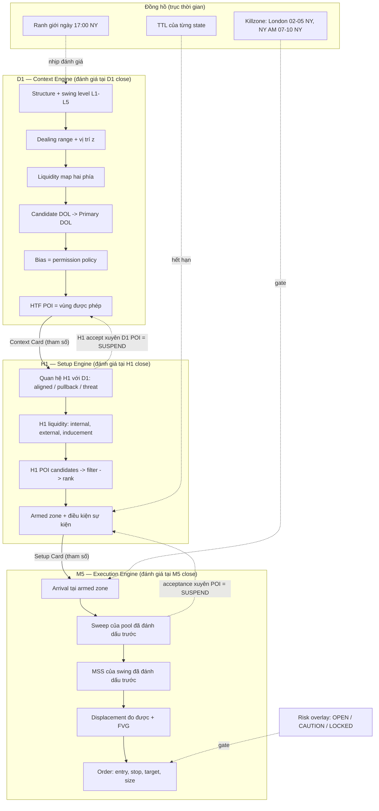
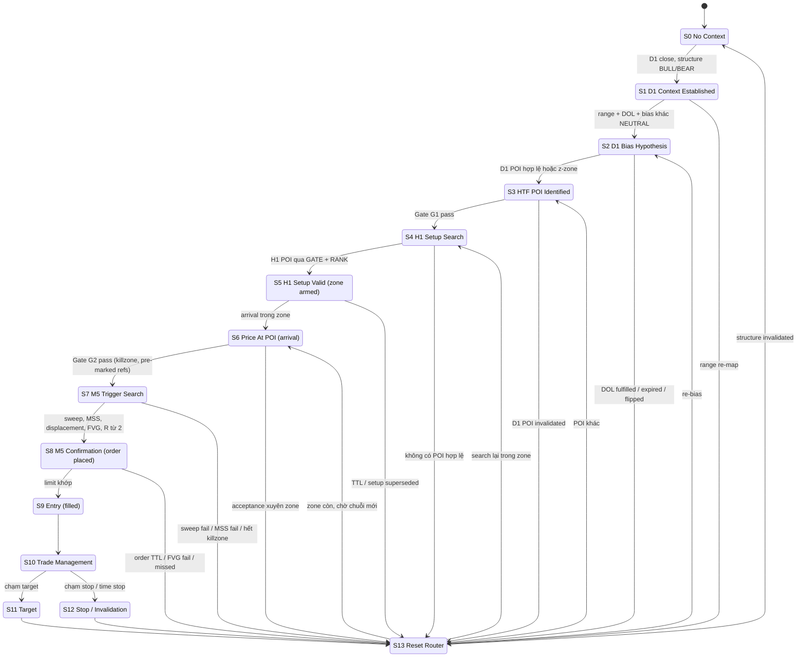
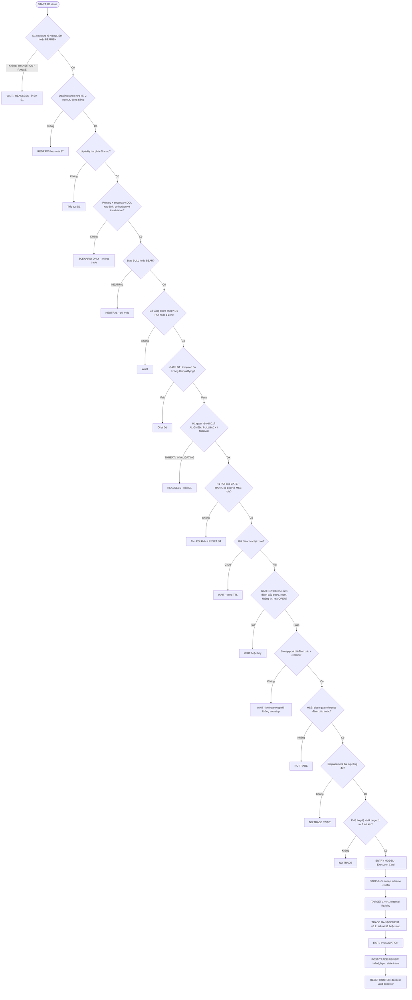

# ICT 2022 Model — Hệ thống quyết định đa khung (State Machine D1 → H1 → M5)

> [!summary] Tóm tắt 1 câu
> **2022 Model không phải "7 bước" — nó là một máy trạng thái phân cấp (hierarchical state machine) gồm ba bộ máy lồng nhau: D1 sinh ra một *giả thuyết bối cảnh có phạm vi* (hướng được phép, vùng giá, mục tiêu, điều kiện sai), H1 biến giả thuyết đó thành *một tập vùng có điều kiện được "vũ trang"*, và M5 chỉ trả lời một câu hỏi nhị phân: *tại đúng vùng đó, trong đúng khung giờ đó, thị trường đã để lại đủ bằng chứng đo được chưa?* Mỗi tầng tiêu thụ output của tầng trên như **tham số**, không phải như "xác nhận"; tầng dưới có quyền **tạm dừng (veto)** tầng trên nhưng không có quyền **tạo ra** hay **đảo** bối cảnh của tầng trên.**

> [!important] Nguyên tắc vận hành cốt lõi — 5 câu phải thuộc
> 1. **Direction from the top, timing from the bottom, veto from anywhere, location arbitrates.** Hướng đến từ D1; thời điểm đến từ M5; bất kỳ tầng nào cũng có thể chặn; và khi hai tầng mâu thuẫn, **vị trí giá** (đã đến POI chưa, có acceptance xuyên qua chưa) là trọng tài.
> 2. **Mỗi transition là một mệnh đề Boolean trên dữ liệu có dấu thời gian**, được đánh giá tại **close** của đúng khung đó. "Tôi thấy setup đẹp" không phải là một transition.
> 3. **Reset về tổ tiên sâu nhất còn hợp lệ** (deepest valid ancestor), không phải về S0. M5 fail không giết H1; H1 POI fail không giết D1; chỉ D1 structure fail mới về S0.
> 4. **Invalidated ≠ Fulfilled ≠ Expired ≠ Superseded ≠ Degraded.** Năm cách một luận điểm "hết dùng được", năm hành động khác nhau.
> 5. **Không component nào có edge cho tới khi dữ liệu của chính bạn nói vậy** — và trên dữ liệu ngẫu nhiên, chuỗi "sweep → MSS → displacement → FVG" vẫn xuất hiện đều đặn với kỳ vọng ≈ 0R (xem §4.6). Cái bạn cần chứng minh không phải là "pattern có tồn tại" mà là "pattern **làm lệch** phân phối kết quả so với null".

> [!warning] Tuyên bố mức độ bằng chứng — đọc trước khi tin bất kỳ con số nào
> Bài này dùng cùng hệ nhãn với [[57-Dealing-Range-Nghien-cuu-chuyen-sau-Swing-Significance-Selection-Algorithm-Backtest]] và [[56-Draw-on-Liquidity-DOL-Ontology-Microstructure-Failure-Model-va-Backtest]], rút gọn theo yêu cầu nghiên cứu:
>
> | Nhãn | Nghĩa | Ví dụ |
> |---|---|---|
> | `[MARKET MECHANICS]` | Cơ chế khớp lệnh / đấu giá quan sát được hoặc có nền tảng học thuật | "Stop-loss order khi bị kích hoạt trở thành market order" |
> | `[ICT FRAMEWORK]` | Cách ICT đặt tên / diễn giải | "Sell-side liquidity bị raid trước khi giá tìm tới buy-side" |
> | `[INTERPRETATION]` | Cách hiểu hợp lý nhưng không chứng minh trực tiếp được từ chart | "Reclaim nhanh sau sweep cho thấy phía bán đã cạn" |
> | `[HYPOTHESIS]` | Mệnh đề có thể kiểm định | "Setup tại D1 discount có expectancy cao hơn setup tại D1 premium" |
> | `[BACKTEST REQUIRED]` | Không được coi là edge khi chưa có dữ liệu | Mọi ngưỡng số trong bài |
> | `HEURISTIC` | Con số khởi điểm để test, không phải sự thật | "Displacement: range ≥ 2 × ATR(M5)" |
>
> **Không có nghiên cứu bình duyệt nào kiểm định trực tiếp ICT 2022 Model.** Cái có bằng chứng học thuật là các *mảnh cơ học bên dưới*: stop-loss và take-profit order co cụm quanh mức giá dễ thấy và hành xử ngược nhau (Osler 2003, 2005); mức hỗ trợ/kháng cự trùng với đỉnh độ sâu của limit order book (Kavajecz & Odders-White 2004). Toàn bộ state machine, các gate, các ngưỡng trong bài là **thiết kế đề xuất v0.1** — một bản spec để backtest, không phải kết quả đã chạy. Riêng §4.6 và §25 có số liệu thật: một mô phỏng Monte Carlo chạy cho bài này, và audit 22 lệnh backtest đang có trong vault.

> [!info] Bài này bổ sung gì cho các note đã có — đừng đọc lại những thứ đã viết
> Vault đã có nghiên cứu sâu cho từng *mảnh*. Bài này là **lớp tích hợp** — bộ khung điều phối các mảnh đó:
> - [[01 - ICT 2022 Model]] → chuỗi 7 bước, ví dụ, case study backtest thật, confluence scoring, schema logging. **Bài này không lặp lại** — nó biến 7 bước thành các state có guard, TTL, invalidation, reset.
> - [[01b - ICT 2022 Model - LTF Intraday (H1-M5-M1)]] → biến thể hạ khung. State machine ở đây áp dụng y hệt cho biến thể đó bằng cách dịch tham số khung.
> - [[57-Dealing-Range-Nghien-cuu-chuyen-sau-Swing-Significance-Selection-Algorithm-Backtest]] → cách chọn neo range, phân cấp swing L1–L5 theo *phạm vi vô hiệu*, máy trạng thái của một dealing range. **Dùng lại, không trình bày lại.**
> - [[56-Draw-on-Liquidity-DOL-Ontology-Microstructure-Failure-Model-va-Backtest]] → DOL là mệnh đề (cutoff + candidate hai phía + horizon + invalidation). **Dùng lại.**
> - [[55-Order-Block-OB-Nghien-cuu-chuyen-sau-Selection-Hierarchy-Backtest]] → lọc/xếp hạng OB, định nghĩa *acceptance* đo được. **Dùng lại.**
> - [[50-Displacement-In-Depth]], [[49-Confirmation-Timeframe-Timeframe-Layering-Khu-nhieu-MSS-trong-2022-Model]] → định lượng displacement; luật "swing cần phá phải được đánh dấu TRƯỚC". **Dùng lại.**
>
> **Phần mới thực sự:** (a) mô hình ba *đối tượng output* (Context Card → Setup Card → Execution Card) và hợp đồng giữa chúng; (b) state machine S0–S13 có guard, TTL, invalidation, reset cho từng state; (c) hai gate chính thức D1→H1 và H1→M5 với điều kiện Required / Supporting / Disqualifying; (d) **chiều thời gian** như một trục độc lập (clock, killzone gate, TTL) — thứ framework hiện tại của bạn đang thiếu; (e) phân loại 5 kiểu "hết hiệu lực"; (f) bảng giải quyết xung đột giữa các khung; (g) **null model** bằng mô phỏng — pattern xuất hiện bao nhiêu trên dữ liệu ngẫu nhiên, và một lỗi look-ahead thật đã tạo ra "edge" giả; (h) kiến trúc backtest A/B/C + ablation + daily state log; (i) audit thẳng thắn 22 lệnh backtest hiện có.

> [!info] Danh mục hình
> | # | Hình | Nằm ở |
> |---|---|---|
> | 1 | Ba bộ máy lồng nhau và hợp đồng dữ liệu giữa chúng (Mermaid) | §3.2 |
> | 2 | Base rate: xác suất một mức bị chạm dưới random walk | §4.5 |
> | 3 | Chuỗi textbook trên dữ liệu ngẫu nhiên — phễu tần suất | §4.6 |
> | 4 | Kỳ vọng trên dữ liệu ngẫu nhiên — ghi sổ lý tưởng vs thực tế vs look-ahead | §4.6 |
> | 5 | State machine S0–S13 (Mermaid) | §14.1 |
> | 6 | Decision tree tổng (Mermaid) | §28.1 |

---

# 1. Executive Summary

Hai mươi mệnh đề dưới đây là toàn bộ mental model. Phần còn lại chứng minh, mở rộng, và biến chúng thành luật kiểm tra được.

1. **2022 Model là một hệ thống lọc tuần tự, không phải một pattern.** Nó nhận vào toàn bộ không gian khả năng {long, short, đứng ngoài} × {mọi mức giá} × {mọi thời điểm} và thu hẹp dần xuống {một hướng, một vùng, một cửa sổ thời gian, một mức vào, một mức sai}. Mỗi tầng khung là một lần thu hẹp. `[INTERPRETATION]`

2. **Mỗi khung trả lời một câu hỏi có *kiểu dữ liệu* khác nhau.** D1 trả lời "*được phép* giao dịch hướng nào, quanh vùng nào, nhắm tới đâu, và điều gì chứng minh mình sai?" (một *giả thuyết có phạm vi*). H1 trả lời "*ở đâu* và *dưới điều kiện gì* thì một setup được phép hình thành?" (một *tập vùng có điều kiện*). M5 trả lời "*đã có đủ bằng chứng* để đặt lệnh chưa, và lệnh cụ thể là gì?" (một *phán quyết + lệnh*).

3. **Output của tầng trên là tham số của tầng dưới, không phải bằng chứng của nó.** H1 không được quyết định lại hướng; nó kế thừa hướng. M5 không được quyết định lại vùng; nó kế thừa vùng. Một tầng dưới "tự tìm" hướng hay vùng là đang chạy một hệ thống khác mà không biết.

4. **Vì sao hướng phải đến từ khung cao — có một lý do toán học.** Nếu có drift (xu hướng) thật với cường độ μ mỗi đơn vị thời gian, thì tín hiệu tăng tuyến tính (μt) trong khi nhiễu tăng theo căn (σ√t). Tỷ lệ tín hiệu/nhiễu ∝ √t. Trên M5, bất kỳ thông tin hướng nào cũng bị nhiễu nhấn chìm; nếu có thông tin hướng thì nó chỉ phát hiện được ở horizon dài. `[MARKET MECHANICS — thống kê]`

5. **Vì vậy giá trị chính của M5 không nằm ở xác suất thắng mà ở hình học rủi ro.** M5 cho phép đặt stop sát điểm luận điểm sai, biến cùng một target thành R lớn hơn. Dự báo kiểm định được: nếu thêm tầng M5 (Model C so với Model B) có giá trị, nó sẽ hiện ra chủ yếu ở **average R / stop distance**, và win rate có thể *giảm*. `[HYPOTHESIS]` `[BACKTEST REQUIRED]`

6. **Framework hiện tại của bạn thiếu một trục: THỜI GIAN.** ICT 2022 là mô hình *time + price* — killzone là điều kiện, không phải trang trí. D1/H1/M5 là trục giá; cần một trục đồng hồ độc lập: ranh giới ngày (17:00 NY), killzone gate, TTL (thời hạn sống) cho từng state. Không có trục này, "setup hết hạn" là khái niệm không định nghĩa được. `[ICT FRAMEWORK]` + `[INTERPRETATION]`

7. **Daily Bias nên được hiểu là một *chính sách cấp phép* (permission policy), không phải một dự báo.** Bias = "hôm nay chỉ những setup hướng X được xét". Giá trị của bias đo bằng việc nó có *cải thiện expectancy có điều kiện* của các setup được phép hay không — không phải bằng việc "ngày đó đóng cửa đúng hướng bias". `[INTERPRETATION]` `[BACKTEST REQUIRED]`

8. **Neutral là một output hợp lệ của D1, và thường là output đúng.** Chính ICT (theo bản tóm tắt thứ cấp Ep.19 của 2022 Mentorship) nói có những thị trường ông "không có bias" và muốn thấy displacement tạo ra một range dùng được trước. Một hệ thống không bao giờ trả lời "neutral" là một hệ thống ép dữ liệu. `[ICT FRAMEWORK — nguồn thứ cấp]`

9. **H1 ngược hướng D1 không phải là xung đột — nó là hình học bình thường của một cú hồi.** Khi D1 bullish và giá đang hồi về D1 discount, H1 *phải* đang bearish. Xung đột chỉ có nghĩa **khi đặt trong quan hệ với vị trí**: H1 bearish *trước* khi tới D1 POI = pullback đang diễn ra (chờ); H1 bearish *xuyên qua* D1 POI có acceptance = POI thất bại (reset); H1 chuyển bullish *tại/sau* D1 POI = alignment.

10. **"Giá chạm H1 POI" chỉ là *arrival*, không phải *setup*.** H1 → M5 gate đòi thêm: context D1 còn hiệu lực, POI chưa bị accept xuyên qua, đang trong killzone, **mức thanh khoản sẽ bị sweep và swing sẽ bị phá cho MSS đã được đánh dấu TRƯỚC**, và còn đủ khoảng cách tới target.

11. **Năm vai trò không được gộp thành "confirmation":** D1 Bias = *context*; H1 POI = *location*; Liquidity sweep = *event*; MSS = *structural evidence*; Displacement = *price-delivery evidence*; FVG = *execution location*; Entry = *execution rule*. Gọi tất cả là "confirmation" làm bạn không thể biết mắt xích nào hỏng khi lệnh thua.

12. **Mỗi thành phần có invalidation riêng, bằng chứng riêng, và phạm vi riêng.** Structure chết bằng *body close* xuyên protected swing; POI chết bằng *acceptance*; DOL "chết" vì được *chạm* (fulfilled) hoặc vì phía đối diện bị lấy với displacement (superseded); setup chết vì *hết giờ* (expired). Dùng một invalidation cho mọi thứ = hoặc reset quá nhiều, hoặc giữ luận điểm chết quá lâu.

13. **Tầng dưới có quyền SUSPEND tầng trên, không có quyền INVALIDATE.** Một cú xuyên sâu dưới protected low D1 trong phiên London là lý do *ngừng tìm entry mới* (SUSPENDED) — nhưng chỉ **D1 close** mới được kết luận cấu trúc D1 đã đổi. Đây là cách tránh cả hai lỗi: ôm luận điểm đã chết, và vứt luận điểm vì một cái râu.

14. **Wick không bao giờ invalidate; acceptance mới invalidate.** Quy ước này khớp với [[57-Dealing-Range-Nghien-cuu-chuyen-sau-Swing-Significance-Selection-Algorithm-Backtest]] và [[55-Order-Block-OB-Nghien-cuu-chuyen-sau-Selection-Hierarchy-Backtest]]: acceptance = N thân nến đóng ngoài mức mà không reclaim (N = 2, HEURISTIC).

15. **Cơ chế thật đằng sau "sweep rồi đảo chiều" là một cuộc đua giữa cầu hữu hạn và cầu mới.** Stop orders là *cầu tiềm ẩn hữu hạn*: khi bị kích hoạt chúng trở thành market order, đẩy giá xuyên mức. Nếu sau khi cụm stop được tiêu thụ **không có dòng lệnh mới cùng hướng**, mất cân bằng lật ngược → reclaim. Nếu cú phá do *thông tin mới*, stop cascade trở thành nhiên liệu → giá chạy tiếp (Osler 2005 ghi nhận xu hướng nhanh bất thường khi giá chạm vùng stop co cụm). Sweep và run là **cùng một sự kiện ban đầu với hai kết cục** — chart chỉ phân biệt được sau vài nến, bằng reclaim vs acceptance. `[MARKET MECHANICS]` + `[INTERPRETATION]`

16. **"Thanh khoản bị lấy" có base rate rất cao ngay cả khi giá đi ngẫu nhiên.** Một mức cách 1 ATR bị chạm trong 12 nến với xác suất ≈ 64% dưới random walk; một mức cách 0,5 ATR trong 5 nến ≈ 72%. Vì vậy "PDL đã bị sweep" gần như không mang thông tin; thông tin nằm ở *phía nào bị lấy trước* và *điều gì xảy ra sau đó*. (§4.5)

17. **Trên 100.000 phiên random walk, chuỗi sweep + reclaim + MSS + displacement + FVG + limit khớp xuất hiện ở 1,4% phiên (chỉ chiều long) — và kỳ vọng ≈ 0R ở mọi tầng lọc.** Filter không tạo ra edge trên dữ liệu martingale; filter chỉ đổi tần suất. Mọi edge thật phải đến từ chỗ dữ liệu thật **lệch khỏi martingale có điều kiện** trên chuỗi đó. (§4.6)

18. **Cách nhanh nhất để "tìm thấy" edge là ghi sổ sai.** Trong mô phỏng, ghi lỗ luôn đúng −1R (bỏ qua trượt giá qua stop) cộng thêm tới khoảng +0,1R "edge" trên dữ liệu ngẫu nhiên (mạnh nhất ở các biến thể có stop sát); một lỗi look-ahead tinh vi trong bản detector đầu tiên của chính bài này tạo ra +0,10R với sai số chuẩn 0,016 — tức "có ý nghĩa thống kê" ở mức 6 sai số chuẩn — trên dữ liệu **hoàn toàn ngẫu nhiên**. (§4.6)

19. **22 lệnh backtest hiện có trong vault cho win rate 77% (khoảng tin cậy Wilson 95%: 57–90%) và +1,77R/lệnh — con số này nhiều khả năng phản ánh quy trình chọn mẫu hơn là edge.** Lý do: mẫu được chọn thủ công theo ngày, chỉ ngày có lệnh được log, `bias_correct` được chấm sau khi biết kết quả (21/22 = "Yes"), và có lỗi dữ liệu. Không phải lỗi của bạn — đây là trạng thái mặc định của mọi backtest thủ công chưa có protocol. Cách sửa: **log mọi ngày**, kể cả ngày dừng ở S0. (§25.3)

20. **Mục tiêu cuối cùng không phải là "hiểu 2022 Model" mà là có một spec đủ chặt để hai người khác nhau chạy trên cùng dữ liệu ra cùng một danh sách lệnh.** Chừng nào điều đó chưa đúng, mọi con số backtest đo *người chạy*, không đo *mô hình*.

---

# 2. What Is the ICT 2022 Model?

## 2.1 Định nghĩa ngắn — theo cách ICT dạy

`[ICT FRAMEWORK]` "ICT 2022 Model" là tên cộng đồng gọi mô hình vào lệnh được Michael J. Huddleston (Inner Circle Trader) trình bày trong **2022 Mentorship** phát miễn phí trên kênh YouTube của ông. Bản tóm tắt thứ cấp phổ biến nhất (và khớp với [[01 - ICT 2022 Model]]) có dạng:

> Xác định bias và draw on liquidity ở khung cao → **chờ giá lấy thanh khoản** (buy-side hoặc sell-side) → **displacement** ngược lại phá một swing ngắn hạn (**MSS**) và để lại **FVG** → vào lệnh khi giá **retrace về FVG** → stop ngoài cực trị của cú sweep → target là **thanh khoản phía đối diện** — *trong các khung giờ killzone* (London ≈ 02:00–05:00 NY, New York AM ≈ 07:00–10:00 NY).

## 2.2 Định nghĩa dùng trong bài này — theo cách một hệ thống cần

Định nghĩa trên là một *chuỗi sự kiện*. Một hệ thống cần nhiều hơn: nó cần biết **khi nào được bắt đầu tìm chuỗi đó**, **khi nào phải ngừng tìm**, và **khi nào những gì đã tìm được hết hiệu lực**. Vì vậy trong bài này:

> **ICT 2022 Model (bản hệ thống) = một máy trạng thái phân cấp ba tầng (D1 context, H1 setup, M5 execution) cộng một đồng hồ (session / killzone / TTL) cộng một lớp rủi ro (risk overlay), trong đó mỗi chuyển trạng thái là một mệnh đề đo được trên dữ liệu đã đóng nến, và mọi trạng thái đều có điều kiện chết và đích reset xác định trước.**

## 2.3 Những gì 2022 Model KHÔNG phải

| Không phải | Vì sao hay bị hiểu nhầm | Hệ quả nếu nhầm |
|---|---|---|
| Một pattern M5 ("sweep + MSS + FVG = vào") | Vì phần M5 là phần "nhìn thấy" và dễ nhận dạng nhất | Trade mọi chuỗi M5 bất kể bối cảnh → như §4.6 cho thấy, chuỗi đó xuất hiện cả trên dữ liệu ngẫu nhiên |
| Một dự báo hướng ngày | Vì "bias" nghe như dự báo | Chấm điểm bias bằng hướng nến ngày → outcome bias; bỏ lỡ giá trị thật của bias (lọc) |
| Một chuỗi phải đủ 7/7 mới vào | Vì checklist 7 ô | Đúng như một *gate*, nhưng không nói gì về *trình tự thời gian*, *hết hạn*, *reset* |
| Một mô hình được kiểm chứng thống kê | Vì được dạy bởi một người nổi tiếng và có nhiều chart "đúng" | Tin trước khi đo → mọi dữ liệu trở thành xác nhận |
| Mô tả hành vi của một actor ("thuật toán", "smart money") | Vì ngôn ngữ ICT gán ý đồ | Không thể falsify; mọi thất bại được giải thích bằng "họ đổi ý" |

## 2.4 Vì sao framework được cấu trúc theo thứ tự đó — đọc thứ tự như một thiết kế

Thứ tự "bias → draw → sweep → displacement/MSS → FVG → entry → target" không tùy tiện. Mỗi bước giải quyết một loại bất định khác nhau, theo thứ tự **từ bất định lớn nhất và chậm thay đổi nhất xuống bất định nhỏ nhất và nhanh thay đổi nhất**:

| Bước | Loại bất định được giải quyết | Tốc độ thay đổi của câu trả lời | Chi phí nếu trả lời sai |
|---|---|---|---|
| Bias / context | Hướng nào được phép? | Chậm (ngày → tuần) | Toàn bộ lệnh trong ngày cùng sai phía |
| Draw on liquidity | Giá "có chỗ để đi" tới đâu? | Chậm–vừa | Target sai, R:R ảo |
| Location (POI, premium/discount) | Vào *ở đâu* thì hình học rủi ro tốt? | Vừa (giờ) | Vào giữa range, stop xa, R:R kém |
| Liquidity event (sweep) | Phía đối diện đã bị tiêu thụ chưa? | Nhanh (phút) | Vào trước khi "nhiên liệu ngược" cạn → bị quét |
| Displacement + MSS | Mất cân bằng đã lật chưa? | Nhanh | Vào vào một cú hồi kỹ thuật chưa có chuyển dịch |
| FVG / entry | Mức giá cụ thể nào để đặt lệnh? | Rất nhanh | Chase, stop rộng |
| Stop / target | Luận điểm sai ở đâu, đúng tới đâu? | Cố định sau entry | Rủi ro không kiểm soát |

Đọc bảng theo cột cuối: **cái sai đắt nhất phải được kiểm tra trước, bằng dữ liệu chậm nhất và ít nhiễu nhất.** Đó chính là lý do top-down. Đây cũng là lý do đảo thứ tự (thấy M5 đẹp rồi mới đi tìm lý do D1) là lỗi logic chứ không chỉ là lỗi kỷ luật: bạn đang dùng dữ liệu nhiễu nhất để chọn giả thuyết, rồi dùng dữ liệu ít nhiễu để *hợp lý hoá* nó.

---

# 3. The Core Mental Model

## 3.1 Ba bộ máy, ba đối tượng output

Hãy nghĩ về hệ thống như ba phòng ban trong một công ty, mỗi phòng chỉ nhận **phiếu yêu cầu đã điền đủ** từ phòng trên:

- **Phòng Chiến lược (D1)** viết một **Context Card**: "Tuần này chúng ta chỉ mua. Chỉ mua trong vùng giá rẻ hơn X. Mục tiêu là Y. Nếu đối thủ làm Z thì toàn bộ kế hoạch huỷ." Phòng này **không** quyết định mua lúc nào.
- **Phòng Tác chiến (H1)** nhận Context Card và viết **Setup Card**: "Trong vùng X, có hai địa điểm A và B đủ điều kiện. A ưu tiên. Chỉ hành động tại A nếu trước đó có sự kiện E, và trong khung giờ K. A hết hiệu lực nếu W." Phòng này **không** được đổi hướng mua thành bán.
- **Phòng Thực thi (M5)** nhận Setup Card và chỉ làm một việc: tại A, trong K, **chờ bằng chứng** theo đúng danh sách đã in sẵn. Có đủ → xuất **Execution Card** (entry, stop, target, size). Không đủ → không làm gì, và báo lên.

Phép so sánh này có giới hạn: phòng ban trong công ty có thể thương lượng; trong hệ thống này **luồng quyền hạn là một chiều về hướng và vị trí**, nhưng **luồng thông tin là hai chiều**: M5 có thể báo "tại A, phía bán vừa accept xuyên qua" — và thông tin đó được phép *tạm dừng* (suspend) Setup Card, thậm chí kích hoạt phòng Chiến lược *đánh giá lại* tại lần đóng nến D1 tiếp theo. Nhưng M5 không bao giờ được tự viết Context Card mới.

## 3.2 Sơ đồ hợp đồng dữ liệu


*Hình 1 — Ba bộ máy lồng nhau. Mũi tên liền: tham số chảy xuống. Mũi tên đứt: tín hiệu veto/suspend chảy lên, cổng thời gian và cổng rủi ro chảy ngang. Không có mũi tên liền nào đi lên.*

## 3.3 Bốn đối tượng dữ liệu — viết ra được mới tồn tại

Một đối tượng mà bạn không viết ra được thì không tồn tại trong hệ thống. Đây là "hợp đồng" giữa các tầng (định dạng đầy đủ ở §6.10, §9.7, §12.7):

| Đối tượng | Do ai tạo | Chứa gì (tối thiểu) | Ai tiêu thụ | Hết hạn khi |
|---|---|---|---|---|
| **Context Card** | D1 tại D1 close | structure state, active range + z, pool list hai phía, primary/secondary DOL, bias ∈ {Bull, Bear, Neutral}, HTF POI, invalidation từng thành phần, TTL | H1 | D1 close kế tiếp (re-issue), hoặc một hard event |
| **Setup Card** | H1 tại H1 close | hướng (kế thừa), armed zones xếp hạng, pool sẽ bị sweep, swing sẽ bị phá cho MSS, điều kiện hủy, TTL, target candidates | M5 | TTL, POI accept-through, Context Card đổi |
| **Execution Card** | M5 tại M5 close | entry type + giá, stop + lý do, target + R, size theo risk, điều kiện hủy lệnh chờ | Broker + journal | fill / cancel / TTL lệnh chờ |
| **Trade Record** | Sau exit | toàn bộ card trên + outcome + MAE/MFE + state trace | Backtest / review | Không bao giờ (dữ liệu) |

## 3.4 Causal hierarchy — mỗi component đóng vai gì

Yêu cầu nghiên cứu của bạn đặt ra chuỗi CONTEXT → CONDITION → OBSERVATION → INTERPRETATION → CONFIRMATION → TRIGGER → EXECUTION → RISK → TARGET. Gán từng component vào đúng một vai chính:

| Component | Vai chính | Vai *không phải* | Câu nó trả lời |
|---|---|---|---|
| D1 structure | CONTEXT | trigger | "Cấu trúc nào đang chi phối?" |
| Dealing range + z | CONTEXT (khung vị trí) | tín hiệu hướng | "Giá đang đắt hay rẻ *so với range này*?" |
| Liquidity map | OBSERVATION | dự báo | "Các mức dễ thấy nằm ở đâu?" |
| Primary DOL | INTERPRETATION → HYPOTHESIS | entry trigger | "Nếu luận điểm đúng, giá có chỗ đi tới đâu?" |
| Daily bias | CONDITION (permission) | prediction | "Hướng nào được xét hôm nay?" |
| HTF POI | CONDITION (location) | confirmation | "Vùng nào được phép tìm setup?" |
| H1 POI | CONDITION (refined location) | entry | "Chính xác vùng nào, xếp hạng ra sao?" |
| Killzone | CONDITION (time) | edge tự thân | "Có đang trong cửa sổ được phép không?" |
| Liquidity sweep | OBSERVATION (event) | reversal signal tự thân | "Pool đã đánh dấu có bị tiêu thụ rồi reclaim không?" |
| MSS | CONFIRMATION (structural evidence) | entry | "Cấu trúc ngắn hạn đã đổi chưa?" |
| Displacement | CONFIRMATION (delivery evidence) | "nến to" | "Cú đổi đó có mất cân bằng đo được không?" |
| FVG | EXECUTION (location) | confirmation | "Đặt lệnh ở mức nào?" |
| Entry rule | TRIGGER → EXECUTION | — | "Lệnh gì, loại lệnh gì, khi nào hủy?" |
| Stop | RISK | "chỗ an toàn" | "Luận điểm sai ở đâu?" |
| Target | TARGET | "chắc chắn tới" | "Luận điểm đúng thì thoát ở đâu?" |

> [!warning] Ba câu "X không phải Y" quan trọng nhất
> - **D1 DOL không phải entry trigger.** Nó chỉ nói *nếu* có entry thì hướng nào có "chỗ đi". Xem [[56-Draw-on-Liquidity-DOL-Ontology-Microstructure-Failure-Model-va-Backtest]].
> - **H1 POI không phải entry trigger.** Chạm POI chỉ là *arrival*. Mistake tương ứng: [[03-Mistake-Entry-When-MSS-not-in-POI-Zone]] (chiều ngược lại) và [[02-Mistake-Enter-before-liquidity-sweep]].
> - **M5 MSS không nhất thiết là entry. FVG không mặc định là entry.** MSS là bằng chứng; FVG là địa chỉ; entry là một *luật* có điều kiện hủy.

## 3.5 Kiểm tra framework hiện tại của bạn — 8 giả định cần sửa hoặc làm rõ

Theo yêu cầu *ASSUMPTION → PROBLEM → ALTERNATIVE → IMPLICATION → TEST*:

**A1 — "D1 = context" ngầm giả định D1 chứa thông tin về hướng của cú di chuyển trong ngày.**
- *Problem:* chưa được chứng minh. Lợi suất intraday phần lớn là nhiễu; tương quan giữa cấu trúc D1 và hướng phiên NY có thể rất yếu.
- *Alternative:* giá trị của D1 có thể nằm chủ yếu ở **bản đồ mức giá** (pool ở đâu, POI ở đâu, range ở đâu) chứ không phải ở **hướng**.
- *Implication:* nếu đúng, bias chỉ nên là bộ lọc yếu; phần lớn giá trị đến từ việc *chọn vị trí*.
- *Test:* Model A (D1 only) vs baseline ngẫu nhiên; và tách ablation "bỏ bias nhưng giữ POI" vs "bỏ POI nhưng giữ bias" (§23).

**A2 — Framework D1/H1/M5 không có trục thời gian, trong khi 2022 Model dạy killzone là điều kiện.**
- *Problem:* không định nghĩa được "setup hết hạn"; trigger ngoài killzone lẫn vào thống kê.
- *Alternative:* thêm một đồng hồ độc lập (§3.2): ranh giới ngày, killzone gate, TTL.
- *Implication:* mọi state từ S4 trở đi có TTL; M5 chỉ được tìm trigger trong killzone (hoặc macro window, xem [[40-Macro-Times]]).
- *Test:* phân tầng kết quả theo session; ablation "bỏ time gate" (§23).

**A3 — "H1 phải xác nhận" không nói rõ xác nhận *loại gì*.**
- *Problem:* nếu đòi H1 MSS, bạn chờ quá lâu — khi H1 MSS hoàn tất, phần lớn cú di chuyển đã xảy ra, R:R sụp. Nếu không đòi gì, H1 chỉ là bản sao của D1.
- *Alternative:* tách hai biến thể: **H1-location** (H1 chỉ cung cấp vùng + bản đồ thanh khoản, M5 cung cấp bằng chứng — đây là 2022 Model chuẩn) vs **H1-confirmed** (đòi H1 sweep + H1 displacement trước khi xuống M5).
- *Implication:* đây là một **đánh đổi độ trễ xác nhận (confirmation latency)** — xác nhận càng cao khung càng chắc nhưng càng đắt về R.
- *Test:* chạy cả hai biến thể trên cùng tập ngày; so sánh expectancy *theo ngày* (không theo lệnh).

**A4 — Top-down được hiểu như dòng chảy một chiều.**
- *Problem:* bằng chứng sớm nhất rằng một D1 POI "giữ" thường xuất hiện ở khung thấp (một M5/H1 displacement tại POI).
- *Alternative:* luồng *quyền hạn* một chiều, luồng *bằng chứng* hai chiều — bằng chứng từ dưới có thể **tăng/giảm confidence** và **suspend**, không thể **tạo** hay **đảo** context.
- *Test:* đo xem setup có M5 displacement mạnh tại POI có tỷ lệ "D1 thesis đúng" cao hơn không.

**A5 — DOL và bias dễ tạo vòng lặp.** DOL suy ra bias, bias xác nhận DOL. Đã phân tích kỹ ở [[56-Draw-on-Liquidity-DOL-Ontology-Microstructure-Failure-Model-va-Backtest]] §10. Ở đây chỉ thêm một luật hệ thống: **DOL và bias phải được ghi tại cùng một cutoff, trước khi mở H1, và không được sửa trong ngày trừ khi một reset trigger (§7) xảy ra và được ghi lý do.**

**A6 — Đánh giá "bias đúng/sai" sau khi biết kết quả.** Field `bias_correct` trong 22 lệnh backtest có 21/22 "Yes". Nếu field này được chấm sau khi thấy giá đi đâu, nó đo *hindsight*, không đo *bias*. Sửa: thay bằng hai field — `bias_at_cutoff` (ghi trước) và `dol_reached_within_horizon` (tính máy móc sau).

**A7 — Tỷ lệ khung D1/H1/M5 được giả định đúng cho mọi thị trường.**
- *Problem:* NQ trong giờ RTH và EURUSD phiên Á có cấu trúc biến động khác hẳn; một "H1 swing" ở hai thị trường không tương đương.
- *Alternative:* chọn khung theo ATR ratio — đã phân tích ở [[49-Confirmation-Timeframe-Timeframe-Layering-Khu-nhieu-MSS-trong-2022-Model]] §7C.
- *Test:* thống kê riêng từng thị trường; không gộp.

**A8 — Chuỗi điều kiện càng dài càng tốt.**
- *Problem:* mỗi điều kiện AND thêm vào làm giảm N và tăng khả năng overfit; một chuỗi 12 điều kiện có thể "đúng" trên 20 lệnh hoàn toàn nhờ may mắn.
- *Alternative:* coi mỗi điều kiện là một giả thuyết phải tự chứng minh giá trị gia tăng (ablation).
- *Test:* §23; và kiểm soát multiple testing (§24.4).

---

# 4. Market Mechanics Behind the Framework

Mục tiêu của phần này: giải thích **những gì thực sự xảy ra** bên dưới mỗi thuật ngữ ICT, không dùng "smart money" như một hộp đen. Nếu một khái niệm ICT có giá trị, giá trị đó phải đi qua một trong các cơ chế dưới đây. Nếu không đi qua cơ chế nào, nó là narrative.

## 4.1 Ba loại lệnh và ai "cung cấp" thanh khoản cho ai

`[MARKET MECHANICS]`

| Loại lệnh | Làm gì với sổ lệnh | Vai trò thanh khoản | Ví dụ gần ICT |
|---|---|---|---|
| **Limit order** | Nằm chờ trong sổ ở một mức giá | *Cung cấp* thanh khoản (liquidity provider) | Lệnh mua chờ ở CE của FVG |
| **Market order** | Khớp ngay với limit tốt nhất phía đối diện, "ăn" dần các mức | *Tiêu thụ* thanh khoản (liquidity taker) | Người đuổi theo breakout |
| **Stop order** | *Không nằm trong sổ hiển thị* ở hầu hết venue; khi giá chạm mức kích hoạt, nó **trở thành market order** (hoặc stop-limit) | *Cầu/cung tiềm ẩn*: bình thường vô hình, khi kích hoạt thì tiêu thụ thanh khoản | Stop-loss của người short nằm trên PDH; buy-stop của người đánh breakout nằm trên PDH |

Điểm then chốt: **"liquidity" trong ngôn ngữ ICT gần như luôn là stop order (thanh khoản tiềm ẩn), trong khi "liquidity" trong microstructure thường là limit order (độ sâu sổ lệnh).** Hai nghĩa này ngược nhau về hành vi: limit order *hấp thụ* chuyển động, stop order *khuếch đại* chuyển động. Một vùng "đầy thanh khoản" theo nghĩa ICT (nhiều stop) là vùng giá sẽ **chạy nhanh qua** khi bị chạm; một vùng "đầy thanh khoản" theo nghĩa microstructure (nhiều limit) là vùng giá sẽ **khựng lại**. Bảng phân biệt đầy đủ ở [[56-Draw-on-Liquidity-DOL-Ontology-Microstructure-Failure-Model-va-Backtest]] §4.1.

## 4.2 Bằng chứng thực nghiệm có thật — và nó nói gì chính xác

`[MARKET MECHANICS]` — đây là phần duy nhất của toàn bộ câu chuyện "liquidity" có dữ liệu lệnh thật:

- **Osler (2003, *Journal of Finance*)** dùng dữ liệu lệnh stop-loss và take-profit thật của một ngân hàng trên thị trường FX. Kết quả: *take-profit orders co cụm đặc biệt mạnh ĐÚNG TẠI số tròn*, còn *stop-loss orders co cụm mạnh NGAY SAU số tròn*. Tác giả dùng điều này để giải thích hai "dự báo" kinh điển của phân tích kỹ thuật: (1) xu hướng hay đảo chiều tại hỗ trợ/kháng cự, và (2) xu hướng hay tăng tốc sau khi vượt qua các mức đó.
- **Osler (2005, *Journal of International Money and Finance*)**: tỷ giá di chuyển nhanh bất thường khi chạm các mức nơi stop-loss co cụm; stop-loss tạo phản ứng giá lớn hơn và kéo dài hơn take-profit → stop-loss lan truyền xu hướng theo từng đợt ("price cascades"), góp phần giải thích đuôi dày của phân phối lợi suất.
- **Kavajecz & Odders-White (2004, *Review of Financial Studies*)**: các mức hỗ trợ/kháng cự trùng với **đỉnh độ sâu** của limit order book — tức phân tích kỹ thuật có thể có giá trị vì nó *định vị thanh khoản đã có sẵn*, kể cả trong một thị trường hiệu quả.

**Hệ quả cho 2022 Model — đọc kỹ vì nó vừa ủng hộ vừa phản bác:**

1. *Ủng hộ:* có cơ sở cơ học để tin rằng mức giá dễ thấy (swing high/low, số tròn, PDH/PDL) là nơi tập trung lệnh chờ. "Liquidity pool" không phải là tưởng tượng.
2. *Phản bác một phần:* bằng chứng Osler cho thấy khi giá **vượt qua** vùng stop, phản ứng mặc định được ghi nhận là **tăng tốc theo hướng phá** (cascade) — không phải đảo chiều. Mô hình "sweep rồi đảo" của ICT đòi hỏi một điều kiện bổ sung: *sau khi cascade tiêu thụ cụm stop, cầu cùng hướng không được bổ sung*. Điều đó **không** được bằng chứng trên chứng minh; nó là một giả thuyết có điều kiện.
3. *Tinh tế:* take-profit ở số tròn (cầu/cung ngược hướng xu hướng) giải thích được việc giá *khựng* tại mức — tức một phần của "phản ứng tại POI" có thể đến từ take-profit của người đã có vị thế, không phải từ "institution vào lệnh mới".

> [!warning] Giới hạn của bằng chứng
> Dữ liệu Osler là FX (một ngân hàng, một giai đoạn); Kavajecz & Odders-White là cổ phiếu NYSE. Không có bằng chứng tương đương công khai cho NQ futures của thập niên 2020 ở cấp độ lệnh từng người. Bạn đang **suy rộng một cơ chế**, không phải áp dụng một kết quả.

## 4.3 Cơ chế của một cú sweep — tách từng giây

Giả sử có cụm buy-stop trên PDH (stop-loss của người short + buy-stop của người đánh breakout). Chuỗi sự kiện *có thể* xảy ra:

| Pha | Quan sát được trên chart | Cơ chế `[MARKET MECHANICS]` | Diễn giải ICT `[ICT FRAMEWORK]` |
|---|---|---|---|
| 1. Tiếp cận | Giá nhích dần về PDH | Market maker/limit sell nằm phía trên; người mua chủ động đẩy lên | "Giá được kéo về buy-side liquidity" |
| 2. Kích hoạt | Râu vọt qua PDH | Buy-stop kích hoạt → trở thành market buy → ăn qua các mức ask mỏng → giá nhảy | "Buy stops bị raid" |
| 3. Tiêu thụ | Râu dừng lại vài tick/pip trên mức | Cụm stop là **hữu hạn**; khi hết, cầu market mua biến mất đột ngột | "Liquidity đã được lấy" |
| 4a. Reclaim (sweep) | Nến đóng lại dưới PDH, nến sau giảm mạnh | Người bán lớn (nếu có) đã *bán vào* dòng market buy — nhận được giá tốt với ít tác động; cầu cạn; take-profit của người long cũng bán ra → mất cân bằng lật | "Smart money bán vào buy stops; displacement xuống" |
| 4b. Acceptance (run) | Nến đóng trên PDH, các nến sau tiếp tục lên | Cú phá mang **thông tin mới** hoặc có cầu mới lớn; cascade trở thành nhiên liệu | "Giá đang được giao tới DOL cao hơn" |

Điểm mấu chốt về nhận thức: **Pha 1–3 giống hệt nhau trong cả hai kết cục.** Tại thời điểm râu vượt PDH, không ai (kể cả bạn nhìn chart) biết đó là sweep hay run. Phân biệt chỉ đến sau vài nến — bằng *close behavior*. Vì vậy:

- Một định nghĩa "sweep" dùng thông tin trong nến kích hoạt là **chưa đủ**; nó phải chờ **reclaim** (đóng lại phía trong) trong một cửa sổ ngắn.
- Displacement ngược lại sau sweep là **proxy quan sát được** rằng mất cân bằng đã lật — đó là lý do cơ học để 2022 Model đòi displacement, chứ không phải vì "nến to trông đẹp".

## 4.4 Displacement, FVG và vì sao giá "quay lại" — nhìn từ góc độ khớp lệnh

`[MARKET MECHANICS]`

- **Displacement** = một đoạn giá đi xa trong ít thời gian so với độ biến động bình thường. Theo mô hình Kyle (1985), mức giá thay đổi tỷ lệ với *dòng lệnh ròng* chia cho *độ sâu* (hệ số λ). Một cú displacement nghĩa là: hoặc dòng market order một chiều rất lớn, hoặc độ sâu bị rút (người cung cấp thanh khoản rút lệnh — hay xảy ra quanh tin tức), hoặc cả hai. **Chart không cho bạn biết là trường hợp nào.** Volume giúp phân biệt một phần: displacement với volume thấp gợi ý rút thanh khoản hơn là mua bán lớn.
- **FVG** trên nến M5 = một vùng giá mà *đường đi trên nến* chỉ đi qua một chiều trong nến giữa. **FVG không phải là "khoảng không có giao dịch"** trên thị trường liên tục như NQ hay EURUSD — mọi tick trong vùng đó đều đã được giao dịch, chỉ là trong một nến và theo một chiều. Vì vậy "imbalance" ở đây nghĩa là *thời gian giao dịch hai chiều ít*, không phải *không có giao dịch*. Volume profile thường cho thấy đây là một vùng volume thấp.
- **Vì sao giá quay lại FVG?** Có ít nhất ba giải thích cạnh tranh, và bạn không cần chọn một:
  1. **Base rate (giải thích nhàm chán nhất và mạnh nhất):** một vùng gần giá hiện tại *sẽ được chạm lại với xác suất cao* dưới gần như mọi quá trình ngẫu nhiên (§4.5). "FVG được fill" có base rate cao đến mức gần như không mang thông tin.
  2. **Hành vi người tham gia:** người lỡ cú di chuyển đặt limit ở vùng vừa bị bỏ qua; người cung cấp thanh khoản bị "chạy qua" có thể quote lại.
  3. **Kháng cự thấp:** vùng volume thấp ít limit order → giá đi qua dễ theo *cả hai chiều*.
- Điều cần kiểm định **không phải** "giá có quay lại FVG không" mà là **"phản ứng khi quay lại FVG có khác phản ứng khi quay lại một vùng ngẫu nhiên cùng khoảng cách không"**. `[HYPOTHESIS]`

## 4.5 Base rate — một mức bị "lấy" thường xuyên đến mức nào nếu giá đi ngẫu nhiên?

Với random walk không drift, biến động mỗi nến σ, xác suất giá chạm một mức cách d trong T nến (nguyên lý phản xạ):

$$P(\text{chạm}) = 2\left[1 - \Phi\!\left(\frac{d}{\sigma\sqrt{T}}\right)\right]$$

Với chuyển động Brown, biên độ kỳ vọng của một nến = $2\sqrt{2/\pi}\,\sigma \approx 1{,}6\sigma$, nên nếu lấy ATR ≈ biên độ nến trung bình thì σ ≈ 0,63 × ATR. Thay số:

| Mức cách (ATR) | Trong 1 nến | 5 nến | 12 nến | 24 nến | 48 nến |
|---|---|---|---|---|---|
| 0,5 | 42,5% | 72,1% | 81,8% | 87,1% | 90,8% |
| 1 | 11,1% | 47,5% | 64,5% | 74,5% | 81,8% |
| 2 | 0,1% | 15,3% | 35,7% | 51,5% | 64,5% |
| 3 | 0,0% | 3,2% | 16,7% | 32,8% | 49,0% |

![[ICT2022-SM-01-Base-rate-cham-muc.png|760]]
*Hình 2 — Base rate chạm mức dưới random walk (tính trực tiếp từ công thức trên). Đây là xấp xỉ liên tục; trên dữ liệu rời rạc và có đuôi dày, con số thật sẽ khác — nhưng bậc độ lớn là điều quan trọng.*

**Đọc bảng như một trader ICT:**
- PDL cách giá mở cửa 0,5 ATR(D1) → xác suất bị chạm trong *chính ngày đó* (1 nến D1) ≈ 42% **dù không có bất kỳ "thuật toán" nào**. Xác suất *ít nhất một trong hai* PDH/PDL bị chạm còn cao hơn nhiều.
- Một M5 FVG cách 1 ATR(M5) → xác suất được revisit trong 1 giờ (12 nến M5) ≈ 64–65%.
- Vì vậy, các mệnh đề "PDL bị sweep", "FVG được fill", "giá quay lại OB" **không thể là bằng chứng cho mô hình** — chúng xảy ra thường xuyên trong nhiễu. Thông tin, nếu có, nằm ở: *phía nào bị lấy trước*, *hành vi close sau khi lấy*, *tốc độ và độ xa của cú ngược lại*, và *xác suất tới target trước stop*.

> [!important] Hệ quả thiết kế
> Mọi gate trong hệ thống này phải được đánh giá **so với một null**. "Tỷ lệ setup đạt target" phải so với tỷ lệ của một setup cùng hình học rủi ro nhưng đặt ngẫu nhiên. Với target 2R/stop 1R, null win rate là ≈ 1/3 (xem §4.6); với chi phí 0,1R/lệnh, win rate hoà vốn là 36,7%.

## 4.6 Null model — chạy thật cho bài này

Để biến câu "pattern xuất hiện cả trên dữ liệu ngẫu nhiên" từ khẳng định thành số liệu, tôi đã mô phỏng **100.000 phiên random walk** (đường giá 1 phút, gộp thành nến M5; 60 nến lịch sử + 36 nến killzone + 120 nến để kết thúc lệnh). Detector chỉ dùng dữ liệu tới nến hiện tại:

- **Pool:** đáy thấp nhất của 24 nến M5 trước killzone (proxy cho session SSL).
- **Sweep:** lần *đầu tiên* giá xuyên pool trong killzone, và một nến đóng lại trên pool trong ≤ 3 nến (reclaim). Không reclaim = run → bỏ.
- **MSS:** close trên fractal high (2 trái/2 phải) gần nhất trước sweep, nằm trên pool, trong ≤ 12 nến sau reclaim.
- **Displacement:** nến MSS có thân ≥ 60% biên độ và biên độ ≥ 1,5 × ATR(14). `HEURISTIC`
- **FVG:** bullish FVG trong leg từ sweep tới MSS; limit tại cạnh trên FVG, hiệu lực 12 nến.
- **Stop:** dưới sweep low − 0,1 ATR. **Target:** 2R. Lỗ/lời tính theo **giá thực tế tại lúc chạm** (có trượt qua stop), song song với cách ghi sổ lý tưởng (lỗ luôn đúng −1R).

**Kết quả (chỉ chiều long; chiều short đối xứng):**

| Tầng lọc | Số phiên / 100.000 | Tỷ lệ | Win rate (2R) | Kỳ vọng thực tế (R) | Kỳ vọng nếu ghi sổ lý tưởng (R) |
|---|---|---|---|---|---|
| D · vào ở thời điểm ngẫu nhiên trong killzone, stop dưới đáy 6 nến | 100.000 | 100% | 36,8% | **−0,001** ± 0,014 | +0,098 |
| A · sweep + reclaim | 36.705 | 36,7% | 35,6% | **−0,012** ± 0,018 | +0,067 |
| B · + MSS (vào tại close nến MSS) | 8.203 | 8,2% | 35,6% | **−0,007** ± 0,031 | +0,013 |
| + displacement | 3.250 | 3,2% | — | — | — |
| + FVG | 2.780 | 2,8% | — | — | — |
| C · + limit tại FVG khớp (full chain) | 1.357 | 1,4% | 34,6% | **−0,009** ± 0,080 | +0,020 |

*(± là khoảng tin cậy 95%.)*

![[ICT2022-SM-02-Null-funnel.png|760]]
*Hình 3 — Phễu tần suất trên dữ liệu ngẫu nhiên.*

![[ICT2022-SM-03-Null-expectancy.png|760]]
*Hình 4 — Kỳ vọng ở mỗi tầng lọc. Xanh dương: khớp thực tế. Cam: ghi sổ lý tưởng. Xanh lá: bản detector đầu tiên có lỗi look-ahead.*

**Bốn bài học từ mô phỏng:**

1. **Chuỗi "textbook" không hiếm trong nhiễu.** Tính cả hai chiều, khoảng 2,7% phiên killzone có một chuỗi full-chain đã khớp — tức cứ khoảng 37 phiên có một chuỗi "đẹp" *hoàn toàn do ngẫu nhiên*. Với hai killzone/ngày và bốn thị trường, bạn sẽ thấy vài chuỗi như vậy mỗi tuần mà không có bất kỳ "thuật toán" nào đứng sau.
2. **Trên martingale, không bộ lọc nào tạo ra edge.** Kỳ vọng thực tế ≈ 0 ở mọi tầng, đúng như lý thuyết dừng tuỳ chọn (optional stopping) dự đoán. Bộ lọc chỉ đổi *tần suất* và *phương sai*. Nếu 2022 Model có edge trên dữ liệu thật, edge đó phải đến từ việc **dữ liệu thật không phải martingale có điều kiện** trên chuỗi sự kiện này. Đó là giả thuyết cần kiểm — không phải điều hiển nhiên.
3. **Ghi sổ lý tưởng tạo ra edge giả.** Win rate trên null cao hơn 1/3 (≈ 35–37%) vì trên dữ liệu rời rạc giá *nhảy qua* stop; nếu bạn ghi mọi lệnh thua là đúng −1R, bạn "thấy" +0,07 đến +0,10R/lệnh trên dữ liệu ngẫu nhiên. Trong thị trường thật, trượt giá qua stop xảy ra nhiều nhất đúng lúc displacement mạnh và quanh tin — tức đúng loại lệnh 2022 Model.
4. **Look-ahead tinh vi có thể tạo edge "có ý nghĩa thống kê" từ hư không.** Bản detector đầu tiên tôi viết cho bài này xác định *sweep low* bằng các nến tới lúc reclaim — nhưng trong một số trường hợp nến reclaim xảy ra **sau** nến MSS dùng để vào lệnh. Điều đó ngầm dùng thông tin "sau khi vào lệnh giá không tạo đáy mới" → kỳ vọng +0,10R với sai số chuẩn 0,016 (≈ 6 sai số chuẩn) trên dữ liệu **hoàn toàn ngẫu nhiên**. Sửa lỗi (mọi mức tham chiếu chỉ dùng dữ liệu tới nến ra quyết định) → kỳ vọng về ≈ 0. Nếu một đoạn code 60 dòng do người cẩn thận viết mắc lỗi này, một backtest thủ công bằng mắt trên TradingView replay mắc lỗi tương tự gần như chắc chắn.

> [!warning] Giới hạn của null model này
> Random walk Gauss không có volatility clustering, không có mùa vụ trong ngày, không có đuôi dày, không có tin tức. Dữ liệu thật có tất cả những thứ đó — và chính chúng có thể tạo ra (hoặc triệt tiêu) sự khác biệt so với null. Null này không nói "2022 Model không có edge". Nó nói: **"nếu có edge, nó không đến từ việc pattern tồn tại; nó phải được đo so với một baseline, bằng kế toán trung thực, không look-ahead."** Một null tốt hơn cho backtest thật: block bootstrap hoặc dịch thời gian ngẫu nhiên trên chính dữ liệu thị trường đó (§22.6).

## 4.7 Các cơ chế còn lại — ngắn gọn

| Góc nhìn | Cơ chế | Liên hệ 2022 Model | Nhãn |
|---|---|---|---|
| **Auction** | Giá dò tìm mức làm cân bằng người mua/người bán; đi tới khi không còn đối tác ở một phía rồi quay lại | Range = vùng giá được chấp nhận; sweep = dò ngoài vùng chấp nhận và bị từ chối | `[INTERPRETATION]` (từ auction market theory) |
| **Price discovery** | Thông tin mới được phản ánh vào giá qua giao dịch | Displacement quanh tin tức = định giá lại, không phải "thuật toán giao hàng" | `[MARKET MECHANICS]` |
| **Volatility** | Biến động có tính cụm và mùa vụ trong ngày (cao quanh mở cửa London/NY) | Killzone trùng với giờ biến động cao → *mọi* pattern đều hình thành nhiều hơn và đi xa hơn trong killzone | `[MARKET MECHANICS]` (Andersen & Bollerslev 1997) |
| **Positioning** | Người có vị thế đặt stop ở mức dễ thấy; người đánh breakout đặt stop-entry cùng chỗ | Pool co cụm quanh swing và số tròn | `[MARKET MECHANICS]` + `[INTERPRETATION]` |
| **Execution** | Người giao dịch khối lượng lớn chia nhỏ lệnh, tìm lúc có dòng lệnh đối ứng để giảm tác động | Bán vào buy-stop = có đối tác cho khối lượng lớn — hợp lý về kinh tế, **không chứng minh được ý đồ** | `[INTERPRETATION]` |
| **Information arrival** | Tin kinh tế (8:30 NY) tạo bước nhảy | 2022 Model trong ngày có tin cao: displacement có thể là định giá lại thuần túy, FVG không có "ý nghĩa ICT" | `[MARKET MECHANICS]` |
| **Behavioral** | Neo giá (anchoring) vào mức cũ, số tròn; hiệu ứng disposition (chốt lời sớm, gồng lỗ) | Giải thích vì sao lệnh chờ co cụm ở mức dễ thấy | `[INTERPRETATION]` |
| **Market structure (venue)** | NQ khớp tập trung trên CME Globex; FX phân mảnh qua nhiều LP, spread và giá khác nhau theo broker | "Sweep" trên FX CFD có thể là artefact của feed broker (spread giãn lúc rollover — xem Case 6 trong [[01 - ICT 2022 Model]]) | `[MARKET MECHANICS]` |

**Kết luận của §4:** các khái niệm ICT có thể mô tả một số hành vi quan sát được **mà không cần giả định một actor duy nhất kiểm soát thị trường**. Cụm lệnh tại mức dễ thấy + tính hữu hạn của cầu từ stop + mùa vụ biến động + phản ứng với tin là đủ để sinh ra "sweep", "displacement", "FVG", "killzone". Câu hỏi còn lại — và là câu hỏi duy nhất quan trọng cho việc kiếm tiền — là: **tổ hợp có điều kiện của chúng có làm lệch phân phối kết quả khỏi null không.**

---

# 5. ICT Interpretation vs Market Mechanics

## 5.1 Bảng dịch bắt buộc — observable vs inferred

| Phát biểu kiểu ICT | Phần quan sát được | Phần suy luận | Phần không thể biết từ chart |
|---|---|---|---|
| "Smart money raid sell-side liquidity rồi mua" | Giá xuyên đáy cũ rồi đóng lại phía trên, sau đó tăng mạnh | Có stop dưới đáy bị kích hoạt; phía bán cạn | Ai mua, mua bao nhiêu, có *chủ đích* quét stop không |
| "Thuật toán giao giá tới buy-side" | Giá đi lên và chạm PDH | PDH là mức có lệnh chờ | Có "thuật toán" nào nhắm tới PDH không |
| "Order block là nơi institution gom hàng" | Nến ngược hướng cuối cùng trước một displacement | Vùng đó là gốc của mất cân bằng | Có vị thế nào còn "để lại" ở đó để bảo vệ không |
| "FVG là inefficiency cần được rebalance" | Vùng một chiều trên nến giữa | Vùng volume thấp, kháng cự thấp | Có "nhu cầu" nào buộc giá quay lại không |
| "Liquidity được engineer" | Đỉnh bằng nhau, range, test lặp lại | Nhiều người đặt stop quanh đó | Có ai *cố ý tạo* cấu trúc đó không |
| "Judas swing" | Đầu phiên đi ngược hướng ngày rồi đảo | Cú đi ngược lấy thanh khoản đầu phiên | Có "đánh lừa" nào có chủ đích không |

**Luật viết trong journal:** mô tả bằng cột 2, suy luận bằng cột 3 với nhãn `[INTERPRETATION]`, và không bao giờ viết cột 4 như sự thật. "Price swept PDL and reclaimed within 2 bars, followed by 2.4×ATR displacement" là một quan sát. "Smart money grabbed stops" là một câu chuyện.

## 5.2 Descriptive power vs predictive power

Một khái niệm có thể **mô tả** rất tốt những gì đã xảy ra mà **không dự báo được** gì. Hai loại sức mạnh này khác nhau về bản chất:

- **Descriptive:** "Sau khi xem chart, tôi gán được nhãn cho mọi đoạn giá." Mọi framework đủ linh hoạt đều làm được điều này — kể cả trên dữ liệu ngẫu nhiên (§4.6).
- **Predictive:** "Tại cutoff t, chỉ dùng dữ liệu ≤ t, phân phối kết quả sau t khác với null."

Phân loại từng thành phần của 2022 Model:

| Thành phần | Descriptive | Predictive *tiềm năng* | Execution heuristic | Risk rule | Narrative |
|---|---|---|---|---|---|
| Market structure, swing level | ● | ◐ (có thể lọc regime) | | | |
| Dealing range, premium/discount | ● | ◐ (vị trí có thể điều kiện hóa R:R) | ● | | |
| Liquidity map (pool) | ● | ◐ (base rate chạm cao → ít thông tin) | | | |
| DOL | ● | ◐ (phía nào bị lấy trước) | | | ◐ |
| Daily bias | | ◐ (như bộ lọc) | | | ◐ |
| HTF / H1 POI | ● | ◐ | ● | | ◐ ("institution gom hàng") |
| Liquidity sweep + reclaim | ● | ◐ (mất cân bằng lật?) | | | ◐ ("stop hunt") |
| MSS | ● | ◐ | ● | | |
| Displacement | ● | ◐ (continuation ngắn hạn?) | ● | | |
| FVG | ● | ○ (base rate revisit rất cao) | ● | | ◐ ("rebalance") |
| Killzone | | ◐ (biến động cao hơn → pattern đi xa hơn) | ● | | ◐ ("thuật toán chạy theo giờ") |
| Stop ngoài sweep extreme | | | | ● | |
| Target tại pool đối diện | | ◐ | ● | ● | |
| IPDA, "smart money", "thuật toán giao giá" | | | | | ● |

● = vai trò chính; ◐ = có thể, cần kiểm; ○ = khó có.

Nhận xét quan trọng: **phần lớn giá trị có thể kiểm chứng của 2022 Model nằm ở cột "execution heuristic" và "risk rule"** — tức nó là một *cách đặt vị trí vào và vị trí sai hợp lý*. Phần "predictive" đều là ◐: có lý do để hy vọng, không có bằng chứng.

## 5.3 Vì sao mỗi khái niệm *có thể* có giá trị thông tin — và vì sao có thể không

Không chọn bên. Mỗi dòng là một cặp giả thuyết cạnh tranh, cả hai đều kiểm định được.

| Khái niệm | BULL CASE — vì sao có thể có thông tin | BEAR CASE — vì sao có thể không có edge |
|---|---|---|
| **Daily Bias** | Nếu lợi suất có momentum ngắn hạn theo chuỗi thời gian (bằng chứng time-series momentum ở horizon tháng: Moskowitz, Ooi & Pedersen 2012), lọc theo hướng cấu trúc có thể nghiêng xác suất | Momentum được ghi nhận ở horizon tháng, không phải ngày; ở horizon trong ngày có thể có mean-reversion; bias dễ bị chấm ex-post |
| **Dealing Range** | Tạo khung tham chiếu nhất quán → giúp đặt vị trí vào có R:R tốt | Chọn neo linh hoạt → có thể vẽ range nào cũng được sau khi biết kết quả ([[57-Dealing-Range-Nghien-cuu-chuyen-sau-Swing-Significance-Selection-Algorithm-Backtest]]) |
| **Liquidity (pool)** | Có bằng chứng cơ học về co cụm lệnh (Osler; Kavajecz & Odders-White) | Base rate chạm rất cao; biết "pool ở đâu" không cho biết "pool nào bị lấy và sau đó ra sao" |
| **DOL** | Nếu cấu trúc lệnh không đối xứng giữa hai phía, xác suất chạm phía này trước phía kia có thể lệch | Phía gần hơn luôn có xác suất chạm trước cao hơn — "DOL" có thể chỉ là tái phát hiện khoảng cách |
| **Premium/Discount** | Mua ở phần rẻ của range cho stop gần biên dưới, target xa → R:R cơ học tốt hơn | 50% là một mức tùy ý; trong trend mạnh giá không về discount → lọc bỏ đúng những lệnh tốt nhất |
| **POI** | Là gốc của mất cân bằng; có thể trùng với nơi lệnh chờ còn lại | Trong nhiễu, giá quay lại vùng gần với xác suất cao; phản ứng tại POI có thể không khác vùng ngẫu nhiên |
| **Order Block** | Cho điểm vào ngay cạnh điểm luận điểm sai → hình học rủi ro tốt ([[55-Order-Block-OB-Nghien-cuu-chuyen-sau-Selection-Hierarchy-Backtest]]) | "Nến ngược hướng cuối cùng" luôn tồn tại trước mọi cú đi; quá nhiều ứng viên → chọn sau |
| **FVG** | Vùng volume thấp; thứ tự lệnh chờ bị bỏ qua | Revisit gần như chắc chắn; định nghĩa 3 nến phụ thuộc khung và giờ mở nến |
| **Sweep** | Cầu stop hữu hạn → nếu không có cầu mới, lật mất cân bằng (§4.3) | Osler: vượt vùng stop thường *tăng tốc*, không đảo; sweep chỉ nhận ra được sau reclaim → đến muộn |
| **MSS** | Đổi cấu trúc ngắn hạn = bằng chứng dòng lệnh đã đổi chiều | Trên khung thấp MSS xảy ra liên tục; nếu swing bị phá không được chọn trước thì luôn tìm được một MSS |
| **Displacement** | Mất cân bằng lớn có thể kéo dài (price impact có tính bền một phần — Bouchaud et al. 2018) | Nến lớn quanh tin là định giá lại, không có "tiếp diễn" có hệ thống; ngưỡng displacement dễ bị tối ưu hóa quá mức |

---

# 6. D1 — Context Engine

> [!important] Nhiệm vụ duy nhất của D1
> **Trả lời "WHAT IS THE RELEVANT CONTEXT?" bằng một Context Card viết ra được, tại một cutoff xác định, trước khi mở H1.** D1 không tìm entry, không quyết định giờ, không nhìn M5. Nếu sau D1 bạn không điền được Context Card (§6.10), output đúng là `S0/S1 — NO H1 SEARCH`.

## 6.0 Trước mọi thứ: định nghĩa "một nến D1" — lỗi nền móng ít ai nói

Toàn bộ swing, PDH/PDL, dealing range phụ thuộc vào **nến ngày bắt đầu và kết thúc lúc nào**. Đây không phải chi tiết kỹ thuật — nó thay đổi dữ liệu:

| Vấn đề | Hệ quả | Quy ước đề xuất (v0.1) |
|---|---|---|
| Broker FX dùng nến ngày 00:00 GMT → có một **nến Chủ nhật** vài giờ | 6 nến/tuần; một "swing low" có thể chỉ là nến Chủ nhật mỏng; PDL thứ Hai sai | Dùng nến ngày **New York close 17:00 NY** (5 nến/tuần). Kiểm tra cài đặt chart của từng symbol |
| NQ (CME): phiên 18:00 → 17:00 NY, nghỉ 1 giờ | Nến ngày theo giờ sàn khác nến ngày theo UTC | Dùng phiên CME (18:00–17:00 NY) |
| Hợp đồng NQ liên tục (NQ1!) — roll mỗi quý | Back-adjusted vs không adjusted cho mức giá lịch sử khác nhau; swing cũ trên chart "dịch chuyển" | Backtest: dùng đúng một kiểu và ghi vào `data_source`; mức lịch sử lấy trên cùng series |
| DST (giờ mùa hè Mỹ/Âu lệch nhau vài tuần) | Killzone theo giờ Việt Nam lệch 1 giờ; Case 5 trong [[01 - ICT 2022 Model]] | Luôn neo giờ theo **New York time**, chuyển sang UTC+7 bằng lịch DST (EDT: +11h; EST: +12h) |

Quy đổi thực hành cho bạn (UTC+7):

| Mốc (NY time) | Khi Mỹ ở EDT (Chủ nhật thứ 2 của tháng 3 → Chủ nhật đầu tiên của tháng 11) | Khi Mỹ ở EST |
|---|---|---|
| Đóng nến D1 (17:00 NY) | 04:00 VN | 05:00 VN |
| London killzone 02:00–05:00 NY | 13:00–16:00 VN | 14:00–17:00 VN |
| NY AM killzone 07:00–10:00 NY | 18:00–21:00 VN | 19:00–22:00 VN |
| Tin 8:30 NY | 19:30 VN | 20:30 VN |

> [!warning] Xung đột cần bạn quyết định — killzone trong spec
> [[ICT 2022 Entry Checklist]] hiện ghi killzone **20:30–23:00 VN** (≈ 09:30–12:00 NY khi EDT — tức phiên cổ phiếu NY, hợp với NAS100). Bài này dùng NY AM **07:00–10:00 NY** (killzone theo cách ICT dạy, phổ biến cho FX) làm ví dụ. Hai cửa sổ chỉ trùng nhau khoảng 30 phút. Không cái nào "đúng" sẵn — **chọn một cửa sổ cho mỗi thị trường, ghi vào spec, và không đổi giữa đợt log.** Nếu muốn biết cửa sổ nào tốt hơn, đó là AB-9 (§23).

**Hệ quả vận hành:** Context Card của một ngày giao dịch được viết **sau 04:00/05:00 VN và trước London killzone**. Với lịch làm việc của bạn, thời điểm tự nhiên là buổi sáng trước giờ làm hoặc giờ nghỉ trưa — trước 13:00 VN.

## 6.1 Structure — xác định cấu trúc có liên quan

**Mục tiêu:** gán cho D1 một **structure state** duy nhất trong bốn trạng thái, bằng quy tắc, không bằng cảm giác.

| State | Định nghĩa vận hành v0.1 | Hệ quả |
|---|---|---|
| `BULLISH` | Sự kiện cấu trúc L4 gần nhất là **body close trên** swing high L4 trước đó (BOS), và **protected low** (gốc của leg BOS đó) chưa bị body close xuyên | Chỉ xét long; short chỉ trong mode countertrend riêng (§20, Case 10) |
| `BEARISH` | Đối xứng | Chỉ xét short |
| `TRANSITION` | Protected swing vừa bị body close xuyên (MSS/CHoCH ở D1), nhưng chưa có BOS xác nhận theo hướng mới | Bias thường = Neutral; chờ D1 tạo leg mới (xem [[09-Change-of-Character]], [[21-Market-Structure-Shift]]) |
| `RANGE` | Giá nằm trong một range L4 ≥ K nến D1, cả hai biên đã bị test/sweep mà không có body close xuyên (K = 10, `HEURISTIC`) | Mô hình trend-continuation của 2022 Model *không áp dụng mặc định*; chỉ range-reversal nếu có spec riêng |

**Protected low (bullish) định nghĩa thế nào?** `[ICT FRAMEWORK]` → vận hành hoá: *swing low thấp nhất của leg đã tạo ra BOS gần nhất* — tức điểm mà nếu bị phá (body close) thì leg đẩy giá lên cao hơn mất gốc. Phân tích đầy đủ "bảo vệ đến từ đâu" ở [[57-Dealing-Range-Nghien-cuu-chuyen-sau-Swing-Significance-Selection-Algorithm-Backtest]] §15.

**Vì sao body close, không phải wick?** Wick = thanh khoản bị tiêu thụ nhưng không có acceptance (§4.3). Một cấu trúc D1 đổi vì một cái râu là một cấu trúc được vẽ lại mỗi ngày — tức không có cấu trúc.

## 6.2 Swing Classification — không phải swing nào cũng đáng tiền

Dùng lại hệ phân cấp của [[57-Dealing-Range-Nghien-cuu-chuyen-sau-Swing-Significance-Selection-Algorithm-Backtest]] §11: **cấp của một swing = cấp của cấu trúc cao nhất mà tính hợp lệ của nó phụ thuộc vào swing đó** (phạm vi vô hiệu), không phải kích thước.

| Cấp | Tên | Tiêu chí (tóm tắt) | Dùng ở tầng nào |
|---|---|---|---|
| L1 | Micro | Không kết luận nào phụ thuộc vào nó | Không dùng làm neo; chỉ là "inventory" thanh khoản vi mô |
| L2 | Internal | Phá nó đổi cấu trúc *trong* một leg | M5: swing tham chiếu cho MSS (nếu là swing gốc của leg vào sweep) |
| L3 | Intermediate | Phá nó đổi nhãn cấu trúc khung trung gian (H1) | H1: protected swing của setup |
| L4 | External | Phá nó đổi *cực trị* của range đang chi phối | D1: neo dealing range, protected high/low |
| L5 | Major | Phá nó làm mất hiệu lực cấu trúc khung cao hơn (W1) | Bối cảnh tuần; DOL xa |

**Vector significance để chấm điểm phụ** (theo framework dự án — S, L, D, R, T), dùng khi hai swing cùng cấp cạnh tranh:

| Biến | Đo gì | Proxy đo được |
|---|---|---|
| S — structural | Swing có gây/đỡ một BOS không | Số BOS tham chiếu swing đó |
| L — liquidity | Swing có phải pool rõ không | Chưa bị lấy; là PDH/PDL/PWH/PWL; có equal high/low trong ε |
| D — displacement | Leg rời swing có mất cân bằng không | Biên độ leg / ATR, directional efficiency, có FVG |
| R — reaction | Giá phản ứng mạnh cỡ nào khi rời swing | MFE trong k nến / ATR |
| T — timeframe | Swing nhìn thấy ở khung nào | Khung cao nhất mà swing còn là fractal |

> [!warning] Không cộng điểm S+L+D+R+T thành một con số rồi tin nó
> Tổng điểm là một mô hình tuyến tính với trọng số tự đặt — chính xác loại thứ dễ overfit nhất. Dùng vector để **phá thế hòa**, không dùng để xếp hạng tuyệt đối. Trọng số nào đáng tin chỉ được biết sau backtest. `[BACKTEST REQUIRED]`

## 6.3 Dealing Range — chọn khung tham chiếu

**Định nghĩa vận hành v0.1:** *Active D1 dealing range* = khoảng giữa hai swing L4 bao quanh giá hiện tại, trong đó **một neo là protected swing** (gốc của leg BOS gần nhất) và **neo kia là cực trị mà leg đó đạt tới** (hoặc swing L4 đối diện gần nhất nếu leg chưa tạo cực trị mới).

Quy trình đầy đủ 14 bước, xử lý nhiều range ứng viên, SUSPENDED/REPLACED/INVALIDATED ở [[57-Dealing-Range-Nghien-cuu-chuyen-sau-Swing-Significance-Selection-Algorithm-Backtest]] §12–§14. Ở tầng hệ thống, chỉ cần ba luật:

1. **Đóng băng range tại cutoff.** Range được ghi vào Context Card với hai neo + thời điểm. Trong ngày không được "vẽ lại cho đẹp".
2. **Nested ranges:** khi có range W1 chứa range D1, range D1 là *active* cho setup; range W1 là *context của context* — chỉ dùng để phát hiện xung đột (ví dụ: D1 discount nhưng W1 premium sâu → hạ confidence, không đổi hướng).
3. **Redraw chỉ khi có sự kiện:** (a) BOS mới tạo neo mới (REPLACED), (b) protected swing bị body close xuyên (INVALIDATED), (c) displacement lớn tạo leg mới — xem [[37-Re-mapping-Dealing-Range-sau-Displacement]].

## 6.4 Premium / Discount — khung vị trí, không phải tín hiệu

Định nghĩa biến liên tục thay vì nhị phân:

$$z = \frac{P - \text{DR}_{low}}{\text{DR}_{high} - \text{DR}_{low}} \in [0,1]$$

- z < 0,5: discount; z > 0,5: premium; z = 0,5: equilibrium (EQ/CE của range).
- Vùng OTE của một long (retracement 62–79%) tương ứng z ≈ 0,21–0,38 ([[26-OTE-Optimal-Trade-Entry]]).

**Ba lưu ý bắt buộc:**
1. **50% không phải mức ma thuật.** Nó là trung điểm của một range mà *chính bạn chọn neo*. Nếu neo sai, z sai. Hãy log z như một **biến số liên tục** và để backtest trả lời "expectancy thay đổi theo z như thế nào" — có thể là một đường dốc, có thể phẳng. `[HYPOTHESIS]`
2. **Premium/discount là quan hệ tương đối với một range**, không phải thuộc tính của giá. Cùng một mức giá có thể là discount của range D1 và premium của range H1 (§18).
3. **Có một biến thể thời gian của premium/discount trong ICT:** theo bản tóm tắt thứ cấp Ep.19, ICT thích mua *dưới giá mở cửa nửa đêm NY* trong kịch bản bullish, và dùng giá mở nến 8:30 làm tham chiếu phiên. Đây là một **premium/discount neo theo thời gian** (xem [[23-New-Day-Opening-Gap]]). Nó hợp lý để test như một bộ lọc intraday độc lập với z của range D1. `[ICT FRAMEWORK — thứ cấp]` `[BACKTEST REQUIRED]`

## 6.5 Liquidity — lập bản đồ

**Pool list D1 (visible liquidity — quan sát được):**

| Loại | Định nghĩa đo được | Ghi chú |
|---|---|---|
| PDH / PDL | High/low của nến D1 trước (theo quy ước §6.0) | Base rate chạm cao (§4.5) |
| PWH / PWL | High/low tuần trước | Thường là candidate DOL tuần |
| Swing high/low L3+ chưa bị lấy | Theo §6.2 | "Unswept" = chưa có giao dịch vượt qua |
| Equal highs / lows (EQH/EQL) | ≥ 2 swing cách nhau ≤ ε = 0,1 × ATR(D1) (`HEURISTIC`) | Sự trùng lặp làm mức "dễ thấy hơn" |
| Range high/low | Neo của active dealing range | Là external range liquidity (ERL) — [[16-Internal-External-Range-Liquidity-IRL-ERL]] |
| Số tròn lớn | Ví dụ NQ bội 100/500; EURUSD bội 0,0050 | Có bằng chứng co cụm lệnh (Osler 2003) |

**Inferred liquidity (suy luận):** "stop của người short nằm trên đỉnh này", "người mua breakout đặt buy-stop ở đây". Đây là `[INTERPRETATION]` — hợp lý, không quan sát được. Trong Context Card, pool được ghi bằng thuộc tính quan sát được; phần suy luận chỉ nằm ở cột ghi chú.

**Thuộc tính mỗi pool (để sau này định lượng):** `side` (BSL/SSL), `price`, `type`, `level` (L1–L5), `age` (số nến từ khi hình thành), `touches`, `swept` (bool + thời điểm), `distance_atr` (khoảng cách tới giá / ATR D1).

## 6.6 External vs Internal Liquidity

- **External (ERL):** pool nằm *ở biên hoặc ngoài* active dealing range — range high/low và các swing L4/L5 ngoài range.
- **Internal (IRL):** pool và PD array *bên trong* range — FVG chưa lấp, swing L2/L3 bên trong, EQ.

Mô hình chuyển động mà ICT dạy là **IRL ↔ ERL**: giá đi từ internal (lấp FVG, hồi về discount) tới external (lấy range high), rồi ngược lại ([[16-Internal-External-Range-Liquidity-IRL-ERL]]). Trong hệ thống này, cặp đó có hai vai trò:

| Vai trò | Ý nghĩa vận hành |
|---|---|
| Xác định **DOL** | Primary DOL thường là **ERL** theo hướng cấu trúc (nếu chưa bị lấy) |
| Xác định **location** | Entry được phép thường nằm ở **IRL** phía đối diện (discount cho long) |

`[INTERPRETATION]` Nếu cả hai đầu ERL của range đều đã bị lấy (range "hết nhiên liệu" hai phía) → range đó INVALIDATED về mặt DOL; phải tìm range cấp cao hơn (xem [[57-Dealing-Range-Nghien-cuu-chuyen-sau-Swing-Significance-Selection-Algorithm-Backtest]] §14.4).

## 6.7 Draw on Liquidity — mệnh đề, không phải vật thể

Dùng nguyên ontology 4 tầng của [[56-Draw-on-Liquidity-DOL-Ontology-Microstructure-Failure-Model-va-Backtest]]: **pool → candidate → DOL → target**. Ở tầng hệ thống, DOL được viết như một mệnh đề có đủ 5 thành phần:

> *"Tại cutoff* **t** *(D1 close ngày X), trong horizon* **H** *(ví dụ 1–5 nến D1), candidate* **A** *(BSL tại PWH 21.480) có xác suất được chạm trước candidate đối thủ* **B** *(SSL tại PDL 20.910) cao hơn — vì [lý do cấu trúc]. Mệnh đề này sai nếu* **I** *(body close D1 dưới protected low 20.850, hoặc B bị lấy trước với displacement xuống)."*

Thiếu bất kỳ thành phần nào (t, H, A, B, I) → không phải DOL, chỉ là một mức giá bạn thích.

**Quy tắc chọn primary DOL v0.1** (thứ tự ưu tiên, `HEURISTIC`):

1. Chỉ xét candidate **chưa bị lấy**, cấp ≥ L3, cách giá ≥ 1 × ATR(D1) (gần hơn = gần như chắc chạm, không phải "draw").
2. Ưu tiên candidate **theo hướng structure state** và theo hướng của **displacement D1 gần nhất**.
3. Trong cùng hướng: ưu tiên **ERL** hơn IRL; trong ERL, ưu tiên **gần nhất** (nearest external).
4. **Luật lật:** nếu pool external *phía đối diện* vừa bị lấy **và** có displacement D1 ngược lại (đóng cửa trở lại trong range), primary DOL chuyển sang phía kia — đây là cấu trúc "raid rồi đảo" ở D1.
5. **Secondary DOL** = candidate tốt nhất ở phía đối diện. Luôn ghi — vì nó là thứ sẽ xảy ra nếu mình sai, và nó là căn cứ để biết khi nào reset.

**DOL là prediction hay scenario?** Scenario. Chính xác hơn: một **giả thuyết xác suất có điều kiện**. Cách kiểm nó (§22): với mỗi Context Card, tính máy móc `dol_first_touched` ∈ {primary, secondary, neither} trong horizon H. Nếu primary không được chạm trước secondary nhiều hơn tỷ lệ mà *khoảng cách thuần túy* dự đoán (phía gần hơn có lợi thế tự nhiên), thì quy tắc chọn DOL không có thông tin.

**Khi DOL bị chạm (fulfilled):** luận điểm *đúng* nhưng *hết dùng* — không còn "chỗ đi" theo hướng đó trong range này. Không được tiếp tục tìm entry cùng hướng với target là DOL cũ. Chuyển sang re-derive (§7): hoặc DOL mới xa hơn (L5), hoặc bias chuyển Neutral chờ phản ứng.

## 6.8 Daily Bias — chính sách cấp phép có điều kiện

**Định nghĩa trong hệ thống:** Daily Bias là **output của một hàm** trên các biến D1 đã ghi, trả về một trong ba giá trị và một mức confidence:

$$\text{Bias} = f(\text{structure state},\ z,\ \text{DOL side},\ \text{displacement D1 gần nhất},\ \text{HTF POI},\ \text{hard events}) \in \{\text{BULL},\ \text{BEAR},\ \text{NEUTRAL}\}$$

**Bias ≠ prediction.** Bias trả lời *"setup hướng nào được xét hôm nay?"*, không trả lời *"hôm nay giá tăng hay giảm?"*. Phân biệt bốn khái niệm hay bị trộn (theo yêu cầu dự án):

| Khái niệm | Câu hỏi | Khung | Ví dụ |
|---|---|---|---|
| **Directional bias** | Hướng nào được phép? | D1 | BULL |
| **DOL** | Nếu đúng, giá có chỗ đi tới đâu? | D1 (target ở H1) | PWH 21.480 |
| **Trade setup** | Ở đâu, dưới điều kiện gì? | H1 | H1 FVG 21.020–21.045 trong D1 discount |
| **Entry direction** | Lệnh cụ thể là mua hay bán? | M5 | Buy limit 21.032 |

Bình thường cả bốn cùng hướng. Chúng *khác hướng* một cách hợp lệ trong đúng một trường hợp: mode countertrend có spec riêng (Case 10). Mọi trường hợp khác mà entry direction ≠ bias là lỗi quy trình ([[09-Mistake-Wrong-daily-bias]]).

**Quy tắc bias v0.1** (`HEURISTIC` — mỗi điều kiện là một giả thuyết):

```text
BULL nếu TẤT CẢ:
  structure_state == BULLISH
  primary_DOL.side == BSL (phía trên)
  VÀ MỘT TRONG:
     (a) z <= 0.5                               # đang ở discount của active range
     (b) giá đang trong/at một D1 bullish POI hợp lệ
     (c) subtype = "expansion continuation":    # tách thống kê riêng
         displacement D1 bullish trong 1–2 nến gần nhất VÀ primary DOL còn >= 1.5 ATR
  KHÔNG có hard event D1 (§7.1) đang mở

BEAR: đối xứng.

NEUTRAL nếu MỘT TRONG:
  structure_state ∈ {TRANSITION, RANGE} và chưa có raid + displacement
  primary và secondary DOL "cân" nhau (khoảng cách chênh < 0.25 ATR và cùng cấp)
  khoảng cách tới primary DOL < 1 ATR(D1)      # thesis gần hoàn tất
  giá ở z ∈ [0.45, 0.55] không có POI           # giữa range, không có vị trí
  hôm nay có sự kiện lịch cấp cao (FOMC, CPI, NFP) và không chạy event-mode
```

**Confidence** (Low / Medium / High) không phải cảm giác — nó là số điều kiện hỗ trợ đạt được (§8.2). Dùng confidence để **chia size** hoặc **đòi thêm điều kiện ở H1**, không dùng để "vào hay không" khi gate đã fail.

**Bias sai nghĩa là gì?** Không phải "hôm nay giá giảm". Bias sai khi **invalidation của nó xảy ra** (§7) — hoặc, ở cấp thống kê, khi **các setup được bias cho phép không có expectancy tốt hơn các setup bị bias chặn** (đo bằng shadow trades, §22.4). Đây là cách duy nhất chấm bias không bị outcome bias.

## 6.9 HTF POI — vùng được phép, không phải tín hiệu

**Candidate D1 POI (cho long):** D1 bullish FVG, D1 bullish OB, breaker, vùng rebalance — xem [[13-FVG-Fair-Value-Gap]], [[25-OB-Order-Block]], [[04-Breaker-Block]].

**Bộ lọc tối thiểu v0.1:**
1. Nằm trong D1 discount (z < 0,5) **hoặc** là gốc của leg BOS gần nhất.
2. Là sản phẩm của leg có displacement (không phải cụm nến chồng chéo).
3. **Distal edge nằm trên protected low** — nếu POI nằm dưới protected low thì khi giá tới POI, cấu trúc D1 đã chết; POI đó thuộc về một kịch bản khác.
4. Chưa bị accept xuyên qua (acceptance = 2 body close ngoài distal không reclaim — theo [[55-Order-Block-OB-Nghien-cuu-chuyen-sau-Selection-Hierarchy-Backtest]]).
5. Còn khoảng cách tới primary DOL ≥ 2 × (bề rộng POI + buffer) — để một lệnh vào tại POI có thể đạt ≥ 2R.

**LOCATION vs CONFIRMATION:** D1 POI trả lời "*ở đâu* được phép tìm setup". Nó không trả lời "setup có xảy ra không". Giá chạm D1 POI mà không có gì xảy ra ở H1/M5 = không có lệnh. Giá chạm D1 POI và *xuyên qua có acceptance* = POI thất bại → D1 reset (§7).

**Nếu không có D1 POI hợp lệ?** Có hai lựa chọn hợp lệ, phải chọn trước và ghi lại: (a) dùng z < 0,5 của active range làm "vùng được phép" rộng (setup search dựa hoàn toàn vào H1 POI), hoặc (b) `NO H1 SEARCH` cho tới khi D1 tạo POI. Lựa chọn (a) tăng số lệnh và giảm chất lượng vị trí — hai biến thể này nên được thống kê riêng.

## 6.10 D1 Output — Context Card

Mẫu dưới đây là **đầu ra bắt buộc** của D1. Không điền được dòng nào → dòng đó là lý do để dừng.

```yaml
# ===== CONTEXT CARD — D1 =====
symbol: NQ1
cutoff: 2026-09-29 17:00 NY          # D1 close đã dùng
rule_version: ICT2022-SM v0.1
D1_STRUCTURE:
  state: BULLISH                      # BULLISH | BEARISH | TRANSITION | RANGE
  last_bos: {price: 21390, date: 2026-09-24, type: body_close_above_L4}
  protected_low: {price: 20850, level: L4, origin_of_leg: 2026-09-18}
  protected_high: null
DEALING_RANGE:
  low: 20850                          # neo = protected low
  high: 21390                         # neo = cực trị leg BOS
  eq: 21120
  frozen_at: 2026-09-29 17:00 NY
CURRENT_LOCATION:
  price: 21065
  z: 0.40                             # discount
  W1_context: "z_W1 = 0.72 (premium tuần) → hạ confidence một bậc"
LIQUIDITY_MAP:
  BSL: [{PWH: 21480, L5, unswept}, {range_high: 21390, L4, swept_once_no_accept}]
  SSL: [{PDL: 20990, L2}, {EQL: 20905/20912, L3}, {protected_low: 20850, L4}]
PRIMARY_DOL:
  target: PWH 21480
  horizon: 1-5 D1 bars
  why: "BULLISH state; nearest unswept external BSL; displacement D1 gần nhất bullish"
SECONDARY_DOL:
  target: EQL 20905/20912
  why: "SSL cấp L3 gần nhất phía dưới; nếu bị lấy với body close dưới 20850 → kịch bản bearish"
DAILY_BIAS:
  value: BULL
  subtype: retracement                # retracement | expansion_continuation
  confidence: Medium                  # số supporting conditions đạt: 3/6
HTF_POI:
  - {type: D1_FVG, range: [20960, 21050], distal_above_protected_low: true, fresh: true}
INVALIDATION:
  structure: "body close D1 < 20850"
  dol: "EQL 20905 bị lấy trước PWH VÀ D1 close < 20990 (acceptance dưới PDL)"
  poi: "2 body close H1 dưới 20960 không reclaim trong 3 nến H1"
  bias: "bất kỳ dòng nào ở trên"
  context: "tin FOMC ngoài lịch; gap > 1 ATR lúc mở phiên"
TTL: "đến D1 close kế tiếp; tự động re-issue nếu không có event"
CONFIDENCE_UNCERTAINTY:
  - "W1 đang ở premium: nguy cơ D1 range high 21390 là đỉnh tuần"
  - "range_high đã bị wick 1 lần: DOL 21480 xa hơn 1 bậc"
OPEN_QUESTIONS:
  - "EQL 20905 là inducement cho long hay candidate DOL bearish? → quyết bằng H1 behavior tại POI"
```

*(Mọi số liệu trong card là ví dụ dựng — không phải phân tích thị trường thật.)*

---

# 7. D1 Invalidation & Reset

## 7.0 Năm cách một luận điểm "hết dùng được" — phân loại trước khi nói về invalidation

Yêu cầu nghiên cứu phân biệt *INVALIDATION* với *NO LONGER RELEVANT*. Trong thực tế có **năm** trạng thái kết thúc, và mỗi trạng thái cần một hành động khác nhau:

| Kiểu | Định nghĩa | Ví dụ D1 | Luận điểm đã... | Hành động |
|---|---|---|---|---|
| **INVALIDATED** | Có bằng chứng *mâu thuẫn* với luận điểm | Body close D1 dưới protected low trong bullish state | Sai | Reset lên tầng tương ứng; ghi `invalidation_reason` |
| **FULFILLED** | Luận điểm *đúng* và đã hoàn tất | Primary DOL (PWH) bị chạm | Đúng — hết nhiên liệu | Re-derive DOL; **không** trade tiếp cùng hướng với target cũ |
| **EXPIRED** | Hết thời hạn mà không có kết quả | 5 nến D1 không tiến về DOL, không bị phá | Chưa kiểm chứng được | Hạ confidence hoặc Neutral; ghi `expired` |
| **SUPERSEDED** | Một cấu trúc ưu tiên cao hơn xuất hiện | Displacement D1 lớn tạo neo mới; range bị REPLACED | Có thể vẫn đúng, nhưng khung tham chiếu đã đổi | Re-map range, re-evaluate DOL |
| **DEGRADED** | Vẫn hợp lệ nhưng yếu đi | POI bị xuyên tới CE; opposing liquidity mới hình thành gần | Còn hiệu lực, confidence giảm | Giữ state, giảm size / đòi thêm điều kiện |

**Vì sao phân loại này quan trọng cho thống kê:** nếu bạn gộp FULFILLED vào "bias đúng" và INVALIDATED vào "bias sai" nhưng để EXPIRED rơi vào một trong hai tùy cảm giác, số liệu "bias accuracy" của bạn là vô nghĩa. EXPIRED phải là một nhóm riêng.

## 7.1 Hard events vs soft re-evaluation — hai nhịp đồng hồ

| Loại | Khi nào được đánh giá | Ai được kết luận | Ví dụ |
|---|---|---|---|
| **Soft re-evaluation** | Chỉ tại **D1 close** | D1 | Structure state, range, DOL, bias |
| **Hard event** | **Bất kỳ lúc nào** trong ngày, đo trên dữ liệu thời gian thực | Kích hoạt **SUSPEND** ngay; kết luận INVALIDATED vẫn chờ D1 close (trừ khi mức xuyên vượt ngưỡng cực đoan) | Giá giao dịch dưới protected low > 0,5 ATR(D1); tin ngoài lịch; gap mở phiên > 1 ATR |

**Luật SUSPEND (v0.1):** khi một hard event xảy ra trong ngày, **mọi state từ S3 trở xuống ngừng tạo entry mới** (lệnh đang chạy do stop/target quản lý, không bị đụng tới). Tại D1 close kế tiếp, D1 re-evaluate: hoặc thesis phục hồi (event chỉ là wick, đã reclaim), hoặc INVALIDATED.

Luật này giải quyết đúng mâu thuẫn mà trader nào cũng gặp: *"giá đã xuyên protected low trong phiên London — mình còn long được không?"* Trả lời: **không tìm entry mới cho tới khi D1 đóng cửa**; không cần đoán.

## 7.2 Invalidation theo từng thành phần

| Thành phần | Trigger invalidation (v0.1) | Loại bằng chứng | Kiểu kết thúc | Reset tới |
|---|---|---|---|---|
| **Structure** | Body close D1 xuyên protected swing | D1 close | INVALIDATED | **S0** (state → TRANSITION) |
| **Dealing range** | (a) BOS tạo neo mới → REPLACED; (b) protected swing bị phá → INVALIDATED; (c) cả hai ERL bị lấy | D1 close | SUPERSEDED / INVALIDATED | S1 (re-map) |
| **Liquidity map** | Pool bị lấy (giao dịch vượt qua) | Tick/nến bất kỳ | Cập nhật — pool chuyển `swept=true` | Không reset; update |
| **Primary DOL** | (a) Bị chạm → FULFILLED; (b) secondary bị lấy trước **và** có acceptance → INVALIDATED; (c) quá horizon H → EXPIRED | Chạm: bất kỳ lúc nào; acceptance: close | FULFILLED / INVALIDATED / EXPIRED | S1→S2 (re-derive DOL) |
| **Bias** | Bất kỳ invalidation nào của structure hoặc DOL; hoặc chuyển sang điều kiện NEUTRAL (§6.8) | Theo thành phần gốc | Theo thành phần gốc | S2 |
| **HTF POI** | Acceptance xuyên distal: 2 body close (H1 hoặc D1 — chọn một, ghi vào spec) ngoài distal không reclaim | Close | INVALIDATED | S3 (chọn POI khác trong cùng thesis) hoặc S2 nếu không còn POI |
| **Context tổng thể** | Tin ngoài lịch; thay đổi chế độ biến động (ATR D1 tăng > 2× trung bình 20 ngày, `HEURISTIC`); gap lớn | Sự kiện | SUSPEND → re-evaluate | S0/S1 |

**Phân biệt quan trọng: POI invalidated ≠ bias invalidated.** Một D1 FVG bị accept xuyên qua nhưng giá vẫn trên protected low: cấu trúc D1 vẫn bullish, chỉ *vùng vào* này chết. Hành động đúng là tìm POI thấp hơn (vẫn trên protected low), không phải lật sang bearish.

## 7.3 D1 Reset Protocol — thang reset 4 bậc

Không phải mọi thay đổi đều cần "bắt đầu lại từ đầu". Dùng bậc thấp nhất đủ để xử lý sự kiện:

| Bậc | Tên | Làm gì | Kích hoạt bởi |
|---|---|---|---|
| R1 | **UPDATE** | Cập nhật tham số, giữ mọi kết luận | Pool mới hình thành / bị lấy; tuần mới (PWH/PWL mới); POI bị DEGRADED |
| R2 | **RE-MAP** | Vẽ lại dealing range, tính lại z, lọc lại POI; giữ structure state | BOS mới (REPLACED); displacement D1 lớn tạo leg mới |
| R3 | **RE-BIAS** | Chọn lại primary/secondary DOL và bias; giữ structure state | DOL FULFILLED / EXPIRED; opposing ERL bị lấy + displacement ngược (luật lật §6.7) |
| R4 | **FULL RESET** | Xác định lại structure state từ đầu | Protected swing bị body close xuyên; context event lớn |

**Protocol (chạy tại mỗi D1 close):**

```text
1. Có hard event nào đang SUSPEND không?          → giải quyết trước (restore hoặc invalidate)
2. Protected swing bị body close xuyên?            → R4 FULL RESET, dừng
3. Có BOS mới / displacement tạo leg mới?          → R2 RE-MAP
4. Primary DOL bị chạm?                            → R3 (FULFILLED)
5. Secondary DOL bị lấy + acceptance?              → R3 (INVALIDATED → có thể lật)
6. Quá horizon H mà DOL chưa chạm, cấu trúc còn?   → R3 (EXPIRED → thường Neutral)
7. Pool/tuần/POI thay đổi nhỏ?                     → R1 UPDATE
8. Ghi Context Card mới (kể cả khi không đổi gì — ghi "re-issued, no change")
```

> [!warning] Luật chống "reset vì cảm xúc"
> Chỉ bảy trigger trên được phép thay đổi Context Card. **Một lệnh thua không phải là trigger reset D1.** Nếu sau lệnh thua bạn muốn đổi bias, hãy hỏi: trigger nào trong 7 trigger đã xảy ra? Nếu không có → bias giữ nguyên, và lệnh thua là một phần của phân phối, không phải bằng chứng.

---

# 8. D1 → H1 Transition Gate

## 8.1 Vì sao cần một gate chính thức

Không có gate, việc "xuống H1" xảy ra theo thói quen: mở chart, nhìn D1 vài giây, xuống H1 tìm FVG. Hệ quả: H1 bắt đầu **tạo ra** bias thay vì **kế thừa** nó. Gate D1 → H1 là một bài kiểm tra Boolean: *"Context Card có đủ để H1 biết mình đang tìm cái gì không?"*

## 8.2 Gate G1 — điều kiện chính thức (v0.1)

**REQUIRED — thiếu một là không mở H1:**

| # | Điều kiện | Kiểm tra được bằng |
|---|---|---|
| G1.R1 | Structure state ∈ {BULLISH, BEARISH} *(hoặc RANGE nếu đang chạy spec range-reversal riêng)* | Field `state` |
| G1.R2 | Active dealing range có hai neo cấp ≥ L4, đã đóng băng tại cutoff | Field `DEALING_RANGE` |
| G1.R3 | Pool list có ít nhất một candidate mỗi phía; primary + secondary DOL đã chọn, có horizon và invalidation | Field `PRIMARY_DOL`, `SECONDARY_DOL` |
| G1.R4 | Bias ∈ {BULL, BEAR} | Field `DAILY_BIAS.value` |
| G1.R5 | Location tương thích: bullish → z ≤ 0,5 **hoặc** giá trong/at D1 POI **hoặc** subtype expansion_continuation (thống kê riêng) | `z`, `HTF_POI`, `subtype` |
| G1.R6 | Có ít nhất một vùng được phép (D1 POI hợp lệ, hoặc lựa chọn "z < 0,5 làm vùng" đã ghi trước) | `HTF_POI` |
| G1.R7 | Không có hard event đang SUSPEND; không có invalidation nào đang mở | `INVALIDATION` |

**SUPPORTING — tăng confidence (đếm để ra Low/Medium/High):**

| # | Điều kiện |
|---|---|
| G1.S1 | W1 context cùng hướng (z_W1 cùng phía, hoặc W1 structure cùng state) |
| G1.S2 | Displacement D1 gần nhất cùng hướng bias |
| G1.S3 | Opposing liquidity (phía secondary DOL) **đã bị lấy gần đây** và có reclaim — nhiên liệu ngược đã tiêu thụ |
| G1.S4 | Primary DOL là ERL chưa bị chạm lần nào (không phải đã bị wick) |
| G1.S5 | Khoảng cách tới DOL ≥ 2 × ATR(D1) |
| G1.S6 | SMT/tương quan không phân kỳ ngược (xem [[42-SMT-Divergence]]) |

Confidence v0.1: 0–2 = Low, 3–4 = Medium, 5–6 = High. `HEURISTIC`. Dùng confidence để **chia size** (ví dụ Low = 0,25%, Medium = 0,4%, High = 0,5% — không bao giờ vượt trần 0,5% của vault, [[07-Mistake-Risk-more-than-0.5-total-account]]) hoặc để **đòi thêm điều kiện H1** — không dùng để vượt qua một REQUIRED bị fail.

**DISQUALIFYING — có một là không mở H1, kể cả khi REQUIRED đủ:**

| # | Điều kiện | Lý do |
|---|---|---|
| G1.X1 | Khoảng cách tới primary DOL < 1 × ATR(D1) | Luận điểm gần hoàn tất; R:R cho lệnh mới gần như không thể ≥ 2 |
| G1.X2 | Sự kiện lịch cấp cao trong ngày (FOMC, CPI, NFP) và không chạy event-mode | Displacement sẽ là định giá lại, không phải "ICT delivery" (Case 9) |
| G1.X3 | W1 structure *ngược hướng* **và** giá đang ở W1 POI ngược hướng | Hai tầng cấp cao chống nhau tại một vùng phản ứng |
| G1.X4 | Circuit breaker rủi ro đang LOCKED ([[Daily Risk & Circuit Breaker Checklist]]) | Lớp rủi ro ưu tiên trên mọi lớp phân tích |
| G1.X5 | Context Card được viết *sau* khi đã nhìn H1/M5 hôm nay | Nhiễm hindsight — viết lại card từ đầu ở phiên sau |

## 8.3 Nếu gate fail — ở lại D1, làm gì?

| Gate fail vì | Trạng thái | Việc làm được |
|---|---|---|
| R1 (TRANSITION/RANGE) | S0/S1 | Theo dõi xem D1 tạo leg mới chưa; không có H1 search |
| R3 (DOL không xác định) | S1 | "Scenario only": viết hai kịch bản có điều kiện ("nếu giá lấy X rồi đóng lại trong range → bullish; nếu accept dưới Y → bearish") — không trade |
| R4 (Neutral) | S1/S2 | Ghi lý do Neutral; theo dõi trigger nào sẽ biến Neutral thành BULL/BEAR |
| R5 (location sai: bullish nhưng ở premium) | S2 | Chờ giá hồi về discount/POI — **đây là trạng thái chờ thường gặp nhất** và là nơi FOMO sinh ra ([[04-Mistake-FOMO-Entry]]) |
| X1 (gần DOL) | S2 | Chờ FULFILLED rồi re-derive |

## 8.4 Output của gate: "Armed for H1"

Khi G1 pass, D1 phát ra một lệnh ngắn gọn cho H1:

```text
ARMED_FOR_H1:
  direction: LONG_ONLY
  allowed_zone: D1 FVG [20960, 21050]  (hoặc: z < 0.5 → giá < 21120)
  hard_floor: 20850  (protected low — dưới mức này mọi setup long chết)
  target_candidates: [21390 (range high, đã wick 1 lần), 21480 (PWH, primary DOL)]
  confidence: Medium → risk tối đa 0.4%
  ttl: tới D1 close kế tiếp
```

H1 chỉ làm việc bên trong những ràng buộc này.

---

# 9. H1 — Setup Engine

> [!important] Nhiệm vụ duy nhất của H1
> **Trả lời "WHERE AND UNDER WHAT CONDITIONS SHOULD A SETUP DEVELOP?"** — trong ràng buộc của Context Card. H1 **không dự báo thị trường**; nó làm bốn việc theo thứ tự: *tinh chỉnh bối cảnh → đọc thanh khoản → chọn vùng → khai báo điều kiện sự kiện*. Output là Setup Card, đánh giá lại ở mỗi H1 close.

## 9.1 Structure — H1 đứng ở đâu so với D1?

Phân loại quan hệ H1–D1 thành năm trạng thái, **luôn đọc cùng với vị trí giá so với vùng được phép (allowed zone)**:

| Quan hệ H1–D1 | Định nghĩa (bullish D1) | Vị trí giá | Đọc là | Hành động |
|---|---|---|---|---|
| **ALIGNED** | H1 structure bullish (HH/HL, BOS lên) | Bất kỳ | Cùng pha | Tìm continuation POI H1 (thường ở H1 discount) |
| **PULLBACK** | H1 bearish (LH/LL) | *Phía trên* allowed zone, đang đi về zone | Cú hồi bình thường của D1 | **Chờ** — đây là pha chuẩn bị của setup retracement |
| **ARRIVAL** | H1 bearish hoặc đi ngang | *Trong* allowed zone | Giá đã tới nơi | Chuyển sang đọc liquidity + H1→M5 gate |
| **THREAT** | H1 phá một swing L3 *bên trong* allowed zone với displacement xuống | Trong zone, gần distal | POI có nguy cơ thất bại | DEGRADED: giảm size hoặc đòi thêm điều kiện; không vào lệnh "bắt đáy" |
| **INVALIDATING** | H1 accept xuyên distal của allowed zone (2 body close H1 không reclaim) | Dưới zone | POI thất bại | Báo lên D1: POI INVALIDATED → S3/S2 |

> [!important] Đây là lời giải cho câu hỏi "D1 bullish nhưng H1 bearish thì sao?"
> Câu hỏi đó thiếu một biến. **D1 bullish + H1 bearish + giá trên zone = PULLBACK (chờ).** D1 bullish + H1 bearish + giá trong zone = ARRIVAL (bắt đầu chú ý). D1 bullish + H1 bearish + accept xuyên zone = INVALIDATING (POI chết). Cùng hai nhãn "bullish/bearish", ba hành động khác nhau — vị trí là trọng tài.

**H1 neutral** (đi ngang, không có BOS rõ trong N nến) thường xảy ra khi giá *nằm trong* zone và đang tích lũy. Đó không phải lý do để bỏ; đó là lý do để đọc thanh khoản hai phía của range H1 nhỏ đó (§9.3).

**H1 dealing range, H1 premium/discount, H1 DOL:** tính giống D1 (§6.3–6.7) nhưng trên swing L3. Quan hệ nested: H1 range thường nằm *trong* D1 range. Xung đột phổ biến nhất — **D1 discount nhưng H1 premium** — được xử lý ở §18: nếu vào long, vị trí nên ở **H1 discount bên trong D1 discount** (discount của discount); H1 premium bên trong D1 discount nghĩa là giá vừa bật lên từ zone, vào lúc này là đuổi.

## 9.2 Liquidity — internal, external, inducement ở H1

| Loại | Định nghĩa ở H1 | Vai trò trong setup long |
|---|---|---|
| **H1 external SSL** | Swing low L3 của H1 range, hoặc PDL, nằm *trong hoặc sát dưới* allowed zone | **Pool sẽ bị sweep** — nhiên liệu cho cú đảo |
| **H1 internal liquidity** | Swing L2 trong leg hồi, FVG H1 chưa lấp phía trên | Target trung gian; hoặc cản đường |
| **Inducement** | Một pool nhỏ nằm **ngay trước** POI theo hướng giá tiến vào (ví dụ swing low L2 ngay trên H1 FVG) | Nếu bị lấy trước khi giá chạm POI → "POI được mở khóa" `[ICT FRAMEWORK]`; nếu còn nguyên → rủi ro giá chỉ chạm inducement rồi bật (POI không được test) |
| **H1 external BSL** | Swing high H1 phía trên | Target đầu tiên của lệnh; phải đủ xa để ≥ 2R |

**Hierarchy thanh khoản cho một setup long (từ dưới lên):**

```text
  ↑  D1 primary DOL (PWH)            ← target cuối / runner
  ↑  H1 external BSL (swing high L3) ← target 1
  ─  giá hiện tại
  ↓  H1 inducement (swing low L2)    ← thường bị lấy trên đường vào
  ↓  H1 POI (FVG / OB) trong D1 zone ← allowed location
  ↓  H1 external SSL / PDL / EQL     ← pool mong đợi bị sweep (bên trong hoặc sát dưới POI)
  ↓  D1 POI distal                   ← POI invalidation
  ↓  D1 protected low                ← structure invalidation
```

Đọc sơ đồ này từ trên xuống bạn sẽ thấy vì sao **khoảng cách giữa các tầng quyết định có setup hay không**: nếu pool bị sweep nằm *dưới* D1 POI distal, thì cú sweep đó đồng thời là acceptance xuyên POI → không còn setup long, chỉ còn một câu hỏi về D1 thesis.

## 9.3 Liquidity Engineering — quan sát trước, diễn giải sau

"Liquidity engineering" là một câu chuyện về ý đồ. Trong journal và trong backtest, chỉ ghi **cấu trúc quan sát được**; diễn giải để ở cột riêng.

| OBSERVABLE (ghi được) | Định nghĩa đo được v0.1 | INTERPRETATION (ICT) | Điều không biết |
|---|---|---|---|
| Consolidation | ≥ 6 nến H1 có biên độ tổng < 1,5 × ATR(H1) | "Tích lũy / xây thanh khoản hai phía" | Có ai tích lũy không |
| Equal lows | ≥ 2 swing low H1 cách nhau ≤ 0,1 × ATR(H1) | "Relative equal lows = mục tiêu dễ thấy" | Stop có thật sự nằm ở đó không |
| Repeated tests | ≥ 3 lần chạm cùng mức ± 0,15 ATR mà không close xuyên | "Mức bị làm yếu / được mời gọi" | — |
| Failed breakout | Close xuyên range rồi close trở lại trong ≤ 2 nến | "Trap / inducement" | Người đánh breakout thật sự bị kẹt bao nhiêu |
| Compression trước zone | Biên độ nến H1 giảm dần khi tiến về POI | "Giá đang được dẫn vào POI" | — |

Luật viết: *"H1 formed EQL at 20.905/20.912 (Δ = 0,05 ATR) 3 hours before arrival"* — không phải *"market engineered sell-side liquidity"*. Lý do không chỉ là sự chính xác: chỉ cột trái mới **lập trình được**, tức chỉ cột trái mới **backtest được**.

## 9.4 Inducement — một khái niệm hai lưỡi

`[ICT FRAMEWORK]` Inducement ([[15-Inducement]]) là pool nhỏ bị lấy trước khi giá tới POI thật. Nó có hai vai trò mâu thuẫn nếu không định nghĩa rõ:

1. **Inducement như điều kiện hỗ trợ:** "POI chỉ đáng tin sau khi inducement phía trước nó bị lấy" — vì khi đó người vào lệnh sớm đã bị dừng, POI "sạch".
2. **Inducement như cái bẫy:** "Đừng vào ở pool đầu tiên — đó chỉ là inducement" — dẫn tới việc *luôn luôn* có lý do để nói setup đầu tiên là bẫy và setup thứ hai là thật (sau khi biết kết quả).

**Luật hệ thống để khử lưỡi thứ hai:** inducement phải được **gán nhãn trước** trong Setup Card, kèm vị trí và hệ quả. Ví dụ: *"swing low 21.055 (L2) nằm ngay trên H1 FVG 21.020–21.045 → là inducement; zone A chỉ được arm sau khi 21.055 bị lấy."* Nếu một pool không được gán nhãn inducement trước arrival, bạn không được dùng chữ "inducement" để giải thích nó sau khi lệnh thua.

`[HYPOTHESIS]` HYP-06: *Setup mà inducement đã bị lấy trước arrival có expectancy cao hơn setup mà inducement còn nguyên.* `[BACKTEST REQUIRED]`

## 9.5 H1 POI Selection — từ nhiều ứng viên tới một kế hoạch có điều kiện

Quy trình lọc đầy đủ và mô hình chấm điểm OB ở [[55-Order-Block-OB-Nghien-cuu-chuyen-sau-Selection-Hierarchy-Backtest]] §9. Ở tầng hệ thống, dùng pipeline 3 lớp: **GATE → RANK → PLAN**.

**Lớp 1 — GATE (loại, không chấm điểm):**

| Gate | Loại nếu |
|---|---|
| P-G1 D1 alignment | POI nằm ngoài allowed zone của Context Card, hoặc distal dưới hard floor |
| P-G2 Origin | POI không phải sản phẩm của một leg có displacement đo được |
| P-G3 Freshness | Đã bị accept xuyên qua (dead), hoặc đã bị test sâu ≥ 2 lần |
| P-G4 Room | Từ proximal tới target 1 < 2 × (bề rộng POI + buffer) |
| P-G5 Opposing liquidity | Có pool đối diện (BSL chưa lấy) nằm *giữa* POI và target 1 trong vòng 1R — cản đường |

**Lớp 2 — RANK (chỉ trên các POI đã qua gate; `HEURISTIC`, phải backtest):**

| Tiêu chí | Hướng ưu tiên | Vì sao *có thể* quan trọng |
|---|---|---|
| Vị trí z_D1 | Sâu hơn (z nhỏ hơn) | R:R cơ học tốt hơn |
| Quan hệ với pool | Pool SSL nằm *trong hoặc ngay dưới* POI | Có "nhiên liệu" để sweep ngay tại POI |
| Cấp swing gốc | L3 > L2 | POI gắn với cấu trúc có phạm vi vô hiệu lớn hơn |
| Displacement của leg gốc | Mạnh hơn (ATR-normalized) | Mất cân bằng lớn hơn ở gốc |
| Inducement | Đã bị lấy | §9.4 |
| Bề rộng | Hẹp hơn (width/ATR nhỏ) | Stop gần hơn |
| Chồng lấn | FVG ∩ OB ∩ OTE | Nhiều khung tham chiếu trùng — **cảnh báo:** nhiều nhãn trên cùng một vùng không phải nhiều bằng chứng độc lập |

**Lớp 3 — PLAN (khi vẫn còn > 1 POI):** không chọn bằng cảm giác; viết **kế hoạch cascade có điều kiện**:

```text
POI_A (H1 FVG 21020–21045, rank 1): armed ngay.
POI_B (H1 OB 20965–20990, rank 2): armed CHỈ KHI
    A bị accept xuyên (2 H1 close < 21020 không reclaim)
    VÀ giá vẫn trên hard floor 20850
    VÀ D1 Context Card chưa đổi
    VÀ còn trong TTL.
Nếu B cũng fail → báo D1: D1 POI [20960, 21050] DEGRADED/INVALIDATED.
```

> [!warning] Không được gọi một POI là "chất lượng cao" vì nó đã hoạt động
> Chất lượng POI chỉ được chấm **tại cutoff**, bằng các tiêu chí trên. "POI này đẹp vì giá bật mạnh ở đó" là outcome bias thuần túy — [[CS-03 - Nghich ly POI rank]] trong backtest của bạn đã chạm vào đúng vấn đề này.

## 9.6 Setup Development — location vs confirmation ở H1

H1 có hai biến thể thiết kế, **phải chọn một và ghi vào spec** (A3 ở §3.5):

| Biến thể | H1 cần gì trước khi xuống M5 | Ưu | Nhược |
|---|---|---|---|
| **H1-LOCATION** (chuẩn 2022 Model) | Giá tới armed POI; thanh khoản đã đánh dấu; không có THREAT/INVALIDATING | Vào sớm, R:R lớn | Nhiều lệnh thua hơn khi POI thất bại |
| **H1-CONFIRMED** | Thêm: H1 sweep của pool đã đánh dấu **và** một nến H1 displacement ngược lại (hoặc H1 close trở lại trên pool) | Lọc bớt POI thất bại | Độ trễ: phần lớn cú di chuyển có thể đã xảy ra; ít setup hơn |

Trong cả hai biến thể, **H1 không phát tín hiệu vào lệnh**. Nó chỉ chuyển trạng thái từ "đang chờ" sang "được phép tìm trigger".

## 9.7 H1 Output — Setup Card

```yaml
# ===== SETUP CARD — H1 =====
parent_context: "NQ1 Context Card cutoff 2026-09-29 17:00 NY"
issued_at: 2026-09-30 06:00 NY         # H1 close
variant: H1-LOCATION
direction: LONG_ONLY                   # kế thừa, không được đổi
h1_relation_to_d1: PULLBACK            # ALIGNED | PULLBACK | ARRIVAL | THREAT | INVALIDATING
armed_zones:
  - id: A
    type: H1_FVG
    range: [21020, 21045]
    inside_d1_poi: true
    z_d1: 0.33
    rank: 1
  - id: B
    type: H1_OB
    range: [20965, 20990]
    armed_if: "A accepted-through AND price > 20850 AND context unchanged"
    rank: 2
liquidity_to_be_swept:                 # PHẢI ghi trước arrival
  - {pool: "H1 swing low L3", price: 21012, relation: "ngay dưới zone A"}
  - {pool: "PDL", price: 20990}
inducement: {price: 21055, status: unswept, rule: "A chỉ arm sau khi 21055 bị lấy"}
mss_reference_rule: "M5 swing high gốc của leg đi xuống vào sweep — đánh dấu khi leg hình thành"
target_candidates:
  t1: {price: 21180, type: "H1 swing high L3 (BSL)"}
  t2: {price: 21390, type: "D1 range high"}
  final: {price: 21480, type: "PWH — D1 primary DOL"}
time_gate: "chỉ tìm M5 trigger trong NY AM 07:00–10:00 NY (hoặc London 02:00–05:00 NY)"
cancel_if:
  - "H1 accept dưới 21020 (zone A) → chuyển sang B nếu đủ điều kiện"
  - "H1 close dưới 20960 (D1 POI distal) → báo D1"
  - "giá chạm t1 trước khi arrival → setup mất R:R, hủy"
ttl: "hết NY AM killzone hôm nay; tối đa tới D1 close"
```

---

# 10. H1 Invalidation & Reset

## 10.1 Sáu kiểu invalidation ở H1

| Kiểu | Trigger v0.1 | Kiểu kết thúc | Hành động |
|---|---|---|---|
| **H1 structure invalidation** | H1 body close xuyên protected swing H1 của leg ALIGNED (với biến thể continuation) | INVALIDATED | Nếu còn trong D1 zone: chuyển sang kịch bản retracement sâu hơn; nếu không: ABANDON |
| **H1 liquidity invalidation** | Pool dự kiến sweep bị lấy **mà không reclaim** (acceptance 2 close H1) | INVALIDATED | Pool đó là "run", không phải "sweep" → POI tương ứng mất nhiên liệu → REASSESS |
| **H1 POI invalidation** | Accept xuyên distal | INVALIDATED | Cascade sang POI kế tiếp (§9.5 PLAN) hoặc báo D1 |
| **H1 setup invalidation** | Giá chạm target 1 trước khi tới zone; hoặc opposing BSL mới hình thành giữa zone và t1 | SUPERSEDED / DEGRADED | Hủy (mất R:R) hoặc tính lại target |
| **D1/H1 conflict** | H1 INVALIDATING allowed zone (§9.1) | Báo lên | D1 re-evaluate tại D1 close; H1 dừng |
| **Setup expiration** | Hết TTL (killzone kết thúc / D1 close) mà không arrival hoặc không trigger | EXPIRED | Ghi `expired`; setup ngày mai phải được phát hành lại từ Context Card mới |

## 10.2 Bốn hành động — KEEP / WAIT / REASSESS / ABANDON

| Hành động | Khi nào | Ví dụ |
|---|---|---|
| **KEEP** | Mọi điều kiện còn nguyên; chỉ chưa tới lúc | Giá đang PULLBACK về zone A, còn 2 giờ trước killzone |
| **WAIT** | Điều kiện còn nhưng có một yếu tố chưa rõ (SUSPENDED) | H1 wick xuyên zone A nhưng nến chưa đóng; tin 8:30 sắp ra |
| **REASSESS** | Một thành phần bị DEGRADED/INVALIDATED nhưng thesis cha còn | Zone A chết, zone B có thể arm |
| **ABANDON** | Thesis cha (Context Card) bị SUSPEND/INVALIDATE, hoặc hết TTL | H1 close dưới D1 POI distal |

## 10.3 Reset routing ở H1 — "deepest valid ancestor"

```text
H1 event → kiểm tra theo thứ tự:
  Context Card còn hợp lệ?          KHÔNG → về tầng D1 (S2/S0 theo §7.3)
  Allowed zone D1 còn hợp lệ?       KHÔNG → S3 (chọn D1 POI khác) hoặc S2
  Có POI H1 khác đã khai báo?       CÓ    → S5 với POI đó (cascade)
                                     KHÔNG → S4 (H1 setup search lại trong zone)
  Còn trong TTL?                    KHÔNG → EXPIRED → chờ Context Card mới
```

---

# 11. H1 → M5 Transition Gate

## 11.1 Vì sao "giá chạm H1 POI" không đủ

Chạm POI là **arrival** — một sự kiện có base rate cao (§4.5). Nếu arrival đủ để xuống M5, bạn sẽ xuống M5 ở gần như mọi POI và tìm được "trigger" ở phần lớn chúng (§4.6: sweep + reclaim xảy ra ở 37% phiên random walk). Gate H1 → M5 tồn tại để **M5 chỉ được hỏi đúng một câu, tại đúng chỗ, đúng lúc, với đáp án đã được định nghĩa trước**.

## 11.2 Gate G2 — điều kiện chính thức (v0.1)

**REQUIRED:**

| # | Điều kiện | Kiểm tra |
|---|---|---|
| G2.R1 | Context Card còn hiệu lực (không SUSPEND, không INVALIDATED) — kiểm tra lại, không giả định | Hard-event log |
| G2.R2 | Setup Card còn hiệu lực; zone đang armed (kể cả điều kiện inducement nếu có) | Setup Card |
| G2.R3 | **Arrival:** giá đã giao dịch vào zone, hoặc cách proximal ≤ δ = 0,1 × ATR(H1) | Giá |
| G2.R4 | **Time gate:** đang trong killzone đã khai báo (hoặc macro window nếu spec dùng) | Đồng hồ NY |
| G2.R5 | **Pre-marked references:** trên M5, (a) pool sẽ bị sweep và (b) swing sẽ bị phá cho MSS **đã được đánh dấu trước khi sweep xảy ra** | Screenshot/ghi chú có timestamp |
| G2.R6 | **Room:** khoảng cách từ entry dự kiến tới target 1 ≥ 2 × stop dự kiến (stop dự kiến = từ entry tới dưới pool sẽ bị sweep + buffer) | Tính trước |
| G2.R7 | Không có tin cấp cao trong ±15 phút (trừ event-mode) | Lịch kinh tế |
| G2.R8 | Risk overlay = OPEN hoặc CAUTION (không LOCKED) | [[Daily Risk & Circuit Breaker Checklist]] |

**SUPPORTING:** inducement đã bị lấy; SMT phân kỳ thuận hướng tại zone; H1 compression khi vào zone; arrival trùng macro time ([[40-Macro-Times]]).

**DISQUALIFYING:**

| # | Điều kiện | Lý do |
|---|---|---|
| G2.X1 | Arrival bằng một displacement H1 *xuyên* zone (một nến H1 đi qua cả zone) | Không phải "tiếp cận" — là acceptance đang diễn ra |
| G2.X2 | Pool dự kiến sweep nằm dưới D1 POI distal hoặc dưới hard floor | Sweep = invalidation cấp cao hơn |
| G2.X3 | Đã có 2 lệnh thua trong cùng zone hôm nay | Zone đã cho câu trả lời; ngăn revenge ([[01-Mistake-Emotional-revenge-trade]]) |
| G2.X4 | M5 references được đánh dấu *sau* khi sweep đã xảy ra | Nhiễm hindsight — đây là nguồn chính của MSS "tìm ra sau" ([[CS-04 - MSS som va sweep 2 chuan]]) |

## 11.3 Vì sao G2.R5 là điều kiện quan trọng nhất trong toàn hệ thống

[[49-Confirmation-Timeframe-Timeframe-Layering-Khu-nhieu-MSS-trong-2022-Model]] đã nêu nguyên tắc: *MSS và sweep chỉ có ý nghĩa khi được neo vào một pool cụ thể và một swing đã xác định TRƯỚC.* Lý do là thống kê, không phải triết lý: trên M5 luôn có một swing high nào đó vừa bị phá. Nếu bạn được chọn swing sau khi thấy giá đi lên, xác suất "tìm thấy MSS" gần 100% và nó không mang thông tin. Pre-marking biến MSS từ một **nhãn** thành một **dự báo có thể sai**. Không có G2.R5, toàn bộ tầng M5 là descriptive.

## 11.4 Output của gate: "Armed for M5"

```text
ARMED_FOR_M5:
  zone: A [21020, 21045]
  pool_to_sweep: 21012 (H1 swing low) — đánh dấu 06:00 NY
  mss_reference: M5 swing high 21061 (gốc leg xuống) — đánh dấu 07:25 NY
  stop_logic: dưới sweep extreme − max(2 × spread, 0.1 × ATR_M5)
  target_1: 21180 ; final: 21480
  time_window: 07:00–10:00 NY
  order_ttl: 12 nến M5 sau MSS, hoặc hết killzone
```

---

# 12. M5 — Execution Engine

> [!important] Nhiệm vụ duy nhất của M5
> **"Ngay tại H1 POI đã armed, trong killzone, thị trường đã cung cấp đủ bằng chứng đo được để execution chưa?"** M5 không xác định hướng thị trường, không chọn vùng, không đổi target cuối. Nó kiểm một checklist đã in sẵn trong Setup Card và phát hành Execution Card — hoặc không làm gì.

## 12.0 Price arrives at POI — đọc cách giá đến

Trước khi tìm sweep, ghi lại **cách giá đến**, vì nó đổi xác suất của phần còn lại (`[HYPOTHESIS]`, cần log để kiểm):

| Biến | Định nghĩa | Vì sao ghi |
|---|---|---|
| `arrival_speed` | Biên độ 3 nến M5 cuối trước khi chạm zone / ATR(M5) | Đến bằng displacement ngược chiều mạnh ≈ acceptance đang hình thành |
| `penetration_pct` | Độ sâu giá đi vào zone / bề rộng zone (0% = chạm proximal, 100% = chạm distal) | Xuyên sâu gần distal trước khi có phản ứng = POI yếu (xem [[51-OB-Mitigation-Depth-Vi-sao-Shallow-CE-hay-Full-khac-nhau]]) |
| `time_in_zone` | Số nến M5 giá nằm trong zone trước sự kiện | Ở lâu không phản ứng = không có mất cân bằng tại đó |
| `nearby_pool` | Pool gần nhất dưới zone đã đánh dấu | Là đối tượng của bước sweep |

## 12.1 Liquidity Sweep — định nghĩa đo được

**Sweep (bullish) v0.1:**

```text
Cho pool P đã đánh dấu trước (G2.R5):
  1. TRIGGER:  tồn tại nến M5 t với low_t < P             # giao dịch xuyên pool
  2. RECLAIM:  tồn tại nến k ∈ [t, t+3] với close_k > P   # đóng lại trên pool trong ≤ 3 nến (HEURISTIC)
  3. NOT RUN:  không có 2 close liên tiếp < P − 0.5×ATR_M5 trước k   # acceptance loại trừ sweep
  sweep_extreme = min(low) từ t tới k                     # CHỈ dùng dữ liệu tới k
  sweep_depth   = (P − sweep_extreme) / ATR_M5
```

Phân loại sweep theo pool bị lấy (quan trọng cho thống kê):

| Loại | Pool | Kỳ vọng `[HYPOTHESIS]` |
|---|---|---|
| External sweep | H1 swing low L3 / PDL / session low / EQL | Mạnh nhất — pool có cấp và dễ thấy |
| Internal sweep | M5 swing L2 bên trong zone | Yếu hơn — có thể chỉ là nhiễu |
| Double sweep | Hai pool lần lượt bị lấy trước reclaim | Xem Case 7 trong [[01 - ICT 2022 Model]] |
| Failed breakout (turtle soup) | Close xuyên rồi close lại trong 1–2 nến | Tương đương sweep với cửa sổ ngắn ([[33-Turtle-Soup]]) |

**Không gọi mọi wick là sweep.** Ba bộ lọc tối thiểu: (1) pool phải được đánh dấu *trước*; (2) phải có reclaim bằng close; (3) sweep_depth không vượt quá mức đưa giá xuống dưới D1 POI distal (nếu có → G2.X2, không phải sweep mà là thesis failure).

## 12.2 MSS — phân biệt nhãn và bằng chứng

**MSS (bullish) v0.1:**

```text
mss_reference = swing high M5 (fractal 2L2R, cấp ≥ L2) là GỐC của leg giá đi xuống vào sweep,
                đánh dấu khi leg hình thành (trước sweep).
MSS xảy ra tại nến m nếu:
  close_m > mss_reference                        # body close, không phải wick
  m > reclaim_bar k                              # sau reclaim — thứ tự thời gian bắt buộc
  m − sweep_bar ≤ 12 nến M5                      # trong cửa sổ (HEURISTIC; test 6/12/24)
```

**Bốn thứ trông giống MSS:**

| Loại | Swing bị phá | Displacement | Ý nghĩa |
|---|---|---|---|
| **Micro break** | L1 bất kỳ gần nhất | Không cần | Nhiễu — không dùng |
| **Meaningful MSS** | Swing gốc của leg vào sweep, đánh dấu trước | Có (§12.3) | Bằng chứng cấu trúc — đây là thứ 2022 Model cần |
| **BOS continuation** | Swing high trong hướng đã có | — | Xác nhận xu hướng đang chạy, không phải đổi cấu trúc |
| **Slow grind break** | Đúng swing, nhưng bằng chuỗi nến nhỏ chồng chéo | Không | Cấu trúc đổi "trên giấy", không có mất cân bằng → [[08-Mistake-Weak-Displacement]] |

**Vì sao swing gốc của leg vào sweep?** Vì đó là swing duy nhất mà việc phá nó *phủ định* cú đi xuống vừa rồi: nếu giá lấy SSL rồi đóng trên điểm mà cú giảm bắt đầu, toàn bộ leg giảm đã bị "hoàn trả". Phá một swing nhỏ hơn bên trong leg chỉ nói rằng leg đang hồi.

## 12.3 Displacement — từ "trông mạnh" tới đo được

Định lượng đầy đủ ở [[50-Displacement-In-Depth]]. Ở tầng hệ thống, cần **một định nghĩa duy nhất, cố định trước**, áp cho leg từ sweep_extreme tới nến MSS:

| Biến | Công thức | Ngưỡng v0.1 (`HEURISTIC`) |
|---|---|---|
| `leg_range_atr` | (high leg − sweep_extreme) / ATR(M5, 20) | ≥ 2,0 |
| `max_body_ratio` | max( \|close−open\| / (high−low) ) trong leg | ≥ 0,6 |
| `efficiency` | \|close_m − open_đầu_leg\| / Σ(high−low) các nến trong leg | ≥ 0,5 |
| `fvg_created` | Leg tạo ≥ 1 FVG kích thước ≥ 0,2 × ATR(M5) | true |
| `bars_in_leg` | Số nến từ sweep_extreme tới MSS | ≤ 8 |

**VISUAL vs MEASURABLE displacement:** mắt người đánh giá "mạnh" tương đối với vài nến lân cận và bị ảnh hưởng bởi zoom chart. Chuẩn hoá theo ATR loại bỏ cả hai. Một cú displacement "rất đẹp" lúc 8:30 có thể chỉ là 1,2 ATR khi ATR đang cao do tin — và một cú "bình thường" lúc 9:50 có thể là 3 ATR.

**Displacement quanh tin:** nếu leg bắt đầu trong ±5 phút quanh tin cấp cao, gắn cờ `news_displacement = true` và **thống kê riêng** (Case 9). Không có lý do tiên nghiệm để tin rằng một cú định giá lại do CPI có cùng tính chất với một cú đảo chiều sau sweep lúc 9:40.

## 12.4 FVG — địa chỉ thực thi

**Bullish FVG:** tại nến x, `low_x > high_{x−2}`; vùng = [high_{x−2}, low_x]; CE = trung điểm ([[10-Consequent-Encroachment-Mean-Threshold]]).

**FVG nào?** Trong leg displacement thường có 1–3 FVG. Quy tắc chọn phải cố định trước (mỗi quy tắc là một biến thể cần test):

| Quy tắc | Mô tả | Ưu | Nhược |
|---|---|---|---|
| **F1 — FVG chứa/nằm sát mức MSS** | FVG mà vùng của nó bao hoặc gần nhất với mss_reference | Có ý nghĩa cấu trúc: retrace về đúng chỗ bị phá | Có thể xa sweep → stop rộng |
| **F2 — FVG đầu tiên sau sweep** | FVG thấp nhất trong leg | Stop gần nhất | Hay bị retrace xuyên |
| **F3 — FVG lớn nhất** | Theo kích thước | Dễ khớp | Chọn theo kích thước là tùy tiện |

`[HYPOTHESIS]` HYP-08: *F1 có expectancy/ngày cao hơn F2.* (liên quan [[48-1st-Presented-Fair-Value-Gap]]) `[BACKTEST REQUIRED]`

**FVG hết hiệu lực khi:** (a) một close M5 xuyên distal edge *trước khi khớp* → hủy lệnh chờ; (b) hết order TTL; (c) giá đi tới +1R phía target mà chưa khớp → hủy và log `missed` (không đuổi).

**Nested FVG:** FVG M5 nằm trong FVG H1 nằm trong FVG D1 — hấp dẫn về mặt hình ảnh, nhưng là *cùng một đoạn giá được đo ở ba khung*, không phải ba bằng chứng độc lập. Không cộng điểm ba lần.

## 12.5 Entry — tách LOCATION / CONFIRMATION / TRIGGER / ENTRY

| Tầng | Trong chuỗi mẫu | Trả lời |
|---|---|---|
| **LOCATION** | H1 POI (armed zone) | Ở đâu được phép? |
| **EVENT** | M5 liquidity sweep + reclaim | Nhiên liệu ngược đã bị tiêu thụ chưa? |
| **CONFIRMATION** | M5 MSS + displacement đo được | Mất cân bằng đã lật chưa? |
| **TRIGGER** | Execution Card được phát hành (FVG xác định, R:R đạt) | Có lệnh cụ thể chưa? |
| **ENTRY** | Limit khớp khi giá retrace về FVG | Lệnh được thực thi chưa? |

`[ICT FRAMEWORK]` Chuỗi H1 POI → M5 sweep → M5 MSS → displacement → FVG → retrace → entry là **cách ICT dạy**, không phải một định luật. `[BACKTEST REQUIRED]` cho từng mắt xích (§23).

**Entry types (chọn một cho mỗi spec version):**

| Type | Mô tả | Hệ quả thống kê cần biết |
|---|---|---|
| E1 — Limit proximal | Limit tại cạnh gần của FVG | Khớp nhiều nhất; R nhỏ nhất |
| E2 — Limit CE | Limit tại 50% FVG | R lớn hơn; bỏ lỡ nhiều hơn ([[CS-02 - Edge entry vs CE entry]]) |
| E3 — Market tại MSS close | Vào ngay khi MSS đóng nến | Không bỏ lỡ; stop xa nhất |

> [!warning] Adverse selection của limit order — bẫy thống kê lớn nhất của entry FVG
> Lệnh limit tại FVG **khớp nhiều hơn ở những lệnh mà giá retrace sâu** — và retrace sâu tương quan với việc luận điểm yếu. Những lệnh giá không quay lại (thường là những cú đi mạnh nhất) thì **không khớp**. Hệ quả: tập lệnh *đã khớp* bị lệch về phía xấu so với tập *setup*. Nếu bạn chỉ log lệnh đã khớp, bạn đo sai; nếu bạn log cả `missed` với outcome giả định, bạn thấy được cái giá thật của việc chờ FVG. Template [[Backtest template - POI & Step Decision (ICT 2022)]] đã có `limit_filled`, `fill_depth_pct`, `missed_by` — **hãy điền chúng cho mọi setup, kể cả setup không khớp.**

## 12.6 Stop Loss — nơi luận điểm sai

**Stop v0.1:** `stop = sweep_extreme − max(2 × spread, 0.1 × ATR_M5)`.

Logic: nếu giá giao dịch dưới sweep extreme, cú sweep đã trở thành *run* — nhiên liệu phía bán chưa cạn, luận điểm "mất cân bằng đã lật" sai. Đây là stop **cấu trúc**, không phải stop "an toàn".

| Biến thể | Vị trí | Khi nào xét |
|---|---|---|
| S1 — Dưới sweep extreme (chuẩn) | Như trên | Mặc định |
| S2 — Dưới nến 1 của FVG | Chặt hơn | Chỉ khi FVG cách sweep > 1,5R so với S1 — đổi win rate lấy R (Case 3 trong [[01 - ICT 2022 Model]]) |
| S3 — Dưới H1 POI distal | Rộng | Không dùng cho entry M5 — sai tầng |

Buffer phải phản ánh chi phí thật: spread giãn quanh rollover 17:00 NY và quanh tin (Case 6 trong [[01 - ICT 2022 Model]]).

## 12.7 Target — nơi luận điểm đúng

**Target v0.1:**

1. **Target 1 (bắt buộc)** = H1 external liquidity đầu tiên theo hướng lệnh (từ Setup Card). Nếu R(target 1) < 2 → **không phát hành Execution Card** ([[05-Mistake-Not-enough-RR]]).
2. **Final target** = D1 primary DOL (runner, nếu spec có quản lý nhiều phần).
3. **Không target xuyên qua opposing liquidity chưa bị lấy** mà không có kế hoạch: nếu giữa entry và target có BSL cấp ≥ L3 chưa bị lấy, đó là target 1 thực sự ([[13-Mistake-Trading-Into-Unswept-Liquidity]], [[CS-01 - Ho loi Trading Into Unswept Liquidity]]).

**Trade management v0.1 — tối giản có chủ đích:** full exit tại target 1, hoặc stop. Không dời BE, không chốt từng phần. Lý do: mỗi luật quản lý là một bậc tự do mới, và trong giai đoạn đo lường, bạn cần tách *edge của entry* khỏi *edge của quản lý*. Các luật quản lý (BE sau +1R, partial tại IRL, trailing theo swing M5) được test **sau** khi có baseline, dưới dạng ablation riêng. `[BACKTEST REQUIRED]`

> [!warning] Khác với checklist hiện tại — cố ý, và cần bạn chọn
> Mục D của [[ICT 2022 Entry Checklist]] đang dùng *"1R → chốt 50% + dời SL về BE"*. State machine v0.1 đề xuất **không quản lý** trong đợt đo baseline. Đây không phải sửa luật cũ — đây là hai spec khác nhau. Nếu giữ quản lý 1R/BE, hãy ghi rõ `management: partial50_1R_BE` vào spec và log thêm `r_if_no_management` (kết quả giả định nếu giữ tới t1/stop) để sau này tách được edge của entry khỏi edge của quản lý.

**Time stop (đề xuất test):** nếu sau N nến M5 (ví dụ 36 = 3 giờ) giá chưa đạt +0,5R và chưa chạm stop → thoát. Luận điểm "mất cân bằng đã lật" có tính thời gian: mất cân bằng thật thường thể hiện nhanh. `[HYPOTHESIS]`

**Execution Card:**

```yaml
# ===== EXECUTION CARD — M5 =====
parent_setup: "Setup Card zone A, issued 06:00 NY"
arrival: {time: "07:41 NY", penetration_pct: 35, speed_atr: 1.1}
sweep: {pool: 21012, extreme: 21003, bar: "07:45", reclaim_bar: "07:50", depth_atr: 0.4}
mss: {reference: 21061, break_bar: "08:05", close: 21068}
displacement: {leg_range_atr: 2.6, max_body_ratio: 0.71, efficiency: 0.62, bars: 4, news: false}
fvg: {rule: F1, range: [21038, 21052], ce: 21045}
entry: {type: E1_limit_proximal, price: 21052}
stop: {price: 20998, logic: "sweep_extreme 21003 − 0.1×ATR(≈5)"}
risk_points: 54
target_1: {price: 21180, R: 2.37}
final_target: {price: 21480, note: "không dùng trong v0.1 (full exit tại t1)"}
size: "risk 0.4% (confidence Medium) → tính theo [[43-Position-Sizing]]"
order_ttl: "12 nến M5 hoặc 10:00 NY hoặc giá tới 21106 (+1R) trước khi khớp"
```

*(Ví dụ dựng — không phải phân tích thị trường thật.)*

---

# 13. M5 Invalidation

| Kiểu | Trigger v0.1 | Trước entry | Sau entry |
|---|---|---|---|
| **Structural** | Close M5 dưới sweep_extreme | Setup chết → về S6/S5 (zone còn?) | Stop đã được chạm (stop nằm dưới extreme) |
| **POI** | Acceptance xuyên distal zone (2 close M5 dưới distal *và* 1 close H1 dưới distal) | Báo H1 → REASSESS | Không thay đổi quản lý; ghi nhận cho review |
| **Sweep failure** | Không reclaim trong 3 nến / acceptance dưới pool | Không phải sweep → không có setup; nếu pool là protective → báo H1 | — |
| **MSS failure** | Không có close trên mss_reference trong 12 nến; hoặc MSS xảy ra rồi close trở lại dưới mss_reference trước khi khớp | Hủy | Nếu đã khớp: không can thiệp v0.1 (để stop làm việc) — log `failed_mss_after_entry` |
| **Displacement failure** | MSS xảy ra nhưng leg không đạt ngưỡng §12.3 | Không phát hành Execution Card | — |
| **FVG failure** | Close xuyên distal FVG trước khi khớp | Hủy lệnh chờ | Không can thiệp v0.1 |
| **Entry invalidation (time)** | Hết order TTL / hết killzone / giá tới +1R chưa khớp | Hủy; log `missed` hoặc `expired` | — |

**Luật chống "3 nến là invalid":** không dùng các ngưỡng thời gian tròn chỉ vì chúng tròn. Mọi cửa sổ (3 nến reclaim, 12 nến MSS, 12 nến order TTL) là `HEURISTIC` và phải được kiểm bằng **hazard analysis**: vẽ tỷ lệ "setup còn thành công" theo số nến chờ. Nếu đường cong rơi rõ sau k nến, k là TTL tự nhiên; nếu phẳng, TTL không quan trọng; nếu tăng, bạn đang cắt những setup tốt nhất.

**Reset routing sau M5 fail (trước entry):**

```text
M5 setup chết →
   zone còn armed (không acceptance)? VÀ còn trong killzone? VÀ chưa có 2 lần fail?
        CÓ   → S6 (price at POI), chờ chuỗi mới — pool mới, mss_reference mới, đánh dấu lại
        KHÔNG→ S5/S4 theo §10.3
```

---

# 14. Complete D1 → H1 → M5 State Machine

## 14.1 Sơ đồ


*Hình 5 — State machine S0–S13. S13 là một bộ định tuyến (router), không phải một trạng thái chờ: nó chọn tổ tiên sâu nhất còn hợp lệ. Ngoài sơ đồ: mọi state S1–S8 có thể vào SUSPENDED khi có hard event (§7.1) và trở lại khi event được giải quyết.*

**Hai vùng trực giao (orthogonal regions) chạy song song với máy chính** — theo nghĩa statechart của Harel (1987):

| Vùng | Trạng thái | Tác động lên máy chính |
|---|---|---|
| **Clock** | PRE_SESSION → KILLZONE → POST_KILLZONE → DAY_CLOSE | S7 chỉ được vào trong KILLZONE; DAY_CLOSE kích hoạt D1 re-evaluation và hết TTL của S4–S8 |
| **Risk** | OPEN → CAUTION → LOCKED | CAUTION: giảm size một bậc; LOCKED: chặn S7→S8 cho tới phiên/ngày sau ([[Daily Risk & Circuit Breaker Checklist]]) |

## 14.2 Bảng trạng thái — entry, exit, TTL, invalidation, reset

| State | Entry condition | Exit (advance) | Valid duration (TTL) v0.1 | Invalidation | Reset target |
|---|---|---|---|---|---|
| **S0 No Context** | Khởi động; hoặc structure invalidated | D1 close cho state BULL/BEAR | — | — | — |
| **S1 D1 Context** | Structure state xác định | Range đóng băng + DOL hai phía + bias ≠ Neutral | Tới D1 close | Protected swing body-close | S0 |
| **S2 D1 Bias** | Bias ∈ {BULL, BEAR} | Có vùng được phép (D1 POI hoặc z-zone) | Horizon DOL (1–5 D1) | DOL fulfilled/expired/flipped; bias → Neutral | S1/S2 (re-derive) |
| **S3 HTF POI** | D1 POI qua bộ lọc §6.9 | Gate G1 pass | Tới khi POI chết hoặc D1 đổi | Acceptance xuyên distal | S3 (POI khác) → S2 |
| **S4 H1 Setup Search** | G1 pass | ≥ 1 H1 POI qua GATE, đã RANK, có pool + mss rule | Tới D1 close | Không còn POI hợp lệ; context đổi | S3 |
| **S5 H1 Setup Valid** | Setup Card phát hành | Arrival (G2.R3) | Hết killzone đã khai báo / D1 close | Zone accept-through; t1 chạm trước arrival; opposing pool mới chen giữa | S4 (cascade POI) |
| **S6 Price At POI** | Arrival | Gate G2 pass | Trong killzone hiện tại | Acceptance xuyên zone; 2 lần M5 fail trong zone | S5/S4 |
| **S7 M5 Trigger Search** | G2 pass | Sweep + MSS + displacement + FVG, R(t1) ≥ 2 | Hết killzone; hoặc 12 nến sau sweep không MSS | Sweep fail (run); MSS fail; displacement fail | S6 |
| **S8 M5 Confirmation** | Execution Card phát hành, lệnh chờ đặt | Limit khớp | Order TTL: 12 nến M5 / hết killzone / giá tới +1R | FVG distal bị close xuyên | S6 (log `missed`/`expired`) |
| **S9 Entry** | Khớp | Ngay lập tức sang S10 | — | — | — |
| **S10 Management** | Có vị thế | Target / stop / time stop | Time stop (nếu spec dùng) | — (stop làm việc) | — |
| **S11 Target** | Target chạm | → S13 | — | — | Router: t1 = D1 DOL? → S1/S2; không → S4/S5 |
| **S12 Stop/Invalidation** | Stop / time stop | → S13 | — | — | Router: đánh giá tầng nào đã fail |
| **S13 Reset Router** | Bất kỳ kết thúc nào | Đi tới deepest valid ancestor | Tức thời | — | Theo §14.4 |

## 14.3 Transition spec — định dạng INPUT / CONDITION / OBSERVATION / DECISION / OUTPUT / INVALIDATION / RESET

Bốn transition quan trọng nhất (các transition còn lại theo cùng mẫu, suy ra từ bảng §14.2):

**T(S2→S3) — từ bias tới vùng được phép**

| Trường | Nội dung |
|---|---|
| INPUT | Context Card (structure, range, z, pool list, DOL, bias) |
| CONDITION | Có D1 POI qua 5 bộ lọc §6.9, hoặc đã khai báo "z-zone mode" |
| OBSERVATION | Vị trí POI so với protected low, z của POI, trạng thái mitigation |
| DECISION | Chọn POI (hoặc danh sách POI xếp hạng) |
| OUTPUT | `HTF_POI` trong Context Card |
| INVALIDATION | POI accept-through; protected low phá |
| RESET | POI khác trong cùng thesis → S3; hết POI → S2 |

**T(S3→S4) — Gate G1**

| Trường | Nội dung |
|---|---|
| INPUT | Context Card đầy đủ |
| CONDITION | G1.R1–R7 đúng; không có G1.X1–X5 |
| OBSERVATION | Đếm G1.S1–S6 → confidence |
| DECISION | ARMED_FOR_H1 hoặc ở lại D1 |
| OUTPUT | Hướng, allowed zone, hard floor, target candidates, confidence, TTL |
| INVALIDATION | Bất kỳ R nào đổi thành false trong ngày (hard event) → SUSPEND |
| RESET | Theo §8.3 |

**T(S6→S7) — Gate G2**

| Trường | Nội dung |
|---|---|
| INPUT | Setup Card + giá + đồng hồ + risk overlay |
| CONDITION | G2.R1–R8 đúng; không có G2.X1–X4 |
| OBSERVATION | arrival_speed, penetration_pct, time_in_zone, nearby_pool |
| DECISION | ARMED_FOR_M5 |
| OUTPUT | pool_to_sweep, mss_reference (có timestamp), stop logic, target, cửa sổ |
| INVALIDATION | Acceptance xuyên zone; hết killzone |
| RESET | S5 (chờ killzone sau nếu TTL còn) hoặc S4 |

**T(S7→S8) — Trigger**

| Trường | Nội dung |
|---|---|
| INPUT | ARMED_FOR_M5 + chuỗi nến M5 |
| CONDITION | Sweep (§12.1) → MSS (§12.2) → displacement (§12.3) → FVG (§12.4) theo đúng thứ tự thời gian; R(t1) ≥ 2 |
| OBSERVATION | sweep_depth, leg_range_atr, efficiency, fvg size, news flag |
| DECISION | Phát hành Execution Card hoặc không |
| OUTPUT | Entry, stop, target, size, order TTL |
| INVALIDATION | Close dưới sweep_extreme; FVG distal bị xuyên |
| RESET | S6 (nếu zone còn và < 2 fail) |

## 14.4 Reset router — thuật toán "deepest valid ancestor"

```text
FUNCTION route_after(event):
    # đi từ trên xuống; dừng ở tầng đầu tiên mà guard fail
    IF not D1.structure_valid():          RETURN S0
    IF D1.range_superseded():             D1.remap(); 
    IF not D1.dol_valid() or D1.bias == NEUTRAL:
                                          RETURN S2 if D1.rederive() else S1
    IF not D1.poi_valid():                RETURN S3 if D1.next_poi() else S2
    IF not H1.setup_valid():              RETURN S4
    IF not H1.zone_armed() or clock.ttl_expired():
                                          RETURN S5 if H1.next_zone() else S4
    IF zone.fail_count >= 2:              RETURN S4
    RETURN S6                              # zone còn, chờ chuỗi M5 mới
```

**Ba tình huống sau lệnh — router quyết định thế nào:**

| Sau khi | Tầng nào bị ảnh hưởng | Router |
|---|---|---|
| **Target 1 chạm, t1 < DOL** | Không tầng nào sai; setup đã dùng xong | S4/S5: có thể tìm continuation POI mới (setup khác, Setup Card mới) — không "re-entry" vào cùng zone |
| **Target = D1 DOL chạm** | D1 FULFILLED | S1/S2: re-derive DOL; thường Neutral cho tới D1 close |
| **Stop chạm** | Sweep extreme bị phá → cú sweep là run; pool bị sweep thường nằm trong/sát zone → zone có thể đã accept-through | Kiểm acceptance: có → S4/S3; không (chỉ wick qua stop) → S6 nếu còn fail budget |

> [!important] Stop chạm không có nghĩa D1 sai
> Stop M5 nằm dưới sweep extreme — thường *bên trong* D1 POI, *trên* protected low. Một lệnh thua ở đây chỉ nói: *"tại zone này, lần này, mất cân bằng chưa lật."* Router đi lên từng tầng và chỉ reset tầng có guard thực sự fail. Đây là khác biệt giữa **một lệnh thua trong một luận điểm đúng** và **một luận điểm sai** — và journal cần ghi rõ cái nào (field `failed_layer`).

## 14.5 Pseudocode tổng — vòng lặp chạy mỗi nến, chỉ dùng dữ liệu tới nến đó

```python
# ICT2022-SM v0.1 — khung vòng lặp (giả mã, không phải code chạy được)
state = S0; ctx = None; setup = None; exe = None

for bar in stream_M5():                       # nến M5 đã ĐÓNG
    clock.update(bar.time_ny)
    risk.update(account)

    # ---- nhịp D1 ----
    if clock.is_day_close(bar):
        ctx = D1.evaluate(data_D1.upto(bar.time))      # Context Card mới hoặc re-issue
        state = route_after("day_close")
    if hard_event(bar, ctx):                           # xuyên protected > 0.5 ATR, tin, gap
        ctx.suspend(); freeze_new_entries = True

    # ---- nhịp H1 ----
    if clock.is_h1_close(bar) and state in (S4, S5, S6) and not ctx.suspended:
        setup = H1.evaluate(ctx, data_H1.upto(bar.time))
        if state == S4 and setup.has_armed_zone(): state = S5
        if setup.invalidating_d1_zone(): ctx.flag_for_review(); state = route_after("h1_inval")

    # ---- nhịp M5 ----
    if state == S5 and setup.arrival(bar): state = S6
    if state == S6 and gate_G2(ctx, setup, clock, risk, marks): state = S7
    if state == S7:
        ev = M5.update_chain(bar, marks)               # sweep→MSS→disp→FVG theo thứ tự
        if ev.failed: state = route_after("m5_fail")
        elif ev.complete and ev.R_t1 >= 2:
            exe = M5.issue_execution_card(ev, ctx, risk); place_limit(exe); state = S8
    if state == S8:
        if filled(exe, bar): state = S10
        elif exe.expired(bar) or exe.fvg_failed(bar):
            log_missed(exe); state = route_after("order_cancel")
    if state == S10:
        out = manage(exe, bar)                          # v0.1: full exit tại t1 hoặc stop
        if out:
            journal.record(ctx, setup, exe, out, trace=state_history)
            state = route_after(out.kind)

    daily_state_log.record(bar.date, max_state_reached, stop_reason)   # §22.3
```

Ba tính chất của vòng lặp này đáng nhấn:
1. **Mọi đánh giá dùng `.upto(bar.time)`** — không một biến nào được tính bằng dữ liệu sau nến hiện tại. Đây là thứ đã phá detector đầu tiên của §4.6.
2. **D1 và H1 chỉ được đánh giá lại tại close của chính chúng.** Trong nến H1 đang chạy, H1 state không đổi, dù M5 có thể SUSPEND.
3. **`daily_state_log` ghi mọi ngày**, kể cả ngày dừng ở S0. Không có dòng này, không đo được selection bias.

---

# 15. Market Psychology — mười trạng thái, không đọc tâm trí

Luật của phần này: mỗi trạng thái có ba cột — **cái quan sát được trên giá**, **cơ chế tâm lý/hành vi hợp lý**, và **cái không thể suy ra**. Không có dòng nào nói "retail chắc chắn đặt stop ở đây".

| # | Trạng thái | OBSERVABLE (giá/volume) | Cơ chế hợp lý `[INTERPRETATION]` | KHÔNG thể suy ra |
|---|---|---|---|---|
| 1 | **Anticipation** | Biên độ co lại trước mức dễ thấy hoặc trước tin; volume giảm | Người tham gia chờ thông tin/mức trước khi cam kết; lệnh chờ tích tụ ở hai phía | Tỷ lệ lệnh chờ mua/bán |
| 2 | **Breakout expectation** | Giá tiến sát PDH/EQH, test lặp lại | Mức càng được test nhiều càng "dễ thấy" → buy-stop (breakout + stop-loss của short) có thể tích tụ | Khối lượng stop thực tế |
| 3 | **FOMO** | Nến lớn cùng chiều sau khi phá mức; volume tăng; spread có thể giãn | Người lỡ cú đi vào bằng market order; tăng cầu tạm thời | Ai đang mua; có phải người mới hay người đóng short |
| 4 | **Stop placement** | Các mức swing/số tròn rõ ràng | Osler 2003: stop-loss co cụm ngay sau số tròn; hợp lý với swing rõ | Vị trí chính xác của từng stop |
| 5 | **Failed breakout** | Close vượt mức rồi close trở lại trong 1–3 nến | Cầu từ stop + breakout hữu hạn đã cạn; không có cầu mới | Có ai "cố ý" đẩy giá qua để lấy thanh khoản không |
| 6 | **Capitulation** | Cú giảm/tăng nhanh cuối cùng với volume cao, râu dài | Người giữ vị thế thua lỗ buộc thoát (stop, margin call) | Phần nào là thoát bắt buộc, phần nào là vào mới |
| 7 | **Reversal** | Displacement ngược lại + MSS | Mất cân bằng lật: người bán cạn, người mua mới/đóng short chiếm ưu thế | Liệu đây là đảo chiều xu hướng hay chỉ là hồi |
| 8 | **Trend continuation** | BOS theo hướng cũ, pullback nông | Người lỡ vào theo xu hướng ở pullback; stop của người đánh ngược bị kích hoạt | Xu hướng còn bao xa |
| 9 | **Profit taking** | Giá khựng tại số tròn / mục tiêu dễ thấy; râu ngược | Osler 2003: take-profit co cụm *tại* số tròn → phản ứng đảo chiều cục bộ | Bao nhiêu vị thế đã đóng |
| 10 | **Re-entry** | Giá quay lại vùng xuất phát cú đi (OB/FVG) rồi đi tiếp | Người lỡ lần đầu dùng lần quay lại để vào; limit chờ tại vùng bị bỏ qua | Có "institution thêm vị thế" không |

**Quan sát then chốt:** trạng thái 5 (failed breakout) và trạng thái 3 (FOMO) **bắt đầu giống hệt nhau**. 2022 Model đặt cược vào 5; chiến lược breakout đặt cược vào 3. Cả hai đều đúng một phần thời gian. Câu hỏi thống kê là: *trong bối cảnh nào (vị trí trong range, phía nào so với DOL, giờ nào) thì 5 thắng 3?* Đó chính là cái mà toàn bộ chuỗi D1 → H1 lọc — và là lý do vì sao M5 pattern không có bối cảnh không có nghĩa.

> [!warning] Cách viết psychology trong journal
> Sai: *"Retail bị bẫy long ở breakout, smart money quét stop rồi đẩy xuống."*
> Đúng: *"Giá close trên PDH lúc 09:35, close lại dưới PDH lúc 09:45 (failed breakout, 2 nến), sau đó displacement xuống 2,3 ATR phá M5 swing low 09:20. Diễn giải: cầu breakout không được duy trì."*

---

# 16. Auction / Liquidity / Price Discovery Perspective

Kể lại một ngày 2022 Model long *hoàn toàn bằng ngôn ngữ đấu giá* — không một từ ICT nào — để thấy framework còn lại gì khi bỏ nhãn:

1. **Đêm trước (phiên Á):** giá dao động trong một vùng hẹp — thị trường đang *chấp nhận* (accept) vùng giá này; hai phía cân bằng. Các mức cao/thấp của vùng trở thành *điểm tham chiếu* cho người tham gia: người mua đặt stop dưới đáy vùng, người bán đặt stop trên đỉnh.
2. **Mở London:** biến động tăng theo mùa vụ (Andersen & Bollerslev 1997). Giá dò xuống dưới đáy vùng Á — *thăm dò* xem có người bán ở mức thấp hơn không. Stop của người mua kích hoạt → bán thêm → giá xuyên nhanh (cascade).
3. **Từ chối (rejection):** ở mức thấp hơn, không có thêm người bán theo sau; người mua có mức giá tốt hơn (bao gồm người muốn mua khối lượng lớn — họ có đối tác từ dòng bán bắt buộc). Giá quay lại *trong* vùng cũ — thị trường *từ chối* mức giá thấp hơn.
4. **Tái định giá lên:** mất cân bằng giờ nghiêng về phía mua; giá đi nhanh lên qua vùng giữa (ít lệnh chờ), để lại một vùng *chỉ được giao dịch một chiều* trên nến (FVG).
5. **Kiểm tra lại (retest):** giá quay về vùng một chiều đó — những người lỡ cú đi đặt lệnh mua ở đó; những người mua sớm chốt một phần. Nếu cầu vẫn thắng, giá tiếp tục lên.
6. **Tìm mức cân bằng mới:** giá đi tới vùng tham chiếu phía trên (đỉnh hôm qua) — nơi có take-profit của người mua và stop của người bán — và ở đó hoặc tiếp tục dò lên (nếu có thông tin mới) hoặc cân bằng lại.

**Đối chiếu:**

| Bước đấu giá | Nhãn ICT | ICT thêm gì so với ngôn ngữ đấu giá |
|---|---|---|
| Vùng chấp nhận + điểm tham chiếu | Range, pool, SSL/BSL | Hệ thống hoá *mức nào* là tham chiếu (cấp swing, PDH/PDL, EQL) |
| Thăm dò xuống + cascade | Liquidity sweep / raid | Nhấn mạnh việc *chờ reclaim* thay vì bán theo cú phá |
| Từ chối | Rejection, MSS | Một định nghĩa cụ thể của "từ chối" = phá swing gốc |
| Tái định giá | Displacement | — (gần như trùng) |
| Vùng một chiều | FVG | Một địa chỉ vào lệnh cụ thể |
| Retest | Retrace vào FVG / OB | — |
| Mức tham chiếu đối diện | DOL, target | Chọn target *trước* thay vì theo cảm giác |
| Thời điểm | Killzone | Neo vào mùa vụ biến động |

**Kết luận:** khi bỏ nhãn, 2022 Model là một **chiến lược "fade the probe, join the re-pricing"** (không theo cú dò ngoài vùng chấp nhận; tham gia khi thị trường từ chối và định giá lại), với ba đóng góp vận hành thật: (1) một quy trình *chọn trước* mức tham chiếu và target, (2) một định nghĩa cụ thể cho "từ chối", (3) một điểm vào có stop cấu trúc gần. Phần "thuật toán giao giá" và "smart money" không đóng góp gì kiểm định được — có thể bỏ mà không mất chức năng nào.

---

# 17. Relationship Between ICT Concepts

## 17.1 Đồ thị phụ thuộc — cái gì cần cái gì

```text
  Swing detection (L1–L5)
        │
        ├──► Structure state ──► Protected swing ──► Hard floor (invalidation)
        │           │
        │           ▼
        ├──► Dealing range ──► z (premium/discount) ──► Allowed zone
        │           │
        │           ▼
        └──► Liquidity map (pools) ──► Candidate DOL ──► Primary/Secondary DOL
                                              │
               Structure + z + DOL ───────────┴──► Daily Bias (permission)
                                                          │
                          Allowed zone + Bias ────────────┴──► HTF POI ──► H1 POI
                                                                              │
                     Clock (killzone) + pre-marked pool + pre-marked swing ───┤
                                                                              ▼
                                            Sweep ──► MSS ──► Displacement ──► FVG ──► Entry
                                                                                         │
                                               Stop ◄── sweep extreme                    │
                                               Target ◄── H1 external liquidity / DOL ◄──┘
```

**Đọc đồ thị theo hai chiều:**
- *Xuôi:* một lỗi ở gốc (swing detection) lan xuống mọi thứ. Đây là lý do [[54-Thuat-toan-phat-hien-swing-turning-point-Directional-Change-va-Nen-tang-dinh-luong]] quan trọng hơn vẻ ngoài của nó: nếu thuật toán swing không cố định, mọi tầng trên nó không cố định.
- *Ngược:* khi một lệnh thua, đi ngược đồ thị để tìm **first_error_step** (đã có trong schema của [[01 - ICT 2022 Model]] §13). State machine cung cấp thêm `failed_layer` ∈ {D1, H1, M5, execution, none}.

## 17.2 Các cặp khái niệm dễ nhầm — bảng phân biệt

| Cặp | Khác biệt cốt lõi | Hệ quả vận hành |
|---|---|---|
| **Bias vs DOL** | Bias = hướng *được phép*; DOL = *nơi* giá có chỗ đi | Có thể có DOL rõ mà bias Neutral (ví dụ: DOL gần < 1 ATR) |
| **Sweep vs Run** | Cùng sự kiện ban đầu; khác ở reclaim vs acceptance | Không phân loại trước khi close xác nhận |
| **MSS vs BOS** | MSS = phá swing *ngược* cấu trúc hiện hành (đổi chiều); BOS = phá theo chiều | Ở M5, sau sweep, cái cần là MSS; ở D1, cái định nghĩa state là BOS |
| **Displacement vs nến lớn** | Displacement = đo được so với ATR + hiệu quả hướng + tạo FVG | Nến lớn quanh tin có thể không phải displacement theo nghĩa hệ thống |
| **POI vs Entry** | POI = vùng; entry = một mức trong vùng + luật | Chạm POI không phải tín hiệu |
| **Invalidation vs Stop** | Invalidation = luận điểm sai (có thể ở tầng cao); stop = nơi *lệnh* sai | Stop luôn gần hơn invalidation D1; stop chạm ≠ D1 sai |
| **Internal vs External liquidity** | Internal = trong range, dùng làm location/target phụ; external = biên range, dùng làm DOL | Target qua internal liquidity dày đặc → kỳ vọng thấp hơn |
| **Premium/discount vs OTE** | P/D = vị trí trong range; OTE = vùng retracement của một leg | Có thể ở OTE của leg H1 nhưng premium của range D1 — xung đột (§18) |

---

# 18. Conflict Resolution Between Timeframes

## 18.1 Nguyên tắc tổng

> **Direction from the top. Timing from the bottom. Veto from anywhere. Location arbitrates.**

1. **Hướng** do tầng cao nhất còn hợp lệ quyết định. Tầng dưới không bao giờ đảo hướng.
2. **Thời điểm** do tầng thấp nhất quyết định. Tầng cao không bao giờ bấm nút.
3. **Veto** (dừng/suspend) có thể đến từ bất kỳ tầng nào, kể cả tầng thấp nhất và cả lớp rủi ro.
4. Khi hai tầng mâu thuẫn về hướng, **vị trí giá so với vùng được phép** quyết định mâu thuẫn đó là *pullback bình thường*, *mối đe dọa*, hay *thất bại*.
5. **Ngân sách xung đột:** tối đa một xung đột chưa giải quyết được phép tồn tại khi vào lệnh (và phải giảm size). Hai xung đột → không trade.

## 18.2 Bảng xung đột

| # | Xung đột | Diễn giải | Ưu tiên | Hành động | Kiểm định |
|---|---|---|---|---|---|
| C1 | **D1 bullish, H1 bearish** | Nếu giá trên zone: pullback. Trong zone: arrival. Accept xuyên zone: POI fail | D1 (hướng), vị trí (trọng tài) | WAIT → ARRIVAL → hoặc REASSESS | Kết quả theo `h1_relation` tại arrival |
| C2 | **D1 bearish, H1 bullish** | Đối xứng C1 | D1 | Đối xứng | Như trên |
| C3 | **D1 DOL phía trên, H1 DOL phía dưới** | Thường hợp lý: H1 cần lấy SSL (nhiên liệu) *trước* khi đi tới D1 DOL — đó chính là cú sweep | D1 cho hướng; H1 DOL = pool sẽ bị sweep | Đánh dấu H1 DOL dưới làm `pool_to_sweep` — không short về đó | Tỷ lệ "H1 SSL bị lấy trước rồi D1 BSL" vs "chỉ đi xuống" |
| C4 | **D1 discount, H1 premium** | Giá vừa bật khỏi vùng rẻ của D1 và đang ở vùng đắt của cú bật | Vị trí | Không đuổi. Chờ H1 hồi về H1 discount (discount của discount) hoặc bỏ | Expectancy theo cặp (z_D1, z_H1) |
| C5 | **D1 bullish POI, H1 bearish structure mạnh (THREAT)** | H1 phá swing L3 trong zone với displacement xuống | POI đang bị đe dọa | DEGRADED: chỉ trade nếu M5 chuỗi cực rõ và size giảm; hoặc chờ H1 close | Tỷ lệ POI giữ khi có THREAT |
| C6 | **H1 POI nhưng M5 không có sweep** | Giá phản ứng tại POI mà không lấy pool đã đánh dấu | M5 (không có event) | **Không trade.** Nếu giá chạy mất → log `no_sweep_runaway` | Shadow trade: vào không cần sweep có expectancy ra sao? (ablation §23) |
| C7 | **M5 sweep nhưng không displacement** | Reclaim chậm, nến chồng chéo | M5 (không có evidence) | **Không trade / chờ.** Chuỗi có thể hình thành lại trong cửa sổ | Hazard: displacement muộn có tốt không |
| C8 | **M5 MSS nhưng không FVG** | Displacement bằng nến liên tục không để khoảng | Execution (không có địa chỉ) | Không có entry kiểu FVG; biến thể E3 (market tại MSS close) *chỉ nếu spec cho phép*; hoặc dùng OB của leg ([[35-Aggressive-Displacement-Entry]]) | So sánh E3 vs bỏ qua |
| C9 | **W1 premium sâu, D1 bullish discount** | Hai tầng cao nhìn khác nhau | D1 cho setup trong ngày; W1 hạ confidence | Giảm size; target 1 gần hơn (không nhắm PWH) | Kết quả phân tầng theo z_W1 |
| C10 | **SMT phân kỳ ngược bias tại zone** | Một thị trường tương quan không xác nhận | Bằng chứng ngược | Đếm như một xung đột (ngân sách) | Tỷ lệ thành công có/không SMT ngược |

## 18.3 Countertrend — khi nào hợp lệ

Countertrend (vào ngược D1 bias) **không phải là giải quyết xung đột** — nó là **một mô hình khác**, với rủi ro khác, và phải có spec riêng và thống kê riêng. ICT (theo bản tóm tắt thứ cấp Ep.19) cũng cảnh báo rằng giao dịch cả hai chiều đặc biệt nguy hiểm cho người chưa có kinh nghiệm và khuyến nghị bắt đầu bằng việc học alignment với khung cao. Chính lịch sử học của bạn có một ví dụ: một lệnh long counter-HTF trên NDX thất bại, và điểm thiếu được xác định là bước xác nhận cấu trúc H1. Điều kiện tối thiểu cho một spec countertrend (Case 10): D1 ở TRANSITION (không phải trend rõ), giá ở external liquidity của range D1 vừa bị sweep với displacement D1 ngược, target chỉ tới EQ của range, size tối đa 50% bình thường.

---

# 19. Failure Modes

## 19.1 Phân loại theo tầng và theo bản chất

Một lệnh thua hoặc một backtest sai có thể đến từ năm nguồn khác nhau. Trộn chúng là cách nhanh nhất để "sửa" sai chỗ.

| Nguồn | Failure mode | Dấu hiệu nhận ra (ex-ante hoặc ngay sau) | Biện pháp trong hệ thống |
|---|---|---|---|
| **Model — D1** | Wrong D1 bias | Invalidation D1 xảy ra; secondary DOL bị lấy trước | Không "sửa bias" giữa ngày; để router + D1 close xử lý. Đo bias bằng shadow trades |
| | Wrong dealing range | Neo không phải L4; range vẽ lại nhiều lần/tuần | Đóng băng range tại cutoff; log `range_redraw_count` |
| | Wrong swing | Swing dùng làm protected không có BOS tham chiếu | Dùng thuật toán swing cố định ([[54-Thuat-toan-phat-hien-swing-turning-point-Directional-Change-va-Nen-tang-dinh-luong]]) |
| | Wrong liquidity identification | Pool "quan trọng" là L1; hoặc pool đã bị lấy từ trước | Pool list chỉ gồm L3+ chưa lấy; ghi `swept` |
| | Wrong DOL / DOL changed | DOL bị lật giữa horizon | Luật lật §6.7 viết trước; ghi `dol_flip_reason` |
| | HTF POI failed | Acceptance xuyên distal | Cascade POI; không "bắt đáy" tại POI đã chết |
| **Model — H1** | H1 setup invalidated | THREAT → INVALIDATING | KEEP/WAIT/REASSESS/ABANDON (§10.2) |
| | Inducement mislabeled | "Inducement" được gán sau khi thua | Gán nhãn trước hoặc không dùng |
| **Model — M5** | False MSS | Phá swing không pre-marked; phá bằng wick | G2.R5; body close |
| | Weak displacement | Không đạt ngưỡng đo | Không phát hành Execution Card ([[08-Mistake-Weak-Displacement]]) |
| | FVG failure | Close xuyên distal trước khi khớp | Hủy lệnh ([[10-Mistake-FVG-Not-Valid]]) |
| **Execution** | Premature entry | Vào trước sweep / trước MSS close | Gate thứ tự thời gian ([[02-Mistake-Enter-before-liquidity-sweep]], [[06-Mistake-Not-Have-Market-Structure-Shift]]) |
| | Late entry / chase | Vào sau khi giá đã rời FVG > 1R | Order TTL + luật "+1R chưa khớp = missed" ([[04-Mistake-FOMO-Entry]]) |
| | Slippage qua stop | Lỗ > 1R | Buffer theo spread; tránh tin; ghi `r_net` thật |
| **Research** | Overfitting | Nhiều ngưỡng tinh chỉnh trên cùng dữ liệu; kết quả in-sample đẹp, OOS sụp | Khóa tham số trước OOS (§24) |
| | Hindsight bias | Card viết sau khi xem chart phía sau | Blind replay; timestamp |
| | Selection bias | Chỉ log ngày có lệnh; chọn ngày "có setup rõ" để backtest | Daily State Log mọi ngày (§22.3); chọn ngày ngẫu nhiên |
| | Narrative bias | Lệnh thua được giải thích bằng "smart money đổi ý" | Cấm cột 4 ở §5.1 trong journal |
| | Confirmation bias | Tìm thêm confluence cho setup đã muốn vào | Checklist đóng; confluence đếm trước |
| | Multiple testing | Thử 20 biến thể, giữ biến thể tốt nhất | Ghi số biến thể đã thử; Deflated Sharpe / Reality Check (§24.4) |
| **Environment** | Regime change | ATR thay đổi mạnh; tương quan đổi | Phân tầng theo volatility regime |
| | News event | Displacement do tin | `news_displacement` flag; event gate |
| | Volatility regime change | Ngưỡng ATR-normalized hoạt động khác ở biến động cực cao | Kiểm tra ổn định theo phân vị ATR |

## 19.2 Cognitive errors — và vì sao chart ICT tạo ảo giác "luôn đúng"

| Lỗi | Biểu hiện trong ICT | Cơ chế | Biện pháp |
|---|---|---|---|
| **Hindsight bias** | "Rõ ràng là DOL phía trên" — sau khi giá đã tới | Biết kết quả làm quá khứ trông tất yếu | Viết Context Card trước; so với outcome sau |
| **Confirmation bias** | Thêm OB, FVG, OTE, SMT vào setup đã muốn vào | Tìm bằng chứng ủng hộ, bỏ qua bằng chứng ngược | Liệt kê cả bằng chứng ngược bắt buộc (conflict budget) |
| **Narrative fallacy** | "Smart money gom hàng ở OB rồi đẩy lên" | Não thích câu chuyện nhân quả có tác nhân | Viết bằng ngôn ngữ đấu giá (§16) |
| **Apophenia** | Thấy FVG/OB/sweep ở mọi nơi | Nhận dạng mẫu trong nhiễu | Nhớ §4.6: chuỗi xuất hiện trên random walk |
| **Pattern matching quá linh hoạt** | Cùng một đoạn giá có thể gán 3 nhãn khác nhau | Định nghĩa lỏng → luôn khớp | Định nghĩa đo được, cố định trước |
| **Survivorship bias** | Chỉ xem chart ví dụ thành công trên mạng/YouTube | Ví dụ thất bại không được đăng | Tự chạy trên ngày ngẫu nhiên |
| **Outcome bias** | Lệnh thắng = setup tốt; lệnh thua = setup xấu | Đánh giá quyết định bằng kết quả | Chấm `followed_plan` độc lập với result ([[CS-05 - Outcome bias va hindsight]]) |
| **Selection bias** | Chọn ngày backtest vì "có setup rõ" | Ngày rõ thường là ngày đã chạy xa | Lịch ngày ngẫu nhiên, log cả ngày S0 |
| **Overconfidence** | 10 lệnh thắng liên tiếp → tăng size | Đánh giá quá cao độ chính xác từ mẫu nhỏ | Khoảng tin cậy (§25.3) |
| **Overfitting** | "Thêm điều kiện X thì 5 lệnh thua kia đã bị lọc" | Điều kiện được chọn để loại đúng các lệnh thua đã biết | Ablation OOS |
| **Recency bias** | Đổi spec sau 3 lệnh thua gần nhất | Trọng số quá lớn cho dữ liệu gần | Thay đổi spec chỉ theo version control (§29.3) |

**Vì sao chart markup ICT đặc biệt dễ tạo ảo giác "mô hình luôn đúng":**

1. **Chart được đánh dấu sau khi hoàn tất.** Mọi video/ảnh ví dụ đều vẽ trên đoạn giá đã xảy ra: DOL "đúng" là mức giá đã tới, OB "đúng" là OB giá đã bật, sweep "đúng" là sweep đã reclaim.
2. **Từ vựng đủ phong phú để gán nhãn cho mọi kết cục.** Giá lên → "DOL phía trên". Giá xuống → "đó là Judas swing / inducement / cần lấy SSL trước". Giá đi ngang → "đang engineer liquidity". Một hệ không thể bị sai không phải là một hệ luôn đúng — nó là một hệ không nói gì.
3. **Nhiều khung = nhiều bậc tự do.** Nếu D1 không giải thích được, dùng H4; nếu H4 không được, dùng W1. Chọn khung sau khi biết kết quả là một dạng multiple testing trá hình.
4. **Base rate cao của các sự kiện thành phần** (§4.5) đảm bảo rằng *gần như mọi ngày* đều có "sweep", "FVG được fill", "giá quay lại OB".

Liều thuốc duy nhất cho cả bốn: **ghi trước, đo sau, so với null.**

---

# 20. Case Studies & Counterexamples

> [!info] Quy ước
> Tất cả case dưới đây là **ví dụ dựng (synthetic)** để minh họa logic state machine — không phải dữ liệu thị trường thật, không phải lệnh thật. Mỗi case được viết theo trình tự **T0 → T5** (theo Case Study Mode của dự án) để tách thông tin *ex-ante* (có tại thời điểm quyết định) khỏi *ex-post* (chỉ biết sau). Case backtest thật đã có ở [[01 - ICT 2022 Model]] §Chuyên sâu 5 và `04 - Backtesting/`.

## 20.1 Case Study 1 — Clean bullish setup (NQ)

- **T0 (D1 close, ex-ante):** State BULLISH (BOS lên 21.390 tuần trước). Range 20.850–21.390, giá 21.065 (z = 0,40). Primary DOL = PWH 21.480; secondary = EQL 20.905/20.912. D1 FVG 20.960–21.050 trên protected low. G1 pass, confidence Medium. → **S3 → S4**.
- **T1 (H1, 06:00 NY):** H1 PULLBACK (LH/LL) hướng về zone. H1 FVG 21.020–21.045 (zone A) nằm trong D1 FVG. Pool dưới zone: H1 swing low 21.012. Inducement 21.055 (chưa lấy). Setup Card phát hành. → **S5**.
- **T2 (07:35 NY, killzone mở):** giá lấy 21.055 (inducement), vào zone A. G2: pool 21.012 và mss_reference 21.061 đã đánh dấu. → **S6 → S7**.
- **T3 (07:45–07:50):** low 21.003 (xuyên 21.012), close 07:50 = 21.019 (reclaim). Sweep hợp lệ, depth 0,4 ATR.
- **T4 (08:05):** close 21.068 > 21.061 (MSS). Leg 2,6 ATR, body ratio 0,71, efficiency 0,62, FVG 21.038–21.052. R(t1 = 21.180) = 2,37. Execution Card → **S8**. Limit khớp 08:15 → **S9/S10**.
- **T5 (ex-post):** giá tới 21.180 lúc 09:40. → **S11 → Router:** t1 < DOL → S4 (có thể tìm continuation setup mới, Setup Card mới).

```text
21180 ─────────────────────────────────────────── t1 ●  (09:40)
21068 ─ MSS close ────────────┐                  ╱
21061 ─ mss_reference ─ ─ ─ ─ ┼ ─ ─ ─ ─ ─ ─ ─ ─ ╱
21052 ┐ M5 FVG (entry) ───────│─── fill ● 08:15╱
21038 ┘                       │      ╲___╱
21045 ┐ H1 zone A             │ ╱
21020 ┘                  ╲    │╱
21012 ─ pool (H1 SSL) ─ ─ ─╲─ ┼ ─ ─ ─ ─ ─
21003 ─ sweep extreme ──────╲╱  07:45 / reclaim 07:50
20998 ─ stop ─────────────────────────────────────
```

**Bài học:** mọi thứ trong case này *được ghi trước khi xảy ra*. Chính vì vậy nó có giá trị thống kê — nếu nó thua, nó cũng được ghi y hệt.

## 20.2 Case Study 2 — Clean bearish setup (EURUSD)

- **T0:** D1 BEARISH (BOS xuống 1,0710). Range 1,0710–1,0890; giá 1,0835 (z = 0,69, premium). Primary DOL = PWL 1,0665; secondary = PDH 1,0875. D1 bearish OB 1,0845–1,0868 dưới protected high 1,0890. G1 pass.
- **T1 (H1, London):** H1 PULLBACK lên. H1 FVG 1,0850–1,0856 trong D1 OB. Pool trên zone: Asia high 1,0859.
- **T2 (02:40 NY):** giá lấy Asia high (1,0863), close trở lại 1,0855 sau 2 nến M5. Sweep.
- **T3 (03:05):** close 1,0838 dưới mss_reference 1,0842 (gốc leg lên vào sweep). Leg 2,3 ATR, FVG 1,0844–1,0849. R(t1 = PDL 1,0790) = (1,0844 − 1,0790)/(1,0868 − 1,0844) = 54/24 = 2,25.
- **T4:** khớp 03:20. **T5:** chạm 1,0790 lúc 06:10.

**Lưu ý thiết kế:** stop 1,0868 (trên sweep extreme 1,0863 + buffer) nằm dưới protected high 1,0890 — stop M5 thua **không** kéo D1 xuống.

## 20.3 Case Study 3 — D1 bullish nhưng H1 invalidates

- **T0:** giống Case 1.
- **T1:** giá vào zone A lúc 03:00 NY (ngoài killzone NY — London đang chạy nhưng spec chỉ dùng NY AM). Không trigger.
- **T2 (05:00, 06:00 NY):** hai H1 close dưới 21.020 (zone A distal) không reclaim → zone A **INVALIDATED (acceptance)**. Cascade: zone B (20.965–20.990) armed vì giá > 20.850, context chưa đổi.
- **T3 (07:30):** H1 close dưới 20.960 (D1 FVG distal) → H1 INVALIDATING D1 zone → **SUSPEND** mọi entry long; Router → S3 (D1 POI khác?). Không có D1 POI khác trên 20.850 → **S2**.
- **T4 (D1 close):** giá đóng 20.905 (trên protected low 20.850) → structure vẫn BULLISH, nhưng DOL đánh giá lại: EQL 20.905/20.912 đã bị chạm → secondary DOL gần như fulfilled → bias chuyển **NEUTRAL** (thesis long mất vị trí, bearish chưa được xác nhận).
- **T5 (ex-post):** hôm sau giá xuống 20.820 rồi bật — dù có "đúng" hay không, hệ thống **không có lệnh**, và đó là output đúng.

**Chuyển trạng thái chính xác:** S5 (A) → S5 (B, cascade) → SUSPENDED → S3 → S2 → (D1 close) → S1/S2 NEUTRAL.

## 20.4 Case Study 4 — H1 POI nhưng không có M5 confirmation

- **T0–T1:** giống Case 1, zone A armed.
- **T2 (07:10):** giá vào zone A, chạm 21.025, **không xuyên pool 21.012**, bật lên 21.090 trong 30 phút.
- **Quyết định:** không có sweep → S7 không bao giờ hoàn tất → không có lệnh. Log `no_sweep_runaway`.
- **T5 (ex-post):** giá chạy lên 21.180. Cảm giác: "mất lệnh". Thực tế: **setup không tồn tại theo spec.**

**Vì sao không trade?** Vì không có sự kiện nào phân biệt cú bật này với nhiễu. Nếu bạn vào những cú bật không sweep, bạn đang chạy một hệ thống khác (touch-and-go tại POI). Hệ thống đó có thể tốt — nhưng phải được **test riêng như ablation "bỏ sweep"** (§23), không phải được thêm vào tùy hứng sau khi thấy giá chạy. Ghi `no_sweep_runaway` cho phép đo đúng điều đó: nếu tỷ lệ runaway cao và kết quả giả định của chúng tốt, bằng chứng sẽ nói cho bạn biết.

## 20.5 Case Study 5 — M5 setup hoàn hảo nhưng D1 context không hợp lệ

- **T0:** D1 **TRANSITION** — protected low vừa bị body close xuyên hôm qua; chưa có BOS xuống. Bias = NEUTRAL. G1 fail (R1, R4). → Không có H1 search.
- **T2 (08:40 NY):** trên M5, giá lấy session low, reclaim, displacement 3,1 ATR, MSS, FVG đẹp — một chuỗi "textbook".
- **Quyết định:** hệ thống ở S1. Không có Setup Card → không có ARMED_FOR_M5 → chuỗi M5 **không được đánh giá**.
- **T5 (ex-post):** có thể thắng, có thể thua. Không quan trọng.

**Vì sao phải loại?** Vì theo §4.6, chuỗi M5 "textbook" xuất hiện ở ~1,4% phiên random walk *mỗi chiều*. Không có bối cảnh, bạn không có lý do để tin chuỗi này khác với nhiễu. Đây chính là nguyên tắc cốt lõi của vault: *"Một M5 MSS không có H1 draw phía sau chỉ là noise"* ([[01b - ICT 2022 Model - LTF Intraday (H1-M5-M1)]]). Nếu muốn giao dịch loại setup này, đó là một **standalone M5 model** với spec và thống kê riêng.

## 20.6 Case Study 6 — DOL thay đổi giữa chừng

- **T0:** D1 BULLISH, primary DOL = PDH 21.240, secondary = PDL 20.990.
- **T1 (London):** giá chạy lên, **chạm PDH 21.240** lúc 04:10 NY → primary DOL **FULFILLED** giữa ngày.
- **Quyết định tại T1:** Setup Card đang có target t1 = 21.240 → target đã bị chạm trước arrival → setup **SUPERSEDED/hủy** (cancel_if "t1 chạm trước arrival"). Không tìm long mới với target cũ.
- **T2:** giá hồi về H1 FVG 21.150. Có nên long với target mới PWH 21.480? **Không trong ngày** — DOL mới chỉ được chọn tại D1 close (R3 RE-BIAS là soft re-evaluation). Hệ thống ở S2 chờ.
- **T3 (D1 close):** re-derive: PDH đã lấy; nearest unswept external BSL = PWH 21.480 (cách 1,1 ATR → qua G1.X1). Nếu cấu trúc vẫn bullish và có POI mới → Context Card mới cho ngày mai.

**Bài học:** "DOL bị chạm" là kết thúc *thành công* của một luận điểm, không phải lời mời vào lệnh tiếp. Phần lớn các lệnh "cố vắt thêm" sau khi DOL đạt nằm ở premium của cú vừa chạy — tức đúng vùng mà 2022 Model bảo không mua.

## 20.7 Case Study 7 — Nhiều H1 POI

- **Bối cảnh:** trong D1 zone 20.960–21.050 có ba ứng viên H1: FVG-1 21.040–21.050 (sát proximal D1 zone), OB-2 21.000–21.018, FVG-3 20.968–20.980.
- **GATE:** FVG-1 fail P-G5 (opposing BSL 21.085 cách chưa tới 1R phía trên) → loại. OB-2 và FVG-3 qua.
- **RANK:** OB-2 có pool (H1 EQL 20.995/20.998) ngay dưới → rank 1. FVG-3 sâu hơn (z = 0,22) nhưng không có pool rõ, sát D1 distal → rank 2.
- **PLAN:** OB-2 armed; FVG-3 armed chỉ khi OB-2 accept-through và giá > 20.850.
- **Kết quả ex-post (minh họa hai nhánh):** (a) giá sweep EQL 20.995, reclaim, trigger tại OB-2 → lệnh; (b) giá xuyên OB-2 có acceptance, sweep 20.962 tại FVG-3 → trigger tại FVG-3 — **nhưng chỉ vì FVG-3 đã được khai báo trước là rank 2 với điều kiện arm cụ thể.**

**Điều không được làm:** sau nhánh (b), kết luận "FVG-3 là POI tốt hơn, lần sau chọn POI sâu nhất". Đó là outcome bias. Xếp hạng chỉ được sửa bằng thống kê trên nhiều case (HYP-05).

## 20.8 Case Study 8 — False MSS

- **Bối cảnh:** zone armed, killzone NY, pool đánh dấu 21.012, mss_reference 21.061.
- **Diễn biến:** sweep 21.006, reclaim. Giá tăng chậm bằng 7 nến chồng chéo, **wick** lên 21.064 nhưng **close 21.058** (dưới reference). Nến sau close 21.063 — trên reference — nhưng leg_range = 1,3 ATR, efficiency 0,34, không có FVG ≥ 0,2 ATR.
- **Phân loại:** "slow grind break" (§12.2) — cấu trúc đổi trên giấy, không có mất cân bằng đo được. Không phát hành Execution Card.
- **Phân biệt với genuine shift:** genuine shift trong Case 1 có leg 2,6 ATR trong 4 nến, efficiency 0,62, để lại FVG. Không phải chuyện "trông mạnh hơn" — mọi con số đều đo được.

**Biến thể nguy hiểm hơn:** trader vẽ lại mss_reference thành một swing L1 thấp hơn (21.040) để "có MSS sớm hơn". Đây là lỗi G2.X4 — reference được chọn sau sự kiện.

## 20.9 Case Study 9 — Displacement do tin tức

- **Bối cảnh:** D1 BULLISH, zone armed; CPI lúc 8:30 NY. Spec không chạy event-mode → G2.R7 chặn trigger trong ±15 phút.
- **Diễn biến:** 08:30 giá rơi 4 ATR(M5) trong 1 nến xuyên zone và pool, 08:35–08:45 bật 5 ATR lên, để lại FVG, phá mss_reference. Chuỗi "hoàn hảo".
- **Quyết định:** trigger bị chặn (news window). Hệ thống ghi `news_displacement = true`, shadow-log setup giả định.
- **Vì sao diễn giải ICT có thể thất bại ở đây:** cú rơi và cú bật là **định giá lại theo thông tin mới** trong thanh khoản mỏng (người cung cấp thanh khoản rút lệnh quanh tin). Không có "sweep" theo nghĩa cầu stop hữu hạn cạn dần — có một cú sốc thông tin rồi một cú sốc ngược (đọc lại con số, dữ liệu phụ). Spread giãn → stop khớp xa hơn nhiều so với mức đặt (§4.6 bài học 3). Trong 15–30 phút sau tin, cấu trúc M5 thường bị "viết lại" nhiều lần.
- **Làm gì với dữ liệu này:** thống kê riêng nhóm `news_displacement`. Nếu sau N ≥ 100 trường hợp nó có expectancy khác biệt (tốt hay xấu), đó là thông tin — nhưng không gộp vào thống kê 2022 Model chuẩn.

## 20.10 Case Study 10 — Countertrend setup

- **Bối cảnh:** W1 bearish; D1 vừa chuyển **TRANSITION** sau khi lấy PWL (SSL tuần) và đóng cửa trở lại trong range với displacement D1 bullish. Chưa có BOS lên.
- **Theo spec chuẩn:** bias NEUTRAL → không trade.
- **Theo spec countertrend v0.1 (riêng, thống kê riêng):** được phép long *chỉ khi*: (1) D1 external SSL (PWL) vừa bị sweep + reclaim D1; (2) displacement D1 ngược lại ≥ 1,5 ATR(D1); (3) target chỉ tới EQ của range D1 (không tới range high); (4) size ≤ 50% bình thường; (5) mọi gate H1/M5 giữ nguyên.
- **Khi nào không nên dùng:** khi D1 BULLISH/BEARISH rõ (đó không phải countertrend, đó là trade ngược xu hướng); khi sweep là của pool L2–L3 (không phải external); khi W1 cũng đang expansion cùng hướng với cú bị sweep; trong giai đoạn nền tảng chưa có baseline của spec chuẩn.

**Lời khuyên thẳng thắn:** trong giai đoạn nền tảng của bạn, đừng chạy spec countertrend. Mỗi spec mới chia đôi dữ liệu và nhân đôi số giả thuyết.

## 20.11 Counterexamples — setup trông hợp lệ nhưng kết quả không như mô hình

Mục tiêu: thấy giới hạn của mô hình, không phải "sửa" mô hình để những case này biến mất.

| # | Counterexample | Điều gì xảy ra | Mô hình sai ở đâu? | Bài học |
|---|---|---|---|---|
| X1 | **D1 bullish nhưng thị trường giảm** | Context đầy đủ, G1 pass; giá giảm 3 ngày, phá protected low | Có thể không sai ở đâu cả — bias là permission, không phải dự báo; đây là phần phân phối "bias thua" | Đo bias bằng expectancy có điều kiện, không bằng tỷ lệ ngày đúng hướng |
| X2 | **D1 DOL phía trên nhưng giá lấy downside liquidity trước** | Giá lấy EQL phía dưới (secondary DOL), rồi mới lên PWH | Không sai nếu EQL nằm trên protected low — đó là cú sweep cấp D1; sai nếu có acceptance dưới EQL | Luật lật DOL phải phân biệt "lấy rồi reclaim" (vẫn bullish) vs "lấy và accept" (lật) |
| X3 | **H1 POI phản ứng nhưng lệnh vẫn thua** | Sweep, MSS, displacement đạt; khớp; giá lên +0,8R rồi quay về stop | Không có lỗi quy trình | Đây là "good loss". Nếu MFE trung bình của các lệnh thua > 0,7R, xem xét quản lý (BE/partial) như một ablation — sau baseline |
| X4 | **Sweep + MSS + FVG nhưng không đạt target** | Giá đi 1,6R, đi ngang, hết killzone, quay lại | Target 1 có thể quá xa so với biến động còn lại của phiên | Kiểm "target distance / ATR phiên còn lại" như một biến; time stop |
| X5 | **Textbook setup, expectancy không dương** | 60 lệnh textbook trong backtest: WR 34%, avg win 2,1R → E ≈ −0,05R sau chi phí | Có thể không có edge trong thị trường/giai đoạn đó | Đây là kết quả hợp lệ của nghiên cứu, không phải thất bại của người nghiên cứu (§4.6) |
| X6 | **Sweep sâu bất thường** | Sweep_depth 2,5 ATR, reclaim, chuỗi đủ | Sweep quá sâu có thể là acceptance bị đảo bởi tin/biến động | Giới hạn sweep_depth là một tham số cần test (HYP-07) |
| X7 | **POI "tươi" thất bại, POI đã dùng lại giữ** | Ngược với luật freshness | Freshness có thể không quan trọng như giả định | Đưa freshness vào ablation |
| X8 | **Mọi thứ đúng, nhưng spread giãn quét stop** | EURUSD 17:00 NY rollover | Không phải mô hình — là venue/execution | Không trade quanh rollover; buffer theo spread thật |

---

# 21. Quantitative Framework

## 21.1 Objective vs Semi-objective vs Subjective

| Thành phần | Hiện trạng | Vì sao | Proxy đo được đề xuất (v0.1) |
|---|---|---|---|
| "Giá phá previous high" | **Objective** | So sánh số | `close > level` (body) hoặc `high > level` (wick) — phải ghi rõ cái nào |
| FVG tồn tại | **Objective** | Định nghĩa 3 nến | `low_x > high_{x−2}` (+ ngưỡng kích thước) |
| PDH/PDL, PWH/PWL | **Objective** (khi quy ước nến ngày cố định) | — | §6.0 |
| Swing high/low | **Semi-objective** | Phụ thuộc thuật toán (fractal N, DC θ) | Fractal 2L2R hoặc DC θ = k·ATR; cố định k |
| Important swing | **Subjective** | "Quan trọng" không định nghĩa | Cấp L1–L5 theo phạm vi vô hiệu ([[57-Dealing-Range-Nghien-cuu-chuyen-sau-Swing-Significance-Selection-Algorithm-Backtest]] §11) |
| Structure state | **Semi-objective** | Phụ thuộc swing + luật BOS | §6.1 |
| Dealing range | **Semi-objective → Subjective** | Chọn neo | Neo = protected swing + cực trị leg BOS; đóng băng tại cutoff |
| Significant liquidity | **Subjective** | "Đáng kể" | Pool cấp ≥ L3, chưa bị lấy, `distance_atr` ∈ [1, 3] |
| Valid sweep | **Semi-objective** | Cửa sổ reclaim tùy chọn | §12.1 (pre-marked pool, reclaim ≤ 3 nến, không acceptance) |
| Valid reclaim | **Semi-objective** | — | `close > pool` trong ≤ k nến; không có 2 close < pool − 0,5 ATR |
| Meaningful MSS | **Subjective** | Swing nào | Swing gốc của leg vào sweep, pre-marked, body close, sau reclaim |
| Strong displacement | **Subjective** | "Mạnh" | `leg_range_atr ≥ 2`, `max_body_ratio ≥ 0,6`, `efficiency ≥ 0,5`, `fvg_created` |
| Clean POI | **Subjective** | "Sạch" | Qua 5 gate §9.5; `width_atr ≤ 0,8`; không có opposing pool trong 1R |
| Fresh POI | **Semi-objective** | Định nghĩa "đã test" | `mitigation_count = 0` và chưa có close vào > 50% bề rộng |
| Strong reaction | **Subjective** | — | MFE trong 6 nến / ATR ≥ 1,5 (đo **sau** — chỉ dùng làm outcome, không làm điều kiện) |
| HTF alignment | **Subjective** | "Đồng thuận" | `h1_relation ∈ {ALIGNED, ARRIVAL}` và `z_H1` cùng phía với bias |
| Daily bias | **Semi-objective** (khi dùng §6.8) | — | Hàm f(state, z, DOL side, displacement, POI, events) |
| DOL | **Subjective** | Chọn candidate | Luật chọn §6.7, ghi candidate set |

> [!warning] "Strong reaction" là outcome, không phải điều kiện
> Một biến chỉ đo được *sau* khi setup đã chạy (MFE, reaction magnitude) **không bao giờ được dùng làm điều kiện vào lệnh** trong backtest. Dùng nó làm điều kiện là look-ahead. Nó chỉ được dùng để *mô tả* kết quả.

## 21.2 Bảng biến số — theo nhóm

**Structure**

| Biến | Công thức / định nghĩa | Đơn vị |
|---|---|---|
| `swing_amplitude_atr` | \|swing − swing đối diện gần nhất\| / ATR(TF) | ATR |
| `swing_level` | L1–L5 | thứ bậc |
| `bos_distance_atr` | (close BOS − level bị phá) / ATR | ATR |
| `leg_duration` | Số nến của leg | nến |
| `retracement_depth` | (cực trị leg − đáy hồi) / biên độ leg | tỷ lệ |
| `range_age` | Số nến D1 từ khi range được xác lập | nến |

**Liquidity**

| Biến | Công thức | Đơn vị |
|---|---|---|
| `eq_tolerance` | \|H₁ − H₂\| / ATR | ATR (ngưỡng EQH/EQL v0.1: ≤ 0,1) |
| `pool_distance_atr` | \|giá − pool\| / ATR(D1) | ATR |
| `pool_density` | Số pool L2+ trong 0,5 ATR quanh mức | đếm |
| `pool_age`, `pool_touches` | — | nến / đếm |
| `sweep_depth_atr` | (pool − sweep_extreme) / ATR(M5) | ATR |
| `reclaim_bars` | Số nến tới reclaim | nến |

**DOL**

| Biến | Công thức | Đơn vị |
|---|---|---|
| `dol_distance_atr` | \|giá − primary DOL\| / ATR(D1) | ATR |
| `dol_ratio` | khoảng cách tới primary / khoảng cách tới secondary | tỷ lệ (null: phía gần có lợi thế) |
| `dol_first_touched` | {primary, secondary, neither} trong horizon H | phân loại (outcome) |
| `dol_flip_count` | Số lần đổi primary trong tuần | đếm |

**Displacement**

| Biến | Công thức | Đơn vị |
|---|---|---|
| `leg_range_atr` | biên độ leg / ATR(20) | ATR |
| `max_body_ratio` | max \|C−O\|/(H−L) trong leg | tỷ lệ |
| `efficiency` | \|C_cuối − O_đầu\| / Σ(H−L) | tỷ lệ (0–1) |
| `consecutive_dir_bars` | Số nến liên tiếp cùng chiều | đếm |
| `velocity` | leg_range_atr / bars_in_leg | ATR/nến |
| `fvg_size_atr` | bề rộng FVG / ATR | ATR |
| `news_displacement` | leg bắt đầu trong ±5' quanh tin cấp cao | bool |

**POI**

| Biến | Công thức | Đơn vị |
|---|---|---|
| `poi_width_atr` | bề rộng / ATR(TF) | ATR |
| `poi_z_d1` | z của trung điểm POI trong D1 range | 0–1 |
| `mitigation_count` | Số lần bị chạm trước | đếm |
| `poi_to_pool_atr` | Khoảng cách POI tới pool gần nhất | ATR |
| `poi_to_dol_R` | Khoảng cách tới target 1 tính theo R dự kiến | R |
| `htf_alignment` | h1_relation + z_H1 | phân loại |

**Execution / Outcome**

| Biến | Định nghĩa |
|---|---|
| `penetration_pct` | Độ sâu vào zone lúc arrival |
| `time_to_trigger` | Số nến từ arrival tới MSS |
| `fill_depth_pct`, `limit_filled`, `missed_by` | Đã có trong template |
| `R_planned`, `r_multiple`, `r_net` | R kế hoạch / thực tế trước và sau chi phí |
| `MAE_R`, `MFE_R` | Excursion bất lợi/thuận lợi tối đa theo R |
| `time_to_target`, `time_in_trade` | nến |
| `failed_layer` | {D1, H1, M5, execution, none} |
| `max_state_reached`, `stop_reason` | Từ Daily State Log |

**Luật tách biệt:** mỗi biến có hai phần tách rời — **biến quan sát** (log giá trị thật, liên tục) và **ngưỡng đề xuất** (dùng để ra quyết định). Log giá trị liên tục cho phép bạn sau này hỏi "expectancy thay đổi thế nào theo leg_range_atr" thay vì chỉ "ngưỡng 2,0 có tốt không". Không bao giờ chỉ log `displacement: Yes`.

---

# 22. Backtesting Methodology

## 22.1 Câu hỏi nghiên cứu — đặt đúng trước khi đo

Câu hỏi sai: *"2022 Model có win rate bao nhiêu?"* Câu hỏi đúng gồm ba tầng:

1. **Toàn hệ thống có expectancy dương sau chi phí, ngoài mẫu không?** (Model C vs null)
2. **Mỗi tầng có đóng góp thông tin gia tăng không?** (A vs baseline, B vs A, C vs B)
3. **Mỗi thành phần trong tầng có đóng góp không?** (ablation §23)

## 22.2 Kiến trúc mô hình — Baseline → A → B → C

Để đo *thông tin gia tăng* của từng tầng, bốn mô hình phải **dùng chung hình học rủi ro** (cùng định nghĩa stop tương đối, cùng R target) và **chạy trên cùng tập ngày**:

| Model | Dùng gì | Luật vào (v0.1 đề xuất) | Stop | Target |
|---|---|---|---|---|
| **Baseline 0a — ngẫu nhiên** | Không gì | Thời điểm ngẫu nhiên trong killzone, hướng ngẫu nhiên | Dưới/trên cực trị 6 nến M5 − buffer | 2R |
| **Baseline 0b — naive** | Chỉ hướng nến D1 trước | Theo hướng close D1 hôm qua, vào lúc mở killzone | Như 0a | 2R |
| **Model A — D1 only** | Context Card (bias, DOL) | Vào theo bias lúc mở killzone, *chỉ khi* G1 pass | Như 0a | 2R hoặc H1 external liquidity nếu gần hơn |
| **Model B — D1 + H1** | + Setup Card | Limit tại proximal H1 POI khi arrival trong killzone (không cần M5) | Dưới distal POI + buffer | Target 1 của Setup Card (≥ 2R) |
| **Model C — D1 + H1 + M5** | + Execution Card | Full chain §12 | Dưới sweep extreme + buffer | Target 1 (≥ 2R) |

**So sánh nào trả lời câu hỏi nào:**

| So sánh | Nếu khác biệt dương, nghĩa là | Chú ý |
|---|---|---|
| A vs 0a | Bias D1 có thông tin hướng trong killzone | Phải so trên cùng tập ngày G1 pass |
| A vs 0b | Context Card hơn một quy tắc hướng thô | — |
| B vs A | Vị trí H1 (POI) cải thiện kết quả | Khác stop → so theo R *và* theo ngày |
| C vs B | Bằng chứng M5 cải thiện | Dự đoán (§1 mệnh đề 5): cải thiện chủ yếu qua R, win rate có thể giảm |

## 22.3 Daily State Log — đơn vị dữ liệu quan trọng nhất

**Log mọi ngày giao dịch, mọi thị trường trong phạm vi, kể cả ngày không có gì.** Mỗi dòng:

```yaml
date: 2026-09-30
symbol: NQ1
rule_version: ICT2022-SM v0.1
context_card_written_at: "2026-09-30 00:40 VN"   # trước khi xem H1/M5
max_state_reached: S7                            # S0..S13
stop_reason: "MSS fail — no close above reference within 12 bars"
bias: BULL
confidence: Medium
g1_pass: true
g2_pass: true
failed_gate: null
shadow_A_R: +2.0          # kết quả giả định Model A trên ngày này
shadow_B_R: -1.0          # kết quả giả định Model B
trade_C: none             # hoặc link tới trade record
news_day: false
atr_d1_pct: 62            # phân vị ATR trong 1 năm
```

**Vì sao đây là thứ thay đổi mọi thứ:**
- Cho bạn **mẫu số**. "17 lệnh thắng" trên 22 lệnh có nghĩa khác hẳn nếu 22 lệnh đến từ 22 ngày được chọn so với 22 lệnh đến từ 180 ngày chạy liên tục.
- Cho bạn **phễu có điều kiện**: P(S2 | S1), P(S5 | S4), P(S8 | S7), P(win | S8)… Bạn sẽ biết hệ thống "chết" chủ yếu ở đâu.
- Cho bạn **shadow trades** để ablation mà không cần chạy lại.
- Làm lộ **selection bias** ngay lập tức: nếu tỷ lệ ngày có lệnh trong log liên tục thấp hơn nhiều so với tỷ lệ trong các backtest trước, các backtest trước đã chọn ngày.

## 22.4 Shadow trades — đo cái bạn đã không làm

Tại mỗi gate fail, ghi kết quả **giả định máy móc** nếu bạn đã vào theo tầng trước đó. Ví dụ ngày Case 4 (no sweep): shadow_B = kết quả của limit tại proximal POI. Qua 200 ngày, bạn có phân phối của "những lệnh bị gate chặn" — và có thể trả lời *"gate này đang loại lệnh xấu, hay loại lệnh tốt?"*. Đây là cách duy nhất chấm một bộ lọc không bị outcome bias.

## 22.5 Spec đầy đủ của một test — 17 mục

| # | Mục | Đề xuất v0.1 |
|---|---|---|
| 1 | Hypothesis | HYP-01: Model C có E[R_net] > 0 và > Baseline 0a trên OOS |
| 2 | Population | Mọi ngày giao dịch trong khoảng thời gian, không chọn |
| 3 | Timeframe | D1 / H1 / M5 theo §6.0 |
| 4 | Market | Mỗi thị trường riêng: NQ1, EURUSD, GBPUSD, XAUUSD — không gộp khi báo cáo |
| 5 | Sample size | Tối thiểu 100 lệnh C / thị trường cho kết luận sơ bộ; xem §22.7 |
| 6 | Inclusion | Mọi ngày có dữ liệu đầy đủ |
| 7 | Exclusion | Ngày lễ nửa phiên; ngày dữ liệu lỗi — **định nghĩa trước, không loại sau khi thấy kết quả** |
| 8 | Entry rule | §12.5, một entry type cố định |
| 9 | Stop rule | §12.6 S1 |
| 10 | Target rule | §12.7, full exit t1 |
| 11 | Session rules | NY AM 07:00–10:00 NY (và/hoặc London) — khai báo trước |
| 12 | Spread/slippage | NQ: ≥ 1 tick mỗi chiều + commission; FX: spread thực tế theo giờ + 0,2 pip trượt; stop khớp theo giá thực tế (bar tiếp theo), không phải giá đặt |
| 13 | Look-ahead prevention | Mọi mức tính `.upto(t)`; D1/H1 chỉ cập nhật tại close; blind replay |
| 14 | Survivorship | Futures/FX ít vấn đề; với NQ dùng đúng hợp đồng theo ngày roll |
| 15 | Outcome variables | r_net, MAE_R, MFE_R, time_in_trade, failed_layer, max_state_reached |
| 16 | Metrics | §22.8 |
| 17 | Robustness | Theo thị trường, năm, session, phân vị ATR, trước/sau tin; perturb ngưỡng ±20% |

**Protocol cho backtest thủ công (TradingView replay)** — vì đây là cách bạn đang làm:
1. **Chọn ngày bằng bộ sinh số ngẫu nhiên**, không bằng cách lướt chart. Hoặc chạy **liên tục** mọi ngày trong một khoảng.
2. **Viết Context Card khi replay dừng ở D1 close**, trước khi tua tiếp. Screenshot có timestamp.
3. **Không bao giờ zoom out về phía phải** của thời điểm replay.
4. **Đánh dấu pool và mss_reference trước sweep** (screenshot).
5. **Log ngày S0** giống như ngày có lệnh.
6. Mỗi 50 ngày, **một người khác (hoặc chính bạn sau 2 tuần, không nhìn log cũ) chạy lại 10 ngày ngẫu nhiên** — đo độ nhất quán (inter-rater agreement). Nếu hai lần chạy ra danh sách lệnh khác nhau > 20%, spec chưa đủ chặt.

## 22.6 Null tốt hơn cho dữ liệu thật

Baseline ngẫu nhiên Gauss (§4.6) là sanity check. Với dữ liệu thật, dùng null giữ nguyên tính chất thống kê của thị trường:

- **Random-time null:** giữ nguyên hình học rủi ro, dịch thời điểm vào ngẫu nhiên trong cùng killzone của cùng ngày → đo giá trị của *timing*.
- **Random-direction null:** giữ nguyên thời điểm và hình học, đảo hướng ngẫu nhiên → đo giá trị của *hướng*.
- **Block bootstrap / circular shift:** xáo dữ liệu theo khối ngày để phá cấu trúc có điều kiện nhưng giữ volatility clustering → phân phối của chỉ số dưới null.

## 22.7 Sample size — bao nhiêu là đủ?

Với target 2R, null win rate ≈ 33,3% (chưa chi phí). Số lệnh cần để phân biệt một win rate thật với null (một phía, α = 5%, power 80%):

| Win rate thật | So với null 33,3% | So với hòa vốn sau chi phí 36,7% |
|---|---|---|
| 40% | ≈ 317 lệnh | — |
| 45% | ≈ 105 lệnh | ≈ 213 lệnh |
| 50% | ≈ 52 lệnh | — |

Sai số chuẩn của expectancy trung bình với độ lệch chuẩn R ≈ 1,5: n = 20 → ±0,34R; n = 50 → ±0,21R; n = 100 → ±0,15R; n = 200 → ±0,11R; n = 400 → ±0,075R. **Với 20 lệnh, một expectancy +0,5R không phân biệt được với 0 một cách đáng tin.**

## 22.8 Metrics

| Nhóm | Metric | Ghi chú |
|---|---|---|
| Kỳ vọng | Expectancy (mean R_net), median R, CI 95% | Median quan trọng khi phân phối lệch |
| Tỷ lệ | Win rate + Wilson CI | — |
| Hiệu quả | Profit factor | Nhạy với vài lệnh lớn |
| Rủi ro | Max drawdown (R), longest losing streak, phân phối streak | So với luật FTMO/The5ers — xem [[43-Position-Sizing]] |
| Chất lượng vào | MAE_R, MFE_R; % lệnh thua có MFE ≥ 1R | Gợi ý quản lý |
| Tần suất | Setup/tuần, % ngày có lệnh | **Expectancy theo ngày** = E[R] × tần suất |
| Có điều kiện | E[R] theo z, session, leg_range_atr, sweep_depth, confidence | Biến liên tục → vẽ đường, không chỉ bảng |
| Phễu | P(S_{k+1} \| S_k) | Từ Daily State Log |
| Sharpe-like | mean/sd của R theo ngày | Chỉ khi N đủ lớn; dùng Deflated Sharpe khi đã thử nhiều biến thể |

---

# 23. Ablation Testing

**Nguyên tắc:** không giả định rằng vì ICT dùng một thành phần nên thành phần đó có edge. Bỏ từng thành phần, giữ mọi thứ khác, đo thay đổi. Vì bỏ một bộ lọc làm **tăng số lệnh và đổi quần thể**, luôn báo cáo cả **expectancy/lệnh** và **expectancy/ngày**, và so trên **cùng tập ngày** (paired).

| # | Ablation | Thay đổi | Nếu thành phần có thông tin, kỳ vọng | Metric chính | Confound cần kiểm |
|---|---|---|---|---|---|
| AB-1 | **Bỏ DOL** | Target = fixed 2R thay vì H1/D1 liquidity; bias không dùng DOL side | E/lệnh giảm; hoặc tỷ lệ chạm target giảm | E/lệnh, % target hit | DOL đang chỉ tái hiện khoảng cách? So với "target = pool gần nhất bất kỳ" |
| AB-2 | **Bỏ Premium/Discount** | Cho phép POI ở z > 0,5 | Nhiều lệnh hơn, E/lệnh giảm | E/lệnh, E/ngày | Premium POI thường trong continuation → so riêng subtype |
| AB-3 | **Bỏ H1 liquidity** (không cần pool dưới zone) | Sweep có thể là pool M5 bất kỳ | Nhiều trigger giả hơn | E/lệnh, tỷ lệ false MSS | — |
| AB-4 | **Bỏ sweep** | Trigger = MSS + displacement tại zone, không cần sweep | Nếu sweep có giá trị: E giảm; nếu không: E giữ, tần suất tăng | E/ngày (quan trọng) | Case 4 `no_sweep_runaway` chính là dữ liệu cho ablation này |
| AB-5 | **Bỏ MSS** | Vào sau sweep + reclaim, không chờ MSS | E/lệnh giảm, R tăng (stop gần) | E/lệnh, WR, avg R | Đánh đổi latency |
| AB-6 | **Bỏ FVG** | Vào tại MSS close (E3) | Nếu FVG có giá trị: E/lệnh giảm dù không bỏ lỡ | E/lệnh, % missed (C) vs 0 | Adverse selection của limit (§12.5) |
| AB-7 | **Bỏ D1 bias** | Cho phép cả hai hướng tại mọi POI H1 hợp lệ | Nếu bias có giá trị: E của lệnh ngược bias < E cùng bias | E theo nhóm cùng/ngược bias | Đây là test bias trung thực nhất |
| AB-8 | **Bỏ H1 filter** | M5 chain tại mọi nơi trong D1 zone | E giảm, tần suất tăng mạnh | E/ngày | Gần với "standalone M5" |
| AB-9 | **Bỏ time gate** | Cho phép trigger ngoài killzone | E ngoài killzone < trong killzone | E theo session | Biến động khác → chuẩn hoá ATR |
| AB-10 | **Bỏ displacement threshold** | Mọi MSS đều được | E giảm | E/lệnh | Ngưỡng có bị overfit không → dùng biến liên tục |

**Kết quả có thể xảy ra và cách đọc:**
- Bỏ X mà E/ngày **tăng** → X đang loại lệnh tốt; X là chi phí, không phải bộ lọc.
- Bỏ X mà E/lệnh giảm nhưng E/ngày tăng → X tăng chất lượng nhưng giảm tần suất quá nhiều; quyết định theo mục tiêu (prop firm cần ít drawdown hơn là nhiều tiền).
- Bỏ X mà không đổi gì (trong CI) → X không có thông tin *trong dữ liệu này* — đơn giản hoá spec.

> [!warning] Multiple testing trong ablation
> 10 ablation × 4 thị trường = 40 so sánh. Ở α = 5%, trung bình **2 so sánh "có ý nghĩa" hoàn toàn do ngẫu nhiên**. Dùng hiệu chỉnh Holm–Bonferroni cho họ so sánh, hoặc Reality Check (White 2000) / SPA (Hansen 2005) khi chọn "biến thể tốt nhất". Và quan trọng hơn: **ghi số biến thể đã thử** — không có con số đó, không ai (kể cả bạn) đánh giá được kết quả.

---

# 24. Out-of-Sample Validation

## 24.1 Chia dữ liệu

| Phần | Mục đích | Đề xuất cho NQ1 (ví dụ) | Được phép làm gì |
|---|---|---|---|
| **Training (in-sample)** | Phát triển spec, chọn ngưỡng | 2019–2022 | Mọi thứ — thử, sửa, ablation |
| **Validation** | Chọn giữa vài biến thể đã khóa | 2023–2024 | Chọn 1 trong ≤ 3 biến thể; **không** sửa ngưỡng |
| **Test (hold-out)** | Đánh giá cuối | 2025–2026 | Chạy **một lần**. Kết quả là kết quả |

Với FX có dữ liệu dài hơn, có thể giữ nhiều năm hơn cho test. Quan trọng: **test set không được nhìn, kể cả "chỉ để xem chart"**, trước khi spec bị khóa.

## 24.2 Walk-forward

Thay vì một lần chia, lặp: tối ưu trên cửa sổ [t−3 năm, t], kiểm trên [t, t+6 tháng], trượt. Báo cáo phân phối kết quả OOS qua các cửa sổ, không chỉ trung bình.

## 24.3 Kiểm soát sai lệch — checklist

| Sai lệch | Kiểm soát |
|---|---|
| Look-ahead | Mọi biến `.upto(t)`; unit test: chạy detector trên dữ liệu bị cắt tại t và so với dữ liệu đầy đủ — kết quả tại t phải giống nhau |
| Hindsight (thủ công) | Blind replay; Context Card có timestamp trước khi tua |
| Selection | Daily State Log liên tục; chọn ngày ngẫu nhiên |
| Survivorship | Hợp đồng NQ đúng theo ngày; FX broker feed cố định |
| Multiple testing | Ghi số biến thể; Deflated Sharpe (Bailey & López de Prado 2014); Probability of Backtest Overfitting (Bailey et al. 2017) |
| Overfitting | ≤ 5 tham số tự do trong spec lõi; perturbation ±20% không được đổi dấu expectancy |
| Regime dependency | Phân tầng theo năm, phân vị ATR, trạng thái lãi suất/biến động; một edge chỉ tồn tại trong một năm không phải edge ổn định |
| Overlapping trades | Nhiều thị trường tương quan (EURUSD/GBPUSD) cùng ngày → không độc lập; báo cáo theo ngày hoặc dùng purging/embargo (López de Prado 2018) |

## 24.4 Khi nào được gọi là "validated"

Đề xuất tiêu chí v0.1 cho giai đoạn nền tảng (trước khi mua challenge — khớp readiness gate của dự án):
1. Test set OOS: E[R_net] > 0 với CI 95% không chứa 0, **hoặc** E[R_net] > 0 ở ≥ 3/4 thị trường với cùng spec.
2. Model C > Baseline 0a với khác biệt có ý nghĩa sau hiệu chỉnh multiple testing.
3. Perturbation ±20% trên từng ngưỡng không đổi dấu expectancy.
4. Max drawdown mô phỏng (bootstrap chuỗi lệnh) ở size dự kiến nằm trong luật daily/max loss của FTMO và The5ers — riêng từng firm.
5. Inter-rater agreement ≥ 80% trên 10 ngày ngẫu nhiên.

Chưa đạt → status `SUPPORTED` hoặc `WEAK EVIDENCE` — không phải `VALIDATED`.

---

# 25. What We Actually Know

## 25.1 Về cơ chế thị trường (có bằng chứng)

| Điều đã biết | Nguồn | Độ tin cậy | Giới hạn |
|---|---|---|---|
| Stop-loss co cụm ngay sau số tròn; take-profit co cụm tại số tròn | Osler 2003 | Cao (dữ liệu lệnh thật) | FX, một ngân hàng, một giai đoạn |
| Xu hướng nhanh bất thường khi giá chạm vùng stop co cụm; stop gây phản ứng lớn và lâu hơn take-profit | Osler 2005 | Cao | Như trên |
| Hỗ trợ/kháng cự trùng với đỉnh độ sâu limit order book | Kavajecz & Odders-White 2004 | Cao | NYSE, cổ phiếu |
| Biến động intraday có mùa vụ, cao quanh mở cửa các phiên lớn | Andersen & Bollerslev 1997 | Cao | — |
| Giá thay đổi theo dòng lệnh ròng / độ sâu | Kyle 1985; Bouchaud et al. 2018 | Cao (lý thuyết + thực nghiệm) | Không cho biết ai giao dịch |
| Kết quả phân tích kỹ thuật dễ bị thổi phồng bởi data snooping | Sullivan, Timmermann & White 1999; White 2000 | Cao | — |
| Backtest thử nhiều biến thể có xác suất overfit cao; Sharpe cần deflate | Bailey et al. 2017; Bailey & López de Prado 2014; Harvey, Liu & Zhu 2016 | Cao | — |
| Có phương pháp thống kê để kiểm pattern kỹ thuật một cách hệ thống | Lo, Mamaysky & Wang 2000 | Cao | Không phải về ICT |

## 25.2 Về 2022 Model (không có bằng chứng bình duyệt)

- Không có nghiên cứu bình duyệt nào kiểm định 2022 Model, killzone như điều kiện, FVG, OB, hay DOL theo định nghĩa ICT.
- ICT không công bố fill, tài khoản, hay tỷ lệ thành công đã kiểm chứng (theo ghi nhận của nguồn thứ cấp phân tích Ep.19 trong `research/notes/` của vault).
- Từ mô phỏng của bài này (§4.6): chuỗi pattern xuất hiện trên dữ liệu ngẫu nhiên với kỳ vọng ≈ 0; ghi sổ lý tưởng và look-ahead tạo ra edge giả.

## 25.3 Về dữ liệu backtest của chính bạn — audit thẳng thắn

Tôi đã đọc frontmatter của mọi note `type: backtest` trong `04 - Backtesting/` (không tính dashboard và 5 note case study `CS-01…05`). Kết quả:

| Chỉ số | Giá trị | Ghi chú |
|---|---|---|
| Số lệnh có `result` | **22** (17 Win, 5 Loss, 0 BE) | Ngày backtest từ 2026-01-07 tới 2026-07-17 |
| Win rate | **77,3%** — Wilson 95% CI: **56,6% – 89,9%** | Null với 2R: 33,3% |
| R/lệnh (21 lệnh đọc được `r_multiple`) | **+1,77R** — CI 95% xấp xỉ: +1,07R – +2,47R; SD 1,64R | Một file có `r_multiple` bị lỗi YAML |
| Lệnh thua | 5/5 đúng **−1,00R** | Ghi sổ lý tưởng — không có trượt giá (§4.6 bài học 3) |
| `bias_correct` | **21/22 "Yes"** | Nếu chấm sau khi biết kết quả → đo hindsight |
| Phân bố ngày giao dịch | Cụm: 6 lệnh EURUSD trong tháng 4–5/2005; 4 lệnh XAUUSD trong tháng 5/2014; 3 lệnh GBPUSD tháng 6–7/2014 | Cho thấy chọn cửa sổ thời gian — không sai, nhưng phải khai báo |
| Log ngày không có setup | **Không thấy** trong `04 - Backtesting/` | Không có mẫu số → không đo được selection bias |

**Lỗi dữ liệu cụ thể (nên sửa, xem [[12-Mistake-Log-Data-Mismatch-Backtest]]):**
1. `02 - Win - EURUSD - 2026-11-30 - Short.md` — tên file ghi **2026-11-30** (một ngày trong tương lai) nhưng `trade_date: 2016-11-30`.
2. `01 - Win - GBPUSD - 2014-06-25 - Long.md` — tên file ghi 2014-06-25 nhưng `trade_date: 2014-07-14`; đồng thời có file `02 - Win - GBPUSD - 2014-06-25 - Long.md` với `trade_date: 2014-06-25` → cần kiểm tra trùng/nhầm nhãn.
3. `02 - Win - GBPUSD - 2014-06-25 - Long.md` — dòng `r_multiple:` chứa chuỗi `risk_percent:` (hai dòng YAML bị dính) → dashboard không đọc được R của lệnh này.
4. Hai file có `session:` chứa chuỗi `setup: ICT 2022 Model` (`01 - Win - EURUSD - 2013-11-21- Long.md`, `01 - Win - GBPUSD- 2024-12-04- Long.md`) → lệnh không được đếm đúng theo session.
5. Định dạng không nhất quán: một số file ghi `Yes`, một số ghi `"Yes"` — nên thống nhất theo controlled vocabulary của template.

**Đọc con số này thế nào — không phải để làm bạn nản:**

Một win rate 77% ở 2R+ trung bình, nếu là thật, sẽ là một trong những edge lớn nhất từng được ghi nhận cho một chiến lược intraday bán lẻ. Có ba cách giải thích, theo thứ tự khả năng từ cao xuống thấp:

1. **Selection bias của quy trình backtest thủ công** — ngày được chọn vì "có setup", những setup mơ hồ không được log, không có mẫu số. Đây là trạng thái mặc định của mọi backtest thủ công chưa có protocol; nó không phản ánh năng lực hay sự trung thực của người làm.
2. **Hindsight trong việc chấm điều kiện** — `bias_correct`, `grade` (phần lớn A/A-/B+), và việc xác định POI/MSS có thể đã bị ảnh hưởng bởi việc nhìn thấy phần chart phía sau.
3. **Edge thật và lớn.**

Không có cách nào phân biệt ba giải thích này bằng 22 lệnh đã có. Có một cách phân biệt bằng 100–200 ngày tiếp theo: **Daily State Log liên tục (§22.3) với protocol replay mù (§22.5).** Nếu win rate trên log liên tục vẫn ≥ 50% ở 2R với N ≥ 100, giải thích 3 bắt đầu có trọng lượng. Nếu nó rơi về 35–45%, bạn vừa học được điều quan trọng nhất trong toàn bộ giai đoạn nền tảng — và rẻ hơn nhiều so với học nó bằng một challenge thất bại.

---

# 26. What We Assume

## 26.1 Các giả định vận hành của state machine

| # | Giả định | Loại | Nếu sai thì |
|---|---|---|---|
| AS-1 | D1 có thông tin về hướng của cú di chuyển trong killzone | `[HYPOTHESIS]` | Bias nên bỏ; D1 chỉ còn là bản đồ mức giá |
| AS-2 | Vị trí trong range (z) ảnh hưởng expectancy | `[HYPOTHESIS]` | Premium/discount là trang trí |
| AS-3 | Sweep + reclaim tại pool có cấp làm tăng xác suất đảo chiều so với null | `[HYPOTHESIS]` | Sweep không nên là điều kiện |
| AS-4 | Displacement đo được là proxy của mất cân bằng đã lật | `[INTERPRETATION]` | Ngưỡng displacement chỉ lọc ngẫu nhiên |
| AS-5 | FVG là vị trí vào tốt hơn MSS close | `[HYPOTHESIS]` | Dùng E3; bỏ chờ retrace |
| AS-6 | Killzone là cửa sổ tốt hơn các giờ khác (sau chuẩn hoá ATR) | `[HYPOTHESIS]` | Time gate chỉ giảm tần suất |
| AS-7 | Các ngưỡng thời gian (3 nến reclaim, 12 nến MSS, TTL) nằm gần vùng tối ưu | `HEURISTIC` | Hazard analysis sẽ chỉ ra |
| AS-8 | Cấu trúc hành vi giá ổn định đủ lâu để một spec cố định còn dùng được | `[HYPOTHESIS]` | Regime dependency → edge không ổn định |
| AS-9 | Một người có thể chạy spec nhất quán bằng mắt | `[HYPOTHESIS]` | Cần tự động hoá detector |

## 26.2 Hypothesis Register (v0.1)

| ID | Hypothesis | Biến | Kiểm bằng | Falsification | Status |
|---|---|---|---|---|---|
| HYP-01 | Model C có E[R_net] > 0 OOS và > Baseline 0a | r_net | §22.2 | CI chứa 0 hoặc ≤ baseline | UNTESTED |
| HYP-02 | Bias D1 có thông tin: E(cùng bias) > E(ngược bias) tại cùng loại POI | shadow trades | AB-7 | Không khác biệt | UNTESTED |
| HYP-03 | E[R] giảm theo z_D1 (long sâu hơn tốt hơn) | poi_z_d1 | Hồi quy/đường cong | Đường phẳng hoặc ngược | UNTESTED |
| HYP-04 | Sweep làm tăng E/ngày so với không sweep | shadow_B vs C, `no_sweep_runaway` | AB-4 | E/ngày không đổi hoặc tăng khi bỏ sweep | UNTESTED |
| HYP-05 | Xếp hạng POI (§9.5) có thứ tự: rank 1 > rank 2 | poi_rank | Phân tầng | Không khác | UNTESTED |
| HYP-06 | Inducement đã lấy trước arrival → E cao hơn | idm_swept | Phân tầng | Không khác | UNTESTED |
| HYP-07 | Có một khoảng sweep_depth tối ưu (quá nông = nhiễu, quá sâu = acceptance) | sweep_depth_atr | Đường cong | Đơn điệu hoặc phẳng | UNTESTED |
| HYP-08 | FVG quy tắc F1 > F2 | fvg_rule | So sánh cặp | — | UNTESTED |
| HYP-09 | Thêm tầng M5 (C vs B) tăng avg R nhiều hơn win rate | avg R, WR | §22.2 | WR tăng mà R không | UNTESTED |
| HYP-10 | Killzone > ngoài killzone sau chuẩn hoá ATR | session | AB-9 | Không khác | UNTESTED |
| HYP-11 | Setup ngày có tin (news_displacement) có phân phối khác | news flag | Tách nhóm | Không khác | UNTESTED |
| HYP-12 | H1-CONFIRMED > H1-LOCATION theo E/ngày | variant | So sánh cặp | — | UNTESTED |

Status hợp lệ: UNTESTED · TESTING · SUPPORTED · WEAK EVIDENCE · REJECTED · REQUIRES MORE DATA. **"Supported by examples" không phải là một status.**

---

# 27. What Cannot Be Known From Price Alone

Danh sách này không phải lời xin lỗi — nó là **ranh giới của phương pháp**. Mọi câu trong journal hay backtest vượt qua ranh giới này phải được gắn `[INTERPRETATION]` hoặc bị xoá.

1. **Vị thế chính xác của bất kỳ tổ chức nào** — không ai, kể cả ICT, thấy được sổ vị thế của người khác qua chart.
2. **Vị trí chính xác của stop orders** — stop phần lớn không hiển thị trong sổ lệnh; ta chỉ *suy luận* chúng co cụm quanh mức dễ thấy (có bằng chứng ở cấp tổng hợp, không ở cấp từng mức).
3. **Danh tính người tham gia** — một cú bán mạnh có thể là quỹ, market maker phòng hộ, người thoát vị thế bắt buộc, hay hàng nghìn người nhỏ cùng lúc.
4. **Ý đồ** — "quét stop có chủ đích" và "stop bị kích hoạt vì giá đi qua" để lại cùng một dấu vết trên chart.
5. **Thanh khoản có được "engineer" (tạo ra có chủ đích) hay không** — đỉnh bằng nhau hình thành cả trong random walk.
6. **Một OB có đại diện cho "tích lũy/phân phối của tổ chức" không** — nó là gốc của một mất cân bằng; điều gì *gây ra* mất cân bằng đó thì không quan sát được.
7. **Một cú di chuyển có do một tổ chức cụ thể gây ra không.**
8. **Order flow ẩn** — iceberg order, giao dịch OTC/dark pool (cổ phiếu), dòng lệnh FX giữa các LP không đi qua feed của broker bạn.
9. **Cú sweep tiếp theo là sweep hay run** — trước khi close xác nhận.
10. **Xác suất thật của bất kỳ setup nào** — chỉ ước lượng được, từ mẫu, với sai số.

---

# 28. Final Decision Framework

## 28.1 Decision tree tổng


*Hình 6 — Decision tree tổng. Mọi nhánh "WAIT/NO TRADE" đều được ghi vào Daily State Log với `max_state_reached` và `stop_reason`.*

## 28.2 Điều kiện theo sáu nhóm

**Required (thiếu một = không có lệnh):** structure BULL/BEAR · range hợp lệ đóng băng · DOL hai phía có horizon + invalidation · bias ≠ Neutral · vùng được phép · G1 pass · H1 POI qua gate · arrival · killzone · pool + mss_reference đánh dấu trước · sweep + reclaim · MSS body close · displacement đo được · FVG hợp lệ · R(t1) ≥ 2 · risk overlay không LOCKED.

**Supporting (tăng confidence / size, không thay Required):** W1 cùng hướng · displacement D1 gần nhất cùng hướng · opposing liquidity đã bị lấy · inducement đã lấy · SMT thuận · arrival trùng macro time · POI rank 1 · z_D1 sâu.

**Optional (biến thể spec, thống kê riêng):** H1-CONFIRMED · entry CE thay proximal · time stop · quản lý BE/partial · event-mode · countertrend spec.

**Disqualifying:** gần DOL < 1 ATR · tin cấp cao không event-mode · W1 ngược + ở W1 POI ngược · card viết sau khi xem LTF · arrival bằng displacement xuyên zone · pool sweep dưới D1 distal · references đánh dấu sau sweep · 2 lần fail trong cùng zone · circuit breaker.

**Confirmation (bằng chứng, theo thứ tự thời gian):** sweep + reclaim → MSS → displacement → FVG.

**Invalidation (theo tầng):** D1 — body close xuyên protected swing · POI — acceptance xuyên distal · H1 — INVALIDATING · M5 — close dưới sweep extreme / FVG distal bị xuyên trước khi khớp · Time — TTL.

---

# 29. Final Mental Model

## 29.1 Một trang

> **D1 hỏi "được phép gì?"** — và trả lời bằng một Context Card có hướng, vùng, mục tiêu, và điều kiện sai. Neutral là câu trả lời hợp lệ.
>
> **H1 hỏi "ở đâu và khi nào?"** — và trả lời bằng một Setup Card có vùng đã xếp hạng, pool sẽ bị lấy, swing sẽ bị phá, cửa sổ thời gian, và điều kiện hủy. H1 không bao giờ đổi hướng.
>
> **M5 hỏi "bằng chứng đã đủ chưa?"** — và chỉ kiểm những gì đã in sẵn. Có đủ → Execution Card. Không đủ → không làm gì.
>
> **Risk hỏi "khi nào luận điểm sai?"** — ở mỗi tầng một câu trả lời khác nhau; stop là câu trả lời của tầng thấp nhất, không phải của D1.
>
> **DOL hỏi "giá có thể được kéo về đâu tiếp theo?"** — như một mệnh đề có thể sai, không phải một nam châm.
>
> **Đồng hồ hỏi "còn hiệu lực không?"** — mọi thứ từ H1 trở xuống đều có hạn.
>
> **Backtest hỏi "tất cả những điều trên có giá trị thống kê không?"** — so với một null, bằng kế toán trung thực, trên mọi ngày, ngoài mẫu.

## 29.2 Ba câu để nhớ khi đang ngồi trước chart

1. *"Tôi đang ở state nào, và điều kiện nào đưa tôi tới state tiếp theo?"* — nếu không trả lời được, bạn không ở trong hệ thống.
2. *"Cái tôi đang nhìn là context, location, event, evidence, hay trigger?"* — nếu bạn gọi nó là "confirmation", hãy gọi lại cho đúng.
3. *"Nếu lệnh này thua, tầng nào đã sai?"* — nếu câu trả lời là "không tầng nào", đó là một good loss. Nếu bạn không biết, spec chưa đủ chặt.

## 29.3 Version control của rule

| Version | Nội dung | Trạng thái |
|---|---|---|
| **ICT2022-SM v0.1** (bài này) | State machine S0–S13; gates G1/G2; định nghĩa đo được §12; ngưỡng `HEURISTIC` | Initial hypothesis |
| v0.2 | Sau 50–100 ngày Daily State Log: sửa định nghĩa gây bất nhất (inter-rater) | — |
| v0.3 | Edge cases từ log (§20.11) → luật cụ thể | — |
| v1.0 | Spec khóa trước OOS | — |
| v1.x | Chỉ thay đổi sau OOS/walk-forward, mỗi thay đổi ghi OLD RULE → NEW RULE → REASON → EXPECTED EFFECT → BACKTEST REQUIRED? | — |

Quy tắc: **không bao giờ đổi một ngưỡng trong khi đang chạy một đợt log.** Đổi ngưỡng = version mới = đợt log mới.

---

## Câu hỏi tự kiểm tra

1. D1 bullish, H1 đang LH/LL, giá cách D1 FVG 0,6 ATR phía trên. State nào? Hành động nào?
2. Vì sao "PDL bị sweep" gần như không mang thông tin tự thân? Tính base rate cho mức cách 0,5 ATR(D1) trong 1 ngày.
3. Stop M5 bị chạm, giá vẫn trên protected low D1 và chưa accept xuyên D1 POI. Router đưa bạn về state nào?
4. Phân biệt INVALIDATED, FULFILLED và EXPIRED bằng một ví dụ DOL cho mỗi loại.
5. Vì sao G2.R5 (đánh dấu trước pool và mss_reference) là điều kiện biến M5 từ descriptive thành predictive?
6. Trong mô phỏng §4.6, vì sao ghi lỗ luôn đúng −1R tạo ra edge giả? Điều đó liên quan gì tới lệnh trong phút 8:30?
7. Thiết kế ablation để trả lời: "sweep có thực sự cần không?" Metric nào quan trọng nhất và vì sao là theo *ngày*?
8. Bạn có 22 lệnh với WR 77%. Viết ba giải thích cạnh tranh và cách phân biệt chúng.

> [!question]- Đáp án gợi ý (mở sau khi tự trả lời)
> 1. PULLBACK, S5 nếu Setup Card đã phát hành (hoặc S4) — KEEP/WAIT; không tìm trigger vì chưa arrival.
> 2. Base rate cao; với d = 0,5 ATR, T = 1 nến D1: P ≈ 42,5%. Thông tin nằm ở phía nào bị lấy trước và hành vi close sau đó.
> 3. S6 nếu zone chưa acceptance, còn killzone và fail_count < 2; nếu zone đã accept-through → S4/S3.
> 4. INVALIDATED: secondary bị lấy + acceptance. FULFILLED: primary bị chạm. EXPIRED: hết horizon không chạm phía nào.
> 5. Vì nếu chọn swing sau khi thấy giá, luôn có một swing bị phá → xác suất "có MSS" ≈ 100%, không thể sai → không có thông tin.
> 6. Trên dữ liệu rời rạc giá nhảy qua stop; ghi −1R bỏ qua phần lỗ thêm. Quanh tin, trượt giá lớn nhất → bias lớn nhất.
> 7. AB-4, so shadow_B (không sweep) vs C trên cùng ngày; theo ngày vì bỏ sweep đổi tần suất.
> 8. Selection bias / hindsight trong chấm điều kiện / edge thật. Phân biệt bằng Daily State Log liên tục + replay mù, N ≥ 100.

## Final Quality Control — tự kiểm theo §40 của đề bài

| # | Câu hỏi kiểm | Có? | Ở đâu |
|---|---|---|---|
| 1 | Giải thích 2022 Model như một SYSTEM | ✓ | §2.2, §3, §14 |
| 2 | Nhiệm vụ D1 | ✓ | §6 |
| 3 | D1 output | ✓ | §6.10 |
| 4 | D1 → H1 gate | ✓ | §8 |
| 5 | D1 invalidation | ✓ | §7.2 |
| 6 | D1 reset | ✓ | §7.3 |
| 7 | Nhiệm vụ H1 | ✓ | §9 |
| 8 | H1 → M5 gate | ✓ | §11 |
| 9 | H1 invalidation | ✓ | §10 |
| 10 | Nhiệm vụ M5 | ✓ | §12 |
| 11 | Location / confirmation / trigger / execution | ✓ | §3.4, §12.5 |
| 12 | State machine | ✓ | §14 |
| 13 | Market mechanics | ✓ | §4, §16 |
| 14 | Observable vs inferred intent | ✓ | §5.1, §27 |
| 15 | Crowd psychology không mind-reading | ✓ | §15 |
| 16 | Counterexamples | ✓ | §20.11 |
| 17 | Khi nào model fail | ✓ | §19 |
| 18 | Subjective → measurable | ✓ | §21 |
| 19 | Backtest methodology | ✓ | §22 |
| 20 | Ablation | ✓ | §23 |
| 21 | Hindsight / look-ahead / selection bias | ✓ | §4.6, §22.5, §24.3 |
| 22 | Descriptive vs predictive | ✓ | §5.2 |
| 23 | Những gì chart không thể cho biết | ✓ | §27 |
| 24 | Không biến narrative thành fact | ✓ | Nhãn xuyên suốt; §5.1 |
| 25 | Decision framework chuyển được thành rule định lượng | ✓ | §14.5, §21, §28 |

---

## Liên kết

- Mô hình gốc & biến thể: [[01 - ICT 2022 Model]] · [[01b - ICT 2022 Model - LTF Intraday (H1-M5-M1)]]
- Nghiên cứu thành phần: [[57-Dealing-Range-Nghien-cuu-chuyen-sau-Swing-Significance-Selection-Algorithm-Backtest]] · [[56-Draw-on-Liquidity-DOL-Ontology-Microstructure-Failure-Model-va-Backtest]] · [[55-Order-Block-OB-Nghien-cuu-chuyen-sau-Selection-Hierarchy-Backtest]] · [[54-Thuat-toan-phat-hien-swing-turning-point-Directional-Change-va-Nen-tang-dinh-luong]] · [[53-Swing-Density-va-DOL-Precedence-Chon-Draw-khi-cau-truc-day-swing]] · [[52-Draw-on-Liquidity-DOL-Nghien-cuu-chuyen-sau-SOP-dau-ngay-Confluence]] · [[50-Displacement-In-Depth]] · [[49-Confirmation-Timeframe-Timeframe-Layering-Khu-nhieu-MSS-trong-2022-Model]] · [[48-1st-Presented-Fair-Value-Gap]] · [[43-Liquidity-Scale-Alignment-Sweep-cung-khung-MSS-FVG-HTF-la-Target]]
- Khái niệm nền: [[59-Daily-Bias]] · [[12-Dealing-Range]] · [[16-Internal-External-Range-Liquidity-IRL-ERL]] · [[18-Kill-Zones]] · [[40-Macro-Times]] · [[20-Liquidity-Sweep]] · [[21-Market-Structure-Shift]] · [[13-FVG-Fair-Value-Gap]] · [[27-Premium-Discount]] · [[15-Inducement]] · [[32-Top-down-Analysis-Multiple-Timeframes]]
- Playbook: [[ICT 2022 State Machine Gate Checklist]] · [[ICT 2022 Entry Checklist]] · [[LTF Drop-Down Confirmation Checklist (Khi nao xuong khung thap tai OB H1)]] · [[Daily Risk & Circuit Breaker Checklist]] · [[Anti-Crowd-Trap Checklist (Chống bẫy đám đông ICT)]]
- Backtest: [[Backtest template - POI & Step Decision (ICT 2022)]] · [[CS-01 - Ho loi Trading Into Unswept Liquidity]] · [[CS-02 - Edge entry vs CE entry]] · [[CS-03 - Nghich ly POI rank]] · [[CS-04 - MSS som va sweep 2 chuan]] · [[CS-05 - Outcome bias va hindsight]]
- Mistakes: [[02-Mistake-Enter-before-liquidity-sweep]] · [[03-Mistake-Entry-When-MSS-not-in-POI-Zone]] · [[04-Mistake-FOMO-Entry]] · [[05-Mistake-Not-enough-RR]] · [[06-Mistake-Not-Have-Market-Structure-Shift]] · [[07-Mistake-Risk-more-than-0.5-total-account]] · [[08-Mistake-Weak-Displacement]] · [[09-Mistake-Wrong-daily-bias]] · [[10-Mistake-FVG-Not-Valid]] · [[12-Mistake-Log-Data-Mismatch-Backtest]] · [[13-Mistake-Trading-Into-Unswept-Liquidity]]
- Goal: [[01 - Roadmap]] · [[02 - Skill Metrics]]

## Nguồn tham chiếu

**Học thuật (đã xác minh trích dẫn/abstract cho các bài đánh dấu \*):**
- \*Osler, C. L. (2003). Currency Orders and Exchange Rate Dynamics: An Explanation for the Predictive Success of Technical Analysis. *Journal of Finance*, 58(5), 1791–1819. doi:10.1111/1540-6261.00588
- \*Osler, C. L. (2005). Stop-loss orders and price cascades in currency markets. *Journal of International Money and Finance*, 24(2), 219–241.
- \*Kavajecz, K. A., & Odders-White, E. R. (2004). Technical Analysis and Liquidity Provision. *Review of Financial Studies*, 17(4), 1043–1071. doi:10.1093/rfs/hhg057
- \*White, H. (2000). A Reality Check for Data Snooping. *Econometrica*, 68(5), 1097–1126.
- \*Sullivan, R., Timmermann, A., & White, H. (1999). Data-Snooping, Technical Trading Rule Performance, and the Bootstrap. *Journal of Finance*, 54(5).
- \*Bailey, D. H., Borwein, J., López de Prado, M., & Zhu, Q. J. (2017). The Probability of Backtest Overfitting. *Journal of Computational Finance*.
- Bailey, D. H., & López de Prado, M. (2014). The Deflated Sharpe Ratio. *Journal of Portfolio Management*.
- Harvey, C. R., Liu, Y., & Zhu, H. (2016). …and the Cross-Section of Expected Returns. *Review of Financial Studies*, 29(1).
- Hansen, P. R. (2005). A Test for Superior Predictive Ability. *Journal of Business & Economic Statistics*, 23(4).
- Lo, A. W., Mamaysky, H., & Wang, J. (2000). Foundations of Technical Analysis. *Journal of Finance*, 55(4).
- Kyle, A. S. (1985). Continuous Auctions and Insider Trading. *Econometrica*, 53(6).
- Andersen, T. G., & Bollerslev, T. (1997). Intraday periodicity and volatility persistence in financial markets. *Journal of Empirical Finance*, 4(2–3).
- Moskowitz, T. J., Ooi, Y. H., & Pedersen, L. H. (2012). Time series momentum. *Journal of Financial Economics*, 104(2).
- Bouchaud, J.-P., Bonart, J., Donier, J., & Gould, M. (2018). *Trades, Quotes and Prices*. Cambridge University Press.
- Harris, L. (2003). *Trading and Exchanges: Market Microstructure for Practitioners*. Oxford University Press.
- López de Prado, M. (2018). *Advances in Financial Machine Learning*. Wiley.
- Harel, D. (1987). Statecharts: A visual formalism for complex systems. *Science of Computer Programming*, 8(3).

**ICT (sơ cấp và thứ cấp):**
- ICT 2022 Mentorship — chuỗi video miễn phí trên kênh YouTube của Inner Circle Trader (nguồn sơ cấp; bài này không trích dẫn timestamp cụ thể).
- AlgoKings — "The ICT 2022 Model Explained" (tóm tắt thứ cấp các bước, killzone): https://www.algokings.net/learn/ict-2022-model/
- Bestprops — "2022 ICT Mentorship Episode 19 Explained" (thứ cấp; đã lưu trong `research/notes/2022-ict-mentorship-episode-19-explained.md`): https://bestprops.com/2022-ict-mentorship-episode-19/

**Dữ liệu của bài này:**
- Mô phỏng Monte Carlo 100.000 phiên random walk (seed cố định), code do Claude viết cho bài này, 2026-09-29. Kết quả trong §4.6; hình 2–4 lưu trong `02 - Trading Knowledge/Models/attachments/`.
- Audit frontmatter 22 lệnh backtest trong `04 - Backtesting/`, 2026-09-29 (§25.3).

## Action items

- [ ] Sửa 5 lỗi dữ liệu backtest ở §25.3 (không đổi kết quả, chỉ sửa tên file/field)
- [ ] Thêm `bias_at_cutoff` và `dol_first_touched` thay cho việc chấm `bias_correct` sau
- [ ] Bắt đầu Daily State Log (§22.3) cho một thị trường (đề xuất: NQ1 NY AM) — 100 ngày liên tục, replay mù
- [ ] Dùng [[ICT 2022 State Machine Gate Checklist]] cho mọi phiên backtest/demo
- [ ] Sau 50 ngày: đo inter-rater agreement trên 10 ngày ngẫu nhiên → quyết định v0.2
- [ ] Chỉ sau baseline: chạy ablation AB-4 (sweep) và AB-7 (bias) trước tiên — hai giả thuyết đắt nhất
